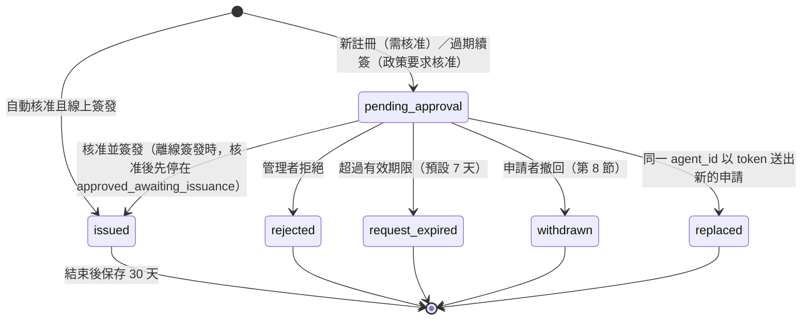
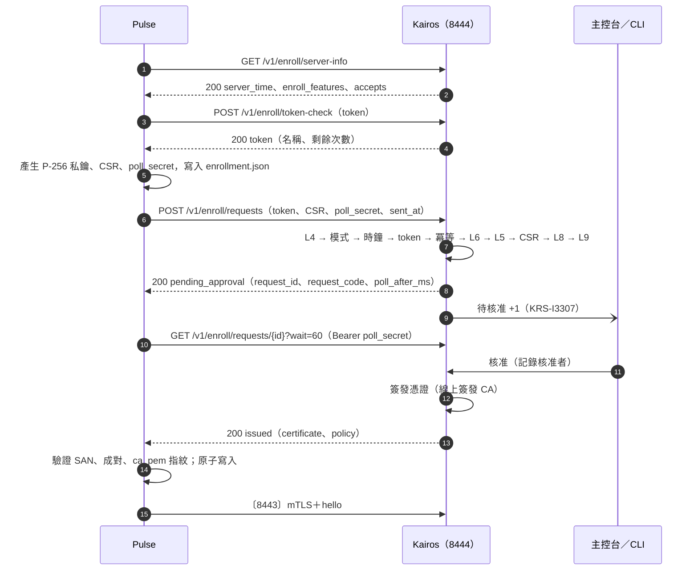
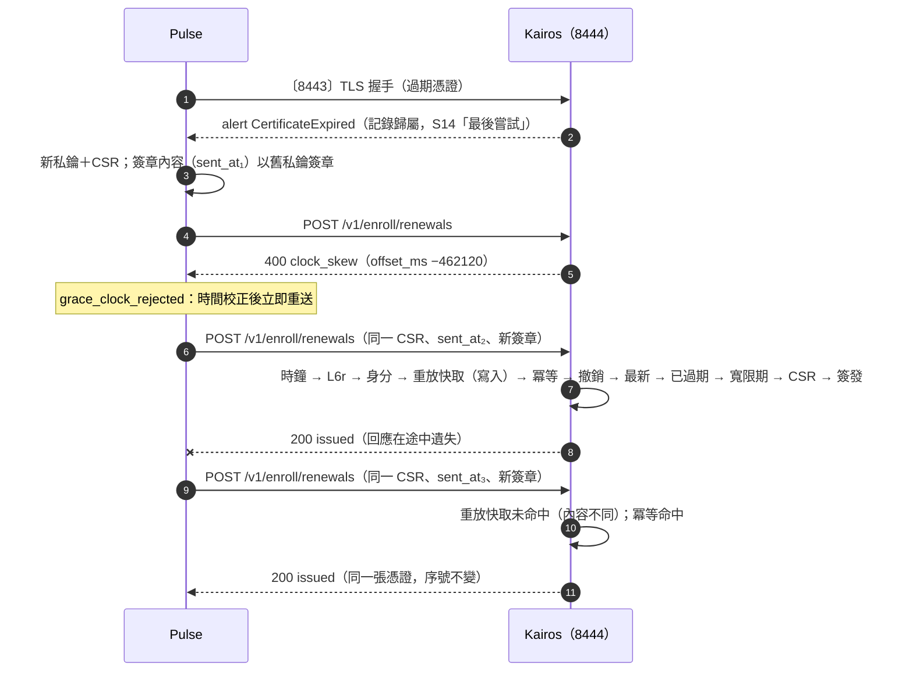
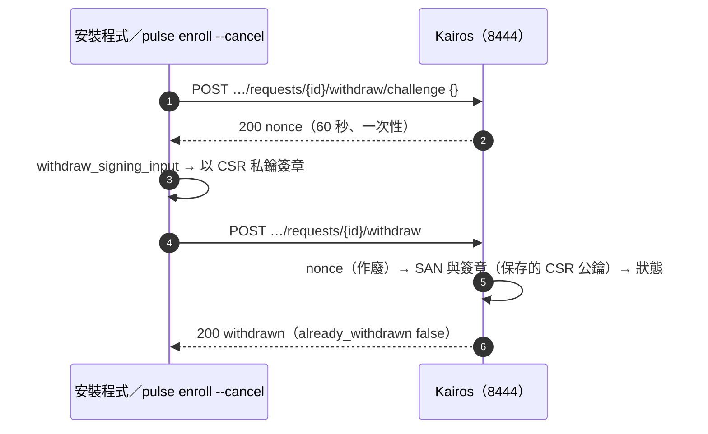

# 註冊通道（8444）協定 v1

本文件是 Pulse ↔ Kairos **註冊通道**的唯一規格，位於 monorepo 的 `crates/kairos-proto/ENROLL.md`，與 agent 長連線的 [`PROTOCOL.md`](PROTOCOL.md) 並列。兩邊共用的型別與純函式在 `kairos-proto` 的 `enroll` 模組；該模組的單元測試以 `include_str!` 讀入本文件，從「範例」節解析每一則請求與回應、從「錯誤碼」節比對對照表、從「測試向量」節比對簽章內容與雜湊。改協定時改這裡與 `enroll` 模組即可。

- 狀態：**衝刺 4 規格（0.5.0〔草稿〕）**。共用型別已完成；Kairos 端與 Pulse 端尚未實作（分工見第 19 節）。
- Kairos 內部的 PKI、簽發、資料表見 [`kairos/PKI.md`](../../kairos/PKI.md)；主控台的管理端點與 CLI 見 [`kairos/API.md`](../../kairos/API.md) 第 11 節。
- 設計依據（設計包，唯讀）：`pulse/enrollment-ux.md` §3～§12、`kairos/screens.md` S12～S15 與 §24 #6、#7、#16、#20、#21、#23、`decisions/enroll-rate-limit.md`（D7）、`decisions/enroll-pause.md`（D8、D10、D11）、`decisions/naming.md`、`decisions/INTEGRATION.md` §2、§17、§18、§23、§24、`design-system/copywriting.md` §3.3、§3.4。本文件與設計包不同之處列在第 17 節，**以本文件為準**。

## 1. 總覽

三個連接埠各有分工（設計包 D1、D4）：

| 連接埠（預設） | 用途 | TLS | 身分 | 本文件涵蓋 |
|---|---|---|---|---|
| `8443` | agent 長連線（NDJSON） | mTLS 必要 | 用戶端憑證（SAN＝`agent_id`） | 只有第 13 節的兩個新 feature：正常輪替 `renew`、除役 `deregister` |
| `8444` | **註冊通道**（HTTPS、JSON） | 只做伺服器端 TLS | 註冊 token、輪詢憑據、CSR 私鑰或舊私鑰的簽章 | 全部 |
| `9443` | 主控台 API | 伺服器端 TLS | API token（之後加上使用者工作階段） | 不在本文件（`kairos/API.md`） |

8444 只做「交付 CSR、取回憑證」與相關的查詢：

1. 新主機以 token 送出 CSR（新註冊），自動核准時當場取得憑證，否則等管理者核准後以輪詢取回。
2. 已過期、但仍在**過期寬限期**內的主機，以舊私鑰簽章送出新 CSR（過期續簽）；過期的憑證無法完成 8443 的 mTLS 握手，所以只能走 8444。
3. 等待核准中被完全移除的主機，以 CSR 私鑰簽章撤回申請。

**正常輪替（憑證仍有效）走 8443**（第 13.1 節），不經 8444，因此註冊端點的模式不影響已註冊主機的自動輪替；**除役通知也走 8443**（第 13.2 節）。私鑰只在 agent 主機產生、永不離開；Kairos 只簽發 SAN 為 `DNS:<agent_id>` 的用戶端憑證，8443 的身分驗證（PROTOCOL.md「身分驗證」）不變。

## 2. 傳輸

| 項目 | 規則 |
|---|---|
| 協定 | HTTPS：TLS 1.2／1.3（rustls＋ring），**只有 HTTP/1.1**（ALPN `http/1.1`；不提供 HTTP/2 與明文 HTTP） |
| 監聽 | `enroll.listen`（空字串＝與 `server.listen` 同一個 IP、連接埠 8444）。模式為「關閉」時**不監聽**，切回時重新監聽，不必重新啟動（第 10 節） |
| 伺服器憑證 | `enroll.cert_path`／`enroll.key_path`，空字串時沿用 `server.cert_path`／`key_path`（設計包 `naming.md` §4.3 的保留名稱）。8444 送出的憑證鏈**必須包含安裝字串中 CA 指紋對應的 CA 憑證**：設定檔的鏈沒有時，Kairos 在 8444 上把 `pki.server_ca_path` 的 CA 憑證接在鏈尾（8443 不受影響）。Pulse 首次連線時還沒有 `ca.pem`，只能在鏈中找到指紋相符的 CA（第 3 節） |
| 用戶端憑證 | 不要求、不檢查（`KRS-E0301` 只檢查 8443） |
| 請求 | `POST` 的本文為 UTF-8 JSON 物件，`Content-Type: application/json`（可帶 `; charset=utf-8`，其他 415 `unsupported_media_type`）；必須帶 `Content-Length`（不接受 chunked，400 `bad_request`，`field` 為 `content-length`），上限 **65,536 bytes**（`enroll.max_body_bytes`，超過 413 `payload_too_large`）。`GET` 不得帶本文 |
| 回應 | JSON（UTF-8），`Cache-Control: no-store`。**每個回應**（含錯誤）的最外層都有 `server_time`（第 9 節）。429、503 另帶 `Retry-After`（整數秒） |
| 路徑 | 註冊 API 一律以 `/v1/enroll/` 開頭（第 4 節）；下載為 `/agent/<檔名>`。不在白名單的路徑 404 `not_found`，方法不符 405 `method_not_allowed`（附 `Allow`）。不接受結尾的 `/`、重複的 `/` 與百分比編碼 |
| 來源位址 | 一律以 socket 的對端位址計算（IPv6 以 /64 合併，同 8443），**不信任** `X-Forwarded-For` 等標頭。回應中的 `observed_ip` 就是這個位址 |
| keep-alive | 支援。Pulse 在同一條連線上依序送 `server-info`、`token-check`、新註冊（設計包 D7：新連線數由約 5 降到 2～3） |
| 版本 | 路徑前綴的 `v1`。同一版本內只新增欄位與端點；讀取端忽略不認得的欄位。**新增列舉值**（`state`、`kind`、錯誤碼等）前必須先在 `server-info` 的 `enroll_features` 宣告、並由 client 以請求欄位表明支援，否則舊 client 會整則解析失敗。不相容的變更改用 `/v2/enroll/` |

**逾時**

| 角色 | 項目 | 數值 |
|---|---|---|
| Kairos | TLS 握手（沿用 `timeouts.handshake_secs`） | 5 秒 |
| Kairos | 讀完請求標頭（`enroll.header_timeout_secs`） | 10 秒 |
| Kairos | keep-alive 閒置（`enroll.idle_timeout_secs`） | 15 秒 |
| Kairos | 處理一個請求（讀完本文到送出回應；長輪詢另加 `wait` 秒） | 5 秒 |
| Pulse | TCP 連線 | 5 秒 |
| Pulse | TLS 握手 | 10 秒 |
| Pulse | 等待回應（長輪詢為 `wait` ＋ 15 秒） | 15 秒 |
| Pulse | 撤回申請（第 8 節）整體 | 15 秒（設計包 §5.11） |

連線層的限制（L1～L3，第 11 節）在 TLS 握手前直接關閉 TCP，Pulse 視為 `PLS-E2201`（在 8444 上可重試）。

## 3. Pulse 如何信任 Kairos

設計包 `enrollment-ux.md` §6。Pulse 在 8444 上只信任下列其中一種來源，**絕不**使用作業系統信任庫：

| 情況 | 驗證方式 | `server_verification` |
|---|---|---|
| 有 CA 指紋（安裝字串的 `p`、`--ca-pin`） | 見下方演算法；相符後把該 CA 存成 `identity/ca.pem` | `ca_pin` |
| 有 `--ca-file`，或已有 `identity/ca.pem`（輪詢、撤回、過期續簽） | 以該檔為唯一的信任錨，照常驗證鏈與名稱 | `ca_file` |
| 都沒有，互動模式 | 顯示鏈中 CA 的指紋請人工比對（TOFU）；確認後同 `ca_pin` 的處理 | `tofu` |
| 都沒有，非互動模式 | 中止 `PLS-E1406`；指定 `--trust-on-first-use`（MSI `ALLOW_TOFU=1`）時同互動模式的 TOFU，結果檔標註「未驗證伺服器身分」（`PLS-W1407`） | `tofu` |

**CA 指紋的驗證演算法**（首次連線，還沒有 `ca.pem`）：

1. 完成 TLS 握手，取得伺服器送出的整條憑證鏈。
2. 在鏈中找出 SPKI 的 SHA-256 等於指紋的憑證（第 14.4 節）；它必須是 CA 憑證（`basicConstraints` CA:TRUE）。找不到時中止 `PLS-E1406`（不送出任何請求，包括 token）。
3. 以**這一張 CA 為唯一的信任錨**，照常以 webpki 驗證伺服器憑證：鏈的簽章、有效期間、EKU `serverAuth`、名稱＝註冊端點的 TLS 名稱（`naming.md` §4.2 的推導規則）。任一項失敗依原本的代碼（`PLS-E1401`～`E1405`）中止。
4. 通過後才送出請求；`issued` 時把這張 CA 寫入 `identity/ca.pem`。

`issued` 回應中的 `certificate.ca_pem`（Kairos 告訴 Pulse 往後在 8443 要信任的 CA）的 SPKI 必須等於指紋或既有 `ca.pem` 的 SPKI，否則中止（`PLS-E1406`，防止中途替換），已取得的憑證不寫入。

**本機時鐘偏差很大時**（設計包 `INTEGRATION.md` §24.7 #5）：本機時鐘與實際相差數天時，第 3 步可能因伺服器憑證「已過期／尚未生效」（`PLS-E1403`）而失敗，Pulse 就拿不到 `server_time`、無法說明是時鐘的問題。處置：**只有在 `PLS-E1403`、且其他檢查（鏈的簽章、信任錨、名稱、EKU）都通過時**，Pulse 可以「忽略有效期間」再驗證一次，只送 `GET /v1/enroll/server-info`，把回應的 `server_time` 當成**未驗證的參考時間**用於錯誤訊息（「本機時間 2026-03-01、Kairos 回報 2026-10-11，請校正時鐘」），`pulse status --json` 的 `clock.source` 為 `server_info_unverified`、`valid: false`（不用於到期判定）。這條連線上不送出 token、CSR、簽章或任何其他請求；其他錯誤（簽章、名稱、信任錨）一律不放寬。

## 4. 端點一覽

所有路徑相對於 `https://<註冊端點>`。「計數」為速率限制的類別（第 11 節）。

| 方法與路徑 | 訊息（設計包用語） | 授權 | 受理的模式 | 計數 | 冪等 |
|---|---|---|---|---|---|
| `GET /v1/enroll/server-info` | `server_info` | 無 | 開放、自動暫停中、僅續簽 | 新註冊類（L4） | 是（唯讀） |
| `POST /v1/enroll/token-check` | `token_check` | token（不消耗次數） | 開放 | 新註冊類（L4、L7） | 是（唯讀） |
| `POST /v1/enroll/requests` | `enroll_request`（新註冊） | token | 開放 | 新註冊類（L4～L9） | 是：同一 `agent_id`＋同一 CSR＋同一 `poll_secret` 回傳同一筆申請（第 6.3 節） |
| `GET /v1/enroll/requests/{request_id}` | `enroll_poll`、`enroll_result`（取回憑證） | `Authorization: Bearer <poll_secret>` | 開放、自動暫停中、僅續簽 | 每筆申請（L10） | 是（唯讀） |
| `POST /v1/enroll/renewals` | 過期續簽（設計包稱「以舊私鑰簽名、不帶 token 的 `enroll_request`」） | 舊私鑰簽章＋主機指紋 | 開放、自動暫停中、僅續簽 | 續簽類（L4r、L6r、L7 續簽、L8、L9） | 是：同一 `agent_id`＋同一 CSR 回傳同一張憑證，不重複簽發（第 7.4 節） |
| `POST /v1/enroll/requests/{request_id}/withdraw/challenge` | `enroll_withdraw` 第 1 步 | 無（只發 nonce） | 開放、自動暫停中、僅續簽 | 每筆申請（L10） | 每次發新的 nonce，作廢舊的 |
| `POST /v1/enroll/requests/{request_id}/withdraw` | `enroll_withdraw` 第 2 步 | CSR 私鑰對 nonce 的簽章 | 開放、自動暫停中、僅續簽 | 每筆申請（L10）；簽章不符計入 L7 續簽類 | 是：已撤回時回 `already_withdrawn: true` |
| `GET /agent/<檔名>` | 安裝腳本、agent 套件 | 無 | 開放 | 下載（L11） | 是 |

`request_id` 是 Kairos 產生的 UUID（不是秘密），一律以小寫輸出；路徑中大小寫皆可。給人以電話核對的**申請編號** `request_code`（`XXXX-XXXX`）由公鑰衍生、不保證唯一，**不當作路徑**（第 14.3 節）。

## 5. 回應與錯誤的格式

**成功**：HTTP 200，本文是一個 JSON 物件，`server_time` 與各端點的欄位並列在最外層（沒有 `data` 包裝；主控台 API 才有）。

**錯誤**：4xx／5xx，本文固定為

```json
{"server_time":"2026-10-11T02:20:47.120Z","error":{"code":"clock_skew","message":"client clock differs from server by more than 300 s","client_time":"2026-10-11T02:13:05.000Z","offset_ms":-462120,"max_skew_ms":300000}}
```

- `error.code`：snake_case 的機器代碼，**程式只依它判斷**；`message` 是給開發者看的英文說明，不保證固定。
- 錯誤碼的附加欄位（`scope`、`retry_after_ms`、`client_time` 等）一律放在 `error` 物件**之內**（設計包 §24 #23 (d) 的範例把 `clock_skew` 的欄位放在外層，本規格統一放在內層，見第 17 節）。
- 404／405 且本文不是上述格式（例如沒有 8444 的舊版 Kairos、或中間設備的回應）時，Pulse 視為「Kairos 不支援自動註冊」（`PLS-E2106`），撤回時為 `PLS-W3310`（`reason: unsupported`）。
- 本文無法解析、或 HTTP 狀態碼與 `error.code` 對不上（見下表）時，Pulse 以 `PLS-W2107`（Kairos 回應不合預期）處理，`details.protocol_code` 帶原始代碼。

## 6. 新註冊

### 6.1 `GET /v1/enroll/server-info`

preflight PF05～PF07 與過期判定（設計包 §8.1 (d)）使用。不判定時鐘，不消耗任何資源。

| 欄位 | 型別 | 說明 |
|---|---|---|
| `server_time` | string | 第 9 節 |
| `kairos_version` | string | 例 `0.5.0` |
| `enroll_api` | string[] | 支援的註冊 API 版本，v1 為 `["v1"]` |
| `enroll_features` | string[] | 註冊 API 的選用功能：`withdraw`（第 8 節）、`grace_renew`（第 7 節）、`long_poll`（`wait` 參數，第 6.4 節）。不認得的名稱忽略 |
| `proto_min`、`proto_max` | u32 | 8443 支援的協定版本範圍（PROTOCOL.md「版本協商」），PF07 在註冊前判斷相容性 |
| `features` | string[] | 8443 的 features（與 `hello_ack.features` 同一份），例如 `renew`、`deregister`（第 13 節） |
| `accepts.new_enrollment` | bool | 目前受理新註冊（模式為開放且沒有自動暫停）。自動暫停與僅續簽同為 `false`，不透露有沒有有效 token |
| `accepts.grace_renewal` | bool | 目前受理過期續簽（模式不是關閉，且過期寬限期政策大於 0） |
| `observed_ip` | string | Kairos 看到的來源位址 |

Pulse 端：404／405（非本規格的錯誤本文）→ `server_unsupported`（`PLS-E2106`）；`enroll_api` 不含 `v1` → 同上；`accepts.new_enrollment` 為 `false` 時 `pulse enroll` 不送 token，直接顯示 `PLS-E2008`。

### 6.2 `POST /v1/enroll/token-check`

preflight PF09 與 MSI 精靈的 token 頁使用；**不消耗使用次數、不建立申請**。

請求：`token`（必填）、`sent_at`（選填，只檢查格式、不判定時鐘）、`pulse_version`（選填）。

回應 200：`token` 物件——`name`、`approval`（`manual`／`auto`）、`expires_at`、`remaining_uses`（u32）、`default_tags`（選填）、`source_allowed`（選填：token 有限定來源網段時，`observed_ip` 是否在其中）；另有 `observed_ip`。

無效、已停用、不存在一律 403 `token_invalid`（對外不區分，避免探測；**計入 L7**）；已過期 403 `token_expired`（附 `expired_at`）；已用完 403 `token_exhausted`（後兩者是已知的值，不計入 L7）。模式不受理 403 `enroll_not_accepted`。Kairos 以 token 的雜湊查表（第 14.2 節），不做逐字比較。

### 6.3 `POST /v1/enroll/requests`

**請求欄位**

| 欄位 | 必填 | 限制 |
|---|---|---|
| `token` | 是 | 第 14.2 節的格式與檢查碼 |
| `agent_id` | 是 | UUID 文字格式（不分大小寫，Kairos 轉小寫） |
| `csr` | 是 | PKCS#10 CSR 的 DER，base64url 不加 `=`（第 14.1 節），1～4,096 bytes；內容要求見第 15.1 節 |
| `poll_secret` | 是 | **Pulse 產生**的 32 bytes 隨機值（作業系統的 CSPRNG），base64url（43 個字元）。Kairos 只保存 SHA-256；之後以它輪詢與取回憑證。送出前先寫入 `enrollment.json`，重送時沿用 |
| `sent_at` | 是 | Pulse 送出時的本機時間，RFC 3339（第 9 節）；每次送出都重新取值 |
| `hostname` | 是 | 1～255 bytes，字元限制同 PROTOCOL.md 的 `hostname` |
| `pulse_version` | 是 | 1～64 bytes，字元限制同上 |
| `server_verification` | 是 | `ca_pin`／`ca_file`／`tofu`（第 3 節）；`tofu` 時主控台標示「未驗證伺服器身分」 |
| `display_name`、`tags`、`host_fingerprint`、`os` | 否 | 限制同 PROTOCOL.md 的 v2 hello（「`hello` 欄位限制」）；`host_fingerprint` 讀得到機器 ID 時一律送出 |
| `previous_serial` | 否 | 重新註冊時前一張憑證的序號（大寫十六進位，1～40 字元；設計包 §5.7）。只供主控台標示，不作為授權 |

**Kairos 的判定順序**（前一步拒絕的請求不扣後面各層的額度；設計包 `enroll-rate-limit.md` §4.1 與 §24 #23 (c) 合併）

| # | 檢查 | 不通過時 |
|---|---|---|
| 1 | L7（新註冊類）封鎖中 | 429 `source_blocked`（`scope: blocked`） |
| 2 | L4 每 IP 新註冊類 | 429 `rate_limited`（`scope: ip`） |
| 3 | 模式白名單（第 10 節） | 403 `enroll_not_accepted`（已扣 L4、不計入 L7） |
| 4 | 本文格式（`validate_enroll_request`） | 400 `bad_request`（`field`） |
| 5 | **時鐘**：`|收到請求標頭的時間 − sent_at|` > 300,000 ms | 400 `clock_skew`（不消耗 token、不建立申請、不計入 L5～L7） |
| 6 | token：不存在或已停用；`allowed_agent_ids` 不含此 `agent_id`；自動核准的 token 而來源不在限定網段 | 403 `token_invalid`（只有「不存在或已停用」計入 L7，相異值＝token 雜湊） |
| 6′ | token 已過期／已用完 | 403 `token_expired`（`expired_at`）／`token_exhausted` |
| 7 | **冪等**：同一 `agent_id`＋同一 CSR（DER 的 SHA-256）已有申請 | `poll_secret` 雜湊相同 → 200 回傳那一筆申請目前的狀態（不再計入後續各層、不消耗次數）；不同 → 409 `request_conflict` |
| 8 | L6 每 `agent_id` | 429 `rate_limited`（`scope: agent`） |
| 9 | L5 每 token、L5b 網段外（需核准的 token） | 429 `rate_limited`（`scope: token`） |
| 10 | CSR 內容（第 15.1 節） | 400 `invalid_csr`（`field: csr`；不消耗次數） |
| 11 | L8 全域申請速率 | 503 `enroll_busy`（`scope: global`） |
| 12 | 結果會是待核准時：L9 佇列上限 | 503 `pending_queue_full`（`Retry-After: 3600`） |
| 13 | 自動核准的 token 且核准後會超過授權節點數 | 403 `license_exhausted`（不消耗次數；需核准的 token 改為建立申請並加「超出授權」旗標） |
| 14 | 建立申請：token 使用次數 +1；同一 `agent_id` 若有其他**待核准**的新註冊申請，舊的改為 `replaced`（主控台稽核）；計算異常旗標（設計包 S13） | — |
| 15 | 自動核准：線上簽發（`kairos/PKI.md`）→ `issued`；簽發金鑰離線保存時為 `pending_approval`＋`approved_awaiting_issuance` | — |

**回應 200**：`EnrollResult`（第 6.5 節）。`state` 為 `issued`（自動核准且已簽發）或 `pending_approval`。

**Pulse 的處理**：429／503 依 `Retry-After × U(1.0, 1.2) + U(0, 2 秒)` 排隊重送（絕不早於伺服器指定的時間；`PLS-E2202`、`PLS-E3005`、`PLS-E3309`），網路錯誤 2 秒起倍增、上限 5 分鐘；**重送時沿用同一把私鑰、同一個 CSR、同一個 `poll_secret`**，只更新 `sent_at`。所以回應遺失也不會產生第二筆申請（第 7 步）。`token_*` 與 `enroll_not_accepted` 停止重試（結束代碼 6）。

### 6.4 `GET /v1/enroll/requests/{request_id}`：輪詢與取回憑證

- 標頭 `Authorization: Bearer <poll_secret>`（scheme 不分大小寫）。缺少、格式錯誤或不符時 404 `request_not_found`（與申請不存在相同，不透露申請是否存在），以出示的值的雜湊計入 L7（依申請的種類分類；申請不存在時計入新註冊類）。比較雜湊時用常數時間。
- 查詢參數 `wait`（選填）：長輪詢秒數 0～60（伺服器宣告 `long_poll` 時才可使用；不合法 400 `bad_request`，`field: wait`）。申請為 `pending_approval` 且有長輪詢名額（每 IP 32、全域 1,000）時，Kairos 保持連線直到狀態改變或 `wait` 秒到期；名額用完時立即回應（附 `poll_after_ms`），不算錯誤。
- L10：同一筆申請兩次輪詢至少間隔 10 秒，可連續 3 次（服務重新啟動、接續）；太頻繁 429（`scope: request`）。撤回的兩個請求也計入同一個額度。
- 回應：`EnrollResult`。`issued` 時含完整的憑證，**取回憑證就是輪詢**：同一筆申請在保存期間（結束後 30 天，設計包 S13「最近結束」）內每次輪詢都回同一張憑證，回應遺失可以再取一次；Kairos 記錄第一次交付的時間（`delivered_at`）。
- 申請已超過保存期限而被清除：404 `request_not_found`。Pulse 視同 `request_expired`（`PLS-E3303`，需 `pulse enroll --force`）。

**動態 `poll_after_ms`**（設計包 §9、L10）：`max(30,000, 同一來源待核准筆數 ÷ 5 × 1,000)`，上限 900,000。Pulse 第一次依 `poll_after_ms`，之後每次 ×1.5、上限 5 分鐘，±20% 抖動，且**不早於** Kairos 最近一次給的 `poll_after_ms`；`next_poll_at` 寫入 `enrollment.json`，服務啟動後依它恢復，不立即輪詢。

### 6.5 `EnrollResult`

新註冊、過期續簽與輪詢共用的回應。

| 欄位 | 出現於 | 說明 |
|---|---|---|
| `server_time` | 一律 | |
| `request_id` | 一律 | UUID（小寫） |
| `request_code` | 一律 | `XXXX-XXXX`（第 14.3 節） |
| `kind` | 一律 | `enroll`（新註冊）／`grace_renewal`（過期續簽） |
| `state` | 一律 | `pending_approval`／`issued`／`rejected`／`request_expired`／`withdrawn`／`replaced`（第 12 節） |
| `agent_id` | 一律 | 小寫 |
| `expires_at` | `pending_approval` | 申請的有效期限（預設送出後 7 天，Kairos 政策） |
| `poll_after_ms` | `pending_approval` | 下次輪詢前至少等待的毫秒數 |
| `approval_detail` | `pending_approval` | `awaiting_approval`（等管理者）／`approved_awaiting_issuance`（已核准，簽發金鑰離線或暫時無法簽發） |
| `certificate` | `issued` | `serial`（大寫十六進位）、`not_before`、`not_after`、`client_cert_pem`（一張）、`chain_pem`（簽發 CA 到信任錨之間的中繼憑證，可為空字串）、`ca_pem`（Pulse 往後在 8443 驗證 Kairos 用的 CA，第 3 節） |
| `policy` | `issued` | `cert_lifetime_days`、`renew_before_days`、`expired_renew_grace_days`（Pulse 快取到 `enrollment.json` 的 `grace_days`） |
| `decided_at`、`decided_by` | `issued`、`rejected` | 核准或拒絕的時間與執行者（主控台帳號、`auto`＝token 免審核、`system`＝過期續簽自動核准） |
| `reject_reason` | `rejected` | 管理者填寫的原因（設計包 §5.3：「非本單位主機」） |
| `observed_ip` | 選填 | |

**Pulse 寫入憑證**（設計包 §7）：`client.pem` ＝ `client_cert_pem` 接上 `chain_pem`；寫入前確認 SAN 為 `DNS:<agent_id>`、與私鑰成對、`ca_pem` 的 SPKI 與指紋或既有 `ca.pem` 相同；先寫 `.tmp` 並 fsync 再 rename。之後以新憑證連 8443（`hello`），成功後才算 `registered`。

## 7. 過期寬限期續簽：`POST /v1/enroll/renewals`

設計包 §5.9、§5.13、§5.14、§8，§24 #16 (g)、#23 (c)(e)。用戶端憑證已過期（8443 握手被 Kairos 以 `CertificateExpired` 拒絕，或依校正後的時間判定過期，設計包 §8.1），且仍在過期寬限期內的主機，以**舊私鑰**證明身分、送出新私鑰的 CSR。

### 7.1 請求欄位

| 欄位 | 限制 |
|---|---|
| `agent_id` | UUID |
| `csr` | 新私鑰的 CSR（同第 6.3 節）。新私鑰必須與舊私鑰不同 |
| `poll_secret` | 同第 6.3 節（政策要求人工核准時用來輪詢） |
| `sent_at` | RFC 3339；**每次送出都重新取值並重新簽章**，同一個 `agent_id` 最近 10 分鐘內送出過的值不再使用（本機時間沒有前進時以「最近一次＋1 毫秒」，記在 `enrollment.json` 的 `grace_last_sent_at`） |
| `host_fingerprint` | 必填，主機指紋（PROTOCOL.md「主機指紋」） |
| `expired_certificate` | 已過期的用戶端憑證（DER，base64url，1～8,192 bytes） |
| `signature` | 以舊私鑰對第 16.2 節簽章內容的 ECDSA 簽章（ASN.1 DER，base64url） |
| `signature_alg` | 固定 `ecdsa-p256-sha256`。舊憑證不是 P-256 金鑰（例如手動以 RSA 簽發的舊憑證）的主機不適用過期續簽，需以 token 重新註冊 |
| `hostname`、`pulse_version` | 同第 6.3 節 |

`sent_at` 為必填：本規格是第一個實作過期續簽的版本，沒有「舊版 Pulse 不帶 `sent_at`」的情況，因此不提供設計包 §24 #23 (b) 的舊版相容路徑（第 17 節）。

### 7.2 判定順序

依設計包 `INTEGRATION.md` §23.6 的順序；前一步拒絕的請求不扣後面各層的額度。

| # | 檢查 | 不通過時 |
|---|---|---|
| 1 | L7（續簽類）封鎖中 | 429 `source_blocked` |
| 2 | L4r 每 IP 續簽類 | 429 `rate_limited`（`scope: ip`） |
| 3 | 模式不是關閉（關閉時不監聽） | — |
| 4 | 本文格式（`validate_grace_renew_request`） | 400 `bad_request` |
| 5 | **時鐘**（同第 6.3 節第 5 步） | 400 `clock_skew`（不計入 L6r、L7；不改變寬限期狀態，寬限期依 Kairos 的時間照常倒數） |
| 6 | L6r 每 `agent_id` 每小時 10 次 | 429 `rate_limited`（`scope: agent`） |
| 7 | **身分**：`expired_certificate` 以目前任一信任錨（`auth.client_ca` 與 Kairos 的簽發 CA）驗證鏈的簽章（**忽略有效期間**）、SAN 恰好一個且等於 `agent_id`、公鑰為 P-256；以該憑證的公鑰、對 Kairos 每一個註冊端點名稱（第 16.3 節）組出的簽章內容驗證 `signature`，任一個通過即可；`host_fingerprint` 等於清冊中這台主機最後已知的指紋（清冊沒有指紋時視為不符） | 403 `renew_identity_mismatch`（計入 L7 續簽類，相異值＝`agent_id`） |
| 8 | **重放快取**：簽章內容的 SHA-256（第 16.4 節）在 10 分鐘內出現過 | 400 `replayed_request`（計入 L7 續簽類，相異值＝內容雜湊）。通過第 7 步的請求一律寫入快取（不論後面的結果），快取**持久化**（第 18 節第 2 項） |
| 9 | **冪等**：同一 `agent_id`＋同一 CSR 已有過期續簽申請 | 已簽發、且那張憑證仍是這台主機最新、未撤銷的憑證 → 200 回傳**同一張憑證**（不重新簽發；設計包 `INTEGRATION.md` §23.9，第 7.4 節）；待核准 → 200 回傳那一筆申請（`poll_secret` 更新為這次的值） |
| 10 | 舊憑證已撤銷，或主機已除役 | 403 `certificate_revoked` |
| 11 | 舊憑證不是這台主機**最新**簽發的憑證（已被正常輪替或重新註冊取代） | 403 `renew_identity_mismatch`（防止以外洩的舊私鑰換到新憑證） |
| 12 | 舊憑證尚未過期（依 Kairos 的時間） | 409 `certificate_not_expired`：Pulse 回到 8443 以這張憑證連線（本機時鐘偏快的情況，設計包 §8.1） |
| 13 | **寬限期**：`收到時間 > not_after + 寬限天數`，且沒有 `grace_override_until` 或已超過它；寬限期政策為 0 時一律超過 | 403 `renew_grace_exceeded`（附 `grace_ended_at`） |
| 14 | CSR 內容（第 15.1 節）；新公鑰與舊公鑰相同 | 400 `invalid_csr` |
| 15 | L8 全域申請速率 | 503 `enroll_busy` |
| 16 | 憑證政策「輪替需人工核准」為是 → 建立待核准申請（L9：503 `pending_queue_full`；主控台類型「過期續簽」）；否則簽發 | 200 `pending_approval`（`grace_pending`）或 `issued`（`decided_by: system`） |

寬限期內的主機已計入授權節點數（設計包 D24），所以不做授權檢查。

### 7.3 Pulse 的處理

| 收到 | 處理 |
|---|---|
| 200 `issued` | 原子寫入新的 `client.pem`／`client.key`，以 8443 連線；`policy.expired_renew_grace_days` 更新快取 |
| 200 `pending_approval` | `grace_pending`，依第 6.4 節輪詢 |
| 400 `clock_skew` | `grace_clock_rejected`（`PLS-E8302`）：保留新私鑰與 CSR，每 5 分鐘（±20%）以新的 `sent_at` 與簽章重送；偵測到本機時間被調整時立即重送 |
| 400 `replayed_request` | 立即以新的 `sent_at` 重新簽章、重送**一次**；仍是 `replayed_request` 時記 `PLS-W2107`，依一般錯誤的退避（2 → 60 分鐘）再試 |
| 403 `renew_grace_exceeded` | `grace_exceeded`（`PLS-E1113`），每 6 小時重試 |
| 403 `renew_identity_mismatch` | `grace_rejected`（`PLS-E1114`），停止（服務重新啟動時再試一次） |
| 403 `certificate_revoked` | `revoked`（`PLS-E1105`） |
| 409 `certificate_not_expired` | 回到 `registered`，以舊憑證連 8443（並由 `hello_ack.server_time` 取得時鐘偏差） |
| 429／503 | 依 `Retry-After`，不少於目前的退避值，**不重設**退避（設計包 §8） |
| 連線被拒（多半是模式為關閉） | `grace_blocked`（`PLS-E2007`）：2 → 60 分鐘退避，每輪失敗後對 8443 出示過期憑證「報到」一次 |

### 7.4 同一個 CSR 的重送（設計包 `INTEGRATION.md` §23.9，本規格正式定案）

Kairos 已簽發、但回應在途中遺失時，Pulse 會以**同一個 CSR**、新的 `sent_at` 與新的簽章重送。重放快取的鍵包含 `sent_at`，所以不會擋下它；第 7.2 節第 9 步以 (`agent_id`, CSR 的 SHA-256) 找到先前的結果，**回傳同一張憑證，不重新簽發**，S14 也不會出現兩張。條件是那張憑證仍是這台主機最新、未撤銷的憑證（設計包建議的「10 分鐘內」放寬為這個條件：在這個條件下回傳同一張憑證總是正確的，而超過 10 分鐘才重送的情況同樣需要冪等）。這次重送仍計入 L4r 與 L6r。

新註冊（第 6.3 節第 7 步）與 8443 的正常輪替（第 13.1 節）採同一個原則：**同一個 CSR 只會得到一張憑證**。

## 8. 撤回待核准的申請

設計包 §5.11、§24 #21。等待核准中被完全移除（或 `pulse enroll --cancel`）的主機，以申請時 CSR 的私鑰對 Kairos 發出的一次性 nonce 簽章，證明自己就是申請者。不使用 `poll_secret`（它是可被複製的持有者憑據，設計包 §10）。

### 8.1 `POST /v1/enroll/requests/{request_id}/withdraw/challenge`

本文為空物件 `{}`（其他欄位忽略）。

| 申請狀態 | 回應 |
|---|---|
| `pending_approval`、`withdrawn`（讓重送得到 `already_withdrawn`）、`issued`（見下方） | 200：`request_id`、`nonce`（32 bytes 隨機值，base64url）、`nonce_expires_at`（60 秒後）。同一筆申請同時只有一個有效的 nonce，新的 challenge 作廢舊的 |
| `rejected`、`request_expired`、`replaced` | 409 `request_not_pending`（附 `state`），不發 nonce |
| 不存在或已超過保存期限 | 404 `request_not_found` |

### 8.2 `POST /v1/enroll/requests/{request_id}/withdraw`

| 欄位 | 限制 |
|---|---|
| `request_id` | 與路徑相同（不分大小寫） |
| `agent_id` | UUID |
| `nonce` | challenge 發出的原字串 |
| `signature`、`signature_alg` | 以 CSR 私鑰對第 16.1 節簽章內容的簽章；`ecdsa-p256-sha256` |
| `reason` | `uninstall_purge`／`enroll_cancelled` |
| `initiated_by` | `msi`／`install_script`／`package_manager`／`cli` |
| `hostname`、`pulse_version`、`sent_at` | 同第 6.3 節（`sent_at` 只記錄，不判定時鐘：nonce 已防重放） |
| `host_fingerprint` | 選填 |

**判定順序**：L10 → nonce 屬於這筆申請、未用過、未逾時（400 `nonce_invalid`／`nonce_expired`；**任何一次驗證嘗試都作廢 nonce**）→ `agent_id` 等於申請 CSR 的 SAN，並以**建立申請時保存的 CSR 公鑰**（不是請求帶來的任何東西）驗證簽章，簽章內容的最後一行接受 Kairos 的任一註冊端點名稱（403 `withdraw_signature_invalid`，兩者對外不細分；計入 L7 續簽類）→ 依狀態：

| 申請狀態 | 處理 |
|---|---|
| `pending_approval`（新註冊或過期續簽） | 改為 `withdrawn`，移出待核准佇列（釋出 L9 名額），**token 使用次數不退回**；200 `already_withdrawn: false` |
| `withdrawn` | 200 `already_withdrawn: true`（`withdrawn_at` 為第一次的時間） |
| `issued`（撤回前剛被核准、主機還沒取回） | **不變更**，409 `request_not_pending`（`state: issued`）；簽章已驗證，Kairos 在該主機加註「核准後、取回憑證前已被完全移除」並寫稽核（設計包 S05、#21 (e)） |
| `rejected`、`request_expired`、`replaced` | 409 `request_not_pending` |

回應 200：`request_id`、`request_code`、`state`（`withdrawn`）、`withdrawn_at`、`already_withdrawn`。

**Pulse 的處理**（設計包 §5.11 的錯誤表）：409 `request_not_pending`（`rejected`／`request_expired`／`replaced`）與 404 `request_not_found` 視為「不需撤回」；`state: issued` → `PLS-W3310`（`already_approved`）；`nonce_invalid`／`nonce_expired` 從 challenge 重來一次；`withdraw_signature_invalid` → `PLS-W3310`（`signature_rejected`）；連線失敗重試 1 次；整體 15 秒。失敗時本機照常清除。

## 9. 時間與時鐘檢查

- **`server_time`**：每個回應（含錯誤）的最外層，Kairos 產生回應時的系統時間，RFC 3339、**UTC**、`Z` 結尾、毫秒（`2026-10-11T18:13:05.123Z`）；與 8443 `hello_ack.server_time` 相同的格式（設計包 §24 #23 (a)）。Pulse 以它量測時鐘偏差（`offset_ms` ＝ 本機收到回應的時間 − `server_time`），不做網路延遲補償。
- **`sent_at`**：RFC 3339，必須含時區、日期與時間以大寫 `T` 分隔，最長 64 bytes（`parse_rfc3339_ms`）。Pulse 一律送 UTC 毫秒（`format_rfc3339_ms`）。
- **判定**（新註冊與過期續簽）：Kairos 以**收到請求標頭時**的系統時間比較，`|收到時間 − sent_at|` **超過** 300,000 ms 即 400 `clock_skew`（恰好 5 分鐘受理，`exceeds_clock_skew`）。附加欄位：`client_time`（回顯 `sent_at`）、`offset_ms`（`sent_at − 收到時間`，負值＝主機較慢；`clock_offset_ms`）、`max_skew_ms`（300000）。不帶 `Retry-After`：Pulse 依自己的規則每 5 分鐘重送。
- 時鐘被拒的請求：仍計入 L4／L4r（避免以偽造的 `sent_at` 繞過每 IP 限流）；**不**消耗 token、**不**計入 L5～L7、L6r、**不**建立申請、**不**改變寬限期狀態。Kairos 端記 `KRS-W8302` 的稽核與彙總資訊事件（規則見設計包 §24 #23 (f)(g)）。
- `server-info`、`token-check` 只回報時間，不判定時鐘。

## 10. 模式與請求白名單

設計包 D8、D10、D11、`decisions/enroll-pause.md` §2.3。`mode_decision` 實作此表。

| 請求 | 開放 | 開放 · 新註冊已自動暫停 | 僅續簽 | 關閉 |
|---|---|---|---|---|
| 監聽 8444 | 是 | 是 | 是 | **否**（連線被拒，Pulse `PLS-E2007`） |
| `server-info` | ✓ | ✓ | ✓ | — |
| `token-check`、新註冊 | ✓ | 403 `enroll_not_accepted` | 403 `enroll_not_accepted` | — |
| 下載 | ✓ | 403（純文字說明） | 403（純文字說明） | — |
| 輪詢（新註冊與過期續簽的申請） | ✓ | ✓ | ✓ | — |
| 過期續簽 | ✓ | ✓ | ✓（寬限期政策為 0 時一律 `renew_grace_exceeded`，Kairos 記 `KRS-W2011`） | — |
| 撤回 | ✓ | ✓ | ✓ | — |

- **自動暫停**：`enroll.mode = "open"` 且 `enroll.auto_pause_enabled = true`，連續 `enroll.auto_pause_after_hours`（預設 24，1～168）小時沒有**有效 token**（未停用、未過期、未用完）時，新註冊暫停；從最後一個有效 token 失效起算，切換到開放時若沒有任何有效 token 則從切換時起算。建立 token 時立即解除。暫停與解除都寫稽核並產生資訊事件。自動暫停與僅續簽對外回應**完全相同**。
- **模式變更立即生效**：改為關閉時停止接受新連線，進行中的請求（含長輪詢）在 5 秒內結束並關閉；改回時重新監聽。進行中的長輪詢在模式改為「僅續簽」時不中斷（輪詢在僅續簽仍受理）。
- **雙層預設**：設定檔沒有 `[enroll]`（或沒有 `mode`）時為 `closed`，啟動記錄一次 `KRS-I2010`；首次啟動精靈寫入 `open`＋`auto_pause_enabled = true`。主控台修改模式的保存位置見 `kairos/PKI.md` 第 8 節。

## 11. 速率限制

數字與鍵名依設計包 `decisions/enroll-rate-limit.md` 與 `INTEGRATION.md` §2.3（不在此重複預設值）。各端點對應的層：

| 層 | 適用 | 超過時 |
|---|---|---|
| L1 全域連線、L2 每 IP 同時連線、L3 硬上限 | 所有連線 | 握手前關閉（`PLS-E2201`，可重試） |
| L3 軟上限 | 所有請求 | 429 `rate_limited`（`scope: ip`） |
| L4 每 IP 新註冊類 | `server-info`、`token-check`、新註冊 | 429（`scope: ip`） |
| L4r 每 IP 續簽類 | 過期續簽 | 429（`scope: ip`） |
| L5、L5b 每 token | 新註冊 | 429（`scope: token`） |
| L6 每 `agent_id`（新註冊）、L6r（續簽，每小時 10 次） | 新註冊、過期續簽 | 429（`scope: agent`） |
| L7 相異無效值（新註冊類、續簽類分開計數與封鎖） | 新註冊類：不存在／停用的 token、錯誤的 `poll_secret`。續簽類：`renew_identity_mismatch`、`replayed_request`、`withdraw_signature_invalid`。`clock_skew` 一律不計 | 429 `source_blocked`（`scope: blocked`，`Retry-After` 為封鎖剩餘秒數） |
| L8 全域申請速率 | 新註冊、過期續簽 | 503 `enroll_busy`（`scope: global`） |
| L9 待核准佇列上限 | 結果為待核准的新註冊與過期續簽 | 503 `pending_queue_full`（`scope: global`，`Retry-After: 3600`） |
| L10 每筆申請 | 輪詢、撤回的兩個請求 | 429（`scope: request`）；長輪詢名額用完時不算錯誤 |
| L11 下載 | 下載 | 429（`scope: download`，`Retry-After: 15`） |

- **429／503 的回應**：`Retry-After` 標頭（整數秒，無條件進位）＋`error.retry_after_ms`（相同的時間）、`error.scope`、`error.observed_ip`。`Retry-After` 依排隊位置計算（GCRA，`enroll-rate-limit.md` §5.1），上限 600 秒（`enroll.retry_after_max_secs`；L7 封鎖與 L9 除外）。
- 只要回 429 或 503，就不會建立申請、不會消耗 token 次數、不會簽發憑證。
- 規則與 8443 的 `per_ip.rs` 相同：被前面某層拒絕的請求不扣後面各層的額度。
- 「批次部署來源」與 token 的「批次部署模式」（`enroll-rate-limit.md` §4.3）把 L2、L3、L4、L11 乘以 10；L5～L9 不變，L7 照常。

## 12. 申請的狀態機



| `state` | Pulse 端（設計包 §4） | 主控台（S13） |
|---|---|---|
| `pending_approval` | `pending_approval`（`PLS-I3307`）；過期續簽為 `grace_pending` | 待核准 |
| `issued` | `issued`（`PLS-I3308`）→ 連上 8443 後 `registered` | 已核准（成為主機） |
| `rejected` | `rejected`（`PLS-E3302`），刪除未使用的私鑰 | 最近結束：已拒絕 |
| `request_expired` | `request_expired`（`PLS-E3303`） | 最近結束：已逾期 |
| `withdrawn` | （本機已清除） | 最近結束：申請者已撤回 |
| `replaced` | 視同 `request_expired`（`PLS-E3303`）：同一台主機已送出較新的申請 | 最近結束：已被新申請取代 |

Pulse 端的完整狀態機（含 `clock_rejected`、`cert_expired` 的子狀態）以設計包 `enrollment-ux.md` §4.1 為準，本規格不重複。

**身分衝突與重新註冊**（設計包 §5.7、§5.8）：

- 同一 `agent_id` 已有有效憑證時，新的 token 申請照常受理，主控台標示「`agent_id` 已存在」；**自動核准的 token 在這種情況下也改為待核准**（避免以 token 取得另一台主機的身分）。核准時可選擇讓舊憑證在新憑證首次使用後撤銷（`superseded`）。
- 撤銷後重新註冊：一律需要新的 token（舊 token 若仍有效也可）；`previous_serial` 或清冊中同一 `agent_id` 有撤銷紀錄時標示「撤銷後重新申請」，建議人工核准。
- 複製的 VM（相同 `agent_id`、不同主機指紋）在 8443 的 `hello` 由既有的 `superseded` 規則與主機指紋比對偵測（PROTOCOL.md、`KRS-W3102`／`PLS-E3102`）；`pulse enroll --reset-identity` 產生新的 `agent_id` 後走一般的新註冊。8444 不另做判斷，只在申請帶的 `host_fingerprint` 與清冊中同一 `agent_id` 的指紋不同時加上異常旗標。

## 13. 8443 上的相關訊息（已移入 PROTOCOL.md）

正常輪替（feature `renew`）與除役通知（feature `deregister`）是 8443 的 NDJSON 訊息，0.5.0 實作時已依原計畫移入 [`PROTOCOL.md`](PROTOCOL.md)「憑證輪替與除役」，訊息型別在 `kairos-proto` 的 `lifecycle` 模組與 `ClientMsg`／`ServerMsg` 的對應變體。以下兩小節保留原本的編號供其他文件引用，內容以 PROTOCOL.md 為準。

### 13.1 正常輪替（feature `renew`）

見 PROTOCOL.md「憑證輪替與除役 › 正常輪替」：`renew_request`／`renew_result`、`hello_ack.expired_renew_grace_days`／`renew_now`、錯誤 `renew_requires_approval`／`invalid_csr`／`rate_limited`（非 fatal）、同一 CSR 只簽發一張、新序號第一次 `hello` 時以 `superseded` 撤銷舊憑證、每 `agent_id` 每小時 10 次。

### 13.2 除役通知（feature `deregister`）

見 PROTOCOL.md「憑證輪替與除役 › 除役通知」：`hello.intent: "deregister"`、`deregister`／`deregister_ack`、10 分鐘的重送保護（第 18 節第 1 項）。

## 14. 編碼與雜湊

### 14.1 base64url

RFC 4648 §5 的 base64url，**不加 `=`**。解碼一律嚴格：不接受 `=`、空白、`+`、`/`，最後一個字元未使用的位元必須為 0（同一份資料只有一種寫法）。例外：安裝字串解碼時容許結尾的 `=`（複製時常見）。函式：`b64url_encode`、`b64url_decode`。

### 14.2 註冊 token

設計包 §3.1。`KRT1-` 加 16 個 Crockford base32 字元（字母表 `0123456789ABCDEFGHJKMNPQRSTVWXYZ`）：前 15 個為秘密（75 位元），最後 1 個為檢查碼。

- **輸入正規化**：不分大小寫；`I`／`L` 視為 `1`、`O` 視為 `0`；連字號與空白可省略。正規寫法 `KRT1-XXXX-XXXX-XXXX-XXXX`。
- **檢查碼**：在 GF(2⁵)（既約多項式 x⁵＋x²＋1，α＝x 的階為 31）中計算 `c = Σ α^(i+1) · v_i`（i＝0～14，v_i 為第 i 個秘密字元的值），c 以字母表的第 c 個字元表示。權重是相異的非零元素，所以**任一個字元打錯、任兩個不同字元互換位置都一定會被發現**（Pulse 在本機以 `PLS-E3001` 攔下，不送到伺服器、不消耗嘗試次數）。函式：`token_check_symbol`、`EnrollToken::parse`。
- **產生**（Kairos）：10 bytes CSPRNG 隨機值的前 75 位元（`EnrollToken::from_random`）。
- **保存**（Kairos）：只保存 `SHA-256("kairos-pulse enroll-token v1\n" ‖ "KRT1" ‖ 16 個字元)`（不含連字號；`lookup_hash`），以它查表。token 有 75 位元的亂度，不需要慢速雜湊。
- **顯示**：建立時完整顯示一次；之後 Kairos 的主控台與 CLI 只顯示前 4 碼 `KRT1-XXXX…`（`prefix4`；已決定（2026-10-14），第 18 節第 5 項）。`hint`（前 4、後 4 碼）保留為共用函式與測試向量，產品不再用於顯示。Pulse 的 `enrollment.json` 只記秘密的前 4 碼（`prefix4`）。

### 14.3 申請編號 `request_code`

設計包 §2、S13。`SHA-256("kairos-pulse request-code v1\n" ‖ CSR 公鑰的 SPKI DER)` 的前 40 位元，每 5 位元一個 Crockford base32 字元（大寫），顯示為 `XXXX-XXXX`。人輸入時（S13 搜尋、CLI）不分大小寫、連字號可省略、`I`／`L`／`O` 同 token 的規則（`RequestCode::parse`）；線上一律為大寫加連字號。同一把公鑰永遠得到同一個編號；40 位元**不保證唯一**，主控台同時顯示公鑰指紋前 8 碼（第 14.5 節）。

### 14.4 CA 指紋

設計包 §3.2。`sha256:` 加 CA 憑證 SPKI DER 的 SHA-256（64 個小寫十六進位）。對 SPKI 而不是整張憑證計算，所以 CA 憑證重新簽發（展延）時不變。輸入時 `sha256:` 可省略，十六進位不分大小寫，可含空白與 `:`（`normalize_ca_pin`）。顯示格式：大寫、每 4 碼一組、每 4 組一個大間隔、分兩行（`ca_pin_display`）。

### 14.5 公鑰指紋

`sha256:` 加 SPKI DER 的 SHA-256；主控台的「公鑰指紋前 8 碼」為十六進位的前 8 個字元轉大寫（`spki_fingerprint_short`）。

### 14.6 端點的正規寫法

安裝字串的 `s`、`e` 與簽章內容的最後一行使用（`normalize_endpoint`）：一定要有連接埠（1～65535，去掉前導 0）；DNS 名稱轉小寫、去掉結尾的 `.`，每段 1～63 個英文字母、數字或 `-`（不得以 `-` 開頭或結尾），最後一段不得全是數字；IPv4 為點分十進位；IPv6 必須以 `[]` 包住，輸出為 RFC 5952 的壓縮小寫寫法（`[2001:db8::1]:8444`）。

### 14.7 安裝字串

設計包 §3.3、`naming.md` §4.4。`pulse-enroll:v1:` 加 base64url（不加 `=`）的 JSON。v1 的欄位固定為 `s`（agent 連線位址，必填）、`e`（註冊端點，選填；省略時為 `s` 的主機加 8444）、`t`（token，必填）、`p`（CA 指紋，必填）、`g`（預設標籤陣列，選填，限制同 hello 的 `tags`）。Kairos 產生時欄位依 `s`、`e`、`t`、`p`、`g` 的順序，值為正規寫法（`InstallString::encode`）。含未知欄位或版本不是 `v1` 時拒絕（Pulse `PLS-E0002`）。

## 15. CSR 與憑證

### 15.1 CSR 的要求（Kairos 檢查，`invalid_csr`）

- PKCS#10（DER），自身的簽章有效（證明持有私鑰）。
- 公鑰為 **ECDSA P-256**（`id-ecPublicKey`＋`prime256v1`，未壓縮點）；簽章演算法 `ecdsa-with-SHA256`。
- extensionRequest 中的 `subjectAltName` **恰好一個** `dNSName`，等於 `agent_id`（小寫）；不得有其他 SAN。subject 可省略；有 CN 時必須等於 `agent_id`。
- 其他要求的擴充欄位**一律忽略**：Kairos 依自己的範本組出憑證（`kairos/PKI.md` 第 5 節），不複製 CSR 的任何擴充欄位（與 INSTALL 的 `copy_extensions = none` 相同）。
- 公鑰不得是這個 `agent_id` 先前任何一張憑證的公鑰（換鑰才算輪替）。

Pulse 產生的 CSR：P-256 私鑰（PKCS#8，0600／限定 ACL，設計包 §7），subject `CN=<agent_id>`，SAN `DNS:<agent_id>`，不帶其他擴充欄位。

### 15.2 簽發的憑證

格式（演算法、SAN、有效期間、序號）由 `kairos/PKI.md` 第 5 節定義，摘要：簽發 CA 以 ECDSA P-256／SHA-256 簽章；序號為 16 bytes 隨機值（大寫十六進位）；subject `CN=<agent_id>`；SAN 恰好一個 `DNS:<agent_id>`（與 8443 現行的 mTLS 驗證 `auth::cert_matches_agent_id` 一致）；EKU `clientAuth`；`notBefore` ＝ 簽發時間 − 10 分鐘（容許 ±5 分鐘的時鐘偏差）；`notAfter` ＝ 簽發時間 ＋ 政策的有效天數（預設 365 天，D2）。

### 15.3 CSR 與憑證的套件（選定）

| 用途 | 套件 | 授權 | 理由 |
|---|---|---|---|
| SHA-256、ECDSA P-256 的簽章與驗證、隨機數 | `ring` 0.17（已在依賴樹，rustls 的加密後端） | Apache-2.0 AND ISC | 不新增套件；`kairos-proto` 的 `enroll` 模組使用 |
| Pulse 產生金鑰與 CSR；Kairos 依範本簽發憑證、產生 CRL | `rcgen` 0.14（`default-features = false`，features `ring`、`pem`、`x509-parser`） | MIT OR Apache-2.0 | rustls 組織維護；以 ring 為後端（不引入 aws-lc-rs，Windows 不需 C 建置工具，與 tokio-rustls 的選擇相同）；可由 CSR 參數簽發（`CertificateSigningRequestParams`）與產生 CRL（`CertificateRevocationListParams`） |
| Kairos 解析 CSR、憑證與 CRL（SAN、公鑰、`nextUpdate`、序號）並驗證 CSR 的簽章 | `x509-parser` 0.18（feature `verify`，以 ring 驗證） | MIT OR Apache-2.0 | rusticata 維護、純 Rust；rcgen 解析 CSR 時本來就使用它 |

兩者新增的間接依賴（`asn1-rs`、`der-parser`、`oid-registry`、`nom`、`rusticata-macros`、`time`、`yasna`、`pem`、`base64`、`data-encoding` 等）都是 MIT 或 MIT／Apache-2.0，`cargo deny check` 通過（`deny.toml` 的允許清單不需變更）。目前只加在 `kairos-proto` 的 dev-dependencies（測試以它們產生與解析測試向量的 CSR），兩個產品實作時各自加入 `[dependencies]`。

## 16. 簽章內容

兩者都是 UTF-8、各行以 LF 分隔、**結尾沒有換行**，第一行是用途標籤（與 CSR 自身的簽章及另一種請求區分，避免互相重放），最後一行是註冊端點的正規寫法（第 14.6 節；避免請求被轉送到另一台 Kairos）。簽章為 ECDSA P-256／SHA-256，ASN.1 DER，base64url。**兩端都必須以 `kairos-proto` 的函式組出簽章內容**，不得自行拼字串。

### 16.1 撤回申請（`withdraw_signing_input`）

```text
pulse-enroll-withdraw/v1
<request_id（小寫）>
<agent_id（小寫）>
<nonce（challenge 回應的原字串）>
<註冊端點 host:port（正規寫法）>
```

以**申請時 CSR 的私鑰**簽章（設計包 §5.11、§24 #21 (d)）。

### 16.2 過期續簽（`grace_renew_signing_input`）

```text
pulse-renew-grace/v1
<agent_id（小寫）>
<host_fingerprint>
<新 CSR（DER）的 SHA-256，小寫十六進位>
<sent_at（請求中的原字串，逐字相同）>
<註冊端點 host:port（正規寫法）>
```

以**舊私鑰**（已過期憑證對應的私鑰）簽章（設計包 §5.14、§24 #23 (e)）。CSR 雜湊把簽章綁定到這次申請的新金鑰；`sent_at` 讓請求只在 ±5 分鐘內有效。

### 16.3 註冊端點名稱

Pulse 使用這次實際連線的註冊端點（`enrollment.json` 的 `enroll_server`；過期續簽為 `pulse.toml` 的 `[enroll]` 與推導值）。Kairos 驗證時依序以自己所有的註冊端點名稱組出簽章內容嘗試，任一個通過即可：`enroll.advertise`、`enroll.listen`（不是萬用位址時）、8444 伺服器憑證 SAN 中的每個 DNS 名稱與 IP，連接埠一律為實際監聽的連接埠。名稱數上限 32。

### 16.4 重放快取鍵

`replay_cache_key` ＝ **簽章內容**的 SHA-256（不是簽章位元組：ECDSA 簽章不唯一，同一內容每次簽出的值不同，既有簽章也能改寫成另一組仍有效的值）。保存 10 分鐘（涵蓋 ±5 分鐘的整個有效視窗；超過 10 分鐘的舊請求一定已被時鐘檢查擋下）。

## 17. 與設計包的差異（本規格定案）

| # | 設計包 | 本規格 | 理由 |
|---|---|---|---|
| 1 | 8444 其他請求的 URL 路徑未定 | 第 4 節：一律 `/v1/enroll/...` | HANDOFF §4 要求與撤回端點統一 |
| 2 | 過期續簽是「不帶 token 的 `enroll_request`」 | 獨立路徑 `POST /v1/enroll/renewals` | 兩者的授權、速率類別、判定順序完全不同；分開讓白名單與限流不必再看本文判斷 |
| 3 | `poll_secret` 由 Kairos 產生 | **Pulse 產生**、隨申請送出 | Kairos 只存雜湊、無法再次交出同一個值；由 Pulse 產生才能讓「回應遺失後重送同一個申請」冪等（第 6.3 節第 7 步），而不必在伺服器保存明文 |
| 4 | 輪詢以 `request_code`＋`poll_secret` 識別 | 以路徑的 `request_id`＋`Authorization: Bearer` | `request_code` 不唯一；秘密不放在 URL（不會出現在存取日誌） |
| 5 | `poll_after`（秒） | `poll_after_ms` | 設計包 `naming.md` R5：單位寫在鍵名 |
| 6 | `clock_skew` 的 `client_time` 等欄位在最外層 | 在 `error` 之內 | 所有錯誤的附加欄位同一個位置 |
| 7 | 舊版 Pulse 沒帶 `sent_at` 照常受理 | v1 的新註冊與過期續簽 **`sent_at` 必填** | 第一個實作本協定的 Pulse 就會送；不留沒有時鐘與重放檢查的降級路徑 |
| 8 | 同一 CSR 10 分鐘內回傳同一張憑證（建議） | 只要那張仍是最新、未撤銷的憑證就回傳同一張；新註冊與 8443 輪替同樣冪等 | 第 7.4 節 |
| 9 | 重放快取只在記憶體 | 持久化到 SQLite | 第 18 節第 2 項（安全審查） |
| 10 | — | 新增錯誤碼 `invalid_csr`（鏡像 `3304`）、`certificate_revoked`（`1105`）、`license_exhausted`（`7101`）、`request_conflict`、`certificate_not_expired`、`not_found`、`request_not_found`（輪詢）等；新增狀態 `replaced` | 設計包 §12 #6 未涵蓋的情況；產品代碼沿用既有號碼，不新增 |
| 11 | `identity_conflict`、`enroll_rejected`、`request_expired` 為錯誤碼 | 8444 不使用 `identity_conflict`（衝突在 8443 偵測，第 12 節）；拒絕與逾期是輪詢回應的 `state`，不是錯誤 | 輪詢本身成功，結果是狀態 |

## 18. 安全審查項目的處置

HANDOFF §4 末的三項，以及本規格另外發現的項目：

| # | 項目 | 規格層級的處置 |
|---|---|---|
| 1 | **除役後 10 分鐘內，已撤銷的憑證仍可完成握手、但只限 deregister**（設計包 §24 #20 (d)） | 不在 TLS 驗證器開例外。撤銷**立即寫入**資料庫，`revoke_effective_at` ＝ 除役時間 ＋ 10 分鐘；CRL 只收錄已生效的撤銷，Kairos 在生效時刻重新產生 CRL 並斷開仍在線的連線。這 10 分鐘內的限制在應用層：清冊的生命週期已是「已除役」，該 `agent_id` 的 `hello` 只要不是 `intent: "deregister"` 一律以 `certificate_rejected` 關閉；`intent: "deregister"` 只回 `already_decommissioned: true`。所有狀態都在資料庫，Kairos 重新啟動不會延長或縮短視窗。殘餘風險：持有該私鑰的人在 10 分鐘內只能重複送除役，無法上線或回報。**接受** |
| 2 | **續簽重放快取只在記憶體**，重新啟動後 10 分鐘內的重放可能被受理 | **改為持久化**：通過身分驗證的過期續簽，在同一個交易中寫入重放快取（`enroll_replay`，`kairos/PKI.md` 第 7 節）與後續結果；啟動時載入未過期的鍵。過期續簽每台每小時最多 10 次，寫入量可忽略。資料庫無法寫入時過期續簽一律 503 `storage_unavailable`（不受理就不會重放）。快取上限 100,000 筆，滿時 503 `enroll_busy`，不淘汰未滿 10 分鐘的項目 |
| 3 | **撤回申請的簽章內容與 nonce 一次性**（§24 #21 (c)(d)） | 簽章內容見第 16.1 節（用途標籤、`request_id`、`agent_id`、nonce、註冊端點）。nonce 為 32 bytes CSPRNG、綁定 `request_id`、同一筆申請同時只有一個、60 秒有效、**任何一次驗證嘗試都作廢**。nonce 只在記憶體：Kairos 重新啟動時全部失效，Pulse 從 challenge 重來（失敗方向安全）。簽章以建立申請時保存的 CSR 公鑰驗證；簽章不符計入 L7 續簽類 |
| 4 | 以外洩的舊私鑰做過期續簽 | 舊憑證必須是這台主機**最新**、未撤銷的憑證，且主機指紋相符（第 7.2 節第 7、10、11 步）；正常輪替成功後舊憑證以 `superseded` 撤銷 |
| 5 | token 的顯示 | 遮蔽後的 `KRT1-XXXX…XXXX` 含 7 個秘密字元（35 位元），剩 40 位元。**已決定（2026-10-14）**：主控台與 CLI 的列表、詳情只顯示前 4 碼 `KRT1-XXXX…`（4 個秘密字元，剩 55 位元）；完整的 token 只在建立時顯示一次 |
| 6 | Pulse 產生的 `poll_secret` | 規定以作業系統的 CSPRNG 產生 32 bytes；Kairos 檢查長度、只存 SHA-256、以常數時間比較。外洩的影響與設計包相同：只能查詢與取回沒有私鑰就無法使用的憑證，**不能**撤回 |
| 7 | CSR 夾帶其他擴充欄位（例如 `CA:TRUE`、額外的 SAN、`serverAuth`） | Kairos 一律忽略，依範本組出憑證（第 15.1 節） |
| 8 | 線上簽發金鑰被竊 | 金鑰檔 0600、目錄 0700、只有 Kairos 常駐行程讀取（CLI 不簽發，只把申請標為已核准）；簽發 CA 憑證帶 `pathLenConstraint=0` 與 EKU `clientAuth`，即使外洩也無法簽出 Pulse 會信任的伺服器憑證；信任錨是簽發 CA 本身，撤換時移出 `auth.client_ca` 即可，不需要根 CA 的 CRL；不願在線上持有任何 CA 私鑰的場域可切換為離線簽發（`kairos/PKI.md` 第 6 節；可選，不是預設） |
| 9 | 8444 的 TLS | 不要求用戶端憑證；只用 ALPN `http/1.1`；8444 的鏈附上被釘選的 CA。TOFU 只在互動或明確允許時，且申請標示「未驗證伺服器身分」 |
| 10 | 本機時鐘偏差時以「忽略有效期間」取得 `server_time`（第 3 節） | 只送 `server-info`、只用於錯誤訊息、不送任何秘密；鏈的簽章、信任錨、名稱照常驗證 |
| 11 | 簽章內容的最後一行接受多個名稱 | 名稱清單只來自 Kairos 自己的設定與憑證（上限 32），請求無法影響 |

## 19. 實作分工（衝刺 4）

### 19.1 Kairos 端

1. 設定：`[enroll]`（`mode`、`auto_pause_*`、`listen`、`advertise`、`cert_path`／`key_path`、L1～L11 的鍵、`max_body_bytes`、`header_timeout_secs`、`idle_timeout_secs`）、`[pki]`（`kairos/PKI.md` 第 8 節）；三個 `listen` 重複時 `KRS-E0202`；沒有 `[enroll]` 時 `KRS-I2010`；`LimitNOFILE` 算式加入 `enroll.max_connections`（D21）。
2. 資料庫 schema v4（`kairos/PKI.md` 第 7 節）與遷移、`kairos db backup` 涵蓋新資料表。
3. 8444 listener：獨立的 TLS 設定與熱重載、鏈尾附加被釘選的 CA、hyper HTTP/1.1、L1～L3、路徑白名單（`parse_route`）、模式白名單（`mode_decision`）、模式切換時監聽與停止、自動暫停計時器。
4. 端點：`server-info`、`token-check`、新註冊（第 6.3 節的判定順序）、輪詢與長輪詢、過期續簽（第 7.2 節）、撤回（第 8 節）、下載（可延後，見第 19.4 節）。
5. 速率限制 L4～L11（沿用 `rate::TokenBucket`、GCRA 的 `Retry-After`）、L7 封鎖表與暫時放寬（存資料庫）。
6. PKI（`kairos/PKI.md`）：線上簽發、序號、CRL 產生與載入（取代手動 `kairos-crl.timer` 的線上模式）、撤銷、`revoke_effective_at`、離線簽發佇列的匯出與匯入。
7. 主控台 API 與 CLI（`kairos/API.md` 第 11 節）：token、申請（含批次核准）、模式、憑證、CSR 佇列；`Principal`／`Permission` 加寫入範圍。
8. 稽核（`audit_events`）、事件（`KRS-I3307`、`KRS-W8302` 彙總、自動暫停與恢復）、S20 的計數（新註冊與續簽分列、舊版與時鐘被拒的台數）。
9. 8443：`hello_ack.expired_renew_grace_days`、過期憑證握手的歸屬（#3 的延伸）；feature `renew`、`deregister`（第 13 節，可排在 PKI 之後）。

### 19.2 Pulse 端

1. `pulse enroll`（`--server`、`--enroll-server`、`--token`、`--ca-pin`、`--ca-file`、`--install-string`、`--trust-on-first-use`、`--wait`、`--no-wait`、`--force`、`--reset-identity`、`--cancel`）與 `enroll.env`、MSI 屬性的串接；安裝字串（`InstallString::decode`）、token 的本機檢查（`EnrollToken::parse`，`PLS-E3001`）。
2. 8444 用戶端：rustls（只信任指紋或 `ca.pem`，第 3 節的演算法與時鐘偏差的例外）、HTTP/1.1 keep-alive、逾時、錯誤本文的解析（未知代碼→`PLS-W2107`）。
3. 身分：P-256 私鑰（PKCS#8，0600／ACL）、CSR（rcgen）、`poll_secret`、`enrollment.json`（含 `request_id`、`next_poll_at`、`grace_*`、`offset_ms`）、中斷後接續、原子寫入 `identity/` 與 `pulse.toml`。
4. 狀態機（設計包 §4）：送出、排隊重試（429／503）、`clock_rejected`（每 5 分鐘，偵測時間調整）、輪詢與長輪詢、`issued` → 8443。
5. 過期續簽：到期判定（§8.1）、`grace_*` 子狀態、簽章（`grace_renew_signing_input`、`sign_ecdsa_p256_sha256`）、`sent_at` 不重複、`replayed_request` 的一次重送、退避排程、對 8443 報到。
6. 撤回（`pulse enroll --cancel`、完全移除）：challenge＋簽章、15 秒時限、`PLS-W3310`。
7. `pulse status`／`status.json` 的身分列與 `data.identity.grace`、`data.clock.source`（含 `server_info_unverified`）；日誌事件（`enroll.*`、`cert.grace_*`）。
8. 8443：feature `renew`（正常輪替）、`deregister`（除役），可排在 Kairos 端完成之後。

### 19.3 端對端測試情境（`tests/e2e`，以實際的執行檔）

| # | 情境 | 確認 |
|---|---|---|
| 1 | 自動核准 token，`pulse enroll --install-string` | 取得憑證、連上 8443、`pulse status` 為線上；token 次數 +1 |
| 2 | 需核准 token，以主控台 API 核准；長輪詢 | 核准後 1 秒內取得憑證；`request_code` 兩端相同 |
| 3 | 需核准，以 API 拒絕 | Pulse `rejected`（結束代碼 6），私鑰已刪除 |
| 4 | token 錯字、無效、過期、用完、已停用 | 錯字在本機攔下不送出；其他依代碼；相異無效值達門檻後 `source_blocked` |
| 5 | CA 指紋錯誤；8444 鏈中沒有被釘選的 CA | 不送出 token（以 Kairos 端的請求計數確認為 0）；`PLS-E1406` |
| 6 | Pulse 時鐘快 7 分鐘（以 `faketime` 或測試用的時鐘覆寫） | `clock_skew`、token 未消耗；時鐘恢復後自動受理 |
| 7 | 回應遺失（Kairos 測試掛鉤：建立申請後斷線）後重送 | 只有一筆申請、token 只扣一次 |
| 8 | 模式：關閉／僅續簽／自動暫停（`auto_pause_after_hours` 以測試掛鉤縮短） | 連線被拒／`enroll_not_accepted`／建立 token 後自動恢復 |
| 9 | 速率限制：同一來源 L4 用盡 | 429＋`Retry-After`，Pulse 不早於指定時間重送，最終成功 |
| 10 | 撤回：待核准時 `pulse enroll --cancel`；重送；已核准後撤回 | `withdrawn`；`already_withdrawn: true`；`request_not_pending`（`issued`） |
| 11 | 過期續簽：以短效憑證（測試政策 1 分鐘）過期後 | 8443 被拒 → 8444 續簽 → 新憑證連上；舊憑證撤銷後不能再續簽 |
| 12 | 過期續簽回應遺失後以同一 CSR 重送 | 回傳同一張憑證（序號相同），清冊只有一張 |
| 13 | 重放：擷取一次過期續簽請求原樣重送 | `replayed_request`；**Kairos 重新啟動後**再重送仍被拒（持久化） |
| 14 | 超過寬限期；`grace_override_until` 延長後 | `renew_grace_exceeded` → 延長後成功 |
| 15 | 撤銷後重新註冊（`--force` 新 token） | 申請帶 `previous_serial`，主控台標示「撤銷後重新申請」 |
| 16 | 離線簽發模式：核准 → 匯出 → `kairos pki sign-bundle` → 匯入 | Pulse 輪詢在匯入後取得憑證 |
| 17 | CRL：撤銷一台線上主機 | 5 秒內被斷線，重連在握手被拒；其他主機不受影響 |
| 18 | 8443 正常輪替（實作 `renew` 後） | 新憑證生效、舊憑證 `superseded`；同一 CSR 重送不重複簽發 |
| 19 | 除役（實作 `deregister` 後）與 10 分鐘視窗 | 除役後的 `hello` 被拒，重送 `deregister` 得到 `already_decommissioned` |
| 20 | 版本混用：新版 Pulse 對沒有 8444 的 0.4 Kairos | `PLS-E2106`／`PLS-E2007`，不影響手動憑證的既有部署 |

### 19.4 仍未定的事項（建議）

| # | 事項 | 建議 |
|---|---|---|
| 1 | 線上簽發（預設）或離線簽發；根 CA 與簽發 CA 的演算法 | **已決定（2026-10-14）**：預設線上簽發（簽發 CA 私鑰 0600，根 CA 離線）；離線簽發是可切換的選項；新安裝根 CA 用 P-384，既有 RSA 根 CA 照用（`kairos/PKI.md` 第 1 節） |
| 2 | 主控台修改模式等設定的保存位置（寫回 `kairos.toml` 或資料庫） | **已決定（2026-10-14）**：存 SQLite 的 `settings` 表、優先於 `kairos.toml`；`kairos config show --effective` 列出每項的實際生效值與來源（`kairos/PKI.md` 第 8 節） |
| 3 | 下載端點（`/agent/install.sh`、套件）的檔案來源與簽章 | 本衝刺先回 404；安裝腳本與套件就緒後以 `enroll.download_dir` 提供，套件簽章沿用發佈包的簽章流程 |
| 4 | token 列表顯示前 4＋後 4 碼（第 18 節第 5 項） | **已決定（2026-10-14）**：只顯示前 4 碼；需設計包負責人更新 `cli-style.md` §10 |
| 5 | 線上簽發金鑰權限過寬、簽發 CA 即將到期等新情況的產品代碼 | 本規格暫沿用 `KRS-E1302`／`KRS-W1301` 並在訊息寫出原因；請設計包負責人決定是否分配新號碼 |
| 6 | `renew_only` 是否也接受 `token-check`（只查詢，不建立） | 維持設計包：不接受（`enroll_not_accepted`），以免透露 token 的存在 |
| 7 | L1 全域握手速率與長輪詢名額 | 在目標硬體實測校正（設計包 D7 待辦） |
| 8 | 過期續簽是否支援非 P-256 的舊憑證（手動以 RSA 簽發的既有部署） | 不支援，需以 token 重新註冊；若既有部署很多，再加 `rsa-pss-sha256` |

### 19.5 實作現況（0.5.0 整合）

第 19.1、19.2 節都已實作（延後的項目見 `kairos/PKI.md` 第 13 節）；第 13 節的訊息已移入 PROTOCOL.md，兩個產品使用 `kairos-proto` 的共用型別。第 19.3 節的端對端情境：

| # | 測試（`tests/e2e/tests/`） | 備註 |
|---|---|---|
| 1 | `enroll_pulse.rs` `install_string_auto_approval_registers_and_the_service_connects` | 另檢查 `identity/` 權限，以及 token、私鑰、輪詢憑據不出現在檔案與日誌 |
| 2 | `enroll_pulse.rs` `manual_approval_is_fetched_by_the_background_service`；`enroll.rs` `enroll_approve_connect_renew_revoke_and_deregister` | Pulse 服務在背景接續；長輪詢的「1 秒內」由 `enroll.rs`（測試用用戶端）量測 |
| 3、4、5、10 | `enroll_pulse.rs` `typo_wrong_pin_unknown_token_rejection_and_withdrawal`、`expired_exhausted_and_disabled_tokens_are_refused` | #4 的 `source_blocked`（相異無效值達門檻）由 Kairos 的單元測試 `rate_limits_return_429_with_retry_after_and_distinct_invalid_tokens_block` 涵蓋 |
| 6 | `enroll.rs` `grace_renewal_replay_survives_restart_and_clock_skew_is_rejected` | 以測試用用戶端改變 `sent_at`（實際的 Pulse 需要 `faketime`，未做） |
| 7 | `enroll_pulse.rs` `lost_response_is_resent_and_creates_one_request` | Kairos 測試掛鉤 `KAIROS_TEST_DROP_ENROLL_RESPONSES` |
| 8、9 | `enroll_pulse.rs` `rate_limit_is_waited_out_and_renew_only_refuses_new_enrollments`；`enroll.rs` `mode_switching_and_rate_limit` | 自動暫停由 Kairos 的單元測試 `mode_switching_and_auto_pause` 涵蓋 |
| 11、12 | `enroll_pulse.rs` `expired_certificate_is_renewed_in_the_grace_period` | `KAIROS_TEST_CERT_LIFETIME_SECS`、`KAIROS_TEST_DROP_RENEWAL_RESPONSES`、Pulse 的 `PULSE_TEST_GRACE_DELAY_SECS` |
| 13 | `enroll.rs` `grace_renewal_replay_survives_restart_and_clock_skew_is_rejected` | 原樣重送同一個請求（實際的 Pulse 不會這麼做） |
| 14 | — | 未做端對端（Kairos 的單元測試 `grace_period_exceeded_and_override` 涵蓋） |
| 15、17 | `enroll_pulse.rs` `revoked_host_is_disconnected_and_can_enroll_again_with_force` | |
| 16 | `enroll_pulse.rs` `offline_signing_export_sign_import_then_the_service_connects` | 簽發 CA 由測試以根 CA 簽發，`auth.client_ca` 為根 CA 加上簽發 CA |
| 18 | `enroll_pulse.rs` `rotation_over_8443_supersedes_the_old_certificate`；`enroll.rs` | 同一 CSR 重送同一張由 `enroll.rs` 涵蓋 |
| 19 | `enroll_pulse.rs` `decommission_then_only_deregister_is_accepted`；`enroll.rs` | |
| 20 | `enroll_pulse.rs` `new_pulse_against_a_kairos_without_8444`；`compat.rs` `old_pulse_wire_format_is_unchanged_with_the_lifecycle_features` | 以 0.4 設定的 Kairos（沒有 `[enroll]`）代替 0.4 的執行檔 |

整合時以端對端測試發現並修正：Kairos CLI 的安裝字串在註冊端點不是 8444 時漏了 `e`；Pulse 服務的過期續簽在第一次送出失敗後停止；`server-info` 的 `not_found` 改為 `PLS-E2106`。

## 20. 序列圖

### 20.1 需核准：送出 → 長輪詢 → 核准



### 20.2 過期續簽：時鐘偏差 → 校正 → 回應遺失後重送



### 20.3 撤回



## 錯誤碼

「附加欄位」放在 `error` 物件之內。Kairos／Pulse 欄的產品代碼依設計包 `copywriting.md` §3.3、§3.4（「—」為沒有對應代碼：Kairos 端只寫稽核，Pulse 端依各端點的處理）。`EnrollErrorCode` 的單元測試逐列比對本表。

| code | HTTP | Kairos | Pulse | 附加欄位 | 說明 |
|---|---|---|---|---|---|
| `bad_request` | 400 | — | `PLS-W2107` | `field` | 本文、標頭或查詢參數不合法 |
| `invalid_csr` | 400 | `KRS-E3304` | `PLS-E3304` | `field` | CSR 不符第 15.1 節（SAN 與 `agent_id` 不符、不是 P-256、簽章無效、公鑰重複使用） |
| `clock_skew` | 400 | `KRS-W8302` | `PLS-E8302` | `client_time`、`offset_ms`、`max_skew_ms` | 時鐘相差超過 5 分鐘（第 9 節） |
| `replayed_request` | 400 | — | `PLS-W2107` | — | 過期續簽的簽章內容在 10 分鐘內再次送達 |
| `nonce_invalid` | 400 | — | `PLS-W3310` | — | 撤回的 nonce 不屬於這筆申請或已用過 |
| `nonce_expired` | 400 | — | `PLS-W3310` | — | 撤回的 nonce 已逾時 |
| `token_invalid` | 403 | `KRS-W3002` | `PLS-E3002` | — | token 不存在、已停用、不允許這個 `agent_id`、或自動核准 token 的來源不在限定網段（對外不區分） |
| `token_expired` | 403 | `KRS-W3003` | `PLS-E3003` | `expired_at` | token 已過期 |
| `token_exhausted` | 403 | `KRS-W3004` | `PLS-E3004` | — | token 使用次數已滿 |
| `enroll_not_accepted` | 403 | `KRS-W2008` | `PLS-E2008` | — | 模式為僅續簽，或開放但新註冊已自動暫停 |
| `renew_grace_exceeded` | 403 | `KRS-W1113` | `PLS-E1113` | `grace_ended_at` | 過期續簽：已超過寬限期 |
| `renew_identity_mismatch` | 403 | `KRS-W1114` | `PLS-E1114` | — | 過期續簽：舊憑證、簽章或主機指紋不符，或舊憑證不是最新的一張 |
| `certificate_revoked` | 403 | `KRS-W1105` | `PLS-E1105` | — | 過期續簽：舊憑證已撤銷或主機已除役 |
| `license_exhausted` | 403 | `KRS-E7101` | `PLS-E7101` | — | 自動核准會超過授權節點數 |
| `withdraw_signature_invalid` | 403 | — | `PLS-W3310` | — | 撤回的簽章或 `agent_id` 不符 |
| `not_found` | 404 | — | — | — | 路徑不在白名單（Pulse：`server-info` 時為 `PLS-E2106`） |
| `request_not_found` | 404 | — | — | — | 申請不存在、已超過保存期限，或輪詢憑據不符（Pulse：輪詢時視同 `PLS-E3303`，撤回時「不需撤回」） |
| `method_not_allowed` | 405 | — | — | — | 方法不符（附 `Allow`） |
| `request_not_pending` | 409 | — | — | `state` | 撤回：申請已不是待核准（Pulse：`issued` 時 `PLS-W3310`，其餘「不需撤回」） |
| `request_conflict` | 409 | — | `PLS-W2107` | — | 同一 `agent_id`＋同一 CSR 的申請已存在，但 `poll_secret` 不同 |
| `certificate_not_expired` | 409 | — | — | — | 過期續簽：舊憑證依 Kairos 的時間仍有效（Pulse 回到 8443） |
| `payload_too_large` | 413 | — | `PLS-W2107` | — | 本文超過上限 |
| `unsupported_media_type` | 415 | — | `PLS-W2107` | — | `Content-Type` 不是 JSON |
| `rate_limited` | 429 | `KRS-W2202` | `PLS-E2202` | `scope`、`retry_after_ms`、`observed_ip` | 速率限制（第 11 節） |
| `source_blocked` | 429 | `KRS-W3005` | `PLS-E3005` | `scope`、`retry_after_ms`、`observed_ip` | 來源被暫時封鎖（L7） |
| `internal` | 500 | — | `PLS-W2107` | — | 未預期的錯誤 |
| `enroll_busy` | 503 | `KRS-W2205` | `PLS-E2202` | `scope`、`retry_after_ms`、`observed_ip` | 整體過載（L1、L8）或重放快取已滿 |
| `pending_queue_full` | 503 | `KRS-E3309` | `PLS-E3309` | `scope`、`retry_after_ms`、`observed_ip` | 待核准佇列已滿（L9） |
| `storage_unavailable` | 503 | — | — | `retry_after_ms` | 資料庫無法讀寫（Pulse 依退避重試） |
| `shutting_down` | 503 | — | — | `retry_after_ms` | Kairos 正在關機 |

## 範例

以下是 `kairos-proto` 單元測試的測試向量：`> ` 開頭的行為請求（方法、路徑，`POST` 另有本文），`< ` 開頭的行為前一個請求的回應（HTTP 狀態碼與本文）。每一則本文都必須能解析為對應的型別、通過欄位驗證，並序列化回相同的 JSON 值；簽章與申請編號必須與「測試向量」節一致。輪詢的 `Authorization: Bearer <poll_secret>` 標頭省略。

### 新註冊（需核准）

```
> GET /v1/enroll/server-info
< 200 {"server_time":"2026-10-11T02:13:04.880Z","kairos_version":"0.5.0","enroll_api":["v1"],"enroll_features":["withdraw","grace_renew","long_poll"],"proto_min":1,"proto_max":2,"features":["metrics","durable","renew","deregister"],"accepts":{"new_enrollment":true,"grace_renewal":true},"observed_ip":"203.0.113.10"}
> POST /v1/enroll/token-check {"token":"KRT1-GE8Q-MMGW-WG5P-DP97","sent_at":"2026-10-11T02:13:04.950Z","pulse_version":"0.5.0"}
< 200 {"server_time":"2026-10-11T02:13:04.990Z","token":{"name":"B廠 2026Q4 部署","approval":"manual","expires_at":"2026-10-16T10:00:00.000Z","remaining_uses":37,"default_tags":["site:tainan"],"source_allowed":true},"observed_ip":"203.0.113.10"}
> POST /v1/enroll/requests {"token":"KRT1-GE8Q-MMGW-WG5P-DP97","agent_id":"6f1c0e4a-1b2c-4d3e-9f00-112233445566","csr":"MIIBKzCB0wIBADAvMS0wKwYDVQQDDCQ2ZjFjMGU0YS0xYjJjLTRkM2UtOWYwMC0xMTIyMzM0NDU1NjYwWTATBgcqhkjOPQIBBggqhkjOPQMBBwNCAARgNMbPtTQP1-VTvmN3xg-pCD1955QBQCVGOIE3bv1cNmmMugTtTreii7ExWus49IYkZVjdJtbzpQtkHiX_nqrLoEIwQAYJKoZIhvcNAQkOMTMwMTAvBgNVHREEKDAmgiQ2ZjFjMGU0YS0xYjJjLTRkM2UtOWYwMC0xMTIyMzM0NDU1NjYwCgYIKoZIzj0EAwIDRwAwRAIgJndw_8aCQ9yt-XvNWH2oALgjI3vllqColw89ojJEUiACIFSNVS7yAv8O7P9LwpJ2BGAOrkpZmXW4ey7P-uhwSra6","poll_secret":"A165FG_KJYDbNpHsR6L9WLMOacQfetUwi-ZBnPdSrQg","sent_at":"2026-10-11T02:13:05.000Z","hostname":"plc-hmi-07","pulse_version":"0.5.0","server_verification":"ca_pin","display_name":"PLC HMI 07","tags":["site:tainan","line:5"],"host_fingerprint":"sha256:355cf5ed40956a057645145cccf74f594102726167e94e3511aae182acc4ec43","os":{"name":"Windows","version":"10 IoT LTSC (19044)","arch":"x86_64"}}
< 200 {"server_time":"2026-10-11T02:13:05.120Z","request_id":"0d5f7b2e-3c41-4a8e-9b6f-2e7c1d9a4b30","request_code":"1KGJ-N9XN","kind":"enroll","state":"pending_approval","agent_id":"6f1c0e4a-1b2c-4d3e-9f00-112233445566","expires_at":"2026-10-18T02:13:05.120Z","poll_after_ms":30000,"approval_detail":"awaiting_approval","observed_ip":"203.0.113.10"}
> GET /v1/enroll/requests/0d5f7b2e-3c41-4a8e-9b6f-2e7c1d9a4b30?wait=60
< 200 {"server_time":"2026-10-11T02:14:35.130Z","request_id":"0d5f7b2e-3c41-4a8e-9b6f-2e7c1d9a4b30","request_code":"1KGJ-N9XN","kind":"enroll","state":"pending_approval","agent_id":"6f1c0e4a-1b2c-4d3e-9f00-112233445566","expires_at":"2026-10-18T02:13:05.120Z","poll_after_ms":45000,"approval_detail":"awaiting_approval"}
> GET /v1/enroll/requests/0d5f7b2e-3c41-4a8e-9b6f-2e7c1d9a4b30?wait=60
< 200 {"server_time":"2026-10-11T02:15:52.410Z","request_id":"0d5f7b2e-3c41-4a8e-9b6f-2e7c1d9a4b30","request_code":"1KGJ-N9XN","kind":"enroll","state":"issued","agent_id":"6f1c0e4a-1b2c-4d3e-9f00-112233445566","certificate":{"serial":"5E0B2C77A1D94F3E8B6A0C21D4F7E913","not_before":"2026-10-11T02:05:52.000Z","not_after":"2027-10-11T02:15:52.000Z","client_cert_pem":"-----BEGIN CERTIFICATE-----\nMIIB...\n-----END CERTIFICATE-----\n","chain_pem":"","ca_pem":"-----BEGIN CERTIFICATE-----\nMIIB...\n-----END CERTIFICATE-----\n"},"policy":{"cert_lifetime_days":365,"renew_before_days":30,"expired_renew_grace_days":90},"decided_at":"2026-10-11T02:15:52.300Z","decided_by":"admin.chen"}
```

### 撤回

```
> POST /v1/enroll/requests/0d5f7b2e-3c41-4a8e-9b6f-2e7c1d9a4b30/withdraw/challenge {}
< 200 {"server_time":"2026-10-11T02:20:00.010Z","request_id":"0d5f7b2e-3c41-4a8e-9b6f-2e7c1d9a4b30","nonce":"CzBVep_E6Q4zWH2ix-wRNluApcrvFDleg6jN8hc8YYY","nonce_expires_at":"2026-10-11T02:21:00.010Z"}
> POST /v1/enroll/requests/0d5f7b2e-3c41-4a8e-9b6f-2e7c1d9a4b30/withdraw {"request_id":"0d5f7b2e-3c41-4a8e-9b6f-2e7c1d9a4b30","agent_id":"6f1c0e4a-1b2c-4d3e-9f00-112233445566","nonce":"CzBVep_E6Q4zWH2ix-wRNluApcrvFDleg6jN8hc8YYY","signature":"MEQCIC6l6lyliHh_wZ1N2p6n7S9CCmKYnfaoU-CmT4klp5RxAiBw7hSat57zqPnsyXsDT3vWEnG3AQ_kViWl_3qGmQxCdQ","signature_alg":"ecdsa-p256-sha256","reason":"uninstall_purge","initiated_by":"msi","hostname":"plc-hmi-07","pulse_version":"0.5.0","sent_at":"2026-10-11T02:20:00.300Z","host_fingerprint":"sha256:355cf5ed40956a057645145cccf74f594102726167e94e3511aae182acc4ec43"}
< 200 {"server_time":"2026-10-11T02:20:00.350Z","request_id":"0d5f7b2e-3c41-4a8e-9b6f-2e7c1d9a4b30","request_code":"1KGJ-N9XN","state":"withdrawn","withdrawn_at":"2026-10-11T02:20:00.340Z","already_withdrawn":false}
```

### 過期續簽

同一份請求在 10 分鐘內原樣送第二次時被重放快取擋下。

```
> POST /v1/enroll/renewals {"agent_id":"6f1c0e4a-1b2c-4d3e-9f00-112233445566","csr":"MIIBKzCB0wIBADAvMS0wKwYDVQQDDCQ2ZjFjMGU0YS0xYjJjLTRkM2UtOWYwMC0xMTIyMzM0NDU1NjYwWTATBgcqhkjOPQIBBggqhkjOPQMBBwNCAARgNMbPtTQP1-VTvmN3xg-pCD1955QBQCVGOIE3bv1cNmmMugTtTreii7ExWus49IYkZVjdJtbzpQtkHiX_nqrLoEIwQAYJKoZIhvcNAQkOMTMwMTAvBgNVHREEKDAmgiQ2ZjFjMGU0YS0xYjJjLTRkM2UtOWYwMC0xMTIyMzM0NDU1NjYwCgYIKoZIzj0EAwIDRwAwRAIgJndw_8aCQ9yt-XvNWH2oALgjI3vllqColw89ojJEUiACIFSNVS7yAv8O7P9LwpJ2BGAOrkpZmXW4ey7P-uhwSra6","poll_secret":"A165FG_KJYDbNpHsR6L9WLMOacQfetUwi-ZBnPdSrQg","sent_at":"2026-10-11T02:13:05.000Z","host_fingerprint":"sha256:355cf5ed40956a057645145cccf74f594102726167e94e3511aae182acc4ec43","expired_certificate":"MIIBszCCAVmgAwIBAgIQ","signature":"MEQCIH_aUjdeT1LR0T3GvCQyp1SP-cpEbEdUEBduPNTlik1sAiB57GJKP8JvMJOWPhmCtyCSZKNTHncwbHCYg4DHxV5zCg","signature_alg":"ecdsa-p256-sha256","hostname":"HMI-LINE5-03","pulse_version":"0.5.0"}
< 200 {"server_time":"2026-10-11T02:13:05.140Z","request_id":"5b0e9c1a-8d27-4f63-a1e4-7c9d2b6f3e81","request_code":"1KGJ-N9XN","kind":"grace_renewal","state":"issued","agent_id":"6f1c0e4a-1b2c-4d3e-9f00-112233445566","certificate":{"serial":"1F8C3A90B27E4D65A0C9E1F2B3D4A5C6","not_before":"2026-10-11T02:03:05.000Z","not_after":"2027-10-11T02:13:05.000Z","client_cert_pem":"-----BEGIN CERTIFICATE-----\nMIIB...\n-----END CERTIFICATE-----\n","chain_pem":"","ca_pem":"-----BEGIN CERTIFICATE-----\nMIIB...\n-----END CERTIFICATE-----\n"},"policy":{"cert_lifetime_days":365,"renew_before_days":30,"expired_renew_grace_days":90},"decided_at":"2026-10-11T02:13:05.130Z","decided_by":"system","observed_ip":"203.0.113.10"}
> POST /v1/enroll/renewals {"agent_id":"6f1c0e4a-1b2c-4d3e-9f00-112233445566","csr":"MIIBKzCB0wIBADAvMS0wKwYDVQQDDCQ2ZjFjMGU0YS0xYjJjLTRkM2UtOWYwMC0xMTIyMzM0NDU1NjYwWTATBgcqhkjOPQIBBggqhkjOPQMBBwNCAARgNMbPtTQP1-VTvmN3xg-pCD1955QBQCVGOIE3bv1cNmmMugTtTreii7ExWus49IYkZVjdJtbzpQtkHiX_nqrLoEIwQAYJKoZIhvcNAQkOMTMwMTAvBgNVHREEKDAmgiQ2ZjFjMGU0YS0xYjJjLTRkM2UtOWYwMC0xMTIyMzM0NDU1NjYwCgYIKoZIzj0EAwIDRwAwRAIgJndw_8aCQ9yt-XvNWH2oALgjI3vllqColw89ojJEUiACIFSNVS7yAv8O7P9LwpJ2BGAOrkpZmXW4ey7P-uhwSra6","poll_secret":"A165FG_KJYDbNpHsR6L9WLMOacQfetUwi-ZBnPdSrQg","sent_at":"2026-10-11T02:13:05.000Z","host_fingerprint":"sha256:355cf5ed40956a057645145cccf74f594102726167e94e3511aae182acc4ec43","expired_certificate":"MIIBszCCAVmgAwIBAgIQ","signature":"MEQCIH_aUjdeT1LR0T3GvCQyp1SP-cpEbEdUEBduPNTlik1sAiB57GJKP8JvMJOWPhmCtyCSZKNTHncwbHCYg4DHxV5zCg","signature_alg":"ecdsa-p256-sha256","hostname":"HMI-LINE5-03","pulse_version":"0.5.0"}
< 400 {"server_time":"2026-10-11T02:14:10.020Z","error":{"code":"replayed_request","message":"renewal request has already been received"}}
```

### 錯誤

```
> POST /v1/enroll/requests {"token":"KRT1-GE8Q-MMGW-WG5P-DP97","agent_id":"6f1c0e4a-1b2c-4d3e-9f00-112233445566","csr":"MIIBKzCB0wIBADAvMS0wKwYDVQQDDCQ2ZjFjMGU0YS0xYjJjLTRkM2UtOWYwMC0xMTIyMzM0NDU1NjYwWTATBgcqhkjOPQIBBggqhkjOPQMBBwNCAARgNMbPtTQP1-VTvmN3xg-pCD1955QBQCVGOIE3bv1cNmmMugTtTreii7ExWus49IYkZVjdJtbzpQtkHiX_nqrLoEIwQAYJKoZIhvcNAQkOMTMwMTAvBgNVHREEKDAmgiQ2ZjFjMGU0YS0xYjJjLTRkM2UtOWYwMC0xMTIyMzM0NDU1NjYwCgYIKoZIzj0EAwIDRwAwRAIgJndw_8aCQ9yt-XvNWH2oALgjI3vllqColw89ojJEUiACIFSNVS7yAv8O7P9LwpJ2BGAOrkpZmXW4ey7P-uhwSra6","poll_secret":"A165FG_KJYDbNpHsR6L9WLMOacQfetUwi-ZBnPdSrQg","sent_at":"2026-10-11T02:13:05.000Z","hostname":"plc-hmi-07","pulse_version":"0.5.0","server_verification":"ca_pin"}
< 400 {"server_time":"2026-10-11T02:20:47.120Z","error":{"code":"clock_skew","message":"client clock differs from server by more than 300 s","client_time":"2026-10-11T02:13:05.000Z","offset_ms":-462120,"max_skew_ms":300000}}
> POST /v1/enroll/token-check {"token":"KRT1-GE8Q-MMGW-WG5P-DP97"}
< 429 {"server_time":"2026-10-11T02:13:06.000Z","error":{"code":"rate_limited","message":"enroll rate limit exceeded","scope":"ip","retry_after_ms":42000,"observed_ip":"203.0.113.10"}}
> POST /v1/enroll/token-check {"token":"KRT1-GE8Q-MMGW-WG5P-DP97"}
< 403 {"server_time":"2026-10-17T00:00:00.000Z","error":{"code":"token_expired","message":"enrollment token has expired","expired_at":"2026-10-16T10:00:00.000Z"}}
> POST /v1/enroll/token-check {"token":"KRT1-GE8Q-MMGW-WG5P-DP97"}
< 403 {"server_time":"2026-10-20T00:00:00.000Z","error":{"code":"enroll_not_accepted","message":"new enrollments are not accepted"}}
> GET /v1/enroll/requests/0d5f7b2e-3c41-4a8e-9b6f-2e7c1d9a4b30
< 404 {"server_time":"2026-11-20T00:00:00.000Z","error":{"code":"request_not_found","message":"enrollment request not found"}}
> POST /v1/enroll/requests/0d5f7b2e-3c41-4a8e-9b6f-2e7c1d9a4b30/withdraw/challenge {}
< 409 {"server_time":"2026-10-11T02:16:00.000Z","error":{"code":"request_not_pending","message":"enrollment request is not pending","state":"issued"}}
> POST /v1/enroll/renewals {"agent_id":"6f1c0e4a-1b2c-4d3e-9f00-112233445566","csr":"MIIBKzCB0wIBADAvMS0wKwYDVQQDDCQ2ZjFjMGU0YS0xYjJjLTRkM2UtOWYwMC0xMTIyMzM0NDU1NjYwWTATBgcqhkjOPQIBBggqhkjOPQMBBwNCAARgNMbPtTQP1-VTvmN3xg-pCD1955QBQCVGOIE3bv1cNmmMugTtTreii7ExWus49IYkZVjdJtbzpQtkHiX_nqrLoEIwQAYJKoZIhvcNAQkOMTMwMTAvBgNVHREEKDAmgiQ2ZjFjMGU0YS0xYjJjLTRkM2UtOWYwMC0xMTIyMzM0NDU1NjYwCgYIKoZIzj0EAwIDRwAwRAIgJndw_8aCQ9yt-XvNWH2oALgjI3vllqColw89ojJEUiACIFSNVS7yAv8O7P9LwpJ2BGAOrkpZmXW4ey7P-uhwSra6","poll_secret":"A165FG_KJYDbNpHsR6L9WLMOacQfetUwi-ZBnPdSrQg","sent_at":"2026-10-11T02:13:05.000Z","host_fingerprint":"sha256:355cf5ed40956a057645145cccf74f594102726167e94e3511aae182acc4ec43","expired_certificate":"MIIBszCCAVmgAwIBAgIQ","signature":"MEQCIH_aUjdeT1LR0T3GvCQyp1SP-cpEbEdUEBduPNTlik1sAiB57GJKP8JvMJOWPhmCtyCSZKNTHncwbHCYg4DHxV5zCg","signature_alg":"ecdsa-p256-sha256","hostname":"HMI-LINE5-03","pulse_version":"0.5.0"}
< 403 {"server_time":"2026-10-11T02:13:05.100Z","error":{"code":"renew_grace_exceeded","message":"certificate expired beyond the renewal grace period","grace_ended_at":"2026-09-18T00:00:00.000Z"}}
> POST /v1/enroll/requests {"token":"KRT1-GE8Q-MMGW-WG5P-DP97","agent_id":"6f1c0e4a-1b2c-4d3e-9f00-112233445566","csr":"MIIBKzCB0wIBADAvMS0wKwYDVQQDDCQ2ZjFjMGU0YS0xYjJjLTRkM2UtOWYwMC0xMTIyMzM0NDU1NjYwWTATBgcqhkjOPQIBBggqhkjOPQMBBwNCAARgNMbPtTQP1-VTvmN3xg-pCD1955QBQCVGOIE3bv1cNmmMugTtTreii7ExWus49IYkZVjdJtbzpQtkHiX_nqrLoEIwQAYJKoZIhvcNAQkOMTMwMTAvBgNVHREEKDAmgiQ2ZjFjMGU0YS0xYjJjLTRkM2UtOWYwMC0xMTIyMzM0NDU1NjYwCgYIKoZIzj0EAwIDRwAwRAIgJndw_8aCQ9yt-XvNWH2oALgjI3vllqColw89ojJEUiACIFSNVS7yAv8O7P9LwpJ2BGAOrkpZmXW4ey7P-uhwSra6","poll_secret":"A165FG_KJYDbNpHsR6L9WLMOacQfetUwi-ZBnPdSrQg","sent_at":"2026-10-11T02:13:05.000Z","hostname":"plc-hmi-07","pulse_version":"0.5.0","server_verification":"ca_pin"}
< 503 {"server_time":"2026-10-11T02:13:05.050Z","error":{"code":"pending_queue_full","message":"pending approval queue is full","scope":"global","retry_after_ms":3600000,"observed_ip":"203.0.113.10"}}
```

## 測試向量

兩端的實作都必須得到相同的結果。金鑰只供測試，**不得**用於任何部署。

### 輸入

```text
agent_id = 6f1c0e4a-1b2c-4d3e-9f00-112233445566
request_id = 0d5f7b2e-3c41-4a8e-9b6f-2e7c1d9a4b30
host_fingerprint = sha256:355cf5ed40956a057645145cccf74f594102726167e94e3511aae182acc4ec43
enroll_endpoint = kairos.example.gov.tw:8444
sent_at = 2026-10-11T02:13:05.000Z
nonce = CzBVep_E6Q4zWH2ix-wRNluApcrvFDleg6jN8hc8YYY
old_key_pkcs8 = MIGHAgEAMBMGByqGSM49AgEGCCqGSM49AwEHBG0wawIBAQQgnlynvCQFgQeuU21zWOc0p4TsNtmb6Tbqv2GKmiHvF0ehRANCAAQQKUT3j3M_S1qxzhyHPGNQ7veuOIpr3hN1amT-q5eKvq6KhUxYXSLI0egf7LF75e1rnCwJSPFmQiGAuxfHoYfX
new_key_pkcs8 = MIGHAgEAMBMGByqGSM49AgEGCCqGSM49AwEHBG0wawIBAQQgHX9Q7m_eZ1iWW_09mGZbZ4Jx1BJtqwT8fQKxiF62Vo6hRANCAARgNMbPtTQP1-VTvmN3xg-pCD1955QBQCVGOIE3bv1cNmmMugTtTreii7ExWus49IYkZVjdJtbzpQtkHiX_nqrL
csr = MIIBKzCB0wIBADAvMS0wKwYDVQQDDCQ2ZjFjMGU0YS0xYjJjLTRkM2UtOWYwMC0xMTIyMzM0NDU1NjYwWTATBgcqhkjOPQIBBggqhkjOPQMBBwNCAARgNMbPtTQP1-VTvmN3xg-pCD1955QBQCVGOIE3bv1cNmmMugTtTreii7ExWus49IYkZVjdJtbzpQtkHiX_nqrLoEIwQAYJKoZIhvcNAQkOMTMwMTAvBgNVHREEKDAmgiQ2ZjFjMGU0YS0xYjJjLTRkM2UtOWYwMC0xMTIyMzM0NDU1NjYwCgYIKoZIzj0EAwIDRwAwRAIgJndw_8aCQ9yt-XvNWH2oALgjI3vllqColw89ojJEUiACIFSNVS7yAv8O7P9LwpJ2BGAOrkpZmXW4ey7P-uhwSra6
ca_spki = MFkwEwYHKoZIzj0CAQYIKoZIzj0DAQcDQgAEE1azYTPT-yRGbZRuLdUGLYOkmNvf8qZIzi8t-67voYeUMfSyBhBLw0_3COOHTQLxo_cov4P2DYM-Lvm30alU3w
token_random = 83917a521ce40b66d93f
```

`old_key_pkcs8`、`new_key_pkcs8` 為 P-256 私鑰的 PKCS#8 DER（base64url）；`csr` 是以 `new_key_pkcs8` 產生、subject `CN=<agent_id>`、SAN `DNS:<agent_id>` 的 CSR；`ca_spki` 是 CA 憑證的 SPKI DER；`token_random` 是產生 token 的 10 bytes 隨機值（十六進位）。

### 預期結果

```text
old_spki = MFkwEwYHKoZIzj0CAQYIKoZIzj0DAQcDQgAEEClE949zP0tasc4chzxjUO73rjiKa94TdWpk_quXir6uioVMWF0iyNHoH-yxe-Xta5wsCUjxZkIhgLsXx6GH1w
new_spki = MFkwEwYHKoZIzj0CAQYIKoZIzj0DAQcDQgAEYDTGz7U0D9flU75jd8YPqQg9feeUAUAlRjiBN279XDZpjLoE7U63oouxMVrrOPSGJGVY3SbW86ULZB4l_56qyw
csr_sha256 = a7e278b234d073fbc5bf7efa0860f821b3a5ac47d15623def278097c629a1a70
request_code = 1KGJ-N9XN
spki_fingerprint = sha256:48f9b390dd54037cc8e8cdfa41e2872d432dc8deb1abcea5ac6313079864b5f4
spki_fingerprint_short = 48F9B390
ca_pin = sha256:94e46debefb80d4362fe1392a94cdec9bdf6419cd6f004bab17ad43663994658
ca_pin_display_1 = 94E4 6DEB EFB8 0D43   62FE 1392 A94C DEC9
ca_pin_display_2 = BDF6 419C D6F0 04BA   B17A D436 6399 4658
token = KRT1-GE8Q-MMGW-WG5P-DP97
token_hint = KRT1-GE8Q…DP97
token_prefix4 = GE8Q
token_hash = 743d031b42d0098187535e2eadfc7ea39243586ee6db25ea656e850852ec9cac
withdraw_signature = MEQCIC6l6lyliHh_wZ1N2p6n7S9CCmKYnfaoU-CmT4klp5RxAiBw7hSat57zqPnsyXsDT3vWEnG3AQ_kViWl_3qGmQxCdQ
grace_signature = MEQCIH_aUjdeT1LR0T3GvCQyp1SP-cpEbEdUEBduPNTlik1sAiB57GJKP8JvMJOWPhmCtyCSZKNTHncwbHCYg4DHxV5zCg
replay_key = dc79d2e4e9bd92086c7e1ad006ee575d284bcc98fc42f33784e53a931b60d838
install_string = pulse-enroll:v1:eyJzIjoia2Fpcm9zLmV4YW1wbGUuZ292LnR3Ojg0NDMiLCJ0IjoiS1JUMS1HRThRLU1NR1ctV0c1UC1EUDk3IiwicCI6InNoYTI1Njo5NGU0NmRlYmVmYjgwZDQzNjJmZTEzOTJhOTRjZGVjOWJkZjY0MTljZDZmMDA0YmFiMTdhZDQzNjYzOTk0NjU4In0
install_string_full = pulse-enroll:v1:eyJzIjoia2Fpcm9zLmV4YW1wbGUuZ292LnR3Ojg0NDMiLCJlIjoiZW5yb2xsLmV4YW1wbGUuZ292LnR3Ojk0NDQiLCJ0IjoiS1JUMS1HRThRLU1NR1ctV0c1UC1EUDk3IiwicCI6InNoYTI1Njo5NGU0NmRlYmVmYjgwZDQzNjJmZTEzOTJhOTRjZGVjOWJkZjY0MTljZDZmMDA0YmFiMTdhZDQzNjYzOTk0NjU4IiwiZyI6WyJzaXRlOnRhaW5hbiIsImxpbmU6NSJdfQ
```

- `withdraw_signature` 以 `new_key_pkcs8` 簽「撤回的簽章內容」；`grace_signature` 以 `old_key_pkcs8` 簽「過期續簽的簽章內容」。ECDSA 每次簽出的值不同：實作簽出的簽章不必等於這兩個值，但必須能以對應的公鑰驗證通過，而這兩個值也必須能被實作驗證通過。
- `replay_key` 是「過期續簽的簽章內容」的 SHA-256。
- `install_string` 的內容為 `s` ＝ `kairos.example.gov.tw:8443`、`t` ＝ `token`、`p` ＝ `ca_pin`；`install_string_full` 另有 `e` ＝ `enroll.example.gov.tw:9444`、`g` ＝ `["site:tainan","line:5"]`。

### 撤回的簽章內容

```text
pulse-enroll-withdraw/v1
0d5f7b2e-3c41-4a8e-9b6f-2e7c1d9a4b30
6f1c0e4a-1b2c-4d3e-9f00-112233445566
CzBVep_E6Q4zWH2ix-wRNluApcrvFDleg6jN8hc8YYY
kairos.example.gov.tw:8444
```

### 過期續簽的簽章內容

```text
pulse-renew-grace/v1
6f1c0e4a-1b2c-4d3e-9f00-112233445566
sha256:355cf5ed40956a057645145cccf74f594102726167e94e3511aae182acc4ec43
a7e278b234d073fbc5bf7efa0860f821b3a5ac47d15623def278097c629a1a70
2026-10-11T02:13:05.000Z
kairos.example.gov.tw:8444
```
