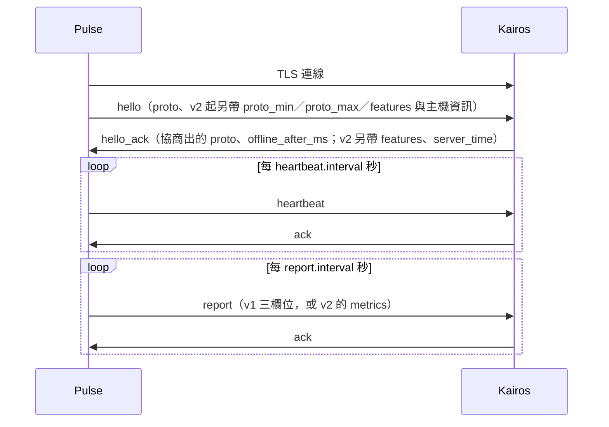

# Pulse ↔ Kairos 通訊協定（v1、v2）

本文件是協定的唯一規格，位於 monorepo 的 `crates/kairos-proto/PROTOCOL.md`（Kairos 與 Pulse 的發佈包各附一份複本）。兩邊共用的實作在同一目錄的 `kairos-proto` crate；該 crate 的單元測試直接解析本文件的「範例」與「錯誤碼」節，修改協定時改這裡與 `kairos-proto` 即可。

- **Pulse**：地端監控代理（client）
- **Kairos**：中央伺服器（server）

目前有兩個版本：**v1**（最初的版本）與 **v2**（版本協商、hello 的主機資訊、hello_ack 的 `server_time`、report 的通用指標）。新版 Kairos 與 Pulse 支援的版本範圍為 `1`～`2`，與只支援 v1 的舊版混用時自動以 v1 通訊（見「版本協商」）。v1 的線上格式與行為完整保留；本文件中沒有標註版本的規則兩個版本都適用。

## 傳輸

- 一條長時間維持的 TLS 連線，由 Pulse 主動連線。
- 訊息格式為 **NDJSON**：UTF-8，一行一則 JSON 物件，以 `\n` 結尾（接收端也接受 `\r\n`）。
- 單行上限 **65536 bytes**（不含結尾的 `\n`，但含 `\r`），超過時伺服器回 `too_long` 並關閉連線。
- Pulse 收到超長或非 UTF-8 的伺服器訊息時，直接斷線並重連。
- 雙方都忽略不認得的欄位，以便日後擴充。
- 伺服器可限制同一來源 IP 位址的同時連線數、同一來源的新連線速率（IPv6 以 /64 網段合併計算），並限制握手中（已連上、尚未通過 `hello`）的連線總數；超過時不進行 TLS 握手，直接關閉 TCP 連線（Pulse 視為連線失敗，退避後重連）。

## 流程



1. 連線後必須先送 `hello`。在 `hello` 之前送 `heartbeat` 或 `report`，伺服器回 `hello_required` 並關閉連線；在 `hello` 之前送壞掉的 JSON 或未知 type，伺服器回非 fatal 的 `bad_request` / `unknown_type`，繼續等待 `hello`。
   Pulse 在收到 `hello_ack` 之前收到任何 `error`（不論是否 fatal），都會結束該連線並重連。
2. 伺服器對每一則合法訊息都會回應：`hello` 回 `hello_ack`，`heartbeat` 與 `report` 回 `ack`。
   `report` 的 `ack` 代表該筆資料**已寫入伺服器的資料庫或資料檔**（Kairos 的 SQLite：交易已 commit；JSONL：已寫入並 flush。兩者都已交給作業系統，但預設不保證已同步到磁碟）；確定沒有寫入時不回 `ack`，而是回 `error`（`storage_unavailable`）。
   唯一的例外：寫入逾時、或寫出中途失敗，而伺服器無法確定這筆是否已寫入時，伺服器**不回應**，直接關閉連線（既不能回 `ack`，也不能回代表「未保存」的 `storage_unavailable`）。Pulse 視為斷線，該筆不重送。
3. 斷線後 Pulse 以指數退避重連，重連後重新送 `hello`（並重新協商版本）。

## 版本協商

**client（Pulse）**在 `hello` 中宣告支援的版本範圍：

- `proto`（必填）：v1 就有的欄位。v1 Kairos 只看這個欄位、只接受 `1`，因此同時支援 v1 的 client 必須送 `1`；新版 Pulse 送 `"proto":1,"proto_min":1,"proto_max":2`。
- `proto_min`、`proto_max`（v2 起，選用）：必須同時出現或同時省略，且 `proto_min ≤ proto ≤ proto_max`，否則回 `bad_request`（帶 hello 的 `seq`）。省略時 client 的範圍就是 `[proto, proto]`（v1 client）。
- `features`（v2 起，選用）：client 支援的選用功能，見下文。

**server（Kairos）**的範圍為 `[1, 2]`。協商結果為兩個範圍中**最高的共同版本**：`v = min(client_max, server_max)`，若 `v < max(client_min, server_min)`（沒有共同版本）則回 fatal 的 `unsupported_version`，`message` 為 `supported proto: <min>-<max>`（只支援單一版本時為 `supported proto: <v>`），並另帶 `proto_min`、`proto_max` 兩個數字欄位標示伺服器支援的範圍。`proto` 不是合法 u32（字串、負數、小數、超出 u32）時同樣回 `unsupported_version`，與 v1 相同。

`hello_ack` 的 `proto` 是協商結果。client 收到不在自己範圍內的 `proto` 時斷線（Pulse 記為 `proto_mismatch`），之後依該版本的格式通訊：

| 協商結果 | hello 的 v2 欄位 | hello_ack | report 格式 |
|---|---|---|---|
| v1 | 伺服器**全部忽略**（不檢查型別與限制，與 v1 Kairos 相同），只有 `proto_min`／`proto_max`／`features` 的型別與一致性仍會檢查 | `seq`、`proto`、`offline_after_ms`（與 v1 完全相同） | `cpu_usage`、`total_memory`、`used_memory` |
| v2 | 依「`hello` 欄位限制」檢查，違反時 `bad_request` | 另帶 `features`（伺服器支援的功能）與 `server_time` | 雙方都宣告 `metrics` 時為 `metrics`，否則同 v1 |

**features**：雙方各自宣告支援的選用功能（小寫字串），實際啟用的是兩者的交集；不認得的名稱一律忽略，不是錯誤。協商結果為 v1 時不使用 features。目前定義：

| feature | 說明 |
|---|---|
| `metrics` | report 改用通用指標 `metrics`（見「report（通用指標）」）。新版 Kairos 與 Pulse 都宣告 |

日後新增功能（例如註冊、除役通知、指令下發）時加入新的 feature 名稱，不必提升版本號；只有不相容的格式變更才需要 v3。

### 相容矩陣

| Pulse | Kairos | 結果 |
|---|---|---|
| v1（舊版） | v1（舊版） | v1（不變） |
| v1（舊版） | 新版（1～2） | 舊版 hello 沒有 `proto_min`／`proto_max`，範圍為 `[1, 1]` → **v1**。hello_ack 不帶任何 v2 欄位，report 為三欄位，JSONL 為 `schema` 1 |
| 新版（1～2） | v1（舊版） | 舊版 Kairos 只檢查 `proto == 1`（通過）並忽略不認得的欄位（`proto_min`、`proto_max`、`features` 與主機資訊），回 `"proto":1` 的 hello_ack → Pulse 以 **v1** 通訊（report 為三欄位） |
| 新版（1～2） | 新版（1～2） | **v2**，雙方都宣告 `metrics` → report 為通用指標，JSONL 為 `schema` 2 |
| 只支援 v2 的 client（`proto` 2，沒有範圍） | v1（舊版） | 舊版回 `unsupported_version`（`supported proto: 1`） |
| 新版（1～2） | 未來只支援 v3 以上的伺服器 | `unsupported_version`，`proto_min`／`proto_max` 標示伺服器的範圍；Pulse 退避後重試，日誌提示更新 |

舊端看到新欄位時的行為：兩個產品的 v1 版本都以 serde 解析、沒有 `deny_unknown_fields`，因此 v1 Kairos 收到 v2 hello、v1 Pulse 收到帶新欄位的訊息都會忽略多出來的欄位（`kairos-proto` 的測試以凍結的 v1 型別定義驗證）。新版 Kairos 只在協商結果為 v2 時才送出 v2 欄位，而 v1 Pulse 的 hello 一定協商成 v1，因此 v1 Pulse 不會收到 `proto` 不是 1 的 hello_ack。

## 共通欄位

| 欄位 | 型別 | 說明 |
|---|---|---|
| `type` | string | 訊息種類（snake_case） |
| `seq` | u64 | 每條連線從 1 開始遞增，重連後重新計算 |
| `ts` | string | client 端時間，RFC 3339 UTC，精確到毫秒。最長 64 bytes，字元限制同 `hello` 的 `hostname`（違反時回 `bad_request`）；伺服器不檢查格式，只記錄，不用來判斷存活 |

## 訊息

### Pulse → Kairos

| type | 其他欄位 |
|---|---|
| `hello` | `proto`、`agent_id`、`hostname`（僅供顯示）、`agent_version`、`heartbeat_interval_ms`；v2 起另有選用的 `proto_min`、`proto_max`、`features`、`host_fingerprint`、`display_name`、`tags`、`report_interval_ms`、`os` |
| `heartbeat` | 無 |
| `report` | v1：`cpu_usage`（%）、`total_memory`（MB）、`used_memory`（MB）。v2 且協商了 `metrics`：`metrics`（陣列，見「report（通用指標）」），不送三欄位 |

### Kairos → Pulse

| type | 欄位 |
|---|---|
| `hello_ack` | `seq`、`proto`、`offline_after_ms`；v2 另有 `features`（字串陣列）、`server_time`（伺服器送出時的時間，RFC 3339 UTC 毫秒，例如 `2026-10-08T03:15:40.012Z`，供 client 檢查時鐘偏差） |
| `ack` | `seq` |
| `error` | `seq`（可為 `null`）、`code`、`message`、`fatal`；`unsupported_version` 另有 `proto_min`、`proto_max`（新版 Kairos 起） |

`fatal` 為 `true` 時，伺服器送出該錯誤後會關閉連線。

`error` 的 `seq` 是它所回應的那則訊息的 `seq`，無法對應時為 `null`。`bad_request` 與 `unknown_type` 的規則：

- hello 被拒（欄位缺漏、型別錯誤或不符「`hello` 欄位限制」）時，只要該行是 JSON 物件、`type` 為 `"hello"` 且 `seq` 是非負整數，就帶回該 `seq`。
- 其他無效訊息（不是合法 JSON、非 UTF-8、不是 hello 的訊息欄位錯誤、未知的 `type` 等）為 `null`。

Pulse 解析 `error` 時容忍欄位缺漏，不會整則忽略：缺 `seq` 視為 `null`、缺 `code` 或 `message` 視為空字串、缺 `fatal` **視為 fatal**（保守處理：結束連線並退避重連），`proto_min`／`proto_max` 不是合法 u32 時視為沒有。伺服器一律送出完整的四個欄位。

### `hello` 欄位限制

| 欄位 | 限制 | 違反時 |
|---|---|---|
| `proto` | 合法 u32，且協商有共同版本（見「版本協商」）。不是合法 u32 的值（字串、負數、小數、超出 u32）也視為不受支援的版本 | `unsupported_version`；缺少欄位、或數字超出 f64 範圍（例如 `1e400`，整行無法解析為 JSON）時 `bad_request` |
| `agent_id` | UUID 文字格式：`8-4-4-4-12` 個十六進位字元（共 36 字元，大小寫皆可）。Pulse 首次啟動時產生並保存。識別**不分大小寫**：伺服器一律轉成小寫後識別、比對憑證、記錄日誌與寫檔；Pulse 讀入後也轉成小寫再送出 | `bad_request` |
| `hostname` | 1～255 bytes，不得含控制字元（Cc）、格式字元（Cf，例如 U+200B、U+202E、U+FEFF）、行分隔（U+2028）、段落分隔（U+2029），以及顯示為空白或不可見的碼位：U+034F、Hangul filler（U+115F、U+1160、U+3164、U+FFA0）、變體選擇字元（U+FE00–U+FE0F、U+E0100–U+E01EF）、私用區（U+E000–U+F8FF、U+F0000–U+FFFFD、U+100000–U+10FFFD）。Pulse 送出前會把這些字元替換成 `?` | `bad_request` |
| `agent_version` | 1～64 bytes，字元限制同 `hostname` | `bad_request` |
| `heartbeat_interval_ms` | 任何 JSON 數字都接受（負數視為 0、小數捨去），伺服器將其夾在 1000～60000 之間後再計算 `offline_after_ms`。例外：超出 f64 範圍的數字（例如 `1e400`）無法解析，整行視為不合法 JSON | 超出範圍不視為錯誤；不是數字、超出 f64 範圍或缺少欄位時 `bad_request` |
| `proto_min`、`proto_max` | v2 起。u32，必須同時出現或同時省略，`proto_min ≤ proto ≤ proto_max`。協商結果為 v1 時也檢查 | `bad_request` |
| `features` | v2 起。字串陣列，最多 32 項，每項 1～64 bytes，小寫英文字母或數字開頭，其後為小寫英文字母、數字或 `_ . -`；不認得的名稱忽略。型別在協商結果為 v1 時也檢查，項目內容只在 v2 時檢查 | `bad_request` |
| `host_fingerprint` | v2 起，選用。`<演算法>:<十六進位>`：演算法 1～16 個小寫英文字母或數字，十六進位為 32～128 個（偶數個）小寫字元，最長 145 bytes。Pulse 的計算方式見「主機指紋」 | `bad_request` |
| `display_name` | v2 起，選用。主控台的顯示名稱，1～255 bytes，字元限制同 `hostname` | `bad_request` |
| `tags` | v2 起，選用。字串陣列，最多 32 個，每個 1～64 bytes，字元限制同 `hostname`，不得重複（區分大小寫） | `bad_request` |
| `report_interval_ms` | v2 起，選用。client 的 report 間隔（毫秒），整數 1000～86400000，供伺服器判定回報延遲 | `bad_request` |
| `os` | v2 起，選用。物件，欄位 `name`（作業系統名稱）、`version`（作業系統版本）、`kernel`（核心版本）、`arch`（CPU 架構）都可省略，各 1～128 bytes，字元限制同 `hostname`；其他欄位忽略 | `bad_request` |

Pulse 端的 `heartbeat.interval` 設定上限為 60 秒，與上表一致。v2 的選用欄位為 `null` 時視同省略。協商結果為 v1 時，`host_fingerprint` 到 `os` 的欄位一律忽略（型別錯誤也不檢查）。

### 主機指紋

`host_fingerprint` 用於偵測同一個 `agent_id` 出現在不同主機（例如從映像檔複製的 VM 沿用了 `agent.id`），以及在主控台辨識同一台主機。它是機器 ID 的單向雜湊，**不送出原始值**，也不含主機名稱、MAC、序號等可識別個人或硬體的資訊。Pulse 的計算方式：

1. 機器 ID：Linux 為 `/etc/machine-id`（沒有時 `/var/lib/dbus/machine-id`），Windows 為登錄機碼 `HKLM\SOFTWARE\Microsoft\Cryptography` 的 `MachineGuid`（64 位元檢視）。去除前後空白後轉成 ASCII 小寫；讀不到或為空時不送 `host_fingerprint`。
2. 以 UTF-8 計算 `SHA-256("kairos-pulse host-fingerprint v1\n" + 機器 ID)`，輸出 `sha256:` 加 64 個小寫十六進位字元。

前面加上固定的用途字串（domain separation），雜湊值就不能拿來與其他軟體對機器 ID 的雜湊比對、追蹤同一台主機。指紋與 `agent_id` 無關，同一台主機重新註冊仍是同一個指紋。重灌作業系統或重新產生機器 ID 時指紋會改變；複製 VM 時若沒有重新產生機器 ID（Linux 的 `systemd-machine-id-setup`、Windows 的 sysprep），複本的指紋會與原機相同。

計算範例（測試向量）：

| 機器 ID | `host_fingerprint` |
|---|---|
| `b08dfa6083e7567a1921a715000001fb` | `sha256:355cf5ed40956a057645145cccf74f594102726167e94e3511aae182acc4ec43` |
| `6F9619FF-8B86-D011-B42D-00C04FC964FF` | `sha256:40b92a4509507544931f2d15b0f2ee4d5b635432e8515620033a5d682dd1a3e9` |

### report（通用指標）

協商結果為 v2 且雙方都宣告 `metrics` 時，report 以 `metrics` 陣列取代三個欄位（同時送了三欄位也會被忽略）。每個元素：

| 欄位 | 型別 | 限制 |
|---|---|---|
| `name` | string | 1～128 bytes，以 `.` 分隔的至少兩段，每段為小寫英文字母開頭、其後為小寫英文字母、數字或 `_`（例如 `system.cpu.usage`）。`system.` 開頭的名稱保留給下表的標準指標 |
| `value` | number | JSON 數字（一定是有限值）。伺服器保留原本的數字表示（整數不會變成小數） |
| `unit` | string | 1～32 bytes，只能是英文字母、數字與 `% / . _ - { } ^ *`，建議用 UCUM 風格：`%`、`By`（bytes）、`By/s`、`s`、`Cel`（攝氏）、`1`（無單位）、`{packets}` |
| `labels` | object | 選用，字串對字串，最多 16 個。名稱 1～64 bytes，小寫英文字母或 `_` 開頭，其後為小寫英文字母、數字或 `_`；值 1～256 bytes，字元限制同 `hostname` |

元素中的其他欄位忽略，不會保存。整個陣列 1～256 個元素；同一個 `name` 與 `labels` 組合不得重複；同時有沒有 label 的 `system.memory.used` 與 `system.memory.total` 時，前者不得大於後者。單行上限 65536 bytes 仍適用，Pulse 送出前會確認不超過（超過時捨去標準指標以外的部分）。

標準指標（Pulse 送出；伺服器另外檢查單位與範圍）：

| `name` | `unit` | 範圍 | `labels` | 說明 |
|---|---|---|---|---|
| `system.cpu.usage` | `%` | 0～100 | 無 | 全機 CPU 平均使用率（上次取樣到這次取樣之間） |
| `system.memory.total` | `By` | ≥ 0 | 無 | 總記憶體 |
| `system.memory.used` | `By` | ≥ 0 | 無 | 已使用記憶體 |
| `system.filesystem.total` | `By` | ≥ 0 | `mountpoint`、`fstype` | 檔案系統總容量 |
| `system.filesystem.available` | `By` | ≥ 0 | `mountpoint`、`fstype` | 檔案系統可用空間 |
| `system.network.received` | `By` | ≥ 0 | `device` | 網路介面開機以來累計接收量（計數器，速率由使用端相減） |
| `system.network.transmitted` | `By` | ≥ 0 | `device` | 網路介面開機以來累計傳送量 |
| `system.temperature` | `Cel` | 不限 | `sensor` | 元件溫度 |

違反時的錯誤：`metrics` 缺漏或型別錯誤（不是陣列、元素缺 `name`／`value`／`unit`、`value` 不是數字、`labels` 不是字串對字串的物件）回 `bad_request`（`seq` 為 `null`，與 v1 的欄位錯誤相同）；格式正確但不符上述限制回 `invalid_report`（帶 `seq`，這筆不保存）。

## 錯誤碼

| code | 情境 | fatal |
|---|---|---|
| `unsupported_version` | `hello` 的 `proto` 不受支援（含不是合法 u32 的值），或版本範圍與伺服器沒有交集（見「版本協商」）；`message` 與 `proto_min`／`proto_max` 標示伺服器支援的範圍 | 是 |
| `hello_required` | 第一則訊息不是 `hello` | 是 |
| `too_long` | 單行超過 65536 bytes | 是 |
| `superseded` | 同一個 `agent_id` 建立了新連線，舊連線被關閉 | 是 |
| `auth_failed` | 伺服器啟用 mTLS 時，`hello` 的 `agent_id` 與客戶端憑證不符（`message` 為 `agent_id does not match client certificate`），或憑證含多個 DNS SAN（`message` 為 `client certificate must contain exactly one DNS SAN`）（見「身分驗證」） | 是 |
| `certificate_rejected` | 伺服器啟用 mTLS 時，收到 `hello` 時重新驗證不通過，或連線期間伺服器重新驗證時發現（見「身分驗證」）。客戶端憑證已被撤銷、過期或不再受信任時 `message` 為 `client certificate has been revoked or is no longer trusted`；伺服器無法判定撤銷狀態（CRL 已過期、或缺少某一層 CA 的 CRL）時 `message` 為 `revocation status unavailable`，屬伺服器端問題，客戶端不需重新簽發憑證 | 是 |
| `storage_unavailable` | 伺服器沒有保存這筆 `report`；伺服器只在**確定未寫入**時回此錯誤，這筆資料未保存。`message` 為 `report could not be stored`（寫入失敗，例如磁碟已滿、資料目錄無法寫入、等待寫入逾時且已取消、當天的資料檔已達伺服器的每日大小上限，或伺服器的主機清冊已滿）或 `report rate limit exceeded`（同一來源的 `report` 送得太快，見「逾時與離線判定」的速率限制） | 否 |
| `bad_request` | 該行不是合法 UTF-8、不是合法 JSON（含超出 f64 範圍的數字）、欄位缺漏或型別錯誤（含 v2 report 的 `metrics`）、`hello` 欄位不合限制（含 v2 的版本範圍、features 與主機資訊）、`ts` 超過 64 bytes 或含禁止的字元；另外，伺服器狀態表已滿而無法登記新的 `agent_id` 時，以 fatal 的 `bad_request` 回應 `hello`（`message` 為 `server agent registry is full`） | 否（連續達上限、或狀態表已滿時是） |
| `unknown_type` | 不認得的 `type` | 否（連續達上限時是） |
| `already_registered` | 同一連線送了第二次 `hello` | 否 |
| `invalid_report` | v1 格式：`cpu_usage` 不是有限值或不在 0～100 之間，或 `used_memory` 大於 `total_memory`（Pulse 送出前會先把 `cpu_usage` 夾在 0～100）。v2 的 `metrics`：不符「report（通用指標）」的限制。這筆資料不會保存 | 否 |

**連續無效訊息上限**：同一連線連續 5 則無效訊息（`bad_request` 與 `unknown_type` 合計，中間沒有合法訊息）時，第 5 則改為 fatal 並關閉連線。註冊前與註冊後都適用；`hello` 欄位不合限制也計入。

## 身分驗證（mTLS）

Kairos 設定了 `auth.client_ca` 時啟用雙向 TLS：

- Pulse 必須出示由該 CA 簽發的客戶端憑證，否則 TLS 握手失敗（不會有應用層錯誤訊息）。
- 伺服器憑證必須是終端實體憑證（`basicConstraints = CA:FALSE`）；`openssl req -x509` 預設產生的 `CA:TRUE` 憑證會被拒絕。
- 客戶端憑證必須包含 `subjectAltName = DNS:<agent_id>`，且擴充金鑰用途（EKU）包含 `clientAuth`。CN 建議也設為 `agent_id`，方便人工辨識。
- 客戶端憑證預設只能有**恰好一個** DNS SAN，含多個 DNS SAN 時回 `auth_failed`，避免一張憑證同時冒用多個代理（伺服器可用 `auth.allow_multiple_dns_sans` 放寬）。
- 伺服器以憑證的 SAN 比對 `hello` 的 `agent_id`（不分大小寫）。不符時回 `auth_failed` 並關閉連線。
- 收到 `hello` 時，伺服器會以目前的 CA 與 CRL 再驗證一次憑證鏈，不通過回 `certificate_rejected`。啟用 mTLS 時伺服器不使用 TLS session resumption，每條連線都完整驗證客戶端憑證。
- 因此只持有某個 `agent_id` 而沒有對應憑證與私鑰的人，無法冒用該代理，也無法把它的連線踢掉（`superseded`）。
- 客戶端憑證可以帶中繼 CA 鏈；私鑰可為 RSA、EC（P-256 / P-384）或 Ed25519。
- **撤銷**：伺服器可設定 CRL（`auth.crl`）。伺服器會定期重新載入憑證、CA 與 CRL 檔案，不需重啟；重新載入後，已連線但憑證已被撤銷、過期或不再受信任的代理會收到 `certificate_rejected` 並被斷線。

未設定 `auth.client_ca` 時不要求客戶端憑證，任何能連上伺服器的人都能以任意 `agent_id` 註冊；Kairos 啟動時會記錄警告。僅建議用於本機開發。

## 逾時與離線判定

Kairos 的 TLS 握手、等待 `hello`、寫出逾時可在設定檔 `[timeouts]` 調整，下表為預設值。

| 角色 | 項目 | 數值 |
|---|---|---|
| Kairos | TLS 握手 | 5 秒 |
| Kairos | 握手後等待 `hello` | 5 秒 |
| Kairos | 讀取閒置（沒收到任何**合法**訊息；壞行與未知 type 不算） | `offline_after_ms` |
| Pulse | TCP 連線 | 5 秒 |
| Pulse | TLS 握手 | 10 秒 |
| Pulse | 等待 `hello_ack` | 5 秒 |
| Pulse | 讀取閒置（沒收到任何**合法**伺服器訊息；無法解析的行不算） | `max(2 × h, h + 10 秒)`，`h = heartbeat.interval`（只看心跳間隔，與 `report.interval` 無關；預設心跳 15 秒時為 30 秒，心跳 1 秒時為 11 秒），視為連線中斷並重連 |
| 雙方 | 每則訊息寫出 | 5 秒（Kairos 的 `timeouts.write_secs` 可調，上限 6 秒） |

- `offline_after_ms = max(5 × clamp(heartbeat_interval_ms, 1000, 60000), 5000)`，因此介於 5000～300000，由伺服器在 `hello_ack` 中告知。
- 伺服器超過 `offline_after_ms` 沒收到某代理的合法訊息（`hello`、`heartbeat`、`report`，含 `invalid_report` 的那筆），就將它標為離線並關閉該連線。
- 離線超過 24 小時的代理會從伺服器的狀態表（`agents.json`）中移除。Kairos 另有持久化的主機清冊（SQLite，預設）：重新啟動時，最近 24 小時內出現過的代理以離線狀態放回狀態表（之後照常在離線 24 小時後移除），線上的代理在重新連線、送出 `hello` 後恢復上線；更早的代理只在清冊中。以 JSONL 儲存時（`storage.backend = "jsonl"`）沒有清冊，重新啟動後狀態表從空開始，離線中的代理會立即從 `agents.json` 消失。
- **伺服器回應延遲最多 8 秒**。伺服器處理一筆 `report` 時會等它寫入資料檔後才回應，期間同一連線後續的訊息（包括 `heartbeat`）都要排隊等待。Kairos 從收到 `report` 到回應（`ack`、`storage_unavailable`，或結果未知時斷線）的最壞延遲為：訊息速率延後最多 0.05 秒 + `report` 速率限制延後最多 0.5 秒 + `timeouts.write_secs`（上限 6 秒）+ 寫入已開始時的寬限 1 秒 = 7.55 秒 ≤ 8 秒。Pulse 的讀取閒置在心跳間隔 `h` 上加 10 秒餘裕（`h + 10 秒` ≤ 逾時），用來容忍這最多 8 秒的回應延遲：Pulse 每 `h` 秒內一定會送出 `heartbeat`，因此最久 `h + 8` 秒內一定會收到伺服器訊息，對任何心跳間隔都小於逾時。`report` 的送出時機依賴取樣，不列入計算。等待寫檔期間，伺服器每秒更新該代理的 `last_seen`，磁碟變慢不會讓代理被誤判為離線。
- 伺服器對 `report` 有速率限制，以「來源」計算且跨連線保留（斷線重連不會取得新的額度）：啟用 mTLS 時來源為 `agent_id`（與憑證綁定）；未啟用 mTLS 時來源為來源 IP（IPv6 以 /64 合併），容量與速率乘上伺服器的每來源連線上限，且每條連線另有一份同樣規格的額度。每份額度可連續送 10 則、之後每秒 2 則，新出現的來源與新連線一開始只有 2 則。需要延後 0.5 秒以內時，伺服器延後處理、不回錯誤；需要延後更久時（例如同一來源有多條連線同時送出）不處理這筆，回非 fatal 的 `storage_unavailable`（`report rate limit exceeded`，這筆未保存）。Pulse 的 `report.interval` 最短 1 秒、且同一時間只有一筆 `report` 在途，正常不會觸及。
- 伺服器對每條連線的所有訊息（含無效的行）另有速率限制：可連續 50 則、之後每秒 20 則，超過時延後處理（每則最多 0.05 秒），不回錯誤。

### 重連

- Pulse 斷線後以指數退避重連：從 `retry.initial_delay` 開始加倍，上限 `retry.max_delay`，加上 ±20% 抖動；達到上限後在 `[0.8 × max_delay, max_delay]` 間均勻分佈。
- 退避只在**連線穩定維持 30 秒以上**後才重置，避免「註冊成功後立刻被踢」時以固定短間隔反覆重連（例如兩台主機誤用同一份 `agent.id`）。
- **連續被 `superseded`**：第一次因 `superseded` 斷線視同一般斷線（連線維持 30 秒以上照常重置退避）。連續第 2 次起，不論連線維持多久都**不重置退避**，且重連延遲**至少 30 秒**（這是「`retry.max_delay` 為延遲上限」的唯一例外）：兩台主機共用同一份 `agent.id` 時，雙方各自維持 30 秒以上再被對方踢掉，若重置或延遲太短就會永久快速互踢。此時 Pulse 以 `ERROR` 記錄並提示可能有多台主機共用 `agent.id`（`ERROR` 每 10 分鐘最多一則，其餘次數記 `WARN`）。因其他原因斷線時，連續次數歸零。
- `report` 採 at-most-once：送不出去就丟棄，不會重送舊資料。
- Pulse 同一時間只有一筆 `report` 在途：送出後到收到伺服器對它（或之後訊息）的回應（`ack` 或帶 `seq` 的 `error`，含 `storage_unavailable`）之前，新的取樣直接丟棄；斷線時清除。伺服器寫檔緩慢時不會在伺服器端無限積壓。

## 範例

以下訊息是 `kairos-proto` 單元測試的測試向量：測試以 `include_str!` 讀入本文件，`P ` 開頭的行為 Pulse → Kairos、`K ` 開頭的行為 Kairos → Pulse，每一則都必須能解析並序列化回相同的 JSON。v1 與 v2 的向量分別放在下面兩個小節。

### v1

舊版 Pulse（或只支援 v1 的 client）與任何版本的 Kairos：

```
P {"type":"hello","seq":1,"proto":1,"agent_id":"6f1c0e4a-1b2c-4d3e-9f00-112233445566","hostname":"web-01","agent_version":"0.1.0","heartbeat_interval_ms":1000,"ts":"2026-10-08T03:15:40.001Z"}
K {"type":"hello_ack","seq":1,"proto":1,"offline_after_ms":5000}
P {"type":"heartbeat","seq":2,"ts":"2026-10-08T03:15:41.002Z"}
K {"type":"ack","seq":2}
P {"type":"report","seq":6,"ts":"2026-10-08T03:15:45.210Z","cpu_usage":17.84,"total_memory":49152,"used_memory":37034}
K {"type":"ack","seq":6}
```

### v2

新版 Pulse 與新版 Kairos（新版 Pulse 連舊版 Kairos 時，hello 相同，之後同 v1 小節的 hello_ack 與 report）：

```
P {"type":"hello","seq":1,"proto":1,"proto_min":1,"proto_max":2,"features":["metrics"],"agent_id":"6f1c0e4a-1b2c-4d3e-9f00-112233445566","hostname":"web-01","agent_version":"0.2.0","heartbeat_interval_ms":15000,"ts":"2026-10-08T03:15:40.001Z","host_fingerprint":"sha256:355cf5ed40956a057645145cccf74f594102726167e94e3511aae182acc4ec43","display_name":"Web 01（正式環境）","tags":["env:prod","team:web"],"report_interval_ms":5000,"os":{"name":"Ubuntu","version":"24.04","kernel":"6.8.0-45-generic","arch":"x86_64"}}
K {"type":"hello_ack","seq":1,"proto":2,"offline_after_ms":75000,"features":["metrics"],"server_time":"2026-10-08T03:15:40.012Z"}
P {"type":"heartbeat","seq":2,"ts":"2026-10-08T03:15:55.002Z"}
K {"type":"ack","seq":2}
P {"type":"report","seq":3,"ts":"2026-10-08T03:15:45.210Z","metrics":[{"name":"system.cpu.usage","value":17.84,"unit":"%"},{"name":"system.memory.total","value":51539607552,"unit":"By"},{"name":"system.memory.used","value":38833356800,"unit":"By"},{"name":"system.filesystem.total","value":502468108288,"unit":"By","labels":{"fstype":"ext4","mountpoint":"/"}},{"name":"system.filesystem.available","value":211312345088,"unit":"By","labels":{"fstype":"ext4","mountpoint":"/"}},{"name":"system.network.received","value":98765432101,"unit":"By","labels":{"device":"eth0"}},{"name":"system.network.transmitted","value":1234567890,"unit":"By","labels":{"device":"eth0"}},{"name":"system.temperature","value":48.5,"unit":"Cel","labels":{"sensor":"coretemp Package id 0"}}]}
K {"type":"ack","seq":3}
```

### 錯誤

```
K {"type":"error","seq":1,"code":"unsupported_version","message":"supported proto: 1-2","fatal":true,"proto_min":1,"proto_max":2}
K {"type":"error","seq":null,"code":"unknown_type","message":"unknown message type","fatal":false}
```

## 手動測試

可以直接用 OpenSSL 連上 Kairos，手動貼上 JSON：

```bash
openssl s_client -connect 127.0.0.1:8080 -servername localhost -quiet
```
