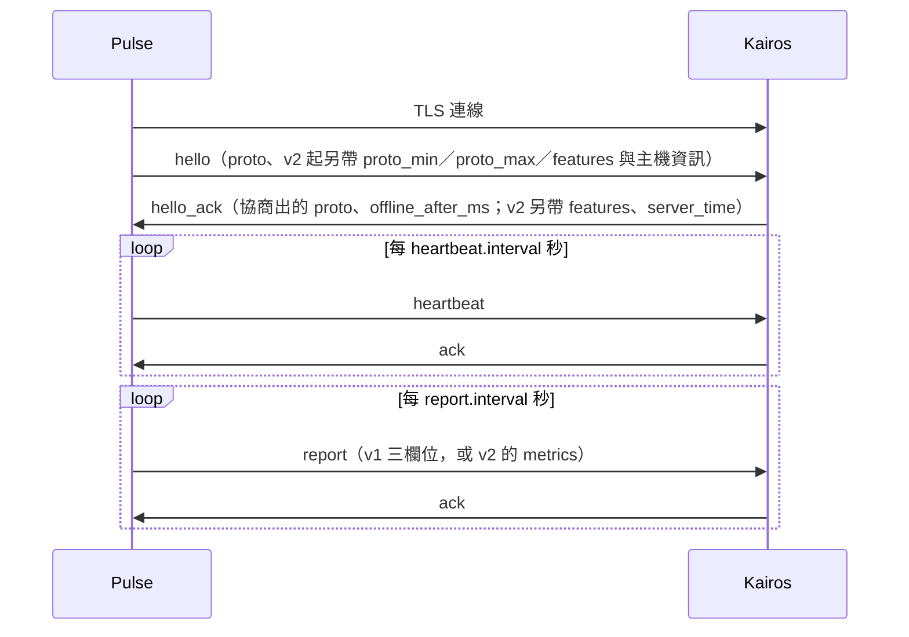

# Pulse ↔ Kairos 通訊協定（v1、v2）

本文件是協定的唯一規格，位於 monorepo 的 `crates/kairos-proto/PROTOCOL.md`（Kairos 與 Pulse 的發佈包各附一份複本）。兩邊共用的實作在同一目錄的 `kairos-proto` crate；該 crate 的單元測試直接解析本文件的「範例」與「錯誤碼」節，修改協定時改這裡與 `kairos-proto` 即可。

- **Pulse**：地端監控代理（client）
- **Kairos**：中央伺服器（server）

目前有兩個版本：**v1**（最初的版本）與 **v2**（版本協商、hello 的主機資訊、hello_ack 的 `server_time`、report 的通用指標；另以 feature 協商 at-least-once 投遞 `durable`）。新版 Kairos 與 Pulse 支援的版本範圍為 `1`～`2`，與只支援 v1 的舊版混用時自動以 v1 通訊（見「版本協商」）。v1 的線上格式與行為完整保留；本文件中沒有標註版本的規則兩個版本都適用。

## 傳輸

- 一條長時間維持的 TLS 連線，由 Pulse 主動連線。
- 訊息格式為 **NDJSON**：UTF-8，一行一則 JSON 物件，以 `\n` 結尾（接收端也接受 `\r\n`）。
- 單行上限 **65536 bytes**（不含結尾的 `\n`，但含 `\r`），超過時伺服器回 `too_long` 並關閉連線。
- Pulse 收到超長或非 UTF-8 的伺服器訊息時，直接斷線並重連。
- 雙方都忽略不認得的欄位，以便日後擴充。
- 伺服器可限制同一來源 IP 位址的同時連線數、同一來源的新連線速率（IPv6 以 /64 網段合併計算），並限制握手中（已連上、尚未通過 `hello`）的連線總數；超過時不進行 TLS 握手，直接關閉 TCP 連線（Pulse 視為連線失敗，退避後重連）。

## 流程



1. 連線後必須先送 `hello`。在 `hello` 之前送 `heartbeat` 或 `report`，伺服器回 `hello_required` 並關閉連線；在 `hello` 之前送壞掉的 JSON 或未知 type，伺服器回非 fatal 的 `bad_request` / `unknown_type`，繼續等待 `hello`。
   Pulse 在收到 `hello_ack` 之前收到任何 `error`（不論是否 fatal），都會結束該連線並重連。
2. 伺服器對每一則合法訊息都會回應：`hello` 回 `hello_ack`，`heartbeat` 與 `report` 回 `ack`。
   `report` 的 `ack` 代表該筆資料**已寫入伺服器的資料庫或資料檔**（Kairos 的 SQLite：交易已 commit；JSONL：已寫入並 flush。兩者都已交給作業系統，但預設不保證已同步到磁碟）；確定沒有寫入時不回 `ack`，而是回 `error`（`storage_unavailable`）。
   唯一的例外：寫入逾時、或寫出中途失敗，而伺服器無法確定這筆是否已寫入時，伺服器**不回應**，直接關閉連線（既不能回 `ack`，也不能回代表「未保存」的 `storage_unavailable`）。Pulse 視為斷線；沒有協商 `durable` 時該筆不重送，協商了 `durable` 時重連後**重送**，由伺服器去重（見「durable：at-least-once 投遞」）。
3. 斷線後 Pulse 以指數退避重連，重連後重新送 `hello`（並重新協商版本）。

## 版本協商

**client（Pulse）**在 `hello` 中宣告支援的版本範圍：

- `proto`（必填）：v1 就有的欄位。v1 Kairos 只看這個欄位、只接受 `1`，因此同時支援 v1 的 client 必須送 `1`；新版 Pulse 送 `"proto":1,"proto_min":1,"proto_max":2`。
- `proto_min`、`proto_max`（v2 起，選用）：必須同時出現或同時省略，且 `proto_min ≤ proto ≤ proto_max`，否則回 `bad_request`（帶 hello 的 `seq`）。省略時 client 的範圍就是 `[proto, proto]`（v1 client）。
- `features`（v2 起，選用）：client 支援的選用功能，見下文。

**server（Kairos）**的範圍為 `[1, 2]`。協商結果為兩個範圍中**最高的共同版本**：`v = min(client_max, server_max)`，若 `v < max(client_min, server_min)`（沒有共同版本）則回 fatal 的 `unsupported_version`，`message` 為 `supported proto: <min>-<max>`（只支援單一版本時為 `supported proto: <v>`），並另帶 `proto_min`、`proto_max` 兩個數字欄位標示伺服器支援的範圍。`proto` 不是合法 u32（字串、負數、小數、超出 u32）時同樣回 `unsupported_version`，與 v1 相同。

`hello_ack` 的 `proto` 是協商結果。client 收到不在自己範圍內的 `proto` 時斷線（Pulse 記為 `proto_mismatch`），之後依該版本的格式通訊：

| 協商結果 | hello 的 v2 欄位 | hello_ack | report 格式 |
|---|---|---|---|
| v1 | 伺服器**全部忽略**（不檢查型別與限制，與 v1 Kairos 相同），只有 `proto_min`／`proto_max`／`features` 的型別與一致性仍會檢查 | `seq`、`proto`、`offline_after_ms`（與 v1 完全相同） | `cpu_usage`、`total_memory`、`used_memory` |
| v2 | 依「`hello` 欄位限制」檢查，違反時 `bad_request` | 另帶 `features`（伺服器支援的功能）與 `server_time` | 雙方都宣告 `metrics` 時為 `metrics`，否則同 v1 |

**features**：雙方各自宣告支援的選用功能（小寫字串），實際啟用的是兩者的交集；不認得的名稱一律忽略，不是錯誤。協商結果為 v1 時不使用 features。目前定義：

| feature | 說明 |
|---|---|
| `metrics` | report 改用通用指標 `metrics`（見「report（通用指標）」）。新版 Kairos 與 Pulse 都宣告 |
| `durable` | report 改為 at-least-once：report 帶 `boot_id`／`report_seq`，伺服器據此去重，client 收到 `ack` 才刪除本機的資料（見「durable：at-least-once 投遞」）。Kairos 0.3.0 起宣告；Pulse 0.3.0 起在啟用本機緩衝（`buffer.enabled`，預設啟用）時宣告 |
| `renew` | 憑證仍有效時經這條 mTLS 連線正常輪替（`renew_request`／`renew_result`），`hello_ack` 另帶 `expired_renew_grace_days`、選用的 `renew_now`（見「憑證輪替與除役」）。Kairos 0.5.0 起在**有註冊服務（SQLite）且 client 也宣告時**才列出；Pulse 0.5.0 起在身分由 `pulse enroll` 管理時宣告 |
| `deregister` | 除役通知（`hello.intent` 為 `deregister` 的連線上送 `deregister`，回 `deregister_ack`）。Kairos 0.5.0 起同 `renew` 的條件列出；Pulse 0.5.0 起只在除役通知的連線（`pulse decommission`）宣告 |
| `inventory` | 主機資產：連線後與資產改變時送 `inventory` 訊息（作業系統、CPU、記憶體、廠牌型號序號、磁碟、網卡），回 `ack`（見 [`METRICS.md`](METRICS.md)「資產」）。〔0.8.0 規格〕Kairos 以 SQLite 儲存時宣告；Pulse 在 `inventory.enabled`（預設啟用）時宣告 |
| `processes` | report 另帶行程排行 `processes`（依 CPU、依記憶體各前 N 個；需同時協商 `metrics`，見 [`METRICS.md`](METRICS.md)「行程」）。〔0.8.0 規格〕Kairos 以 SQLite 儲存時宣告；Pulse 在 `processes.enabled`（預設啟用）時宣告 |
| `config` | 集中設定：Kairos 在 `hello_ack`／心跳的 `ack` 以 `pending.config_rev` 提示，Pulse 以 `config_get` 取得白名單內的設定、以 `config_status` 回報實際生效值與差異（見「遠端管理」與 [`REMOTE.md`](REMOTE.md) 第 3 節）。〔0.9.0：協定與共用型別在 `kairos-proto` 的 `mgmt` 模組；**Kairos 已實作**（K1，REMOTE.md 第 13.1 節）、**Pulse 已實作**（P1，REMOTE.md 第 17 節）〕Kairos 以 SQLite 儲存、mTLS、`[remote] config_enabled` 且 client 也宣告時列出；Pulse 在 `remote_config.enabled`（預設啟用）時宣告 |
| `upgrade` | 遠端升級：`upgrade_get`／`upgrade_offer` 提議官方簽章的發佈包，`upgrade_chunk_get`／`upgrade_chunk` 經這條連線分段下載，`upgrade_status` 回報結果（見「遠端管理」與 [`REMOTE.md`](REMOTE.md) 第 4 節）。〔0.9.0：協定、簽章驗證與發佈清單的共用實作在 `kairos-proto` 的 `mgmt`、`release` 模組；**Kairos 已實作**（K2，REMOTE.md 第 13.1 節）、**Pulse 已實作**（P2，Linux；REMOTE.md 第 17 節）〕條件同 `config`（Kairos 另看 `[remote] upgrade_enabled`）；Pulse 在 `upgrade.enabled` 且本機準備就緒（`install.upgrade` 為 `ready`：信任錨、輔助程式）時宣告 |
| `cluster` | 叢集連線：`hello_ack` 另帶 `server_node`（回應的節點名稱）與選用的 `cluster_id`，Kairos 可以送排空訊息 `drain` 要求 agent 改連其他節點（見「叢集與排空」）。〔0.9.0〕Kairos 只在 **client 也宣告時**才列出（同 `renew`）；Pulse 一律宣告（一次性連線除外） |

日後新增功能（例如指令下發）時加入新的 feature 名稱，不必提升版本號；只有不相容的格式變更才需要 v3。註冊通道（8444 HTTPS）是另一份規格 [`ENROLL.md`](ENROLL.md)；8443 上與註冊有關的 `renew`、`deregister` 定義在本文件「憑證輪替與除役」（原為 ENROLL.md 第 13 節的草稿）。

### 相容矩陣

| Pulse | Kairos | 結果 |
|---|---|---|
| v1（舊版） | v1（舊版） | v1（不變） |
| v1（舊版） | 新版（1～2） | 舊版 hello 沒有 `proto_min`／`proto_max`，範圍為 `[1, 1]` → **v1**。hello_ack 不帶任何 v2 欄位，report 為三欄位，JSONL 為 `schema` 1 |
| 新版（1～2） | v1（舊版） | 舊版 Kairos 只檢查 `proto == 1`（通過）並忽略不認得的欄位（`proto_min`、`proto_max`、`features` 與主機資訊），回 `"proto":1` 的 hello_ack → Pulse 以 **v1** 通訊（report 為三欄位） |
| 新版（1～2） | 新版（1～2） | **v2**，雙方都宣告 `metrics` → report 為通用指標，JSONL 為 `schema` 2 |
| 0.3.0 起（宣告 `durable`） | 0.3.0 起（宣告 `durable`） | **v2**＋`metrics`＋`durable` → at-least-once：report 帶 `boot_id`／`report_seq`，JSONL 另有這兩個欄位（`schema` 不變） |
| 0.3.0 起（宣告 `durable`） | 0.2.0（v2，不宣告 `durable`） | v2＋`metrics`，**不啟用 durable**，維持 at-most-once：連線中的新取樣照舊送出、送不出去就丟棄；Pulse 本機緩衝中的積壓（斷線期間的取樣）不送出，保留到連上支援 `durable` 的 Kairos，或超過 `buffer.max_age`、容量上限而被丟棄 |
| 0.2.0（不宣告 `durable`） | 0.3.0 起 | v2＋`metrics`，**不啟用 durable**，與 0.2.0 相同（report 不帶新欄位，伺服器不去重） |
| 0.3.0 起，`buffer.enabled = false` | 0.3.0 起 | Pulse 不宣告 `durable` → at-most-once（與 0.2.0 相同） |
| 0.4.0 以前（不宣告 `renew`／`deregister`） | 0.5.0 起 | 與 0.4.0 完全相同：Kairos 只在 client 宣告時才在 `hello_ack` 列出 `renew`、`deregister` 並帶 `expired_renew_grace_days`／`renew_now`，因此舊版 Pulse 收到的 `hello_ack` 不變 |
| 0.5.0 起（宣告 `renew`） | 0.4.0 以前 | 舊版 Kairos 不列出 `renew`：Pulse 不送 `renew_request`，憑證到期前沒有自動輪替（維持 0.4 的行為：手動換憑證，或過期後經 8444 續簽）。除役通知的連線在 `hello_ack` 沒有 `deregister` 時直接關閉，不送 `deregister` |
| 0.5.0 起（宣告 `renew`） | 0.5.0 起，`storage.backend = "jsonl"`（沒有註冊服務） | 同上：Kairos 不列出 `renew`、`deregister` |
| 0.8.0 以前（不宣告 `cluster`） | 0.9.0 起 | 與 0.8.0 完全相同：Kairos 只在 client 宣告時才列出 `cluster`、帶 `server_node`，也只對協商了 `cluster` 的連線送 `drain`（其他連線在關機時照舊直接關閉） |
| 0.9.0 起（宣告 `cluster`） | 0.8.0 以前 | 舊版 Kairos 不列出 `cluster`：沒有 `server_node`、不會收到 `drain`。Pulse 的多個伺服器位址（`server.fallback_addresses`）不依賴這個 feature，照常運作 |
| 0.8.0 以前（不宣告 `config`／`upgrade`、沒有 `install`） | 0.9.0 起 | 與 0.8.0 完全相同：Kairos 只在 client 宣告時才列出 `config`、`upgrade`，也只在協商了其中之一時帶 `pending`。主控台顯示「不支援集中設定與遠端升級（需要 Pulse 0.9.0 以上）」；0.8 → 0.9 必須手動升級一次 |
| 0.9.0 起（宣告 `config`／`upgrade`） | 0.8.0 以前，或 0.9.0 但 `storage.backend = "jsonl"`、沒有 mTLS | Kairos 不列出兩個 feature、忽略 `install`：Pulse 只用本機設定（遠端設定的快取保留不用），不會升級 |
| 0.9.0 起，`remote_config.enabled = false` | 0.9.0 起 | 只協商 `upgrade`（若準備就緒）；`install.config` 為 `disabled` |
| 0.9.0 起，`install.upgrade` 不是 `ready` | 0.9.0 起 | 只協商 `config`；主控台依 `install.upgrade` 顯示原因 |
| 只支援 v2 的 client（`proto` 2，沒有範圍） | v1（舊版） | 舊版回 `unsupported_version`（`supported proto: 1`） |
| 新版（1～2） | 未來只支援 v3 以上的伺服器 | `unsupported_version`，`proto_min`／`proto_max` 標示伺服器的範圍；Pulse 退避後重試，日誌提示更新 |

舊端看到新欄位時的行為：兩個產品的 v1 版本都以 serde 解析、沒有 `deny_unknown_fields`，因此 v1 Kairos 收到 v2 hello、v1 Pulse 收到帶新欄位的訊息都會忽略多出來的欄位（`kairos-proto` 的測試以凍結的 v1 型別定義驗證）。新版 Kairos 只在協商結果為 v2 時才送出 v2 欄位，而 v1 Pulse 的 hello 一定協商成 v1，因此 v1 Pulse 不會收到 `proto` 不是 1 的 hello_ack。

## 共通欄位

| 欄位 | 型別 | 說明 |
|---|---|---|
| `type` | string | 訊息種類（snake_case） |
| `seq` | u64 | 每條連線從 1 開始遞增，重連後重新計算 |
| `ts` | string | client 端時間，RFC 3339 UTC，精確到毫秒。最長 64 bytes，字元限制同 `hello` 的 `hostname`（違反時回 `bad_request`）；伺服器不檢查格式，只記錄，不用來判斷存活 |

## 訊息

### Pulse → Kairos

| type | 其他欄位 |
|---|---|
| `hello` | `proto`、`agent_id`、`hostname`（僅供顯示）、`agent_version`、`heartbeat_interval_ms`；v2 起另有選用的 `proto_min`、`proto_max`、`features`、`host_fingerprint`、`display_name`、`tags`、`report_interval_ms`、`os`、`install`（0.9.0 起） |
| `heartbeat` | 無 |
| `report` | v1：`cpu_usage`（%）、`total_memory`（MB）、`used_memory`（MB）。v2 且協商了 `metrics`：`metrics`（陣列，見「report（通用指標）」），不送三欄位。協商了 `durable`：另有 `boot_id`、`report_seq`（見「durable：at-least-once 投遞」）。協商了 `processes`：另有選用的 `processes`（見 [`METRICS.md`](METRICS.md)「行程」） |
| `renew_request` | 協商了 `renew` 時：`request_id`、`csr`、`sent_at`（見「憑證輪替與除役」） |
| `deregister` | 協商了 `deregister` 且 hello 帶 `intent: "deregister"` 時：`request_id`、`agent_id`、`reason`、`initiated_by`、`host_fingerprint`（選用）、`hostname`、`pulse_version`、`sent_at` |
| `inventory` | 協商了 `inventory` 時：`inventory`（物件，見 [`METRICS.md`](METRICS.md)「資產」），回 `ack`。沒有協商時伺服器視為不認得的 `type`（`unknown_type`） |
| `config_get`、`config_status` | 協商了 `config` 時（見「遠端管理」）。沒有協商時伺服器視為不認得的 `type`（欄位不合法時也是） |
| `upgrade_get`、`upgrade_chunk_get`、`upgrade_status` | 協商了 `upgrade` 時（見「遠端管理」）。沒有協商時同上 |

`hello` 另有選用的 `intent`（字串，目前只定義 `deregister`，見「憑證輪替與除役」）；不是字串時視為沒有。

### Kairos → Pulse

| type | 欄位 |
|---|---|
| `hello_ack` | `seq`、`proto`、`offline_after_ms`；v2 另有 `features`（字串陣列）、`server_time`（伺服器送出時的時間，RFC 3339 UTC 毫秒，例如 `2026-10-08T03:15:40.012Z`，供 client 檢查時鐘偏差）；協商了 `renew` 時另有 `expired_renew_grace_days`（u32）與選用的 `renew_now`（布林）；協商了 `cluster` 時另有 `server_node`（string）與選用的 `cluster_id`（UUID）；協商了 `config` 或 `upgrade` 時另有 `pending`（物件，見「遠端管理」）。這些欄位型別不符時都視為沒有 |
| `ack` | `seq`；回應 `heartbeat` 的 `ack` 在協商了 `config` 或 `upgrade` 時另有 `pending`（回應其他訊息的不帶） |
| `error` | `seq`（可為 `null`）、`code`、`message`、`fatal`；`unsupported_version` 另有 `proto_min`、`proto_max`（新版 Kairos 起）；回應 `upgrade_chunk_get` 的 `rate_limited` 另有 `retry_after_ms`（u32） |
| `renew_result` | 回應 `renew_request`：`seq`、`request_id`、`state`（`issued`）、`certificate`、`policy`、`server_time` |
| `deregister_ack` | 回應 `deregister`：`seq`、`request_id`、`agent_id`、`state`（`decommissioned`）、`decommissioned_at`、`certificate_revoked`、`already_decommissioned` |
| `drain` | 協商了 `cluster` 時：`seq`（一律 `null`）、`reason`、`reconnect_within_ms`（見「叢集與排空」）。不回應任何訊息 |
| `config` | 協商了 `config` 時回應 `config_get`：`seq`、`rev`、`hash`、`settings`、`sources`（選用）、`issued_at`（見「遠端管理」） |
| `upgrade_offer` | 協商了 `upgrade` 時回應 `upgrade_get`（見「遠端管理」） |
| `upgrade_chunk` | 協商了 `upgrade` 時回應 `upgrade_chunk_get`：`seq`、`upgrade_id`、`filename`、`offset`、`data`、`eof` |

`fatal` 為 `true` 時，伺服器送出該錯誤後會關閉連線。

`error` 的 `seq` 是它所回應的那則訊息的 `seq`，無法對應時為 `null`。`bad_request` 與 `unknown_type` 的規則：

- hello 被拒（欄位缺漏、型別錯誤或不符「`hello` 欄位限制」）時，只要該行是 JSON 物件、`type` 為 `"hello"` 且 `seq` 是非負整數，就帶回該 `seq`。
- 其他無效訊息（不是合法 JSON、非 UTF-8、不是 hello 的訊息欄位錯誤、未知的 `type` 等）為 `null`。

Pulse 解析 `error` 時容忍欄位缺漏，不會整則忽略：缺 `seq` 視為 `null`、缺 `code` 或 `message` 視為空字串、缺 `fatal` **視為 fatal**（保守處理：結束連線並退避重連），`proto_min`／`proto_max` 不是合法 u32 時視為沒有。伺服器一律送出完整的四個欄位。

### `hello` 欄位限制

| 欄位 | 限制 | 違反時 |
|---|---|---|
| `proto` | 合法 u32，且協商有共同版本（見「版本協商」）。不是合法 u32 的值（字串、負數、小數、超出 u32）也視為不受支援的版本 | `unsupported_version`；缺少欄位、或數字超出 f64 範圍（例如 `1e400`，整行無法解析為 JSON）時 `bad_request` |
| `agent_id` | UUID 文字格式：`8-4-4-4-12` 個十六進位字元（共 36 字元，大小寫皆可）。Pulse 首次啟動時產生並保存。識別**不分大小寫**：伺服器一律轉成小寫後識別、比對憑證、記錄日誌與寫檔；Pulse 讀入後也轉成小寫再送出 | `bad_request` |
| `hostname` | 1～255 bytes，不得含控制字元（Cc）、格式字元（Cf，例如 U+200B、U+202E、U+FEFF）、行分隔（U+2028）、段落分隔（U+2029），以及顯示為空白或不可見的碼位：U+034F、Hangul filler（U+115F、U+1160、U+3164、U+FFA0）、變體選擇字元（U+FE00–U+FE0F、U+E0100–U+E01EF）、私用區（U+E000–U+F8FF、U+F0000–U+FFFFD、U+100000–U+10FFFD）。Pulse 送出前會把這些字元替換成 `?` | `bad_request` |
| `agent_version` | 1～64 bytes，字元限制同 `hostname` | `bad_request` |
| `heartbeat_interval_ms` | 任何 JSON 數字都接受（負數視為 0、小數捨去），伺服器將其夾在 1000～60000 之間後再計算 `offline_after_ms`。例外：超出 f64 範圍的數字（例如 `1e400`）無法解析，整行視為不合法 JSON | 超出範圍不視為錯誤；不是數字、超出 f64 範圍或缺少欄位時 `bad_request` |
| `proto_min`、`proto_max` | v2 起。u32，必須同時出現或同時省略，`proto_min ≤ proto ≤ proto_max`。協商結果為 v1 時也檢查 | `bad_request` |
| `features` | v2 起。字串陣列，最多 32 項，每項 1～64 bytes，小寫英文字母或數字開頭，其後為小寫英文字母、數字或 `_ . -`；不認得的名稱忽略。型別在協商結果為 v1 時也檢查，項目內容只在 v2 時檢查 | `bad_request` |
| `host_fingerprint` | v2 起，選用。`<演算法>:<十六進位>`：演算法 1～16 個小寫英文字母或數字，十六進位為 32～128 個（偶數個）小寫字元，最長 145 bytes。Pulse 的計算方式見「主機指紋」 | `bad_request` |
| `display_name` | v2 起，選用。主控台的顯示名稱，1～255 bytes，字元限制同 `hostname` | `bad_request` |
| `tags` | v2 起，選用。字串陣列，最多 32 個，每個 1～64 bytes，字元限制同 `hostname`，不得重複（區分大小寫） | `bad_request` |
| `report_interval_ms` | v2 起，選用。client 的 report 間隔（毫秒），整數 1000～86400000，供伺服器判定回報延遲 | `bad_request` |
| `os` | v2 起，選用。物件，欄位 `name`（作業系統名稱）、`version`（作業系統版本）、`kernel`（核心版本）、`arch`（CPU 架構）都可省略，各 1～128 bytes，字元限制同 `hostname`；其他欄位忽略 | `bad_request` |
| `install` | v2 起，選用（0.9.0 起的 Pulse）。物件，欄位 `method`、`upgrade`、`config` 都可省略，各 1～32 bytes 的小寫英文字母、數字或 `_`；不認得的值不是錯誤，其他欄位忽略（見「遠端管理」） | `bad_request` |

Pulse 端的 `heartbeat.interval` 設定上限為 60 秒，與上表一致。v2 的選用欄位為 `null` 時視同省略。協商結果為 v1 時，`host_fingerprint` 到 `install` 的欄位一律忽略（型別錯誤也不檢查）。

### 主機指紋

`host_fingerprint` 用於偵測同一個 `agent_id` 出現在不同主機（例如從映像檔複製的 VM 沿用了 `agent.id`），以及在主控台辨識同一台主機。它是機器 ID 的單向雜湊，**不送出原始值**，也不含主機名稱、MAC、序號等可識別個人或硬體的資訊。Pulse 的計算方式：

1. 機器 ID：Linux 為 `/etc/machine-id`（沒有時 `/var/lib/dbus/machine-id`），Windows 為登錄機碼 `HKLM\SOFTWARE\Microsoft\Cryptography` 的 `MachineGuid`（64 位元檢視）。去除前後空白後轉成 ASCII 小寫；讀不到或為空時不送 `host_fingerprint`。
2. 以 UTF-8 計算 `SHA-256("kairos-pulse host-fingerprint v1\n" + 機器 ID)`，輸出 `sha256:` 加 64 個小寫十六進位字元。

前面加上固定的用途字串（domain separation），雜湊值就不能拿來與其他軟體對機器 ID 的雜湊比對、追蹤同一台主機。指紋與 `agent_id` 無關，同一台主機重新註冊仍是同一個指紋。重灌作業系統或重新產生機器 ID 時指紋會改變；複製 VM 時若沒有重新產生機器 ID（Linux 的 `systemd-machine-id-setup`、Windows 的 sysprep），複本的指紋會與原機相同。

計算範例（測試向量）：

| 機器 ID | `host_fingerprint` |
|---|---|
| `b08dfa6083e7567a1921a715000001fb` | `sha256:355cf5ed40956a057645145cccf74f594102726167e94e3511aae182acc4ec43` |
| `6F9619FF-8B86-D011-B42D-00C04FC964FF` | `sha256:40b92a4509507544931f2d15b0f2ee4d5b635432e8515620033a5d682dd1a3e9` |

### report（通用指標）

協商結果為 v2 且雙方都宣告 `metrics` 時，report 以 `metrics` 陣列取代三個欄位（同時送了三欄位也會被忽略）。每個元素：

| 欄位 | 型別 | 限制 |
|---|---|---|
| `name` | string | 1～128 bytes，以 `.` 分隔的至少兩段，每段為小寫英文字母開頭、其後為小寫英文字母、數字或 `_`（例如 `system.cpu.usage`）。`system.` 開頭的名稱保留給下表的標準指標 |
| `value` | number | JSON 數字（一定是有限值）。伺服器保留原本的數字表示（整數不會變成小數） |
| `unit` | string | 1～32 bytes，只能是英文字母、數字與 `% / . _ - { } ^ *`，建議用 UCUM 風格：`%`、`By`（bytes）、`By/s`、`s`、`Cel`（攝氏）、`1`（無單位）、`{packets}` |
| `labels` | object | 選用，字串對字串，最多 16 個。名稱 1～64 bytes，小寫英文字母或 `_` 開頭，其後為小寫英文字母、數字或 `_`；值 1～256 bytes，字元限制同 `hostname` |

元素中的其他欄位忽略，不會保存。整個陣列 1～256 個元素；同一個 `name` 與 `labels` 組合不得重複；同時有沒有 label 的 `system.memory.used` 與 `system.memory.total` 時，前者不得大於後者。單行上限 65536 bytes 仍適用，Pulse 送出前會確認不超過（超過時捨去標準指標以外的部分）。

標準指標（Pulse 送出；伺服器另外檢查單位與範圍，label 名稱只是慣例、伺服器不檢查）：

| `name` | `unit` | 範圍 | `labels` | 說明 |
|---|---|---|---|---|
| `system.cpu.usage` | `%` | 0～100 | 無 | 全機 CPU 平均使用率（上次取樣到這次取樣之間） |
| `system.memory.total` | `By` | ≥ 0 | 無 | 總記憶體 |
| `system.memory.used` | `By` | ≥ 0 | 無 | 已使用記憶體 |
| `system.filesystem.total` | `By` | ≥ 0 | `mountpoint`、`fstype` | 檔案系統總容量 |
| `system.filesystem.available` | `By` | ≥ 0 | `mountpoint`、`fstype` | 檔案系統可用空間 |
| `system.network.received` | `By` | ≥ 0 | `device` | 網路介面開機以來累計接收量（計數器，速率由使用端相減） |
| `system.network.transmitted` | `By` | ≥ 0 | `device` | 網路介面開機以來累計傳送量 |
| `system.temperature` | `Cel` | 不限 | `sensor` | 元件溫度 |
| `system.cpu.load_1m` | `1` | ≥ 0 | 無 | 1 分鐘平均負載（只有 Linux） |
| `system.cpu.load_5m` | `1` | ≥ 0 | 無 | 5 分鐘平均負載（只有 Linux） |
| `system.cpu.load_15m` | `1` | ≥ 0 | 無 | 15 分鐘平均負載（只有 Linux） |
| `system.memory.available` | `By` | ≥ 0 | 無 | 可用記憶體 |
| `system.swap.total` | `By` | ≥ 0 | 無 | 置換空間（swap／分頁檔）總量 |
| `system.swap.used` | `By` | ≥ 0 | 無 | 置換空間已使用量 |
| `system.filesystem.used` | `By` | ≥ 0 | `mountpoint`、`fstype` | 檔案系統已使用量 |
| `system.filesystem.usage` | `%` | 0～100 | `mountpoint`、`fstype` | 檔案系統使用率（同 `df`） |
| `system.disk.read` | `By` | ≥ 0 | `device` | 磁碟累計讀取量（計數器） |
| `system.disk.written` | `By` | ≥ 0 | `device` | 磁碟累計寫入量（計數器） |
| `system.disk.read_ops` | `{operations}` | ≥ 0 | `device` | 磁碟累計讀取次數（計數器，只有 Linux） |
| `system.disk.write_ops` | `{operations}` | ≥ 0 | `device` | 磁碟累計寫入次數（計數器，只有 Linux） |
| `system.disk.io_time` | `ms` | ≥ 0 | `device` | 磁碟累計忙碌時間（計數器，只有 Linux） |
| `system.network.packets_received` | `{packets}` | ≥ 0 | `device` | 累計接收封包數（計數器） |
| `system.network.packets_transmitted` | `{packets}` | ≥ 0 | `device` | 累計傳送封包數（計數器） |
| `system.network.errors_received` | `{errors}` | ≥ 0 | `device` | 累計接收錯誤數（計數器） |
| `system.network.errors_transmitted` | `{errors}` | ≥ 0 | `device` | 累計傳送錯誤數（計數器） |
| `system.process.count` | `{processes}` | ≥ 0 | 無 | 行程數 |
| `system.uptime` | `s` | ≥ 0 | 無 | 開機後經過的時間 |

`system.temperature` 以前的 8 個是 0.2.0 起的指標，其後是 0.8.0（商業審計 F4）新增的指標，語意、各平台的來源、計數器的重置處理與 Pulse 的送出上限見 [`METRICS.md`](METRICS.md)。新增的指標沿用同一個 `metrics` 陣列、**不需要新的 feature**：0.2.0～0.7.0 的 Kairos 對不認得的 `system.*` 名稱只檢查格式（上表的名稱、單位與 label 都符合），原樣保存。

違反時的錯誤：`metrics` 缺漏或型別錯誤（不是陣列、元素缺 `name`／`value`／`unit`、`value` 不是數字、`labels` 不是字串對字串的物件）回 `bad_request`（`seq` 為 `null`，與 v1 的欄位錯誤相同）；格式正確但不符上述限制回 `invalid_report`（帶 `seq`，這筆不保存）。

### durable：at-least-once 投遞

協商結果為 v2 且雙方都宣告 `durable` 時，report 改為 at-least-once（至少一次）：client 在本機保留資料直到收到 `ack`，斷線或結果不明時重送；伺服器以 (agent_id, `boot_id`, `report_seq`) 去重，重送不會寫出重複的資料。沒有協商 `durable` 的連線維持 at-most-once（見「重連」）。

report 另帶兩個欄位：

| 欄位 | 型別 | 限制 |
|---|---|---|
| `boot_id` | string | UUID 文字格式（規則同 `agent_id`：大小寫皆可，伺服器轉成小寫後比對與寫檔）。client 開始一組新的 `report_seq` 時產生；**Pulse 每次程序啟動時以 UUID v4 產生**，只存在記憶體中（緩衝區中的每筆資料各自記錄所屬的 `boot_id`，重送時沿用） |
| `report_seq` | u64 | 至少為 1。同一個 `boot_id` 內從 1 開始、每筆取樣加 1，單調遞增；client 在本機丟棄的序號不補，伺服器看到的序號可能不連續 |

- 兩個欄位必須同時出現（`null` 視同省略）。協商了 `durable` 而缺漏、只有其中一個、型別錯誤（字串、負數、小數）、`boot_id` 不是 UUID 或 `report_seq` 為 0 時回 `bad_request`（`seq` 為 `null`，與 report 其他欄位的型別錯誤相同；這筆不保存）。
- 沒有協商 `durable` 的連線上，這兩個欄位一律忽略（型別錯誤也不檢查），與 0.2.0 的 Kairos 相同。
- 重送同一筆時 `boot_id`、`report_seq`、`ts` 與內容都不變，只有 `seq`（每條連線重新計算）不同。例外：兩次連線協商出的 report 格式不同（例如中間換成沒有協商 `metrics` 的伺服器）時，內容依當次的格式組成；去重只看 (agent_id, `boot_id`, `report_seq`)。

**伺服器**

- 同一個 (agent_id, `boot_id`, `report_seq`) 已保存過時回 `ack`，**不重寫**（只保存一筆，也不再計入彙總）。匯出與 JSONL 的行另有 `boot_id`、`report_seq` 兩個欄位（選用欄位，`schema` 不變）。
- 去重範圍依 Kairos 的儲存後端（`kairos/STORAGE.md`「去重」）：
  - **SQLite（預設）**：以 (主機, `boot_id`, `report_seq`) 的唯一索引判斷，範圍是原始資料仍保存的整段期間，跨伺服器重新啟動。寫入逾時或 commit 結果不明（伺服器不回應並斷線）而其實已寫入時，重送的那筆被判定為重複，不會重複保存。原始資料依保留期限或容量上限刪除之後，同一筆再送來會被當成新的一筆。
  - **JSONL（`storage.backend = "jsonl"`）**：去重紀錄在伺服器記憶體中。同一個 (agent_id, `boot_id`) 中，`report_seq` 不小於「已保存的最大 `report_seq` − 255」的重送都能正確判斷；更舊的重送視為已保存（回 `ack`、不寫入）。client 依序送出且在途不超過 8 筆時，需要重送的資料一定在範圍內。伺服器重新啟動時，從最新的兩個資料檔尾端（合計最多 64 MiB）重建；48 小時沒有新資料的 (agent_id, `boot_id`) 會被清除。寫出中途失敗、無法確定這筆是否已寫入時，這筆**不**列入去重紀錄，重送時會再寫一次（資料檔中可能多一行不完整或重複的紀錄）：寧可重複，不可遺失。超出這些範圍的重送可能寫出重複的資料。
- `ts` 是 client 的取樣時間，伺服器**不限制它與收到時間的差距**（補送數小時、數天前的資料一律接受），原樣保存。Kairos 的 SQLite 以它作為取樣時間（彙總、保留期限；client 時鐘明顯錯誤時改用收到的時間），JSONL 的 `recv_at` 為收到的時間，決定寫入哪一天的檔案與保留期限。資料的最長延遲由 client 限制：Pulse 丟棄取樣時間超過 `buffer.max_age_hours`（預設 168 小時）的資料，不送出；這個值不超過伺服器原始資料的保留期限時，重送的資料一定還在伺服器的去重範圍內。
- agents.json 的 `last_report` 只在 durable report 的 `ts` 不早於目前 `last_report` 的 `ts` 時更新，補送的舊資料不會蓋過較新的狀態。

**client**

- 收到該筆的 `ack` 才算送達。下列情況保留資料，之後依原本的順序重送：連線中斷（包括伺服器因寫入結果不明而直接斷線）、送出後在收到回應前斷線、`storage_unavailable`。
- `invalid_report` 與 `bad_request` 代表這筆永遠不會被接受：丟棄，不重送（否則會一直卡住後面的資料）。
- 依 `report_seq` 的順序送出：先補送積壓的資料，再送新的取樣。同一時間最多 **8 筆**在途（已送出、尚未收到回應；Pulse 為 4 筆）。收到 `storage_unavailable` 時停止送出新的，等在途的都有回應後，退避一段時間再從最舊的未確認資料重送（重送的資料中可能有已保存的，由伺服器去重）。
- 送出速率不得超過 report 的速率限制（每秒 2 則）：Pulse 兩筆 report 之間至少間隔 `buffer.replay_interval_ms`（預設 1200 ms，最小 500 ms；不超過 `report.interval` 的 60%，讓積壓一定補得完）。
- 伺服器端不會無限積壓：每條連線最多 8 筆 report 在途，伺服器逐則處理並在 8 秒內回應每一則（見「逾時與離線判定」）。

## 錯誤碼

| code | 情境 | fatal |
|---|---|---|
| `unsupported_version` | `hello` 的 `proto` 不受支援（含不是合法 u32 的值），或版本範圍與伺服器沒有交集（見「版本協商」）；`message` 與 `proto_min`／`proto_max` 標示伺服器支援的範圍 | 是 |
| `hello_required` | 第一則訊息不是 `hello` | 是 |
| `too_long` | 單行超過 65536 bytes | 是 |
| `superseded` | 同一個 `agent_id` 建立了新連線，舊連線被關閉 | 是 |
| `auth_failed` | 伺服器啟用 mTLS 時，`hello` 的 `agent_id` 與客戶端憑證不符（`message` 為 `agent_id does not match client certificate`），或憑證含多個 DNS SAN（`message` 為 `client certificate must contain exactly one DNS SAN`）（見「身分驗證」） | 是 |
| `certificate_rejected` | 伺服器啟用 mTLS 時，收到 `hello` 時重新驗證不通過，或連線期間伺服器重新驗證時發現（見「身分驗證」）。客戶端憑證已被撤銷、過期或不再受信任時 `message` 為 `client certificate has been revoked or is no longer trusted`；伺服器無法判定撤銷狀態（CRL 已過期、或缺少某一層 CA 的 CRL）時 `message` 為 `revocation status unavailable`，屬伺服器端問題，客戶端不需重新簽發憑證 | 是 |
| `storage_unavailable` | 伺服器沒有保存這筆 `report`；伺服器只在**確定未寫入**時回此錯誤，這筆資料未保存（協商了 `durable` 時 client 稍後重送）。`message` 為 `report could not be stored`（寫入失敗，例如磁碟已滿、資料目錄無法寫入、等待寫入逾時且已取消、當天的資料檔已達伺服器的每日大小上限，或伺服器的主機清冊已滿）或 `report rate limit exceeded`（同一來源的 `report` 送得太快，見「逾時與離線判定」的速率限制）。`inventory` 也以此錯誤表示未保存（`message` 同上，或 `inventory rate limit exceeded`：同一條連線兩則 `inventory` 間隔不到 60 秒；client 稍後重送）。`config_get`、`config_status`、`upgrade_status` 無法讀寫資料庫時也回此錯誤（Pulse 稍後重送） | 否 |
| `bad_request` | 該行不是合法 UTF-8、不是合法 JSON（含超出 f64 範圍的數字）、欄位缺漏或型別錯誤（含 v2 report 的 `metrics`、durable report 的 `boot_id`／`report_seq`）、`hello` 欄位不合限制（含 v2 的版本範圍、features 與主機資訊）、`ts` 超過 64 bytes 或含禁止的字元；另外，伺服器狀態表已滿而無法登記新的 `agent_id` 時，以 fatal 的 `bad_request` 回應 `hello`（`message` 為 `server agent registry is full`） | 否（連續達上限、或狀態表已滿時是） |
| `unknown_type` | 不認得的 `type` | 否（連續達上限時是） |
| `already_registered` | 同一連線送了第二次 `hello` | 否 |
| `renew_requires_approval` | `renew_request`：政策要求人工核准，申請已進入待核准佇列（類型「憑證更新」）；核准後以**同一個 CSR** 重送即得到 `renew_result` | 否 |
| `invalid_csr` | `renew_request`：`csr` 不是合法的 base64url DER、CSR 不符 ENROLL.md 第 15.1 節（SAN 與這條連線的 `agent_id` 不符、不是 P-256、簽章無效、公鑰與這台主機用過的相同），或同一個 CSR 的申請已被拒絕或逾期 | 否 |
| `rate_limited` | `renew_request`：同一個 `agent_id` 每小時超過 10 次。`upgrade_chunk_get`：同時下載的主機數超過 Kairos 的上限（`[remote] max_concurrent_downloads`），另帶 `retry_after_ms`（u32），client 依此等待（加 ±20% 抖動）後續傳 | 否 |
| `upgrade_unavailable` | `upgrade_get`、`upgrade_chunk_get`：沒有這個 `upgrade_id`、推送已暫停或取消、這台主機已不在推送中、檔案不在提議中或已從版本庫刪除。Pulse 停止這次升級，刪除暫存（`staged` 之前）或保留到下一個提議（`staged`，同一個目標版本時沿用） | 否 |
| `invalid_report` | v1 格式：`cpu_usage` 不是有限值或不在 0～100 之間，或 `used_memory` 大於 `total_memory`（Pulse 送出前會先把 `cpu_usage` 夾在 0～100）。v2 的 `metrics`：不符「report（通用指標）」的限制。協商了 `processes` 的 report：`processes` 不符 METRICS.md 的限制；協商了 `inventory` 的 `inventory`：內容不符 METRICS.md 的限制。這筆資料不會保存 | 否 |

**連續無效訊息上限**：同一連線連續 5 則無效訊息（`bad_request` 與 `unknown_type` 合計，中間沒有合法訊息）時，第 5 則改為 fatal 並關閉連線。註冊前與註冊後都適用；`hello` 欄位不合限制也計入。

## 身分驗證（mTLS）

Kairos 設定了 `auth.client_ca` 時啟用雙向 TLS：

- Pulse 必須出示由該 CA 簽發的客戶端憑證，否則 TLS 握手失敗（不會有應用層錯誤訊息）。
- 伺服器憑證必須是終端實體憑證（`basicConstraints = CA:FALSE`）；`openssl req -x509` 預設產生的 `CA:TRUE` 憑證會被拒絕。
- 客戶端憑證必須包含 `subjectAltName = DNS:<agent_id>`，且擴充金鑰用途（EKU）包含 `clientAuth`。CN 建議也設為 `agent_id`，方便人工辨識。
- 客戶端憑證預設只能有**恰好一個** DNS SAN，含多個 DNS SAN 時回 `auth_failed`，避免一張憑證同時冒用多個代理（伺服器可用 `auth.allow_multiple_dns_sans` 放寬）。
- 伺服器以憑證的 SAN 比對 `hello` 的 `agent_id`（不分大小寫）。不符時回 `auth_failed` 並關閉連線。
- 收到 `hello` 時，伺服器會以目前的 CA 與 CRL 再驗證一次憑證鏈，不通過回 `certificate_rejected`。啟用 mTLS 時伺服器不使用 TLS session resumption，每條連線都完整驗證客戶端憑證。
- 因此只持有某個 `agent_id` 而沒有對應憑證與私鑰的人，無法冒用該代理，也無法把它的連線踢掉（`superseded`）。
- 客戶端憑證可以帶中繼 CA 鏈；私鑰可為 RSA、EC（P-256 / P-384）或 Ed25519。
- **撤銷**：伺服器可設定 CRL（`auth.crl`）。伺服器會定期重新載入憑證、CA 與 CRL 檔案，不需重啟；重新載入後，已連線但憑證已被撤銷、過期或不再受信任的代理會收到 `certificate_rejected` 並被斷線。

未設定 `auth.client_ca` 時不要求客戶端憑證，任何能連上伺服器的人都能以任意 `agent_id` 註冊；Kairos 啟動時會記錄警告。僅建議用於本機開發。

## 憑證輪替與除役

feature `renew`、`deregister`（0.5.0 起；原為 ENROLL.md 第 13 節的草稿）。兩者都只在協商結果為 v2、雙方都宣告、且這條連線以用戶端憑證（mTLS）證明身分時使用；Kairos 只在 client 也宣告時才在 `hello_ack` 列出這兩個 feature（沒有宣告的 client 收到的 `hello_ack` 與 0.4 的 Kairos 完全相同）。沒有協商時，伺服器把 `renew_request`、`deregister` 視同不認得的 `type`（回 `unknown_type`，與舊版相同，欄位不合法時也是）。訊息內容的型別：`kairos-proto` 的 `lifecycle` 模組。

### 正常輪替（feature `renew`）

**憑證仍有效時一律走 8443 的既有 mTLS 連線**，身分由連線的用戶端憑證證明，不需要 token 或額外簽章。憑證已過期時改走註冊通道 8444 的過期續簽（ENROLL.md 第 7 節）。

| 訊息 | 欄位 |
|---|---|
| `renew_request`（Pulse → Kairos） | `seq`、`ts`、`request_id`（UUID，同一個 CSR 重送時沿用）、`csr`（base64url DER，SAN 必須等於這條連線的 `agent_id`，新公鑰必須與這台主機用過的不同）、`sent_at`（只記錄） |
| `renew_result`（Kairos → Pulse） | `seq`（回應的 `renew_request`）、`request_id`、`state`（`issued`）、`certificate`、`policy`（同 ENROLL.md 第 6.5 節）、`server_time` |
| `error`（非 fatal，`seq` 為 `renew_request` 的 `seq`） | `renew_requires_approval`（Pulse `PLS-W1111`，依 1 → 12 小時退避以同一個 CSR 重送）、`invalid_csr`（Pulse 下次重新產生私鑰與 CSR）、`rate_limited`（依退避）、`storage_unavailable`、`bad_request`（`request_id` 不是 UUID、或已被另一個 CSR 使用） |

- 冪等：同一 `agent_id`＋同一 CSR 只簽發一張（ENROLL.md 第 7.4 節的原則）。
- `hello_ack` 另帶 `expired_renew_grace_days`（Pulse 快取到 `enrollment.json`），以及選用的 `renew_now: true`：Kairos 要求這台主機提早輪替（例如這張憑證不是由啟用中的簽發 CA 簽發，`kairos/PKI.md` 第 4 節），Pulse 在 0～6 小時的隨機延遲後開始輪替，不必等到觸發門檻（已使用壽命的 2/3，或剩餘 `identity.renew_before_days` 天，取較早者）。
- Pulse 以新憑證建立第二條連線送 `hello` 成功後才替換本機檔案；Kairos 在**新序號第一次成功 `hello`** 時，依政策（`pki.policy.revoke_superseded`）把同一 `agent_id` 的舊憑證以 `superseded` 撤銷。
- 不受 8444 的模式影響；不計入 8444 的速率限制，另以每 `agent_id` 每小時 10 次限制（`rate_limited`）。

### 除役通知（feature `deregister`）

**只走 8443**，以這台主機的用戶端憑證證明身分；8444 不受理除役。憑證已過期的主機不送除役（Pulse `PLS-W3107`）；等待核准中的主機改用 8444 的撤回（ENROLL.md 第 8 節）。

- `hello` 帶 `intent: "deregister"` 並宣告 `deregister`：這條連線不算上線、不更新最後連線時間、不取代既有連線。Kairos 回 `hello_ack` 後只等待一則 `deregister`（期間的 `heartbeat` 忽略），回 `deregister_ack` 後關閉。沒有協商 `deregister` 卻帶 `intent: "deregister"` 時，Kairos 回 fatal 的 `bad_request`；client 在 `hello_ack` 沒有 `deregister` 時（舊版 Kairos）不送 `deregister`，直接關閉。
- `deregister`：`seq`、`ts`、`request_id`（UUID，重送時沿用）、`agent_id`（必須等於憑證 SAN，否則 `auth_failed`）、`reason`（`uninstall_purge`）、`initiated_by`（`msi`、`install_script`、`package_manager`、`cli`）、`host_fingerprint`（選用）、`hostname`、`pulse_version`、`sent_at`。
- `deregister_ack`：`seq`、`request_id`、`agent_id`、`state`（`decommissioned`）、`decommissioned_at`、`certificate_revoked`、`already_decommissioned`（重送時為 `true`，冪等）。
- **10 分鐘視窗**（ENROLL.md 第 18 節第 1 項）：依政策（`pki.policy.revoke_on_self_decommission`）撤銷這條連線的憑證，撤銷在除役後 10 分鐘生效。這段期間清冊已是「已除役」，該 `agent_id` 的 `hello` 只要不是 `intent: "deregister"` 一律以 fatal 的 `certificate_rejected` 關閉；`intent: "deregister"` 只回 `already_decommissioned: true`。所有狀態都在資料庫，Kairos 重新啟動不會延長或縮短視窗。

## 叢集與排空（feature `cluster`）

〔0.9.0〕Kairos 的高可用部署（`kairos/HA.md`）有多個節點；agent 可能經 L4 負載平衡器、虛擬 IP，或 Pulse 自己的多個伺服器位址（`server.fallback_addresses`）連到其中任何一個。feature `cluster` 讓 agent 知道自己連到哪個節點，並讓節點在排空或關機時要求 agent 有秩序地改連其他節點。只在協商結果為 v2、雙方都宣告時使用；訊息內容的型別：`kairos-proto` 的 `cluster` 模組與 `ServerMsg::Drain`。

### 節點資訊

協商了 `cluster` 時 `hello_ack` 另帶：

| 欄位 | 型別 | 說明 |
|---|---|---|
| `server_node` | string | 回應的節點名稱（Kairos 的 `cluster.node_id`，預設為主機名稱的第一段，轉成小寫）。1～63 bytes，只有小寫英文字母、數字與 `-`，不以 `-` 開頭或結尾 |
| `cluster_id` | string | 選用。叢集的 UUID（Kairos 以叢集模式執行時才送；單機的 Kairos 不送） |

型別或格式不符時視為沒有，不影響整則 `hello_ack`。Pulse 把 `server_node` 寫進日誌與狀態檔（`pulse status`），用來診斷「連到哪個節點」；`cluster_id` 在同一個 Pulse 行程內改變時記 `WARN`（候選位址可能指到了另一套獨立的 Kairos，durable 的去重在不同的資料庫之間無效）。

### 排空訊息 `drain`（Kairos → Pulse）

| 欄位 | 型別 | 說明 |
|---|---|---|
| `type` | `"drain"` | |
| `seq` | `null` | 不回應任何訊息 |
| `reason` | string | `node_draining`（維運排空或節點關機）、`rebalance`（之後的負載重新分配，目前不送）。client 不認得的值一律當成排空 |
| `reconnect_within_ms` | u32 | client 在 `[0, reconnect_within_ms]` 之間隨機選一個延遲後重連。1000～300000，超出範圍時 client 夾在範圍內，缺漏或型別不符時為 10000。Kairos 送 `max(10000, 連線數 × 5)`，避免所有 agent 同時湧向其他節點 |

**Pulse 收到後**：

1. 停止送出新的 report（取樣照常寫進本機緩衝，協商了 `durable` 時之後補送；沒有協商時這段期間的取樣不送出）；
2. 等待在途的 report 收到回應（最多 8 秒；沒有回應的 report 在協商了 `durable` 時於下一條連線重送）；
3. 送出 TLS close_notify 並關閉連線；
4. 依延遲重連，從候選位址清單中**目前位址的下一個**開始（只有一個位址時就是同一個，由負載平衡器導向其他節點）。

這次斷線不算連線失敗、不增加退避；「連續被 `superseded`」的次數與其他原因的斷線一樣歸零。Pulse 記 `PLS-I8507`（資訊）。

**Kairos 端**：只對協商了 `cluster` 的連線送 `drain`。0.9.0 在**優雅關機**時先對這些連線送 `drain`（`reason` 為 `node_draining`），再送出 close_notify 關閉；其他連線照舊直接關閉（舊版 Pulse 依退避重連）。由維運命令排空節點（`kairos cluster drain`）留待叢集模式實作。舊版 Pulse 收到不認得的 `type` 只會忽略（記 DEBUG），所以即使誤送也不會壞，但規格上沒有協商時不送。

### 多個伺服器位址（client 端）

協定本身不變；以下是 Pulse 0.9.0 起的連線行為，與 `cluster` 是否協商無關：

- 候選位址＝`server.address:server.port`，接著 `server.fallback_addresses`（依設定順序，重複的只留第一個）。所有位址都以同一個 `server.domain` 驗證伺服器憑證，因此每個節點的伺服器憑證都必須含這個名稱。
- **一輪**＝從第一個候選位址開始依序嘗試。收到 `hello_ack` 之前的任何失敗（DNS、TCP、逾時、TLS、收到 `error` 或斷線）都**立即**改試下一個（兩次嘗試之間只隔 0～500 ms 的隨機延遲），不增加退避；整輪都失敗後才依「重連」的指數退避等待，下一輪再從第一個開始。
- 連上之後不主動切回第一優先；斷線後下一輪自然從第一個開始。被 `superseded` 時不改試其他位址（身分衝突，換節點也一樣）。
- 重送的 durable report 內容不變（`boot_id`、`report_seq` 與連到哪個節點無關）；所有候選位址必須屬於共用同一個資料庫的同一個叢集，去重才是全叢集的。

## 遠端管理（feature `config`、`upgrade`）

〔0.9.0；原為 [`REMOTE.md`](REMOTE.md) 第 2 節的草稿，該文件仍是集中設定、遠端升級、安全模型與兩端行為的工程規格〕Kairos 下發 Pulse 的部分設定（集中設定）與推送官方簽章的 Pulse 發佈包（遠端升級）。沿用「Pulse 送、Kairos 回」的一問一答：Kairos 只在 `hello_ack` 與回應 `heartbeat` 的 `ack` 中以 `pending` 提示，不新增伺服器主動送出的訊息，「伺服器回應延遲最多 8 秒」的推論不變。訊息內容的型別、驗證與設定白名單：`kairos-proto` 的 `mgmt` 模組；發佈包的簽章、雜湊、檔名與清單：`release` 模組。

**協商**：兩個 feature 都只在協商結果為 v2、雙方都宣告、這條連線以用戶端憑證（mTLS）證明身分、且 Kairos 以 SQLite 儲存時使用；Kairos 只在 client 也宣告時才在 `hello_ack` 列出（同 `renew`），另依 `[remote] config_enabled`／`upgrade_enabled`（預設都啟用）。沒有協商時，`config_get`、`config_status`、`upgrade_get`、`upgrade_chunk_get`、`upgrade_status` 一律視為不認得的 `type`（`unknown_type`，欄位不合法時也是），與 0.8 相同；新欄位與新訊息只在協商了對應 feature 的連線上出現，協定版本不升。

### hello 的 `install`

0.9.0 起的 Pulse 在 hello 另帶選用的 `install` 物件（v2 選用欄位，不論是否宣告 `config`／`upgrade` 都送），讓主控台區分「Pulse 太舊」「本機停用」「缺少輔助程式」等原因。限制見「`hello` 欄位限制」；協商結果為 v1 時忽略。

| 欄位 | 說明 |
|---|---|
| `method` | 安裝方式：`tar`、`deb`、`rpm`、`msi`、`zip`、`unknown`（偵測方式見 REMOTE.md 第 4.3 節） |
| `upgrade` | 遠端升級的本機狀態：`ready`（可接受）、`disabled`（`upgrade.enabled = false`）、`no_trust_anchor`（找不到或無法使用 `allowed_signers`）、`no_helper`（Linux 沒有啟用 `pulse-upgrade.path`）、`unsupported`（多實例、`unknown` 安裝方式、不支援的平台）、`unsafe_path`（Pulse 0.10.0 起：其他條件都就緒，但安裝路徑沒有通過升級輔助程式的路徑檢查；REMOTE.md 第 17.9.7 節。協定版本不變：不認得的值不是錯誤，0.9 的 Kairos 原樣保存並把這台主機分類為 `not_ready`）。不是 `ready` 時 Pulse **不宣告** `upgrade` |
| `config` | 集中設定的本機狀態：`enabled`、`disabled` |

### `pending`

協商了 `config` 或 `upgrade` 的連線上，Kairos 在 `hello_ack` 與**回應 `heartbeat` 的 `ack`** 另帶 `pending` 物件（回應 `report` 等其他訊息的 `ack` 不帶）：

| 欄位 | 型別 | 說明 |
|---|---|---|
| `config_rev` | u64 | 協商了 `config` 時才有：這台主機目前應套用的設定版本；`0` 表示沒有任何下發設定（Pulse 以空的 `settings` 處理：回到本機與內建預設） |
| `upgrade_id` | string | 協商了 `upgrade` 且有提議給這台主機時才有：推送中這台主機的升級 ID（UUID） |

- Pulse 收到的 `config_rev` 與本機已套用的版本不同時送 `config_get`；收到不認得的 `upgrade_id`（與正在處理、或已完成的不同）時送 `upgrade_get`。延遲上限為一個心跳間隔。
- `pending` 不是物件、或欄位型別不符（`upgrade_id` 不是 UUID）時 Pulse 視為沒有該欄位（與 `renew_now` 相同的容錯）。

### 集中設定的訊息

| 訊息 | 方向 | 欄位 |
|---|---|---|
| `config_get` | P → K | `seq`、`ts`、`have_rev`（u64，本機已套用的版本，沒有時 `0`） |
| `config` | K → P | `seq`（回應的 `config_get`）、`rev`（u64）、`hash`、`settings`（物件）、`sources`（物件，鍵為設定鍵、值為設定檔名稱，供本機顯示來源；選用）、`issued_at`（RFC 3339 UTC 毫秒） |
| `config_status` | P → K | `seq`、`ts`、`rev`、`hash`、`state`、`effective`、`overridden`、`ignored`、`errors`、`code`（見下表），回 `ack`（只有 `seq`） |

- `settings`：兩層物件 `{"<區段>": {"<鍵>": <值>}}`，區段與鍵與 `pulse.toml` 相同（例如 `{"report":{"interval":10},"log":{"level":"debug"}}`），巢狀區段以 `.` 表示；值的型別與 `pulse.toml` 相同（整數、布林、字串、字串陣列）。只能出現白名單中的鍵（REMOTE.md 第 3.1 節，`mgmt::settings::SETTINGS`），Kairos 依主機回報的 `agent_version` 只送該版本認得的鍵。單行上限照舊適用（白名單全部填滿約 2 KB）。
- `hash`：`sha256:` 加 64 個小寫十六進位字元，為 `settings` **正規化 JSON** 的 SHA-256。正規化 JSON：物件的鍵依字典序（UTF-8 位元組順序）排列、沒有任何空白、數字與字串照 serde_json 的輸出（字串只跳脫 `"`、`\` 與控制字元）。Pulse 收到 `hash` 與 `settings` 不符的 `config` 時當作沒有收到。

`config_status` 的欄位：

| 欄位 | 型別 | 說明 |
|---|---|---|
| `rev`、`hash` | u64、string | 這次處理的版本；`state` 為 `disabled` 時為本機最後一次套用的版本（沒有時 `0`、`""`） |
| `state` | string | `applied`（已套用；含部分鍵被本機覆蓋或忽略）、`rejected`（驗證失敗，整份不套用，沿用上一版）、`rolled_back`（套用後健康確認失敗，已回復上一版）、`disabled`（本機停用集中設定；只在停用後的第一次連線送一次，之後不宣告 `config`） |
| `effective` | object | 白名單中每個鍵**實際生效的值**（合併後，與 `settings` 同一種兩層格式） |
| `overridden` | array | 被本機覆蓋的鍵：`{"key":"report.interval","remote":10,"local":5,"source":"pulse.toml"}`；`source` 為 `pulse.toml` 或 `env`。本機值與下發值相同時不列 |
| `ignored` | array | 沒有套用、但不影響其他鍵的項目：`{"key":"…","reason":"unknown_key"\|"unsupported_platform"\|"not_more_restrictive"}`。只能在本機設定的鍵與值（例如 `processes.command = "full"`）為 `unknown_key` |
| `errors` | array | `state` 為 `rejected`／`rolled_back` 時的原因：`{"key":"report.interval","reason":"out_of_range","message":"…"}`（`reason` 為 `type_mismatch`、`out_of_range`、`invalid_value`、`conflict`；`message` ≤ 256 bytes，字元限制同 `hostname`） |
| `code` | string 或 `null` | 對應的 Pulse 代碼（例如 `PLS-W0501`），沒有時 `null` |

- Pulse 在**每條新連線的 `hello_ack` 之後**送一次，以及每次處理 `config` 之後送一次；未收到 `ack` 就斷線時，重連後再送（內容以當時的狀態為準）。
- `overridden`、`ignored`、`errors` 各最多 64 項；超過時截斷，最後一項為 `{"key":"*","reason":"truncated"}`。違反這些限制時 Kairos 回 `bad_request`。
- Kairos 以「(主機, `rev`, `state`) 最新的一則」更新紀錄；`rev` 比已記錄的舊時只更新 `effective`／`overridden`，不倒退版本。

### 遠端升級的訊息

| 訊息 | 方向 | 欄位 |
|---|---|---|
| `upgrade_get` | P → K | `seq`、`ts`、`upgrade_id` |
| `upgrade_offer` | K → P | `seq`、`upgrade_id`、`rollout_id`、`action`（`upgrade`／`downgrade`）、`target`（`version`、`commit`）、`artifact`、`rollback_artifact`（選用）、`manifest`、`sha256sums`、`signature`、`apply_window`、`health_timeout_secs`、`allow_downgrade` |
| `upgrade_chunk_get` | P → K | `seq`、`ts`、`upgrade_id`、`filename`、`offset`（u64）、`length`（1～32768） |
| `upgrade_chunk` | K → P | `seq`、`upgrade_id`、`filename`、`offset`、`data`（標準 base64，含補位）、`eof`（布林：這段之後沒有資料） |
| `upgrade_status` | P → K | `seq`、`ts`、`upgrade_id`、`state`、`from_version`、`to_version`、`code`、`detail`、`progress`（選用），回 `ack` |

`upgrade_offer` 的欄位：

| 欄位 | 說明 |
|---|---|
| `artifact` | `filename`（發佈檔名 `pulse-<版本>-<commit>-<os>-<arch>.<格式>`）、`size`（bytes，1～128 MiB）、`sha256`（64 個小寫十六進位）、`source`（`kairos`：以 `upgrade_chunk_get` 從這條連線下載；`url`：從 `url` 下載，0.10.0）、`url`（`source` 為 `url` 時，`https://` 開頭、≤ 2048 bytes） |
| `rollback_artifact` | deb／rpm／msi 的主機才有：**目前版本**、同格式同平台的發佈檔（欄位同 `artifact`），自動回滾時使用；版本庫沒有時省略 |
| `manifest` | 發佈清單的檔名與內容：`{"filename":"pulse-0.9.1-…-release.json","content":"<JSON 字串>"}`（≤ 8 KiB）。0.9.0 以前的發佈沒有清單，此欄為 `null`，只能作為降版或回滾目標 |
| `sha256sums` | 該次發佈的 `SHA256SUMS` 全文（≤ 16 KiB） |
| `signature` | `SHA256SUMS.sig` 全文（≤ 4 KiB，`-----BEGIN SSH SIGNATURE-----` 格式） |
| `apply_window` | `not_before`、`not_after`（RFC 3339）：Pulse 只在這段期間**開始替換**；下載與驗證可以提早。超過 `not_after` 仍未開始時放棄（`state: expired`） |
| `health_timeout_secs` | 替換後的健康確認期限（120～3600） |
| `allow_downgrade` | 推送是否允許降版；Pulse 只在這個值**與**本機 `upgrade.allow_downgrade` 都為 `true` 時接受低於目前版本的目標 |

Pulse 收到提議後以**本機信任錨**驗證（REMOTE.md 第 4.2.2 節，`release` 模組）：`allowed_signers` 只接受 `ssh-ed25519` 與 `namespaces=`（必須列出 `kairos-pulse-release`）、`valid-after=`、`valid-before=` 選項，principal 為 `release@kairos-pulse` 或本機 `upgrade.extra_principals`；SSHSIG 的 namespace 為 `kairos-pulse-release`、雜湊演算法 `sha512`；清單與發佈檔都列在 `SHA256SUMS` 中且雜湊相符；檔名的版本、commit 與清單、`target` 一致，平台與格式與本機相符；版本政策與清單的 `min_upgrade_from`。簽章失敗為 `PLS-E8401`，其他為 `PLS-E8402`。

下載（`source: "kairos"`）：

- 每段最多 32768 bytes（base64 後約 43.7 KB，加上 JSON 不超過單行上限）。`filename` 只能是這次提議的 `artifact`、`rollback_artifact` 之一，否則 `upgrade_unavailable`。
- Pulse 同一時間最多 **2 段**在途（另計，不占 durable report 的在途筆數）；依 `offset` 順序寫入暫存檔，斷線後從已寫入的長度續傳。全部收到後以 `artifact.sha256` 檢查，不符時刪除重來（連續 3 次不符時放棄，`PLS-E8402`）。
- 段落請求計入每條連線的訊息速率限制。Kairos 以 `[remote] max_concurrent_downloads`（預設 100 台）限制同時下載的主機數；超過時回非 fatal 的 `rate_limited`，另帶 `retry_after_ms`。一台主機超過 10 分鐘沒有請求下一段時釋出名額。

`upgrade_status` 的欄位：

| 欄位 | 說明 |
|---|---|
| `state` | `accepted`（收到提議、開始下載）、`declined`（拒絕：本機停用、降版、不支援、空間不足、`min_upgrade_from` 不符）、`staged`（下載並驗證完成，等待時段）、`expired`（超過 `apply_window.not_after` 未開始）、`applying`（已交給輔助程式）、`succeeded`、`failed`（替換前或替換中失敗，沒有變更、或已復原）、`rolled_back`（健康確認失敗，已回到原版本）、`rollback_failed`（回滾也失敗，需要人工處理） |
| `from_version`、`to_version` | 替換前與目標版本（0～64 bytes，字元限制同 `hostname`） |
| `code` | Pulse 代碼或 `null` |
| `detail` | 0～512 bytes，字元限制同 `hostname`（例如套件管理員的最後一行錯誤） |
| `progress` | 選用：`{"bytes":1048576,"total":10485760}`；`accepted` 之後每完成 25% 送一次 |

- `applying` 之後的狀態（`succeeded`、`rolled_back`、`rollback_failed`、`failed`）由**替換後的 Pulse**（新版，或回滾後的原版）在重新連線、`hello_ack` 之後送出：結果先寫在本機的狀態檔，收到 `ack` 才標為已回報（at-least-once）。Kairos 以 (`upgrade_id`, `state`) 去重，並以 hello 的 `agent_version` 交叉確認（收到 `succeeded` 而版本不是目標版本時記 `KRS-W8402`）。
- `upgrade_get`、`upgrade_chunk_get`、`upgrade_status` 的 `upgrade_id` 不是 UUID、`state` 不在上表、文字超過限制時 Kairos 回 `bad_request`。

## 逾時與離線判定

Kairos 的 TLS 握手、等待 `hello`、寫出逾時可在設定檔 `[timeouts]` 調整，下表為預設值。

| 角色 | 項目 | 數值 |
|---|---|---|
| Kairos | TLS 握手 | 5 秒 |
| Kairos | 握手後等待 `hello` | 5 秒 |
| Kairos | 讀取閒置（沒收到任何**合法**訊息；壞行與未知 type 不算） | `offline_after_ms` |
| Pulse | TCP 連線 | 5 秒 |
| Pulse | TLS 握手 | 10 秒 |
| Pulse | 等待 `hello_ack` | 5 秒 |
| Pulse | 讀取閒置（沒收到任何**合法**伺服器訊息；無法解析的行不算） | `max(2 × h, h + 10 秒)`，`h = heartbeat.interval`（只看心跳間隔，與 `report.interval` 無關；預設心跳 15 秒時為 30 秒，心跳 1 秒時為 11 秒），視為連線中斷並重連 |
| 雙方 | 每則訊息寫出 | 5 秒（Kairos 的 `timeouts.write_secs` 可調，上限 6 秒） |

- `offline_after_ms = max(5 × clamp(heartbeat_interval_ms, 1000, 60000), 5000)`，因此介於 5000～300000，由伺服器在 `hello_ack` 中告知。
- 伺服器超過 `offline_after_ms` 沒收到某代理的合法訊息（`hello`、`heartbeat`、`report`，含 `invalid_report` 的那筆），就將它標為離線並關閉該連線。
- 離線超過 24 小時的代理會從伺服器的狀態表（`agents.json`）中移除。Kairos 另有持久化的主機清冊（SQLite，預設）：重新啟動時，最近 24 小時內出現過的代理以離線狀態放回狀態表（之後照常在離線 24 小時後移除），線上的代理在重新連線、送出 `hello` 後恢復上線；更早的代理只在清冊中。以 JSONL 儲存時（`storage.backend = "jsonl"`）沒有清冊，重新啟動後狀態表從空開始，離線中的代理會立即從 `agents.json` 消失。
- **伺服器回應延遲最多 8 秒**。伺服器處理一筆 `report` 時會等它寫入資料檔後才回應，期間同一連線後續的訊息（包括 `heartbeat`）都要排隊等待。Kairos 從收到 `report` 到回應（`ack`、`storage_unavailable`，或結果未知時斷線）的最壞延遲為：訊息速率延後最多 0.05 秒 + `report` 速率限制延後最多 0.5 秒 + `timeouts.write_secs`（上限 6 秒）+ 寫入已開始時的寬限 1 秒 = 7.55 秒 ≤ 8 秒（從開始處理這筆起算）。Pulse 的讀取閒置在心跳間隔 `h` 上加 10 秒餘裕（`h + 10 秒` ≤ 逾時），用來容忍這最多 8 秒的回應延遲：Pulse 每 `h` 秒內一定會送出 `heartbeat`，因此最久 `h + 8` 秒內一定會收到伺服器訊息，對任何心跳間隔都小於逾時。`report` 的送出時機依賴取樣，不列入計算。等待寫檔期間，伺服器每秒更新該代理的 `last_seen`，磁碟變慢不會讓代理被誤判為離線。
  協商了 `durable` 時同一連線最多 8 筆 report 在途：伺服器逐則處理，排在後面的訊息（含 `heartbeat`）要等前面的都處理完，從送出到收到回應可能超過 8 秒；但只要還有訊息在途，伺服器每處理完一則就回應一則，兩則回應的間隔不超過 8 秒。Pulse 的讀取閒置從「最後一次收到合法訊息」起算，因此上面的推論不變：最後一次收到訊息後，若仍有訊息在途，8 秒內會收到下一則回應；若沒有，Pulse 最晚 `h` 秒內送出 `heartbeat`，再 8 秒內收到回應。
- 伺服器對 `report` 有速率限制，以「來源」計算且跨連線保留（斷線重連不會取得新的額度）：啟用 mTLS 時來源為 `agent_id`（與憑證綁定）；未啟用 mTLS 時來源為來源 IP（IPv6 以 /64 合併），容量與速率乘上伺服器的每來源連線上限，且每條連線另有一份同樣規格的額度。每份額度可連續送 10 則、之後每秒 2 則，新出現的來源與新連線一開始只有 2 則。需要延後 0.5 秒以內時，伺服器延後處理、不回錯誤；需要延後更久時（例如同一來源有多條連線同時送出）不處理這筆，回非 fatal 的 `storage_unavailable`（`report rate limit exceeded`，這筆未保存；協商了 `durable` 時 client 稍後重送）。Pulse 的 `report.interval` 最短 1 秒；沒有協商 `durable` 時同一時間只有一筆 `report` 在途，協商了 `durable` 時補送積壓的資料也以預設每 1.2 秒最多一筆（每秒約 0.83 則；設定的下限 0.5 秒時恰為每秒 2 則，都不超過）送出，正常不會觸及。
- 伺服器對每條連線的所有訊息（含無效的行）另有速率限制：可連續 50 則、之後每秒 20 則，超過時延後處理（每則最多 0.05 秒），不回錯誤。

### 重連

- Pulse 斷線後以指數退避重連：從 `retry.initial_delay` 開始加倍，上限 `retry.max_delay`，加上 ±20% 抖動；達到上限後在 `[0.8 × max_delay, max_delay]` 間均勻分佈。
- 退避只在**連線穩定維持 30 秒以上**後才重置，避免「註冊成功後立刻被踢」時以固定短間隔反覆重連（例如兩台主機誤用同一份 `agent.id`）。
- **連續被 `superseded`**：第一次因 `superseded` 斷線視同一般斷線（連線維持 30 秒以上照常重置退避）。連續第 2 次起，不論連線維持多久都**不重置退避**，且重連延遲**至少 30 秒**（這是「`retry.max_delay` 為延遲上限」的唯一例外）：兩台主機共用同一份 `agent.id` 時，雙方各自維持 30 秒以上再被對方踢掉，若重置或延遲太短就會永久快速互踢。此時 Pulse 以 `ERROR` 記錄並提示可能有多台主機共用 `agent.id`（`ERROR` 每 10 分鐘最多一則，其餘次數記 `WARN`）。因其他原因斷線時，連續次數歸零。
- 沒有協商 `durable` 時（任一端為 0.2.0 以前的版本，或 Pulse 停用了本機緩衝），`report` 採 at-most-once：送不出去就丟棄，不會重送舊資料。Pulse 同一時間只有一筆 `report` 在途：送出後到收到伺服器對它（或之後訊息）的回應（`ack` 或帶 `seq` 的 `error`，含 `storage_unavailable`）之前，新的取樣直接丟棄；斷線時清除。伺服器寫檔緩慢時不會在伺服器端無限積壓。
- 協商了 `durable` 時採 at-least-once：重連後先依序補送積壓的資料（含斷線前已送出、尚未收到 `ack` 的），再送新的取樣（見「durable：at-least-once 投遞」）。
- 設定了多個伺服器位址時，上面的退避以「一輪」為單位：同一輪中收到 `hello_ack` 之前失敗就立即改試下一個位址，整輪都失敗才退避（見「叢集與排空」的「多個伺服器位址」）。因 `drain` 斷線時不退避，改依 `reconnect_within_ms` 的隨機延遲重連。

## 範例

以下訊息是 `kairos-proto` 單元測試的測試向量：測試以 `include_str!` 讀入本文件，`P ` 開頭的行為 Pulse → Kairos、`K ` 開頭的行為 Kairos → Pulse，每一則都必須能解析並序列化回相同的 JSON。v1 與 v2 的向量分別放在下面兩個小節。

### v1

舊版 Pulse（或只支援 v1 的 client）與任何版本的 Kairos：

```
P {"type":"hello","seq":1,"proto":1,"agent_id":"6f1c0e4a-1b2c-4d3e-9f00-112233445566","hostname":"web-01","agent_version":"0.1.0","heartbeat_interval_ms":1000,"ts":"2026-10-08T03:15:40.001Z"}
K {"type":"hello_ack","seq":1,"proto":1,"offline_after_ms":5000}
P {"type":"heartbeat","seq":2,"ts":"2026-10-08T03:15:41.002Z"}
K {"type":"ack","seq":2}
P {"type":"report","seq":6,"ts":"2026-10-08T03:15:45.210Z","cpu_usage":17.84,"total_memory":49152,"used_memory":37034}
K {"type":"ack","seq":6}
```

### v2

新版 Pulse 與新版 Kairos（新版 Pulse 連舊版 Kairos 時，hello 相同，之後同 v1 小節的 hello_ack 與 report）：

```
P {"type":"hello","seq":1,"proto":1,"proto_min":1,"proto_max":2,"features":["metrics"],"agent_id":"6f1c0e4a-1b2c-4d3e-9f00-112233445566","hostname":"web-01","agent_version":"0.2.0","heartbeat_interval_ms":15000,"ts":"2026-10-08T03:15:40.001Z","host_fingerprint":"sha256:355cf5ed40956a057645145cccf74f594102726167e94e3511aae182acc4ec43","display_name":"Web 01（正式環境）","tags":["env:prod","team:web"],"report_interval_ms":5000,"os":{"name":"Ubuntu","version":"24.04","kernel":"6.8.0-45-generic","arch":"x86_64"}}
K {"type":"hello_ack","seq":1,"proto":2,"offline_after_ms":75000,"features":["metrics"],"server_time":"2026-10-08T03:15:40.012Z"}
P {"type":"heartbeat","seq":2,"ts":"2026-10-08T03:15:55.002Z"}
K {"type":"ack","seq":2}
P {"type":"report","seq":3,"ts":"2026-10-08T03:15:45.210Z","metrics":[{"name":"system.cpu.usage","value":17.84,"unit":"%"},{"name":"system.memory.total","value":51539607552,"unit":"By"},{"name":"system.memory.used","value":38833356800,"unit":"By"},{"name":"system.filesystem.total","value":502468108288,"unit":"By","labels":{"fstype":"ext4","mountpoint":"/"}},{"name":"system.filesystem.available","value":211312345088,"unit":"By","labels":{"fstype":"ext4","mountpoint":"/"}},{"name":"system.network.received","value":98765432101,"unit":"By","labels":{"device":"eth0"}},{"name":"system.network.transmitted","value":1234567890,"unit":"By","labels":{"device":"eth0"}},{"name":"system.temperature","value":48.5,"unit":"Cel","labels":{"sensor":"coretemp Package id 0"}}]}
K {"type":"ack","seq":3}
```

### durable

新版 Pulse 與新版 Kairos 都宣告 `durable`（這個 hello 省略了主機資訊）。report 的 `ts` 是補送的歷史資料（約 3 小時前的取樣）；這筆若在收到 `ack` 前斷線，Pulse 重連後以新的 `seq`、相同的 `boot_id`／`report_seq`／`ts`／內容重送，伺服器回 `ack` 但不再寫入：

```
P {"type":"hello","seq":1,"proto":1,"proto_min":1,"proto_max":2,"features":["metrics","durable"],"agent_id":"6f1c0e4a-1b2c-4d3e-9f00-112233445566","hostname":"web-01","agent_version":"0.3.0","heartbeat_interval_ms":15000,"ts":"2026-10-08T06:20:00.001Z"}
K {"type":"hello_ack","seq":1,"proto":2,"offline_after_ms":75000,"features":["metrics","durable"],"server_time":"2026-10-08T06:20:00.009Z"}
P {"type":"report","seq":2,"ts":"2026-10-08T03:15:45.210Z","metrics":[{"name":"system.cpu.usage","value":17.84,"unit":"%"},{"name":"system.memory.total","value":51539607552,"unit":"By"},{"name":"system.memory.used","value":38833356800,"unit":"By"}],"boot_id":"0b5e3c1d-7a2f-4e8b-9c6d-5f4a3b2c1d0e","report_seq":42}
K {"type":"ack","seq":2}
```

### 輪替

0.5.0 的 Pulse（身分由 `pulse enroll` 管理）與 0.5.0 的 Kairos：hello 宣告 `renew`，hello_ack 列出並帶寬限天數；`renew_request` 得到 `renew_result`（CSR 與憑證在此縮短）：

```
P {"type":"hello","seq":1,"proto":1,"proto_min":1,"proto_max":2,"features":["metrics","durable","renew"],"agent_id":"6f1c0e4a-1b2c-4d3e-9f00-112233445566","hostname":"web-01","agent_version":"0.5.0","heartbeat_interval_ms":15000,"ts":"2026-10-14T02:00:00.001Z"}
K {"type":"hello_ack","seq":1,"proto":2,"offline_after_ms":75000,"features":["metrics","durable","renew"],"server_time":"2026-10-14T02:00:00.009Z","expired_renew_grace_days":90,"renew_now":true}
P {"type":"renew_request","seq":2,"ts":"2026-10-14T02:00:01.000Z","request_id":"5b0e9c1a-8d27-4f63-a1e4-7c9d2b6f3e81","csr":"MIIBDTCBtAIBADAAMFkwEwYHKoZIzj0CAQYIKoZIzj0DAQcDQgAE","sent_at":"2026-10-14T02:00:01.000Z"}
K {"type":"renew_result","seq":2,"request_id":"5b0e9c1a-8d27-4f63-a1e4-7c9d2b6f3e81","state":"issued","certificate":{"serial":"3F2A9C0B7D41E8A5","not_before":"2026-10-14T01:55:01.000Z","not_after":"2027-10-14T01:55:01.000Z","client_cert_pem":"-----BEGIN CERTIFICATE-----\nMIIB\n-----END CERTIFICATE-----\n","chain_pem":"","ca_pem":"-----BEGIN CERTIFICATE-----\nMIIC\n-----END CERTIFICATE-----\n"},"policy":{"cert_lifetime_days":365,"renew_before_days":30,"expired_renew_grace_days":90},"server_time":"2026-10-14T02:00:01.020Z"}
```

### 除役

`pulse decommission` 的一次性連線（`intent: "deregister"`，只宣告 `deregister`）；重送時 `already_decommissioned` 為 `true`：

```
P {"type":"hello","seq":1,"proto":1,"proto_min":1,"proto_max":2,"features":["deregister"],"agent_id":"6f1c0e4a-1b2c-4d3e-9f00-112233445566","hostname":"web-01","agent_version":"0.5.0","heartbeat_interval_ms":15000,"ts":"2026-10-14T03:00:00.001Z","intent":"deregister"}
K {"type":"hello_ack","seq":1,"proto":2,"offline_after_ms":75000,"features":["metrics","durable","deregister"],"server_time":"2026-10-14T03:00:00.008Z"}
P {"type":"deregister","seq":2,"ts":"2026-10-14T03:00:00.010Z","request_id":"6c0e9c1a-8d27-4f63-a1e4-7c9d2b6f3e81","agent_id":"6f1c0e4a-1b2c-4d3e-9f00-112233445566","reason":"uninstall_purge","initiated_by":"msi","host_fingerprint":"sha256:355cf5ed40956a057645145cccf74f594102726167e94e3511aae182acc4ec43","hostname":"web-01","pulse_version":"0.5.0","sent_at":"2026-10-14T03:00:00.010Z"}
K {"type":"deregister_ack","seq":2,"request_id":"6c0e9c1a-8d27-4f63-a1e4-7c9d2b6f3e81","agent_id":"6f1c0e4a-1b2c-4d3e-9f00-112233445566","state":"decommissioned","decommissioned_at":"2026-10-14T03:00:00.015Z","certificate_revoked":true,"already_decommissioned":false}
```

### 叢集

0.9.0 的 Pulse 與 0.9.0 的 Kairos：hello 宣告 `cluster`，hello_ack 列出並帶 `server_node`（單機的 Kairos 不帶 `cluster_id`；叢集模式的 hello_ack 另帶 `cluster_id`）；Kairos 關機時送 `drain`：

```
P {"type":"hello","seq":1,"proto":1,"proto_min":1,"proto_max":2,"features":["metrics","durable","cluster"],"agent_id":"6f1c0e4a-1b2c-4d3e-9f00-112233445566","hostname":"web-01","agent_version":"0.9.0","heartbeat_interval_ms":15000,"ts":"2026-10-19T02:00:00.001Z"}
K {"type":"hello_ack","seq":1,"proto":2,"offline_after_ms":75000,"features":["metrics","durable","cluster"],"server_time":"2026-10-19T02:00:00.009Z","server_node":"kairos-a","cluster_id":"3f6c2b1a-9d4e-4f8a-b7c6-1e2d3c4b5a69"}
P {"type":"heartbeat","seq":2,"ts":"2026-10-19T02:00:15.002Z"}
K {"type":"ack","seq":2}
K {"type":"drain","seq":null,"reason":"node_draining","reconnect_within_ms":10000}
```

### 遠端管理

0.9.0 的 Pulse（tar 安裝、準備就緒）與 0.9.0 的 Kairos：hello 宣告 `config`、`upgrade` 並帶 `install`，hello_ack 帶 `pending`；取得並回報設定（`hash` 是 `settings` 正規化 JSON 的實際雜湊）；心跳的 `ack` 提示升級，取得提議（`sha256sums`、`signature`、`manifest` 是 `kairos-proto/testdata/release` 中以 `ssh-keygen -Y sign` 產生的真實測試向量，以測試金鑰簽署）、分段下載、回報狀態；最後兩則是下載併發超過上限與推送已取消時的錯誤：

```
P {"type":"hello","seq":1,"proto":1,"proto_min":1,"proto_max":2,"features":["metrics","durable","renew","inventory","processes","config","upgrade"],"agent_id":"6f1c0e4a-1b2c-4d3e-9f00-112233445566","hostname":"web-01","agent_version":"0.9.0","heartbeat_interval_ms":15000,"ts":"2026-11-20T02:00:00.001Z","os":{"name":"Ubuntu","version":"24.04","arch":"x86_64"},"install":{"method":"tar","upgrade":"ready","config":"enabled"}}
K {"type":"hello_ack","seq":1,"proto":2,"offline_after_ms":75000,"features":["metrics","durable","renew","inventory","processes","config","upgrade"],"server_time":"2026-11-20T02:00:00.009Z","expired_renew_grace_days":90,"pending":{"config_rev":42}}
P {"type":"config_get","seq":2,"ts":"2026-11-20T02:00:00.020Z","have_rev":37}
K {"type":"config","seq":2,"rev":42,"hash":"sha256:68123d3318acb4f58391d094f1df791c233209e5b619b77b249059c3e1e05fd1","settings":{"report":{"interval":10},"log":{"level":"debug"},"processes":{"top":10}},"sources":{"report.interval":"正式環境 Linux","log.level":"web-01 除錯","processes.top":"正式環境 Linux"},"issued_at":"2026-11-20T02:00:00.025Z"}
P {"type":"config_status","seq":3,"ts":"2026-11-20T02:00:00.140Z","rev":42,"hash":"sha256:68123d3318acb4f58391d094f1df791c233209e5b619b77b249059c3e1e05fd1","state":"applied","effective":{"report":{"interval":5},"log":{"level":"debug"},"processes":{"top":10}},"overridden":[{"key":"report.interval","remote":10,"local":5,"source":"pulse.toml"}],"ignored":[],"errors":[],"code":"PLS-I0503"}
K {"type":"ack","seq":3}
P {"type":"heartbeat","seq":4,"ts":"2026-11-20T02:00:15.002Z"}
K {"type":"ack","seq":4,"pending":{"config_rev":42,"upgrade_id":"9d3e7a10-4b2c-4f6e-8a1d-2c3b4a5f6e70"}}
P {"type":"upgrade_get","seq":5,"ts":"2026-11-20T02:00:15.010Z","upgrade_id":"9d3e7a10-4b2c-4f6e-8a1d-2c3b4a5f6e70"}
K {"type":"upgrade_offer","seq":5,"upgrade_id":"9d3e7a10-4b2c-4f6e-8a1d-2c3b4a5f6e70","rollout_id":"r-20261120-0001","action":"upgrade","target":{"version":"0.9.1","commit":"5e6f7a8"},"artifact":{"filename":"pulse-0.9.1-5e6f7a8-linux-x86_64.tar.gz","size":54,"sha256":"7316ae7e8e9cba500abf443d5559acc9cb5f59b30f9917cf494ec15c7d391634","source":"kairos"},"manifest":{"filename":"pulse-0.9.1-5e6f7a8-release.json","content":"{\"schema\":\"kairos-pulse.release/v1\",\"product\":\"pulse\",\"version\":\"0.9.1\",\"commit\":\"5e6f7a8\",\"released_at\":\"2026-11-18\",\"min_kairos\":\"0.5.0\",\"min_upgrade_from\":\"0.9.0\",\"remote_features\":[\"config\",\"upgrade\"],\"unit\":{\"sha256\":\"1111111111111111111111111111111111111111111111111111111111111111\",\"previous_sha256\":[\"2222222222222222222222222222222222222222222222222222222222222222\"]},\"breaking\":false}\n"},"sha256sums":"a13150fd321e47d0185375b08ea5f5352630234eae50b8f5cf8b4030ad698d20  pulse-0.9.1-5e6f7a8-linux-x86_64.deb\n7316ae7e8e9cba500abf443d5559acc9cb5f59b30f9917cf494ec15c7d391634  pulse-0.9.1-5e6f7a8-linux-x86_64.tar.gz\nc0ca452da673446c2d501e414254c143b19f1a4cb8ad52c9555a3b73214bc5fd  pulse-0.9.1-5e6f7a8-release.json\n","signature":"-----BEGIN SSH SIGNATURE-----\nU1NIU0lHAAAAAQAAADMAAAALc3NoLWVkMjU1MTkAAAAglvGKPBvvvP3WlBBnio+5ypW7+M\nBBHkqe+l/j1JMB/LkAAAAUa2Fpcm9zLXB1bHNlLXJlbGVhc2UAAAAAAAAABnNoYTUxMgAA\nAFMAAAALc3NoLWVkMjU1MTkAAABAbEbE59WaG132LoCWEqVXyGUI9MuzakoKovbgISw5Di\nmsmIO3+pB6KzzHJvFHOmZS9G+ZhLEU4PI9Inn5PIPuCw==\n-----END SSH SIGNATURE-----\n","apply_window":{"not_before":"2026-11-20T17:00:00.000Z","not_after":"2026-11-20T21:00:00.000Z"},"health_timeout_secs":600,"allow_downgrade":false}
P {"type":"upgrade_status","seq":6,"ts":"2026-11-20T02:00:15.100Z","upgrade_id":"9d3e7a10-4b2c-4f6e-8a1d-2c3b4a5f6e70","state":"accepted","from_version":"0.9.0","to_version":"0.9.1","code":null,"detail":""}
K {"type":"ack","seq":6}
P {"type":"upgrade_chunk_get","seq":7,"ts":"2026-11-20T02:00:15.120Z","upgrade_id":"9d3e7a10-4b2c-4f6e-8a1d-2c3b4a5f6e70","filename":"pulse-0.9.1-5e6f7a8-linux-x86_64.tar.gz","offset":0,"length":32768}
K {"type":"upgrade_chunk","seq":7,"upgrade_id":"9d3e7a10-4b2c-4f6e-8a1d-2c3b4a5f6e70","filename":"pulse-0.9.1-5e6f7a8-linux-x86_64.tar.gz","offset":0,"data":"S2Fpcm9zL1B1bHNlIHRlc3QgYXJ0aWZhY3QgMC45LjEgKG5vdCBhIHJlYWwgYXJjaGl2ZSkK","eof":true}
P {"type":"upgrade_status","seq":8,"ts":"2026-11-20T02:00:15.300Z","upgrade_id":"9d3e7a10-4b2c-4f6e-8a1d-2c3b4a5f6e70","state":"staged","from_version":"0.9.0","to_version":"0.9.1","code":null,"detail":"","progress":{"bytes":54,"total":54}}
K {"type":"ack","seq":8}
K {"type":"error","seq":9,"code":"rate_limited","message":"too many concurrent downloads; retry later","fatal":false,"retry_after_ms":30000}
K {"type":"error","seq":10,"code":"upgrade_unavailable","message":"the rollout was cancelled","fatal":false}
```

### 錯誤

```
K {"type":"error","seq":1,"code":"unsupported_version","message":"supported proto: 1-2","fatal":true,"proto_min":1,"proto_max":2}
K {"type":"error","seq":null,"code":"unknown_type","message":"unknown message type","fatal":false}
K {"type":"error","seq":2,"code":"renew_requires_approval","message":"renewal requires approval or offline issuance; resend the same CSR later","fatal":false}
K {"type":"error","seq":3,"code":"invalid_csr","message":"the new key must differ from previous keys of this agent_id","fatal":false}
K {"type":"error","seq":4,"code":"rate_limited","message":"too many renewal requests; retry later","fatal":false}
```

## 手動測試

可以直接用 OpenSSL 連上 Kairos，手動貼上 JSON：

```bash
openssl s_client -connect 127.0.0.1:8080 -servername localhost -quiet
```
