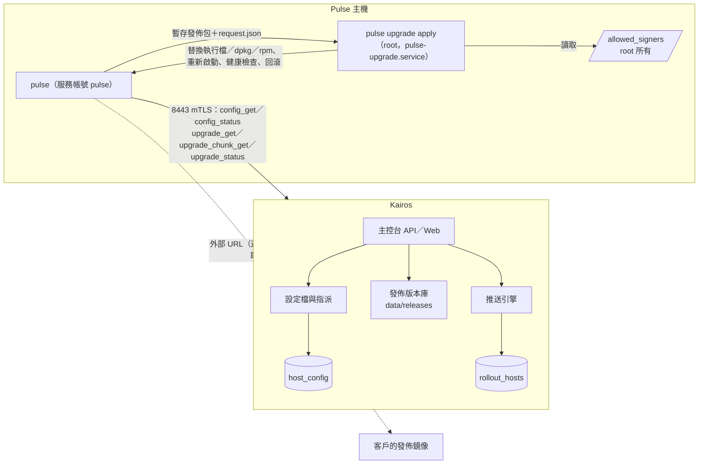
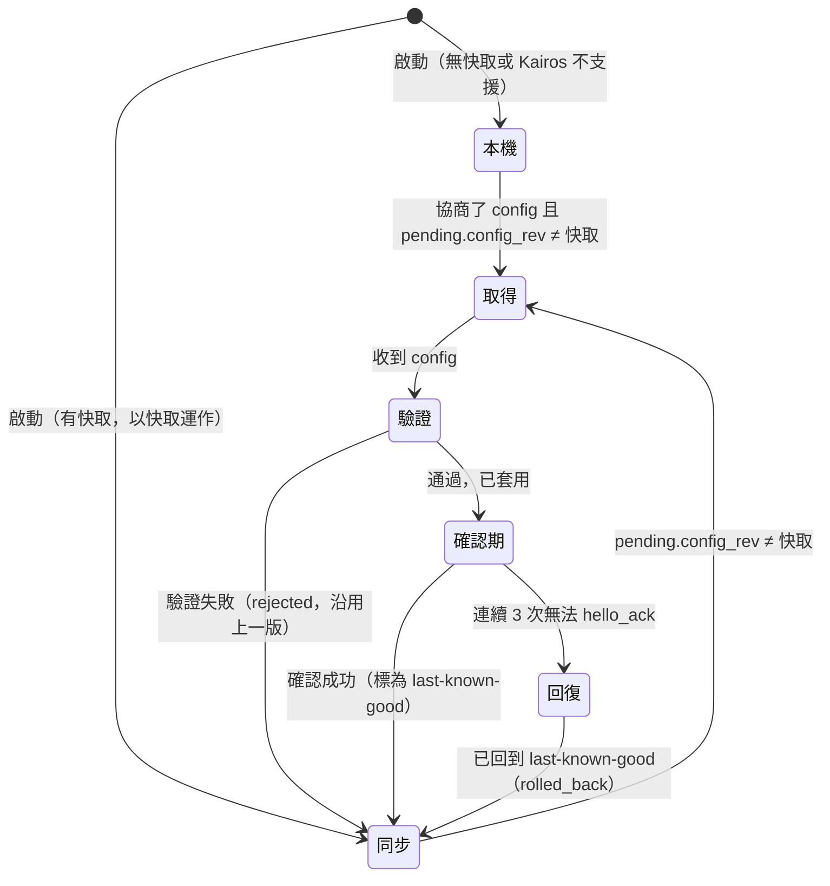
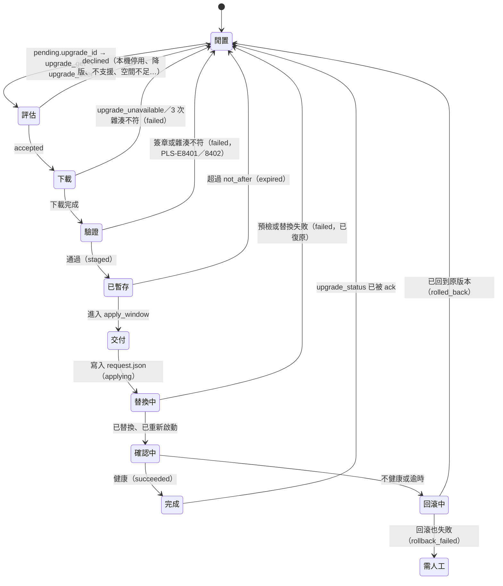

# 遠端管理：集中設定與 agent 遠端升級（F8）

〔衝刺 8 規格。第 14 節 D1～D18 已決定（2026-10-19，採建議）：Kairos 0.9.0／Pulse 0.9.0 實作 MVP（D15：集中設定＋Linux 升級＋兩批推送＋最小主控台），其餘延到 0.10.0。**S1（共用 crate）已實作**（衝刺 9）：第 2 節已搬入 [`PROTOCOL.md`](PROTOCOL.md)「遠端管理」並以它為準，`kairos-proto` 的 `mgmt`、`release` 模組。**K1／K2（Kairos 端）與 P1／P2（Pulse 端）都已實作**（衝刺 9）：Kairos 0.9.0 在 mTLS、SQLite 的連線上宣告 `config`、`upgrade`（實作附註與差異見第 13.1 節）；Pulse 0.9.0 帶 `install`、宣告 `config`／`upgrade`（實作附註與差異見第 17 節）；兩端都是 0.9.0 時協商這兩個 feature〕

本文件是商業審計 F8「agent 遠端升級與集中設定」的工程規格：8443 上的兩個新 feature `config`、`upgrade`（協定版本維持 v2），Kairos 端的設定檔、發佈版本庫與分批推送，Pulse 端的設定合併、升級狀態機與特權輔助程式，安全模型、資料表（schema v9 草案）、主控台 API 草案、畫面需求、錯誤代碼（暫定）、測試策略與實作分工。

- 協定的共通規則（傳輸、版本協商、錯誤格式、逾時）以 [`PROTOCOL.md`](PROTOCOL.md) 為準，本文件只定義新增的部分；實作時把第 2 節搬進 PROTOCOL.md（與 `renew`／`deregister` 從 ENROLL.md 搬過去的做法相同），範例改為 `kairos-proto` 的測試向量。
- 發佈包的簽章沿用 [`RELEASING.md`](../../RELEASING.md) 第 3 節（`ssh-keygen -Y sign`、namespace `kairos-pulse-release`、Ed25519）；安裝方式與檔案版面見 [`pulse/packaging/INSTALL.md`](../../pulse/packaging/INSTALL.md)。
- 主控台 API 的總則（回應格式、錯誤、RBAC、稽核、危險操作的確認）沿用 [`kairos/API.md`](../../kairos/API.md) 第 1、11.1、12 節。
- 錯誤代碼的格式與分配規則見設計包 `design-system/copywriting.md` §3；本文件的代碼都是**暫定**（第 11 節），由設計包正式分配後才能寫進程式。

### 範圍

| 在範圍內 | 不在範圍內 |
|---|---|
| Kairos 下發 Pulse 的部分設定（白名單），以群組、標籤、單台指派，回報實際生效值與差異，失敗回復 | 下發伺服器位址、憑證、信任設定等安全相關設定（永遠只在本機改，第 3.2 節） |
| Kairos 推送 Pulse 的**官方簽章發佈包**，分批（canary、百分比、升級時段），健康檢查與自動回滾 | 任意指令、指令碼、外掛的下發；不是遠端執行通道（第 5.5 節） |
| Linux tar／deb／rpm、Windows MSI／zip 的替換方式 | Kairos 自身的升級（第 4.11 節）；macOS |
| 離線 agent 重連後的同步 | 多實例主機的遠端升級（第 4.4.5 節，第一版不支援） |

### 與其他開發線的協調

- **schema 號碼**：本文件的資料表寫成 **schema v9 草案**。衝刺 8 另有 A2 HA（`kairos/HA.md`）、匯出、隱私三條線，可能也要新的 schema 版本。整合時由先合併的一方取 v9，另一方順延；本文件的遷移只**新增資料表與欄位**、不修改既有資料表的唯一鍵，不依賴其他線的物件，可依 v5／v6 的前例（`kairos/STORAGE.md` 第 3.2 節：版本號不必連續）接在任何一方之後。HA 若改用外部資料庫，本文件的資料表一併遷移，沒有只能在 SQLite 上成立的假設（除了「單一寫入者」的推送引擎，見第 4.7.6 節）。
- **錯誤代碼**：本文件使用**新的子類別 05（集中設定）與 84（遠端升級）**（設計包 §31.3 已正式分配，號碼不變；HA 原暫定的 84xx 改為 85xx），以及 61 的 `6106`（第 11 節）。其他線若也需要新子類別，整合前在設計包一次分配，避免撞號。
- **隱私線**：`processes.command`、`inventory.hardware_serials`、`inventory.network_addresses` 屬於隱私敏感的採集設定，第 3.1 節規定「下發只能更保守」；隱私線若改變這幾個設定的語意或預設值，第 3.1 節的表要同步。

## 1. 總覽



設計原則：

1. **Pulse 主動拉取**：沿用「Pulse 送、Kairos 回」的一問一答，Kairos 只在 `hello_ack` 與心跳的 `ack` 中提示「有新的設定／升級」（第 2.2 節），不新增伺服器主動送出的訊息，PROTOCOL.md「伺服器回應延遲最多 8 秒」的推論不變。
2. **信任不經過 Kairos**：Pulse 只安裝由**本機信任錨**（root 擁有的 `allowed_signers`）驗證過的官方發佈包。Kairos 被入侵時，最多能讓主機安裝另一個**官方簽章**的版本（且不能降版，第 4.8 節），不能執行任意程式。
3. **特權分離（Linux）**：Pulse 以 `pulse` 帳號、`NoNewPrivileges`、`ProtectSystem=strict` 執行，無法替換自己。下載與第一次驗證在 Pulse 中進行；替換由 root 的 `pulse-upgrade.service` 以**目前已安裝的**執行檔執行，**重新驗證**所有檔案後才動手，且不連網路（第 4.4 節）。
4. **本機永遠有最後決定權**：本機設定優先於下發設定（第 3.3 節）；遠端升級與集中設定各有本機開關（第 5.6 節），開關只能在本機改。
5. **升級與設定都可回復**：設定保留上一份可用的版本（last-known-good），升級保留上一版的執行檔或套件；兩者都有自動回復與回報。

## 2. 協定：feature `config`、`upgrade`

> 〔S1 已搬入 [`PROTOCOL.md`](PROTOCOL.md)「遠端管理（feature `config`、`upgrade`）」，以該節與 `kairos-proto` 的測試向量為準；本節保留作為設計背景。與本節的差異：`config_status` 的 `overridden` 只列本機值與下發值不同的鍵；`errors[].reason` 定為 `type_mismatch`、`out_of_range`、`invalid_value`、`conflict`；`upgrade_status` 的 `from_version`／`to_version`／`detail` 可以是空字串；第 2.7 節的範例雜湊與簽章在 PROTOCOL.md 換成真實的測試向量〕

兩個 feature 都只在協商結果為 v2、雙方都宣告、這條連線以用戶端憑證（mTLS）證明身分、且 Kairos 以 SQLite 儲存時使用（與 `renew` 的條件相同：Kairos 只在 client 也宣告時才在 `hello_ack` 列出）。沒有協商時，下列新的 `type` 一律視為不認得（`unknown_type`），與 0.8 相同。**協定版本不升**：新訊息、新欄位只在協商了對應 feature 的連線上出現，舊端不會收到。

| feature | Pulse 何時宣告 | Kairos 何時列出 |
|---|---|---|
| `config` | `remote_config.enabled = true`（預設） | `[remote] config_enabled = true`（預設）、SQLite 儲存、mTLS，且 client 宣告 |
| `upgrade` | `upgrade.enabled = true`，**且**本機準備就緒（`install.upgrade = "ready"`，第 2.1 節） | `[remote] upgrade_enabled = true`（預設）、SQLite 儲存、mTLS，且 client 宣告 |

### 2.1 hello 的 `install` 欄位

0.9.0 起的 Pulse 在 hello 另帶選用的 `install` 物件（v2 選用欄位；舊版 Kairos 忽略），讓主控台區分「Pulse 太舊」「本機停用」「缺少輔助程式」等原因。不論是否宣告 `config`／`upgrade` 都送。

| 欄位 | 型別 | 說明 |
|---|---|---|
| `method` | string | 安裝方式：`tar`、`deb`、`rpm`、`msi`、`zip`、`unknown`（偵測方式見第 4.3 節） |
| `upgrade` | string | 遠端升級的本機狀態：`ready`（可接受）、`disabled`（`upgrade.enabled = false`）、`no_trust_anchor`（找不到或無法使用 `allowed_signers`）、`no_helper`（Linux 沒有啟用 `pulse-upgrade.path`）、`unsupported`（多實例、`unknown` 安裝方式、不支援的平台）、`unsafe_path`（**Pulse 0.10.0 起**：其他條件都就緒，但安裝路徑沒有通過升級輔助程式的路徑檢查，第 17.9.7 節「hello 之前的預檢」） |
| `config` | string | 集中設定的本機狀態：`enabled`、`disabled` |
| `external_url` | string | **Pulse 0.11.0 起**。本機是否允許從外部 URL 下載發佈檔（第 4.1.2 節）：`none`（`upgrade.url_allowlist` 是空的，或沒有任何有效的項目——`source: "url"` 的提議一律 `declined`）、`allowlist`（白名單至少有一個有效的前綴）。**沒有這個欄位＝未知**（0.10.1 以前的 Pulse）。只宣告「有沒有白名單」，**不回報白名單的內容**（理由見下方「`external_url` 的設計」）。不論 `upgrade` 的值都送 |

| `rollback` | string | **Pulse 0.11.0 之後的版本**（ADR-0003 階段 2）。這台主機的自動回滾能力：`archived`（deb／rpm：目前版本的套件在 root 專屬的本機封存中，回滾經套件管理員裝回，不依賴 Kairos 的版本庫；第 17.10 節）、`binary_only`（只做執行檔層級的回滾：tar，或 deb／rpm 而沒有本機封存——版本庫有主機目前的版本時，提議附的回滾檔與 `rollback_bundle` 仍可讓它經套件管理員回滾）、`none`（`upgrade` 不是 `ready`：沒有自動回滾）、`degraded`（上一次自動回滾是降級回滾，套件資料庫與實際的執行檔仍不一致，第 4.5.2 節）。**沒有這個欄位＝未知**（較舊的 Pulse）。不論 `upgrade` 的值都送 |

- 限制：每個欄位都是 1～32 bytes 的小寫英文字母、數字或 `_`；不認得的值由 Kairos 原樣保存、顯示為「其他」。其他欄位忽略。物件或欄位型別錯誤時 `bad_request`（與 `os` 相同）；協商結果為 v1 時忽略。
- **`rollback` 的設計**（與 `external_url` 相同的理由放在 `install`、不升協定版本、不是新的 feature；較舊的 Kairos 忽略它）：
  - 值由 Pulse（服務帳號）依升級輔助程式（root）留在 `/var/lib/pulse/upgrade/rollback.json` 的提示算出（第 17.10.6 節）。提示只在它描述的是「目前執行的這一份執行檔」（SHA-256 相同）時才採用；`degraded` 另外要求套件資料庫的狀態仍與降級回滾當時相同（重新安裝套件之後不再回報）。這個檔案在服務帳號可寫的目錄裡，**只影響顯示與資格預覽**：輔助程式從不讀它，回滾時用什麼來源仍由輔助程式以 root 的封存索引與信任錨決定（ADR-0003 的 INV-6、INV-11）。謊報 `archived` 的主機只會讓預覽少算一台「無法自動回滾」；實際回滾時沒有封存就照第 4.4.2 節往下退。
  - Kairos 的用途：資格分類（第 4.7.2 節：宣告 `archived` 的 deb／rpm 主機不因「版本庫沒有目前的版本」而列為 `no_rollback`）、預覽的 `rollback` 統計、主機詳情（`install.rollback`、「需要修復套件」）。清冊的 `hosts.install_rollback`（schema v13）與 `install_external_url` 相同：每次帶 `install.upgrade` 的 hello 整個取代，不沿用舊值。
- **`external_url` 的設計**（0.11.0 起）：
  - **為什麼放在 `install` 而不是新的 feature**：需要分辨三種情況——不允許、允許、舊版沒宣告。feature 只有「宣告／沒宣告」兩種，「沒宣告 `upgrade_url`」分不出是舊版還是白名單是空的（除非再以版本號推測）；`install` 的選用欄位天生有第三種狀態（沒有這個欄位）。這也是 0.10.0 `unsafe_path` 的做法：Pulse 在 hello 事先回報、Kairos 據此做資格分類。
  - **協定版本不升、沒有新的 feature**：「`install` 物件中的其他欄位忽略」是 0.9.0 就定下的規則。新 Pulse 連 0.9／0.10 的 Kairos：舊 Kairos 忽略這個欄位，行為與現在完全相同（不允許外部 URL 的主機在推送中回報 `declined`）。0.10.1 以前的 Pulse 連新 Kairos：沒有這個欄位＝未知，維持現行行為，預覽另外註明台數。值的格式與其他欄位相同，不認得的值（未來的 Pulse）原樣保存並視為未知。
  - **只回報「有沒有」，不回報白名單的內容，也不回報雜湊**。評估過讓 Kairos 判斷某個 `base_url` 是否落在主機的白名單內（回報前綴，或前綴的雜湊），沒有採用：(1) 白名單是「這台主機可以對哪些位址發出 HTTPS 請求」的清單，集中到 Kairos 之後，**被入侵的 Kairos 不必猜測就知道對每台主機可用的外連目標**（第 5.1 節的威脅「把 agent 當成對內網發出請求的工具」），白名單原本要求攻擊者盲猜的保護就沒有了；(2) 白名單常含內部主機名稱與路徑，回報到中央並存入資料庫、備份、匯出是資訊揭露；(3) 雜湊沒有改善：前綴的熵很低（內部主機名稱可以列舉），Kairos 本來就能對任何候選 URL 計算雜湊來比對，等同提供查詢的神諭。只回報一個位元時，被入侵的 Kairos 得知的只有「這台主機有設定白名單」，仍然要猜內容；而「白名單是空的」對攻擊者沒有用處（那些主機本來就不會對外連線）。
  - 代價：宣告 `allowlist` 但白名單不含這個 `base_url` 的主機，預覽仍然看不出來，照舊在推送中回報 `declined`（`PLS-W8411`、`url_not_allowed`）。實務上白名單由集中部署工具一致下發，最常見的落差是「完全沒設定」，這正是 `none` 涵蓋的情況。更精確的做法（例如由 Kairos 把候選的 `base_url` 送給 Pulse、Pulse 只回答是或否，並限制詢問的頻率）列為待決（第 17.5 節 #4）。
  - Pulse 端：`upgrade.url_allowlist` 以 `pulse.toml` 的值為準（環境變數不能放寬，第 17.2 節 #18），與實際比對提議時用的是同一份；「有效的項目」與第 17.7 節的比對相同（不合法的項目不比對任何 URL，全部不合法等同空的）。修改白名單後重新啟動 Pulse，下一次 hello 就會更新。
- **`unsafe_path` 不需要改協定版本**（0.10.0）：它符合上面的格式限制，而「不認得的值不是錯誤」是 0.9.0 就定下的規則。0.9 的 Kairos 收到 0.10 的 Pulse 送的 `unsafe_path`：原樣保存，主控台顯示為「其他（unsafe_path）」，資格分類為 `not_ready`（一樣不會被提議升級，只是原因不精確）。0.10 的 Kairos 收到 0.9 的 Pulse：0.9 不做預檢，不合規的主機回報 `ready`，要到升級到 0.10.0 之後才會回報——0.9 的輔助程式也沒有路徑檢查，所以 0.9 → 0.10 的那一次升級不受影響。判斷順序：`disabled` → `unsupported` → `no_trust_anchor` → `no_helper` → `unsafe_path` → `ready`（只有「原本會是 `ready`」的主機才做預檢）。
- `upgrade` 為 `ready` 以外的值時 Pulse **不宣告** `upgrade`；Kairos 因此不會對它提議升級，主控台依 `install.upgrade` 顯示原因。

### 2.2 `pending`：有新的設定或升級

協商了 `config` 或 `upgrade` 的連線上，Kairos 在 `hello_ack` 與**回應 `heartbeat` 的 `ack`** 另帶 `pending` 物件（回應 `report` 等其他訊息的 `ack` 不帶，避免每筆 report 多出位元組）：

| 欄位 | 型別 | 說明 |
|---|---|---|
| `config_rev` | u64 | 協商了 `config` 時才有。這台主機目前應套用的設定版本（第 3.4.4 節）；`0` 表示沒有任何下發設定 |
| `upgrade_id` | string | 協商了 `upgrade` 且有提議給這台主機時才有：推送中這台主機的升級 ID（UUID） |

- Pulse 收到的 `config_rev` 與本機已套用的版本不同時送 `config_get`；收到不認得的 `upgrade_id`（與正在處理、或已完成的不同）時送 `upgrade_get`。
- 延遲上限為一個心跳間隔（預設 15 秒）。Kairos 不必在設定改變的當下通知每條連線，只要下一次回應心跳時帶出新的值。
- 型別不符時 Pulse 視為沒有該欄位（與 `renew_now` 相同的容錯）。

### 2.3 集中設定的訊息

| 訊息 | 方向 | 欄位 |
|---|---|---|
| `config_get` | P → K | `seq`、`ts`、`have_rev`（u64，本機已套用的版本，沒有時 `0`） |
| `config` | K → P | `seq`（回應的 `config_get`）、`rev`（u64）、`hash`（`sha256:` 加 64 個小寫十六進位：`settings` 正規化 JSON 的 SHA-256，第 3.4.4 節）、`settings`（物件，第 2.3.1 節）、`sources`（物件，鍵為設定鍵、值為設定檔名稱，供本機顯示來源；選用）、`issued_at`（RFC 3339 UTC 毫秒） |
| `config_status` | P → K | `seq`、`ts`、`rev`、`hash`、`state`、`effective`、`overridden`、`ignored`、`errors`、`code`（第 2.3.2 節） |
| `ack` | K → P | 回應 `config_status`（只有 `seq`） |

#### 2.3.1 `settings` 的格式

兩層物件：`{"<區段>": {"<鍵>": <值>}}`，區段與鍵與 `pulse.toml` 相同（例如 `{"report":{"interval":10},"log":{"level":"debug"}}`）。巢狀區段以 `.` 表示（`log.syslog` 不在白名單，目前沒有用到）。

- 只能出現第 3.1 節白名單中的鍵；Kairos 依這台主機回報的 `agent_version` 只送該版本認得的鍵（第 3.1 節「最低 Pulse」欄）。
- 值的型別與 `pulse.toml` 相同（整數、布林、字串、字串陣列）。
- 單行上限 65536 bytes 仍適用；白名單全部填滿約 2 KB，不會接近上限。Kairos 儲存設定檔時以同樣的上限檢查。

#### 2.3.2 `config_status`

| 欄位 | 型別 | 說明 |
|---|---|---|
| `rev`、`hash` | u64、string | 這次處理的版本；`state` 為 `disabled` 時為本機最後一次套用的版本（沒有時 `0`、`""`） |
| `state` | string | `applied`（已套用；含部分鍵被本機覆蓋或忽略）、`rejected`（驗證失敗，整份不套用，沿用上一版）、`rolled_back`（套用後健康確認失敗，已回復上一版，第 3.6 節）、`disabled`（本機停用集中設定；只在停用後的第一次連線送一次，之後不宣告 `config`） |
| `effective` | object | 白名單中每個鍵**實際生效的值**（合併後，與 `settings` 同一種兩層格式） |
| `overridden` | array | 被本機覆蓋的鍵：`{"key":"report.interval","remote":10,"local":5,"source":"pulse.toml"}`；`source` 為 `pulse.toml` 或 `env` |
| `ignored` | array | 沒有套用、但不影響其他鍵的項目：`{"key":"…","reason":"unknown_key"\|"unsupported_platform"\|"not_more_restrictive"}` |
| `errors` | array | `state` 為 `rejected`／`rolled_back` 時的原因：`{"key":"report.interval","reason":"out_of_range","message":"…"}`（`message` ≤ 256 bytes，字元限制同 `hostname`） |
| `code` | string 或 `null` | 對應的 Pulse 代碼（例如 `PLS-W0501`），沒有時 `null` |

- Pulse 在**每條新連線的 `hello_ack` 之後**送一次（讓 Kairos 知道本機設定在重新啟動後的變化），以及每次處理 `config` 之後送一次。未收到 `ack` 就斷線時，重連後再送（內容以當時的狀態為準）。
- 陣列各最多 64 項；超過時截斷並在最後一項加 `{"key":"*","reason":"truncated"}`。
- Kairos 以「(主機, `rev`, `state`) 最新的一則」更新 `host_config`（第 6 節）；`rev` 比資料庫中的 `applied_rev` 舊時只更新 `effective`／`overridden`（本機變化），不倒退版本。

### 2.4 遠端升級的訊息

| 訊息 | 方向 | 欄位 |
|---|---|---|
| `upgrade_get` | P → K | `seq`、`ts`、`upgrade_id` |
| `upgrade_offer` | K → P | `seq`、`upgrade_id`、`rollout_id`、`action`（`upgrade`／`downgrade`）、`target`（`version`、`commit`）、`artifact`、`rollback_artifact`（選用）、`rollback_bundle`（選用，0.11.0 之後的 Kairos）、`manifest`、`sha256sums`、`signature`、`apply_window`、`health_timeout_secs`、`allow_downgrade`（第 2.4.1 節） |
| `upgrade_chunk_get` | P → K | `seq`、`ts`、`upgrade_id`、`filename`、`offset`（u64）、`length`（1～32768） |
| `upgrade_chunk` | K → P | `seq`、`upgrade_id`、`filename`、`offset`、`data`（標準 base64，含補位）、`eof`（布林：這段之後沒有資料） |
| `upgrade_status` | P → K | `seq`、`ts`、`upgrade_id`、`state`、`from_version`、`to_version`、`code`、`detail`、`progress`（第 2.4.3 節） |
| `ack` | K → P | 回應 `upgrade_status` |

#### 2.4.1 `upgrade_offer`

| 欄位 | 說明 |
|---|---|
| `artifact` | `filename`（發佈檔名，`pulse-<版本>-<commit>-<os>-<arch>.<格式>`）、`size`（bytes，上限 128 MiB）、`sha256`（64 個小寫十六進位）、`source`（`kairos`：以 `upgrade_chunk_get` 從這條連線下載；`url`：從 `url` 下載）、`url`（`source` 為 `url` 時，`https://` 開頭、≤ 2048 bytes） |
| `rollback_artifact` | deb／rpm／msi 的主機才有：**目前版本**、同格式同平台的發佈檔（欄位同 `artifact`），自動回滾時使用（第 4.4.2 節）；版本庫沒有時省略，Pulse 依第 4.5.3 節處理 |
| `rollback_bundle` | **0.11.0 之後的 Kairos**（ADR-0003 階段 1）。`rollback_artifact` 所屬那次發佈的簽章資料：`{"sha256sums":"<SHA256SUMS 全文>","signature":"<SHA256SUMS.sig 全文>"}`（各 1 bytes 以上，上限與 `sha256sums`、`signature` 相同）。**只有 `rollback_artifact` 存在時才允許**；Kairos 只對 deb／rpm 主機附上，其他安裝方式的 Pulse 收到也忽略。它讓「本機沒有目前版本的驗證紀錄」的主機（第一次遠端升級、手動安裝的套件）也能驗證並使用回滾檔。**只是提示**：Pulse 與升級輔助程式各自以本機信任錨完整驗證（第 4.4.2 節），驗證不過不讓升級失敗 |
| `manifest` | 發佈清單的檔名與內容：`{"filename":"pulse-0.9.1-…-release.json","content":"<JSON 字串>"}`（≤ 8 KiB，第 4.1.3 節）。0.9.0 以前的發佈沒有清單，此欄為 `null`，只能作為降版或回滾目標 |
| `sha256sums` | 該次發佈的 `SHA256SUMS` 全文（≤ 16 KiB） |
| `signature` | `SHA256SUMS.sig` 全文（≤ 4 KiB，`-----BEGIN SSH SIGNATURE-----` 格式） |
| `apply_window` | `not_before`、`not_after`（RFC 3339）：Pulse 只在這段期間**開始替換**；下載與驗證可以提早進行。超過 `not_after` 仍未開始時放棄（`state: expired`），等 Kairos 下一個時段再提議 |
| `health_timeout_secs` | 替換後的健康確認期限（120～3600，第 4.5 節） |
| `allow_downgrade` | 推送是否允許降版。Pulse 只在這個值**與**本機 `upgrade.allow_downgrade` 都為 `true` 時接受低於目前版本的目標（第 4.8 節） |

Kairos 依這台主機的 `install.method`、`os.arch`（hello 的 `os`）選出發佈檔：`tar` → `linux-<arch>.tar.gz`、`deb` → `.deb`、`rpm` → `.rpm`、`msi` → `windows-x86_64.msi`、`zip` → `windows-x86_64.zip`。版本庫中沒有對應的檔案時，這台主機在推送中標為 `skipped`（`no_artifact`），不送提議。

**`rollback_bundle` 不需要新的 feature，條件是整則訊息仍在單行上限內**（ADR-0003 第 6.2、6.3 節）：`upgrade_offer` 的解析不拒絕不認得的欄位，0.9～0.11.0 的 Pulse 忽略它（`kairos-proto` 有凍結的舊型別測試）。但超過單行上限（65536 bytes）的訊息對端會當成**連線錯誤**，不是忽略欄位；欄位的大小上限只限制原始 bytes，JSON 跳脫之後可能更長。所以 Kairos 在送出前套用**單行大小的三段式規則**（`kairos_proto::mgmt::fit_upgrade_offer`）：

1. 以要送出的**完整訊息**（`{"type":"upgrade_offer",…}`）實際序列化，byte 長度加上換行字元與 1 KiB 的餘裕（`OFFER_LINE_RESERVE`）必須 ≤ 65536：原樣送出。
2. 含 `rollback_bundle` 時超過 → 省略 `rollback_bundle` 再算一次，放得下就送出（主機照常升級；回滾檔只有在主機本機有紀錄時才會被使用）。這台主機在推送中的 `reason` 記為 `rollback_bundle_omitted`（主機表看得到），Kairos 記一則 `WARN`。
3. 仍超過 → **不送出**：`upgrade_get` 的回應是 `upgrade_unavailable`（連線不受影響）。這台主機在推送中標為 `failed`（`reason` 為 `offer_too_large`，代碼 `KRS-W8419`〔暫定號〕；修正版本庫後可以重試），寫稽核事件 `host.upgrade.offer_too_large`，推送自動暫停（`pause_cause` 為 `offer_too_large`，第 4.7.4 節）。沒有 `rollback_bundle` 的提議也適用這一條。

正常的官方發佈不會碰到第 2、3 段（每個欄位都取上限的合法內容約 55 KB）；它們擋的是版本庫中需要大量跳脫的異常內容。回滾檔所屬發佈的簽章資料本身不合規定（空的、超過欄位上限）時 Kairos 不附 `rollback_bundle`、照常提議。

#### 2.4.2 下載（`source: "kairos"`）

- 發佈包經這條 mTLS 連線分段傳送：每段最多 32768 bytes（base64 後約 43.7 KB，加上 JSON 不超過單行上限）。`filename` 只能是這次 `upgrade_offer` 的 `artifact`、`rollback_artifact` 之一，否則 `upgrade_unavailable`。
- Pulse 同一時間最多 **2 段**在途（另計，不占 durable report 的 4 筆）；依 `offset` 順序寫入暫存檔 `<檔名>.part`，斷線後從已寫入的長度續傳。全部收到後以 `artifact.sha256` 檢查，不符時刪除重來（連續 3 次不符時放棄，`PLS-E8402`）。
- 段落請求計入每條連線的訊息速率限制（可連續 50 則、之後每秒 20 則）；10 MB 的發佈包約 320 段，區域網路約 20～40 秒。Kairos 從磁碟讀一段的時間遠小於 8 秒的回應上限。
- **併發限制**：Kairos 以 `[remote] max_concurrent_downloads`（預設 100 台）限制同時下載的主機數；超過時對 `upgrade_chunk_get` 回非 fatal 的 `rate_limited`，另帶 `retry_after_ms`，Pulse 依此等待（加 ±20% 抖動）後續傳。一台主機超過 10 分鐘沒有請求下一段時釋出名額。
- `source: "url"` 時 Pulse 以 HTTPS GET 下載（第 4.1.2 節），不經這條連線。

#### 2.4.3 `upgrade_status`

| 欄位 | 說明 |
|---|---|
| `state` | `accepted`（收到提議、開始下載）、`declined`（拒絕，原因在 `code`／`detail`：本機停用、降版、不支援、空間不足、`min_upgrade_from` 不符）、`staged`（下載並驗證完成，等待時段）、`expired`（超過 `apply_window.not_after` 未開始）、`applying`（已交給輔助程式）、`succeeded`、`failed`（替換前或替換中失敗，沒有變更、或已復原）、`rolled_back`（健康確認失敗，已回到原版本）、`rollback_failed`（回滾也失敗，需要人工處理） |
| `from_version`、`to_version` | 替換前與目標版本 |
| `code` | Pulse 代碼（第 11 節）或 `null` |
| `detail` | ≤ 512 bytes，字元限制同 `hostname`（例如套件管理員的最後一行錯誤） |
| `progress` | 選用：`{"bytes":1048576,"total":10485760}`；`accepted` 之後每完成 25% 送一次 |

- `applying` 之後的狀態（`succeeded`、`rolled_back`、`rollback_failed`、`failed`）由**替換後的 Pulse**（新版，或回滾後的原版）在重新連線、`hello_ack` 之後送出：結果先寫在本機的狀態檔（第 4.6 節），收到 `ack` 才標為已回報（at-least-once）。Kairos 以 (`upgrade_id`, `state`) 去重。
- Kairos 另以 hello 的 `agent_version` 交叉確認：收到 `succeeded` 而版本不是目標版本時記 `KRS-W8402` 並把這台主機標為 `failed`（`version_mismatch`）。
- **降級回滾**（0.11.0 之後的版本；第 4.5.2 節、ADR-0003 第 5.4 節）：健康確認失敗後服務已恢復到舊版，但 deb／rpm 只換回了執行檔、套件資料庫與實際的執行檔不一致。`state` **仍是 `rolled_back`**（舊的 Kairos 只接受固定的狀態值，新的狀態值會被當成 `bad_request`），另外：
  - `code` 是 `PLS-W8418`〔暫定號〕，不是一般回滾的 `PLS-W8407`；
  - `detail` 以固定的前綴 `degraded:` 開頭，接著是以逗號分隔、機器可讀的原因（小寫英文字母、數字與 `_`），到第一個其他字元（`;`）為止，之後才是人讀的說明。例：`degraded:package_rollback_failed,package_db_inconsistent; crash_restart (NRestarts 0 → 1); rollback: dpkg: error processing archive`。
  - 原因（`kairos_proto::mgmt::DEGRADED_*`；不認得的原因 Kairos 原樣保存與顯示）：`package_db_inconsistent`（每一次降級回滾都有）、`no_rollback_package`（沒有任何回滾套件）、`rollback_not_verified`（回滾套件沒有通過簽章、雜湊或檔名與平台的驗證，含簽署金鑰已到期）、`rollback_commit_mismatch`、`rollback_binary_mismatch`（回滾套件不是替換前執行的那個 commit／那一份執行檔）、`rollback_archive_unusable`（本機封存損毀、缺失或不安全）、`rollback_signer_revoked`（回滾套件的簽署金鑰已從信任錨移除，或信任錨無法讀取）、`rollback_copy_changed`（驗證過的複本在回滾時與紀錄的雜湊不符）、`package_rollback_failed`（套件管理員裝回舊版失敗）。
  - 較舊的 Kairos 收到時當成一般的 `rolled_back`（`detail` 原樣顯示）。

### 2.5 新增與擴充的錯誤碼

| code | 情境 | fatal |
|---|---|---|
| `upgrade_unavailable` | `upgrade_get`、`upgrade_chunk_get`：沒有這個 `upgrade_id`、推送已暫停或取消、這台主機已不在推送中、檔案不在提議中或已從版本庫刪除。Pulse 停止這次升級、刪除暫存（`staged` 之前）或保留到下一個提議（`staged`，同一個目標版本時沿用） | 否 |
| `rate_limited`（擴充） | 原本只用於 `renew_request`。另用於 `upgrade_chunk_get` 超過下載併發，此時另帶 `retry_after_ms`（u32） | 否 |
| `storage_unavailable`（擴充） | `config_get`、`config_status`、`upgrade_status` 無法讀寫資料庫時；Pulse 稍後重送 | 否 |
| `bad_request` | 新訊息的欄位缺漏或型別錯誤（`seq` 為 `null`，與 report 相同） | 否（連續上限照舊） |

### 2.6 相容矩陣

| Pulse | Kairos | 結果 |
|---|---|---|
| 0.8.0 以前 | 0.9.0 | 不宣告 `config`／`upgrade`、沒有 `install`：與 0.8 完全相同。主控台顯示「不支援集中設定與遠端升級（需要 Pulse 0.9.0 以上）」。**0.8 → 0.9 必須手動升級一次**（第 4.10 節） |
| 0.9.0 | 0.8.0 以前 | 舊版 Kairos 不列出兩個 feature、忽略 `install`：Pulse 只用本機設定（遠端設定的快取保留不用，第 3.7 節），不會升級 |
| 0.9.0 | 0.9.0，`storage.backend = "jsonl"` 或沒有 mTLS | Kairos 不列出兩個 feature，同上 |
| 0.9.0，`remote_config.enabled = false` | 0.9.0 | 只協商 `upgrade`（若準備就緒）；主控台顯示「本機停用集中設定」 |
| 0.9.0，`install.upgrade` 不是 `ready` | 0.9.0 | 只協商 `config`；主控台依 `install.upgrade` 顯示原因 |

回滾檔的簽章資料、降級回滾與 `install.rollback`（ADR-0003 第 6.4 節；「N」＝含階段 1、2 的版本，0.11.0 之後）：

| Kairos ＼ Pulse | 0.9.x | 0.10.x、0.11.0 | N |
|---|---|---|---|
| 0.9.x～0.11.0 | 沒有 `rollback_bundle`：回滾檔只有在本機有紀錄時使用，否則 `pulse.prev` | 同左（`from_version` 等已修） | 沒有 bundle：本機封存、本機紀錄或 `pulse.prev`；只換回執行檔時回報降級回滾——舊 Kairos 當成一般的 `rolled_back`（`detail` 原樣顯示，不暫停推送）；`install.rollback` 被忽略 |
| N | 忽略 `rollback_bundle`（單行大小的規則保證訊息不超過上限）；沒有 `install.rollback`（未知） | 同左 | 第一次遠端升級即可經套件管理員回滾；降級回滾暫停推送並標示主機；資格預覽依 `install.rollback` 與版本庫 |

「回報降級回滾」取決於**執行回滾的輔助程式**的版本（替換前安裝的那一版；替換後中斷而接續時是新版）：N 的 Pulse 升級到任何版本失敗時都依 N 的規則回滾與回報。

### 2.7 範例（實作時改為 PROTOCOL.md 的測試向量）

```
P {"type":"hello","seq":1,"proto":1,"proto_min":1,"proto_max":2,"features":["metrics","durable","renew","inventory","processes","config","upgrade"],"agent_id":"6f1c0e4a-1b2c-4d3e-9f00-112233445566","hostname":"web-01","agent_version":"0.9.0","heartbeat_interval_ms":15000,"ts":"2026-11-20T02:00:00.001Z","os":{"name":"Ubuntu","version":"24.04","arch":"x86_64"},"install":{"method":"deb","upgrade":"ready","config":"enabled"}}
K {"type":"hello_ack","seq":1,"proto":2,"offline_after_ms":75000,"features":["metrics","durable","renew","inventory","processes","config","upgrade"],"server_time":"2026-11-20T02:00:00.009Z","expired_renew_grace_days":90,"pending":{"config_rev":42}}
P {"type":"config_get","seq":2,"ts":"2026-11-20T02:00:00.020Z","have_rev":37}
K {"type":"config","seq":2,"rev":42,"hash":"sha256:0c4f3d2b1a6e5f7081928374655647382910abcdef0123456789abcdef012345","settings":{"report":{"interval":10},"log":{"level":"debug"},"processes":{"top":10}},"sources":{"report.interval":"正式環境 Linux","log.level":"web-01 除錯","processes.top":"正式環境 Linux"},"issued_at":"2026-11-20T02:00:00.025Z"}
P {"type":"config_status","seq":3,"ts":"2026-11-20T02:00:00.140Z","rev":42,"hash":"sha256:0c4f3d2b1a6e5f7081928374655647382910abcdef0123456789abcdef012345","state":"applied","effective":{"report":{"interval":5},"log":{"level":"debug"},"processes":{"top":10}},"overridden":[{"key":"report.interval","remote":10,"local":5,"source":"pulse.toml"}],"ignored":[],"errors":[],"code":"PLS-I0503"}
K {"type":"ack","seq":3}
P {"type":"heartbeat","seq":4,"ts":"2026-11-20T02:00:15.002Z"}
K {"type":"ack","seq":4,"pending":{"config_rev":42,"upgrade_id":"9d3e7a10-4b2c-4f6e-8a1d-2c3b4a5f6e70"}}
P {"type":"upgrade_get","seq":5,"ts":"2026-11-20T02:00:15.010Z","upgrade_id":"9d3e7a10-4b2c-4f6e-8a1d-2c3b4a5f6e70"}
K {"type":"upgrade_offer","seq":5,"upgrade_id":"9d3e7a10-4b2c-4f6e-8a1d-2c3b4a5f6e70","rollout_id":"r-20261120-0001","action":"upgrade","target":{"version":"0.9.1","commit":"5e6f7a8"},"artifact":{"filename":"pulse-0.9.1-5e6f7a8-linux-x86_64.deb","size":5242880,"sha256":"7d9a0e1b2c3d4e5f60718293a4b5c6d7e8f90123456789abcdef0123456789ab","source":"kairos"},"rollback_artifact":{"filename":"pulse-0.9.0-1a2b3c4-linux-x86_64.deb","size":5238784,"sha256":"aa11bb22cc33dd44ee55ff6600112233445566778899aabbccddeeff00112233","source":"kairos"},"manifest":{"filename":"pulse-0.9.1-5e6f7a8-release.json","content":"{\"schema\":\"kairos-pulse.release/v1\",\"product\":\"pulse\",\"version\":\"0.9.1\"}"},"sha256sums":"7d9a…  pulse-0.9.1-5e6f7a8-linux-x86_64.deb\n","signature":"-----BEGIN SSH SIGNATURE-----\nU1NIU0lH\n-----END SSH SIGNATURE-----\n","apply_window":{"not_before":"2026-11-20T17:00:00.000Z","not_after":"2026-11-20T21:00:00.000Z"},"health_timeout_secs":600,"allow_downgrade":false}
P {"type":"upgrade_status","seq":6,"ts":"2026-11-20T02:00:15.100Z","upgrade_id":"9d3e7a10-4b2c-4f6e-8a1d-2c3b4a5f6e70","state":"accepted","from_version":"0.9.0","to_version":"0.9.1","code":null,"detail":""}
K {"type":"ack","seq":6}
P {"type":"upgrade_chunk_get","seq":7,"ts":"2026-11-20T02:00:15.120Z","upgrade_id":"9d3e7a10-4b2c-4f6e-8a1d-2c3b4a5f6e70","filename":"pulse-0.9.1-5e6f7a8-linux-x86_64.deb","offset":0,"length":32768}
K {"type":"upgrade_chunk","seq":7,"upgrade_id":"9d3e7a10-4b2c-4f6e-8a1d-2c3b4a5f6e70","filename":"pulse-0.9.1-5e6f7a8-linux-x86_64.deb","offset":0,"data":"ITxhcmNoPgo=","eof":false}
K {"type":"error","seq":9,"code":"rate_limited","message":"too many concurrent downloads; retry later","fatal":false,"retry_after_ms":30000}
```

（`sha256sums`、`signature`、`data` 在此縮短。）

## 3. 集中設定

### 3.1 可下發的設定（白名單）

「套用」欄：**即時**＝不中斷連線、下一個週期生效；**重新連線**＝Pulse 主動結束目前的連線並重連（hello 的內容或協商的 feature 會改變），等同一次短暫斷線（durable 的積壓照常補送）。沒有任何下發的鍵需要重新啟動行程。

| 鍵 | 範圍（同 `pulse.toml`） | 套用 | 最低 Pulse | 備註 |
|---|---|---|---|---|
| `heartbeat.interval` | 1～60 秒 | 重新連線 | 0.9.0 | hello 的 `heartbeat_interval_ms` 改變，Kairos 的離線判定隨之改變 |
| `report.interval` | 1～3600 秒 | 即時（hello 的 `report_interval_ms` 在下一次連線更新） | 0.9.0 | |
| `retry.max_retries`、`retry.initial_delay`、`retry.max_delay` | 同 `pulse.toml` | 即時（下一次斷線） | 0.9.0 | |
| `collect.filesystems`、`disk_io`、`network`、`temperature` | 布林 | 即時 | 0.9.0 | |
| `collect.max_filesystems`、`max_disks`、`max_interfaces` | 0～16／0～8／0～16 | 即時 | 0.9.0 | |
| `collect.interface_exclude` | 字串陣列，最多 32 個 | 即時 | 0.9.0 | 與本機的值**取聯集**（第 3.3 節例外） |
| `processes.enabled` | 布林 | 重新連線（feature `processes`） | 0.9.0 | |
| `processes.interval`、`processes.top` | 1～3600／1～10 | 即時 | 0.9.0 | |
| `processes.command` | `none`、`executable` | 即時 | 0.9.0 | **隱私敏感：只能下發更保守的值**。`full` 不接受（只能在本機設定）；本機為 `none` 時下發 `executable` 被忽略（`not_more_restrictive`） |
| `inventory.enabled`、`inventory.interval` | 布林／300～86400 | 重新連線（feature `inventory`）／即時 | 0.9.0 | |
| `inventory.hardware_serials`、`inventory.network_addresses` | 布林 | 即時（下一次收集） | 0.9.0 | **隱私敏感：只能下發 `false`**；下發 `true` 而本機（或內建預設）已是 `true` 時視為相同，本機為 `false` 時忽略 |
| `buffer.enabled` | 布林 | 重新連線（feature `durable`） | 0.9.0 | 由 `true` 改為 `false` 時緩衝中的積壓保留，改回 `true` 後補送 |
| `buffer.max_mb`、`max_records`、`max_age_hours`、`replay_interval_ms` | 同 `pulse.toml` | 即時 | 0.9.0 | 調小時依原本的規則丟掉最舊的資料（`PLS-W4202`） |
| `log.level` | `trace`～`error` | 即時 | 0.9.0 | 常用於暫時除錯；設定檔可帶到期時間（第 3.4.2 節） |
| `log.retention_days` | 0～3650 | 即時（下一次清除） | 0.9.0 | |
| `status.*`、`metrics.textfile_interval` | — | — | — | 不下發（見第 3.2 節） |

「隱私敏感」的規則：下發的值只有在**比本機（含內建預設）更保守或相同**時才套用，否則放進 `ignored`。理由：主機的擁有者可能基於當地法規關閉了某些採集，中央不應能重新開啟（詳見第 14 節 D10，與隱私線協調）。

### 3.2 永遠只能在本機改的設定

下列設定**不在白名單**，Kairos 不能下發，Pulse 收到時一律放進 `ignored`（`unknown_key`），不影響其他鍵：

| 類別 | 鍵 | 理由 |
|---|---|---|
| 連線與信任 | `server.*`（`address`、`port`、`domain`、`accept_invalid_certs`、`ca_cert`、`use_system_roots`、`client_cert`、`client_key`）、`enroll.*` | 改錯會使主機永久失聯，或被導向假的伺服器 |
| 身分 | `agent.id_file`、`agent.display_name`、`agent.tags`、`identity.*` | 身分與指派的依據；標籤由 Kairos 端另外管理（第 3.4.3 節） |
| 路徑與檔案 | `buffer.dir`、`status.file`、`metrics.textfile`、日誌目錄 | 服務帳號的可寫路徑由 systemd unit 決定，下發路徑只會失敗或寫到不該寫的地方 |
| 對外送出 | `log.syslog.*`、`metrics.listen`、`log.format`、`log.stdout`、`log.timezone` | 不可讓中央把日誌導向任意主機或開啟監聽埠；`format` 改變檔名，會破壞客戶的日誌收集 |
| 隱私上限 | `processes.command = "full"`、`processes.include_user` | 見第 3.1 節 |
| 遠端管理本身 | `remote_config.*`、`upgrade.*` | 本機開關與信任錨（第 5.6 節）；特權輔助程式只讀 `pulse.toml`，不讀遠端設定 |

### 3.3 合併優先順序

```
內建預設值  <  Kairos 下發  <  pulse.toml  <  PULSE__* 環境變數
```

- **本機明確寫出的值永遠優先**（第 14 節 D1 的建議）。`pulse enroll` 與套件產生的 `pulse.toml` 只有 `[server]` 與註解，大多數主機沒有本機覆蓋；需要由中央管理的鍵，請從 `pulse.toml` 移除。
- 被本機覆蓋的鍵回報在 `overridden`，主控台列為「本機覆蓋」（差異），不是錯誤。
- 例外：`collect.interface_exclude` 取聯集（本機排除的介面不會因中央的清單而被送出；中央也能再排除更多）。
- 「隱私敏感」的鍵另依第 3.1 節只取較保守者。
- `pulse config show --effective --sources`（第 10.2 節）列出每個鍵的值與來源（`default`／`remote:<設定檔>`／`pulse.toml`／`env`）。

### 3.4 Kairos 端：設定檔、指派與版本

#### 3.4.1 設定檔（profile）

一個設定檔是白名單鍵的部分集合（只寫要改的鍵），加上名稱、說明。儲存時 Kairos 依第 3.1 節檢查鍵與範圍（`KRS-E0502`），並保留每一版（`config_profile_revisions`）供比較與回復。設定檔不含任何秘密。

#### 3.4.2 指派

每筆指派是（設定檔, 選擇器, 優先序）：

| 選擇器 | 比對 | 預設優先序 |
|---|---|---|
| `global` | 所有主機（最多一筆） | 0 |
| `group:<主機群組>` | `hosts.host_group`（不分大小寫，同 RBAC 範圍） | 100 |
| `tag:<標籤>` | hello 的 `tags`（區分大小寫），或 Kairos 端的主機標籤（日後 S21「主機群組與標籤」） | 200 |
| `host:<agent_id>` | 單台 | 1000 |

- 合併：依優先序**由低到高**套用，同一個鍵以優先序高者為準。
- 同一個鍵出現在兩個**相同優先序**的指派、且兩者都比對到同一台主機時，Kairos 在**儲存指派時**拒絕（409 `assignment_conflict`，`details` 列出衝突的鍵與主機數），不在執行期決定勝負。
- 指派可帶 `expires_at`（例如「web-01 暫時開 `log.level = debug` 到明天 09:00」）；到期時 Kairos 刪除指派、重新計算受影響主機。
- 主機的群組、標籤改變（重新註冊、hello 的 `tags` 改變）時重新計算該主機。

#### 3.4.3 標籤的來源

hello 的 `tags` 由本機 `pulse.toml` 決定（第 3.2 節不下發），Kairos 以它比對 `tag:` 選擇器。Kairos 端的主機標籤（設計包 S21「主機群組與標籤」，目前沒有後端）實作時一併納入比對，不需要改協定。

#### 3.4.4 版本與雜湊

- `meta.config_rev`：全域單調遞增的計數器。任何設定檔、指派改變時加 1。
- 每台主機的**期望設定**（合併後的 `settings`）以正規化 JSON（鍵依字典序排列、沒有空白、數字照原樣）計算 `hash`。只有 `hash` 改變的主機才把 `desired_rev` 更新為當時的 `meta.config_rev`；其他主機不受影響、不會重新套用。
- `pending.config_rev` 就是這台主機的 `desired_rev`；沒有任何指派比對到時為 `0`（Pulse 收到 `0` 而本機有遠端設定時，以空的 `settings` 處理：回到本機與內建預設）。
- 1 萬台主機時，一次變更的重新計算在同一個交易中完成（每台一次 JSON 合併與 SHA-256，預估數十毫秒；實作時量測）。

### 3.5 Pulse 端：驗證、套用與回報

1. 收到 `config` 後，先把 `settings` 與本機設定依第 3.3 節合併成完整的設定，以既有的 `AppConfig::validate` 檢查（與啟動時相同的規則）。任何一個白名單鍵的值不合法（型別、範圍、互相矛盾）時**整份拒絕**：`state: rejected`、`errors` 列出原因、`code: PLS-W0501`，繼續使用目前的設定。不認得的鍵與不更保守的隱私鍵只放進 `ignored`，不造成拒絕。
2. 通過時，先把新的遠端設定寫入本機快取（第 3.7 節，寫暫存檔再改名），記下 `pending_apply`，再依第 3.1 節「套用」欄逐一套用；需要重新連線的鍵在全部即時鍵套用後統一重連一次。
3. 套用後進入**確認期**（第 3.6 節）；確認期內就先送 `config_status`（`applied`），確認期失敗時再送 `rolled_back`。
4. 日誌：`config.applied`（INFO，列出改變的鍵與新舊值）、`config.rejected`（WARN，`PLS-W0501`）、`config.overridden`（INFO，`PLS-I0503`，只在本機覆蓋的鍵集合改變時記一次）。

### 3.6 失敗回復（last-known-good）

下發的鍵都不影響連線位址與信任，正常不會因下發設定而失聯；但仍保留保險：

- **確認期**：套用後 `max(3 × heartbeat.interval, 60 秒)`。期間內只要有一次成功的 `hello_ack`（重新連線的情況）或沒有斷線（即時的情況），就把這一版標為 last-known-good。
- 確認期內連續 3 次無法完成 `hello_ack`（而套用前是連線中的），回復上一份 last-known-good、重新連線，連上後送 `config_status`（`state: rolled_back`、`code: PLS-W0504`）。同一個 `rev` 不再自動套用；Kairos 下發新的 `rev` 時才再試。
- **崩潰保護**：`pending_apply` 標記在確認成功後清除。Pulse 啟動時發現標記仍在、且同一個 `rev` 已連續 2 次在確認期內結束（崩潰、被 systemd 重啟），改以 last-known-good 啟動並回報 `rolled_back`。
- 本機的 `pulse.toml` 有誤時照舊啟動失敗（結束代碼 3），與遠端設定無關；遠端快取損毀時忽略快取、以本機設定啟動並記 `PLS-E0506`。

### 3.7 離線與重連的同步

- 遠端設定快取：`<狀態目錄>/remote/config.json`（Linux 的狀態目錄為 `STATE_DIRECTORY`，預設 `/var/lib/pulse`；Windows `%ProgramData%\Pulse`，環境變數 `STATE_DIRECTORY` 設為絕對路徑時改用它（整個值視為一個路徑）；目錄 0750、檔案 0640），內容為最後套用的 `rev`、`hash`、`settings`、`sources`，以及 last-known-good 的同樣欄位。
- **離線或 Kairos 停機時**，Pulse 以快取的遠端設定啟動與運作，不會退回內建預設。快取沒有期限（中央的設定在連上之前一直有效）。
- 重新連線後，`hello_ack` 的 `pending.config_rev` 與快取的 `rev` 不同才送 `config_get`；相同時只送一次 `config_status`。斷線期間 Kairos 端累積的多次變更只會套用最後一版。
- 連上**不支援 `config` 的 Kairos**（舊版、JSONL）時，快取保留但不使用（只用本機設定），避免換到另一台 Kairos 後沿用不屬於它的設定；`pulse status` 顯示「集中設定：未使用（Kairos 不支援）」。
- 本機停用（`remote_config.enabled = false`）時同樣不使用快取，並在下一次連線送一次 `state: disabled`。

### 3.8 Pulse 端狀態機（集中設定）



## 4. 遠端升級

### 4.1 發佈版本庫

#### 4.1.1 Kairos 代管（預設）

- 管理員以 `kairos releases import <目錄>`（離線環境建議）或主控台「Pulse 版本庫」上傳同一次發佈的 `SHA256SUMS`、`SHA256SUMS.sig`、`pulse-*-release.json` 與需要的 Pulse 發佈檔（tar.gz、deb、rpm、msi、zip；不必全部）。
- Kairos 匯入時以 **Kairos 端的** `[remote] allowed_signers` 驗證簽章與雜湊（`KRS-E8413`），檔案以 SHA-256 命名存入 `data/releases/`（0700），資料表記錄檔名、平台、格式、大小（第 6 節）。Kairos 的驗證只是**提早發現錯誤**，信任仍由每台 Pulse 自行驗證（第 4.2 節）。
- 版本庫同一個版本的檔案可以分次補上（例如先匯入 deb，之後補 msi）；每次補上都必須在已匯入的 `SHA256SUMS` 中且雜湊相符。
- 刪除版本：有進行中的推送使用、或它是某些主機的回滾目標（主機目前的版本，第 4.4.2 節）時拒絕（409 `release_in_use`）。
- 同一份版本庫日後也可以作為 8444 `/agent/<檔名>` 下載端點的來源（ENROLL.md 第 19.4 節第 3 項；不在本文件範圍）。

#### 4.1.2 外部 URL（選用）

- 匯入時只上傳 `SHA256SUMS`、`.sig` 與清單，另填 `base_url`（例如客戶內部的 `https://repo.example.gov.tw/kairos-pulse/0.9.1/`）；Kairos 不保存發佈檔，提議中的 `artifact.url` 為 `base_url` ＋檔名。
- Pulse 只在 URL 符合**本機** `upgrade.url_allowlist`（前綴比對，例如 `https://repo.example.gov.tw/kairos-pulse/`）時才下載，否則 `declined`（`PLS-W8411`，`detail: url_not_allowed`）。白名單預設為空，也就是**預設只接受從 Kairos 下載**。理由：不讓被入侵的 Kairos 把上萬台主機變成對任意位址（含內網）發出請求的工具。
- **事先宣告**（Pulse 0.11.0 起，第 2.1 節）：Pulse 在 hello 的 `install.external_url` 宣告白名單是空的（`none`）或有內容（`allowlist`），**不回報內容**。Kairos 建立外部 URL 版本的推送時據此做資格分類（第 4.7.2 節）：宣告 `none` 的主機事先列為 `url_not_allowed`，不必等到推送中才回報 `declined`；低於 0.10.0 的 Pulse（不支援外部 URL）事先列為 `url_not_supported`。
- 下載以 HTTPS、TLS 1.2 以上，信任 `upgrade.external_ca`（空字串時為作業系統信任庫），不跟隨跨主機的重新導向，大小以 `artifact.size` 為上限。沒有 HTTP 代理設定（第一版）。

#### 4.1.3 發佈清單（release manifest，0.9.0 起）

每次發佈另產生 `pulse-<版本>-<commit>-release.json`，**列在 `SHA256SUMS` 中**（因此受同一個簽章保護），供 Kairos 與 Pulse 以機器判斷相容性：

```json
{
  "schema": "kairos-pulse.release/v1",
  "product": "pulse",
  "version": "0.9.1",
  "commit": "5e6f7a8",
  "released_at": "2026-11-18",
  "min_kairos": "0.5.0",
  "min_upgrade_from": "0.9.0",
  "remote_features": ["config", "upgrade"],
  "unit": { "sha256": "…", "previous_sha256": ["…", "…"] },
  "breaking": false
}
```

| 欄位 | 用途 |
|---|---|
| `min_kairos` | 這版 Pulse 需要的最低 Kairos。Kairos 版本低於它時不能建立推送（`KRS-W8415`） |
| `min_upgrade_from` | 能**遠端**升級到這版的最低 Pulse 版本（例如需要新的 systemd unit、資料格式轉換時提高）。低於它的主機 `skipped`（`min_upgrade_from`），需手動升級 |
| `remote_features` | 這版支援的遠端管理 feature。目標版本沒有 `upgrade` 時（降回 0.8 以前）主控台要求 L3 確認「升級後將無法再遠端管理」 |
| `unit` | 發佈包中 `pulse.service` 的雜湊，以及歷來官方 unit 的雜湊（tar 安裝替換 unit 的判斷，第 4.4.1 節） |
| `breaking` | 有破壞性變更（`CHANGELOG.md`「破壞性變更與升級步驟」）；主控台在建立推送時顯示並要求勾選「已閱讀升級步驟」 |

`packaging/release.sh` 依 `Cargo.toml` 的版本與手動維護的 `packaging/release-meta.toml`（`min_kairos`、`min_upgrade_from`、`breaking`）產生（RELEASING.md 要加一步，第 13 節 R1）。CHANGELOG 的相容矩陣仍是給人看的唯一來源，清單只是其中可機器判斷的子集。

### 4.2 信任鏈與簽章驗證

#### 4.2.1 信任錨

- Pulse 的信任錨是**本機檔案** `allowed_signers`（`ssh-keygen` 的格式，與客戶手動驗證用的是同一份）：Linux 預設 `/etc/kairos-pulse/allowed_signers`，Windows 預設 `%ProgramData%\Pulse\allowed_signers`，可由本機 `upgrade.allowed_signers` 指定。
- 檔案必須由 root（Windows：SYSTEM 或 Administrators）擁有、其他使用者不可寫；不符時視為沒有信任錨（`install.upgrade = "no_trust_anchor"`、`PLS-E8403`）。
- 不內建於執行檔（第 14 節 D12）：RELEASING.md 第 3 節規定公鑰經發佈包以外的管道交付、repo 中不放正式公鑰；一行安裝腳本本來就要求事先放好 `allowed_signers`（INSTALL.md A.1），0.9.0 起腳本把 `--allowed-signers` 指定的檔案複製到預設位置（root 644），MSI 另加屬性 `ALLOWEDSIGNERS=<路徑>`。
- **遠端設定與遠端升級都不能修改信任錨**。

#### 4.2.2 驗證步驟（Pulse 與輔助程式各做一次）

1. 解析 `allowed_signers`：只接受 `ssh-ed25519` 金鑰；選項只接受 `namespaces=`（必須包含 `kairos-pulse-release`）、`valid-after=`、`valid-before=`；`cert-authority` 或其他選項的那一行**整行拒絕**並記錄（fail closed）。principal 必須是 `release@kairos-pulse`，或本機 `upgrade.extra_principals` 列出的名稱（客戶自行重新簽署時，第 14 節 D14）。
2. 驗證 `SHA256SUMS.sig`：SSHSIG 格式（magic `SSHSIG`、版本 1、namespace `kairos-pulse-release`、雜湊演算法 `sha512`），簽章金鑰必須是步驟 1 中有效的一把，`valid-after`／`valid-before` 依本機時間判斷（時鐘偏差超過 5 分鐘時 `PLS-E8302` 已提示）。以 `kairos-proto` 的 ring Ed25519 實作，**不呼叫系統的 `ssh-keygen`**（Windows、RHEL 8 的 OpenSSH 8.0 沒有 `-Y verify`）；測試向量以 `ssh-keygen -Y sign` 產生。
3. 解析 `SHA256SUMS`（`<64 位小寫十六進位>  <檔名>`，每行一筆），確認清單與發佈檔都列在其中且 SHA-256 相符。
4. 檢查檔名符合 `pulse-<版本>-<commit>-<os>-<arch>.<格式>`，版本與 commit 與清單、提議的 `target` 一致，`os`／`arch`／格式與本機相符。
5. 檢查版本政策（第 4.8 節）與清單的 `min_upgrade_from`。

任何一步失敗都是 `PLS-E8401`（簽章）或 `PLS-E8402`（雜湊、檔名、平台、版本），刪除暫存、回報 `failed`，**不重試同一個提議**。Kairos 收到 `PLS-E8401` 時記稽核事件並開告警（第 5.3 節），因為這代表版本庫或傳輸被竄改，或信任錨與發佈不符。

**「任何一步失敗都 `failed`」只適用於目標**（0.11.0 之後的版本；ADR-0003 第 6.5 節）。回滾來源（回滾檔與它的簽章資料、本機封存）的驗證以同樣的步驟 1～4 進行，版本的期望值是**目前執行的版本**（輔助程式自己的版本），另加 commit 與執行檔雜湊的綁定（第 4.4.2 節）；它驗證失敗時**不讓升級失敗**——改評估下一個來源，最後退到 `pulse.prev`，原因記在交易紀錄，健康確認失敗而真的回滾時寫進降級回滾的 `detail`。理由：回滾來源是 Kairos 提供的提示（或本機的封存），拒絕整個升級等於讓「不附或亂附回滾檔」變成阻擋升級的手段，而退到 `pulse.prev` 永遠是更保守的一邊。

#### 4.2.3 金鑰輪替

依 RELEASING.md 第 3 節：過渡期間 `allowed_signers` 同時列出新舊兩把（可用 `valid-before` 讓舊金鑰自動失效）。更新 `allowed_signers` 是**本機操作**（組態管理工具、Ansible、GPO、手動），第一版不提供經遠端升級通道輪替的方式（第 14 節 D13）。外洩時：客戶從 `allowed_signers` 移除舊金鑰即可讓所有主機拒絕舊金鑰簽的發佈。

**自然到期與撤銷是兩件事**（0.11.0 之後的版本；ADR-0003 的 INV-7、決策點 D1）：

| | 自然到期 | 撤銷 |
|---|---|---|
| 怎麼表示 | 那一行還在 `allowed_signers`，`valid-before` 已過 | **刪除那一行**（不是把 `valid-before` 改成過去的時間：那是到期）。信任錨整個讀不到（不存在、權限不符、`pulse.toml` 無法載入）視同撤銷 |
| 新的升級目標、還沒驗證過的回滾檔（取得時驗證） | 拒絕（完整驗證含有效期間） | 拒絕 |
| **已綁定的回滾目標**（替換前已完整驗證、雜湊記在 root 交易紀錄的回滾套件；本機封存中已提交的套件） | 照常使用：金鑰到期是正常的輪替，不代表不可信；取得時已完整驗證，整包雜湊綁定 | **不經套件管理員回滾**：不再以 root 執行那個簽署者簽的維護指令碼，改換回 `pulse.prev`（同一份執行檔），結果是降級回滾，`detail` 有 `rollback_signer_revoked`（第 4.5.2 節） |
| `pulse.prev` | 可用 | 可用（它是替換前實際在執行的位元組，不需要簽章） |

輔助程式在兩個時間點判斷撤銷，都只看「這把金鑰的指紋是否仍列在信任錨中」，不重新判斷有效期間：選用本機封存當回滾來源時（替換前），以及回滾當下。兩條路徑**不是安全等價**：重裝套件會在不同的時間與系統狀態下再執行一次舊版的維護指令碼並把套件的其他檔案換回舊版；只換回 `pulse.prev` 不執行任何新的程式碼，但套件資料庫與 unit 等其他檔案仍是失敗的那一版。撤銷之後要讓套件資料庫恢復一致：以新金鑰簽署的版本升級，或在主機上手動重新安裝套件（第一版不提供「撤銷後強制套件回滾」的命令）。

### 4.3 安裝方式的偵測

| 平台 | 判斷（依序） | `install.method` |
|---|---|---|
| Linux | 套件在 `/opt/pulse/.install-method` 寫入 `deb`／`rpm`（0.9.0 的 postinst 新增）；沒有時：`/var/lib/dpkg/info/pulse.list` 存在 → `deb`；`rpm -q --quiet pulse` 成功 → `rpm`；執行檔是 `/opt/pulse/pulse` 以外的路徑，或工作目錄不是 `/opt/pulse` → `unknown` | `deb`、`rpm`、`tar`、`unknown` |
| Windows | 登錄的解除安裝資訊中有 Pulse 的 UpgradeCode（`6A0B8C2E-…`）且安裝位置等於執行檔所在目錄 → `msi`；否則 → `zip` | `msi`、`zip` |

多實例（Linux 有其他 unit 的 `ExecStart=` 指向同一個執行檔，或 `STATE_DIRECTORY` 是 `pulse/N`）時 `install.upgrade = "unsupported"`（第 4.4.5 節）。

### 4.4 各平台的替換方式

所有平台共通：**Pulse 本身只負責下載、第一次驗證、暫存與回報**；替換、重新啟動、健康確認與回滾由另一個行程執行，它重新驗證所有檔案，不信任 Pulse 留下的判斷。

#### 4.4.1 Linux：輔助程式

- 0.9.0 起套件另外安裝兩個 unit（tar 安裝依 INSTALL 手動安裝）：
  - `pulse-upgrade.path`：`PathExists=/var/lib/pulse/upgrade/request.json`，啟用後才算 `install.upgrade = "ready"`。
  - `pulse-upgrade.service`：`Type=oneshot`、root、`ExecStart=/opt/pulse/pulse upgrade apply --request /var/lib/pulse/upgrade/request.json`；`RestrictAddressFamilies=AF_UNIX`（**不連網路**：要用的檔案都已暫存）、`NoNewPrivileges=yes`、`PrivateTmp=yes`、`ProtectHome=yes`；`TimeoutStartSec` 為健康確認上限加 15 分鐘。
- 流程：
  1. Pulse（`pulse` 帳號）把發佈檔、`SHA256SUMS`、`.sig`、清單（與 deb／rpm 的回滾檔）放在 `/var/lib/pulse/upgrade/<upgrade_id>/`，最後以寫暫存檔再改名的方式寫入 `request.json`（`upgrade_id`、`target`、檔名、`health_timeout_secs`、`allow_downgrade`，≤ 64 KiB）。
  2. systemd 啟動輔助程式。輔助程式把 `request.json` 與檔案**複製**到 root 專用的 `/var/lib/pulse-upgrade/<upgrade_id>/`（0700）——只接受一般檔案，開檔使用 `O_NOFOLLOW`，拒絕符號連結、硬連結（`st_nlink > 1`）與超過大小上限的檔案——之後只對複本操作（避免 Pulse 在驗證後換掉檔案）。
  3. 依第 4.2.2 節重新驗證（信任錨與 `upgrade.*` 由輔助程式自己從 root 擁有的 `pulse.toml` 讀取，不讀環境變數、遠端設定快取或 Pulse 寫的任何設定）。
  4. **預檢**：把新的執行檔解到 `/opt/pulse/.upgrade-<id>/`（同一個檔案系統），以 `pulse` 帳號執行 `pulse --version`（必須與目標版本一致）與 `pulse check-config --json`（以目前的 `pulse.toml` 與遠端設定快取；結束代碼 0／8 才通過）。不通過：`PLS-E8405`，不做任何變更。
  5. 依安裝方式替換（下述），`systemctl restart pulse.service`。
  6. 健康確認（第 4.5 節）；失敗則回滾。
  7. 把結果寫到 `/var/lib/pulse/upgrade/result.json`（Pulse 可讀），刪除 `request.json` 與暫存，保留 `/var/lib/pulse-upgrade/` 中最近一次的紀錄供 `pulse diag` 收集。
- **tar**：`/opt/pulse/pulse` 複製為 `pulse.prev`（覆蓋更早的 `.prev`），新執行檔寫成 `pulse.new` 後 `rename` 取代（原子操作），文件同時更新。清單的 `unit.sha256` 與目前 `/etc/systemd/system/pulse.service` 不同時：目前的 unit 若等於 `unit.previous_sha256` 之一（客戶沒有改過）就換上新版並 `daemon-reload`；改過的不動，結果附 `unit_not_updated` 提醒（`PLS-W8411` 的 `detail`），與 INSTALL 第 10 節「沒有換 unit 時服務照常執行」一致。
- **deb**：`DEBIAN_FRONTEND=noninteractive dpkg -i --force-confold <新版.deb>`；postinst 本來就會 `systemctl try-restart pulse`。**rpm**：`rpm -U <新版.rpm>`。套件資料庫被鎖住（例如 unattended-upgrades 執行中）時每 30 秒重試、最多 10 分鐘，之後 `PLS-E8406`。套件的 `pulse.toml` 不覆寫（既有行為）。
- 選擇經由套件管理員、而不是直接替換執行檔，是為了讓套件資料庫與實際檔案一致（第 14 節 D4）；不需要客戶另外架設 apt／yum 套件庫。

#### 4.4.2 回滾所需的檔案

| 安裝方式 | 回滾方式 | 需要 |
|---|---|---|
| tar | `pulse.prev` `rename` 回來（unit 若被替換，一併還原），重新啟動 | 無（替換時保留） |
| deb | `dpkg -i <目前版本.deb>`（dpkg 允許降版） | 提議中的 `rollback_artifact` |
| rpm | `rpm -U --oldpackage <目前版本.rpm>` | 同上 |
| msi | `msiexec /i <目前版本.msi>`（需要 wxs 允許降版，第 4.4.4 節） | 同上 |
| zip | `pulse.exe.prev` 改名回來 | 無 |

Kairos 建立推送時，對 deb／rpm／msi 主機檢查版本庫是否有「主機目前版本」的同格式檔案；沒有的主機在預覽中列為「無法自動回滾」，推送預設**排除**它們（建立時可勾選「允許無法自動回滾的主機」，L2）。主控台建議匯入新版時一併匯入目前部署中的版本。0.11.0 之後的版本：宣告 `install.rollback = "archived"` 的主機不依賴版本庫，不列為「無法自動回滾」（第 4.7.2 節）；「無法自動回滾」的主機照樣會以 `pulse.prev` 回到舊版，只是結果是降級回滾（第 4.5.2 節）。

**deb／rpm 回滾來源的順序與資格**（0.11.0 之後的版本；ADR-0003 第 5.4 節。0.11.0 以前只有第 2 項與第 4 項，而且不檢查 commit 與執行檔）。輔助程式（root）在**替換之前**依序評估，每個來源都要**全部**符合列出的資格才使用；不符合就評估下一個，**不回頭使用已判定不合格的來源，也不放寬任何資格**。「更保守」指以 root 執行的新內容更少（重跑維護指令碼 → 只換回執行檔），且只依賴更早、更直接由輔助程式自己建立的紀錄：

| 順序 | 來源 | 資格 | 不符合時 |
|---|---|---|---|
| 1 | root 的本機封存（`/var/lib/pulse-upgrade/archive/`，第 17.10 節） | 封存索引可用（checksum、路徑檢查）；有一筆**已提交**的條目，版本與 commit 是輔助程式自己的（`CARGO_PKG_VERSION`、`PULSE_BUILD_COMMIT`，前綴比對）；條目記錄的執行檔雜湊＝目前安裝的執行檔；封存的套件整包 SHA-256＝條目的主鍵；簽署金鑰仍列在信任錨中（到期可以，撤銷不行） | 評估 2（索引或套件損毀：`rollback_archive_unusable`；執行檔不同：`rollback_binary_mismatch`；撤銷：`rollback_signer_revoked`；沒有這個版本的條目不算不合格） |
| 2、3 | 服務帳號暫存的回滾檔（提議的 `rollback_artifact`），簽章資料來自本機紀錄 `releases/<目前版本>/`（2）或提議的 `rollback_bundle`（3）。Pulse 先看本機紀錄、再看 bundle，把通過它自己驗證的那一份暫存成 `rollback.SHA256SUMS(.sig)`；**對輔助程式兩者都只是提示，以同一套規則重新驗證** | 它所屬發佈的 `SHA256SUMS` 以本機信任錨**完整**驗證（含 `valid-after`／`valid-before`），回滾檔列在其中、雜湊相符、平台與格式相符，版本是輔助程式自己的版本（不是請求中的值）；檔名的 commit 與輔助程式自己的 commit 相同（前綴比對；輔助程式不是正式的建置、commit 不是合法的縮寫時一律不符）；**套件中的 `/opt/pulse/pulse` 與目前安裝的執行檔位元組相同**（在 root 的工作目錄解開套件比對，方案 A2） | 評估 4（`rollback_not_verified`、`rollback_commit_mismatch`、`rollback_binary_mismatch`；沒有回滾檔：`no_rollback_package`） |
| 4 | `pulse.prev`（替換前由輔助程式保留的執行檔） | 存在，雜湊等於交易紀錄的 `old_binary_sha256` | `rollback_failed`（`PLS-E8408`） |

- 通過的回滾套件複製到工作目錄的 `rollback.pkg`，檔名、整包雜湊、簽署者指紋與來源（`archive`／`hint`）記在交易紀錄的 `rollback`（綁定欄位）；之後的接續與回滾只用這一份，以雜湊確認沒有變。沒有通過時，原因記在 `rollback_declined`。
- **回滾當下**（健康確認失敗）再做兩項檢查：回滾套件的簽署金鑰是否已被撤銷（第 4.2.3 節；撤銷 → 第 4 項），以及 `rollback.pkg` 的雜湊。套件管理員的命令失敗（含交易部分完成）或複本不符時**先以 `pulse.prev` 緊急復原**（第 4 項），不是直接 `rollback_failed`。
- 以第 4 項回滾的 deb／rpm 是**降級回滾**（第 4.5.2 節）：服務恢復，但套件資料庫與實際的執行檔不一致。
- Kairos 能影響的只有：要不要附回滾檔與 `rollback_bundle`，以及在「同版本、同平台、同 commit、官方簽署、執行檔相同」的多份封裝之間選哪一份（被選中的封裝的維護指令碼與 unit 會以 root 執行或寫入）。發佈政策以「同一個版本號只發佈一份 `SHA256SUMS`」收斂這個殘餘風險（`RELEASING.md`；Kairos 的版本庫也拒絕同一版本匯入不同的 `SHA256SUMS`）；本機封存綁定的是這台主機實際安裝過的那一份，優先於它。

#### 4.4.3 健康確認期間的重新開機

`request.json` 在成功或回滾完成前不刪除，因此主機在替換中途重新開機時，`pulse-upgrade.path` 在開機後再次觸發輔助程式；輔助程式依 `/var/lib/pulse-upgrade/<id>/state.json` 的步驟接續（已替換 → 重新做健康確認。0.10.0 在健康確認期限已過時直接回滾；0.10.1 起接續時至少有 120 秒做與正常流程相同的健康確認，通過就是 `succeeded`，不通過才回滾——第 17.9.3 節「接續 `replaced` 時的健康確認」）。0.10.0 起要接續哪一筆交易由 root 的 `/var/lib/pulse-upgrade/active.json` 決定（不是 `request.json` 的 `upgrade_id`），`state.json` 是有 checksum 的正式交易紀錄；每個步驟、每個當機點接續後的結果，以及紀錄損毀時的處理見第 17.9 節。

#### 4.4.4 Windows（服務 `Pulse`，LocalSystem）

- 服務本身就有權限，不需要另外的 unit；但不能在自己執行中替換自己，也不能讓 MSI 停止服務時連帶結束升級程序。因此 Pulse 把**目前的** `pulse.exe` 複製到 `%ProgramData%\Pulse\upgrade\<upgrade_id>\pulse-upgrader.exe`（目錄只允許 SYSTEM、Administrators），以 `pulse-upgrader.exe upgrade apply --request …` 啟動一個脫離服務工作物件（`CREATE_BREAKAWAY_FROM_JOB`、`DETACHED_PROCESS`）的行程，由它執行第 4.4.1 節的步驟 2～7（Windows 版：ACL 檢查取代擁有者檢查）。
- **msi**：`msiexec /i <新版.msi> /qn /norestart REBOOT=ReallySuppress /l*v <暫存>\msiexec.log`。目前的 wxs 對服務只有 `Stop="both"`、沒有 `Start`，MajorUpgrade 完成後服務是停止的，升級程序再以服務控制管理員啟動 `Pulse`。`msiexec` 回 1618（另一個安裝正在進行）時每 30 秒重試、最多 10 分鐘；回 3010（需要重新開機）視為成功但記錄（第一版不自動重新開機）。
- **回滾（msi）**：目前的 wxs 是 `MajorUpgrade DowngradeErrorMessage=…`，不允許降版。0.9.0 的 wxs 改為 `AllowDowngrades="yes"`（第 14 節 D5），回滾時 `msiexec /i <目前版本.msi>`；降版政策改由 Pulse 端判斷（第 4.8 節）。
- **zip**：停止服務 → `pulse.exe` 改名為 `pulse.exe.prev` → 複製新版 → 啟動服務。
- 重新開機：服務啟動時 Pulse 讀 `%ProgramData%\Pulse\upgrade\state.json`；狀態為「已替換、確認中」而升級程序已不在時，重新啟動升級程序接續（健康確認，或期限已過時回滾）。
- 0.8.0 的 MSI 與服務**尚未在 Windows 實機驗證**；遠端升級的 Windows 部分必須在實機（至少 Windows Server 2019／2022、Windows 11）驗證後才列入支援（第 12 節）。**0.10.0 仍未實作**：評估、建議的做法與實機驗證清單見第 18 節。

#### 4.4.5 不支援的情況（第一版）

- **多實例**：多個實例共用同一個執行檔，升級一個實例會影響全部；第一版回報 `unsupported`，主控台說明「多實例主機請手動升級」（第 14 節 D11）。
- `unknown` 安裝方式、非 systemd 的 Linux、沒有啟用 `pulse-upgrade.path`。
- 容器中執行的 Pulse（以映像檔版本管理，不應在容器內替換）：偵測到 `/.dockerenv` 或 cgroup 為容器時 `unsupported`。

### 4.5 健康檢查與自動回滾

#### 4.5.1 健康的條件

替換並重新啟動後，在 `health_timeout_secs`（Kairos 預設 600，範圍 120～3600；本機 `upgrade.health_timeout_secs` 非 0 時取兩者較大）內同時符合：

1. 服務在執行（systemd `ActiveState=active`；Windows 服務 `RUNNING`），且確認期間 systemd 的 `NRestarts` 沒有增加（沒有崩潰重啟）。
2. 本機狀態檔（`status.json`）由**新的行程**寫入（`pid` 與版本相符；0.9.0 的狀態檔若還沒有這兩個欄位則一併新增），連線狀態為已註冊（收到 `hello_ack`），且 `reporting.last_ack_at` 晚於重新啟動的時間（至少一筆 report 被 Kairos 確認）。
3. 符合 1、2 之後再穩定 60 秒（沒有斷線、沒有重啟）。

符合後輔助程式把結果寫為 `succeeded`；新版 Pulse 讀到結果、連上 Kairos 後送 `upgrade_status`（`succeeded`）。

#### 4.5.2 回滾

- 期限內不符合，或服務以結束代碼 2／3／4 停止（設定、憑證錯誤；systemd 不會重啟），或 1 分鐘內崩潰 3 次以上 → 回滾（第 4.4.2 節），以同樣的條件、`max(health_timeout_secs, 300)` 的期限確認舊版恢復。
- 回滾成功：`rolled_back`（`PLS-W8407`）。回滾後也不健康：`rollback_failed`（`PLS-E8408`，ERROR，同時寫 stderr／journal），**不再嘗試任何動作**，保留所有暫存與紀錄，由現場人工處理；Kairos 依 Pulse 是否還連得上，以 `upgrade_status` 或「推送中的主機超過期限未回報」（第 4.7.4 節）得知。
- **套件回滾失敗先以 `pulse.prev` 緊急復原**（0.11.0 之後的版本；先前是直接 `rollback_failed`）：deb／rpm 經套件管理員裝回舊版的命令失敗（失敗版本的 `prerm` 失敗、舊版的 `postinst` 失敗、解包中斷等，交易可能只完成一部分），或驗證過的 `rollback.pkg` 在回滾時與紀錄的雜湊不符時，輔助程式先把改變後的意圖（`via: binary` 與原因）寫進交易紀錄，再換回 `pulse.prev`、重新啟動並確認舊版恢復。`pulse.prev` 也不能用（不存在，或雜湊與紀錄不符）才是 `rollback_failed`。輔助程式**只回報、不自動修復套件資料庫**（不執行 `dpkg --configure -a` 之類的命令）。
- **降級回滾**（0.11.0 之後的版本；ADR-0003 第 5.4 節）：deb／rpm 主機因健康確認失敗而回滾、卻只換回了執行檔——沒有合格的回滾套件（第 4.4.2 節）、回滾套件的簽署金鑰已撤銷，或套件回滾失敗。服務已恢復到舊版，但套件資料庫（`dpkg -l`／`rpm -q`）仍顯示失敗的版本（或停在半安裝），套件的其他檔案（unit、文件）也還是新版的。它不再被回報成一般的回滾：
  - `upgrade_status`：`state` 仍是 `rolled_back`，`code` 為 `PLS-W8418`〔暫定號〕，`detail` 以 `degraded:<原因>,…` 開頭（第 2.4.3 節）；套件資料庫的狀態與交易前不同時 `detail` 另附 `package_db_shows_<狀態>`（沒有回滾套件時是既有的 `binary_restored_package_db_shows_<版本>`）。
  - Kairos：稽核事件 `host.upgrade.rolled_back_degraded`（`KRS-W8418`〔暫定號〕）、**推送自動暫停**（`pause_cause` 為 `rollback_degraded`，第 4.7.4 節；系統規則「升級推送已暫停」開告警）；推送的主機列帶 `degraded`（原因的陣列）；主機標示「需要修復套件」（主機的升級 API 的 `package_repair_needed`：Pulse 宣告 `install.rollback = "degraded"`，或沒有宣告而最近一次已結束的升級是降級回滾）。
  - Pulse：`pulse upgrade status` 顯示「需要修復套件」與修復方式，`pulse status` 的「升級」列為警告（結束代碼非 0）直到修復；hello 的 `install.rollback` 為 `degraded`。
  - **修復**：在主機上重新安裝目前版本的套件（`dpkg -i <套件>`／`rpm -U --replacepkgs --oldpackage <套件>`；`pulse.toml`、身分與狀態不受影響），或推送一次成功的升級（升級經套件管理員安裝，成功後資料庫恢復一致）。修復後 Pulse 下一次連線不再回報 `degraded`。
  - tar 安裝沒有套件資料庫，換回 `pulse.prev`（與 unit）就是完整的回滾，不會是降級回滾。替換無法完成而還原的情況（`failed`，第 17.9.3 節）照舊。
- 注意健康條件包含「連上 Kairos」：替換期間若 Kairos 剛好停機或網路中斷，會造成不必要的回滾。這是刻意的保守選擇（寧可回滾）；推送引擎只在主機連線中時提議，且 Kairos 停機時推送自動暫停（第 4.7.4 節），實際發生的機會很小。

#### 4.5.3 沒有回滾檔時

deb／rpm 的提議沒有 `rollback_artifact`（推送勾選了「允許無法自動回滾的主機」），或回滾檔沒有通過輔助程式的驗證時，Pulse 照常升級；健康確認失敗時輔助程式**換回替換前保留的 `pulse.prev`**、重新啟動並確認舊版恢復。主機上有合格的本機封存時（第 17.10 節）仍經套件管理員回滾。

- 0.9.0～0.11.0：結果是 `rolled_back`（`PLS-W8407`），`detail` 附 `binary_restored_package_db_shows_<目標版本>`（套件資料庫仍顯示失敗的版本）。
- 0.11.0 之後的版本：結果是**降級回滾**（第 4.5.2 節：`rolled_back`、`PLS-W8418`〔暫定號〕、`detail` 以 `degraded:no_rollback_package,package_db_inconsistent` 等開頭）。

〔本節原本的設計是「回報 `failed`（`PLS-E8406`，`no_rollback_artifact`），不做任何回復動作」；實作從 0.9.0 起就一律保留並換回 `pulse.prev`（第 17.3 節第 1 項）。ADR-0003 核定後把規格改成實際的行為。msi 尚未實作（第 18 節）〕

### 4.6 Pulse 端狀態機（遠端升級）



- 狀態持久化在 `<狀態目錄>/upgrade/state.json`（Pulse 寫）與 `/var/lib/pulse-upgrade/<id>/state.json`（輔助程式寫；Windows 同一個目錄）。Pulse 重新啟動後依狀態檔接續：下載中 → 續傳；已暫存 → 等待時段；替換中以後 → 讀 `result.json`、回報。
- 同一時間只處理一個升級。升級進行中收到新的 `config` 時先套用設定（不影響升級）；升級的「交付」等到設定的確認期結束。
- 暫存需要的空間：`3 × artifact.size + 64 MiB`（發佈檔、回滾檔、解開的執行檔），不足時 `declined`（`PLS-W8412`）。
- 日誌事件（識別碼依設計包 `pulse/log-ux.md` §4.6：集中設定 6000～6005、遠端升級 6100～6110，第 15 節）：`upgrade.offered`、`upgrade.declined`、`upgrade.downloaded`、`upgrade.verify_failed`、`upgrade.applying`、`upgrade.completed`、`upgrade.rolled_back`、`upgrade.rollback_failed`。

### 4.7 分批推送（rollout）

#### 4.7.1 推送的內容

| 欄位 | 說明 |
|---|---|
| `name` | 名稱（1～128） |
| `target_version` | 版本庫中的 Pulse 版本 |
| `selector` | `all`，或 `groups[]`、`tags[]`、`agent_ids[]` 的聯集，再減去 `exclude_agent_ids[]` |
| `waves` | 分批：每批 `size`（台數或剩餘可升級主機的百分比）、`soak_minutes`（這批全部結束後的觀察時間）、`max_failure_ratio`（超過即暫停）、`manual_continue`（觀察期滿後是否要人工按「繼續」） |
| `canary_agent_ids` | 選用：指定第一批的主機（沒有指定時第一批依下述順序取前 N 台） |
| `max_in_progress` | 同時在下載到確認之間的主機數上限（預設 50，1～1000），另受 `[remote] max_concurrent_downloads` 限制 |
| `schedule` | `starts_at`、`ends_at`（選用）、`windows[]`（每週的時段：`days`、`start`、`end`，跨午夜可）、`timezone`（IANA 時區名稱，例如 `Asia/Taipei`、`Europe/Berlin`，或固定位移 `+08:00`；預設 Kairos 的 `alerts.timezone`，沒有設定時 `+08:00`。日光節約時間的規則見第 4.7.5 節） |
| `allow_downgrade`、`allow_no_rollback` | 第 4.8 節、第 4.4.2 節；L3／L2 確認 |
| `health_timeout_secs` | 預設 600 |

預設的分批範本（主控台「建議」）：

| 批次 | 大小 | 觀察 | 失敗上限 | 人工繼續 |
|---|---|---|---|---|
| 1 canary | 1%（至少 1 台、至多 10 台） | 60 分鐘 | 0（任何失敗都暫停） | 是 |
| 2 | 10% | 30 分鐘 | 5% | 否 |
| 3 | 50% | 30 分鐘 | 5% | 否 |
| 4 | 其餘 | — | 5% | 否 |

#### 4.7.2 主機的順序與資格

- 建立推送時計算資格（預覽 API，第 8.3 節）：可升級、已是目標版本（`skipped: already`）、Pulse 太舊（`unsupported_version`，< 0.9.0）、本機停用、缺少輔助程式或安裝路徑不安全（依 `install.upgrade`；`unsafe_path` 是 Pulse 0.10.0 起事先回報的路徑檢查結果，原因代碼 `unsafe_path`，第 17.9.7 節——不事先標出的話這台主機要到推送時才以 `PLS-E8405` 失敗；不認得的 `install.upgrade` 值分類為 `not_ready`）、低於 `min_upgrade_from`、沒有對應平台的發佈檔、無法自動回滾、多實例、已在另一個進行中的推送（一台主機同時只能屬於一個進行中的推送，建立時 409 `rollout_overlap`）。
- **版本庫的檔案遺失**（0.10.0，ADR-0002 F1～F3；`KRS-W8417`）：資料庫記為已存入、但檔案不存在或大小不符的發佈檔（代管的版本；只 `stat`，與系統健康相同）不算可以提議的檔案。預覽與送出時，需要它的主機分類為 `artifact_missing`（與「版本庫沒有這個平台的檔案」的 `no_artifact` 分開：一個是重新上傳、一個是匯入另一個檔案）；回滾檔遺失的 deb／rpm 主機算無法自動回滾。核准時再檢查一次（409 `artifact_missing`）；提議時不發出無法下載的提議（第 13.1 節）。外部 URL 的版本沒有本機檔案，不適用。
- **外部 URL 的版本**（0.11.0 起，ADR-0002 決策點 5c；第 2.1 節的 `install.external_url`）：目標版本是外部 URL 的版本庫（第 4.1.2 節）時，預覽與送出另外分出兩類——
  - `url_not_supported`：Pulse 低於 0.10.0。0.9 的 Pulse 不支援從外部 URL 下載，對 `source: "url"` 的提議一律拒絕（第 17.3 節 #2），所以事先列出。處理方式：先以存放在 Kairos 的版本升級到 0.10 以上。依版本號判斷，先於宣告的比對（0.9 的 Pulse 不會宣告；即使帶了 `external_url` 也一樣）。使用者 2026-11-14 決定實作（ADR-0002 決策點 5c）。
  - `url_not_allowed`：Pulse 宣告 `external_url = "none"`（本機白名單是空的）。處理方式：在這些主機的 `pulse.toml` 設定 `upgrade.url_allowlist` 後重新啟動 Pulse，或改用存放在 Kairos 的版本。原因代碼與 Pulse 拒絕提議時回報的 `detail` 同名。
  - **未知**（0.10.0 以上而沒有宣告：0.10.0、0.10.1 的 Pulse，或不認得的值）與宣告 `allowlist` 的主機**照舊算可升級**（現行行為不變）；其中不允許這個 URL 的主機在推送中回報 `declined`（`PLS-W8411`、`url_not_allowed`），不計入失敗比例。預覽的 `external_url`（`base_url`、`undeclared`：可升級主機中沒有宣告的台數、`allowlist`：宣告有白名單的台數）讓主控台註明「其中 N 台尚未宣告，可能在推送中拒絕」。
  - 與 0.10.0、0.10.1 的 Kairos 的差異：那兩版把 0.9 的 Pulse 也算可升級（在推送中 `declined`）；現在 0.9 的 Pulse 在預覽與送出時就是 `skipped`（`url_not_supported`），結果相同（都不會升級），只是事先看得到。
  - 判斷的位置在平台與發佈檔的檢查之後、降版與 `min_upgrade_from` 之前（先版本、再宣告）；`install.upgrade` 不是 `ready` 的主機先依那個原因分類。目標版本由 Kairos 代管時不看 `external_url`（提議不含外部 URL：回滾檔來自外部 URL 的版本時本來就不附，第 13.1 節）。
- **「無法自動回滾」的口徑**（0.11.0 之後的版本；ADR-0003、ADR-0002 留的接點）。deb／rpm 主機健康確認失敗時預期的回滾方式，由 Kairos 依版本庫與主機的宣告（第 2.1 節的 `install.rollback`）分成三種，預覽的 `rollback` 回報台數：
  - `archive`：主機宣告 `install.rollback = "archived"`（目前版本的套件在本機封存中）。回滾不依賴版本庫，**即使版本庫沒有主機目前的版本也不是 `no_rollback`**；版本庫有的話提議照樣附回滾檔與 bundle（提示；輔助程式優先用封存）。
  - `repository`：沒有宣告封存、版本庫有主機目前版本的同格式檔案：提議附回滾檔與 `rollback_bundle`。0.11.0 之後的 Pulse 第一次遠端升級也能經套件管理員回滾；**較舊的 Pulse 忽略 bundle，只有本機有紀錄時才使用回滾檔**——所以這一類對舊 Pulse 是「可能」而不是「一定」（與 0.11.0 以前的 `no_rollback` 口徑相同）。
  - `binary_only`：兩者都沒有。這就是 `no_rollback`（預設排除；勾選「允許無法自動回滾的主機」後照常升級，失敗時以 `pulse.prev` 回到舊版，結果是降級回滾）。`no_rollback` 的數字與 `rollback.binary_only` 相同；確認字串「無法自動回滾 N 台」用的是它。
  - `degraded_hosts`：可升級的主機中宣告 `install.rollback = "degraded"`（需要修復套件）的台數。它們照樣可以升級——升級經套件管理員安裝，成功後套件資料庫恢復一致。
  - 這些是 Kairos 的**預期**：實際用哪一個來源由主機上的輔助程式驗證後決定（第 4.4.2 節），Kairos 不選擇。宣告的其他值（`binary_only`、`none`、不認得的值）與沒有宣告相同。提議時回滾檔在版本庫中遺失：宣告 `archived` 的主機照常提議（不附回滾檔），其餘照舊（允許無法自動回滾才提議）。
- 批次中的順序：先 `canary_agent_ids`，其餘依 `SHA-256(rollout_id ‖ agent_id)` 排序（同一個推送每次計算結果相同，不偏向某個群組）。
- 推送進行中新註冊、或之後才符合選擇器的主機**不加入**（推送的對象在開始時固定）；要涵蓋它們請另建推送。

#### 4.7.3 推送引擎

- 推送狀態：`draft` → （需要覆核時）`pending_approval` → `scheduled` → `running` ⇄ `paused` → `completed`／`cancelled`。
- 只在 `running`、目前時間在某個 `windows` 內、且主機**連線中**時，才在該主機的 `pending` 帶出 `upgrade_id`。時段結束時不再提議新的主機；已開始替換的主機照常完成。
- 主機狀態：`pending` → `offered` → `accepted` → `staged` → `applying` → `succeeded`／`failed`／`rolled_back`／`rollback_failed`；另有 `declined`、`expired`、`skipped`（含原因）。
- 一批的主機全部到達終止狀態，或離線超過 `offline_grace_hours`（預設 24）的主機標為 `skipped_offline` 後，開始計算觀察期；觀察期滿、失敗比例不超過上限，且（需要時）有人按下「繼續」，才開始下一批。`skipped_offline` 的主機在推送結束前重新連線時仍會被提議（不阻擋批次）。
- 失敗比例 = (`failed` + `rolled_back` + `rollback_failed`) ÷ 這批已到達終止狀態的主機（`declined`／`skipped` 不計）。
- 推送在所有對象都到達終止狀態，或 `ends_at` 時 `completed`。

#### 4.7.4 自動暫停

下列任一情況時推送轉為 `paused`（`pause_reason`），記稽核、主控台與 SSE 通知，並由系統規則「升級推送已暫停」開告警事件（`KRS-W8414`，嚴重度：警告；`rollback_failed` 與簽章失敗為嚴重）：

1. 一批的失敗比例超過 `max_failure_ratio`。
2. 任何一台 `rollback_failed`。
3. 任何一台回報簽章失敗（`PLS-E8401`）：可能是版本庫被竄改，**整個推送暫停**，且同一版本的其他推送也暫停。
4. 一台主機在 `applying` 之後超過 `health_timeout_secs + 30 分鐘` 沒有回報且離線（可能卡在替換中）：該主機標為 `unknown`，計入失敗。
5. Kairos 重新啟動：推送維持原狀態，但在第一次心跳統計前（1 分鐘）不提議新的主機。
6. 任何一台回報**降級回滾**（0.11.0 之後的版本；`rolled_back` 而 `detail` 以 `degraded:` 開頭，第 4.5.2 節）：`pause_cause` 為 `rollback_degraded`，`pause_reason` 列出主機與原因。主機的服務已恢復，但套件資料庫不一致、需要人處理；同一個推送的其他主機很可能遇到同樣的情況（例如版本庫沒有目前的版本），所以先停下來。嚴重度：警告。一般的 `rolled_back` 照舊只計入失敗比例。
7. `upgrade_offer` 省略 `rollback_bundle` 後仍超過單行上限而沒有送出（第 2.4.1 節）：`pause_cause` 為 `offer_too_large`。同一個版本的其他主機會遇到同樣的問題。嚴重度：警告。

恢復（`resume`）時重新檢查時段與資格。

#### 4.7.5 升級時段

> 〔離線告警的自動抑制已在 0.10.0 實作，做法與差異見第 13.1 節「升級中主機的離線告警抑制」〕

推送的 `windows` 是「允許開始替換的時段」，與告警的維護時段（`alert_silences` 的 `maintenance`）是不同的東西；但推送中的主機在替換到健康確認之間（`applying`）**自動抑制**該主機的離線類告警（等同於針對該主機、持續到確認結束或 `health_timeout_secs + 10 分鐘` 的靜音，事件時間軸註明「升級中」），避免每台主機升級都觸發離線告警。

##### 時段的時區與日光節約時間（0.11.0 起）

`schedule.timezone` 接受兩種寫法：

- **IANA 時區名稱**（`Asia/Taipei`、`Europe/Berlin`、`America/New_York`、`Australia/Sydney`…）：時區資料庫中的任何名稱（含連結的舊名，例如 `Asia/Calcutta`），大小寫必須完全相同，Kairos 原樣保存。時段依該時區**當地的牆上時鐘**計算，日光節約時間的切換依下面的規則處理，操作者不必在換季時調整時段。
- **固定位移**（`+08:00`、`-05:30`、`UTC`、`Z`；0.10.0 的寫法）：照舊，沒有日光節約時間。已經存在資料庫裡的推送不受影響。

其他的值（不存在的名稱、大小寫不同、`+8`、`GMT+8` 之類）在建立、修改與預覽時 400 `invalid_parameter`（`parameter: "schedule.timezone"`）。`starts_at`、`ends_at` 是絕對時間（RFC 3339，自帶位移），不受 `timezone` 影響。只有推送的升級時段支援時區名稱；告警的 `alerts.timezone` 仍是固定位移（沒有指定 `timezone` 的推送以它為預設）。

**時區資料庫**：Kairos 以 `chrono-tz` 把 IANA 時區資料庫**編進執行檔**（0.10.4 內含 tzdb 2025b；預覽 API 的 `timezone.tzdb` 回報實際的版本），不讀主機的 `/usr/share/zoneinfo`、不連網路。

- 選擇的理由：專案的時間型別本來就是 `chrono` 0.4，`chrono-tz` 直接實作 `chrono::TimeZone`，只多 3 個套件（`chrono-tz`、`phf`、`phf_shared`，授權 MIT／Apache-2.0，`cargo deny check` 的允許清單不必修改）；資料是 crate 內預先產生的 Rust 原始碼，**沒有建置時的程式碼產生**（不啟用 `filter-by-regex`、`case-insensitive`），因此同一個 `Cargo.lock` 在任何平台建置出的時區資料完全相同，發佈包維持可重現；Linux（含 musl 靜態連結）與 Windows 的行為相同。代價是 Kairos 的執行檔變大（內嵌約 600 個時區的規則）：實測 release 建置（x86_64 Linux、預設的 release 設定、`strip` 之後）由 29.45 MB 增加到 31.64 MB，約 **＋2.2 MB（＋7%）**。`chrono-tz` 可以用 `filter-by-regex` 只編入部分時區來縮小，但那需要建置時的程式碼產生與環境變數，而且操作者選不到被排除的時區，沒有採用。
- 沒有採用 `jiff`：它是另一套完整的時間函式庫（專案要同時帶兩套時間型別），在 Unix 上預設讀取主機的 `/usr/share/zoneinfo`——同一個推送在兩台 Kairos（或叢集的兩個節點）上可能因為主機的 tzdata 版本不同而算出不同的時段；要避免就得改成內嵌資料，結果與 `chrono-tz` 相同而依賴更多。沒有採用「讀主機的 zoneinfo」：最小化的容器與 Windows 沒有它。
- **資料的更新方式**：時區資料隨 Kairos 的版本更新（發佈前更新 `chrono-tz`，CHANGELOG 註明 tzdb 的版本）。某個國家臨時修改日光節約時間的規則而 Kairos 還沒有更新時，該時區的時段會偏移（通常是一小時）；過渡期間可以把推送的 `timezone` 改為固定位移。叢集的各節點必須是同一個版本的 Kairos（本來就是 HA.md 的要求），因此各節點的時區資料相同。

**規則**（`kairos/src/remote/schedule.rs` 的純函式；每一條都有假時鐘的測試）。以下「當地時間」指 `timezone` 的牆上時鐘。

1. **時段屬於它開始的那個當地日期**。`days` 比對的是開始那天（當地日期）的星期；`end` 小於或等於 `start` 時結束在**下一個當地日期**。當地的一天可能是 23 或 25 小時，計算以當地日期為準，不以「24 小時」推算。
2. **時段的兩端各自換算成絕對時間**：開始＝開始日期的 `start`、結束＝結束日期的 `end`，各依第 3～5 條換算。時段的長度因此是**牆上時鐘的長度，不是實際經過的時間**：`01:00`～`05:00` 在跳過一小時的那一晚實際是 3 小時，在重複一小時的那一晚實際是 5 小時（歐洲）——操作者看著時鐘時，時段永遠在時鐘顯示 `01:00` 時開始、顯示 `05:00` 時結束。
3. **不存在的時刻**（春季撥快，例如 `Europe/Berlin` 2026-03-29 的 02:00～03:00 被跳過）：開始或結束落在被跳過的區間時，換算為**切換的那一刻**（時鐘從 01:59:59 跳到 03:00:00 的瞬間，也就是「時鐘第一次顯示晚於這個時刻」的時候）。開始因此**只會延後、不會提早**（`02:30` 開始的時段在那一天於當地 03:00 開始）；結束在被跳過的區間時，時段在切換的那一刻結束（`01:00`～`02:30` 那一天是 01:00～02:00，實際 1 小時）。午夜被跳過的時區（例如 `America/Santiago` 春季的 00:00～01:00）同樣適用：`00:00` 開始的時段在當地 01:00 開始，仍屬於那個日期。
4. **重複的時刻**（秋季撥慢，例如 `America/New_York` 2026-11-01 的 01:00～02:00 出現兩次）：
   - **開始**取**第二次**（較晚的那一次；寧可晚開始；使用者 2026-11-14 確認維持）。`01:30` 開始的時段在撥慢之後的 01:30 開始。
   - **結束**取「開始之後，時鐘**第一次**顯示 `end` 的時刻」。`00:30`～`01:30` 在第一次 01:30 結束（實際 1 小時，與平常相同）；`01:15`～`01:45`（兩端都重複）從第二次 01:15 到第二次 01:45（30 分鐘）。時段因此不會比牆上時鐘的長度多出重複的那一小時，除非重複的區間完整落在時段中間（第 2 條的 `01:00`～`05:00`）。
5. **時段不會變成零長度**：依第 3、4 條換算後結束沒有晚於開始時（整個時段落在被跳過的區間，例如那一天的 `02:15`～`02:45`；或開始被延後到恰好等於結束，例如 `02:30`～`03:00`），時段改為**從換算後的開始起、維持牆上時鐘的長度**（當地 03:00～03:30）。任何一天該有的時段都不會因為日光節約時間而消失。
6. **跨午夜的時段遇到切換日**沒有特別的規則：開始與結束各自依第 1～5 條換算。`Europe/Berlin` 週六 `23:00`～`03:00`：2026-03-28 開始的那一次實際 3 小時（23:00 CET～03:00 CEST），2026-10-24 開始的那一次實際 5 小時。
7. **相連或重疊的時段視為一段**的判斷在換算成絕對時間之後進行（與 0.10.0 相同）。
8. **看得到的紀錄**：預覽（`POST /api/v1/rollouts/preview`）與推送詳情的 `upcoming_windows[]` 列出接下來的時段實際的開始與結束（`start_local`／`end_local` 含當時的位移，例如 `2026-03-29T03:00:00+02:00`）、實際長度 `minutes`，受日光節約時間影響的那一次標 `dst`（`gap`＝跳過、`fold`＝重複），主控台在建立推送時顯示。`apply_window`（給 Pulse 的是絕對時間）與 `next_action: waiting_window{until}` 都是換算後的絕對時間，Pulse 不需要時區資料、協定不變。

固定位移沒有不存在或重複的時刻，上述規則對它與 0.10.0 的計算結果完全相同。

#### 4.7.6 單一寫入者

推送引擎在 Kairos 服務中執行（與告警引擎相同）；CLI 對推送的操作（暫停、繼續、取消、核准）寫入資料庫後由執行中的 Kairos 接手（沿用 `alert_actions` 的做法）。HA（A2）若有多個 Kairos，推送引擎只能在主要節點執行，與告警引擎一併在 HA.md 中處理。

### 4.8 降版政策

- **自動回滾**是本機的動作（回到替換前的版本），不受下列限制。它不受降版政策限制，**正因為**目標由輔助程式自己決定、只能是替換前實際執行的版本（ADR-0003 的 INV-1、INV-9）：目標的版本與 commit 是輔助程式第一次執行時自己的 `CARGO_PKG_VERSION` 與 `PULSE_BUILD_COMMIT`，記在 root 的交易紀錄；回滾套件必須是那個版本、那個 commit、執行檔位元組相同（第 4.4.2 節），`pulse.prev` 必須等於紀錄的替換前執行檔。`request.json`、提議的 `rollback_artifact`／`rollback_bundle`、本機紀錄都不能把目標改成別的版本——「回到其他任何版本」一律是下面的遠端降版。
- **本機管理者的手動回滾**（`pulse upgrade rollback`、手動安裝套件）是本機管理者的動作，不受遠端降版政策限制。
- **遠端降版**（目標版本低於主機目前版本）需要同時符合：推送 `allow_downgrade: true`（需要 `rollouts:write` 與 L3 確認「降版 N 台」＋重新驗證）、主機本機 `upgrade.allow_downgrade = true`（預設 `false`）。不符時 `declined`（`PLS-W8410`）。
- 理由：被入侵的 Kairos 可以挑一個有已知漏洞的舊版官方發佈推給所有主機；本機預設拒絕降版就能擋住這種攻擊。代價是「整批回到上一版」預設做不到，建議的處理方式是**發佈修正的 PATCH 版本**再推送（第 14 節 D6）。
- 目標版本低於清單的 `min_upgrade_from` 規則不適用於降版；降到沒有 `upgrade` feature 的版本（0.8 以前）時主控台另外要求確認「之後無法再遠端管理」。
- 相同版本（重新安裝）不視為降版，但推送預設排除已是目標版本的主機。

### 4.9 與相容矩陣的關係

- 建立推送時，Kairos 以清單的 `min_kairos` 檢查目前的 Kairos 版本（不符時 400 `incompatible_release`、`KRS-W8415`）。
- Pulse 的版本**新於** Kairos 是允許的（協定以 feature 協商），只要符合 `min_kairos`；主控台在推送預覽中引用 `CHANGELOG.md` 的對應段落（`breaking: true` 時要求勾選「已閱讀破壞性變更與升級步驟」）。
- 「兩端必須搭配升級」的情況（例如 0.5.0 的 `pulse enroll` 需要 Kairos 0.5）由 `min_kairos` 表達；遠端升級**不改變** CHANGELOG 中建議的升級順序（通常先升級 Kairos，Kairos 本身仍手動升級，第 4.11 節）。
- 支援期限的草稿（CHANGELOG「支援期限」）中「相鄰兩個 MINOR 版本可混用」若定案，Kairos 可在主機清單對超出範圍的 Pulse 加 ⚠（設計包 S04「低於伺服器建議最低版本時加 ⚠」已預留，最低版本取版本庫中最新版的清單）。

### 4.10 第一次導入（0.8 → 0.9）

遠端升級需要主機上已經有 0.9.0 的 Pulse、輔助程式的 unit 與 `allowed_signers`，因此**每台主機都要手動升級一次到 0.9.0**（套件：`apt install ./pulse-0.9.0-….deb` 會安裝並啟用 `pulse-upgrade.path`；tar：依 INSTALL 新增的步驟安裝兩個 unit；Windows：新版 MSI，並以 `ALLOWEDSIGNERS=` 放入信任錨）。之後的版本才能從 Kairos 推送。CHANGELOG [0.9.0] 的升級步驟要寫明這一點。

### 4.11 Kairos 自身的升級（不在範圍）

Kairos 仍依 `kairos/packaging/INSTALL.md` 手動升級（備份資料庫、替換、重新啟動；schema 遷移不可逆）。理由：Kairos 是唯一的控制平面，自我升級失敗時沒有另一個控制平面能回滾；資料庫遷移需要人工確認備份。HA（A2）完成後可另案評估「滾動升級」。版本庫只管理 Pulse 的發佈檔；匯入 Kairos 的發佈檔時拒絕（`product` 不是 `pulse`）。

## 5. 安全

### 5.1 威脅與對策

| 威脅 | 對策 |
|---|---|
| Kairos 被入侵，推送惡意程式 | Pulse 只接受本機信任錨驗證過的官方發佈（第 4.2 節）；Kairos 沒有私鑰（發佈私鑰離線保存，RELEASING.md 第 3 節） |
| Kairos 被入侵，推送有漏洞的舊版 | 本機預設拒絕降版（第 4.8 節） |
| Kairos 被入侵，下發設定破壞監控或洩漏資料 | 白名單（第 3.1 節）不含連線、信任、路徑、對外送出；隱私敏感的鍵只能更保守；本機設定優先；可本機停用 |
| Kairos 被入侵，把 agent 當成對內網發出請求的工具 | 外部 URL 需要本機白名單（預設空）；從 Kairos 下載只走既有的 mTLS 連線。**白名單的內容不回報給 Kairos**：hello 的 `install.external_url` 只有「空的／有內容」一個位元（第 2.1 節），被入侵的 Kairos 無法從中得知對某台主機可用的外連目標，仍然要盲猜 |
| `pulse` 帳號被入侵，藉輔助程式提權 | 輔助程式只執行固定的動作、只接受信任錨驗證的發佈包、對複本操作、拒絕連結、不讀 Pulse 可寫的設定、不連網路（第 4.4.1 節）；最多能觸發「安裝某個官方版本」，且同樣受降版政策限制。**`request.json` 的每個欄位都不可信**：目標版本以輔助程式自己的版本（＝目前安裝的版本）套用降版政策；**回滾檔的版本也以輔助程式自己的版本為準**，不採用 `request.json` 的 `from_version`——第一次執行時 `from_version` 與輔助程式的版本不符就拒絕（`PLS-E8402`，`from_version_mismatch`，什麼都不改），安裝方式同樣由輔助程式自己偵測（`method` 不符就拒絕）；替換前把版本、安裝方式、目標與驗證過的回滾檔名寫進 root 專用的 `state.json`，重新開機後接續時（執行檔已是新版）只以 `state.json` 為準，不再採用 `request.json` 的這些欄位（0.10.0 的安全性修正，第 17.8 節；0.9.0 採用請求中的值，可被用來繞過降版政策） |
| Kairos 被入侵，藉回滾檔影響主機（0.11.0 之後的版本；ADR-0003） | 回滾的目標由輔助程式自己決定（替換前實際執行的版本與 commit，INV-1），回滾後執行的代理程式必須與替換前的位元組相同（INV-2）；Kairos 提供的回滾檔與 `rollback_bundle` 只是提示，由輔助程式在替換前以本機信任錨完整驗證並綁定（INV-3、INV-4），不合格就往更保守的來源退、不放寬（INV-5）。**殘餘**：在「同版本、同平台、同 commit、官方簽署、執行檔相同」的多份封裝之間選一份（維護指令碼與 unit 不同）；以「同一版本只發佈一份 `SHA256SUMS`」的發佈政策與本機封存（綁定這台主機實際安裝過的那一份，優先於提示）收斂。Kairos 也可以不附回滾檔，使回滾變成降級回滾（可用性與套件資料庫一致性，不是完整性）：會暫停推送並標示主機 |
| `pulse` 帳號被入侵，竄改回滾的提示（0.11.0 之後的版本） | 本機紀錄 `releases/`、暫存的回滾檔與簽章資料、`request.json`、`rollback.json` 都在服務帳號可寫的位置，對輔助程式只是提示（INV-6、INV-11）：信任的紀錄（交易紀錄、指標、封存與封存索引）只在 root 專屬的 `/var/lib/pulse-upgrade/`，耐久寫入、路徑檢查。竄改提示最多讓套件層級的回滾不可用（退到 `pulse.prev`，降級回滾）或讓 hello 的 `install.rollback` 不正確（只影響顯示與資格預覽） |
| 發佈金鑰撤銷之後，仍以 root 執行該金鑰簽的程式碼（0.11.0 之後的版本） | 撤銷＝從 `allowed_signers` 刪除那一行（第 4.2.3 節）。之後新的目標與還沒驗證過的回滾檔都驗不過；已綁定的回滾套件（含本機封存）在選用時與回滾當下各檢查一次簽署者是否仍列在信任錨，撤銷時不重跑它的維護指令碼，改換回 `pulse.prev`（INV-7）。自然到期不影響已綁定的回滾目標 |
| 傳輸中被竄改 | 簽章與雜湊；8443 本來就是 mTLS |
| 冒用其他主機取得提議 | 提議只經該主機的 mTLS 連線送出；發佈包本身不是秘密 |
| 權限過大的操作員一次推送全部主機 | RBAC（第 5.2 節）、分批與自動暫停、選用的雙人覆核（第 5.4 節）、L2／L3 確認、稽核 |
| 推送造成大量主機同時失聯 | canary、失敗比例暫停、健康確認與自動回滾、`max_in_progress` |

### 5.2 RBAC 新權限

延伸 `kairos/API.md` 第 12.1 節（`kairos/src/rbac.rs`）：

| 權限 | 管理員 | 維運者 | 稽核員 | 唯讀 | 用於 |
|---|:-:|:-:|:-:|:-:|---|
| `config:read` | ✓ | ✓ | ✓ | | 設定檔、指派、每台主機的設定狀態與差異 |
| `config:write` | ✓ | ✓ | | | 建立、修改、刪除設定檔，指派、解除指派（第 14 節 D9） |
| `releases:read` | ✓ | ✓ | ✓ | | Pulse 版本庫 |
| `releases:write` | ✓ | | | | 匯入、刪除發佈版本 |
| `rollouts:read` | ✓ | ✓ | ✓ | | 推送清單、詳情、每台主機的升級狀態 |
| `rollouts:write` | ✓ | | | | 建立、修改草稿、啟動、繼續、取消推送（第 14 節 D8） |
| `rollouts:pause` | ✓ | ✓ | | | 暫停推送（緊急煞車：維運者也能停，不能啟動） |
| `rollouts:approve` | ✓ | | | | 雙人覆核時核准、退回（建立者與送出者都不能核准自己的推送，第 5.4 節） |

- 主機詳情中的「設定」「升級」卡片只需要 `hosts:read` 看摘要（目前版本、設定是否同步），細節需要 `config:read`／`rollouts:read`。
- 全部只由**全站範圍**的角色指派授予（與告警相同的保守做法；群組範圍的寫入屬於延後項目，API.md 第 12.11 節）。
- 0.4／0.5 的舊範圍 token 不會得到這些權限（權限凍結在升級前）。

### 5.3 稽核事件

寫入 `audit_events`（雜湊鏈與 HMAC，API.md 第 12.8 節），執行者 `user:<帳號>`、`token:<token_id>`、`system`：

| 類別 | 動作 |
|---|---|
| `config` | `config.profile.create`／`update`（變更前後的鍵與值）／`delete`／`revert`、`config.assign`、`config.unassign`、`config.assign_expired`（`system`） |
| `release` | `release.import`（版本、檔案、簽署金鑰指紋）、`release.import_failed`（`KRS-E8413`）、`release.delete` |
| `rollout` | `rollout.create`、`rollout.update`、`rollout.submit`、`rollout.approve`、`rollout.reject`、`rollout.start`、`rollout.pause`、`rollout.auto_pause`（`system`，原因）、`rollout.resume`、`rollout.cancel`、`rollout.complete`（各狀態的台數） |
| `host` | `host.upgrade.signature_failed`（`PLS-E8401`，主機、檔案）、`host.upgrade.rollback_failed`、`host.upgrade.rolled_back`；0.11.0 之後的版本：`host.upgrade.rolled_back_degraded`（降級回滾，`KRS-W8418`〔暫定號〕；`details` 的 `detail` 含 `degraded:` 與原因，取代同一次回滾的 `host.upgrade.rolled_back`）、`host.upgrade.offer_too_large`（`KRS-W8419`〔暫定號〕；`details` 有 `line_bytes`、`max_line_bytes`，第 2.4.1 節） |
| `settings` | `settings.rollout_approval.baseline`、`settings.rollout_approval.change`（0.10.0；`system`，啟動時與資料庫的前值比對，對象 `remote.rollout_approval`；第 5.4 節） |

- 0.10.0（ADR-0002）：`rollout.submit` 的 `details` 另有 `digest`；`rollout.approve` 的 `details` 有 `digest`、`eligible`、`downgrade`、`confirm_level`、`reason`，以及原本的送審資訊（`created_by`、`submitted_by`、`submitted_at`）。
- 0.10.1：**推送開始時生效的雙人覆核設定留在推送自己的稽核紀錄**。`rollout.submit` 的 `details` 另有 `rollout_approval`（送出當下的 `none`／`required`）；`rollout.start`（實際開始的那一刻：`none` 時送出就開始由送出者寫入、核准後開始由核准者寫入、排程的開始由 `system` 寫入）的 `details` 有 `rollout_approval`（開始當下的設定）、`approval`（`approved`／`not_required`／`unknown`，下述）、`submitted_by`、`approved_by`，以及原有的 `approved`／`scheduled`。用途：雙人覆核的關閉原本只靠 `meta` 表的前值偵測（第 5.4 節），能寫資料庫的人把前值改掉就沒有 `settings.rollout_approval.change`；現在「在 `none` 之下送出並開始」的每一個推送各自在雜湊鏈（HMAC）裡留下一筆，改掉前值或 `rollouts` 的列都不會讓這些紀錄消失（刪改稽核紀錄會被完整性驗證發現）。沒有經過核准就開始時 Kairos 另記一行警告日誌（`rollout.start_unapproved`）。
- 0.10.1：推送的 API 有 `approval`（清單、詳情、SSE `rollout.progress`）：開始或排定開始時有沒有經過另一位管理員核准。**由既有欄位導出，沒有 schema 變更**——推送離開草稿只有 `submit` 一條路，`required` 時一定先到 `pending_approval`、核准時寫 `approved_at`；`none` 時直接排程或開始，`approved_at` 維持空值（每次送出都清除上一輪的核准）。所以「已開始或已排程、有 `submitted_at`、沒有 `approved_at`」就是「送出時政策為 `none`」，另存一個「開始時的政策」欄位不會多出資訊，同樣可以被能寫資料庫的人改掉；不可否認的證據放在稽核（上一點）。

  | `approval` | 條件 | 主控台 |
  |---|---|---|
  | `approved` | 有 `approved_at` | 覆核紀錄列出核准者 |
  | `not_required` | 已開始或已排程、有 `submitted_at`、沒有 `approved_at` | 清單與詳情標示「未經核准」；目前的設定是 `required` 時以警告呈現（這個推送是在覆核關閉的期間送出的），否則是中性的標籤 |
  | `unknown` | 已開始、沒有 `submitted_at`（`submitted_at` 是 schema v10 加的：0.9.x 建立並開始的推送） | 覆核紀錄寫「無法判斷」，不標示成未經核准 |
  | `null` | 草稿、待核准、開始之前就取消 | 不顯示 |

- 每台主機的一般升級結果（`succeeded`、`declined`…）記在 `rollout_hosts`，**不**逐台寫入稽核鏈（1 萬台的推送會產生 1 萬筆；第 14 節 D17）；推送完成時的 `rollout.complete` 帶各狀態的台數。安全相關（簽章失敗）與需要人工處理（回滾失敗）的逐台記錄。
- 被拒絕的寫入照舊以 `access.denied` 記錄。

### 5.4 雙人覆核

> 0.10.0 依 ADR-0002（`docs/adr/0002-rollout-console-design.md`，2026-11-13 核定；實作範圍 S0～S3）修訂。實作的細節在第 13.1 節「雙人覆核」。

- Kairos 設定 `[remote] rollout_approval = "none" | "required"`（預設 `none`，第 14 節 D7）。`required` 時推送送出（`submit`）後為 `pending_approval`，必須由有 `rollouts:approve` 的使用者核准（以帳號登入的工作階段；API token 不能核准）。核准後推送內容（目標、選擇器、批次、時段）鎖定，修改要重新送審。
- **`required` 時送出推送必須是真人**（0.10.0 安全修正）：`rollout_approval = "required"` 時，`submit` 只接受以帳號登入的工作階段——純 API token 或 CLI 送出得到 403 `session_required`。否則單一管理員能用自己的 token 送出推送、再用自己的工作階段核准（送出者與核准者是同一個背後的人）。`none` 時 token／CLI 送出照舊（雙人覆核關閉時不限制自動化）。建立推送（`POST /rollouts`，草稿）不固定對象、不觸發核准，仍允許 token／CLI。
- **誰可以核准（三人邊界）**：推送的**建立者與送出者都不能核准**（403 `self_approval`，`KRS-E6106`）。由同一個人建立並送出時，另一位管理員就可以核准；甲建立、乙送出時，甲和乙都不能核准，需要第三位管理員丙。只有兩位管理員的部署請由同一個人建立並送出。修改推送的人不在限制之列（修改會把推送退回草稿，內容由送出者重新確認）。
- **以背後的使用者身分比對，不只是執行者字串**（0.10.0 安全修正）：建立者與送出者的比對會把稽核執行者展開回背後的 Kairos 使用者（`user_id`，帳號可改名故以 id 比對）。以 API token 建立或送出時，**token 的擁有者（`owner_user_id`）與建立這個 token 的人（`created_by`）都算在內**，且**連已撤銷與過期的 token 都查**（攻擊者可能先撤銷自己的 token），因此管理員無法用自己的 token 繞過。`cli:<OS 帳號>` 沒有對應的 Kairos 使用者，無法與任何工作階段算成同一人，所以 CLI 建立或送出的推送可由任何合格的管理員工作階段核准（CLI 身分無法與核准者共謀為同一人）。
- **核准是 L2，由伺服器強制**：`POST …/approve` 的本文必須帶 `confirm`（「核准 N 台」，N 為已固定的可升級台數；含降版時為 L3 字串「核准降版 N 台」，另需 `reason`，不要求重新驗證密碼）與 `digest`。伺服器在核准的**同一個交易**中重新讀取推送與已固定的對象、重新計算兩者並比對，再檢查狀態、身分、排程的結束時間與版本庫的檔案，全部通過才轉移狀態——只在畫面上要求輸入字串不構成第二人的確認。
- **送審摘要與 `digest`**：待核准的推送有 `submission` 物件（第 13.1 節）。`digest` 是這次送審內容的 SHA-256：推送的內容（編號、名稱、目標版本、選擇條件、批次、排程、選項）、建立者、送出的時間與送出者，以及每台已固定主機的 (`agent_id`、批次、順序、狀態、原因、原本的版本)。內容或對象有任何改變、或重新送出，`digest` 就不同；核准者檢視之後推送被修改並重新送出時，舊的 `digest` 得到 409 `submission_changed`。稽核 `rollout.submit` 與 `rollout.approve` 都記下 `digest`，之後可以證明核准者核准的是哪一份內容。
- **沒有可核准者**：`submission.approvers_available` 是目前已知、啟用中、全站範圍有 `rollouts:approve`、不是這個推送的建立者或送出者的帳號數（目錄服務的帳號以最近一次登入時的群組計算，從未登入過的不計入）。為 0 時預覽、送出對話框、待核准的詳情頁與系統健康都會警告，但不阻擋送出。
- **沒有逾時**（0.10.0）：待核准的推送會一直佔住它的主機，直到核准、退回、修改或取消；主控台顯示已等待多久。逾時自動退回與通知規則屬於 ADR-0002 的切片 S6，尚未實作（`submission.approval_deadline` 一律 `null`）。
- 集中設定的變更**不需要**覆核（風險低、可立即回復；白名單不含安全設定）。

**`rollout_approval` 只能在設定檔修改——已接受的治理缺口**

把 `rollout_approval` 由 `required` 改為 `none` **不是** L3 操作，也沒有任何主控台流程：`rollout_approval` 只能在設定檔 `kairos.toml` 或環境變數（`KAIROS__REMOTE__ROLLOUT_APPROVAL`）修改，需要重新啟動，主控台 S21 唯讀顯示。主控台內的雙人覆核約束的是**主控台帳號**：沒有任何單一主控台帳號能讓自己的推送不經另一位管理員核准就開始（0.10.0 的修正關閉了用自己擁有的 API token 建立並送出、再用自己的工作階段核准的繞過路徑——送出者與核准者都以背後的使用者身分比對，見本節上方）。但這是**帳號式雙人覆核的固有邊界**：有 `users:write` 的管理員仍可**自建一個新帳號**，或**重設另一位管理員的密碼／MFA** 後以其身分登入，用這第二個身分核准自己的推送。雙人覆核**不防這種情況**（它假設帳號各由不同的人掌握）；請把 `user.*`、`token.*`（帳號與 token 的建立、改密、重設 MFA、建立 token）的稽核外送到 Kairos 以外的系統監看。它也**不約束**能修改 Kairos 主機的設定、或能直接寫入 Kairos 資料庫的人（PostgreSQL 時包括資料庫管理者）：這些人可以獨自關閉政策，也可以直接改資料庫中推送的狀態——「權限高」不等於「兩個人」。Kairos 能做到的是**偵測經由設定檔的關閉**：啟動時與資料庫記錄的前值比對，寫入稽核並開告警事件。這個偵測有前提：前值記錄存在同一個資料庫，能寫資料庫的人可以先改掉它；告警事件可以被有 `alert-rules:write`、`silences:write` 的帳號（維運者以上）預先靜音或停用（停用系統預設規則要填原因；這些操作有稽核 `alert_rule.disable`、`silence.create`，但稽核也在同一套系統內）。因此偵測只有在告警即時送到通知管道、稽核即時外送到 Kairos 以外的系統時才可靠。做法：

- **前值保存在資料庫**（`meta` 表的 `remote.rollout_approval_observed`，JSON：`value`、`source`＝`file`／`environment`／`default`、`observed_at`、`node`、`changed_at`、`changed_from`、`disabled_at`；隨備份、`kairos db migrate` 與叢集共用，不需要 schema 變更）。
- **啟動時比對**，在遠端管理開始接受請求（主控台 API、8443 的遠端管理訊息、推送引擎）**之前**、在同一個交易中寫入稽核與新的紀錄。叢集模式下只有取得租約的節點會啟動遠端管理，所以只有主動節點寫入。

  | 情況 | 處理 |
  |---|---|
  | 沒有前值（升級到 0.10.0 後第一次啟動、全新安裝、換了新的資料庫） | 記下目前的值作為基準，稽核 `settings.rollout_approval.baseline`，不告警。但目前是 `none` 而資料庫裡有待核准或核准過的推送時，表示曾經啟用過雙人覆核：視同 `required` → `none`（稽核 `…change`，`details.basis = "reviewed_rollouts"`） |
  | 值與來源都相同 | 不寫任何東西 |
  | `none` → `required` | 稽核 `settings.rollout_approval.change`（`from`、`to`、`source`、`previous_source`、`node`、`previous_observed_at`） |
  | `required` → `none` | 稽核同上；另開系統規則「雙人覆核已關閉」的告警事件（下述） |
  | 只有來源改變（例如由設定檔改為環境變數） | 稽核同上，`details.source_changed = true` |
  | 還原資料庫備份 | 前值是備份當時的值，與目前的設定不同時照上列處理（可能把還原前就做過的修改再報一次——寧可重複） |
  | 前值無法解析 | 視同沒有前值，稽核的 `details.previous_unreadable = true` |

- **寫入失敗時遠端管理不啟動**：主控台的集中設定、版本庫與升級推送回 503 `remote_unavailable`，Kairos 不宣告 `config`、`upgrade`；其餘功能與既有主機的連線照常。不能在沒有記錄的情況下以新的政策接受推送。
- **告警事件「雙人覆核已關閉」**（系統規則 `sys.rollout_approval_disabled`，警告等級、預設推播；尚未分配產品代碼）：觀察到 `required` → `none` 時開啟，到改回 `required` 並重新啟動為止不會自己結束。系統健康的「遠端管理」與 S26 清單頁首在 30 天內顯示關閉的時間與來源（`rollout_approval_change`）；S21 顯示目前的值、來源與上一次改變的時間。
- **偵測的侷限（0.10.0 的現況）**：前值、告警事件與稽核都在同一套系統內。能改設定檔的人通常也能動這台機器上的紀錄；能寫資料庫的人可以先改掉前值，讓啟動時的比對看不出改變；維運者以上的主控台帳號可以預先靜音這條系統規則或把它停用（`sys.rollout_approval_disabled` 在 0.10.0 沒有標為不可靜音）。所以這個偵測只有在事件即時離開 Kairos 時才可靠——告警送到通知管道（Email、Webhook），稽核（含 `alert_rule.*`、`silence.*`）外送到 Kairos 以外的系統。
- **部署端的補償措施**（部署單位的責任，Kairos 不強制；`kairos/packaging/INSTALL.md`「啟用雙人覆核時的部署建議」）：`kairos.toml` 納入設定管理並由另一個人審核修改；主機上的特權操作經過核准或側錄、限制誰可以重新啟動 Kairos；對 `kairos.toml` 設檔案完整性監控；把「雙人覆核已關閉」接到通知管道、稽核日誌外送到 Kairos 以外的系統。
- 資料庫遺失或換成新的資料庫時等同「沒有前值」，沒有歷史可以判斷，是這個做法的已知限制。可從主控台修改並需要另一位管理員核准的做法（ADR-0002 決策點 2i 的方案 B）列為之後的版本。
- 改為 `none` 之後，已經在 `pending_approval` 的推送仍然要核准或退回（核准只看推送的狀態）。

### 5.5 不是遠端執行通道

- 協定中沒有任何「執行指令」「執行指令碼」「上傳任意檔案」的訊息；`upgrade_offer` 只能指向**官方簽章的 Pulse 發佈檔**，`config` 只能包含白名單的鍵與型別。
- 發佈檔的內容（deb／rpm 的維護指令碼、MSI 的自訂動作）由簽章保護，與客戶手動安裝同一個檔案的風險相同。
- 輔助程式的命令列參數只有 `--request <固定路徑>`；它不接受來自 Kairos 或 Pulse 的指令字串，執行的外部程式只有固定的 `systemctl`、`dpkg`、`rpm`、`msiexec`、`sc`（以絕對路徑，參數由程式組成）。
- 日後若要新增「重新啟動 Pulse」「收集診斷包」等遠端操作，各自定義新的 feature 與白名單動作，不得以通用指令的形式加入。

### 5.6 本機開關

```toml
[remote_config]
# 接受 Kairos 下發的設定（第 3 節）。false = 不宣告 config，只用本機設定（遠端快取保留不用）
enabled = true

[upgrade]
# 接受 Kairos 推送的升級。false = 不宣告 upgrade
enabled = true
# 信任錨（ssh-keygen allowed_signers 格式，必須由 root／Administrators 擁有、其他人不可寫）；
# 空字串 = 預設位置：Linux /etc/kairos-pulse/allowed_signers，Windows %ProgramData%\Pulse\allowed_signers
allowed_signers = ""
# 除 release@kairos-pulse 外另外接受的 principal（客戶以自己的金鑰重新簽署 SHA256SUMS 時）
extra_principals = []
# 接受遠端降版（推送也必須允許）。自動回滾不受影響
allow_downgrade = false
# 允許從外部 URL 下載的前綴（https://…/）；空 = 只從 Kairos 下載
url_allowlist = []
# 外部 URL 的 CA（PEM）；空 = 作業系統信任庫
external_ca = ""
# 健康確認期限（秒，0 = 依 Kairos 的值；非 0 時取兩者較大，120～3600）
health_timeout_secs = 0
```

- 這兩個區段**只能在 `pulse.toml` 設定**（輔助程式也只讀 `pulse.toml`）；`PULSE__UPGRADE__*` 環境變數對 Pulse 有效（關閉用），但輔助程式不讀，因此以環境變數「開啟」不會生效——`upgrade.enabled` 以 `pulse.toml` 與環境變數**都不為 false** 才算開啟。
- 安裝時的選項：`pulse-install.sh --no-remote-upgrade`、`--no-remote-config`；MSI 屬性 `REMOTEUPGRADE=0`、`REMOTECONFIG=0`（寫入初始的 `pulse.toml`）。
- 預設值的取捨見第 14 節 D2。

## 6. Kairos 端儲存（schema v9 草案）

> schema 號碼：整合後為 **v9**（其他線沒有用到新的 schema 版本；K1／K2 實作，[`kairos/STORAGE.md`](../../kairos/STORAGE.md) 第 18 節）。以下 SQL 為草案，以 `store/sqlite/` 的 `SCHEMA_V9` 與第 13.1 節的差異為準。

```sql
-- 集中設定
CREATE TABLE config_profiles (
  id            INTEGER PRIMARY KEY,
  name          TEXT NOT NULL UNIQUE COLLATE NOCASE,   -- 1～128
  description   TEXT NOT NULL DEFAULT '',
  settings      TEXT NOT NULL,                         -- 兩層 JSON（第 2.3.1 節）
  revision      INTEGER NOT NULL DEFAULT 1,
  created_at    INTEGER NOT NULL, created_by TEXT NOT NULL,
  updated_at    INTEGER NOT NULL, updated_by TEXT NOT NULL
);
CREATE TABLE config_profile_revisions (
  profile_id    INTEGER NOT NULL REFERENCES config_profiles(id) ON DELETE CASCADE,
  revision      INTEGER NOT NULL,
  settings      TEXT NOT NULL,
  changed_at    INTEGER NOT NULL, changed_by TEXT NOT NULL, reason TEXT,
  PRIMARY KEY (profile_id, revision)
) WITHOUT ROWID;
CREATE TABLE config_assignments (
  id             INTEGER PRIMARY KEY,
  profile_id     INTEGER NOT NULL REFERENCES config_profiles(id),
  selector_kind  TEXT NOT NULL CHECK (selector_kind IN ('global','group','tag','host')),
  selector_value TEXT NOT NULL DEFAULT '',            -- global 為空字串；group 小寫保存
  priority       INTEGER NOT NULL,
  expires_at     INTEGER,                             -- 選用，到期自動刪除
  created_at     INTEGER NOT NULL, created_by TEXT NOT NULL,
  UNIQUE (selector_kind, selector_value, profile_id)
);
CREATE TABLE host_config (
  host_id        INTEGER PRIMARY KEY REFERENCES hosts(id),
  desired_rev    INTEGER NOT NULL DEFAULT 0,
  desired_hash   TEXT NOT NULL DEFAULT '',
  desired        TEXT NOT NULL DEFAULT '{}',          -- 合併後的 settings
  sources        TEXT NOT NULL DEFAULT '{}',          -- 鍵 → 設定檔名稱
  applied_rev    INTEGER NOT NULL DEFAULT 0,
  applied_hash   TEXT NOT NULL DEFAULT '',
  state          TEXT,                                -- applied／rejected／rolled_back／disabled，尚未回報為 NULL
  effective      TEXT, overridden TEXT, ignored TEXT, errors TEXT,
  code           TEXT,
  reported_at    INTEGER
) WITHOUT ROWID;
CREATE INDEX host_config_state ON host_config(state);
-- meta.config_rev：全域單調遞增

-- 主機的安裝資訊（hello 的 install）
ALTER TABLE hosts ADD COLUMN install_method  TEXT;
ALTER TABLE hosts ADD COLUMN install_upgrade TEXT;   -- ready／disabled／no_trust_anchor／no_helper／unsupported／unsafe_path（0.10.0；欄位是自由文字，不需要 schema 變更）
ALTER TABLE hosts ADD COLUMN install_config  TEXT;

-- 發佈版本庫
CREATE TABLE releases (
  id             INTEGER PRIMARY KEY,
  product        TEXT NOT NULL CHECK (product = 'pulse'),
  version        TEXT NOT NULL,
  commit_id      TEXT NOT NULL,
  source         TEXT NOT NULL CHECK (source IN ('hosted','external')),
  base_url       TEXT,                                -- external
  sha256sums     TEXT NOT NULL,
  signature      TEXT NOT NULL,
  signer_fingerprint TEXT NOT NULL,                   -- SHA256:…（匯入時驗證的金鑰）
  manifest       TEXT,                                -- 0.9.0 以前的發佈為 NULL
  imported_at    INTEGER NOT NULL, imported_by TEXT NOT NULL,
  UNIQUE (product, version)
);
CREATE TABLE release_artifacts (
  release_id     INTEGER NOT NULL REFERENCES releases(id) ON DELETE CASCADE,
  filename       TEXT NOT NULL,
  os TEXT NOT NULL, arch TEXT NOT NULL, format TEXT NOT NULL,   -- linux／windows、x86_64／aarch64、tar.gz／deb／rpm／msi／zip
  sha256         TEXT NOT NULL,
  size_bytes     INTEGER NOT NULL,
  stored         INTEGER NOT NULL,                    -- 1 = 檔案在 data/releases/<sha256>
  PRIMARY KEY (release_id, filename)
) WITHOUT ROWID;

-- 推送
CREATE TABLE rollouts (
  id             TEXT PRIMARY KEY,                    -- r-YYYYMMDD-NNNN
  name           TEXT NOT NULL,
  release_id     INTEGER NOT NULL REFERENCES releases(id),
  selector       TEXT NOT NULL,                       -- JSON
  waves          TEXT NOT NULL,                       -- JSON
  schedule       TEXT NOT NULL,                       -- JSON（starts_at、ends_at、windows、timezone）
  options        TEXT NOT NULL,                       -- JSON（max_in_progress、health_timeout_secs、allow_downgrade、allow_no_rollback）
  state          TEXT NOT NULL,                       -- draft／pending_approval／scheduled／running／paused／completed／cancelled
  current_wave   INTEGER NOT NULL DEFAULT 0,
  wave_started_at INTEGER, soak_until INTEGER, awaiting_continue INTEGER NOT NULL DEFAULT 0,
  pause_reason   TEXT, cancel_reason TEXT,
  created_at INTEGER NOT NULL, created_by TEXT NOT NULL,
  approved_at INTEGER, approved_by TEXT,
  started_at INTEGER, completed_at INTEGER, updated_at INTEGER NOT NULL
);
CREATE TABLE rollout_hosts (
  rollout_id     TEXT NOT NULL REFERENCES rollouts(id) ON DELETE CASCADE,
  host_id        INTEGER NOT NULL REFERENCES hosts(id),
  upgrade_id     TEXT NOT NULL UNIQUE,                -- 提議給 Pulse 的 UUID
  wave           INTEGER NOT NULL,
  ordinal        INTEGER NOT NULL,                    -- 批次內順序
  state          TEXT NOT NULL,
  reason         TEXT,                                -- skipped／declined 的原因
  from_version   TEXT, to_version TEXT,
  attempts       INTEGER NOT NULL DEFAULT 0,
  bytes_done     INTEGER, bytes_total INTEGER,
  code           TEXT, detail TEXT,
  offered_at INTEGER, applying_at INTEGER, finished_at INTEGER, updated_at INTEGER NOT NULL,
  PRIMARY KEY (rollout_id, host_id)
) WITHOUT ROWID;
CREATE INDEX rollout_hosts_host ON rollout_hosts(host_id, state);
CREATE INDEX rollout_hosts_state ON rollout_hosts(rollout_id, wave, state);
```

- 保存期限：設定檔的版本保留全部（數量小）；`rollout_hosts` 隨推送保留，已完成或取消的推送在 `[remote] rollout_retention_days`（預設 400 天）後刪除；`data/releases/` 中沒有任何版本參照的檔案在每日清理時刪除。
- `kairos db backup` 包含這些資料表，但**不含** `data/releases/` 的發佈檔（可從發佈處重新取得）；還原後版本庫中 `stored = 1` 而檔案不存在的版本標為「檔案遺失」，需重新匯入檔案（0.10.0：系統健康的「遠端管理」與 `kairos releases list` 標出，`kairos releases import <目錄>` 補上，第 13.1 節）。
- 升級到這個 schema 後 0.8 的 Kairos 無法開啟（與先前的版本相同）。

## 7. Kairos 設定 `[remote]`

```toml
[remote]
config_enabled = true            # 宣告 feature config
upgrade_enabled = true           # 宣告 feature upgrade
releases_dir = "data/releases"   # 相對路徑以資料目錄解析
allowed_signers = ""             # 匯入發佈時驗證簽章；空 = 匯入時不驗證簽章、只檢查格式（主控台警告），Pulse 端仍會驗證
max_concurrent_downloads = 100   # 同時經 8443 下載的主機數，1～10000
max_release_bytes = 134217728    # 單一發佈檔上限（128 MiB）
rollout_approval = "none"        # none／required（第 5.4 節）
rollout_retention_days = 400
```

需要重新啟動才生效（與其他安全相關設定相同）；主控台 S21「連線與安全」的「遠端管理」卡片唯讀顯示（0.10.0）。`rollout_approval` 的改變在啟動時與資料庫的前值比對並寫入稽核，`required` → `none` 另開告警事件（第 5.4 節）。

## 8. 主控台 API 草案

總則同 `kairos/API.md` 第 1 節；寫入的本文為 JSON（上限 1 MiB，發佈檔上傳除外），工作階段的寫入需要 `X-CSRF-Token`；每個寫入都寫稽核（第 5.3 節）。

### 8.1 集中設定

| 方法與路徑 | 權限 | 說明 |
|---|---|---|
| `GET /api/v1/config/schema` | `config:read` | 白名單：每個鍵的型別、範圍、預設值、套用方式、最低 Pulse、`privacy_restrict_only`（主控台據此產生表單） |
| `GET /api/v1/config/profiles` | `config:read` | 設定檔清單：`id`、`name`、`description`、`revision`、`keys`（鍵數）、`assignments`（指派數）、`hosts`（比對到的主機數）、`updated_at`、`updated_by` |
| `POST /api/v1/config/profiles` | `config:write` | `name`、`description`、`settings`。不合法 400 `config_invalid`（`KRS-E0502`，`details.key`、`reason`） |
| `GET /api/v1/config/profiles/{id}` | `config:read` | 另有 `assignments[]` |
| `PUT /api/v1/config/profiles/{id}` | `config:write` | `settings`、`description`、`reason`（選用）、`impact_token`（影響超過 1,000 台時必填，見 8.1.1） |
| `DELETE /api/v1/config/profiles/{id}` | `config:write` | 有指派時 409 `profile_in_use`（先解除指派）；L1 |
| `GET /api/v1/config/profiles/{id}/revisions` | `config:read` | 各版本與差異 |
| `POST /api/v1/config/profiles/{id}/revert` | `config:write` | `revision`：以舊版內容建立新的一版 |
| `GET /api/v1/config/assignments` | `config:read` | 篩選 `profile_id`、`selector_kind` |
| `POST /api/v1/config/assignments` | `config:write` | `profile_id`、`selector`（`global`／`group:…`／`tag:…`／`host:<agent_id>`）、`priority`（選用，預設依第 3.4.2 節）、`expires_at`；衝突 409 `assignment_conflict`（`details.keys`、`hosts`） |
| `DELETE /api/v1/config/assignments/{id}` | `config:write` | L1（影響數字在確認對話框中顯示） |
| `POST /api/v1/config/preview` | `config:read` | 本文為「假設的變更」（`profile_id`＋`settings`，或新指派）；回 `affected_hosts`、`by_change`（每個鍵改變的台數）、`overridden_locally`（這些主機中有多少會被本機覆蓋）、`unsupported`（Pulse 太舊或本機停用）、`impact_token` |
| `GET /api/v1/config/status` | `config:read` | 全站的同步狀態：`in_sync`、`pending`（期望版本 ≠ 已套用，含離線）、`rejected`、`rolled_back`、`overridden`（有本機覆蓋）、`disabled`、`unsupported`、`never_reported` 的台數 |
| `GET /api/v1/hosts/{agent_id}/config` | `config:read` | `desired`（含每個鍵的 `source` 設定檔）、`applied_rev`、`state`、`effective`、`overridden`、`ignored`、`errors`、`code`、`reported_at`、`install`（`config` 狀態） |

`GET /api/v1/hosts` 新增篩選 `config_state`（`in_sync`／`pending`／`rejected`／`overridden`／`unsupported`）與欄位 `config_state`。

#### 8.1.1 影響範圍的確認

沿用 API.md 第 11.4 節的 `impact_token`：先 `preview` 取得影響台數與 token，送出時帶 token；送出前影響數字改變時 409 `impact_changed`（附新的數字與 token）。影響 1,000 台以上的變更由主控台以 L1 確認（「這個變更會套用到 3,214 台主機」）。

### 8.2 發佈版本庫

| 方法與路徑 | 權限 | 說明 |
|---|---|---|
| `GET /api/v1/releases` | `releases:read` | 版本清單：`version`、`commit`、`source`、`signer_fingerprint`、`manifest`（摘要）、`artifacts[]`（檔名、平台、格式、大小、`stored`）、`hosts_on_version`（目前執行這個版本的主機數）、`rollback_target_for`（作為回滾目標的主機數）、`in_use_by_rollouts` |
| `POST /api/v1/releases` | `releases:write` | 建立版本：`sha256sums`、`signature`、`manifest`（文字）、`source`（`hosted`／`external`）、`base_url`（external）。驗證簽章失敗 400 `release_signature_invalid`（`KRS-E8413`） |
| `PUT /api/v1/releases/{version}/artifacts/{filename}` | `releases:write` | 上傳一個發佈檔：本文為檔案內容（`application/octet-stream`，上限 `max_release_bytes`）；檔名與 SHA-256 必須在該版本的 `SHA256SUMS` 中，否則 400 `artifact_not_listed`／`artifact_hash_mismatch` |
| `DELETE /api/v1/releases/{version}` | `releases:write` | L2（輸入版本號）；使用中 409 `release_in_use` |
| `GET /api/v1/releases/{version}` | `releases:read` | 詳情，另有各平台、安裝方式的主機數 |

CLI：`kairos releases import <目錄> [--external <base_url>]`（讀取目錄中的 `SHA256SUMS`、`.sig`、清單與 `pulse-*` 發佈檔）、`kairos releases list`、`kairos releases delete <版本> --confirm <版本>`。〔0.10.0 已實作，見第 13.1 節「版本庫」；`--external` 與外部 URL 的版本庫一起提供〕

### 8.3 推送

| 方法與路徑 | 權限 | 說明 |
|---|---|---|
| `POST /api/v1/rollouts/preview` | `rollouts:read` | 本文同建立；回各批次的台數、資格分類（第 4.7.2 節的每個原因與台數、前 100 台樣本）、`incompatible`（`min_kairos`）、`breaking`、`no_rollback`、`impact_token` |
| `GET /api/v1/rollouts` | `rollouts:read` | 篩選 `state`；每筆有 `progress`（各主機狀態的台數）、`current_wave`、`next_action`（「等待時段 01:00」「觀察中，還有 23 分鐘」「等待繼續」） |
| `GET /api/v1/rollouts/summary`（0.10.1） | `rollouts:read` | 只回計數（各狀態的推送數、已暫停、回滾失敗未處理的主機數、待核准與這次請求的身分可以核准的筆數）：主控台計數泡泡的來源，不讀推送的內容與主機列。清單每一筆的 `progress` 自 0.10.1 起由資料庫彙總（API.md 第 17.3 節） |
| `POST /api/v1/rollouts` | `rollouts:write` | 建立（`draft`）：第 4.7.1 節的欄位、`impact_token`；與其他推送重疊 409 `rollout_overlap`（`details.agent_ids` 前 100 台） |
| `PUT /api/v1/rollouts/{id}` | `rollouts:write` | 只有 `draft`／`pending_approval`／`scheduled` 可修改（修改後需要重新送審） |
| `POST /api/v1/rollouts/{id}/submit` | `rollouts:write` | 送出：`rollout_approval = "required"` 時進入 `pending_approval`，否則 `scheduled`。L2：`confirm` 為「升級 N 台」（N 為可升級台數）；`allow_downgrade` 時 L3（「降版 N 台」＋重新驗證） |
| `POST /api/v1/rollouts/{id}/approve`、`/reject` | `rollouts:approve` | 核准者不得是建立者或送出者（403 `self_approval`，`KRS-E6106`）；需要以帳號登入的工作階段（API token 403 `session_required`）。`approve` 的本文（0.10.0，第 5.4 節）：`confirm`（「核准 N 台」；降版「核准降版 N 台」）與 `digest`（推送的 `submission.digest`）必填，降版另需 `reason`；`reject` 需要 `reason` |
| `POST /api/v1/rollouts/{id}/pause` | `rollouts:pause` | `reason` 必填 |
| `POST /api/v1/rollouts/{id}/resume`、`/continue` | `rollouts:write` | `continue`：觀察期滿、`manual_continue` 的批次開始下一批 |
| `POST /api/v1/rollouts/{id}/cancel` | `rollouts:write` | `reason` 必填；已提議但尚未替換的主機收到 `upgrade_unavailable`，替換中的照常完成 |
| `GET /api/v1/rollouts/{id}/hosts` | `rollouts:read` | 分頁；篩選 `wave`、`state`、`reason`、`code`；每台的狀態、版本、進度、代碼、時間 |
| `POST /api/v1/rollouts/{id}/hosts/{agent_id}/retry` | `rollouts:write` | 對 `failed`／`rolled_back`／`expired`／`skipped_offline` 的主機重新提議（新的 `upgrade_id`）；`rollback_failed` 不可（需先人工處理並以 `.../acknowledge` 標記） |
| `GET /api/v1/hosts/{agent_id}/upgrade` | `rollouts:read` | `install`、目前版本、最近 10 次升級（推送、結果、代碼、時間） |

新的錯誤碼（`product_code` 依第 11 節暫定）：

| HTTP | `code` | `product_code` | 何時 |
|---|---|---|---|
| 400 | `config_invalid` | `KRS-E0502` | 設定檔的鍵或值不合法 |
| 409 | `assignment_conflict` | — | 相同優先序的指派設定同一個鍵 |
| 409 | `profile_in_use` | — | 刪除仍有指派的設定檔 |
| 400 | `release_signature_invalid` | `KRS-E8413` | 匯入的發佈簽章或雜湊驗證失敗 |
| 400 | `artifact_not_listed`、`artifact_hash_mismatch` | `KRS-E8413` | 上傳的檔案不在 `SHA256SUMS` 中或雜湊不符 |
| 409 | `release_in_use` | — | 刪除推送使用中或作為回滾目標的版本 |
| 400 | `incompatible_release` | `KRS-W8415` | 目標版本的 `min_kairos` 高於目前的 Kairos |
| 409 | `rollout_overlap` | — | 主機已在另一個進行中的推送 |
| 403 | `self_approval` | `KRS-E6106` | 核准自己建立或送出的推送 |
| 403 | `session_required` | — | 以 API token 核准或退回（需要以帳號登入的工作階段） |
| 400 | `confirmation_required` | — | 核准的 `confirm` 與伺服器算出的確認字串不符，或降版而沒有 `reason`（`details.confirm_text`、`confirm_level`；0.10.0） |
| 409 | `submission_changed` | — | 核准的 `digest` 與目前的送審內容不符：檢視之後推送被修改或重新送出（`details.digest`；0.10.0） |
| 409 | `artifact_missing` | `KRS-W8417` | 核准時已固定的主機需要的發佈檔不在版本庫（遺失或大小不符；`details.files[]`；0.10.0） |
| 409 | `invalid_state` | — | 推送的狀態不允許這個操作（核准與退回只看推送的狀態，不論 `rollout_approval` 目前的值） |
| 503 | `remote_unavailable` | — | `[remote]` 停用，或 `storage.backend = "jsonl"`（遠端管理需要資料庫：SQLite 或 PostgreSQL） |

### 8.4 即時推送（SSE）

- `config.host`：主機的設定狀態改變（`agent_id`、`state`、`applied_rev`）；需要 `config:read`。
- `rollout.progress`：推送的狀態與各狀態台數（每個推送每 2 秒最多一則）；`rollout.host`：單台狀態改變（只送給正在看該推送詳情的連線，以查詢參數 `rollout_id` 訂閱）；需要 `rollouts:read`。
- 實作（0.10.0，第 13.1 節）：`rollout.host` 隨推送引擎的每一輪送出（每台主機每輪最多一則，內容同主機表的一列）；一輪改變超過 200 台時改在 `rollout.progress` 帶 `hosts_resync: true`，主控台重新抓取主機表。沒有連線訂閱的推送不產生 `rollout.host`。

## 9. 主控台畫面需求（給設計包）

本節是需求，不是設計；畫面、文案與等級由設計包定案後回寫。

| # | 畫面 | 需求 |
|---|---|---|
| R1 | **S24 集中設定**（新，SideNav「主機」群組下） | 設定檔清單（名稱、鍵數、指派、影響台數、最後修改）；設定檔編輯：依 `config/schema` 產生表單，只顯示有填的鍵與「新增設定」，每個鍵顯示內建預設值、範圍、套用方式（「會重新連線」）、隱私敏感的說明；儲存前的影響預覽（改變的台數、會被本機覆蓋的台數、不支援的台數）；版本歷史與差異、回復；指派清單（選擇器、優先序、到期）與衝突的就地錯誤 |
| R2 | **全站同步狀態** | S24 頁首或 S03 總覽的小卡：同步、待套用、被拒、已回復、本機覆蓋、不支援的台數，點擊帶入 S04 的篩選 |
| R3 | **S05 主機詳情：「設定」分頁** | 每個白名單鍵的「生效值／中央期望值／來源（設定檔或本機）」；本機覆蓋以「本機覆蓋」標示；被拒的原因（三段式，`PLS-W0501`）；`install.config` 為停用或 Pulse 太舊時的空狀態 |
| R4 | **S25 Pulse 版本庫**（新，「系統」群組） | 版本清單（版本、簽署金鑰指紋、平台與格式矩陣、目前執行的台數、作為回滾目標的台數）；匯入：上傳 `SHA256SUMS`／`.sig`／清單與發佈檔（大檔案的進度、雜湊驗證結果），或外部 URL；匯入失敗的三段式（`KRS-E8413`）；刪除（L2）；「建議也匯入目前部署中的版本 0.9.0（312 台的回滾需要）」提示 |
| R5 | **S26 升級推送清單**（新） | 狀態、目標版本、進度條（各狀態台數）、目前批次、下一步（「等待時段 01:00」「觀察中」「等待繼續」「已暫停：失敗比例 8% 超過 5%」） |
| R6 | **S26 建立推送精靈** | 步驟：目標版本（顯示 `breaking` 與 CHANGELOG 摘要、`min_kairos`）→ 對象（選擇器，資格分類的預覽：可升級、已是目標版本、Pulse 太舊、本機停用、缺少輔助程式、無法自動回滾、多實例、重疊…每類可展開主機）→ 分批（預設範本、canary 主機挑選）→ 時段（每週時段、時區）→ 確認（L2「升級 N 台」；降版 L3） |
| R7 | **S26 推送詳情** | 批次時間軸（每批的台數、結果、觀察倒數、「繼續」按鈕）；主機表（狀態、版本、進度、代碼，篩選）；暫停、繼續、取消；雙人覆核的「待核准」狀態與核准／退回；自動暫停的原因橫幅 |
| R8 | **S05 主機詳情：「升級」卡片** | 安裝方式、遠端升級狀態（就緒／本機停用／缺少信任錨／缺少輔助程式／不支援，各自的處理方式）、最近的升級紀錄；`rollback_failed` 的醒目提示與處理步驟 |
| R9 | **S04 主機清單** | 新篩選「設定狀態」「遠端升級」；agent 版本欄的 ⚠（已預留）以版本庫最新版的清單計算 |
| R10 | **S20 系統健康** | 新項目「遠端管理」：版本庫檔案遺失、進行中與暫停的推送、`rollback_failed` 台數、`allowed_signers` 未設定（匯入不驗證簽章） |
| R11 | **S16／S18** | 權限表新增第 5.2 節的 8 個權限；稽核類別新增 `config`、`release`、`rollout`（第 5.3 節） |
| R12 | **S06 告警** | 系統規則「升級推送已暫停」「升級回滾失敗」「發佈簽章驗證失敗」；升級中主機的離線告警被抑制時，時間軸註明「升級中」 |
| R13 | **危險操作分級**（§0.3） | 建議：送出推送 L2（「升級 N 台」）、降版 L3、刪除發佈版本 L2、允許無法自動回滾的主機 L2、取消推送 L1、刪除設定檔 L1、影響 1,000 台以上的設定變更 L1 |

## 10. Pulse 端

### 10.1 設定

新增第 5.6 節的 `[remote_config]`、`[upgrade]`；`config.toml`（內建預設）與 `pulse.example.toml` 同步。

### 10.2 CLI

| 命令 | 說明 |
|---|---|
| `pulse config show [--effective] [--sources] [--json]` | 列出設定；`--effective` 為合併後的值（含遠端快取），`--sources` 標出每個鍵的來源 |
| `pulse upgrade status [--json]` | 本機遠端升級的狀態：`install`、信任錨（路徑、金鑰指紋、有效期間）、輔助程式是否啟用、目前的升級（狀態機位置、目標版本、進度）、最近一次結果 |
| `pulse upgrade apply --request <檔案>` | 輔助程式的進入點（root）；不供人工使用（`--help` 標示為內部） |
| `pulse upgrade rollback [--yes]` | 本機手動回滾到 `pulse.prev`（tar）或提示套件的回滾方式；危險操作需要 `--yes` |
| `pulse check-config` | 新增 `--with-remote`：連同遠端設定快取一起檢查（輔助程式預檢使用） |

### 10.3 `pulse status`

- 「設定」列加上集中設定的狀態：「集中設定：已同步（第 42 版，2 個鍵被本機覆蓋）」「集中設定：第 43 版被拒（PLS-W0501）」「集中設定：本機停用」。
- 新增一列「升級」（只在有進行中的升級或最近 24 小時有結果時顯示）：「下載中 45%（0.9.1）」「等待升級時段 01:00」「已回滾到 0.9.0（PLS-W8407）」「回滾失敗，需要人工處理（PLS-E8408）」。
- `--json` 的 `data` 新增 `management`（`config`、`upgrade` 物件）；只新增欄位。
- `rollback_failed` 時結束代碼為 9（需要處理），與服務異常相同。

### 10.4 日誌事件

`config.applied`、`config.rejected`、`config.rolled_back`、`config.overridden`、`upgrade.offered`、`upgrade.declined`、`upgrade.downloaded`、`upgrade.verify_failed`、`upgrade.applying`、`upgrade.completed`、`upgrade.rolled_back`、`upgrade.rollback_failed`。名稱與識別碼待設計包（`pulse/log-ux.md` §4）分配；建議 6000～6019（設定）、6100～6129（升級）。輔助程式的日誌寫 journal（Linux）與 `<暫存>/upgrade.log`，`pulse diag` 收集。

## 11. 錯誤代碼

> 設計包 `decisions/INTEGRATION.md` §31.3（2026-10-19）已正式分配，**號碼全部不變**（`KRS-E6106` 為 0.10，雙人覆核）；原文：全部暫定，待設計包 `copywriting.md` §3.3 分配。需要新增兩個子類別：**05 集中設定**（類別 0「啟動、設定、命令列」目前只用到 00～04）、**84 遠端升級**（類別 8「平台與服務」目前只用到 80～83）。已核對 `copywriting.md` §3.3 總表、`pulse/ERROR-CODES.md` 與 `kairos/web/assets/js/core/error-codes.js`，05xx、84xx、`6106` 都沒有使用。

| 號碼 | Kairos | Pulse | 兩端 | 情況 |
|---|---|---|---|---|
| 0501 | `KRS-W0501` | `PLS-W0501` | 鏡像 | 下發的設定驗證失敗，整份拒絕，沿用上一版 |
| 0502 | `KRS-E0502` | | | 設定檔的內容不合法，無法儲存（API 400 `config_invalid`） |
| 0503 | `KRS-I0503` | `PLS-I0503` | 鏡像 | 下發的設定有部分鍵被本機設定覆蓋 |
| 0504 | `KRS-W0504` | `PLS-W0504` | 鏡像 | 套用後確認失敗，已回復上一份可用的設定 |
| 0505 | `KRS-I0505` | `PLS-I0505` | 鏡像 | 集中設定在本機停用 |
| 0506 | | `PLS-E0506` | | 遠端設定快取損毀或無法寫入，改用本機設定 |
| 6106 | `KRS-E6106` | | | 不能核准自己建立或送出的推送（雙人覆核；建立者與送出者都不能核准，第 5.4 節） |
| 8401 | `KRS-E8401` | `PLS-E8401` | 鏡像 | 發佈包的簽章驗證失敗（簽署者不在信任錨中、簽章無效、namespace 不符） |
| 8402 | `KRS-W8402` | `PLS-E8402` | 鏡像 | 發佈包的雜湊、檔名、平台或版本不符；升級後的版本與目標不符 |
| 8403 | | `PLS-E8403` | | 找不到或無法使用信任錨 `allowed_signers`（遠端升級停用） |
| 8404 | `KRS-W8404` | `PLS-W8404` | 鏡像 | 下載失敗，重試中 |
| 8405 | `KRS-E8405` | `PLS-E8405` | 鏡像 | 新版預檢失敗（無法執行、版本不符、目前的設定無法通過新版檢查），沒有變更 |
| 8406 | `KRS-E8406` | `PLS-E8406` | 鏡像 | 替換失敗（檔案、套件管理員、msiexec），已復原或沒有回滾檔 |
| 8407 | `KRS-W8407` | `PLS-W8407` | 鏡像 | 健康確認失敗，已自動回滾 |
| 8408 | `KRS-E8408` | `PLS-E8408` | 鏡像 | 回滾失敗，需要人工處理 |
| 8409 | `KRS-I8409` | `PLS-I8409` | 鏡像 | 遠端升級在本機停用 |
| 8410 | `KRS-W8410` | `PLS-W8410` | 鏡像 | 拒絕降版（本機或推送不允許） |
| 8411 | `KRS-W8411` | `PLS-W8411` | 鏡像 | 不支援的安裝方式或條件（多實例、未知安裝方式、缺少輔助程式、外部 URL 不在白名單、unit 未更新） |
| 8412 | `KRS-W8412` | `PLS-W8412` | 鏡像 | 磁碟空間不足，無法暫存發佈包 |
| 8413 | `KRS-E8413` | | | 匯入發佈版本失敗（簽章、雜湊、清單、檔案不在 `SHA256SUMS` 中） |
| 8414 | `KRS-W8414` | | | 推送已自動暫停（失敗比例、回滾失敗、簽章失敗、主機卡在替換中） |
| 8415 | `KRS-W8415` | | | 目標版本與目前的 Kairos 不相容（`min_kairos`） |
| 8416 | `KRS-I8416` | `PLS-I8416` | 鏡像 | 升級完成 |
| 8417 | `KRS-W8417` | | | 版本庫的檔案遺失：已存入的發佈檔不存在或大小與記錄不符（系統健康的「遠端管理」、S25、資格分類 `artifact_missing`、核准時的 409 `artifact_missing`、推送中等待檔案的主機；0.10.0）。ADR-0002 決策點 7／U10（2026-11-13 核定）：照工程的號碼採用——子類別 84、只有 Kairos 端、不鏡像，「不存在」與「大小不符」同號；設計包的總表與三段式尚未收錄（主控台暫用 `error-codes-local.js`） |

| 8418 | `KRS-W8418` | `PLS-W8418` | 鏡像 | **暫定號**（ADR-0003 階段 1；正式分配由設計包負責）。降級回滾：健康確認失敗後服務已恢復到舊版，但 deb／rpm 只換回了執行檔（沒有合格的回滾套件、套件回滾失敗，或回滾套件的簽署金鑰已撤銷），套件資料庫與實際的執行檔不一致，需要重新安裝目前版本的套件。`upgrade_status.state` 仍是 `rolled_back`，`detail` 以 `degraded:` 開頭（第 2.4.3、4.5.2 節）。與一般的回滾（8407）分開，是因為處理方式不同：8407 不需要處理主機，8418 需要修復套件 |
| 8419 | `KRS-W8419` | | | **暫定號**（ADR-0003 階段 1）。`upgrade_offer` 省略 `rollback_bundle` 後仍超過協定的單行上限，沒有送出（第 2.4.1 節）；推送中的主機 `failed`（`reason` 為 `offer_too_large`），推送自動暫停。只有 Kairos 端、不鏡像 |

協定錯誤碼與產品代碼的對照（`copywriting.md` §3.4）：`upgrade_unavailable` → 不對應（Pulse 就地處理，記 `DEBUG`）；`rate_limited`（下載）→ 不對應（排隊，不是錯誤）。

降級回滾的原因、資格分類與暫停的原因代碼（都是資料，不是產品代碼；主控台不認得時原樣顯示）：`upgrade_status.detail` 的 `degraded:` 原因見第 2.4.3 節；推送中主機的 `reason` 新增 `offer_too_large`、`rollback_bundle_omitted`；推送的 `pause_cause` 新增 `rollback_degraded`、`offer_too_large`；稽核動作新增 `host.upgrade.rolled_back_degraded`、`host.upgrade.offer_too_large`。

## 12. 測試策略

### 12.1 單元測試

- `kairos-proto`：新訊息的序列化與驗證（範例改為 PROTOCOL.md 的測試向量）、`install` 欄位限制、`pending` 的容錯；**SSHSIG 驗證**（以 `ssh-keygen -Y sign` 產生的測試向量：正確簽章、錯誤 namespace、錯誤金鑰、`valid-before` 過期、被修改的 `SHA256SUMS`、`cert-authority` 行、RSA 金鑰行）；`SHA256SUMS` 解析；發佈檔名解析；清單的版本比較；設定的正規化 JSON 與雜湊。
- Kairos：指派合併與衝突偵測、`desired_rev` 只對雜湊改變的主機更新、到期的指派；推送引擎的狀態轉換（以假的時鐘：批次、觀察期、時段跨午夜與時區、失敗比例、自動暫停的每個條件、離線寬限、重疊）；資格分類；版本庫匯入與 `release_in_use`。
- Pulse：合併順序（預設 < 遠端 < 檔案 < 環境變數、`interface_exclude` 聯集、隱私鍵只取保守值）、驗證失敗整份拒絕、即時與重新連線的套用、確認期與崩潰保護、快取損毀；升級狀態機（以假的輔助程式）、續傳、空間不足、降版政策、URL 白名單；安裝方式偵測。
- 輔助程式：以暫存目錄模擬 `/opt/pulse` 與 `/var/lib/pulse`：符號連結、硬連結、超大檔案、驗證後換檔（TOCTOU）、`allowed_signers` 權限過寬、unit 是否替換的判斷、重新開機後接續。0.10.0 另有交易紀錄的故障注入矩陣（第 17.9.4 節的每一個當機點 × 安裝方式 × 新版健康／崩潰）、紀錄與指標損毀或遺失、舊格式、路徑檢查與保留上限（`helper/fault_tests.rs`，第 17.9.10 節）。

- 0.11.0 之後的版本（ADR-0003 階段 1、2；第 9.4 節的情境）：`kairos-proto` 的 `rollback_bundle` 測試向量（真實簽章）、凍結的舊型別（0.9～0.11.0 的 Pulse 忽略 bundle、0.11.0 的 Kairos 忽略 `install.rollback`）、單行大小三段式規則的每一個分支（含需要大量 JSON 跳脫的輸入與邊界）、`degraded:` 的解析；Kairos 的提議（附 bundle、省略、不送出並暫停）、降級回滾的暫停與稽核、資格分類的 `rollback`；Pulse 的來源順序（本機紀錄 → bundle）與舊狀態檔；輔助程式的 A2（commit、執行檔、版本、簽章、到期）、套件回滾失敗的降級（含部分完成與中斷後接續）、撤銷與到期（回滾當下）、本機封存（封存、選用、損毀與缺失、清理、撤銷、當機點第 23、24 列）。ADR-0003 的 INV-1～INV-11 與測試的對照在第 17.10.9 節。

### 12.2 端對端測試（`tests/e2e`，必須真的升級並回滾一個 Pulse 執行檔）

在建置機 kp-build 上執行，不需要 systemd（輔助程式提供測試用的 `--service-manager=direct`：直接啟動、停止 Pulse 行程，取代 `systemctl`；只在測試建置中可用）：

1. **準備**：同一份原始碼建置兩次 Pulse，以建置期環境變數 `KP_TEST_VERSION_OVERRIDE` 產生版本 `0.9.0-test.1` 與 `0.9.0-test.2`（只在 `cfg(test)`／e2e 特性下讀取），打包成 tar.gz；測試時以 `ssh-keygen -t ed25519` 產生臨時發佈金鑰，簽署測試用的 `SHA256SUMS`，寫入測試的 `allowed_signers`。
2. **升級成功**：啟動 Kairos（SQLite、mTLS）與 `test.1` 的 Pulse，以 API 匯入 `test.2`、建立單一批次的推送；確認 Pulse 下載（經 8443 分段）、輔助程式替換、新行程連上並 `hello` 的 `agent_version` 為 `test.2`、`rollout_hosts.state = succeeded`、`pulse.prev` 為 `test.1`。
3. **自動回滾**：第三個建置 `0.9.0-test.3` 以 `KP_TEST_CRASH_ON_START=1`（測試特性）啟動即結束（結束代碼 1）；推送後確認崩潰被偵測、`pulse.prev` 被換回、`test.2` 重新連上並回報 `rolled_back`（`PLS-W8407`）、推送自動暫停（canary 失敗上限 0）。
4. **健康逾時**：`test.4` 啟動但不連線（測試特性：連到錯誤的埠），確認在 `health_timeout_secs`（測試設為 120，以縮短的假時間或真的等待）後回滾。
5. **簽章失敗**：版本庫中的檔案被改一個位元組（直接改 `data/releases/` 的檔案），確認 Pulse 回報 `PLS-E8401`／`8402`、不替換、推送暫停、稽核有 `host.upgrade.signature_failed`。
6. **降版被拒**：推送 `allow_downgrade: true` 到 `test.1`，本機 `allow_downgrade = false` → `declined`（`PLS-W8410`）。
7. **集中設定**：指派 `report.interval = 2`、`log.level = debug`，確認 `config_status` 的 `effective`、Pulse 實際的 report 間隔；本機 `pulse.toml` 設 `report.interval = 5` 時 `overridden`；下發不合法的值被拒；Kairos 停機期間重啟 Pulse 仍沿用快取。
8. **離線同步**：Pulse 斷線期間變更設定三次，重連後只套用最後一版；推送中的離線主機重連後被提議。

### 12.3 套件與 systemd（容器，夜間或發佈前）

在 kp-build 以 systemd 容器（Debian 12、Ubuntu 24.04、Rocky 9；`--privileged` 或 `systemd` 支援的映像檔）：安裝 `test.1` 的 deb／rpm → 推送 `test.2` → 確認 `pulse-upgrade.path` 觸發、`dpkg -i`／`rpm -U` 成功、`systemctl status pulse` 為新版 → 推送會崩潰的 `test.3` → 確認以 `rollback_artifact` 回到 `test.2`；tar 安裝（含 unit 未修改／已修改兩種情況）同樣執行一次。另測：套件資料庫被鎖住時的重試、重新開機（容器重啟）後接續。

**實作與實測結果（2026-10-21，衝刺 9）**：可重跑的腳本在 `tests/systemd/`（`run.sh`、`build.sh`、說明 `README.md`；不在 CI 必跑的範圍）。在 kp-build（Ubuntu 24.04、docker 29、cgroup v2）以 HEAD 打包 0.9.0 與只改版本號的 `0.9.1-test.1`～`test.4`（`test.2`、`test.4` 在沒有參數啟動時立刻以結束代碼 1 結束），全部以測試時臨時產生的 ed25519 金鑰簽章；實際的 Kairos（`kairos pki init`、mTLS、線上簽發、`[remote]`）與三台以 systemd 為 PID 1 的容器（`--privileged --cgroupns=private`）：Debian 12（`pulse-install.sh` → deb）、Rocky 9（`pulse-install.sh` → rpm）、Ubuntu 24.04（INSTALL 的 tar 安裝與第 10.1 節）。容器中 Pulse 依第 4.4.5 節回報 `unsupported`，測試映像每次開機在 Pulse 啟動前刪除 `/.dockerenv`（`--cgroupns=private` 下 `/proc/1/cgroup` 為 `0::/init.scope`）。推送為單一批次、`health_timeout_secs = 120`，依序：

| 情境 | 推送 | 結果（三台） |
|---|---|---|
| b0 第一次遠端升級就失敗 | 0.9.0 → test.2 | `rolled_back`（`PLS-W8407`，`crash_restart (NRestarts 0 → 1)`）：本機沒有 0.9.0 的已驗證發佈，三台都以 `pulse.prev` 換回；deb／rpm 的套件資料庫仍是 test.2（`binary_restored_package_db_shows_0.9.1-test.2`，第 17.3 節第 1 項） |
| a 成功升級 | 0.9.0 → test.1 | `succeeded`（`PLS-I8416`），下載＋替換＋健康確認約 75 秒；`--version`、`dpkg-query`／`rpm -q`（`0.9.1~test.1-1`）、Kairos 的 `agent_version` 一致；tar 的 `pulse.prev` 為 0.9.0；推送 `completed` |
| b 失敗回滾 | test.1 → test.2 | 約 10 秒內偵測到崩潰、`rolled_back`（`PLS-W8407`）；deb／rpm 以提議的 `rollback_artifact` 經 `dpkg -i`／`rpm -U --oldpackage --replacepkgs` 裝回 test.1（第 17.3 節第 1 項的已驗證紀錄），套件資料庫也回到 test.1 |
| c 健康確認期間重新開機 | test.1 → test.3 | 輔助程式在 `replaced` 時 `docker restart`（`STOPSIGNAL SIGRTMIN+3`，正常關機）；開機後 `pulse-upgrade.path` 再次觸發、「接續上次中斷的升級」→ `succeeded` |
| c2 回滾確認期間重新開機 | test.3 → test.4 | `rolling_back` 時重新開機；開機後接續回滾確認 → `rolled_back`、回到 test.3 |
| d 簽章錯誤 | — ／ test.9 | Kairos 匯入以不信任的金鑰簽的發佈被拒（400 `release_signature_invalid`、`KRS-E8413`）；Kairos 信任但 Pulse 不信任的金鑰：第一台在下載前驗證失敗（`failed`、`PLS-E8401`、`upgrade.verify_failed`），推送立即自動暫停（`KRS-W8414`），其餘主機不再提議，版本不變 |

實測發現並修正：`pulse enroll` 改寫套件的 `pulse.toml`（`root:pulse 640`）時變成 `root:root`，服務帳號讀不到設定；讀不到的 `pulse.toml` 被當成不存在、改用內建預設值（現在以 `PLS-E0402` 結束）；Rocky 9 沒有 `cpio` 時輔助程式解開 rpm 卡到 `TimeoutStartSec`（rpm 另宣告相依 `cpio`）；rpm 在套件資料庫比目標新或同版時拒絕安裝（改為 `--oldpackage --replacepkgs`）；tar 主機在其他目錄執行 `pulse upgrade status`／`rollback` 時判斷為 `unknown`；回滾確認期間重新開機後 `detail` 只剩 `resumed`；段落請求超過 Kairos 每條連線的訊息速率（Kairos 每台主機都記 WARN）。詳見第 17.6 節。

沒有實測（原因見 `tests/systemd/README.md`「沒有涵蓋」）：套件資料庫被鎖住時的重試（時序不易穩定重現，以單元測試的假套件管理員涵蓋）、tar 安裝替換已修改／未修改的 `pulse.service`（同一個 commit 的新舊 unit 相同，輔助程式不替換）、斷電（`docker kill`）而非正常關機的重新開機、aarch64、Debian 11／RHEL 8。〔0.10.0：`docker kill` 後重新啟動已由情境 `crash-replace`、`crash-rollback` 涵蓋兩個當機點（第 17.9.10 節）；它終止的是行程，真正的斷電（頁面快取遺失）仍沒有實測〕

### 12.4 Windows（實機，手動清單）

沒有 Windows CI；在 Windows Server 2022 與 Windows 11 的 VM 上依清單手動驗證：MSI 安裝 `test.1` → 推送 `test.2`（MajorUpgrade、服務重新啟動、升級程序脫離服務）→ 推送 `test.3` 回滾（`AllowDowngrades`）→ zip 安裝的替換與回滾 → 升級中重新開機 → `allowed_signers` ACL 過寬時拒絕。結果記在 CHANGELOG「尚未實機驗證」一節，未通過前 Windows 的遠端升級標示為預覽。

### 12.5 量測

1 萬台模擬主機（既有的負載工具）：一次設定變更的重新計算時間與 `pending` 傳播（預期一個心跳間隔內 99% 主機送出 `config_get`）；100 台同時經 8443 下載 10 MB 時 Kairos 的 CPU、report `ack` 延遲（API.md 第 9 節的量測方式，目標：report `ack` p99 不超過 0.8.0 量測值的 2 倍）。

## 13. 實作分工與估工

| 線 | 內容 | 依賴 | 估工（人週） |
|---|---|---|---|
| **S1 共用**（先做） | `kairos-proto`：`mgmt` 模組（新訊息、`install`、`pending`、驗證）、`release` 模組（SSHSIG 驗證、`allowed_signers` 解析、`SHA256SUMS`、檔名、清單型別、版本比較）、設定白名單的定義（兩端共用一份鍵、型別、範圍、套用方式、隱私規則）、測試向量；PROTOCOL.md 搬入第 2 節 | — | 1.0 |
| **K1 Kairos 集中設定** | schema（設定部分）、合併與雜湊、`pending`、`config_get`／`config_status`、第 8.1 節 API、SSE、稽核、CLI | S1 | 1.5 |
| **K2 Kairos 版本庫與推送** | schema（版本庫與推送）、匯入與驗證、8443 分段下載與併發、推送引擎（批次、時段、自動暫停、離線寬限、告警抑制與系統規則）、第 8.2、8.3 節 API、雙人覆核、稽核、CLI | S1 | 2.5 |
| **P1 Pulse 集中設定** | 遠端層的合併、驗證、即時與重新連線的套用、確認期與崩潰保護、快取、`config_status`、`pulse config show`、`pulse status` | S1 | 1.5 |
| **P2 Pulse 升級（Linux）** | 安裝方式偵測、`install`、提議與下載（8443、外部 URL）、驗證與暫存、狀態機、輔助程式 `pulse upgrade apply`（tar／deb／rpm、預檢、健康確認、回滾、接續）、systemd units、套件腳本（`.install-method`、啟用 path unit）、`pulse upgrade status`／`rollback` | S1 | 2.5 |
| **P3 Pulse 升級（Windows）** | 脫離服務的升級程序、MSI／zip 的替換與回滾、wxs `AllowDowngrades`、`ALLOWEDSIGNERS`／`REMOTEUPGRADE` 屬性、實機驗證 | P2 | 1.0 |
| **W1 主控台** | S24～S26、S05 兩張卡片、S04 篩選、S20 項目、S16／S18 更新（等設計包） | K1、K2 的 API 草案即可開始（以假資料） | 2.0 |
| **R1 發佈與文件** | 發佈清單（`release.sh`、`release-meta.toml`、RELEASING.md）、一行安裝腳本放置 `allowed_signers` 與選項、INSTALL（tar 的輔助程式安裝、遠端升級章節）、CHANGELOG [0.9.0]、API.md／STORAGE.md／ERROR-CODES.md 更新 | — | 0.7 |
| **T1 測試** | 第 12.2 節 e2e、第 12.3 節容器測試、第 12.5 節量測 | K2、P2 | 1.3 |
| 合計 | | | **約 14 人週** |

- 可並行：S1 完成後，K1／K2／P1／P2 四條線並行；W1 以 API 草案與假資料同時開始；R1 隨時可做；T1 在 K2、P2 可用後開始。以 4～5 人計約 4 週。
- **與審計的 4～6 人週的差異**：審計的估計沒有計入特權分離的輔助程式、套件安裝的回滾、Windows 的升級程序、分批推送引擎與主控台。若要壓在 6～8 人週，建議第一版（0.9.0）只做 **MVP**：集中設定（K1、P1）、Linux tar／deb／rpm 的升級與回滾（P2）、推送只有「canary＋其餘」兩批、沒有時段與雙人覆核、主控台只有版本庫與推送詳情的最小畫面；Windows（P3）、時段、雙人覆核、外部 URL 放到 0.10.0（第 14 節 D15）。

### 13.1 K1／K2 實作附註（Kairos 0.9.0，衝刺 9）

實作在 `kairos/src/remote/`（`RemoteService`：記憶體中的 `pending`、連線表、下載名額與推送引擎）、`kairos/src/api/remote.rs`（主控台端點，[`kairos/API.md`](../../kairos/API.md) 第 17 節）、`kairos/src/store/sqlite/remote.rs`（schema v9，[`kairos/STORAGE.md`](../../kairos/STORAGE.md) 第 18 節）與 `connection.rs`（8443）。協定、白名單、簽章與清單的驗證全部使用 `kairos-proto` 的 `mgmt`、`release`，沒有另寫一份。

**8443**

- 協商：`ServerMgmtPolicy`（`[remote] config_enabled`／`upgrade_enabled`、SQLite、這條連線以 mTLS 證明了 `agent_id`）＋`MgmtSession`；只在 client 也宣告時列出。沒有協商時新訊息一律 `unknown_type`（格式錯誤也是）；協商了時格式錯誤為 `bad_request`（`seq: null`）。
- `pending`：`hello_ack` 與回應 `heartbeat` 的 `ack`（`ServerMsg::heartbeat_ack`；其他 `ack` 一律 `ServerMsg::ack()`）。`config_rev`／`upgrade_id` 取自記憶體（啟動時由 `host_config`、進行中的推送載入，變更時更新），心跳不查資料庫。
- hello（協商了 `config`）時以 hello 的 `tags`、`agent_version`、`install.config` 與清冊的群組重新計算這台主機的期望設定，只有雜湊或 hello 的資訊改變時才寫入；hello 的資訊另存在 `host_config`，之後的設定變更以它計算（清冊每 30 秒才同步）。
- `config_get` → `config`：`rev` 為 `desired_rev`，`settings` 依 `agent_version` 過濾（`filter_for_version`），`hash` 以送出的 `settings` 計算；沒有設定時 `rev: 0`、空的 `settings`。`config_status` → `ack`，依「`rev` 比已記錄的舊時只更新 `effective`／`overridden`」寫入（但 `rev` 等於目前的 `desired_rev` 時照常記錄：刪除所有指派後期望設定回到第 0 版，Pulse 回報的 `rev: 0`）；`rejected`、`rolled_back` 記 WARN（`KRS-W0501`／`KRS-W0504`），停用與本機覆蓋記 INFO（`KRS-I0505`／`KRS-I0503`）。
- `upgrade_get`：只有目前提議給這台主機（`offered`／`accepted`／`staged`、推送 `running`）的 `upgrade_id` 才回 `upgrade_offer`，否則 `upgrade_unavailable`。發佈檔依 hello 的 `install.method` 與 `os.arch` 選擇（`release::artifact_kind`）；deb／rpm 另附**主機目前版本**的同格式檔案為 `rollback_artifact`（版本庫有時）。`apply_window`：提議時起 24 小時（0.9 沒有升級時段）。組出的提議先以 `validate_upgrade_offer` 檢查。
- `upgrade_chunk_get`：`filename` 只能是這次提議的檔案（其他 `upgrade_unavailable`）；下載名額（`max_concurrent_downloads`，同一台主機延續名額，10 分鐘沒有請求或回報 `staged`／結束時釋出）不足時 `rate_limited`＋`retry_after_ms: 15000`；從 `<releases_dir>/<sha256>` 讀取（blocking 執行緒），檔案遺失或比記錄的短時 `upgrade_unavailable` 並記 WARN。Kairos **不在提供時重新驗證**檔案內容（被竄改的檔案由 Pulse 的雜湊與簽章檢查發現，第 12.2 節第 5 項）。
- `upgrade_status`：以 (`upgrade_id`, `state`) 去重；晚到的較早狀態（例如 `applying` 之後的 `accepted`）與已結束的主機的回報只記錄不改變；不認得的 `upgrade_id` 也回 `ack`。`succeeded` 以這條連線 hello 的 `agent_version` 交叉確認（不符 → `failed`／`version_mismatch`／`KRS-W8402`）。資料庫失敗時 `storage_unavailable`（`config_get`、`config_status`、`upgrade_get`、`upgrade_chunk_get`、`upgrade_status` 都是）。

**推送**（第 4.7 節的 MVP）

- 0.9.0：最多兩批（0.10.0 起見下方「自訂批次」「排程與升級時段」；`waves` 的最後一批為 `"rest"`；預設範本為 canary 1%（至多 10 台）、觀察 60 分鐘、上限 0、人工繼續，其餘 5%），送出後立即開始（`draft` → `running`；`scheduled`、`pending_approval` 保留給 0.10）。對象在**送出時**固定（第 4.7.2 節寫「開始時」，建立草稿時只預覽），不符資格的記為 `skipped`（`wave = -1`）。
- **自訂批次**（0.10.0，第 4.7.1 節）：`waves` 最多 10 批（`rollout::MAX_WAVES`），最後一批 `"rest"`；`size` 的百分比以**當時剩餘**的可升級主機計（至少 1 台，`max_hosts` 為上限），兩批時與 0.9 的結果相同。省略 `waves` 時仍是 0.9 的兩批預設範本（API 相容）；第 4.7.1 節的四批範本由預覽的 `wave_templates.recommended` 提供，主控台可一鍵套用。`canary_agent_ids` 仍指定第一批。失敗比例、觀察期、人工繼續逐批計算。
- **排程與升級時段**（0.10.0，第 4.7.1、4.7.3、4.7.5 節；`kairos/src/remote/schedule.rs` 的純函式）：`rollouts.schedule`（JSON）＝`starts_at`、`ends_at`、`windows[]`（`days`：`mon`～`sun`，省略＝每天；`start`／`end`：`HH:MM`，跨午夜的時段屬於開始的那一天；最多 16 個，相連或重疊的時段視為一段）、`timezone`（0.10.0、0.10.1 只接受固定位移；之後的版本另接受 IANA 時區名稱，日光節約時間的規則見第 4.7.5 節）。
  - 狀態：送出時 `starts_at` 在未來 → `scheduled`（對象同樣在送出時固定，算在「未結束的推送」中，其他推送會 `rollout_overlap`）；推送引擎到時轉為 `running` 並以 `system` 寫 `rollout.start`。`scheduled` 可以取消；修改（`PUT`）時退回 `draft`、刪除已固定的對象，需要重新送出。
  - 時段外不提議新的主機（`next_action: waiting_window{until}`）。提議的 `apply_window` 為 `[提議時, 所在時段結束]`（沒有時段時照舊為提議後 24 小時；都不超過 `ends_at`）。時段結束後 `upgrade_get`（含 Pulse 交付前的再確認，第 17.2 節 #10）回 `upgrade_unavailable`，Pulse 不會在時段外替換。
  - 時段結束時還沒開始替換的主機——Pulse 回報 `expired`，或時段結束 2 分鐘後仍停在提議中——回到 `pending`（`reason: window_closed`、新的 `upgrade_id`、`attempts` 加 1），下一個時段重新提議，不計入失敗比例、不阻擋批次；同一台超過 10 次後留在 `expired`（可手動重試）。沒有時段的推送維持 0.9 的行為（`expired` 為終止狀態）。
  - `ends_at`：到時尚未開始替換的主機（`pending`、提議中、`skipped_offline`）標為 `expired`（`reason: rollout_ended`）；沒有替換中的主機時推送 `completed`，有的話等它們結束。送出時 `ends_at` 已過 → 409 `schedule_ended`。
  - Kairos 重新啟動：時段以目前時間與資料表中的 `schedule` 重新計算，不需要另外的狀態。暫停後 `resume` 同樣重新判斷時段。
  - 不需要協定變更：Pulse 0.9.0 已遵守 `apply_window`（已暫存的升級等待 `not_before`、超過 `not_after` 回報 `expired`）。
- **雙人覆核**（0.10.0，第 5.4 節）：`[remote] rollout_approval = "none" | "required"`（預設 `none`；`kairos.toml`，需要重新啟動）。`required` 時 `submit`（L2／L3 確認照舊、對象在此時固定）之後為 `pending_approval`，推送引擎不處理它。`submit` 在 `required` 時也**只接受以帳號登入的工作階段**（純 token／CLI 403 `session_required`；`none` 時照舊），否則同一個人能送出又核准。`POST …/approve`（權限 `rollouts:approve`，只有管理員；**只接受以帳號登入的工作階段**，API token 403 `session_required`）由建立者（`created_by`）與送出者（`submitted_by`）以外的人核准（否則 403 `self_approval`，`KRS-E6106`）後轉為 `running`，`starts_at` 在未來時為 `scheduled`。核准的身分比對**以背後的使用者身分為準**，不只是執行者字串：`token:<id>` 展開成 token 的擁有者與建立者（含已撤銷／過期的 token），`user:<帳號>` 以 `user_id` 比對；`cli:<OS 帳號>` 無對應使用者，由任何管理員工作階段核准。`POST …/reject`（`reason` 必填）退回 `draft`、刪除已固定的對象並記下 `reject_reason`；修改（`PUT`）待核准的推送同樣退回 `draft`（核准的是固定下來的內容，改了就要重新送審）。待核准的推送可以取消，它的主機算在未結束的推送中（`rollout_overlap`）。稽核 `rollout.approve`、`rollout.reject`（`rollout.submit` 的 `details.state` 為 `pending_approval`）。核准與退回**只看推送的狀態**：不是 `pending_approval` 的推送一律 409 `invalid_state`（不論 `rollout_approval` 目前的值）；由 `required` 改回 `none` 時，已在 `pending_approval` 的推送仍要核准或退回。schema v11（SQLite 與 PostgreSQL 兩個後端；v10 是叢集協調的資料表）：`rollouts.submitted_at`、`submitted_by`、`reject_reason`。
  - **核准的伺服器驗證**（ADR-0002 切片 S1；`kairos/src/remote/submission.rs`、`engine.rs` 的 `approve_rollout`）。`POST …/approve` 的本文 `{ "confirm": "核准 1520 台", "digest": "…", "reason": "…" }`，在同一個寫入交易中依序檢查，全部通過才轉移狀態：(1) 狀態是 `pending_approval`（409 `invalid_state`）；(2) 核准者不是建立者或送出者（403 `self_approval`，`details.created_by`、`submitted_by`）；(3) 重新讀取已固定的對象並重新計算 `digest`，請求的 `digest` 不符 → 409 `submission_changed`（`details.digest` 為目前的值）；(4) 重新計算確認字串，`confirm`（比照 `submit` 去掉前後空白）不符 → 400 `confirmation_required`（`details.confirm_text`、`confirm_level`、`eligible`、`downgrade`），沒有帶 `digest` → 400 `invalid_parameter`，降版而沒有 `reason` → 400 `confirmation_required`（`details.parameter = "reason"`）；(5) 排程的結束時間還沒過（409 `schedule_ended`）；(6) 已固定的主機需要的發佈檔都還在版本庫（409 `artifact_missing`，`KRS-W8417`，`details.files[]`：`version`、`filename`、`file_problem`、`hosts`）。本文不認得的欄位 400 `invalid_parameter`。確認字串：「核准 N 台」（L2）；已固定的對象含降版時「核准降版 N 台」（L3），N 為已固定的可升級台數（不含 `skipped`），與 `submit` 的確認字串一樣不加千分位（「核准 1520 台」）。
  - **`submission`**（待核准的推送才有；`GET /api/v1/rollouts`、`GET …/{id}`、`submit` 的回應）：`digest`、`confirm_text`、`confirm_level`、`eligible`、`downgrade`、`skipped`（原因 → 台數）、`waves`（每批台數）只由已固定的內容計算（核准時驗證的就是這些）；`no_rollback`、`artifact_problems[]`、`warnings[]`、`approvers_available` 依目前的版本庫、清冊與帳號計算，每次讀取都可能不同；`approval_deadline` 一律 `null`（逾時尚未實作）。`digest` 的格式版本為 `kairos.rollout.submission.v1`（組成改變時遞增）。
  - **`viewer`**（待核准的推送才有）：這次請求的身分能否核准，由後端計算，主控台不以帳號字串比對——`can_approve`、`blocked`（`forbidden`／`session_required`／`self_approval`／`null`，與 `approve` 的檢查順序相同）、`is_creator`、`is_submitter`。清單的 `meta.pending_approval_actionable` 是這個身分可以核准的筆數（SideNav 的泡泡只計這個數字）；`meta.pending_approval` 是總數；`meta.rollout_approval_change` 是 30 天內的政策改變（`from`、`to`、`at`、`source`、`node`；沒有時 `null`）。
  - **風險提醒 `warnings[]`**（預覽與 `submission`；固定代碼，主控台組文案，預覽、送出對話框、送審摘要與核准對話框顯示同一組）：`single_wave`（只有一批而可升級超過 1 台）、`large_first_wave`（第一批超過可升級主機的 10% 或 100 台）、`no_pause_between_waves`（批次之間沒有觀察時間、也不需要人工繼續）、`empty_wave`（某一批是 0 台）、`downgrade`、`no_rollback`、`artifact_problem`（目標版本有檔案遺失或大小不符的發佈檔）、`no_approvers`（啟用雙人覆核而沒有可核准者）。預覽另有 `artifact_problems[]`（`version`、`filename`、`file_problem`）與 `approvers_available`（以這次請求的身分為建立者與送出者計算；沒有啟用雙人覆核時 `null`）。
  - **版本庫的檔案檢查**（ADR-0002 切片 S2）：預覽、送出（F1：`artifact_missing`）、核准（F2：409）與提議（F3）四處使用同一個檢查。F3：推送引擎每一輪（有推送在進行時，每個已存入的檔案一次 `stat`）發現檔案有問題時，需要它的主機**不提議**、留在 `pending`（`reason: artifact_missing`）；已提議而還沒下載完的收回提議、回到 `pending`（新的 `upgrade_id`）；不計入失敗、不自動暫停，檔案補回後下一輪清除 `reason`、照常提議。推送的 `next_action` 為 `waiting_artifact{hosts}`，系統健康的 `values.hosts_waiting_artifact`。`build_offer` 另外在發出提議前檢查一次（檔案在這一輪之後才消失時不發出無法下載的提議）；回滾檔遺失時，允許無法自動回滾的推送不附回滾檔，否則不提議。刪除版本的保護（F6）：`pending_approval` 與 `scheduled` 的推送使用中的版本不能刪除（409 `release_in_use`）。
  - **併發**：核准、退回、修改、取消都在寫入交易中先檢查狀態再轉移，對同一個待核准的推送同時發出時只有一個成功，其餘 409 `invalid_state`，沒有半更新的狀態。SQLite 是單一寫入者；PostgreSQL 後端的寫入交易以交易層級的 advisory lock 序列化。儲存層的測試在兩個後端各跑一次（`kairos/src/store/backend_tests/domain2.rs`）。
- **PostgreSQL 後端與叢集模式**（0.10.0，`kairos/HA.md` 第 6.8 節）：本節 0.10.0 的項目（`kairos releases`、排程與升級時段、自訂批次、雙人覆核、外部 URL 的版本庫、升級中的離線告警抑制、SSE `rollout.host`、版本庫檔案的健康檢查）在 `storage.backend = "postgres"` 下行為相同（儲存層的測試在兩個後端各跑一次）。叢集模式下推送引擎只在取得租約的主動節點上執行，換手後由接手的節點從資料庫繼續（已排程的推送、`applying` 主機的離線抑制）；**版本庫的發佈檔是節點本機的檔案，每個節點要各自匯入**（`kairos releases import` 可以在備援節點執行），`rollout_approval` 在各節點要一致（不一致時 `KRS-W8505`）。
- **資格分類的主機資訊**：預覽、建立與送出都以清冊的列為基礎，連線中的主機（狀態表）以最近一次 hello 的版本、`install`、`os.arch` 與標籤覆蓋，協商了 `upgrade` 的連線再以發提議時使用的資訊（`AgentSession`）覆蓋——與發提議一致，主機連線後不必等清冊每 30 秒的同步（原本只有協商了遠端管理的連線如此，沒有 mTLS 時約有 30 秒的落差）。清冊還沒有的主機（連線後尚未寫入過任何資料，沒有 `host_id`）不在對象中。`GET /api/v1/hosts/{agent_id}/upgrade` 的版本、`install`、`arch` 同樣以 hello 為準。
- 推送引擎每 5 秒（狀態改變時立即）每個推送一個交易：逾時（提議後 24＋1 小時仍未開始 → `expired`；`applying` 後超過 `health_timeout_secs + 30 分鐘` 沒有回報且離線 → `unknown`）、離線寬限（`skipped_offline`，重新連線時回到 `pending`）、失敗比例（持續檢查）、觀察期、人工繼續、完成。只對**連線中且協商了 `upgrade`** 的主機提議；連線中但沒有協商的主機記為 `skipped`（`not_ready`）。
- **`server_lost`**：`applying` 的逾時判斷中，最後一次離線的原因是 Kairos 這端（`server_shutdown`、叢集的 `server_lost`）時，期限從 Kairos 這次啟動時重新起算，不把主機標為 `unknown`（主機連不上是因為 Kairos 的節點失聯或停機，不是卡在替換中）；`server_lost` 已在 0.9.0 的 `offline_reason` 列舉中（單機的 Kairos 不會產生）。Kairos 啟動後 1 分鐘內不提議新的主機（第 4.7.4 節第 5 項）。
- 暫停時提議中、尚未替換的主機回到 `pending` 並在恢復時換新的 `upgrade_id`（Pulse 對舊的 id 收到 `upgrade_unavailable`，同一目標版本的暫存檔可以沿用）；取消時改為 `cancelled`；替換中的照常完成。重試同樣換新的 `upgrade_id`（`attempts` 加 1），`rollback_failed` 需要先 `acknowledge`。
- 自動暫停：失敗比例、`rollback_failed`、簽章失敗（`PLS-E8401`；同一版本的其他推送也暫停），記 `rollout.auto_pause`（`KRS-W8414`）。API 與 SSE `rollout.progress` 的 `pause_cause`（暫停中才有值）：`failure_ratio`、`rollback_failed`、`signature_failed`（自動暫停，存在 `rollouts.pause_cause`），主控台或 API 暫停（資料表為 NULL）為 `manual`；主控台只在自動暫停時附 `KRS-W8414`。推送清單另回每筆的 `rollback_failed_unacknowledged` 與 `meta`（`paused`、`rollback_failed_unacknowledged`，不受篩選影響），SideNav「升級推送」的計數泡泡直接用它。系統規則（`kairos/ALERTS.md`）：`sys.rollout_paused`「升級推送已暫停」（`KRS-W8414`，警告；原因為回滾失敗或簽章失敗時為嚴重）、`sys.upgrade_rollback_failed`「升級回滾失敗」（`KRS-E8408`，嚴重，對象為主機）、`sys.release_signature_failed`「發佈簽章驗證失敗」（`KRS-E8401`，嚴重，對象為目標版本）。遠端管理服務每一輪依資料庫調和（自動暫停的推送記 `rollouts.pause_cause`，手動暫停不開事件），以內部事件 `RemoteCondition` 發布改變的部分；推送繼續或取消、回滾失敗標記為已處理（或重試）時恢復，Kairos 重新啟動後重新發布。
- 允許無法自動回滾的主機（`allow_no_rollback`）而有這類主機時，送出的 L2 確認字串為設計包 S26 的「升級 N 台（無法自動回滾 M 台）」（全形括號；只接受這個字串），降版的 L3「降版 N 台」優先。
- 系統健康（`GET /api/v1/system/health`）的 `remote` 項目（設計包 S20「遠端管理」列，需要 `rollouts:read` 才看得到細節）：回滾失敗未處理為嚴重（`KRS-E8408`）、自動暫停的推送為警告（`KRS-W8414`）、版本庫有發佈版本但沒有 `allowed_signers` 為警告。**版本庫的檔案遺失**（0.10.0）：`stored = 1` 的發佈檔在 `<releases_dir>/<sha256>` 不存在、不是一般檔案或大小與記錄不符（例如還原備份之後，第 6 節）時為警告（`KRS-W8417`），摘要為「版本庫的檔案遺失：0.9.0 的 pulse-0.9.0-…deb（312 台的回滾需要）」（多於一個時加「等 N 個檔案」；大小不符時為「版本庫的檔案大小不符」），`values.release_files_missing`、`missing_files[]`（前 20 個：`version`、`filename`、`problem`＝`missing`／`size_mismatch`、`rollback_target_for`）；每次查詢只 `stat` 已存入的檔案、不重算雜湊（內容被改而大小相同的檔案由 Pulse 的雜湊與簽章檢查發現）。優先序：回滾失敗 ＞ 自動暫停 ＞ 檔案遺失 ＞ 雙人覆核在 30 天內被關閉 ＞ 待核准的推送沒有可核准者 ＞ 信任錨未設定。處理方式是重新匯入這個版本的發佈檔（主控台 S25 或 `kairos releases import`；大小不符的檔案會被取代）。0.10.0（ADR-0002）另有：檔案遺失而有主機在等待時摘要加「N 台主機等待中」（`values.hosts_waiting_artifact`）；`values.rollout_approval_observed`（啟動時與資料庫比對的紀錄：`value`、`source`、`observed_at`、`node`、`changed_at`、`changed_from`、`disabled_at`）、`rollout_approval_change`（30 天內的改變，沒有時 `null`）；`values.pending_approval`、`pending_approval_no_approvers`。雙人覆核在 30 天內由 `required` 改為 `none` 時為警告「雙人覆核已關閉…」；待核准的推送沒有可核准者時為警告。
- **升級中主機的離線告警抑制**（第 4.7.5 節，0.10.0）：主機回報 `applying`（已交給輔助程式）時，遠端管理服務在匯流排發布 `upgrade_window`（主機、推送、期限 `applying_at + health_timeout_secs + 10 分鐘`），到達終止狀態（`succeeded`、`failed`、`rolled_back`、`rollback_failed`、被引擎標為 `unknown`…）時發布解除；另外每一輪依資料庫（`rollout_hosts.state = applying`，不論推送是否已暫停或取消）調和，Kairos 重新啟動後由此重建，仍有效的每分鐘重送一次。告警引擎在期限前**不開新的**離線類事件：`host_offline`（系統規則與自訂規則）、`host_long_offline`，升級中的主機也不計入網段離線、大規模離線的台數；指標門檻、回報延遲等其他規則不受影響，已經開著的離線事件不會因此關閉。**期限過後仍離線時在下一輪照常開事件並通知**（離線時間以實際離線的時間計，不重新起算寬限），事件的 `details.upgrade`（`rollout_id`、`suppressed_until`）與處理紀錄 `upgrade_suppressed` 註明「升級中」；期限內恢復連線的主機不留事件。抑制只由 `upgrade_status` 觸發：必須是這台主機自己（mTLS 的 `agent_id`）、對 Kairos 目前提議給它的 `upgrade_id`（狀態為 `offered`／`accepted`／`staged`，或取消時已交給輔助程式）回報，其他主機的 `upgrade_id`、不存在的 `upgrade_id`、已結束的主機都不會開始抑制；一次提議最多抑制到期限為止（最長 `3600 + 600` 秒），之後引擎把仍未回報的主機標為 `unknown`（計入失敗）。
- **SSE `rollout.host`**（0.10.0，第 8.4 節）：主控台的 SSE 連線以 `GET /api/v1/events?rollout_id=…` 訂閱一個推送（`RemoteService::watch_rollout`，串流結束時取消；需要 `rollouts:read`）。有訂閱的推送在每一輪 `flush_progress` 時比對每台主機上次送出的樣子（`updated_at`、狀態、進度、重試次數、是否已處理），只送改變的主機，並排在 `rollout.progress` 之前；第一次（還沒有基準）補送最近 15 秒內改變過的主機。一輪超過 200 台（`ROLLOUT_HOST_EVENTS_MAX`）時不逐台送，`rollout.progress` 帶 `hosts_resync: true`、`hosts_changed`。沒有訂閱的推送不比對、不送（1 萬台的推送沒有人看詳情時沒有額外成本）。
- **建議的最低 Pulse 版本**（0.10.0，第 4.9 節、R9）：版本庫中**最新版本**的清單的 `min_upgrade_from`（低於它的主機無法遠端升級到最新版，需要手動升級）；`GET /api/v1/hosts` 的 `meta.recommended_min_agent_version` 與每一列的 `agent_outdated`，主控台 S04 的 agent 版本欄加 ⚠ 與說明。版本庫是空的或最新版本沒有清單時不標示。規格只寫「取版本庫中最新版的清單」，取哪個欄位是實作的判斷（待確認）。
- **全域搜尋**（0.10.0）：`GET /api/v1/rollouts`、`GET /api/v1/config/profiles` 新增 `q`（名稱、編號、目標版本／名稱、說明的子字串），主控台的全域搜尋多了「升級推送」「設定檔」兩組（各需要 `rollouts:read`、`config:read`）。

**版本庫**

- 匯入：`POST /api/v1/releases`（`SHA256SUMS`、`.sig`、清單全文）建立版本，之後逐一 `PUT …/artifacts/{filename}` 上傳（串流寫入暫存檔並計算 SHA-256，符合 `SHA256SUMS` 才改名為 `<sha256>`）。有 `[remote] allowed_signers` 時以 `release::verify_bundle` 驗證；沒有設定時只確認簽章本身（`SshSignature::verify_message`）與雜湊，`signer_fingerprint` 為 NULL（主控台警告）。`allowed_signers` 在每次匯入時讀取（修改後不需重新啟動）。
- **`kairos releases list|import|delete`**（0.10.0，`kairos/src/releases_cli.rs`；`kairos releases --help`）：與主控台 API 用同一套操作（`RemoteService` 的 `import_release`、`store_artifact`、`delete_release`），簽章與雜湊的驗證、`release_in_use` 的保護與稽核事件（`release.import`、`release.import_failed`、`release.delete`）都相同，執行者為 `cli:<OS 帳號>`。版本庫只有資料庫的列與檔案、沒有記憶體中的狀態，因此不經第 4.7.6 節的「寫入後由執行中的 Kairos 接手」：CLI 直接開資料庫（WAL），Kairos 執行中或啟動前（離線環境先匯入）都可以使用；請以 Kairos 的服務帳號執行。
  - `import <目錄>`：讀取 `SHA256SUMS`、`SHA256SUMS.sig`、`pulse-*-release.json`（至多一個）與 `SHA256SUMS` 列出、目錄中有的 Pulse 發佈檔。版本已在版本庫且 `SHA256SUMS` 完全相同時只補上發佈檔（已存入且檔案正常的略過；遺失或大小不符的重新存入）；`SHA256SUMS` 不同時結束代碼 11。目錄中不在 `SHA256SUMS` 的 `pulse-*` 檔案不匯入並提醒；沒有設定 `allowed_signers` 時警告「沒有驗證簽署者」。任何一個檔案驗證失敗時停止（結束代碼 1、`KRS-E8413`），已存入的檔案保留，修正後重新執行即可。
  - `list [--json]`：版本、commit、簽署金鑰、發佈檔（已存入／列出的數量）、執行中、回滾目標、推送中的數量；標出已存入而檔案遺失或大小不符的發佈檔（`--json` 的 `artifacts[].file_problem`）。
  - `delete <版本> --confirm <版本> [--reason …]`：L2 以 `--confirm` 再輸入一次版本號；使用中時結束代碼 11（`release_in_use`）。
  - `import <目錄> --external <base_url>`（0.10.0）：外部 URL 的版本庫，見下一項。
- **外部 URL 的版本庫**（0.10.0，第 4.1.2 節；`releases.source = 'external'`、`base_url`）：
  - 匯入：`POST /api/v1/releases` 的 `source: "external"`＋`base_url`，或 `kairos releases import <目錄> --external <base_url>`。`SHA256SUMS`、簽章與清單的驗證與代管**完全相同**（同一個 `verify_release`）。`base_url` 以兩端共用的規則檢查並正規化（`kairos_proto::mgmt::url`：只接受 `https://<主機>[:<埠>]/<路徑>`，不接受帳號密碼、查詢字串、片段、百分比編碼、`.`／`..`；主機名稱轉小寫、補上結尾的 `/`）。
  - **發佈檔只登記、不保存**：`PUT …/artifacts/{filename}`（與 CLI 的匯入）照樣讀取檔案、確認 SHA-256 與 `SHA256SUMS` 相符，但只記下大小（`release_artifacts.size_bytes`，`stored = 0`），檔案不存入 `releases_dir`。提議的 `artifact.size` 需要大小而 `SHA256SUMS` 沒有，所以**只有登記過的發佈檔可以推送**（API 的 `artifacts[].registered`）；尚未登記的在資格分類為 `no_artifact`。規格寫「只上傳 `SHA256SUMS`、`.sig` 與清單」，這是差異（見下表）。
  - 提議：`artifact.source = "url"`、`artifact.url = base_url＋檔名`；`sha256sums`、`signature`、`manifest` 照舊附上，Pulse 的驗證鏈不變。外部 URL 的檔案不經 8443 提供（`upgrade_chunk_get` 回 `upgrade_unavailable`）。
  - 回滾檔：主機目前版本的發佈是外部 URL 時，**只在目標也是外部 URL 時**才附 `rollback_artifact`（`source: "url"`）；目標由 Kairos 代管時不附（資格分類算作「無法自動回滾」），避免不允許外部 URL 的主機因為回滾檔而拒絕整個提議。
  - Kairos **不知道**哪些主機的本機白名單允許這個 URL（沒有新的 feature；見第 17 節）：不允許的主機（含 0.9.0 的 Pulse）回報 `declined`（`PLS-W8411`、`detail: url_not_allowed`），不計入失敗比例。**0.11.0 起**：Pulse 在 hello 宣告白名單是不是空的（`install.external_url`，第 2.1 節；`hosts.install_external_url`，schema v12），資格分類事先列出 `url_not_supported`（Pulse 低於 0.10.0）與 `url_not_allowed`（宣告 `none`）；0.10.0 以上沒有宣告與宣告 `allowlist` 的主機照舊（第 4.7.2 節），預覽的 `external_url` 回報這兩種的台數。清冊的值在每次 hello 帶 `install.upgrade` 時整個取代（沒有 `external_url` 的 hello 會把它清成 NULL：Pulse 降回舊版後回到「未知」，不沿用舊值）。回滾檔的規則（上一項）不變：`classify` 只在**目標**是外部 URL 時看這個宣告。
- 重複上傳同一個發佈檔時，版本庫中已有同名而**大小不同**的檔案會被這次（雜湊已符合 `SHA256SUMS`）的內容取代（0.9.0 一律保留既有的檔案，無法修復被截斷的檔案）。

**集中設定**

- `meta.config_rev` 與「只有雜湊改變的主機才更新 `desired_rev`」照第 3.4.4 節；沒有任何設定時 `desired_rev = 0`。`global` 最多一筆；相同優先序的衝突在儲存指派**與修改設定檔**時檢查（409）；之後主機的標籤或群組改變造成的重疊以指派編號（後建立的為準）決定。
- 影響 1,000 台以上的變更（修改、回復設定檔，新增、刪除指派）需要 `impact_token`。

**與規格的差異**（其餘照第 2～8 節）

| 項目 | 規格 | 實作 |
|---|---|---|
| 升級時段的 `timezone`（0.10.0） | IANA 時區名稱，預設 `alerts.timezone` 或 `Asia/Taipei` | **已支援**（0.11.0 起，第 4.7.5 節「時段的時區與日光節約時間」）：接受 IANA 時區名稱，並繼續接受固定位移（`+08:00`、`UTC`、`Z`）。0.10.0、0.10.1 只接受固定位移。剩下的差異只有預設值：預設是 `alerts.timezone`（固定位移），沒有設定時 `+08:00`（與 `Asia/Taipei` 的時間相同） |
| 修改已排程的推送（0.10.0） | `draft`／`pending_approval`／`scheduled` 可修改，修改後重新送審 | `pending_approval`、`scheduled` 的推送修改時退回 `draft`（對象重新計算、確認字串重新輸入、重新核准） |
| 雙人覆核（0.10.0） | 核准者不得是建立者；關閉雙人覆核是 L3 操作；主控台唯讀顯示設定；降版 L3 要重新驗證 | 核准者不得是建立者**或送出者**（比規格嚴格：否則甲建立、乙送出並自己核准，仍只有一個人看過固定下來的對象）；`reject` 不限制身分（往安全的方向）。`rollout_approval` 只在 `kairos.toml`，修改需要主機上的檔案權限與重新啟動，**沒有 L3 流程**（ADR-0002 決策點 2i：已接受的治理缺口，第 5.4 節已修訂）；啟動時與資料庫的前值比對，改變時寫稽核、`required` → `none` 另開告警事件；目前的值在系統健康 `remote` 項目的 `values.rollout_approval` 與推送清單的 `meta`，S21「連線與安全」的「遠端管理」卡片唯讀顯示。核准是 L2（`confirm`＋`digest`，伺服器在交易內驗證）。降版推送的 L3 是固定字串＋原因，不要求重新驗證密碼（已定案，ADR-0002 第 1.1 節） |
| `host_config` 的鍵 | `host_id`（`hosts`） | `agent_id`，另存 hello 的 `tags`／`agent_version`／`install_config`（主機可能在清冊寫入前就送出 `config_get`） |
| 對象固定的時間 | 推送開始時（第 4.7.2 節） | 送出時（0.9 送出即開始，兩者相同） |
| `rollout_hosts` | — | 另有 `acknowledged_at`／`_by`；`skipped` 的 `wave` 為 -1 |
| SSE | `config.host`、`rollout.progress`（每 2 秒）、`rollout.host` | `config.host`、`rollout.progress`（每 5 秒，推送引擎每一輪；另帶 `pause_cause`）；`rollout.host`（0.10.0）隨每一輪送出、每台每輪最多一則，一輪超過 200 台時以 `rollout.progress` 的 `hosts_resync` 取代 |
| 系統健康 | R10：S20「遠端管理」列 | `remote` 項目（暫停、回滾失敗、信任錨；0.10.0 起另有「版本庫的檔案遺失」，`KRS-W8417`，只 `stat` 不重算雜湊；雙人覆核已關閉、沒有可核准者、等待檔案的主機） |
| CLI | `kairos releases import／list／delete` | 0.10.0 提供（直接開資料庫，不經執行中的 Kairos），含 `--external` |
| 外部 URL 的版本庫（0.10.0） | 匯入時只上傳 `SHA256SUMS`、`.sig` 與清單，另填 `base_url` | 另外要「登記」要推送的發佈檔（上傳或 CLI 匯入時確認雜湊並記下大小，檔案不保存）：協定的 `artifact.size` 必填、Pulse 以它作為下載上限與空間檢查，而 `SHA256SUMS` 沒有大小；由 Kairos 向 URL 查詢大小會讓 Kairos 對外發出請求，不採用 |
| 外部 URL 的資格預覽（0.10.0） | — | 0.10.0、0.10.1：Kairos 不知道主機的 `upgrade.url_allowlist`，預覽不會把「不允許外部 URL」的主機列為不符資格；它們在推送中回報 `declined`（`url_not_allowed`）。**之後的版本已補上**：Pulse 以 hello 的 `install.external_url` 宣告白名單是不是空的（不是新的 feature，理由見第 2.1 節），預覽與送出事先列出 `url_not_allowed` 與 `url_not_supported`（Pulse 低於 0.10.0；第 4.7.2 節）。仍然做不到的：宣告有白名單、但白名單不含這個 `base_url` 的主機（白名單的內容刻意不回報；第 17.5 節 #4） |
| 告警 | 系統規則與離線告警抑制 | 三條系統規則已接上；升級中主機的離線告警抑制（第 4.7.5 節）在 0.10.0 提供。與規格的差異：規格寫「等同於針對該主機的靜音，事件時間軸註明『升級中』」，實作為期限前**不開事件**（一般的升級重啟短於離線規則的寬限，本來就沒有事件；靜音會留下上萬筆已靜音的事件），期限過後才開的事件在細節與處理紀錄註明 |
| `GET /api/v1/hosts` | `config_state` 篩選與欄位 | 另有 `install` 欄位與 `remote_upgrade` 篩選；0.10.0 另有 `agent_outdated` 與 `meta.recommended_min_agent_version`（R9 的 ⚠） |
| 刪除主機資料 | — | 一併刪除 `host_config`、`rollout_hosts`（`remote_management` 筆數），個資匯出另有 `remote_management` |

## 14. 已決定（2026-10-19，採建議）

使用者於 2026-10-19 決定全部採用「建議」欄的選項（各項結論見最右欄）。規格內容沒有因此修改。

| # | 項目 | 選項 | 建議 | 結論（2026-10-19） |
|---|---|---|---|---|
| D1 | 合併優先順序 | (a) 本機 `pulse.toml`／環境變數優先於下發；(b) 下發優先於本機（本機只能鎖定個別鍵）；(c) 每台可選 | **(a)**：不會無聲地推翻現場的設定，行為可預期；大多數主機沒有本機覆蓋，差異會回報在主控台 | 採建議：(a) |
| D2 | 遠端升級的本機預設 | (a) 預設開啟，但需要信任錨與輔助程式都在（安裝腳本與 MSI 會放）；(b) 預設關閉，安裝時以選項開啟 | **(a)**：F8 的價值在「不必逐台處理」；安全由信任錨與降版政策保證；提供 `--no-remote-upgrade`／`REMOTEUPGRADE=0` 退出 | 採建議：(a) |
| D3 | 發佈包的下載通道 | (a) 8443 內分段（預設）＋外部 URL（本機白名單）；(b) 8444 `/agent/<檔名>` HTTP；(c) 只有外部 URL | **(a)**：不需要新的防火牆規則、以 mTLS 驗證身分；8444 的模式可能是「關閉」。(b) 可在版本庫就緒後作為新安裝的下載來源另案處理 | 採建議：(a) |
| D4 | deb／rpm 的升級方式 | (a) 輔助程式呼叫 `dpkg -i`／`rpm -U`；(b) 不支援，交給客戶的套件庫與組態管理工具 | **(a)**：多數地端客戶沒有內部套件庫；套件資料庫維持一致 | 採建議：(a) |
| D5 | MSI 的回滾 | (a) wxs 加 `AllowDowngrades="yes"`，回滾時安裝舊版 MSI；(b) 解除安裝新版後安裝舊版 | **(a)**：一次 msiexec、由 Windows Installer 處理交易；降版政策由 Pulse 判斷 | 採建議：(a) |
| D6 | 降版 | (a) 本機 `allow_downgrade` 預設 `false`，整批回復以發佈 PATCH 處理；(b) 預設 `true` | **(a)**：擋住「被入侵的 Kairos 推送有漏洞的舊版」；自動回滾不受影響 | 採建議：(a) |
| D7 | 雙人覆核 | (a) 選用（`rollout_approval`，預設 `none`）；(b) 一律需要；(c) 不做 | **(a)**：小型部署可能只有一位管理員；政府、金融客戶可開啟，關閉為 L3 | 採建議：(a) |
| D8 | 推送的權限 | (a) 建立與啟動只限管理員，維運者可暫停；(b) 維運者也能建立與啟動 | **(a)**：影響全部主機的變更；暫停是安全方向，讓值班的維運者能踩煞車 | 採建議：(a) |
| D9 | 集中設定的編輯權限 | (a) 管理員＋維運者；(b) 只限管理員 | **(a)**：白名單不含安全設定，屬日常維運（調整間隔、暫時開除錯日誌） | 採建議：(a) |
| D10 | 隱私敏感的採集設定 | (a) 只能下發更保守的值；(b) 完全可下發；(c) 完全不可下發 | **(a)**；與隱私線確認 `processes.command`、資產序號與位址的最終語意 | 採建議：**(a)**。隱私線（0.9.0，`kairos/PRIVACY.md`）沒有改變 Pulse 端 `processes.command`、`inventory.hardware_serials`、`inventory.network_addresses` 的語意與預設值；Kairos 端另以 `[privacy]` 在保存前轉換，第 3.1 節的表不需修改 |
| D11 | 多實例主機 | (a) 第一版不支援遠端升級；(b) 升級共用執行檔並重新啟動所有實例 | **(a)**：多實例只在 tar 安裝、數量少；(b) 的健康判斷要涵蓋所有實例，另案 | 採建議：(a) |
| D12 | 信任錨的來源 | (a) 只用本機 `allowed_signers`；(b) 執行檔內嵌正式公鑰；(c) 兩者皆可 | **(a)**：符合 RELEASING.md「公鑰經另一管道交付、repo 不放正式公鑰」；(b) 會讓 CI 與正式發佈的執行檔不同（可重現性比對，RELEASING 第 2.4 節） | 採建議：(a) |
| D13 | 發佈金鑰的遠端輪替 | (a) 第一版不做，以組態管理更新 `allowed_signers`；(b) 以舊金鑰簽署的輪替聲明經升級通道下發 | **(a)**：信任錨的變更應是本機決定；(b) 會讓「舊金鑰外洩」同時能輪替成攻擊者的金鑰 | 採建議：(a) |
| D14 | 客戶自行重新簽署 | (a) 允許：`allowed_signers` 列客戶的公鑰（namespace 相同），`upgrade.extra_principals` 列 principal；(b) 只接受官方金鑰 | **(a)**：部分客戶要求所有軟體經內部簽核後重新簽署；文件說明風險 | 採建議：(a) |
| D15 | 0.9.0 的範圍 | (a) MVP（集中設定＋Linux 升級＋兩批推送＋最小主控台，約 7～8 人週），其餘 0.10.0；(b) 一次做完（約 14 人週） | **(a)**：先讓 Linux 客戶用到；Windows 的 MSI 與服務本來就尚未實機驗證 | 採建議：**(a)** MVP 在 0.9.0，其餘在 0.10.0 |
| D16 | Kairos 自身的升級 | (a) 不在範圍，仍手動；(b) 一併規劃 | **(a)**，見第 4.11 節；HA 完成後另案 | 採建議：(a) |
| D17 | 稽核的粒度 | (a) 推送層級的事件＋逐台記錄安全相關（簽章失敗、回滾失敗、已回滾）；(b) 每台每次結果都寫稽核鏈 | **(a)**：每台的結果已在 `rollout_hosts`；避免大型推送灌滿稽核鏈 | 採建議：(a) |
| D18 | schema 號碼 | 與 A2 HA、匯出、隱私線協調 | 先合併者取 v9，其餘順延；本文件的遷移不依賴其他線 | 採建議：先合併者取 v9。0.9.0 的匯出、隱私線都沒有升 schema（仍為 v8），HA 的 L1a 是純重構；本文件的遷移在 F8 MVP 合併時取號 |

## 15. 設計包待辦

設計包（`F:\sync-project\design`）由設計負責人修改，本文件不改動；以下為需要設計包配合的事項：

1. **錯誤代碼**：新增子類別 05（集中設定）、84（遠端升級）並正式分配第 11 節的代碼（含 `KRS-E6106`），補 §4.2 三段式範例（至少 `PLS-W0501`、`PLS-E8401`、`PLS-W8407`、`PLS-E8408`、`PLS-W8411`、`KRS-E8413`、`KRS-W8414`）；§3.4 協定錯誤碼對照加上 `upgrade_unavailable` 與擴充的 `rate_limited`。
2. **新畫面**：S24 集中設定、S25 Pulse 版本庫、S26 升級推送（清單、建立精靈、詳情），以及第 9 節 R2～R13 對既有畫面（S03、S04、S05、S06、S16、S18、S20）的修改；`ia.md` 的 SideNav 位置與權限表（§4.2）。
3. **危險操作分級**：§0.3 加入第 9 節 R13 的操作與等級。
4. **Pulse**：`pulse/cli-spec.md` 新增 `pulse config show`、`pulse upgrade status`／`rollback`，`pulse status` 的「設定」列文字與新的「升級」列；`pulse/log-ux.md` §4 分配第 10.4 節的事件與識別碼；`pulse/install-ux.md` 的安裝選項（`--no-remote-upgrade`、`--no-remote-config`、MSI 的 `ALLOWEDSIGNERS`、`REMOTEUPGRADE`、`REMOTECONFIG`）與 MSI 精靈是否顯示「允許遠端升級」核取方塊；`sccm-deployment.md` 說明 SCCM 與遠端升級並用時的建議（擇一管理版本）。
5. **文案**：`copywriting.md` §2.2 產品固定用語：「集中設定」「設定檔」「指派」「本機覆蓋」「推送」「批次」「canary（先行批次）」「回滾」「版本庫」「信任錨」的固定譯名與 i18n key。

## 16. 實作時需要同步修改的文件

| 文件 | 修改 |
|---|---|
| `crates/kairos-proto/PROTOCOL.md` | features 表加 `config`、`upgrade`（本次已加草稿列）；第 2 節的訊息、欄位、錯誤碼、範例搬入；`hello` 欄位限制加 `install`；`hello_ack`／`ack` 加 `pending` |
| `RELEASING.md` | 發佈清單的產生（`release-meta.toml`）、`SHA256SUMS` 的檔案數 |
| `pulse/packaging/INSTALL.md` | 第 A 節的信任錨放置與退出選項；tar 安裝的輔助程式 unit；第 10 節「遠端升級」；第 12 節移除時一併停用 `pulse-upgrade.path` |
| `pulse/README.md`、`pulse/config.toml` | `[remote_config]`、`[upgrade]`、新的 CLI |
| `pulse/ERROR-CODES.md` | 新代碼與日誌事件 |
| `kairos/API.md` | 第 8 節的端點、權限表（第 12.1 節）、稽核類別（第 12.8 節） |
| `kairos/STORAGE.md` | schema 版本（第 3.2 節）、新資料表、`data/releases/` 與備份 |
| `kairos/README.md`、`kairos.example.toml` | `[remote]` |
| `CHANGELOG.md` | [0.9.0]：功能、相容性（第 2.6 節）、升級步驟（0.8 → 0.9 必須手動一次，第 4.10 節）、新代碼、尚未實機驗證（Windows） |

## 17. P1／P2 實作附註（Pulse 端，衝刺 9）

〔衝刺 9，已與 K1／K2（第 13.1 節）一起整合。範圍依 D15：集中設定（P1）與 Linux 的遠端升級（P2）；Windows（P3）、外部 URL、升級時段與雙人覆核延到 0.10.0。設定說明見 `pulse/README.md`「集中設定與遠端升級」、`pulse/packaging/INSTALL.md` 第 10.1 節，代碼見 `pulse/ERROR-CODES.md` 2.9〕

### 17.1 程式位置

| 規格 | 程式（`pulse/src/`） |
|---|---|
| 第 5.6 節的本機開關 | `config_manager.rs` 的 `[remote_config]`、`[upgrade]`（`config.toml` 有說明） |
| 第 2.1、4.3、4.4.5 節的 `install` 與安裝方式偵測、第 4.2.1 節的信任錨檢查 | `remote/install.rs` |
| 第 3.3～3.7 節（合併、驗證、套用、快取、確認期、回復） | `remote/config.rs`（`CentralConfig`；合併以 `mgmt::settings::check_remote`／`merge_key`，重新連線以 `needs_reconnect`） |
| 每條連線上的訊息（`pending`、`config_get`／`config_status`、`upgrade_*`） | `remote/conn.rs`（`MgmtConn`），由 `network.rs` 的兩個連線迴圈呼叫 |
| 第 4.6 節的 Pulse 端狀態機（評估、下載、驗證、暫存、交付、回報） | `remote/upgrade/mod.rs`（`UpgradeAgent`；`<狀態目錄>/upgrade/state.json`） |
| 第 4.4.1～4.5 節的輔助程式 | `remote/upgrade/helper.rs`（`pulse upgrade apply`；`pulse/packaging/pulse-upgrade.path`、`pulse-upgrade.service`）；0.10.0 的交易紀錄、指標、路徑檢查與清理在 `remote/upgrade/helper/txn.rs`（第 17.9 節） |
| `request.json`、`result.json` 與不信任的檔案的讀取 | `remote/upgrade/files.rs` |
| 第 10.2、10.3 節的命令與 `pulse status` | `remote/cli.rs`、`status_cmd/eval.rs`（「設定」列與「升級」列）、`status_file.rs` 的 `management` |
| 即時的鍵的套用與重建 | `main.rs` 的 `pipeline`、`collect_live`、`spawn_live_logging`；`inventory.rs` 的 `InventoryAgent::update`、`spool.rs` 的 `set_limits`、`backoff.rs` 的 `set_limits` |

### 17.2 規格未明定、由實作決定的行為

1. **`config_status.effective`** 列出白名單的**每一個**鍵（不只下發的鍵），兩層物件。
2. **`rolled_back`** 的 `rev`／`hash` 為**失敗的那一版**（快取記下它的雜湊），`errors` 為空、`code` 為 `PLS-W0504`；收到 `ack` 後之後的連線回報目前套用的版本（`applied`）。
3. **快取無法寫入**時不套用新的版本，回報 `state: rejected`、`code: PLS-E0506`、`errors` 為空（第 3.7 節「改用本機設定」）。快取損毀時忽略並記 `config.cache_unavailable`。快取另存 `skip_rev`（回復過的版本）、`rolled_back`（待回報）、`disabled_reported`（停用的通知已送出）。
4. **確認期**：即時套用的版本在 `max(3 × heartbeat.interval, 60 秒)` 內沒有斷線即確認；需要重新連線的版本（或即時套用後斷線了）以下一次成功的 `hello_ack` 確認。「確認前連續 3 次無法完成 `hello_ack`」只計**在連線上收到 `config` 而套用**的版本；重新啟動後接續的確認期（`pending_apply` 還在）以第一次成功的 `hello_ack` 確認、不因連線失敗而回復（Kairos 可能剛好停機），崩潰由 `pending_apply.starts`（連續 2 次）判斷。
5. **`pending.config_rev = 0`** 而本機有下發的設定時，不送 `config_get`，就地回到本機與內建預設，回報 `applied`、`rev: 0`、`hash: ""`。
6. **連上不支援 `config` 的 Kairos** 時改用本機設定（不刪快取）；之後連回支援的 Kairos 時恢復快取的版本。兩者之間的切換若改變了需要重新連線的鍵，會再重連一次。
7. **即時的鍵**：`log.level` 立即；`report.interval`、`collect.*`、`processes.interval`／`top`／`command` 以新的設定重新開始取樣（下一筆在一個新的間隔之後）；`inventory.*` 的間隔與序號、位址的開關在下一次收集；`buffer.max_*` 在下一次寫入；`retry.*`、`buffer.replay_interval_ms` 與 hello 的 `report_interval_ms` 在下一次連線（含退避的計算）。需要重新連線的鍵在 `config_status` 收到 `ack`（或結果不明）後結束連線，連線迴圈以生效的設定**重建**取樣、本機緩衝（關閉後重新開啟，積壓保留）與連線；重連前另加 0～`min(heartbeat.interval, 5)` 秒的隨機延遲（大量主機同時套用時分散）。
8. **升級提議的評估順序**：格式（不合法 → `declined`、`PLS-E8402`）→ 本機狀態 → 進行中的升級（已交付時 `declined`、`detail: upgrade_in_progress`、`code: null`；同一個目標版本且已暫存時沿用暫存，回報新 ID 的 `accepted`〔`detail: reused_staged`〕與 `staged`）→ 來源 → 平台 → 暫存空間 → 信任錨與簽章（**下載前**先驗證簽章、清單與發佈檔在 `SHA256SUMS` 中的雜湊；失敗時直接回報 `failed`，沒有 `accepted`）→ 版本政策。全部通過才 `accepted` 並開始下載；下載完成後以實際的 SHA-256 再檢查一次才 `staged`。
9. **進度**：`state: accepted` 附 `progress`（25%、50%、75%），`staged` 附 100%；Kairos 以 (`upgrade_id`, `state`) 去重時，`accepted` 的進度更新應只更新 `bytes_done`／`bytes_total`。
10. **交付前再確認**：已暫存的升級進入 `apply_window` 時，先對同一個 `upgrade_id` 再送一次 `upgrade_get`；收到內容相同的提議（時段與 `health_timeout_secs` 可更新）才交付，收到 `upgrade_unavailable`（推送已暫停或取消）時不替換、保留暫存，10 分鐘後（或下一條連線）再確認。避免 Kairos 取消推送後，主機仍從先前暫存的檔案替換。
11. **交付**：先送 `applying`，收到 `ack`（最多等 15 秒）才寫 `request.json`；寫入失敗時 `failed`（`PLS-E8406`）。替換中 Pulse 每 5 秒輪詢 `result.json`（預檢失敗時 Pulse 沒有被重新啟動）。
12. **健康確認**（第 4.5.1 節）：服務 `ActiveState=active`；`NRestarts` **任何增加**即判定失敗（比「1 分鐘內崩潰 3 次」嚴格：`Restart=always` 下第一次崩潰就是失敗）；狀態檔的 `pid` 等於 `MainPID`、`version` 等於期望的版本、`running`；`connection.state = "registered"`；`reporting.last_ack_at` 不早於重新啟動的時間；符合後再穩定 60 秒（期間不符時重新起算）。結束代碼 2／3／4 立即回滾。輔助程式的狀態檔位置為 `pulse.toml` 的 `status.file`（相對路徑以安裝目錄解析），沒有設定時為 `<狀態目錄>/status.json`。
13. **預檢**的解開方式：tar 以 `tar -xzf … --no-same-owner`、deb 以 `dpkg-deb -x`、rpm 以 `rpm2cpio | cpio -idm`（第 5.5 節的固定外部程式另外加上這三個；`cpio` 不屬於 rpm，Pulse 的 rpm 宣告相依 `cpio`，cpio 無法執行時立即以 `PLS-E8405` 失敗）；以 `pulse` 帳號（`getpwnam`、`setuid`／`setgid`，清空環境變數、只給 `PATH` 與 `STATE_DIRECTORY`）執行 `--version` 與 `check-config --json --with-remote`。
14. **`pulse-upgrade.service` 的 `TimeoutStartSec`** 為 2.5 小時（健康確認最長 1 小時，回滾後再確認 `max(期限, 300 秒)`，另有套件資料庫最多 10 分鐘的重試）；被 systemd 中止時，`request.json` 仍在，`pulse-upgrade.path` 再次觸發並依步驟接續。
15. **輔助程式對 Pulse 可寫的請求目錄**（`/var/lib/pulse/upgrade`）**的所有操作都相對一個開啟當下的目錄 fd**（`openat`／`renameat`／`unlinkat`）：輔助程式一開始就以 `O_DIRECTORY | O_NOFOLLOW` 開啟請求目錄取得 fd、`fstat` 確認是目錄且擁有者合理，之後讀 `request.json`、寫 `result.json`（暫存檔另以 `O_EXCL | O_NOFOLLOW` 新建後 `renameat`）、刪 `request.json`、遞迴刪暫存的 `<upgrade_id>` 子目錄、讀暫存的發佈檔都相對這個 fd。`O_EXCL | O_NOFOLLOW` 只保護路徑的最後一段；握住 fd 則連「服務帳號在執行期間把請求目錄本身改名、換成指向任意目錄的符號連結」也擋得住——fd 綁定的是開啟當下那個 inode，root 的寫入與刪除不會被導向別處（安全稽核 2026-11-14 A1；第 17.9.7 節「請求目錄」）。請求目錄本身在開啟時若已是符號連結（`open` 以 `ELOOP` 失敗）或不是目錄，輔助程式什麼都不碰、不寫結果就結束，交由人檢查。
16. **安裝方式與就緒狀態在每次連線前重新偵測**（放好信任錨、啟用 `pulse-upgrade.path` 後不必重新啟動 Pulse；`upgrade.enabled` 與信任錨的路徑只在啟動時讀取）；Windows 以「執行檔在 `%ProgramFiles%\Pulse`」判斷 `msi`（否則 `zip`），`install.upgrade` 一律 `unsupported`（0.10.0 改以登錄的 UpgradeCode 判斷）。
17. **`pulse upgrade rollback --yes`** 只對 tar 安裝動作（換回 `pulse.prev`、`systemctl restart`）；deb／rpm 顯示套件管理員的回滾方式。`pulse upgrade status` 與 `rollback` 以執行檔所在的目錄代替目前目錄判斷安裝方式（服務的工作目錄固定是 `/opt/pulse`，管理者可能在任何目錄執行 `sudo /opt/pulse/pulse upgrade …`）。
18. **`[remote_config]`、`[upgrade]` 以 `pulse.toml` 的值為準**（與輔助程式一致：信任錨的路徑、`extra_principals`、`allow_downgrade`、`health_timeout_secs`），`PULSE__REMOTE_CONFIG__ENABLED`、`PULSE__UPGRADE__ENABLED` 只能關閉（`pulse.toml` 與環境變數都不為 `false` 才算開啟），其他 `PULSE__UPGRADE__*` 不影響遠端升級。
19. `upgrade.trust_anchor_unavailable`（`PLS-E8403`）在啟動時記一則 `ERROR`，不另寫 stderr（大多數從 0.8 手動升級、還沒放信任錨的主機都會有，避免 journal 告警）。
20. **rpm 的替換與回滾**一律 `rpm -U --oldpackage --replacepkgs`（與 `dpkg -i` 一樣允許降版與重新安裝同一版）：版本政策已依實際的執行檔判斷，套件資料庫可能因第 17.3 節第 1 項的 `pulse.prev` 回復而比執行檔新。
21. **段落請求**之間至少隔 60 ms（約每秒 16 則），不超過 Kairos 每條連線的訊息速率（可連續 50 則、之後每秒 20 則），保留約每秒 4 則給心跳、report 與補送；10 MB 約 20 秒。
22. **回滾的原因**記在輔助程式的狀態檔（`rollback_reason`）：回滾確認期間重新開機後接續時，結果的 `detail` 為「<原因>; resumed」。

### 17.3 與規格的差異

| # | 規格 | 實作 | 理由 |
|---|---|---|---|
| 1 | 第 4.4.2 節：deb／rpm 以提議的 `rollback_artifact` 回滾 | 回滾檔沒有簽章可驗證（`SHA256SUMS` 屬於另一次發佈，提議中沒有）。Pulse 只在本機保存過**它所屬發佈的、驗證過的** `SHA256SUMS`（`<狀態目錄>/upgrade/releases/<版本>/`，每次驗證通過的發佈都會保存，只留目前與目標版本）時才下載並交給輔助程式，輔助程式以信任錨重新驗證後才 `dpkg -i`／`rpm -U --oldpackage`；否則改以替換前保留的 `pulse.prev` 回復執行檔，`detail` 附 `binary_restored_package_db_shows_<版本>` | 否則被入侵的 Kairos 可以讓健康確認失敗（不 `ack` report），讓主機以 root 安裝它提供的任意套件，違反第 1 節原則 2。代價：從 0.9.0 手動安裝後的第一次遠端升級沒有可用的回滾檔（之後的升級就有）；建議 0.10.0 在 `upgrade_offer` 加入選用的 `rollback_bundle`（回滾檔所屬發佈的 `sha256sums`、`signature`），見第 17.5 節。**0.11.0 之後的版本已依 ADR-0003 處理**：`rollback_bundle`、安裝時的種子與本機封存讓第一次遠端升級也能經套件管理員回滾（第 4.4.2 節）；規格的第 4.5.3 節已改成實際的行為；只換回 `pulse.prev` 的結果改為降級回滾（第 4.5.2 節） |
| 2 | 第 4.1.2 節：外部 URL（`source: "url"`）以本機白名單下載 | 0.9.0 一律 `declined`（`PLS-W8411`、`detail: url_not_allowed`）。**0.10.0 起提供**（`remote/upgrade/fetch.rs`、第 17.7 節）：一律不跟隨重新導向（規格只禁止跨主機的） | D15；重新導向一律不跟隨比較單純，也不會被導向白名單以外的位址 |
| 3 | 第 4.4.1 節：`TimeoutStartSec` 為健康確認上限加 15 分鐘 | 2.5 小時 | 17.2 #14 |
| 4 | 第 5.5 節：外部程式只有 `systemctl`、`dpkg`、`rpm`、`msiexec`、`sc` | 另有預檢用的 `tar`、`dpkg-deb`、`rpm2cpio`、`cpio`（固定路徑、參數由程式組成） | 第 4.4.1 節步驟 4 的預檢需要解開發佈檔 |
| 5 | 第 10.2 節：`pulse config show` 不加 `--effective` 時「列出設定」 | 只列出白名單的鍵（本機與內建預設，`--effective` 另合併快取）；完整設定請看 `pulse check-config`／`pulse diag` | 指令的目的在集中設定 |
| 6 | 第 4.4.1、4.4.2 節：rpm 以 `rpm -U`，回滾以 `rpm -U --oldpackage` | 兩者都是 `rpm -U --oldpackage --replacepkgs` | 17.2 #20：沒有可驗證的回滾檔而以 `pulse.prev` 回復後，套件資料庫是失敗的那一版，重試同一版或推送比它低的修正版時 `rpm -U` 會拒絕（第 12.3 節實測） |

### 17.4 與 Kairos 端（K1／K2）的對接

- **`config`** 的 `seq` 必須等於 `config_get` 的 `seq`；`hash` 與 `settings` 不符的 `config` 會被當作沒有收到（Pulse 記 `WARN`，不回 `config_status`，下一次心跳的 `pending` 會再觸發 `config_get`）。Kairos 也可以對 `config_rev = 0` 回 `config`（`settings: {}`），Pulse 兩種都能處理。
- **`config_status`** 在每條新連線的 `hello_ack` 之後一定送一次（含本機從未套用過時的 `rev: 0`、`hash: ""`、`state: applied`）；停用的主機只送一次 `state: disabled`（之後不宣告 `config`，`install.config` 為 `disabled`）。
- **同一個 `upgrade_id` 的 `upgrade_get` 可能出現多次**：交付前的再確認（17.2 #10）。推送仍在進行時請回同一份提議（`apply_window` 可以更新）；已暫停或取消時回 `upgrade_unavailable`。
- **`pending.upgrade_id`**：Pulse 對已處理過的 ID（進行中、已結束、這條連線上 `upgrade_unavailable` 的）不再送 `upgrade_get`；已暫存的升級不需要 Kairos 一直帶著它的 ID。
- **段落**：Pulse 依序請求、最多 2 段在途、請求之間至少隔 60 ms（17.2 #21），`length` 為 1～32768；回應的 `data` 可以比 `length` 短（不是最後一段時 Pulse 從檔案長度重新請求），最後一段須 `eof: true`。`rate_limited` 請帶 `retry_after_ms`（沒有時 Pulse 等 30 秒）。
- **`upgrade_status`** 的 `accepted` 會帶進度重送多次（17.2 #9）；`applying` 之後的終止狀態由替換後的 Pulse（新版或回滾後的舊版）在重新連線後送出，可能晚於 `health_timeout_secs`（替換＋健康確認＋穩定 60 秒）。`detail` 可能是 `reused_staged`、`unit_not_updated`、`binary_restored_package_db_shows_<版本>`、`url_not_allowed`、`upgrade_in_progress`、`min_upgrade_from: <版本>`、`downgrade_not_allowed`、`insufficient_space: …` 等。
- **`bad_request` 的 `seq` 為 `null`** 時 Pulse 無法對應到哪一則請求：之後的回應抵達時，比它早送出而沒有回應的請求視為結果不明（設定的請求下一條連線重送；升級狀態最多重送 3 次後放棄）。
- **`install.method`** 只會是 `tar`、`deb`、`rpm`、`unknown`（Linux）或 `msi`、`zip`（Windows，0.9.0 的 `install.upgrade` 一律 `unsupported`）。

### 17.5 待決（附建議）

1. ~~**回滾檔的信任**（17.3 #1）~~：**已決定並實作**（ADR-0003，使用者 2026-11-13 核定；0.11.0 之後的版本）。`upgrade_offer` 的 `rollback_bundle`（第 2.4.1 節）、輔助程式的來源順序與 A2 綁定（第 4.4.2 節）、root 的本機封存（第 17.10 節）。原本的建議：0.10.0 在 `upgrade_offer` 加選用欄位 `rollback_bundle: {sha256sums, signature}`（Kairos 版本庫有該版本時附上；舊版 Pulse 忽略），Pulse 與輔助程式以信任錨驗證後即可使用，第一次遠端升級也能以套件回滾。
2. ~~**系統層驗證**（第 12.3 節）~~：已完成（2026-10-21，`tests/systemd/`，結果見第 12.3 節與第 17.6 節）。建議發佈前與修改遠端升級、打包、unit 時在 kp-build 重跑一次 `sh tests/systemd/run.sh`。
3. ~~**套件資料庫與執行檔不一致**~~：**已處理**（ADR-0003；0.11.0 之後的版本）。第一次遠端升級的主機可以用 `rollback_bundle` 或安裝時的種子（`pulse-install.sh` 寫入的本機紀錄與本機封存）經套件管理員回滾；仍然只換回執行檔時不再回報成一般的回滾，而是降級回滾（第 4.5.2 節：另一個代碼、`degraded:`、推送暫停、主機標示「需要修復套件」、Pulse 的 `install.rollback = "degraded"`）。原本的說明（17.3 #1 的代價，第 12.3 節 b0 實測）：第一次遠端升級失敗而以 `pulse.prev` 回復的 deb／rpm 主機，`dpkg -l`／`rpm -q` 顯示失敗的版本，直到下一次成功的遠端升級或手動重新安裝。0.10.0 的 `rollback_bundle`（第 1 項）可以消除；在那之前主控台的主機詳情可依 `detail` 的 `binary_restored_package_db_shows_<版本>` 提示。
4. **外部 URL 是否落在主機的白名單內**（第 2.1 節「`external_url` 的設計」）：目前 Pulse 只宣告白名單是不是空的，宣告 `allowlist` 而白名單不含這個 `base_url` 的主機仍要到推送中才回報 `declined`。不建議回報白名單或它的雜湊（被入侵的 Kairos 會得知或可以列舉每台主機可用的外連目標）。若日後需要更精確的預覽，建議改成**由 Pulse 回答**：Kairos 在 `pending` 帶出版本庫中外部版本的 `base_url`（至多數個），Pulse 只回答每一個「允許／不允許」，並限制詢問的頻率與每條連線的次數——這仍然是一個神諭，只是有速率上限而且留下紀錄，是否值得要看實際的落差有多常見。建議先觀察 `declined`（`url_not_allowed`）在宣告 `allowlist` 的主機中出現的比例再決定。**使用者 2026-11-14 同意：不回報白名單的內容，先觀察**；這一項維持開放，等有實際的數字再評估。
5. ~~**`url_not_supported`**（ADR-0002 決策點 5c）~~：**已決定並實作**（使用者 2026-11-14）。外部 URL 的版本對低於 0.10.0 的 Pulse 事先分類為 `url_not_supported`（「Pulse 版本不支援外部 URL（需要 0.10 以上）」），規則見第 4.7.2 節。

本節以外、同一天由使用者確認的決定（都維持實作時的做法）：`hosts.install_external_url` 以 **schema v12** 保存（第 13.1 節；不採用「只看連線中的 hello、不落地」）；升級時段在重複的時刻**開始取第二次**（第 4.7.5 節規則 4）；時區資料庫編進執行檔、執行檔增加約 2.2 MB（第 4.7.5 節）。

### 17.6 系統層實測發現的問題（第 12.3 節，衝刺 9 修正）

| # | 現象（實測） | 原因 | 修正 |
|---|---|---|---|
| 1 | Debian 12／Rocky 9 以 `pulse-install.sh` 安裝後一直「127.0.0.1:8080 拒絕連線」、「mTLS 未啟用」 | `pulse enroll` 以 root 改寫套件的 `/opt/pulse/pulse.toml`（`root:pulse 640`）時，暫存檔以 `root:root` 建立、只沿用權限，服務帳號讀不到設定 | `pulse.toml` 與備份都沿用原檔的擁有者、群組與權限（`enroll::toml_edit`） |
| 2 | 同上，而且沒有任何設定錯誤 | config 的 `required(false)` 把「存在但讀不到」當成不存在，Pulse 以內建預設值啟動；main.rs 為此準備的 `PLS-E0402` 永遠走不到 | `AppConfig` 只在 NotFound 時略過設定檔，其他讀取錯誤是設定錯誤（服務以結束代碼 3 停止，不重啟） |
| 3 | Rocky 9：`pulse-upgrade.service` 停在「已重新驗證」，Pulse 停在 `applying` | 系統沒有 `cpio`；cpio 無法啟動時程式仍握著管線的讀取端並等待 rpm2cpio，rpm2cpio 寫滿管線後永遠卡住（到 `TimeoutStartSec` 2.5 小時） | 先釋放管線、cpio 失敗時結束 rpm2cpio（立即 `PLS-E8405`）；rpm 宣告相依 `cpio` |
| 4 | Rocky 9：「package pulse-0.9.1~test.3-1 is already installed」「… which is newer … is already installed」 | `rpm -U` 不允許重新安裝同一版與降版；`pulse.prev` 回復後套件資料庫比執行檔新 | `rpm -U --oldpackage --replacepkgs`（17.2 #20） |
| 5 | tar 主機：`sudo /opt/pulse/pulse upgrade status` 顯示「安裝方式：unknown、不支援」，`upgrade rollback --yes` 拒絕執行 | tar 的判斷需要目前目錄是 `/opt/pulse` | 命令列以執行檔所在的目錄判斷（17.2 #17） |
| 6 | 回滾確認期間重新開機後回報 `rolled_back`，`detail` 只有 `resumed` | 接續時沒有原本的原因 | 狀態檔另存 `rollback_reason`（17.2 #22） |
| 7 | 每台主機下載時 Kairos 記 WARN「送出訊息超過每秒 20 則（可連續 50 則），延後處理」 | 區域網路上 2 段在途的段落請求遠超過每條連線的訊息速率 | 段落請求之間至少隔 60 ms（17.2 #21） |

另外為了維運，輔助程式在回滾前記下回滾的方式（「以回滾檔 … 經套件管理員裝回」或「以替換前保留的 /opt/pulse/pulse.prev 換回」）。

### 17.7 外部 URL 的下載（0.10.0，第 4.1.2 節）

- **接受的條件**（`on_offer` 第 2 步，早於簽章驗證）：`artifact`（與 `rollback_artifact`）的 `source` 為 `url` 時，`url` 必須（1）通過 `kairos_proto::mgmt::url::parse_https_url`，（2）符合本機 `upgrade.url_allowlist` 的任一個前綴，（3）最後一個路徑段等於提議的檔名。否則 `declined`（`PLS-W8411`、`detail: url_not_allowed`）。白名單預設是空的：**預設只接受從 Kairos 下載**，0.9.0 的行為不變。
- **前綴比對**：白名單的每一項視為目錄，比對前補上結尾的 `/`（`https://repo.example.gov.tw` 不會放行 `https://repo.example.gov.tw.evil.example/…`，`https://repo/kairos-pulse` 不會放行 `https://repo/kairos-pulse-evil/…`）；主機名稱不分大小寫、路徑區分；URL 中不可有 `@`、`?`、`#`、`%`、`\`、`.`／`..` 路徑段。不合法的白名單項目不比對任何 URL，啟動時記 `WARN`。白名單與 CA 以 `pulse.toml` 的值為準（`PULSE__UPGRADE__*` 不能放寬，第 17.2 節 #18）。
- **下載**（背景工作 `run_url_downloads`，白名單不是空的才啟動；不經 8443、不占段落請求）：HTTPS（rustls，TLS 1.2 以上），信任 `upgrade.external_ca`（PEM；設定時**只**信任它，空字串時為作業系統信任庫），不送用戶端憑證；`GET`、`Accept-Encoding: identity`、`Connection: close`；只接受 200／206，**不跟隨任何重新導向**；不接受 `Transfer-Encoding: chunked` 或 `Content-Encoding`；`Content-Length` 必須等於提議的大小（續傳時為剩餘的大小），沒有 `Content-Length` 時讀到提議的大小為止、多出來即失敗；連線 30 秒、閒置 60 秒逾時；沒有 HTTP 代理。失敗時約 60 秒（±20%）後以 `Range` 續傳，`upgrade.download_failed`（`PLS-W8404`）照既有的節流記錄。
- **驗證鏈不變**：下載前已以本機信任錨驗證 `SHA256SUMS.sig`、清單與發佈檔在 `SHA256SUMS` 中的雜湊（第 17.2 節 #8）；下載完成後與分段下載走同一段程式（`file_downloaded`）比對提議的 SHA-256（不符刪除重來，連續 3 次後 `failed`、`PLS-E8402`），`stage` 再驗證一次，輔助程式以 root 重新驗證所有檔案。TLS 與白名單只決定「可以向哪裡發出請求」，不是信任的來源：外部伺服器或 CA 被入侵時，最多讓下載失敗。
- **進度**與分段下載相同（每 25% 一則 `accepted`）；`staged` 之後的流程（時段、交付、健康確認、回滾）沒有差別。
- **沒有新的 feature**：Kairos 0.10 對 0.9.0 的 Pulse 提議 `source: "url"` 時得到 `declined`（`url_not_allowed`），不影響連線與其他主機；0.10 的 Pulse 連上 0.9 的 Kairos 不會收到這種提議。
- **hello 的宣告**（0.11.0 起，第 2.1 節）：`install.external_url` 由 `kairos_proto::mgmt::url::allowlist_state` 以同一份 `upgrade.url_allowlist` 計算——至少一項通過 `parse_https_url` 時 `allowlist`，否則 `none`；只送這個固定的代碼，白名單的主機名稱與路徑不出現在 hello 中（有測試）。接受提議的條件（本節第一項）不變：宣告只供 Kairos 的資格預覽使用，Pulse 不因為 Kairos 的任何回應而放寬比對。

### 17.8 安全性修正：回滾檔的版本不再採用 `request.json` 的 `from_version`（0.10.0；0.9.0 受影響）

**問題**（0.9.0）。`request.json` 由 `pulse` 服務帳號寫入，第 5.1 節把它列為不可信。輔助程式對**目標**版本的降版政策用的是自己的版本，但驗證**回滾檔**時，預期的版本取自 `request.json` 的 `from_version`，`Request::validate` 也沒有檢查這個欄位。取得 `pulse` 帳號的人可以自己寫一份請求：

1. 目標：任何一個比目前新、有官方簽章的版本（通過降版政策與簽章驗證）；
2. `from_version` 謊報為某個**較舊**的版本，`rollback_artifact` 附上那個舊版有官方簽章的 deb／rpm 與它的 `SHA256SUMS`（「版本與 `from_version` 相符」的檢查因此通過）；
3. 讓新版的健康確認失敗（同一個帳號可以反覆終止服務行程，或讓它連不上 Kairos）。

輔助程式於是「回滾」：以 root 執行 `dpkg -i`／`rpm -U --oldpackage --replacepkgs` 把主機裝回那個舊版，回滾後的健康確認也以謊報的版本比對而通過。結果是**繞過本機的 `upgrade.allow_downgrade = false`**，把主機降到任一個有官方簽章、可能有已知漏洞的舊版。只影響 deb／rpm 安裝（tar 的回滾是換回替換前保留的 `pulse.prev`，不使用回滾檔）；攻擊者必須已經取得 `pulse` 帳號，能安裝的仍只限有官方簽章的 Pulse 套件。

同一個根因的另外兩處（0.9.0）：輔助程式每次執行（包含重新開機後的接續）都重讀 `request.json`，服務帳號可以在替換之後改寫它；替換與回滾走哪一條路（套件管理員或換回 `pulse.prev`）由請求的 `method` 決定，輔助程式沒有自己偵測安裝方式。目標設為「重新安裝目前的版本」也不算降版，所以第 1 步不需要真的有更新的版本。

**修正**（`pulse/src/remote/upgrade/helper.rs` `trust_request`、`files.rs` `Request::validate`）：

- 「替換前的版本」的可信來源是**輔助程式自己的版本**（輔助程式就是目前安裝的 `/opt/pulse/pulse`，由 root 的 unit 執行）。第一次執行時 `request.json` 的 `from_version` 與它不符就拒絕：`failed`、`PLS-E8402`、`detail` 為 `from_version_mismatch: request says <謊報的版本>, installed version is <實際的版本>`，不複製、不解開、不替換任何東西；結果的 `from_version` 回報實際的版本。
- 替換前把這個版本寫進 `/var/lib/pulse-upgrade/<id>/state.json`（0700 目錄、0600 檔案，只有 root 可寫）的 `from_version`。**重新開機後接續**時執行檔與輔助程式已是新版，改以 `state.json` 記下的版本為準：回滾後的健康確認與結果都用它；此時 `request.json` 的 `from_version` 若被改過，輔助程式不能半途停下，忽略請求中的值並在結果的 `detail` 加註 `request_from_version_ignored`。驗證過的回滾檔（`rollback.pkg`）在第一次執行時就已複製到 root 專用的工作目錄，接續時不再讀取暫存區。
- **安裝方式由輔助程式自己偵測**（與 Pulse 回報 `install.method` 相同的判斷：`/opt/pulse/.install-method`、dpkg／rpm 的資料庫、執行檔的位置，都不是服務帳號可寫的）。第一次執行時請求的 `method` 與偵測結果不符就拒絕（`PLS-E8402`，`method_mismatch: request says <x>, detected install method is <y>`）。
- 替換前另外把 `method`、`target`（版本與 commit）與通過驗證的回滾檔名寫進 `state.json`。**接續時這些欄位一律取自 `state.json`**，不重新偵測、也不採用 `request.json` 的值；請求被改過時在結果的 `detail` 加註 `request_fields_ignored`。接續時輔助程式仍會讀 `request.json`，但只用它的 `upgrade_id` 找到工作目錄（健康確認的期限在替換時也已記在 `state.json`）。
- `Request::validate` 另外要求 `from_version` 是合法的版本號（不合法的請求整份拒絕並刪除）。
- **狀態檔 fail closed**（接續時只信它，所以它不能悄悄失效）：
  - 替換前的順序改為「先寫入 `state.json`（`verified`：版本、安裝方式、目標）→ 保留 `pulse.prev` → 再寫一次（記下已保留）→ 複製回滾檔 → 替換」。這兩次寫入任何一次失敗就**不開始替換**：`failed`、`PLS-E8406`、`state_not_saved: …`。0.9.0 寫入失敗只記 `WARN` 後照常替換。替換之後的步驟（`replaced`、`rolling_back`、`done`）寫不進去時仍只記 `WARN`——不能半途停下，這次執行會做完健康確認與回滾，只有重新開機後的接續受影響。
  - `state.json` 存在但讀不到、不是合法的內容或 schema 不符，或 `state.json` 不見了而工作目錄裡已有替換階段才會出現的檔案（`rollback.pkg`、`pulse.service.prev`）時，**不當成全新的請求**（0.9.0 會重新開始並改信 `request.json`）：`failed`、`PLS-E8402`、`state_unusable: …; manual check required`，不替換也不回滾，由人檢查這台主機。只有日誌（上一次在預檢時中斷）的工作目錄照常重新開始。
- **進行中交易的指標**（`/var/lib/pulse-upgrade/active.json`，0600，只有 root 可寫）：工作目錄原本以 `request.json` 的 `upgrade_id` 選擇——服務帳號在交易進行中把 `request.json` 換成另一個 UUID，重新開機後輔助程式就把它當成全新的交易：不讀原交易的 `state.json`、重新驗證並替換、覆寫 `pulse.prev`，結束時還刪掉原交易的工作目錄，等於繞過上面的保護。現在開始替換前先寫入指標（記這一筆的 `upgrade_id`，寫不進去就不開始），交易結束（任何終止狀態）才刪除。輔助程式啟動時先看指標：有尚未結束的交易就**只接續那一筆**——`request.json` 的 `upgrade_id` 與它不同時不開新的交易，改以指標的 `upgrade_id` 接續原交易並在結果的 `detail` 加註 `request_upgrade_id_ignored`（結果回報的是原交易的 `upgrade_id`）。指標讀不到或內容不合法時不猜：`failed`、`PLS-E8402`、`transaction_pointer_unusable`，指標保留；狀態檔不可用（`state_unusable`）時指標同樣保留，之後的請求一樣被擋下，檢查主機後刪除 `active.json` 與那個工作目錄才能再升級。由 0.9.0 的輔助程式開始的交易沒有指標，照舊以請求的 `upgrade_id` 接續。
- **`verified` 的接續**（上一次執行已寫下狀態檔、還沒記下 `replaced` 就中斷）：目標以 `state.json` 記下的為準，請求中的 `target` 被改過時忽略並加註 `request_fields_ignored`；發佈檔仍要通過對「記下的目標」的驗證，否則照常失敗。
- **狀態檔與指標的持久性**：寫入後另外 fsync 上層目錄（`write_atomic_durable`，Unix），斷電後改名不會遺失。
- **替換完成到記下 `replaced` 之間中斷**（當機、斷電）：狀態仍是 `verified`，接續時會重新驗證並再替換一次。0.9.0 的 `replace()` 一開始就覆寫 `pulse.prev`——此時目前的執行檔已是新版，舊版的備份被新版蓋掉，之後健康確認失敗時「回滾」換回的仍是新版（tar，以及沒有回滾檔的 deb／rpm），最後是 `rollback_failed`。現在 `state.json` 記下這次升級是否已保留 `pulse.prev`（`prev_saved`），已保留就不再覆寫。這個窗口中 tar 安裝已換上的新 unit 不會在回滾時還原（`unit_replaced` 是在替換之後才記下的），留給 ADR-0003 的實作。
- 由 0.9.0 的輔助程式寫入的 `state.json` 沒有 `from_version`：升級到 0.10.0 的途中重新開機時，接續的（0.10.0 的）輔助程式只能沿用請求中的值，行為與 0.9.0 相同——那一次升級的回滾檔已由 0.9.0 的輔助程式驗證並複製。**從 0.9.0 升級到 0.10.0 的那一次仍在受影響的範圍內**；之後的升級才受到保護。

**測試**：單元測試 `tampered_from_version_is_refused_before_anything_changes`、`resuming_after_a_reboot_uses_the_version_recorded_before_the_replacement`、`method_and_target_come_from_the_helper_and_the_recorded_state`、`the_state_file_fails_closed`、`a_crash_between_replacing_and_recording_it_keeps_the_old_backup`、`an_unfinished_transaction_is_resumed_even_if_the_request_names_another_upgrade`、`a_verified_transaction_keeps_its_recorded_target`（`helper/tests.rs`）；系統層另有情境 `tamper-resume`（f）：回滾確認期間以服務帳號改寫 `request.json` 的 `upgrade_id` 後重新開機；系統層 `tests/systemd/run.sh` 的情境 `tamper`（e）在 Debian 12（deb）與 Rocky 9（rpm）以服務帳號實際寫入竄改的 `request.json`。2026-11-12 在 kp-build 以修正後的程式實跑全部情境（b0、a、b、c、c2、d、e；目標版本由 0.10.0 推導為 0.10.1-test.N）：144 項通過、0 失敗——包含重新開機接續的 c、c2（接續時改用 `state.json` 的內容），以及 e 在兩台主機上的結果 `PLS-E8402 from_version_mismatch: request says 0.10.0, installed version is 0.10.1-test.3`、版本與套件資料庫不變。沒有在修正前的程式上實跑情境 e（修正前的行為由讀程式與單元測試的對照推得）。

**ADR-0003 階段 1、2 之後**（0.11.0 之後的版本）：下面兩項都已處理——套件回滾失敗先以 `pulse.prev` 緊急復原、結果是降級回滾（第 4.5.2 節）；回滾檔的信任改為第 4.4.2 節的來源順序（本機封存 → 本機紀錄或 `rollback_bundle` → `pulse.prev`），並加上 commit 與執行檔雜湊的綁定。回滾檔的版本期望值改由 `Paths::current_version`（輔助程式自己的版本）直接取得，不再經過（已比對過的）`req.from_version`。**當時沒有改的**（已確認屬實，由 ADR-0003 的實作處理）：套件回滾失敗（`dpkg -i`／`rpm -U` 回報錯誤）時輔助程式直接回報 `rollback_failed`（`PLS-E8408`），不會退回以 `pulse.prev` 換回執行檔——`rollback()` 中套件管理員與 `pulse.prev` 是二擇一的分支，沒有後備。回滾檔所屬發佈的信任方式（目前是 Pulse 保存的 `SHA256SUMS` 紀錄，由輔助程式以信任錨重新驗證簽章）也由 ADR-0003 處理。ADR-0003 列的其餘補強這次同樣沒有做：交易紀錄的完整 schema 與 checksum、明確的「替換中」步驟（目前 `verified` 涵蓋「尚未替換」與「替換途中」，接續時重新驗證後再替換一次；此時重新驗證失敗會以 `failed` 結束而不回滾）、故障注入的測試矩陣、既存工作目錄的擁有者與權限檢查、工作目錄數量的上限。**〔後續〕這一段列的「其餘補強」已由第 17.9 節（ADR-0003 階段 0b）完成**；套件回滾失敗的降級狀態與回滾檔所屬發佈的信任方式仍屬 ADR-0003 階段 1，沒有改。本節描述的 `state.json` 是 0.10.0 開發期間的 v1 加欄位版本（未曾發佈），發佈的 0.10.0 使用第 17.9.2 節的 v2。

### 17.9 輔助程式的交易紀錄（0.10.0；ADR-0003 階段 0b）

第 17.8 節的修正把「接續時信什麼」從 `request.json` 移到 root 的狀態檔；這一節定義那份狀態檔本身——正式的 schema、明確的步驟、每個當機點的接續結果、損毀時的處理、路徑檢查與保留上限。程式：`pulse/src/remote/upgrade/helper.rs`（流程）、`helper/txn.rs`（紀錄、指標、路徑檢查、清理）；測試：`helper/tests.rs`、`helper/fault_tests.rs`、`tests/systemd/` 的情境 `tamper-resume`、`crash-replace`、`crash-rollback`。對外行為（`upgrade_status` 的狀態與代碼、協定、Kairos）不變。

#### 17.9.1 檔案

全部在 `/var/lib/pulse-upgrade/`（root:root 0700；`pulse` 帳號無法讀寫）：

| 路徑 | 內容 |
|---|---|
| `active.json`（0600） | **進行中交易的指標**：`schema`（`pulse.upgrade-active/v1`）、`checksum`、`upgrade_id`、`binding_sha256`（與交易紀錄中的同名欄位相同）、`created_at`。存在＝有一筆已經（或即將）變更系統、尚未結束的交易 |
| `<upgrade_id>/state.json`（0600） | **交易紀錄**（schema `pulse.upgrade-helper/v2`，第 17.9.2 節） |
| `<upgrade_id>/upgrade.log` | 日誌（`pulse diag` 收集） |
| `<upgrade_id>/<發佈檔>`、`SHA256SUMS`、`SHA256SUMS.sig`、發佈清單 | 從暫存區複製並驗證過的複本（交易結束時刪除） |
| `<upgrade_id>/new.bin`（tar） | 從驗證過的發佈檔解出的新執行檔（預檢時執行過的那一份） |
| `<upgrade_id>/pulse.service.new`、`pulse.service.prev`（tar） | 要換上的新 unit、替換前的 unit 備份 |
| `<upgrade_id>/rollback.pkg`、`rollback.SHA256SUMS(.sig)`（deb／rpm） | 驗證過的回滾套件與它的簽章資料 |

`state.json` 與 `active.json` 一律以「寫暫存檔 → fsync → 改名 → fsync 目錄」寫入（`write_atomic_durable`）；`pulse.prev`、`new.bin`、unit 的備份與替換也是寫暫存檔 fsync 後改名，再 fsync 目錄。

#### 17.9.2 交易紀錄的 schema（`pulse.upgrade-helper/v2`）

| 欄位 | 說明 |
|---|---|
| `schema`、`checksum` | `checksum` 是整份檔案（`checksum` 的值以 64 個 `0` 代入）的 SHA-256；不符＝損毀 |
| `upgrade_id`、`seq`、`updated_at` | 交易的識別；每次寫入遞增的序號與時間（診斷用） |
| `step` | 步驟（第 17.9.3 節） |
| `from_version`、`from_commit` | 替換前實際執行的版本與 commit：輔助程式自己的 `CARGO_PKG_VERSION`、`PULSE_BUILD_COMMIT`（INV-1），不是請求中的值 |
| `target`（`version`、`commit`） | 目標；必須列在驗證過的 `SHA256SUMS` 與發佈清單 |
| `method` | 輔助程式自己偵測的安裝方式（`tar`／`deb`／`rpm`） |
| `old_binary_sha256` | 交易開始時 `/opt/pulse/pulse` 的 SHA-256；`pulse.prev` 必須等於它才會被用來回滾 |
| `artifact`（`name`、`sha256`、`signer`） | 驗證過的發佈檔：檔名、SHA-256、簽署金鑰的指紋 |
| `manifest` | 發佈清單的檔名（沒有時 `null`） |
| `new_binary_sha256` | 發佈檔中新執行檔的 SHA-256（判斷「執行檔是否已替換」的依據） |
| `rollback`（`name`、`sha256`、`signer`） | 驗證過的回滾套件（`rollback.pkg`）；沒有可信的回滾套件時 `null` |
| `unit`（`old_sha256`、`new_sha256`） | tar：這次要替換 unit（目前的 unit 是歷來官方版本之一）時的新舊雜湊；不替換時 `null` |
| `pkg_db_before`、`pkg_db_after` | deb／rpm：替換前後套件資料庫的狀態（`dpkg-query -W -f='${Version} ${db:Status-Abbrev}' pulse`／`rpm -q --qf '%{VERSION}-%{RELEASE}' pulse` 的輸出；查不到時 `null`） |
| `binding_sha256` | 以上「綁定」欄位在 `prepared` 時算出的 SHA-256，同時寫進 `active.json`；接續時兩者必須相同 |
| `prev_saved` | 這筆交易已把替換前的執行檔保留為 `pulse.prev`（且雜湊等於 `old_binary_sha256`） |
| `unit_backed_up`、`unit_replaced` | tar：unit 已備份到 `pulse.service.prev`、已換上新 unit |
| `health_timeout_secs`、`deadline_unix`、`n_restarts_before`、`restarted_unix` | 健康確認（與 v1 相同） |
| `boot_id`（0.10.1） | 寫入 `replaced` 時這次開機的識別（`/proc/sys/kernel/random/boot_id`；讀不到時 `null`）。接續 `replaced` 時與目前的值比較，判斷替換之後主機有沒有重新開機（`NRestarts` 在開機後從 0 起算，第 17.9.3 節）。0.10.0 的輔助程式寫的紀錄沒有這個欄位 |
| `service_restarted` | 這個步驟（`replaced`／`rolling_back`）的 `systemctl restart pulse.service` 已經送出。接續時還是 `false` 就再送一次（第 17.9.3 節） |
| `legacy` | 這份紀錄由 v1 的狀態檔轉換而來（沒有雜湊可比對，第 17.9.6 節） |
| `rollback_intent`（`reason`、`cause`、`via`） | 回滾的意圖（還原**之前**寫入）：原因；`cause` 為 `health`（健康確認失敗）或 `replace_failed`（替換無法完成）；`via` 為 `package`（以 `rollback.pkg` 經套件管理員）或 `binary`（換回 `pulse.prev`，tar 另還原 unit） |
| `notes`、`result` | 附在結果 `detail` 的說明；最後的結果（`done` 時） |

綁定欄位在 `prepared` 之後不再改變。同一份紀錄會被兩個版本的輔助程式讀寫（替換後接續的是新版）：讀取時忽略不認識的欄位、缺少的欄位取預設值；`checksum` 以檔案的原始位元組計算，不受欄位增減影響。

#### 17.9.3 步驟與寫入順序

原則：**紀錄先於指標，指標先於任何變更**。「變更」指 `/opt/pulse/pulse`、`pulse.prev`、unit、套件資料庫與服務；複製到 root 工作目錄與預檢用的 `/opt/pulse/.upgrade-<id>/`（預檢結束即刪除）不算。因此：指標存在就必定有一份可用的紀錄；只有紀錄（`preparing`／`prepared`）而沒有指標，代表還沒動手，可以安全地重新開始；步驟在 `replacing` 之後而沒有指標，是不一致（指標遺失），不得繼續。

| 步驟 | 進入這個步驟時已經完成的事 | 之後要做的事（依序） |
|---|---|---|
| （無紀錄） | 讀指標與 `request.json`；檢查路徑；`from_version`、`method` 與輔助程式自己的值相符 | 寫入紀錄 `preparing` |
| `preparing` | 紀錄已有替換前的狀態（版本、commit、安裝方式、`old_binary_sha256`、`pkg_db_before`） | 從暫存區複製到工作目錄、重新驗證簽章與雜湊、版本政策、預檢；保存 `new.bin`、新 unit、`rollback.pkg`；寫入 `prepared`（全部綁定欄位） |
| `prepared` | 已驗證的複本都在工作目錄、雜湊已記錄；系統沒有任何變更 | 寫入指標 → 寫入 `replacing` |
| `replacing` | 指標已寫入：可以變更系統 | ① 保留 `pulse.prev` → 記錄 `prev_saved`；② tar 且要換 unit：備份 unit → 記錄 `unit_backed_up`；③ 替換執行檔（tar：把 `new.bin` 複製成同目錄的暫存檔、fsync 後改名取代，`new.bin` 留在工作目錄供接續時重做；deb／rpm：套件管理員）；④ tar：換上新 unit、`daemon-reload`；⑤ 寫入 `replaced`（期限、`pkg_db_after`、`unit_replaced`、`service_restarted = false`） |
| `replaced` | 執行檔（與 unit、套件資料庫）已是新版 | 重新啟動服務 → 記錄 `service_restarted` → 健康確認 → 通過：`done`（`succeeded`）；不通過：回滾 |
| `rollback_intent` | 已記錄回滾的原因與方式（**先寫意圖再還原**） | 還原（`package`：`rollback.pkg`；`binary`：`pulse.prev`，tar 另還原 unit）→ 寫入 `rolling_back`（期限、`service_restarted = false`） |
| `rolling_back` | 已還原 | 重新啟動服務 → 記錄 `service_restarted` → 確認舊版恢復 → `done`（`rolled_back`；`cause` 為 `replace_failed` 時是 `failed`／`PLS-E8406`；不恢復：`rollback_failed`） |
| `done` | 結果已記錄 | 寫 `result.json` → 刪除 `request.json` → 清理 → 刪除指標 |

寫入失敗的處理（fail closed）：`preparing`、`prepared`、指標、`replacing`、`prev_saved`、`unit_backed_up` 任何一次寫不進去就**不再往下做**——此時執行檔、unit、套件資料庫都還沒被改過，結果是 `failed`（`PLS-E8406`，`state_not_saved: …`）。`replaced` 之後的寫入（`replaced`、`rollback_intent`、`rolling_back`、`done`）失敗時不能半途停下：記 `WARN` 後繼續，這次執行仍會做完；之後接續時依磁碟實況冪等重做（下表）。`done` 寫不進去時，為了不讓下一個請求把這筆已結束的交易當成未結束，輔助程式改為刪除 `state.json`（刪除不需要空間）；連刪除都失敗時（檔案系統唯讀或損壞）**指標照常清除**：留下的那份未結束的紀錄沒有指標，之後的請求依第 17.9.5 節以 `state_unusable` 擋下。〔與實作前的設計不同：原本寫「指標保留」。指標保留的話，下一次觸發會「接續」這筆其實已經結束的交易——期限早已過去，結果是回滾一個已完成的升級；清除指標才是不替換也不回滾的那一邊〕**已知的殘餘情況**：連指標都刪不掉時（例如整個 `/var/lib/pulse-upgrade` 所在的檔案系統變成唯讀，`state.json` 與 `active.json` 的 unlink 一起失敗），這次執行仍回報它實際的結果，但指標與停在 `replaced` 的紀錄都留著；檔案系統恢復後的下一次觸發會接續這筆交易，期限已過 → 回滾一個其實已完成的升級（單元測試 `a_result_that_cannot_be_recorded_with_a_pointer_that_cannot_be_removed_is_resumed_later` 鎖住現行行為；輔助程式的日誌有 `無法寫入也無法刪除 …state.json` 與 `無法刪除 …active.json`）。

**重新啟動只送一次，但中斷後會補送**：`replaced`、`rolling_back` 寫入時 `service_restarted = false`，`systemctl restart` 送出後才記為 `true`。接續時還是 `false`（在兩者之間中斷）就再送一次——主機重新開機的話多重新啟動一次沒有副作用（`NRestarts` 只計自動重啟）；只有輔助程式自己被終止而主機沒有重新開機時（OOM、人工 `kill` 等，`request.json` 還在，很快就被 `pulse-upgrade.path` 重新觸發），服務仍是替換（或還原）前啟動的行程，不補送的話健康確認會一路等到期限而誤判。〔實作時補上；實作前的設計假設中斷一定伴隨重新開機〕由 v1 轉換的紀錄照 v1 的行為（不補送）。

**補送重新啟動時不重新起算期限**：期限（`deadline_unix`）在寫入 `replaced`／`rolling_back` 時就定下，接續時沿用。接續 `replaced` 時期限已過的話，輔助程式**不做健康確認、直接回滾**（原因 `health_timeout`，沒有括號中的最後狀態）——即使新版的服務一直正常執行，也即使剛剛才補送了重新啟動。所以補送只對「很快就被重新觸發」的終止有意義。被 unit 的 `TimeoutStartSec` 終止**不是**這種情況：`pulse-upgrade.service` 的逾時是 2.5 小時，健康確認的期限最長 3600 秒，被逾時終止時期限早已過去，接續的結果是回滾。〔先前這裡以 `TimeoutStartSec` 為例，不成立。單元測試 `a_helper_killed_and_resumed_after_the_deadline_rolls_back_without_a_health_check` 鎖住現行行為；「期限已過而服務健康」時是否改為先確認再決定，屬於之後版本的補強〕

**接續時不重讀暫存區、不重新驗證簽章**：`replacing` 之後的接續只使用工作目錄裡的複本，以紀錄中的雜湊確認它們沒有變（信任結論在 `prepared` 時已經與雜湊一起記下，INV-3 的「取得時驗證」）。暫存區（`pulse` 帳號可寫）、`request.json`、當下的信任錨與 `pulse.toml` 的 `[upgrade]` 都不再影響這筆交易。`request.json` 只用來觸發輔助程式；它讀不到或不合法時，有指標就照常接續（加註 `request_unreadable`）。

**接續 `replaced` 時的健康確認**（0.10.1；0.10.0 的行為是「期限已過就直接回滾，不做任何檢查」）：接續時距離第一次寫入 `replaced` 可能已經很久——輔助程式被終止後很久才再被觸發、主機關機很久才開機，或紀錄不可用／路徑不安全，由人修好之後下一個請求才接續。此時新版可能早已健康運作，直接回滾會把一個成功的升級退掉。所以：

1. **健康確認的時間至少 120 秒**（`RESUME_GRACE`＝`STABLE_FOR` 60 秒＋60 秒）：接續時的時間是「期限剩下的時間」與 120 秒中較長的一個。期限已過、或只剩幾秒時，仍有 120 秒做**與正常流程完全相同**的檢查（第 4.5.1 節：服務在執行、`NRestarts` 沒有增加、沒有以結束代碼 2／3／4 停止、狀態檔由目前的行程寫入且版本是目標版本、已註冊、`last_ack_at` 晚於替換的時間、連續穩定 60 秒）；通過 → `succeeded`，不通過 → 回滾。**沒有放寬任何條件**，只是不再把「時間到了」當成不健康的證據。120 秒的理由：穩定 60 秒是條件本身；另外 60 秒給剛被補送重新啟動的服務連線、註冊並讓一筆 report 被確認（心跳預設 15 秒、重連退避上限 60 秒）；它也等於推送可以設定的最短健康確認期限（`health_timeout_secs` 的下限 120），所以接續時得到的時間不會比任何一次正常的升級少。紀錄的 `deadline_unix` 不改寫（每次接續各自計算）；確認途中再被中斷，下次接續同樣至少有 120 秒。
2. **崩潰偵測的基準在接續時重新判斷**（`n_restarts_before` 是替換前量的；`NRestarts` 在重新開機後從 0 起算，0.10.0 沿用舊的基準，開機前若曾自動重啟過 k 次，新版在開機後可以崩潰 k 次而不被這一項發現）。以目前的 `NRestarts`（`cur`）、紀錄的基準（`before`）與 `boot_id` 判斷，**先判斷接續之前有沒有崩潰過，再決定之後的基準**：

   | 情況 | 判斷 | 之後的基準 |
   |---|---|---|
   | `boot_id` 與紀錄不同（替換後重新開機過） | 開機後的自動重啟都發生在替換之後：`cur > 0` → `crash_restart`，回滾 | 0 |
   | `boot_id` 相同或無法判斷，`cur > before` | 替換後崩潰重啟過 → `crash_restart`，回滾（與 0.10.0 相同） | — |
   | `boot_id` 相同或無法判斷，`cur < before` | 計數被重設過（重新開機，或 root 執行了 `systemctl reset-failed`），重設發生在替換之後：`cur > 0` → `crash_restart`，回滾 | 0 |
   | `boot_id` 相同或無法判斷，`cur == before` | 沒有崩潰的證據 | `before`（不變） |

   基準只會維持或降低，而且只在「沒有任何崩潰證據」時才沿用，所以不會因為重設基準而漏掉接續之前的崩潰。**殘餘的窗口**：紀錄沒有 `boot_id`（由 0.10.0 的輔助程式替換、0.10.1 接續的那一次升級，或 `/proc` 讀不到）、主機重新開機過、而且開機後新版恰好崩潰了與 `before` 相同的次數（`before > 0`）之後穩定下來——與 0.10.0 相同，這一項看不出來（其餘的健康條件照常）。紀錄的 `n_restarts_before` 不改寫。
3. `rolling_back` 的接續不變：以紀錄的期限確認舊版恢復，期限已過而舊版沒有通過 → `rollback_failed`。

**替換無法完成時**（第一次執行或接續時；0.9.0 與 0.10.0 先前的做法是「重新驗證失敗就以 `failed` 結束、不回滾」）：先看系統是否已被改過——執行檔的雜湊不等於 `old_binary_sha256`、unit 不等於替換前、或套件資料庫與 `pkg_db_before` 不同。**沒被改過**：`failed`（`PLS-E8406`），不重新啟動服務。**已被改過**：走回滾的路徑（`rollback_intent`，`cause: replace_failed`，一律 `via: binary`——與先前「替換失敗時換回 `pulse.prev`」相同，不使用回滾套件），還原後重新啟動並確認舊版恢復：恢復時結果仍是 `failed`（`PLS-E8406`，`detail` 以 `restored` 結尾；deb／rpm 的套件資料庫可能停在半安裝的狀態，`detail` 附 `package_db_shows_<狀態>`），不恢復時 `rollback_failed`（`PLS-E8408`）。不會再有「回報 `failed` 但系統停在替換到一半」的結果。

#### 17.9.4 當機點對照表

「當機」指輔助程式在該點之後、下一個動作之前被終止（斷電、`SIGKILL`、`TimeoutStartSec`）。`request.json` 還在，所以開機後 `pulse-upgrade.path` 再次觸發輔助程式。「舊」＝替換前的版本，「新」＝目標版本。每一列都有對應的單元測試（`helper/fault_tests.rs` 的 `crash_point_matrix_*`，以 checkpoint 的名稱注入；`the_matrix_covers_every_row_of_the_crash_point_table` 讀這張表，確認矩陣與它的列號、名稱一致）；標 ★ 的另有 `tests/systemd/` 的實機情境。第 10、14、16（套件）、19 列不在輔助程式自己的兩個動作之間，而是在套件管理員執行中或等待中：測試由假的作業系統注入（名稱 `package_running`、`health_wait`、`rollback_package_running`、`rollback_wait`），程式中沒有這四個 checkpoint。

| # | checkpoint | 當機時磁碟上的狀態 | 接續時的判斷 | 接續後的結果 |
|---|---|---|---|---|
| 1 | `before_record` | 工作目錄只有日誌；沒有紀錄、沒有指標；系統未變更 | 全新的請求 | 從頭執行；與沒有當機相同 |
| 2 | `record_preparing` | 紀錄 `preparing`；工作目錄可能有複製到一半的檔案；沒有指標；系統未變更 | 沒有指標＋`preparing`：確認執行檔與套件資料庫仍等於紀錄的替換前狀態 → 可安全重來 | 從頭執行（重新複製、驗證、預檢） |
| 3 | `record_prepared` | 紀錄 `prepared`；沒有指標；系統未變更 | 同上 | 從頭執行 |
| 4 | `pointer_written` | 指標＋紀錄 `prepared`；系統未變更 | 指標指向的紀錄：以紀錄的雜湊確認工作目錄的複本 → 進入 `replacing` | 不重讀暫存區，直接替換；之後同正常流程 |
| 5 | `record_replacing` | 指標＋`replacing`；`prev_saved = false`；系統未變更 | 執行檔＝舊 → 保留 `pulse.prev` | 同上 |
| 6 | `prev_copied` | `pulse.prev` 已是舊版，`prev_saved` 尚未記錄；執行檔＝舊 | 執行檔＝舊 → 再保留一次（內容相同）並記錄 | 同上；`pulse.prev`＝舊 |
| 7 | `prev_recorded` | `prev_saved = true`；執行檔＝舊 | `pulse.prev` 的雜湊＝`old_binary_sha256` → 不再覆寫 | 同上 |
| 8 | `unit_backed_up`（tar） | unit 備份已寫入、`unit_backed_up` 尚未記錄；unit＝舊 | unit＝舊 → 再備份一次並記錄 | 同上 |
| 9 | `unit_backup_recorded`（tar） | `unit_backed_up = true`；執行檔＝舊、unit＝舊 | 備份的雜湊＝`unit.old_sha256` → 不再覆寫 | 同上 |
| 10 | `package_running`（deb／rpm） | 套件管理員執行到一半：執行檔可能已是新版、套件資料庫可能是半安裝 | `replacing`：以驗證過的複本**再執行一次**套件管理員（`dpkg -i`／`rpm -U --replacepkgs` 可重複執行），之後執行檔必須＝新 | 成功 → `replaced` → 健康確認；套件管理員仍失敗 → 依第 17.9.3 節「替換無法完成時」還原並確認，`failed`（`restored`）或 `rollback_failed` |
| 11 ★ | `binary_replaced` | 執行檔＝新（deb／rpm：套件已安裝完成）；紀錄仍是 `replacing`；tar 的 unit 仍是舊的 | 執行檔＝新 → tar：不再複製，接著換 unit；deb／rpm：再執行一次套件管理員（冪等）。**不覆寫 `pulse.prev`**（`prev_saved` 且雜湊相符） | `replaced` → 健康確認 → `succeeded`；之後若不健康 → 回滾換回的是舊版 |
| 12 | `unit_replaced`（tar） | 執行檔＝新、unit＝新；`unit_replaced` 尚未記錄 | unit 的雜湊＝`unit.new_sha256` → 不再寫入，`daemon-reload` 後記錄 | 同上；之後若回滾，unit 依雜湊判斷並還原（不依賴 `unit_replaced`） |
| 13 | `record_replaced` | `replaced`（期限已記錄）；服務尚未重新啟動（`service_restarted = false`） | `replaced`：先看接續之前有沒有崩潰重啟過（`NRestarts`、`boot_id`；有 → 回滾），再補送重新啟動（主機沒有重新開機時服務仍是舊的行程），做健康確認——時間是期限剩下的時間與 120 秒中較長的一個（第 17.9.3 節「接續 `replaced` 時的健康確認」） | 健康 → `succeeded`（**期限已過也一樣**：仍有 120 秒確認，0.10.1）；不健康 → 回滾〔0.10.0：期限已過 → 不檢查、直接回滾〕 |
| 14 | （健康確認中） | `replaced`、`service_restarted = true` | `replaced`：同上，但不再重新啟動（開機時服務已由新版啟動） | 同上（情境 `reboot`；期限已過的是情境 `late-resume`） |
| 15 | `rollback_intent_recorded` | `rollback_intent`；尚未還原：執行檔＝新 | 依紀錄的 `via` 還原：`binary` → `pulse.prev` 的雜湊＝`old_binary_sha256` 才使用；`package` → `rollback.pkg` 的雜湊相符才使用 | `rolling_back` → 確認舊版 → `rolled_back`（`detail` 為「<原因>; resumed」） |
| 16 | `rollback_restoring` | 還原到一半：套件管理員執行中，或執行檔已換回而 unit 尚未還原 | 同上，冪等重做（執行檔已＝舊時不再複製；unit 依雜湊；套件管理員再執行一次） | 同上 |
| 17 ★ | `rollback_restored` | 已還原（執行檔＝舊、unit＝舊、套件已裝回）；紀錄仍是 `rollback_intent` | 同上：實況已是還原後的狀態，重做不改變任何內容 | 同上 |
| 18 | `record_rolling_back` | `rolling_back`（期限已記錄）；服務尚未重新啟動（`service_restarted = false`） | `rolling_back`：補送重新啟動，再確認舊版恢復 | `rolled_back`；期限內不恢復 → `rollback_failed` |
| 19 | （回滾確認中） | `rolling_back` | 同上 | 同上（情境 `reboot-rollback`、`tamper-resume`） |
| 20 | `record_done` | `done`（含結果）；`result.json` 尚未寫出；指標還在 | `done`：不再做任何替換或回滾 | 寫出同一份結果、清理、刪除指標 |
| 21 | `result_written` | `done`；`result.json` 已寫出；`request.json` 還在 | 同上 | 同上（結果相同） |
| 22 | `request_removed` | `done`；`request.json` 已刪除；指標還在 | 不會被觸發；下一個請求到來時：指標指向 `done` 的交易 → 只清除指標（不覆寫 `result.json`），再照常處理新的請求 | 新的請求照常執行 |
| 23 | `archive_staged`（deb／rpm；0.11.0 之後的版本） | 健康確認已通過；新版的套件已寫進 `archive/<發佈檔 SHA-256>/`，**封存索引還沒有它**；紀錄仍是 `replaced`（時間上在第 14 列之後、第 20 列之前；第 17.10.3 節） | `replaced`：同第 14 列，重新做健康確認（至少 120 秒）；通過後重新封存——同一個主鍵的目錄整個換掉，再提交索引 | `succeeded`；索引恰好提交一次（generation 加一），沒有殘留的暫存目錄。接續時不健康 → 回滾，這個版本不進索引（留下的目錄不在索引中，不是回滾目標，下一次提交時清除） |
| 24 | `archive_committed`（deb／rpm；0.11.0 之後的版本） | 封存索引已提交（新版的條目、generation 已加一），舊的條目可能還沒清除；紀錄仍是 `replaced` | `replaced`：同上；通過後封存發現索引已經只有這一筆、套件完好 → 不再提交，只清除不在索引中的目錄 | `succeeded`；generation 不再增加。接續時不健康 → 回滾到舊版：索引留著新版的條目，但它的版本與 commit 不是之後執行的輔助程式自己的，不會被選用（第 17.10.4 節） |

任何一列接續之後，`pulse.prev` 都是替換前的版本（或交易還沒動手、`pulse.prev` 沒被改過）。斷電時「改名尚未落盤」的情況等同於上一列（例如第 7 列的記錄遺失＝第 6 列），因為每一步都先 fsync 才進行下一步。

#### 17.9.5 紀錄或指標損毀、遺失

輔助程式啟動時依序判斷；**凡是不確定是否已經動過手，一律不替換、不回滾、不當成全新的請求**，回報 `failed`（`PLS-E8402`）並保留現場，由人檢查後刪除 `/var/lib/pulse-upgrade/active.json` 與對應的工作目錄才能再遠端升級：

| 情況 | 處理 |
|---|---|
| `active.json` 存在但讀不到、不是合法的內容、`checksum` 不符或 schema 不認識 | `transaction_pointer_unusable`，指標保留 |
| 指標有效，但它指向的 `state.json` 不存在、讀不到、`checksum` 不符、schema 不認識、`upgrade_id` 或 `binding_sha256` 與指標不同，步驟是 `preparing`、是 `done` 卻沒有結果，或它是 v1 的格式（v1 沒有指標）；`state.json` 是符號連結或有多個硬連結時同樣讀不到 | `state_unusable`，指標保留；結果回報的是指標指向的 `upgrade_id` |
| 指標有效、紀錄可用，但那筆交易的工作目錄沒有通過路徑檢查（第 17.9.7 節） | `unsafe_path`（`PLS-E8405`），不接續，指標保留 |
| 指標有效、紀錄是 `done`（有結果），而請求是另一個 `upgrade_id`（上一筆交易只差清除指標，第 17.9.4 節第 22 列） | 清除指標，照常處理新的請求 |
| 沒有指標，但某個工作目錄的紀錄停在 `replacing`、`replaced`、`rollback_intent` 或 `rolling_back`（指標遺失） | `state_unusable`（列出那個 `upgrade_id`） |
| 沒有指標，某個工作目錄的 `state.json` 讀不到或 `checksum` 不符 | `state_unusable`（無法判斷那筆交易是否已結束） |
| 沒有指標，請求的工作目錄已存在、沒有 `state.json`，但有日誌以外的檔案（交易的痕跡） | `state_unusable`（列出檔名） |
| 沒有指標，請求的工作目錄有 `preparing`／`prepared` 的紀錄，而輔助程式的版本仍是紀錄的 `from_version`，但執行檔的雜湊或套件資料庫已與紀錄的替換前狀態不同 | `state_unusable`（紀錄說還沒動手，系統卻已不同） |
| 沒有指標，`preparing`／`prepared` 的紀錄與系統的替換前狀態相符（或輔助程式已是另一個版本：那筆紀錄屬於更早、已無關的嘗試） | 可安全重來：照全新的請求處理 |
| 沒有指標，只有日誌的工作目錄；或紀錄是 `done` | 照常（`done` 且是同一個 `upgrade_id`：回報記下的結果） |

紀錄與指標整個消失（例如 `/var/lib/pulse-upgrade` 被清空）時沒有任何痕跡可查，視為沒有進行中的交易；此時若執行檔已是新版，誠實的請求會因 `from_version` 不符被拒絕（第 17.8 節）。

#### 17.9.6 舊格式（`pulse.upgrade-helper/v1`）

v1 由 0.9.0 的輔助程式寫入（0.10.0 開發期間的版本另加了欄位，未曾發佈）；它沒有指標、沒有雜湊。會讀到 v1 的情況只有「由舊版輔助程式開始的交易，替換後由新版接續」。規則：

- 沒有指標時，輔助程式掃描工作目錄：**恰好一筆**未結束的 v1 紀錄 → 接續那一筆（不由 `request.json` 的 `upgrade_id` 決定；不同時加註 `request_upgrade_id_ignored`）。超過一筆 → `state_unusable`。
- 只接受**已替換之後**的步驟：`replaced` → 轉成 v2 的 `replaced`；`rolling_back` → v2 的 `rolling_back`；`done` → 回報記下的結果。
- `verified`（v1 沒有「替換中」，`verified` 涵蓋「尚未替換」到「已替換、尚未記錄」）：以**輔助程式自己的版本**判斷——等於目標版本（紀錄有 `target` 時用紀錄的，否則用請求的）代表執行檔已經是新版（舊版的輔助程式一定先保留 `pulse.prev` 才替換），視為「已替換、尚未重新啟動」：轉成 v2 的 `replaced`、重新起算健康確認的期限。不等於目標版本 → `state_unusable`（無法判斷替換到哪裡；不重新替換）。
- 轉換後立刻寫入 v2 的紀錄與指標，之後依 v2 的規則。v1 沒有的雜湊留空：`pulse.prev`、unit 備份與 `rollback.pkg` 不做雜湊比對（照 v1 的行為使用）。v1 沒有記 `from_version`、`method`、`target` 時（0.9.0）沿用請求中的值——**0.9.0 → 0.10.0 的那一次升級仍在第 17.8 節所說的未受保護範圍內**。

#### 17.9.7 路徑檢查

輔助程式在讀取指標之前檢查（不只依賴 systemd 第一次建立 `StateDirectory`；既存的目錄同樣檢查）。不通過：`failed`（`PLS-E8405`，`unsafe_path: <路徑>: <原因>`），不做任何變更：

| 路徑 | 條件 |
|---|---|
| `/var/lib/pulse-upgrade`、`/var/lib/pulse-upgrade/<upgrade_id>` | 是目錄、不是符號連結；擁有者 root；群組與其他人沒有任何權限（只多了讀取／執行權限時由輔助程式改回 0700 並記 `WARN`；可寫入則拒絕）。不存在時以 0700 建立 |
| 上述路徑的每一個上層目錄（`/var/lib`、`/var`、`/`；路徑中有符號連結時連同解析後的實際路徑） | 擁有者 root；群組與其他人不可寫（sticky 的目錄除外）；符號連結本身必須由 root 擁有 |
| `/opt/pulse`（安裝目錄）與它的上層目錄 | 同上（`/opt/pulse` 本身不得是符號連結；群組與其他人不可寫——INSTALL 的 `root:pulse 751` 符合） |
| `/opt/pulse/pulse` | 一般檔案、不是符號連結；擁有者 root；群組與其他人不可寫 |
| `/opt/pulse/pulse.prev`（存在時） | 一般檔案、不是符號連結（否則拒絕；寫入一律以暫存檔改名取代，不跟隨連結） |
| 工作目錄中接續要用的檔案（`state.json`、複本、備份） | 以 `O_NOFOLLOW` 開啟、必須是一般檔案 |

沒有檢查：掛載選項（`nosuid`、`noexec`）、檔案系統類型、ACL 與 SELinux 標籤、`/etc/systemd/system` 的權限、`pulse.toml` 的擁有者（INSTALL 規定 `root:pulse 640`；輔助程式只讀它，不寫）。

**請求目錄 `/var/lib/pulse/upgrade`（服務帳號可寫）的防符號連結**（安全稽核 2026-11-14 A1）：上表的路徑檢查對象是 root 專用的目錄（`/var/lib/pulse-upgrade`、`/opt/pulse`），不適用於請求目錄——請求目錄本來就由低權限的服務帳號擁有、可寫，無法要求「root 擁有、群組與其他人不可寫」。服務帳號可以在輔助程式執行期間把它改名、換成指向任意目錄 D 的符號連結，讓 root 把 `result.json` 寫到 D、把 `D/<upgrade_id>` 刪掉（`O_EXCL | O_NOFOLLOW` 只保護路徑的最後一段，上層目錄被換成符號連結仍會被跟隨）。因此輔助程式不以字面路徑操作請求目錄，而是：

- 一開始就以 `O_DIRECTORY | O_NOFOLLOW` 開啟請求目錄取得一個 fd，`fstat` 確認是目錄、擁有者是 root／服務帳號／輔助程式本身（排除「被換成某個無關帳號擁有的目錄」；真正的保護是 `O_NOFOLLOW` 加上全程握住同一個 fd）。開不起來（已是符號連結 → `ELOOP`、不是目錄、或擁有者不合理）就什麼都不碰、不寫結果就結束。
- 之後對請求目錄的每一項操作都相對這個 fd：讀 `request.json`（`openat`，同樣 `O_NOFOLLOW`、一般檔案、`st_nlink == 1`、大小上限）、寫 `result.json`（相對 fd 以 `O_EXCL | O_NOFOLLOW` 新建暫存檔 → fsync → `renameat` → fsync 目錄）、刪 `request.json`（`unlinkat`）、遞迴刪暫存的 `<upgrade_id>` 子目錄（`fstatat`／`openat`／`unlinkat` 全程 `AT_SYMLINK_NOFOLLOW`／`O_NOFOLLOW`，不跟隨任何符號連結）、讀暫存的發佈檔（相對請求目錄的 fd 再 `openat` 子目錄，不跟隨連結，之後重新驗證）。
- fd 綁定的是開啟當下那個 inode：服務帳號事後把路徑改名、換成符號連結，都改變不了 root 寫到哪裡、刪掉哪裡，關閉了「檢查到使用之間」（TOCTOU）的時間窗。這條路徑不經 hello 之前的預檢（請求目錄是服務帳號可寫的，沒有可預檢的條件），只在輔助程式執行時處理。
- 以 `libc` 的 `openat`／`renameat`／`unlinkat`／`fstatat`／`fdopendir` 實作（`remote/upgrade/helper/reqdir.rs`）；沒有新增相依。Windows（只用於交叉編譯檢查，輔助程式只在 Linux 執行）退回路徑操作。

此外，`request.json` 的 `target.version`／`target.commit` 是服務帳號寫的自由字串，會原樣寫進 `result.json` 的 `to_version`、journal 與 `upgrade.log`；`Request::validate` 以 `release::Version::parse` 限制 `target.version`、以「7..=40 個小寫十六進位」限制 `target.commit`，不合即拒（第 4.4.1 節），避免把 `$( ) \` 反引號、換行等字元帶進可能被 shell `source` 的檔案。寫 `result.json` 前對 `to_version`／`from_version` 再套一次 `sanitize_detail` 與長度上限作為縱深防禦。

**hello 之前的預檢（0.10.0；`install.upgrade = "unsafe_path"`）**：Pulse（服務帳號 `pulse`，不是 root）在每次連線前偵測安裝狀態時（第 2.1、4.3 節），對「其他條件都就緒」的主機先做一次上表的檢查，不通過就在 hello 回報 `install.upgrade = "unsafe_path"`、不宣告 `upgrade`；Kairos 的資格預覽把它分類為 `unsafe_path`（第 4.7.2 節），主控台的資格預覽與主機詳情顯示「路徑不安全」與處置方式。目的是讓不合規的主機在建立推送時就被標出來，而不是等推送失敗（`PLS-E8405`）。`pulse upgrade status` 顯示「路徑不安全（PLS-E8405）」，「原因」是與輔助程式的 `detail` 相同的 `unsafe_path: <路徑>: <原因>`。

- **同一套檢查**：預檢與輔助程式呼叫同一組函式（`helper/txn.rs` 的 `inspect_install`、`inspect_private_dir`；預檢的進入點是 `precheck`），不是另外寫的一份。單元測試對每一種不安全的情況確認兩者回報**同一個**路徑與原因。
- **預檢不建立、不修改任何東西**；輔助程式的檢查**維持不變**（`/var/lib/pulse-upgrade` 不存在時建立、只多了讀取／執行權限時改回 0700）。預檢只是提早告知，不取代輔助程式的檢查：兩者之間路徑可能改變，輔助程式每次執行都重新檢查。
- **涵蓋**（服務帳號以 `lstat`／`realpath` 做得到的）：`/opt/pulse` 與它的每一層上層目錄、`/opt/pulse/pulse`、`/opt/pulse/pulse.prev`（存在時）、`/var/lib/pulse-upgrade` 本身（`0700 root` 的目錄可以 `lstat`）與它的每一層上層目錄。`/var/lib/pulse-upgrade` 不存在（輔助程式第一次執行時才建立）、或群組與其他人只多了讀取／執行權限（輔助程式會改回）都算通過。
- **不涵蓋**：每筆交易的工作目錄 `/var/lib/pulse-upgrade/<upgrade_id>` 與其中的檔案（根目錄是 `0700 root`，服務帳號進不去）——仍由輔助程式在執行時檢查（第 17.9.5 節的 `unsafe_path`）；上表「沒有檢查」的項目。
- **看不到的不算不安全**：`lstat`／`realpath` 因為權限不足（`EACCES`）失敗時略過那一部分（安裝目錄、工作目錄的根目錄各自獨立），不回報 `unsafe_path`——服務帳號看不到不代表路徑有問題；輔助程式（root）沒有這個例外。
- **什麼時候更新**：與其他的 `install` 欄位相同，每次連線前重新偵測。連線期間路徑被改掉，要到下一次重新連線才會回報；已送出的推送中，送出之後才變成 `unsafe_path` 的主機沒有協商 `upgrade`，在推送中標為 `skipped`（`not_ready`），主機詳情顯示實際的狀態。
- **相容**：見第 2.1 節。協定版本、schema 都不變。

**路徑檢查在一切之前，包括接續**：`apply()` 的第一步就是安裝目錄與 `/var/lib/pulse-upgrade` 的檢查，在讀指標、掃描工作目錄之前。不通過時不論有沒有未結束的交易，都回報 `failed`（`PLS-E8405`）、刪除 `request.json`，不接續、不健康確認、不回滾。對全新的請求這就是「不做任何變更」；但有一個需要兩件事同時成立的情況：**0.9 → 0.10 的升級在替換之後中斷（當機、斷電），由 0.10.0 的輔助程式接續，而這台主機的路徑不符合上表**（0.9.0 的輔助程式沒有這項檢查，所以替換本身做得完）。此時主機停在新版（0.10.0）、沒有健康確認也沒有回滾，回報的 `upgrade_id` 是請求的；0.9.0 留下的 v1 紀錄（`replaced`）原封不動。修正路徑之後的**下一個**請求會依第 17.9.6 節接續這筆 v1 的交易——期限早已過去，結果是回滾到 0.9（`pulse.prev`）。處置：修正路徑後，先確認 0.10.0 運作正常，再刪除 `/var/lib/pulse-upgrade/<upgrade_id>`（那筆 v1 紀錄的工作目錄）才送出新的升級；不刪除的話，下一個請求（不論目標版本）得到的是回滾。0.10.0 之後開始的交易（v2）遇到同樣的情況時指標與紀錄同樣留著，修正路徑後的下一次觸發依第 17.9.3 節接續（期限已過 → 回滾）。

#### 17.9.8 工作目錄的保留上限

`pulse` 帳號可以不斷寫入新的 `request.json`（不同的 `upgrade_id`，或反覆讓升級失敗）。輔助程式保證 `/var/lib/pulse-upgrade` 不隨請求的次數成長：

- 同一時間只有一筆交易（指標）；有未結束的交易時不為其他 `upgrade_id` 建立工作目錄。
- 每次開始新的交易之前與每筆交易結束時清理（只處理名稱是 UUID 的子目錄；其他名稱不動）：保留**最近 1 筆**已結束的紀錄（任何結果）與**最近 3 筆** `rollback_failed` 的紀錄，其餘刪除。沒有紀錄的殘留目錄（預檢中斷）一律刪除。
- 已結束的交易只留 `state.json` 與 `upgrade.log`；發佈檔、`new.bin`、回滾套件等大檔在結束時刪除（在記下 `done` 之後、清理之前中斷而沒有再被觸發的交易會留著大檔，下一次清理時刪除）。例外：最近一筆 `rollback_failed` 保留全部檔案供人工處理（較舊的 `rollback_failed` 只留紀錄與日誌）。因此磁碟用量的上限約為「進行中的交易」＋「一筆 `rollback_failed` 的完整檔案」，各不超過發佈檔大小上限的 3 倍。
- 清理**不會**刪除：指標指向的工作目錄、任何未結束的紀錄（`replacing`～`rolling_back`；它們會讓請求被 `state_unusable` 擋下，由人處理）、`/opt/pulse/pulse.prev`（下一次升級保留新的備份時才被取代）。
- 預檢用的 `/opt/pulse/.upgrade-*` 在預檢結束時刪除；開始新的交易時清掉先前中斷留下的。

#### 17.9.9 故障注入

- **單元測試**：`System::checkpoint(name)` 在第 17.9.4 節的每個點被呼叫（正式的 `RealSystem` 不做任何事）；測試用的假 `System`（`helper/tests.rs` 的 `Fake`）在指定的點中止這次執行（`std::panic::resume_unwind`，模擬行程被終止：之後的程式都不會執行；沒有到達那個點就是測試失敗），再以「重新開機後」的另一個假 `System` 重新呼叫 `apply`，斷言當機時磁碟上的狀態與接續後的結果、`pulse.prev`、執行檔、unit、套件資料庫、指標與工作目錄。假的 `System` 另外在**每一個** checkpoint 檢查寫入順序的不變條件：系統（執行檔、`pulse.prev`、unit、套件資料庫）有任何變更時，指標與 `replacing` 之後的紀錄必定已經寫入；指標存在時必定有一份屬於它（`binding_sha256` 相同）的可用紀錄；`pulse.prev` 只會是交易前的內容或替換前的執行檔。
- **實機**（`tests/systemd/`）：編譯期 feature `fault-injection`（`pulse/Cargo.toml`，預設關閉）。開啟時 `RealSystem::checkpoint` 讀 `/var/lib/pulse-upgrade/fault-inject`（只有 root 可寫；內容是一個 checkpoint 名稱）：到達那個點時把檔案改名為 `fault-inject.hit` 後停住，測試腳本看到 `.hit` 就 `docker kill` 容器（`SIGKILL` PID 1：所有行程立即終止，等同斷電但不遺失已寫入頁面快取的資料）再啟動。改名讓掛鉤只觸發一次：重新開機後的接續不會再停。
- **正式發佈的執行檔不含這段程式**（已定的規則：注入掛鉤只能是測試建置用的編譯期 feature）。保證的方式有四層，任何一層不通過都不會產生可發佈的檔案：
  1. feature 不是預設的（`pulse/Cargo.toml` 的 `default = []`；單元測試 `fault_injection_is_not_a_default_feature`），停住的程式與標記字串都在 `#[cfg(feature = "fault-injection")]` 之下。
  2. 只有設定了環境變數 `TEST_FEATURES=fault-injection` 時，`packaging/build-release-common.sh` 才會以 `--features` 建置；只有 `tests/systemd/build.sh` 這樣做（`test.5`、`test.6` 兩個版本），正式的打包（`packaging/release.sh`、CI 的 package job）在環境中有 `TEST_FEATURES` 時**拒絕執行**。
  3. `packaging/check-release-binary.sh`：執行檔含標記字串 `pulse-fault-injection-build`（`FAULT_INJECTION_MARKER`，開啟 feature 時才編譯進去）或 `--version` 的結尾標記 `[fault-injection]` 時判定為測試用建置。`build-release-common.sh` 在每個目標建置完成後對執行檔執行它（沒有 `TEST_FEATURES`：含標記就中止打包；有 `TEST_FEATURES`：反過來要求標記存在，確認這個檢查認得出來），`--version` 的輸出也必須逐字等於期望值（正式的建置沒有結尾標記）；`release.sh` 在打包後、簽章前對 `tar.gz` 內的執行檔再檢查一次；CI 的 package job 對要上傳的 `tar.gz`、`zip`、`deb` 再檢查一次，並確認 `release.sh` 拒絕 `TEST_FEATURES`。單元測試 `the_packaging_check_knows_the_fault_injection_marker` 確認腳本與程式用的是同一個標記。
  4. CI 的 check job 另以 `--features fault-injection` 對 Pulse 執行 clippy（這段程式不在預設的建置裡，避免無人發現地壞掉）。
- 沒有涵蓋：真正的斷電（頁面快取遺失）——fsync 的順序只由程式審查與單元測試中的順序斷言保證；檔案系統回報寫入成功但實際損毀的情況由 `checksum` 偵測、以 `state_unusable` 擋下。

#### 17.9.10 實作與驗證（2026-11-13）

**與實作前的設計（本節在 ab824dc 的版本）不同之處**，都已寫回上面各小節：

| 小節 | 實作前的設計 | 實作 | 理由 |
|---|---|---|---|
| 17.9.2、17.9.3、17.9.4 第 13、18 列 | `replaced`／`rolling_back` 接續時直接做健康確認（假設中斷一定伴隨重新開機） | 新欄位 `service_restarted`；接續時 `systemctl restart` 還沒送出就補送 | 輔助程式只是自己被終止（OOM、人工 `kill` 等，很快就被重新觸發）時服務仍是舊的行程，會一路等到期限而誤判（0.9.0 起就有的窗口）。期限不重新起算（第 17.9.3 節） |
| 17.9.3 | `done` 寫不進去、連刪除都失敗時指標保留 | 指標照常清除；留下的未結束紀錄讓之後的請求以 `state_unusable` 擋下 | 指標保留會讓下一次觸發「接續」並回滾一筆其實已完成的升級 |
| 17.9.3 ③ | tar：`new.bin` 改名取代 | 以 `new.bin` 的複本改名取代，`new.bin` 留到交易結束 | 接續時可依雜湊重做；替換仍是原子的改名 |
| 17.9.4 | 每一列都是程式中的 checkpoint | 第 10、14、16（套件）、19 列由測試的假作業系統注入 | 這四點在套件管理員執行中或等待中，不在輔助程式自己的兩個動作之間 |
| 17.9.5 | — | 補上：指標有效而工作目錄不安全（`unsafe_path`，指標保留）；`done` 的交易只差清除指標而請求是另一筆；`done` 卻沒有結果、指標指向 v1 的紀錄 | 實作時列舉到的情況 |
| 17.9.8 | 已結束的交易的大檔在結束時刪除 | 另外在下一次清理時刪除「記下 `done` 後、清理前中斷」留下的大檔 | 對照表第 20～22 列 |
| 17.9.9 | `build-release-common.sh` 自己比對標記字串 | 獨立的 `packaging/check-release-binary.sh`（另檢查 `--version` 的結尾標記、可檢查發佈檔內的執行檔、`--test-build` 反向確認），`release.sh` 與 CI 各再檢查一次 | 檢查本身要能單獨執行與驗證 |

沒有改變的：對外行為（`upgrade_status` 的狀態與代碼、協定、Kairos）、第 17.9.1 節的檔案、第 17.9.6 節的舊格式規則、第 17.9.7 節的路徑條件。

**0.10.1 的設計變更**（H4；0.10.0 發佈之後才改的行為，已寫回第 4.4.3、17.9.2、17.9.3 節與第 17.9.4 節第 13、14 列）：

| 小節 | 0.10.0 | 0.10.1 | 理由 |
|---|---|---|---|
| 17.9.3、17.9.4 第 13、14 列 | 接續 `replaced` 時健康確認期限已過 → 不做任何檢查、直接回滾（`health_timeout`） | 接續時至少有 120 秒（`RESUME_GRACE`）做與正常流程相同的健康確認：通過 → `succeeded`，不通過 → 回滾 | 輔助程式被終止很久才再觸發、主機關機很久才開機、或紀錄不可用／路徑不安全由人修好之後才接續時，新版可能早已健康運作；「時間到了」不是不健康的證據。健康條件沒有放寬 |
| 17.9.2、17.9.3 | 崩潰偵測的基準一律是替換前量的 `n_restarts_before` | 新欄位 `boot_id`；接續 `replaced` 時先以目前的 `NRestarts` 判斷接續之前有沒有崩潰過，重新開機過（或計數被重設）時之後的基準是 0 | `NRestarts` 在重新開機後從 0 起算：舊的基準讓新版在開機後可以崩潰同樣多次而不被這一項發現 |

沒有改變的：正常（沒有中斷）的流程、`rolling_back` 與其他步驟的接續、回滾的來源與目標（ADR-0003 的 INV-1～INV-11，逐條對照在 ADR-0003 第 14 節）、對外的狀態與代碼。Kairos 端沒有改：主機在推送中若已被標為 `unknown`（替換後超過期限沒有回報且離線），之後才到的 `succeeded` 與先前晚到的 `rolled_back` 一樣只記錄、不改那台主機在推送中的狀態（仍是 `unknown`，計入失敗、可以重試）；主機實際執行的版本以它的 hello 為準——0.10.0 會把這種主機退回舊版，0.10.1 起它留在已經健康運作的新版，推送中的狀態與實際版本可能不同，重試時依實際版本重新判斷資格。

**0.10.1 的驗證**（2026-11-14，kp-build；分支 `sprint12/hardening`）：`remote::upgrade::helper::` 共 58 個測試（原 55 個，新增 3 個）——`tests::a_late_resume_checks_health_before_deciding_to_roll_back`（第 13、14 列 × 重新開機／只有輔助程式被終止 × 期限已過 601 秒、30 天或只剩幾秒 × 新版健康／連不上／崩潰；確認窗恰好 120 秒；確認途中再中斷不改寫紀錄的期限與基準）、`tests::resuming_rebases_crash_detection_without_forgetting_earlier_crashes`（崩潰基準的 12 種情況，含沒有 `boot_id` 的殘餘窗口）、`fault_tests::rows_13_and_14_resumed_after_the_deadline_check_health_before_rolling_back`（四種安裝方式 × 兩列 × 健康／連不上，16 個案例）；原本靠「期限已過」走回滾的三個測試改由「新版連不上 Kairos」觸發，檢查的內容不變。`cargo test --workspace --exclude kp-e2e`（PostgreSQL 14）1672 通過、0 失敗、12 略過（其中 Pulse 575）；`kp-e2e` 62 通過、1 略過。系統層（`tests/systemd/run.sh` 全部 11 個情境，commit 7df56ef）**369 項通過、0 失敗**；新增的情境 i `late-resume`（test.6 → test.8，50 項）：三台在 `record_replaced` 停住時紀錄為 `replaced`、`service_restarted = false`、有 `boot_id`，`docker kill` 後關機到期限過後 30 秒才啟動，輔助程式記「健康確認的期限已過（31 秒前）：仍以 120 秒做與正常流程相同的健康確認」、補送重新啟動、約 75 秒後「健康確認通過」→ `succeeded`（`PLS-I8416`），沒有回滾。**沒有驗證的**：容器的 `boot_id` 是宿主機核心的、重新啟動容器後不變，「`boot_id` 不同」那一支只有單元測試；期限已過而新版不健康的接續只有單元測試；沒有做「植入錯誤確認測試會失敗」的反向驗證；aarch64、真正的斷電。

**單元測試**（`cargo test -p pulse`；`remote::upgrade::helper::` 共 55 個測試）：

- `fault_tests::crash_point_matrix_{tar,deb_with_a_rollback_package,deb_without_a_rollback_package,rpm}`：對照表 22 列中適用的列 × 新版健康／崩潰，共 136 個案例（tar 37、deb 有回滾套件 33、deb 無回滾套件 33、rpm 33）。每個案例：在那個點中止 → 檢查當機時的步驟、指標、執行檔、`pulse.prev`、unit、套件資料庫與旗標 → 重新開機（另一個假系統；第 4 列之後先刪掉服務帳號的暫存區）→ 接續 → 檢查結果、`detail`、執行檔、`pulse.prev`（一律是舊版）、unit、套件資料庫、`result.json`、指標已清除、工作目錄只留紀錄與日誌。
- `the_matrix_covers_every_row_of_the_crash_point_table`：讀本文件第 17.9.4 節的表，列號連續 1～22、每一列的名稱都有對應的測試、矩陣沒有表以外的列；另確認一次完整的升級＋回滾經過程式中的每一個 checkpoint，且程式中沒有表以外的 checkpoint。
- 其他：連續兩次中斷、只有輔助程式被終止（補送重新啟動）、`request.json` 讀不到或不見、替換無法完成（未變更／已變更後還原／還原後不恢復／複本被換掉）、回滾用的複本被換掉、結果寫不進紀錄；第 17.9.5 節的每一種損毀與遺失（指標 5 種、紀錄 10 種、指標遺失 4 個步驟、其他工作目錄的紀錄損毀、紀錄與系統矛盾、同一筆交易再次出現、全部消失）；第 17.9.6 節（`replaced`、`rolling_back`、`verified` 兩種、請求換了 `upgrade_id`、兩筆未結束、已結束）；第 17.9.7 節（工作目錄與安裝目錄各種不安全的情況、擁有者、接續時的工作目錄）；第 17.9.8 節（清理的保留規則、不刪除未結束或無法判斷的紀錄與非 UUID 的項目、連續 8 個請求不成長、連續 5 次 `rollback_failed`）；第 17.9.9 節（打包檢查的標記與程式一致）。
- 0.10.0 打 tag 前補上（之後共 57 個）：兩個**鎖住現行行為**的測試——只終止輔助程式、期限之後才接續（不做健康確認就回滾；補送重新啟動不重新起算期限），以及 `done` 寫不進去且指標也刪不掉（指標留著，之後的請求接續並回滾）。見第 17.9.3 節。
- 驗證測試本身有效：暫時植入三處錯誤（接續時不補送重新啟動、回滾時不還原 unit、沒有指標的未結束紀錄不擋下），9 個測試失敗；還原後全部通過。

**kp-build 的結果**（Ubuntu 24.04；分支 `sprint11/helper-txn`）：`cargo fmt --all --check`、`cargo clippy --workspace --all-targets --locked -- -D warnings`、同一命令加 `--target x86_64-pc-windows-gnu`、`cargo clippy -p pulse --all-targets --locked --features fault-injection -- -D warnings`、`cargo deny check` 通過；`cargo test --workspace --locked --exclude kp-e2e`（PostgreSQL 14，`KAIROS_TEST_PG_REQUIRED=1`）1646 通過、0 失敗、12 略過（其中 Pulse 572）；`cargo test -p kp-e2e` 62 通過、0 失敗、1 略過。

**系統層**（`tests/systemd/run.sh`，全部情境依序一次；commit ca52ba3，之後的 commit 只改文件）：**319 項通過、0 失敗**——b0 22、a 19、b 24、c 23、c2 26、d 10、e 16、f 65、g 67（含升級到 test.5 的準備 20 項）、h 43，另 4 項環境檢查。情境 b0～e 與先前相同（輔助程式整個改寫後的回歸）；f、g、h 的實測：

| 情境 | 三台主機（deb／rpm／tar）的結果 |
|---|---|
| f `tamper-resume` | `rolled_back`（`PLS-W8407`），`detail` 為 `crash_restart (NRestarts 0 → 1); resumed; request_upgrade_id_ignored,request_from_version_ignored`。竄改當下 `active.json`（`pulse.upgrade-active/v1`）與 `state.json`（`pulse.upgrade-helper/v2`、`rolling_back`）的 `checksum` 以 `sha256sum` 重算相符、`upgrade_id` 與 `binding_sha256` 相同；`700 root:root`（兩個目錄）、`600 root:root`（兩個檔案）；服務帳號 `ls /var/lib/pulse-upgrade` 被拒。結束後紀錄為 `done`、工作目錄只有 `state.json` 與 `upgrade.log`、`/var/lib/pulse-upgrade` 只有 1 筆交易 |
| g `crash-replace`（第 11 列） | 輔助程式停在 `binary_replaced`：紀錄 `replacing`、`prev_saved = true`、checksum 相符，執行檔已是 test.6、`pulse.prev` 是 test.5。`docker kill`、重新啟動後「接續上次中斷的替換（replacing）」「pulse.prev 已是替換前的執行檔，不再覆寫」→ `succeeded`（`PLS-I8416`）；`pulse.prev` 仍是 test.5，deb／rpm 的套件資料庫為 test.6，指標已清除 |
| h `crash-rollback`（第 17 列） | 輔助程式停在 `rollback_restored`：紀錄 `rollback_intent`（`cause: health`；`via` 為 deb／rpm 的 `package`、tar 的 `binary`），執行檔已換回 test.6。`docker kill`、重新啟動後「接續上次中斷的回滾：重新還原」→ `rolled_back`（`PLS-W8407`，`crash_restart (NRestarts 0 → 1); resumed`）；deb／rpm 經套件管理員回滾，套件資料庫為 test.6 |

**故障注入只在測試用建置**的實測：`tests/systemd/build.sh` 建置的 8 個 Pulse 發佈中，6 個正式的建置（`<V0>`、test.1～test.4、test.7）在打包時通過「不含測試用 feature」的檢查，test.5、test.6（`TEST_FEATURES=fault-injection`）通過反向的檢查（`pulse 0.10.1-test.5 (76a42da) [fault-injection]`）；`TEST_FEATURES=fault-injection sh packaging/release.sh` 在刪除或建置任何東西之前以「測試用的 feature 不可用於正式發佈」結束。對同一份原始碼的 debug 建置：預設建置 `check-release-binary.sh` 回 0、`--features fault-injection` 的建置回 1（`--test-build` 相反）。**反向驗證**：在暫時的 clone 把 `pulse/Cargo.toml` 改成 `default = ["fault-injection"]`（模擬 feature 經由 `TEST_FEATURES` 以外的途徑被開啟）後照正式的方式執行 `pulse/packaging/build-release.sh`（沒有 `TEST_FEATURES`）：建置完成後以「含測試用 feature 的程式，中止打包」結束（結束代碼 1），輸出目錄沒有任何檔案。

**沒有驗證的**：真正的斷電（頁面快取遺失）；系統層只實測 22 個當機點中的 2 個（其餘由單元測試涵蓋）；由 0.9.0 的輔助程式開始、0.10.0 接續的交易（v1 → v2）只有單元測試，沒有在實機上以真的 0.9.0 套件跑過；aarch64；GitHub 上的 CI（新增的步驟沒有在 GitHub 跑過）；發佈包的可重現性檢查（`packaging/check-reproducible.sh`）沒有重跑。

### 17.10 root 的本機封存與回滾來源（0.11.0 之後的版本；ADR-0003 階段 1、2）

第 4.4.2 節定義回滾來源的順序與資格；這一節是其中第 1 項（root 的本機封存）的檔案格式、寫入順序、損毀時的處理與上限，以及階段 1、2 的實作紀錄。程式：`pulse/src/remote/upgrade/helper/archive.rs`（封存）、`helper.rs`（`prepare` 的來源評估、`verify_rollback_hint`、`rollback`／`restore_and_confirm` 的降級、`archive_installed`、`archive_current`、`rollback_hint`）；紀錄的格式在 `kairos-proto` 的 `release::ReleaseRecord`（ADR-0003 第 7.1 節 Q3：Windows 的版本槽沿用同一種內容）。

#### 17.10.1 檔案

全部在 `/var/lib/pulse-upgrade/archive/`（root:root 0700；與交易的工作目錄同一個根目錄，服務帳號無法讀寫）：

| 路徑 | 內容 |
|---|---|
| `index.json`（0600） | **提交紀錄**：`schema`（`pulse.upgrade-archive/v1`）、`checksum`（與交易紀錄相同的算法）、`generation`（每次提交加一）、`updated_at`、`entries`（`ReleaseRecord` 的陣列；保留 1 份）。**只有索引中的條目是回滾目標** |
| `<發佈檔 SHA-256>/`（0700） | 一份封存：`package`（套件本身）、`SHA256SUMS`、`SHA256SUMS.sig`、發佈清單（OTA 才有）、`record.json`（條目的複本，只是快取，不作為依據） |
| `.staging-<…>/` | 封存到一半的暫存目錄（下一次提交時清除） |

條目（`kairos-pulse.release-record/v1`）：`artifact_sha256`（**主鍵**：套件整包的 SHA-256）、`version`、`commit`、`artifact`（發佈時的檔名）、`binary_sha256`（套件中 `/opt/pulse/pulse` 的 SHA-256）、`source`（`ota`：遠端升級成功後封存；`seed`：一行安裝腳本在安裝時封存；`install`：本機管理者以 `pulse upgrade archive-current` 封存）、`policy`（驗證當時的信任政策：簽署金鑰的指紋、principal、那一行的 `valid-after`／`valid-before`、信任錨檔案的 SHA-256、驗證時間）、`revoked_at`（選用封存時偵測到簽署金鑰已撤銷的時間）、`generation`（提交它的那一次）、`archived_at`。

#### 17.10.2 什麼時候封存

- **遠端升級成功**（deb／rpm）：健康確認通過之後、記下 `done` 之前，把工作目錄裡驗證過的發佈檔（雜湊等於交易紀錄的 `artifact.sha256`）連同 `SHA256SUMS`、簽章、清單封存。條件：目前安裝的執行檔的雜湊等於交易紀錄的 `new_binary_sha256`。**沒有通過健康確認的版本不封存**（INV-10）：回滾的那一版從來不會進索引。tar 不封存（回滾是 `pulse.prev`）。由 v1 轉換的交易（沒有雜湊）不封存。
- **安裝時的種子**：`pulse-install.sh` 安裝套件後執行 `pulse upgrade archive-current --seed …`（第 17.10.5 節）。
- **本機管理者**：`pulse upgrade archive-current …`（手動安裝套件的主機、封存損毀之後補上）。

封存失敗（空間不足、目錄不安全、寫入錯誤）**不影響升級的結果**：輔助程式記 `WARN`，之後的回滾往下一個來源退。

#### 17.10.3 寫入順序與當機點

1. 檢查大小（1 bytes～發佈檔的大小上限）與可用空間（套件大小加 16 MiB；`statvfs` 取不到時不檢查）。
2. 在 `.staging-<主鍵>/` 寫好 `package`（複製後以主鍵核對雜湊）、簽章資料、`record.json`，每個檔案都是「寫暫存檔 → fsync → 改名 → fsync 目錄」；fsync 暫存目錄後改名為 `<主鍵>/`（同名的舊目錄整個換掉），fsync `archive/`。**checkpoint `archive_staged`**（第 17.9.4 節第 23 列）：索引還沒有它，不是回滾目標。
3. 寫入新的 `index.json`（generation 加一，條目只留這一筆；耐久寫入）。**這一次原子寫入就是提交**。**checkpoint `archive_committed`**（第 24 列）。
4. 清除 `archive/` 中不在索引裡的目錄（被取代的條目、暫存目錄；只處理名稱是 64 個十六進位字元或 `.staging-` 開頭的目錄，其他項目不動）。

重做：索引已經只有這一筆、封存的套件完好時不再提交（generation 不變），只做第 4 步。OTA 的封存在交易紀錄仍是 `replaced` 時進行，所以途中中斷時接續的是第 17.9.4 節第 14 列（重新確認健康），通過後重做封存；接續時不健康就回滾，索引可能留著新版的條目——它的版本與 commit 不是之後執行的輔助程式自己的，第 17.10.4 節的資格擋下它，下一次成功的升級取代它。

**交易期間不清除回滾目標**：交易使用的回滾套件在替換前已經從封存複製到那筆交易的工作目錄（`rollback.pkg`，雜湊記在交易紀錄），之後的接續與回滾只用那一份；所以第 4 步清除舊條目不影響任何進行中的交易。

#### 17.10.4 選用、損毀與缺失

輔助程式在 `prepare`（替換之前）評估（第 4.4.2 節第 1 項）：

| 情況 | 處理（交易紀錄的 `rollback_declined`，降級回滾時寫進 `detail`） |
|---|---|
| 沒有 `archive/`、沒有 `index.json`，或索引中沒有「輔助程式自己的版本與 commit」的條目 | 沒有封存：不記原因，評估下一個來源 |
| `archive/` 不安全（不是目錄、符號連結、擁有者不是 root、群組或其他人可寫）；`index.json` 讀不到（含符號連結、硬連結）、不是合法的內容、`checksum` 不符、schema 不認得、條目不合規定 | `rollback_archive_unusable`，評估下一個來源 |
| 條目的 `binary_sha256` 不等於目前安裝的執行檔 | `rollback_binary_mismatch` |
| 條目的目錄不見、不安全，或 `package` 不見、不是一般檔案、整包雜湊不等於主鍵 | `rollback_archive_unusable` |
| 簽署金鑰已不在信任錨中 | `rollback_signer_revoked`；索引記下 `revoked_at`（generation 不變） |
| 全部符合 | 複製到工作目錄的 `rollback.pkg`、核對雜湊，交易紀錄的 `rollback.source = "archive"` |

輔助程式不修復損毀的封存，也不因為封存損毀而讓升級失敗；下一次成功的升級（或 `archive-current`）會以新的索引與條目取代它。**不重新驗證簽章的有效期間**：封存時已完整驗證，之後只看金鑰是否仍列在信任錨（第 4.2.3 節）。

#### 17.10.5 `pulse upgrade archive-current` 與安裝時的種子

`pulse upgrade archive-current --package <套件> --sums <SHA256SUMS> --signature <SHA256SUMS.sig> [--seed]`（需要 root；deb／rpm）：把**目前安裝的版本**的套件封存起來。資格與遠端升級的回滾來源相同——會以 root 重跑維護指令碼的套件層級回滾一律需要官方簽章（INV-3、INV-8）：

1. `SHA256SUMS` 以本機信任錨完整驗證，套件（檔名必須是發佈時的檔名）列在其中、雜湊相符、平台與格式相符；
2. 版本與 commit 是這個執行檔自己的；
3. 套件中的 `/opt/pulse/pulse` 與目前安裝的執行檔位元組相同（套件先複製到 `archive/` 下 root 專用的暫存目錄，之後的檢查與封存都用那一份）；
4. 套件資料庫查得到 `pulse`，deb 的狀態必須是已安裝（`ii`）。

有進行中的遠端升級（`active.json`）時拒絕。成功後寫出提示（第 17.10.6 節）。結束代碼：0 已封存（或已是目前的版本）、1 無法封存、10 需要 root。

`pulse-install.sh`（deb／rpm）在安裝套件、放好信任錨之後：(1) 以服務帳號把這次發佈的 `SHA256SUMS`、簽章寫到 `/var/lib/pulse/upgrade/releases/<版本>/`（本機紀錄，只是提示）；(2) 執行 `archive-current --seed`。兩者失敗都只提醒、不影響安裝。直接 `apt install ./x.deb`／`dnf install ./x.rpm` 的主機沒有種子：第一次遠端升級的回滾靠提議的 `rollback_bundle`（版本庫有目前的版本時），或事後執行 `archive-current`。

#### 17.10.6 給 Pulse 的提示（`rollback.json`）與 `install.rollback`

輔助程式（root）在每筆交易結束時、以及 `archive-current` 成功後，相對請求目錄的 fd 原子地寫出 `/var/lib/pulse/upgrade/rollback.json`（deb／rpm；0644）：`schema`（`pulse.upgrade-rollback/v1`）、`state`、`binary_sha256`（當時 `/opt/pulse/pulse` 的 SHA-256）、`pkg_db`（當時套件資料庫的狀態，與交易紀錄的 `pkg_db_*` 相同的查詢）、`updated_at`。

| `state` | 條件（依序） |
|---|---|
| `degraded` | 剛結束的交易是降級回滾；或先前的提示是 `degraded`，而執行檔與套件資料庫都與當時相同 |
| `archived` | 封存索引可用，有條目的 `binary_sha256` 等於目前安裝的執行檔，封存的套件完好 |
| `binary_only` | 其他 |

Pulse（服務帳號）每次連線前算出 hello 的 `install.rollback`（第 2.1 節）：`install.upgrade` 不是 `ready` → `none`；tar → `binary_only`；deb／rpm → 提示的 `binary_sha256` 等於**這個行程的執行檔**（啟動時算一次）才採用——`archived` 照用，`degraded` 另外要求現在的套件資料庫狀態（Pulse 自己以 `dpkg-query`／`rpm -q` 查，不需要 root）仍等於提示的 `pkg_db`；其他情況 `binary_only`。`pulse upgrade status` 的「自動回滾」與「需要修復套件」、`pulse status` 的「升級」列用同一個判斷。

**宣告過時時重新連線**：提示在交易結束時才寫出，而健康確認要求 Pulse 先連上 Kairos，所以升級成功（封存）或降級回滾之後，那條連線的 hello 宣告的還是交易結束前的值。Pulse 在沒有進行中的升級、也沒有待送的 `upgrade_status` 時，最多每 30 秒重算一次；與這條連線宣告的值不同就結束連線並立刻重新連線（與套用需要重新連線的設定鍵相同的路徑），新的 hello 帶新的值。`archive-current`、手動重新安裝套件之後也一樣，不需要重新啟動服務。

這個檔案在服務帳號可寫的目錄裡：**輔助程式只寫、從不依據它做決定**（延續 `degraded` 的標示是唯一讀它的地方，只影響下一份提示的 `state`）。被竄改的後果限於 Kairos 的顯示與資格預覽不正確（INV-6、INV-11）。

#### 17.10.7 上限與清理

- 份數：索引只保留 1 筆（目前安裝的版本），每次提交時清除其餘的目錄；磁碟用量的上限是一個套件（≤ 發佈檔的大小上限）加簽章資料，另加提交當下暫存目錄的一份。
- 空間：封存前要求可用空間 ≥ 套件大小＋16 MiB；不足就不封存（`WARN`，`insufficient_space`）。
- 交易的工作目錄清理（第 17.9.8 節）只處理 UUID 名稱的目錄，不會動 `archive/`；套件移除（purge）時與 `/var/lib/pulse-upgrade` 一起刪除。

#### 17.10.8 降級回滾在交易紀錄中的表示

- `rollback`（綁定欄位）多了 `source`（`archive`／`hint`；不屬於綁定的雜湊）；`rollback_declined`：沒有採用套件層級來源的原因；`policy`：驗證發佈檔當時的信任政策（封存時寫進條目）。
- `rollback_intent` 多了 `degraded`：降級回滾的原因。寫入意圖時就決定（沒有回滾套件、簽署金鑰已撤銷）；套件回滾失敗時，輔助程式**先把意圖改寫為 `via: binary` 與原因並寫入紀錄，再換回 `pulse.prev`**——之後中斷的話，接續時直接換回執行檔，不再執行套件管理員。這一次改寫沒有另外的 checkpoint：在它之前中斷，接續時重做套件管理員（可重複執行），失敗就再走同一條路。
- 這些欄位由兩個版本的輔助程式讀寫（替換後接續的是新版）：缺少的欄位取預設值；0.11.0 以前的輔助程式開始、新版接續的交易沒有 `source` 與 `policy`，回滾當下的撤銷檢查照常（紀錄有簽署者指紋），成功後封存的條目只有簽署者指紋。

#### 17.10.9 實作與驗證

**與 ADR-0003 字面不同之處**：

| ADR-0003 | 實作 | 理由 |
|---|---|---|
| 第 5.4 節：降級回滾只列「套件管理員命令失敗」與撤銷 | deb／rpm **只要是以 `pulse.prev` 回滾**（含本來就沒有合格的回滾套件）都回報為降級回滾 | 結果相同（套件資料庫與執行檔不一致）；第 8.1 節「不再把只換回執行檔誤報為完整的回滾」。影響：勾選「允許無法自動回滾」的推送在第一台失敗時會暫停 |
| 第 6.3 節規則 3：主機標為明確的原因 | 主機 `failed`（`reason: offer_too_large`）並暫停推送 | `failed` 可以重試；同一版本的其他主機會遇到同樣的問題 |
| 第 9.3 節：封存索引含撤銷狀態、政策快照 | 相同；另外回滾當下才偵測到的撤銷不寫回索引 | 回滾途中不多一次寫入；下一次選用時會記下 |
| P9 `install.rollback` 由 Pulse 回報 | Pulse 依輔助程式留下的提示（`rollback.json`）回報 | 服務帳號讀不到 root 的封存；提示只影響顯示（第 17.10.6 節） |
| 第 9.2 節：種子紀錄寫入發佈檔雜湊 | 種子紀錄只有 `SHA256SUMS` 與簽章（與 Pulse 既有的本機紀錄相同格式）；發佈檔雜湊記在種子封存的條目 | 本機紀錄只是提示，雜湊綁定在 root 的封存 |
| Kairos 對降級回滾「開告警」 | 由既有的系統規則「升級推送已暫停」（`pause_cause: rollback_degraded`）開，沒有新的告警規則 | 不新增規則；主機層級另有 `package_repair_needed` |

**INV-1～INV-11 與測試的對照**（`pulse` 的 `remote::upgrade::helper::tests`／`fault_tests`、`remote::upgrade::tests`；`kairos` 的 `remote::tests`、`remote::rollout_tests`；`kairos-proto` 的 `mgmt::tests`；`tests/e2e`；`tests/systemd`）：

| 不變條件 | 測試 |
|---|---|
| INV-1 回滾目標由特權元件自己決定 | `a_staged_rollback_package_is_only_used_when_it_is_the_installed_version_commit_and_binary`（版本、commit 以輔助程式自己的為準）；既有的 `tampered_from_version_is_refused_before_anything_changes`、`resuming_after_a_reboot_uses_the_version_recorded_before_the_replacement`；systemd `tamper` |
| INV-2 內容綁定 | 同上（執行檔雜湊）；`a_damaged_or_missing_archive_is_not_used_and_the_next_source_is_evaluated`（封存的執行檔、整包雜湊）；`rollback_only_uses_copies_that_match_the_recorded_hashes`；`archive_current_seeds_the_archive_only_with_the_installed_signed_package` |
| INV-3 新的特權內容在取得時完整驗證 | `a_staged_rollback_package_signed_by_an_expired_or_unknown_key_is_not_used`；`rollback_bundle_and_local_record_are_hints_verified_with_the_local_trust_anchor`（Pulse）；`archive_current_…`；proto `rollback_bundle_vector_verifies_and_older_peers_ignore_it` |
| INV-4 Kairos 不選擇、回滾不需要網路 | `a_successful_upgrade_archives_the_package_and_the_next_rollback_uses_it`（沒有任何 Kairos 提供的回滾檔）；Pulse 的九種提示（都不通過時照常升級）；e2e `rollback_bundle_is_offered_and_a_degraded_rollback_is_surfaced`；輔助程式不連網路（unit 的 `RestrictAddressFamilies=AF_UNIX`，既有） |
| INV-5 來源有資格與順序，只往下退 | `a_damaged_or_missing_archive_…`（封存 → 提示 → `pulse.prev`）；`a_failed_package_rollback_falls_back_to_the_saved_binary_and_is_reported_as_degraded`（含 `pulse.prev` 也不能用 → `rollback_failed`）；systemd `archive-tamper`、`degraded` |
| INV-6 信任的紀錄只在特權專屬位置、耐久 | `a_successful_upgrade_archives_…`（0700／0600）；`a_damaged_or_missing_archive_…`（符號連結、權限過寬、checksum）；故障注入矩陣第 23、24 列；`hello_declares_the_rollback_capability_from_the_helper_hint`（提示只影響回報）；既有的第 17.9.5、17.9.7 節測試 |
| INV-7 到期與撤銷 | `a_revoked_signer_is_not_used_at_rollback_time_but_an_expired_one_is`（提示來源，回滾當下）；`an_archived_package_survives_key_expiry_but_not_revocation`（封存：選用時與回滾當下 × 到期／撤銷）；proto `lists_fingerprint` |
| INV-8 本機管理者安裝的版本只豁免執行檔層級 | `archive_current_…`（種子必須通過簽章驗證才封存；不合格的八種情況）；沒有種子的 deb 只換回執行檔（故障注入矩陣 `DebNoRollback`） |
| INV-9 自動回滾與遠端降版的界線 | INV-1 的測試（回滾套件不能是其他版本）；既有的降版政策測試（`offers_are_declined_by_local_policy`、輔助程式的 `check_version_policy`）不變 |
| INV-10 只有提交過的版本是回滾目標 | 故障注入矩陣的 `final_state`（成功才有條目、恰好提交一次；回滾的版本沒有條目）、第 23 列（已寫入、未提交 → 不是目標）；`a_damaged_or_missing_archive_…` 的 `index-missing`；`archiving_is_bounded_and_never_fails_the_upgrade` |
| INV-11 低權限輸入不決定信任結論、交易身分、回滾目標、特權路徑 | Pulse 的九種提示、`hello_declares_…`；A2 的六種情況；既有的 `method_and_target_come_from_the_helper_and_the_recorded_state`、`an_unfinished_transaction_is_resumed_even_if_the_request_names_another_upgrade`；systemd `tamper`、`tamper-resume`、`degraded`（服務帳號暫存的簽章被換掉） |

驗證的結果（測試數、系統層的情境）記在 `CHANGELOG.md` 的未發佈區塊與 ADR-0003 第 14 節。第 17.9.4 節的對照表現在是 24 列（第 17.9.10 節的數字是 0.10.0、0.10.1 當時的紀錄）。

## 18. Windows 的遠端升級：0.10.0 不實作的評估與需要的實機驗證（待使用者決定）

〔衝刺 10。第 4.4.4 節的 Windows 部分（P3：MSI／zip 的替換與回滾）**沒有實作**：`install.upgrade` 在 Windows 仍一律是 `unsupported`，Pulse 不宣告 `upgrade`，Kairos 把 Windows 主機分類為 `unsupported_platform`，與 0.9.0 相同。集中設定（feature `config`）在 Windows 不受影響。本節說明理由、建議的做法與實機驗證清單，是否與何時實作由使用者決定〕

### 18.1 為什麼沒有實機就不出貨

1. **整條路徑都是無法在 kp-build 上執行的 Win32 行為**。P3 要做的事是：以 LocalSystem 把目前的 `pulse.exe` 複製成 `pulse-upgrader.exe`、以 `CREATE_BREAKAWAY_FROM_JOB`／`DETACHED_PROCESS` 脫離服務的工作物件、呼叫 `msiexec /i … /qn`（MajorUpgrade 會停止並移除服務）、以服務控制管理員重新啟動服務、判斷 `RUNNING` 與 1618／3010 等結束代碼、失敗時以舊版 MSI 降版（需要把 wxs 改為 `AllowDowngrades="yes"`）或把 `pulse.exe.prev` 換回。交叉編譯（`x86_64-pc-windows-gnu`）只能證明「型別對得上」，單元測試只能測到命令列的組成與狀態機，**測不到任何一個會出錯的地方**：服務停止時升級程序是否被一起結束、MSI 交易失敗時的狀態、檔案被防毒或服務本身鎖住、`msiexec` 在 session 0 的行為。
2. **信任邊界是 ACL，寫錯了不會有任何錯誤訊息**。Linux 的輔助程式靠「root 擁有、其他人不可寫」「`O_NOFOLLOW`」「`st_nlink`」保護信任錨與暫存目錄（第 4.4.1 節）；Windows 要改為檢查擁有者是 SYSTEM／Administrators、DACL 沒有給其他主體寫入權限、路徑沒有重新解析點（junction、符號連結）。這段程式判斷錯誤的結果是「任何本機使用者可以讓 LocalSystem 安裝他提供的檔案」的提權路徑，而且在 Linux 上的測試一定是綠的。沒有在實機上以一般使用者實際嘗試攻擊前，不應該存在於出貨的執行檔中——即使以本機開關預設關閉也一樣（開關本身就是請客戶在正式環境替我們做第一次測試）。
3. **底下的基礎還沒有驗證過**。0.8.0 的 Windows 服務與 MSI 本身至今「未在 Windows 實機驗證前不列入支援」（CHANGELOG「支援期限」與 [0.8.0]「尚未實機驗證」）：服務的安裝與啟停、MajorUpgrade、工作目錄、檔案 ACL 都還沒有在 Windows 上跑過。在沒有驗證過的服務與 MSI 上再疊一層「自動替換自己並回滾」，出問題時無法分辨是哪一層。
4. **失敗的代價是到現場處理**。遠端升級失敗而回滾也失敗時（`rollback_failed`），主機的監控 agent 停止，只能人工處理；Windows 主機通常數量多、由 SCCM／GPO 管理。寧可晚一個版本，也不要讓第一次遠端升級就把一批 Windows 主機的 agent 弄停。
5. **客戶目前有替代方案**：Windows 主機以既有的 MSI（SCCM、GPO、手動）升級，這條路徑在設計包 `pulse/sccm-deployment.md` 已有說明；集中設定已可用。

### 18.2 建議的做法

| 階段 | 內容 | 前提 |
|---|---|---|
| W0（可以先做，不出貨行為） | 準備 Windows VM（Windows Server 2019、2022、Windows 11 各一台，可還原快照），先完成 0.8.0 遺留的服務與 MSI 的實機驗證（CHANGELOG [0.8.0]「尚未實機驗證」的清單） | 使用者提供 VM 或同意在 PVE 上建立 |
| W1 | Pulse：安裝方式偵測改以登錄的 UpgradeCode 判斷（第 4.3 節）、信任錨與暫存目錄的 ACL 檢查、`install.upgrade = "ready"` 的條件；Kairos：`msi`／`zip` 的發佈檔選擇與 `rollback_artifact`（`msi`） | W0 |
| W2 | 升級程序（`pulse-upgrader.exe upgrade apply`）：脫離服務、複製並重新驗證、預檢、zip 的替換與回滾、MSI 的安裝與降版回滾、健康確認、重新開機後接續；wxs `AllowDowngrades="yes"`、`ALLOWEDSIGNERS`／`REMOTEUPGRADE`／`REMOTECONFIG` 屬性 | W1 |
| W3 | 第 18.3 節的實機驗證全部通過後才把 `install.upgrade` 改為 `ready`；第一個版本標示為預覽並在 CHANGELOG 列出驗證過的 Windows 版本 | W2 |

估工維持第 13 節的 P3（約 1 人週）加上 W0 的實機驗證（約 0.5 人週）；關鍵不是程式量，而是每一步都要在 VM 上實際執行。

### 18.3 實機驗證清單（通過條件）

在 Windows Server 2019、Windows Server 2022、Windows 11 各做一次（MSI 與 zip 兩種安裝），以測試金鑰簽署的 `0.10.x-test.1`～`test.4`（與 `tests/systemd/` 相同的四個建置：正常、啟動即結束、正常、啟動即結束）與實際的 Kairos：

| # | 情境 | 通過條件 |
|---|---|---|
| 1 | MSI 安裝 `test.0`，放好 `allowed_signers`（`ALLOWEDSIGNERS=`） | 服務 `Pulse` 為 `RUNNING`；hello 的 `install` 為 `msi`／`ready`；`pulse upgrade status` 顯示信任錨指紋 |
| 2 | 推送 `test.1`（成功） | 升級程序在 MSI 停止服務後仍在執行（工作物件已脫離）；`msiexec` 結束代碼 0；服務重新啟動為 `RUNNING`；Kairos 的 `agent_version`、「應用程式與功能」的版本、`pulse --version` 一致；推送 `succeeded`（`PLS-I8416`）；`%ProgramData%\Pulse\upgrade` 的暫存已清除 |
| 3 | 推送 `test.2`（啟動即結束） | 健康確認失敗 → 以 `rollback_artifact`（`test.1` 的 MSI，`AllowDowngrades`）回復；服務 `RUNNING`、版本為 `test.1`（登錄與執行檔一致）；`rolled_back`（`PLS-W8407`）；推送自動暫停 |
| 4 | zip 安裝：升級成功、失敗回滾 | `pulse.exe.prev` 的保留與換回；服務的啟停順序；檔案被鎖住時的重試與錯誤訊息 |
| 5 | 替換後、健康確認期間重新開機（正常關機與直接斷電各一次） | 開機後服務啟動、依 `state.json` 接續（確認或回滾），結果正確回報 |
| 6 | 另一個安裝正在進行（`msiexec` 1618） | 每 30 秒重試、最多 10 分鐘，之後 `failed`（`PLS-E8406`），主機仍是舊版且服務執行中 |
| 7 | `msiexec` 回 3010（需要重新開機） | 視為成功並記錄，不自動重新開機 |
| 8 | **ACL 與提權**（以一般使用者登入） | `allowed_signers` 可被 Users 寫入時 `install.upgrade = "no_trust_anchor"`；一般使用者無法在 `%ProgramData%\Pulse\upgrade\` 建立或替換檔案、無法以 junction／符號連結把升級程序導向其他路徑；換掉已驗證的檔案（TOCTOU）會被第二次驗證擋下；升級程序的命令列不能由一般使用者控制 |
| 9 | 簽章錯誤（Pulse 不信任的金鑰） | 下載前驗證失敗、`failed`（`PLS-E8401`）、沒有任何檔案被替換、推送暫停 |
| 10 | 防毒軟體（至少 Microsoft Defender 即時保護開啟） | 複製出來的 `pulse-upgrader.exe` 與 MSI 不被隔離；被隔離時的錯誤是可診斷的 `failed`，不是卡住 |
| 11 | 服務帳號與 session 0 | `msiexec /qn` 在 LocalSystem、沒有互動工作階段時完成；記錄檔 `msiexec.log` 可由 `pulse diag` 收集 |
| 12 | SCCM 並用（選做） | SCCM 的偵測規則在遠端升級後仍判定為已安裝（`pulse/sccm-deployment.md`） |

結果記在 CHANGELOG「尚未實機驗證」一節；任何一項沒有通過，Windows 的 `install.upgrade` 維持 `unsupported`。

### 18.4 需要使用者決定

- **(a) 建議**：0.10.0 不含 Windows 的遠端升級；先取得 Windows VM、完成 W0，之後的版本依 18.2 實作並以 18.3 驗證。
- (b) 先實作（W1、W2）並以本機開關預設關閉的「預覽」出貨，由願意的客戶協助驗證：可以早一點拿到回饋，但把未驗證的特權程式放進出貨的執行檔（18.1 第 2 項），不建議。
- (c) 只做 zip 安裝（不經 MSI，沒有降版與交易的問題）：範圍小，但多數 Windows 部署使用 MSI（SCCM），效益有限，且 ACL 的問題相同。
