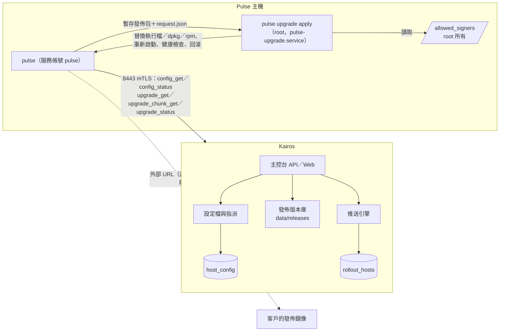
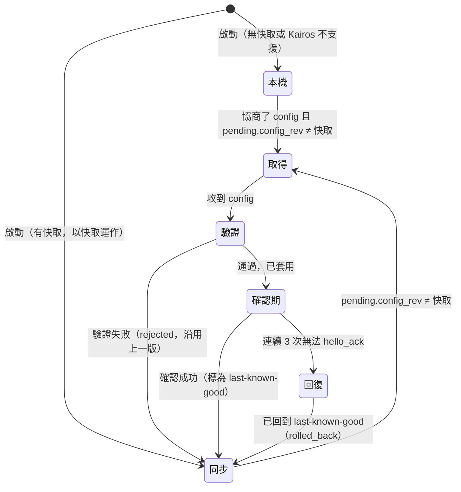
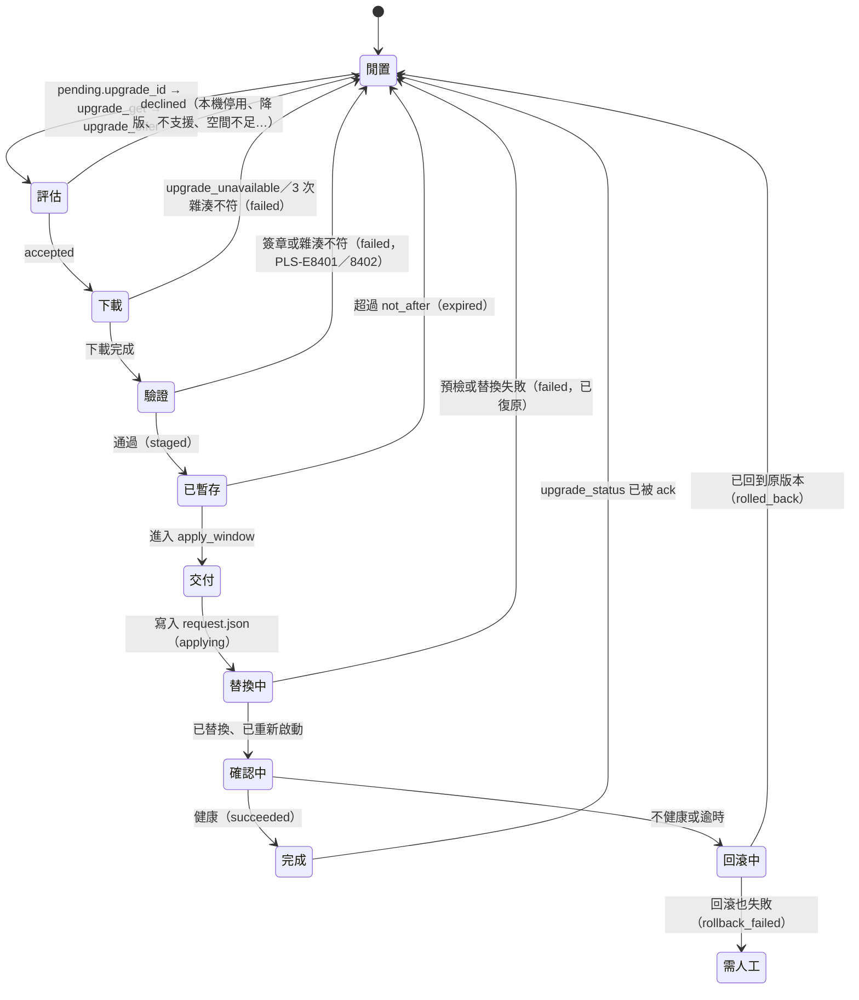

# 遠端管理：集中設定與 agent 遠端升級（F8）

〔衝刺 8 規格。第 14 節 D1～D18 已決定（2026-10-19，採建議）：Kairos 0.9.0／Pulse 0.9.0 實作 MVP（D15：集中設定＋Linux 升級＋兩批推送＋最小主控台），其餘延到 0.10.0。**S1（共用 crate）已實作**（衝刺 9）：第 2 節已搬入 [`PROTOCOL.md`](PROTOCOL.md)「遠端管理」並以它為準，`kairos-proto` 的 `mgmt`、`release` 模組。**K1／K2（Kairos 端）與 P1／P2（Pulse 端）都已實作**（衝刺 9）：Kairos 0.9.0 在 mTLS、SQLite 的連線上宣告 `config`、`upgrade`（實作附註與差異見第 13.1 節）；Pulse 0.9.0 帶 `install`、宣告 `config`／`upgrade`（實作附註與差異見第 17 節）；兩端都是 0.9.0 時協商這兩個 feature〕

本文件是商業審計 F8「agent 遠端升級與集中設定」的工程規格：8443 上的兩個新 feature `config`、`upgrade`（協定版本維持 v2），Kairos 端的設定檔、發佈版本庫與分批推送，Pulse 端的設定合併、升級狀態機與特權輔助程式，安全模型、資料表（schema v9 草案）、主控台 API 草案、畫面需求、錯誤代碼（暫定）、測試策略與實作分工。

- 協定的共通規則（傳輸、版本協商、錯誤格式、逾時）以 [`PROTOCOL.md`](PROTOCOL.md) 為準，本文件只定義新增的部分；實作時把第 2 節搬進 PROTOCOL.md（與 `renew`／`deregister` 從 ENROLL.md 搬過去的做法相同），範例改為 `kairos-proto` 的測試向量。
- 發佈包的簽章沿用 [`RELEASING.md`](../../RELEASING.md) 第 3 節（`ssh-keygen -Y sign`、namespace `kairos-pulse-release`、Ed25519）；安裝方式與檔案版面見 [`pulse/packaging/INSTALL.md`](../../pulse/packaging/INSTALL.md)。
- 主控台 API 的總則（回應格式、錯誤、RBAC、稽核、危險操作的確認）沿用 [`kairos/API.md`](../../kairos/API.md) 第 1、11.1、12 節。
- 錯誤代碼的格式與分配規則見設計包 `design-system/copywriting.md` §3；本文件的代碼都是**暫定**（第 11 節），由設計包正式分配後才能寫進程式。

### 範圍

| 在範圍內 | 不在範圍內 |
|---|---|
| Kairos 下發 Pulse 的部分設定（白名單），以群組、標籤、單台指派，回報實際生效值與差異，失敗回復 | 下發伺服器位址、憑證、信任設定等安全相關設定（永遠只在本機改，第 3.2 節） |
| Kairos 推送 Pulse 的**官方簽章發佈包**，分批（canary、百分比、維護時段），健康檢查與自動回滾 | 任意指令、指令碼、外掛的下發；不是遠端執行通道（第 5.5 節） |
| Linux tar／deb／rpm、Windows MSI／zip 的替換方式 | Kairos 自身的升級（第 4.11 節）；macOS |
| 離線 agent 重連後的同步 | 多實例主機的遠端升級（第 4.4.5 節，第一版不支援） |

### 與其他開發線的協調

- **schema 號碼**：本文件的資料表寫成 **schema v9 草案**。衝刺 8 另有 A2 HA（`kairos/HA.md`）、匯出、隱私三條線，可能也要新的 schema 版本。整合時由先合併的一方取 v9，另一方順延；本文件的遷移只**新增資料表與欄位**、不修改既有資料表的唯一鍵，不依賴其他線的物件，可依 v5／v6 的前例（`kairos/STORAGE.md` 第 3.2 節：版本號不必連續）接在任何一方之後。HA 若改用外部資料庫，本文件的資料表一併遷移，沒有只能在 SQLite 上成立的假設（除了「單一寫入者」的推送引擎，見第 4.7.6 節）。
- **錯誤代碼**：本文件使用**新的子類別 05（集中設定）與 84（遠端升級）**（設計包 §31.3 已正式分配，號碼不變；HA 原暫定的 84xx 改為 85xx），以及 61 的 `6106`（第 11 節）。其他線若也需要新子類別，整合前在設計包一次分配，避免撞號。
- **隱私線**：`processes.command`、`inventory.hardware_serials`、`inventory.network_addresses` 屬於隱私敏感的採集設定，第 3.1 節規定「下發只能更保守」；隱私線若改變這幾個設定的語意或預設值，第 3.1 節的表要同步。

## 1. 總覽



設計原則：

1. **Pulse 主動拉取**：沿用「Pulse 送、Kairos 回」的一問一答，Kairos 只在 `hello_ack` 與心跳的 `ack` 中提示「有新的設定／升級」（第 2.2 節），不新增伺服器主動送出的訊息，PROTOCOL.md「伺服器回應延遲最多 8 秒」的推論不變。
2. **信任不經過 Kairos**：Pulse 只安裝由**本機信任錨**（root 擁有的 `allowed_signers`）驗證過的官方發佈包。Kairos 被入侵時，最多能讓主機安裝另一個**官方簽章**的版本（且不能降版，第 4.8 節），不能執行任意程式。
3. **特權分離（Linux）**：Pulse 以 `pulse` 帳號、`NoNewPrivileges`、`ProtectSystem=strict` 執行，無法替換自己。下載與第一次驗證在 Pulse 中進行；替換由 root 的 `pulse-upgrade.service` 以**目前已安裝的**執行檔執行，**重新驗證**所有檔案後才動手，且不連網路（第 4.4 節）。
4. **本機永遠有最後決定權**：本機設定優先於下發設定（第 3.3 節）；遠端升級與集中設定各有本機開關（第 5.6 節），開關只能在本機改。
5. **升級與設定都可回復**：設定保留上一份可用的版本（last-known-good），升級保留上一版的執行檔或套件；兩者都有自動回復與回報。

## 2. 協定：feature `config`、`upgrade`

> 〔S1 已搬入 [`PROTOCOL.md`](PROTOCOL.md)「遠端管理（feature `config`、`upgrade`）」，以該節與 `kairos-proto` 的測試向量為準；本節保留作為設計背景。與本節的差異：`config_status` 的 `overridden` 只列本機值與下發值不同的鍵；`errors[].reason` 定為 `type_mismatch`、`out_of_range`、`invalid_value`、`conflict`；`upgrade_status` 的 `from_version`／`to_version`／`detail` 可以是空字串；第 2.7 節的範例雜湊與簽章在 PROTOCOL.md 換成真實的測試向量〕

兩個 feature 都只在協商結果為 v2、雙方都宣告、這條連線以用戶端憑證（mTLS）證明身分、且 Kairos 以 SQLite 儲存時使用（與 `renew` 的條件相同：Kairos 只在 client 也宣告時才在 `hello_ack` 列出）。沒有協商時，下列新的 `type` 一律視為不認得（`unknown_type`），與 0.8 相同。**協定版本不升**：新訊息、新欄位只在協商了對應 feature 的連線上出現，舊端不會收到。

| feature | Pulse 何時宣告 | Kairos 何時列出 |
|---|---|---|
| `config` | `remote_config.enabled = true`（預設） | `[remote] config_enabled = true`（預設）、SQLite 儲存、mTLS，且 client 宣告 |
| `upgrade` | `upgrade.enabled = true`，**且**本機準備就緒（`install.upgrade = "ready"`，第 2.1 節） | `[remote] upgrade_enabled = true`（預設）、SQLite 儲存、mTLS，且 client 宣告 |

### 2.1 hello 的 `install` 欄位

0.9.0 起的 Pulse 在 hello 另帶選用的 `install` 物件（v2 選用欄位；舊版 Kairos 忽略），讓主控台區分「Pulse 太舊」「本機停用」「缺少輔助程式」等原因。不論是否宣告 `config`／`upgrade` 都送。

| 欄位 | 型別 | 說明 |
|---|---|---|
| `method` | string | 安裝方式：`tar`、`deb`、`rpm`、`msi`、`zip`、`unknown`（偵測方式見第 4.3 節） |
| `upgrade` | string | 遠端升級的本機狀態：`ready`（可接受）、`disabled`（`upgrade.enabled = false`）、`no_trust_anchor`（找不到或無法使用 `allowed_signers`）、`no_helper`（Linux 沒有啟用 `pulse-upgrade.path`）、`unsupported`（多實例、`unknown` 安裝方式、不支援的平台） |
| `config` | string | 集中設定的本機狀態：`enabled`、`disabled` |

- 限制：三個欄位都是 1～32 bytes 的小寫英文字母、數字或 `_`；不認得的值由 Kairos 原樣保存、顯示為「其他」。其他欄位忽略。物件或欄位型別錯誤時 `bad_request`（與 `os` 相同）；協商結果為 v1 時忽略。
- `upgrade` 為 `ready` 以外的值時 Pulse **不宣告** `upgrade`；Kairos 因此不會對它提議升級，主控台依 `install.upgrade` 顯示原因。

### 2.2 `pending`：有新的設定或升級

協商了 `config` 或 `upgrade` 的連線上，Kairos 在 `hello_ack` 與**回應 `heartbeat` 的 `ack`** 另帶 `pending` 物件（回應 `report` 等其他訊息的 `ack` 不帶，避免每筆 report 多出位元組）：

| 欄位 | 型別 | 說明 |
|---|---|---|
| `config_rev` | u64 | 協商了 `config` 時才有。這台主機目前應套用的設定版本（第 3.4.4 節）；`0` 表示沒有任何下發設定 |
| `upgrade_id` | string | 協商了 `upgrade` 且有提議給這台主機時才有：推送中這台主機的升級 ID（UUID） |

- Pulse 收到的 `config_rev` 與本機已套用的版本不同時送 `config_get`；收到不認得的 `upgrade_id`（與正在處理、或已完成的不同）時送 `upgrade_get`。
- 延遲上限為一個心跳間隔（預設 15 秒）。Kairos 不必在設定改變的當下通知每條連線，只要下一次回應心跳時帶出新的值。
- 型別不符時 Pulse 視為沒有該欄位（與 `renew_now` 相同的容錯）。

### 2.3 集中設定的訊息

| 訊息 | 方向 | 欄位 |
|---|---|---|
| `config_get` | P → K | `seq`、`ts`、`have_rev`（u64，本機已套用的版本，沒有時 `0`） |
| `config` | K → P | `seq`（回應的 `config_get`）、`rev`（u64）、`hash`（`sha256:` 加 64 個小寫十六進位：`settings` 正規化 JSON 的 SHA-256，第 3.4.4 節）、`settings`（物件，第 2.3.1 節）、`sources`（物件，鍵為設定鍵、值為設定檔名稱，供本機顯示來源；選用）、`issued_at`（RFC 3339 UTC 毫秒） |
| `config_status` | P → K | `seq`、`ts`、`rev`、`hash`、`state`、`effective`、`overridden`、`ignored`、`errors`、`code`（第 2.3.2 節） |
| `ack` | K → P | 回應 `config_status`（只有 `seq`） |

#### 2.3.1 `settings` 的格式

兩層物件：`{"<區段>": {"<鍵>": <值>}}`，區段與鍵與 `pulse.toml` 相同（例如 `{"report":{"interval":10},"log":{"level":"debug"}}`）。巢狀區段以 `.` 表示（`log.syslog` 不在白名單，目前沒有用到）。

- 只能出現第 3.1 節白名單中的鍵；Kairos 依這台主機回報的 `agent_version` 只送該版本認得的鍵（第 3.1 節「最低 Pulse」欄）。
- 值的型別與 `pulse.toml` 相同（整數、布林、字串、字串陣列）。
- 單行上限 65536 bytes 仍適用；白名單全部填滿約 2 KB，不會接近上限。Kairos 儲存設定檔時以同樣的上限檢查。

#### 2.3.2 `config_status`

| 欄位 | 型別 | 說明 |
|---|---|---|
| `rev`、`hash` | u64、string | 這次處理的版本；`state` 為 `disabled` 時為本機最後一次套用的版本（沒有時 `0`、`""`） |
| `state` | string | `applied`（已套用；含部分鍵被本機覆蓋或忽略）、`rejected`（驗證失敗，整份不套用，沿用上一版）、`rolled_back`（套用後健康確認失敗，已回復上一版，第 3.6 節）、`disabled`（本機停用集中設定；只在停用後的第一次連線送一次，之後不宣告 `config`） |
| `effective` | object | 白名單中每個鍵**實際生效的值**（合併後，與 `settings` 同一種兩層格式） |
| `overridden` | array | 被本機覆蓋的鍵：`{"key":"report.interval","remote":10,"local":5,"source":"pulse.toml"}`；`source` 為 `pulse.toml` 或 `env` |
| `ignored` | array | 沒有套用、但不影響其他鍵的項目：`{"key":"…","reason":"unknown_key"\|"unsupported_platform"\|"not_more_restrictive"}` |
| `errors` | array | `state` 為 `rejected`／`rolled_back` 時的原因：`{"key":"report.interval","reason":"out_of_range","message":"…"}`（`message` ≤ 256 bytes，字元限制同 `hostname`） |
| `code` | string 或 `null` | 對應的 Pulse 代碼（例如 `PLS-W0501`），沒有時 `null` |

- Pulse 在**每條新連線的 `hello_ack` 之後**送一次（讓 Kairos 知道本機設定在重新啟動後的變化），以及每次處理 `config` 之後送一次。未收到 `ack` 就斷線時，重連後再送（內容以當時的狀態為準）。
- 陣列各最多 64 項；超過時截斷並在最後一項加 `{"key":"*","reason":"truncated"}`。
- Kairos 以「(主機, `rev`, `state`) 最新的一則」更新 `host_config`（第 6 節）；`rev` 比資料庫中的 `applied_rev` 舊時只更新 `effective`／`overridden`（本機變化），不倒退版本。

### 2.4 遠端升級的訊息

| 訊息 | 方向 | 欄位 |
|---|---|---|
| `upgrade_get` | P → K | `seq`、`ts`、`upgrade_id` |
| `upgrade_offer` | K → P | `seq`、`upgrade_id`、`rollout_id`、`action`（`upgrade`／`downgrade`）、`target`（`version`、`commit`）、`artifact`、`rollback_artifact`（選用）、`manifest`、`sha256sums`、`signature`、`apply_window`、`health_timeout_secs`、`allow_downgrade`（第 2.4.1 節） |
| `upgrade_chunk_get` | P → K | `seq`、`ts`、`upgrade_id`、`filename`、`offset`（u64）、`length`（1～32768） |
| `upgrade_chunk` | K → P | `seq`、`upgrade_id`、`filename`、`offset`、`data`（標準 base64，含補位）、`eof`（布林：這段之後沒有資料） |
| `upgrade_status` | P → K | `seq`、`ts`、`upgrade_id`、`state`、`from_version`、`to_version`、`code`、`detail`、`progress`（第 2.4.3 節） |
| `ack` | K → P | 回應 `upgrade_status` |

#### 2.4.1 `upgrade_offer`

| 欄位 | 說明 |
|---|---|
| `artifact` | `filename`（發佈檔名，`pulse-<版本>-<commit>-<os>-<arch>.<格式>`）、`size`（bytes，上限 128 MiB）、`sha256`（64 個小寫十六進位）、`source`（`kairos`：以 `upgrade_chunk_get` 從這條連線下載；`url`：從 `url` 下載）、`url`（`source` 為 `url` 時，`https://` 開頭、≤ 2048 bytes） |
| `rollback_artifact` | deb／rpm／msi 的主機才有：**目前版本**、同格式同平台的發佈檔（欄位同 `artifact`），自動回滾時使用（第 4.4.2 節）；版本庫沒有時省略，Pulse 依第 4.5.3 節處理 |
| `manifest` | 發佈清單的檔名與內容：`{"filename":"pulse-0.9.1-…-release.json","content":"<JSON 字串>"}`（≤ 8 KiB，第 4.1.3 節）。0.9.0 以前的發佈沒有清單，此欄為 `null`，只能作為降版或回滾目標 |
| `sha256sums` | 該次發佈的 `SHA256SUMS` 全文（≤ 16 KiB） |
| `signature` | `SHA256SUMS.sig` 全文（≤ 4 KiB，`-----BEGIN SSH SIGNATURE-----` 格式） |
| `apply_window` | `not_before`、`not_after`（RFC 3339）：Pulse 只在這段期間**開始替換**；下載與驗證可以提早進行。超過 `not_after` 仍未開始時放棄（`state: expired`），等 Kairos 下一個時段再提議 |
| `health_timeout_secs` | 替換後的健康確認期限（120～3600，第 4.5 節） |
| `allow_downgrade` | 推送是否允許降版。Pulse 只在這個值**與**本機 `upgrade.allow_downgrade` 都為 `true` 時接受低於目前版本的目標（第 4.8 節） |

Kairos 依這台主機的 `install.method`、`os.arch`（hello 的 `os`）選出發佈檔：`tar` → `linux-<arch>.tar.gz`、`deb` → `.deb`、`rpm` → `.rpm`、`msi` → `windows-x86_64.msi`、`zip` → `windows-x86_64.zip`。版本庫中沒有對應的檔案時，這台主機在推送中標為 `skipped`（`no_artifact`），不送提議。

#### 2.4.2 下載（`source: "kairos"`）

- 發佈包經這條 mTLS 連線分段傳送：每段最多 32768 bytes（base64 後約 43.7 KB，加上 JSON 不超過單行上限）。`filename` 只能是這次 `upgrade_offer` 的 `artifact`、`rollback_artifact` 之一，否則 `upgrade_unavailable`。
- Pulse 同一時間最多 **2 段**在途（另計，不占 durable report 的 4 筆）；依 `offset` 順序寫入暫存檔 `<檔名>.part`，斷線後從已寫入的長度續傳。全部收到後以 `artifact.sha256` 檢查，不符時刪除重來（連續 3 次不符時放棄，`PLS-E8402`）。
- 段落請求計入每條連線的訊息速率限制（可連續 50 則、之後每秒 20 則）；10 MB 的發佈包約 320 段，區域網路約 20～40 秒。Kairos 從磁碟讀一段的時間遠小於 8 秒的回應上限。
- **併發限制**：Kairos 以 `[remote] max_concurrent_downloads`（預設 100 台）限制同時下載的主機數；超過時對 `upgrade_chunk_get` 回非 fatal 的 `rate_limited`，另帶 `retry_after_ms`，Pulse 依此等待（加 ±20% 抖動）後續傳。一台主機超過 10 分鐘沒有請求下一段時釋出名額。
- `source: "url"` 時 Pulse 以 HTTPS GET 下載（第 4.1.2 節），不經這條連線。

#### 2.4.3 `upgrade_status`

| 欄位 | 說明 |
|---|---|
| `state` | `accepted`（收到提議、開始下載）、`declined`（拒絕，原因在 `code`／`detail`：本機停用、降版、不支援、空間不足、`min_upgrade_from` 不符）、`staged`（下載並驗證完成，等待時段）、`expired`（超過 `apply_window.not_after` 未開始）、`applying`（已交給輔助程式）、`succeeded`、`failed`（替換前或替換中失敗，沒有變更、或已復原）、`rolled_back`（健康確認失敗，已回到原版本）、`rollback_failed`（回滾也失敗，需要人工處理） |
| `from_version`、`to_version` | 替換前與目標版本 |
| `code` | Pulse 代碼（第 11 節）或 `null` |
| `detail` | ≤ 512 bytes，字元限制同 `hostname`（例如套件管理員的最後一行錯誤） |
| `progress` | 選用：`{"bytes":1048576,"total":10485760}`；`accepted` 之後每完成 25% 送一次 |

- `applying` 之後的狀態（`succeeded`、`rolled_back`、`rollback_failed`、`failed`）由**替換後的 Pulse**（新版，或回滾後的原版）在重新連線、`hello_ack` 之後送出：結果先寫在本機的狀態檔（第 4.6 節），收到 `ack` 才標為已回報（at-least-once）。Kairos 以 (`upgrade_id`, `state`) 去重。
- Kairos 另以 hello 的 `agent_version` 交叉確認：收到 `succeeded` 而版本不是目標版本時記 `KRS-W8402` 並把這台主機標為 `failed`（`version_mismatch`）。

### 2.5 新增與擴充的錯誤碼

| code | 情境 | fatal |
|---|---|---|
| `upgrade_unavailable` | `upgrade_get`、`upgrade_chunk_get`：沒有這個 `upgrade_id`、推送已暫停或取消、這台主機已不在推送中、檔案不在提議中或已從版本庫刪除。Pulse 停止這次升級、刪除暫存（`staged` 之前）或保留到下一個提議（`staged`，同一個目標版本時沿用） | 否 |
| `rate_limited`（擴充） | 原本只用於 `renew_request`。另用於 `upgrade_chunk_get` 超過下載併發，此時另帶 `retry_after_ms`（u32） | 否 |
| `storage_unavailable`（擴充） | `config_get`、`config_status`、`upgrade_status` 無法讀寫資料庫時；Pulse 稍後重送 | 否 |
| `bad_request` | 新訊息的欄位缺漏或型別錯誤（`seq` 為 `null`，與 report 相同） | 否（連續上限照舊） |

### 2.6 相容矩陣

| Pulse | Kairos | 結果 |
|---|---|---|
| 0.8.0 以前 | 0.9.0 | 不宣告 `config`／`upgrade`、沒有 `install`：與 0.8 完全相同。主控台顯示「不支援集中設定與遠端升級（需要 Pulse 0.9.0 以上）」。**0.8 → 0.9 必須手動升級一次**（第 4.10 節） |
| 0.9.0 | 0.8.0 以前 | 舊版 Kairos 不列出兩個 feature、忽略 `install`：Pulse 只用本機設定（遠端設定的快取保留不用，第 3.7 節），不會升級 |
| 0.9.0 | 0.9.0，`storage.backend = "jsonl"` 或沒有 mTLS | Kairos 不列出兩個 feature，同上 |
| 0.9.0，`remote_config.enabled = false` | 0.9.0 | 只協商 `upgrade`（若準備就緒）；主控台顯示「本機停用集中設定」 |
| 0.9.0，`install.upgrade` 不是 `ready` | 0.9.0 | 只協商 `config`；主控台依 `install.upgrade` 顯示原因 |

### 2.7 範例（實作時改為 PROTOCOL.md 的測試向量）

```
P {"type":"hello","seq":1,"proto":1,"proto_min":1,"proto_max":2,"features":["metrics","durable","renew","inventory","processes","config","upgrade"],"agent_id":"6f1c0e4a-1b2c-4d3e-9f00-112233445566","hostname":"web-01","agent_version":"0.9.0","heartbeat_interval_ms":15000,"ts":"2026-11-20T02:00:00.001Z","os":{"name":"Ubuntu","version":"24.04","arch":"x86_64"},"install":{"method":"deb","upgrade":"ready","config":"enabled"}}
K {"type":"hello_ack","seq":1,"proto":2,"offline_after_ms":75000,"features":["metrics","durable","renew","inventory","processes","config","upgrade"],"server_time":"2026-11-20T02:00:00.009Z","expired_renew_grace_days":90,"pending":{"config_rev":42}}
P {"type":"config_get","seq":2,"ts":"2026-11-20T02:00:00.020Z","have_rev":37}
K {"type":"config","seq":2,"rev":42,"hash":"sha256:0c4f3d2b1a6e5f7081928374655647382910abcdef0123456789abcdef012345","settings":{"report":{"interval":10},"log":{"level":"debug"},"processes":{"top":10}},"sources":{"report.interval":"正式環境 Linux","log.level":"web-01 除錯","processes.top":"正式環境 Linux"},"issued_at":"2026-11-20T02:00:00.025Z"}
P {"type":"config_status","seq":3,"ts":"2026-11-20T02:00:00.140Z","rev":42,"hash":"sha256:0c4f3d2b1a6e5f7081928374655647382910abcdef0123456789abcdef012345","state":"applied","effective":{"report":{"interval":5},"log":{"level":"debug"},"processes":{"top":10}},"overridden":[{"key":"report.interval","remote":10,"local":5,"source":"pulse.toml"}],"ignored":[],"errors":[],"code":"PLS-I0503"}
K {"type":"ack","seq":3}
P {"type":"heartbeat","seq":4,"ts":"2026-11-20T02:00:15.002Z"}
K {"type":"ack","seq":4,"pending":{"config_rev":42,"upgrade_id":"9d3e7a10-4b2c-4f6e-8a1d-2c3b4a5f6e70"}}
P {"type":"upgrade_get","seq":5,"ts":"2026-11-20T02:00:15.010Z","upgrade_id":"9d3e7a10-4b2c-4f6e-8a1d-2c3b4a5f6e70"}
K {"type":"upgrade_offer","seq":5,"upgrade_id":"9d3e7a10-4b2c-4f6e-8a1d-2c3b4a5f6e70","rollout_id":"r-20261120-0001","action":"upgrade","target":{"version":"0.9.1","commit":"5e6f7a8"},"artifact":{"filename":"pulse-0.9.1-5e6f7a8-linux-x86_64.deb","size":5242880,"sha256":"7d9a0e1b2c3d4e5f60718293a4b5c6d7e8f90123456789abcdef0123456789ab","source":"kairos"},"rollback_artifact":{"filename":"pulse-0.9.0-1a2b3c4-linux-x86_64.deb","size":5238784,"sha256":"aa11bb22cc33dd44ee55ff6600112233445566778899aabbccddeeff00112233","source":"kairos"},"manifest":{"filename":"pulse-0.9.1-5e6f7a8-release.json","content":"{\"schema\":\"kairos-pulse.release/v1\",\"product\":\"pulse\",\"version\":\"0.9.1\"}"},"sha256sums":"7d9a…  pulse-0.9.1-5e6f7a8-linux-x86_64.deb\n","signature":"-----BEGIN SSH SIGNATURE-----\nU1NIU0lH\n-----END SSH SIGNATURE-----\n","apply_window":{"not_before":"2026-11-20T17:00:00.000Z","not_after":"2026-11-20T21:00:00.000Z"},"health_timeout_secs":600,"allow_downgrade":false}
P {"type":"upgrade_status","seq":6,"ts":"2026-11-20T02:00:15.100Z","upgrade_id":"9d3e7a10-4b2c-4f6e-8a1d-2c3b4a5f6e70","state":"accepted","from_version":"0.9.0","to_version":"0.9.1","code":null,"detail":""}
K {"type":"ack","seq":6}
P {"type":"upgrade_chunk_get","seq":7,"ts":"2026-11-20T02:00:15.120Z","upgrade_id":"9d3e7a10-4b2c-4f6e-8a1d-2c3b4a5f6e70","filename":"pulse-0.9.1-5e6f7a8-linux-x86_64.deb","offset":0,"length":32768}
K {"type":"upgrade_chunk","seq":7,"upgrade_id":"9d3e7a10-4b2c-4f6e-8a1d-2c3b4a5f6e70","filename":"pulse-0.9.1-5e6f7a8-linux-x86_64.deb","offset":0,"data":"ITxhcmNoPgo=","eof":false}
K {"type":"error","seq":9,"code":"rate_limited","message":"too many concurrent downloads; retry later","fatal":false,"retry_after_ms":30000}
```

（`sha256sums`、`signature`、`data` 在此縮短。）

## 3. 集中設定

### 3.1 可下發的設定（白名單）

「套用」欄：**即時**＝不中斷連線、下一個週期生效；**重新連線**＝Pulse 主動結束目前的連線並重連（hello 的內容或協商的 feature 會改變），等同一次短暫斷線（durable 的積壓照常補送）。沒有任何下發的鍵需要重新啟動行程。

| 鍵 | 範圍（同 `pulse.toml`） | 套用 | 最低 Pulse | 備註 |
|---|---|---|---|---|
| `heartbeat.interval` | 1～60 秒 | 重新連線 | 0.9.0 | hello 的 `heartbeat_interval_ms` 改變，Kairos 的離線判定隨之改變 |
| `report.interval` | 1～3600 秒 | 即時（hello 的 `report_interval_ms` 在下一次連線更新） | 0.9.0 | |
| `retry.max_retries`、`retry.initial_delay`、`retry.max_delay` | 同 `pulse.toml` | 即時（下一次斷線） | 0.9.0 | |
| `collect.filesystems`、`disk_io`、`network`、`temperature` | 布林 | 即時 | 0.9.0 | |
| `collect.max_filesystems`、`max_disks`、`max_interfaces` | 0～16／0～8／0～16 | 即時 | 0.9.0 | |
| `collect.interface_exclude` | 字串陣列，最多 32 個 | 即時 | 0.9.0 | 與本機的值**取聯集**（第 3.3 節例外） |
| `processes.enabled` | 布林 | 重新連線（feature `processes`） | 0.9.0 | |
| `processes.interval`、`processes.top` | 1～3600／1～10 | 即時 | 0.9.0 | |
| `processes.command` | `none`、`executable` | 即時 | 0.9.0 | **隱私敏感：只能下發更保守的值**。`full` 不接受（只能在本機設定）；本機為 `none` 時下發 `executable` 被忽略（`not_more_restrictive`） |
| `inventory.enabled`、`inventory.interval` | 布林／300～86400 | 重新連線（feature `inventory`）／即時 | 0.9.0 | |
| `inventory.hardware_serials`、`inventory.network_addresses` | 布林 | 即時（下一次收集） | 0.9.0 | **隱私敏感：只能下發 `false`**；下發 `true` 而本機（或內建預設）已是 `true` 時視為相同，本機為 `false` 時忽略 |
| `buffer.enabled` | 布林 | 重新連線（feature `durable`） | 0.9.0 | 由 `true` 改為 `false` 時緩衝中的積壓保留，改回 `true` 後補送 |
| `buffer.max_mb`、`max_records`、`max_age_hours`、`replay_interval_ms` | 同 `pulse.toml` | 即時 | 0.9.0 | 調小時依原本的規則丟掉最舊的資料（`PLS-W4202`） |
| `log.level` | `trace`～`error` | 即時 | 0.9.0 | 常用於暫時除錯；設定檔可帶到期時間（第 3.4.2 節） |
| `log.retention_days` | 0～3650 | 即時（下一次清除） | 0.9.0 | |
| `status.*`、`metrics.textfile_interval` | — | — | — | 不下發（見第 3.2 節） |

「隱私敏感」的規則：下發的值只有在**比本機（含內建預設）更保守或相同**時才套用，否則放進 `ignored`。理由：主機的擁有者可能基於當地法規關閉了某些採集，中央不應能重新開啟（詳見第 14 節 D10，與隱私線協調）。

### 3.2 永遠只能在本機改的設定

下列設定**不在白名單**，Kairos 不能下發，Pulse 收到時一律放進 `ignored`（`unknown_key`），不影響其他鍵：

| 類別 | 鍵 | 理由 |
|---|---|---|
| 連線與信任 | `server.*`（`address`、`port`、`domain`、`accept_invalid_certs`、`ca_cert`、`use_system_roots`、`client_cert`、`client_key`）、`enroll.*` | 改錯會使主機永久失聯，或被導向假的伺服器 |
| 身分 | `agent.id_file`、`agent.display_name`、`agent.tags`、`identity.*` | 身分與指派的依據；標籤由 Kairos 端另外管理（第 3.4.3 節） |
| 路徑與檔案 | `buffer.dir`、`status.file`、`metrics.textfile`、日誌目錄 | 服務帳號的可寫路徑由 systemd unit 決定，下發路徑只會失敗或寫到不該寫的地方 |
| 對外送出 | `log.syslog.*`、`metrics.listen`、`log.format`、`log.stdout`、`log.timezone` | 不可讓中央把日誌導向任意主機或開啟監聽埠；`format` 改變檔名，會破壞客戶的日誌收集 |
| 隱私上限 | `processes.command = "full"`、`processes.include_user` | 見第 3.1 節 |
| 遠端管理本身 | `remote_config.*`、`upgrade.*` | 本機開關與信任錨（第 5.6 節）；特權輔助程式只讀 `pulse.toml`，不讀遠端設定 |

### 3.3 合併優先順序

```
內建預設值  <  Kairos 下發  <  pulse.toml  <  PULSE__* 環境變數
```

- **本機明確寫出的值永遠優先**（第 14 節 D1 的建議）。`pulse enroll` 與套件產生的 `pulse.toml` 只有 `[server]` 與註解，大多數主機沒有本機覆蓋；需要由中央管理的鍵，請從 `pulse.toml` 移除。
- 被本機覆蓋的鍵回報在 `overridden`，主控台列為「本機覆蓋」（差異），不是錯誤。
- 例外：`collect.interface_exclude` 取聯集（本機排除的介面不會因中央的清單而被送出；中央也能再排除更多）。
- 「隱私敏感」的鍵另依第 3.1 節只取較保守者。
- `pulse config show --effective --sources`（第 10.2 節）列出每個鍵的值與來源（`default`／`remote:<設定檔>`／`pulse.toml`／`env`）。

### 3.4 Kairos 端：設定檔、指派與版本

#### 3.4.1 設定檔（profile）

一個設定檔是白名單鍵的部分集合（只寫要改的鍵），加上名稱、說明。儲存時 Kairos 依第 3.1 節檢查鍵與範圍（`KRS-E0502`），並保留每一版（`config_profile_revisions`）供比較與回復。設定檔不含任何秘密。

#### 3.4.2 指派

每筆指派是（設定檔, 選擇器, 優先序）：

| 選擇器 | 比對 | 預設優先序 |
|---|---|---|
| `global` | 所有主機（最多一筆） | 0 |
| `group:<主機群組>` | `hosts.host_group`（不分大小寫，同 RBAC 範圍） | 100 |
| `tag:<標籤>` | hello 的 `tags`（區分大小寫），或 Kairos 端的主機標籤（日後 S21「主機群組與標籤」） | 200 |
| `host:<agent_id>` | 單台 | 1000 |

- 合併：依優先序**由低到高**套用，同一個鍵以優先序高者為準。
- 同一個鍵出現在兩個**相同優先序**的指派、且兩者都比對到同一台主機時，Kairos 在**儲存指派時**拒絕（409 `assignment_conflict`，`details` 列出衝突的鍵與主機數），不在執行期決定勝負。
- 指派可帶 `expires_at`（例如「web-01 暫時開 `log.level = debug` 到明天 09:00」）；到期時 Kairos 刪除指派、重新計算受影響主機。
- 主機的群組、標籤改變（重新註冊、hello 的 `tags` 改變）時重新計算該主機。

#### 3.4.3 標籤的來源

hello 的 `tags` 由本機 `pulse.toml` 決定（第 3.2 節不下發），Kairos 以它比對 `tag:` 選擇器。Kairos 端的主機標籤（設計包 S21「主機群組與標籤」，目前沒有後端）實作時一併納入比對，不需要改協定。

#### 3.4.4 版本與雜湊

- `meta.config_rev`：全域單調遞增的計數器。任何設定檔、指派改變時加 1。
- 每台主機的**期望設定**（合併後的 `settings`）以正規化 JSON（鍵依字典序排列、沒有空白、數字照原樣）計算 `hash`。只有 `hash` 改變的主機才把 `desired_rev` 更新為當時的 `meta.config_rev`；其他主機不受影響、不會重新套用。
- `pending.config_rev` 就是這台主機的 `desired_rev`；沒有任何指派比對到時為 `0`（Pulse 收到 `0` 而本機有遠端設定時，以空的 `settings` 處理：回到本機與內建預設）。
- 1 萬台主機時，一次變更的重新計算在同一個交易中完成（每台一次 JSON 合併與 SHA-256，預估數十毫秒；實作時量測）。

### 3.5 Pulse 端：驗證、套用與回報

1. 收到 `config` 後，先把 `settings` 與本機設定依第 3.3 節合併成完整的設定，以既有的 `AppConfig::validate` 檢查（與啟動時相同的規則）。任何一個白名單鍵的值不合法（型別、範圍、互相矛盾）時**整份拒絕**：`state: rejected`、`errors` 列出原因、`code: PLS-W0501`，繼續使用目前的設定。不認得的鍵與不更保守的隱私鍵只放進 `ignored`，不造成拒絕。
2. 通過時，先把新的遠端設定寫入本機快取（第 3.7 節，寫暫存檔再改名），記下 `pending_apply`，再依第 3.1 節「套用」欄逐一套用；需要重新連線的鍵在全部即時鍵套用後統一重連一次。
3. 套用後進入**確認期**（第 3.6 節）；確認期內就先送 `config_status`（`applied`），確認期失敗時再送 `rolled_back`。
4. 日誌：`config.applied`（INFO，列出改變的鍵與新舊值）、`config.rejected`（WARN，`PLS-W0501`）、`config.overridden`（INFO，`PLS-I0503`，只在本機覆蓋的鍵集合改變時記一次）。

### 3.6 失敗回復（last-known-good）

下發的鍵都不影響連線位址與信任，正常不會因下發設定而失聯；但仍保留保險：

- **確認期**：套用後 `max(3 × heartbeat.interval, 60 秒)`。期間內只要有一次成功的 `hello_ack`（重新連線的情況）或沒有斷線（即時的情況），就把這一版標為 last-known-good。
- 確認期內連續 3 次無法完成 `hello_ack`（而套用前是連線中的），回復上一份 last-known-good、重新連線，連上後送 `config_status`（`state: rolled_back`、`code: PLS-W0504`）。同一個 `rev` 不再自動套用；Kairos 下發新的 `rev` 時才再試。
- **崩潰保護**：`pending_apply` 標記在確認成功後清除。Pulse 啟動時發現標記仍在、且同一個 `rev` 已連續 2 次在確認期內結束（崩潰、被 systemd 重啟），改以 last-known-good 啟動並回報 `rolled_back`。
- 本機的 `pulse.toml` 有誤時照舊啟動失敗（結束代碼 3），與遠端設定無關；遠端快取損毀時忽略快取、以本機設定啟動並記 `PLS-E0506`。

### 3.7 離線與重連的同步

- 遠端設定快取：`<狀態目錄>/remote/config.json`（Linux 的狀態目錄為 `STATE_DIRECTORY`，預設 `/var/lib/pulse`；Windows `%ProgramData%\Pulse`；目錄 0750、檔案 0640），內容為最後套用的 `rev`、`hash`、`settings`、`sources`，以及 last-known-good 的同樣欄位。
- **離線或 Kairos 停機時**，Pulse 以快取的遠端設定啟動與運作，不會退回內建預設。快取沒有期限（中央的設定在連上之前一直有效）。
- 重新連線後，`hello_ack` 的 `pending.config_rev` 與快取的 `rev` 不同才送 `config_get`；相同時只送一次 `config_status`。斷線期間 Kairos 端累積的多次變更只會套用最後一版。
- 連上**不支援 `config` 的 Kairos**（舊版、JSONL）時，快取保留但不使用（只用本機設定），避免換到另一台 Kairos 後沿用不屬於它的設定；`pulse status` 顯示「集中設定：未使用（Kairos 不支援）」。
- 本機停用（`remote_config.enabled = false`）時同樣不使用快取，並在下一次連線送一次 `state: disabled`。

### 3.8 Pulse 端狀態機（集中設定）



## 4. 遠端升級

### 4.1 發佈版本庫

#### 4.1.1 Kairos 代管（預設）

- 管理員以 `kairos releases import <目錄>`（離線環境建議）或主控台「Pulse 版本庫」上傳同一次發佈的 `SHA256SUMS`、`SHA256SUMS.sig`、`pulse-*-release.json` 與需要的 Pulse 發佈檔（tar.gz、deb、rpm、msi、zip；不必全部）。
- Kairos 匯入時以 **Kairos 端的** `[remote] allowed_signers` 驗證簽章與雜湊（`KRS-E8413`），檔案以 SHA-256 命名存入 `data/releases/`（0700），資料表記錄檔名、平台、格式、大小（第 6 節）。Kairos 的驗證只是**提早發現錯誤**，信任仍由每台 Pulse 自行驗證（第 4.2 節）。
- 版本庫同一個版本的檔案可以分次補上（例如先匯入 deb，之後補 msi）；每次補上都必須在已匯入的 `SHA256SUMS` 中且雜湊相符。
- 刪除版本：有進行中的推送使用、或它是某些主機的回滾目標（主機目前的版本，第 4.4.2 節）時拒絕（409 `release_in_use`）。
- 同一份版本庫日後也可以作為 8444 `/agent/<檔名>` 下載端點的來源（ENROLL.md 第 19.4 節第 3 項；不在本文件範圍）。

#### 4.1.2 外部 URL（選用）

- 匯入時只上傳 `SHA256SUMS`、`.sig` 與清單，另填 `base_url`（例如客戶內部的 `https://repo.example.gov.tw/kairos-pulse/0.9.1/`）；Kairos 不保存發佈檔，提議中的 `artifact.url` 為 `base_url` ＋檔名。
- Pulse 只在 URL 符合**本機** `upgrade.url_allowlist`（前綴比對，例如 `https://repo.example.gov.tw/kairos-pulse/`）時才下載，否則 `declined`（`PLS-W8411`，`detail: url_not_allowed`）。白名單預設為空，也就是**預設只接受從 Kairos 下載**。理由：不讓被入侵的 Kairos 把上萬台主機變成對任意位址（含內網）發出請求的工具。
- 下載以 HTTPS、TLS 1.2 以上，信任 `upgrade.external_ca`（空字串時為作業系統信任庫），不跟隨跨主機的重新導向，大小以 `artifact.size` 為上限。沒有 HTTP 代理設定（第一版）。

#### 4.1.3 發佈清單（release manifest，0.9.0 起）

每次發佈另產生 `pulse-<版本>-<commit>-release.json`，**列在 `SHA256SUMS` 中**（因此受同一個簽章保護），供 Kairos 與 Pulse 以機器判斷相容性：

```json
{
  "schema": "kairos-pulse.release/v1",
  "product": "pulse",
  "version": "0.9.1",
  "commit": "5e6f7a8",
  "released_at": "2026-11-18",
  "min_kairos": "0.5.0",
  "min_upgrade_from": "0.9.0",
  "remote_features": ["config", "upgrade"],
  "unit": { "sha256": "…", "previous_sha256": ["…", "…"] },
  "breaking": false
}
```

| 欄位 | 用途 |
|---|---|
| `min_kairos` | 這版 Pulse 需要的最低 Kairos。Kairos 版本低於它時不能建立推送（`KRS-W8415`） |
| `min_upgrade_from` | 能**遠端**升級到這版的最低 Pulse 版本（例如需要新的 systemd unit、資料格式轉換時提高）。低於它的主機 `skipped`（`min_upgrade_from`），需手動升級 |
| `remote_features` | 這版支援的遠端管理 feature。目標版本沒有 `upgrade` 時（降回 0.8 以前）主控台要求 L3 確認「升級後將無法再遠端管理」 |
| `unit` | 發佈包中 `pulse.service` 的雜湊，以及歷來官方 unit 的雜湊（tar 安裝替換 unit 的判斷，第 4.4.1 節） |
| `breaking` | 有破壞性變更（`CHANGELOG.md`「破壞性變更與升級步驟」）；主控台在建立推送時顯示並要求勾選「已閱讀升級步驟」 |

`packaging/release.sh` 依 `Cargo.toml` 的版本與手動維護的 `packaging/release-meta.toml`（`min_kairos`、`min_upgrade_from`、`breaking`）產生（RELEASING.md 要加一步，第 13 節 R1）。CHANGELOG 的相容矩陣仍是給人看的唯一來源，清單只是其中可機器判斷的子集。

### 4.2 信任鏈與簽章驗證

#### 4.2.1 信任錨

- Pulse 的信任錨是**本機檔案** `allowed_signers`（`ssh-keygen` 的格式，與客戶手動驗證用的是同一份）：Linux 預設 `/etc/kairos-pulse/allowed_signers`，Windows 預設 `%ProgramData%\Pulse\allowed_signers`，可由本機 `upgrade.allowed_signers` 指定。
- 檔案必須由 root（Windows：SYSTEM 或 Administrators）擁有、其他使用者不可寫；不符時視為沒有信任錨（`install.upgrade = "no_trust_anchor"`、`PLS-E8403`）。
- 不內建於執行檔（第 14 節 D12）：RELEASING.md 第 3 節規定公鑰經發佈包以外的管道交付、repo 中不放正式公鑰；一行安裝腳本本來就要求事先放好 `allowed_signers`（INSTALL.md A.1），0.9.0 起腳本把 `--allowed-signers` 指定的檔案複製到預設位置（root 644），MSI 另加屬性 `ALLOWEDSIGNERS=<路徑>`。
- **遠端設定與遠端升級都不能修改信任錨**。

#### 4.2.2 驗證步驟（Pulse 與輔助程式各做一次）

1. 解析 `allowed_signers`：只接受 `ssh-ed25519` 金鑰；選項只接受 `namespaces=`（必須包含 `kairos-pulse-release`）、`valid-after=`、`valid-before=`；`cert-authority` 或其他選項的那一行**整行拒絕**並記錄（fail closed）。principal 必須是 `release@kairos-pulse`，或本機 `upgrade.extra_principals` 列出的名稱（客戶自行重新簽署時，第 14 節 D14）。
2. 驗證 `SHA256SUMS.sig`：SSHSIG 格式（magic `SSHSIG`、版本 1、namespace `kairos-pulse-release`、雜湊演算法 `sha512`），簽章金鑰必須是步驟 1 中有效的一把，`valid-after`／`valid-before` 依本機時間判斷（時鐘偏差超過 5 分鐘時 `PLS-E8302` 已提示）。以 `kairos-proto` 的 ring Ed25519 實作，**不呼叫系統的 `ssh-keygen`**（Windows、RHEL 8 的 OpenSSH 8.0 沒有 `-Y verify`）；測試向量以 `ssh-keygen -Y sign` 產生。
3. 解析 `SHA256SUMS`（`<64 位小寫十六進位>  <檔名>`，每行一筆），確認清單與發佈檔都列在其中且 SHA-256 相符。
4. 檢查檔名符合 `pulse-<版本>-<commit>-<os>-<arch>.<格式>`，版本與 commit 與清單、提議的 `target` 一致，`os`／`arch`／格式與本機相符。
5. 檢查版本政策（第 4.8 節）與清單的 `min_upgrade_from`。

任何一步失敗都是 `PLS-E8401`（簽章）或 `PLS-E8402`（雜湊、檔名、平台、版本），刪除暫存、回報 `failed`，**不重試同一個提議**。Kairos 收到 `PLS-E8401` 時記稽核事件並開告警（第 5.3 節），因為這代表版本庫或傳輸被竄改，或信任錨與發佈不符。

#### 4.2.3 金鑰輪替

依 RELEASING.md 第 3 節：過渡期間 `allowed_signers` 同時列出新舊兩把（可用 `valid-before` 讓舊金鑰自動失效）。更新 `allowed_signers` 是**本機操作**（組態管理工具、Ansible、GPO、手動），第一版不提供經遠端升級通道輪替的方式（第 14 節 D13）。外洩時：客戶從 `allowed_signers` 移除舊金鑰即可讓所有主機拒絕舊金鑰簽的發佈。

### 4.3 安裝方式的偵測

| 平台 | 判斷（依序） | `install.method` |
|---|---|---|
| Linux | 套件在 `/opt/pulse/.install-method` 寫入 `deb`／`rpm`（0.9.0 的 postinst 新增）；沒有時：`/var/lib/dpkg/info/pulse.list` 存在 → `deb`；`rpm -q --quiet pulse` 成功 → `rpm`；執行檔是 `/opt/pulse/pulse` 以外的路徑，或工作目錄不是 `/opt/pulse` → `unknown` | `deb`、`rpm`、`tar`、`unknown` |
| Windows | 登錄的解除安裝資訊中有 Pulse 的 UpgradeCode（`6A0B8C2E-…`）且安裝位置等於執行檔所在目錄 → `msi`；否則 → `zip` | `msi`、`zip` |

多實例（Linux 有其他 unit 的 `ExecStart=` 指向同一個執行檔，或 `STATE_DIRECTORY` 是 `pulse/N`）時 `install.upgrade = "unsupported"`（第 4.4.5 節）。

### 4.4 各平台的替換方式

所有平台共通：**Pulse 本身只負責下載、第一次驗證、暫存與回報**；替換、重新啟動、健康確認與回滾由另一個行程執行，它重新驗證所有檔案，不信任 Pulse 留下的判斷。

#### 4.4.1 Linux：輔助程式

- 0.9.0 起套件另外安裝兩個 unit（tar 安裝依 INSTALL 手動安裝）：
  - `pulse-upgrade.path`：`PathExists=/var/lib/pulse/upgrade/request.json`，啟用後才算 `install.upgrade = "ready"`。
  - `pulse-upgrade.service`：`Type=oneshot`、root、`ExecStart=/opt/pulse/pulse upgrade apply --request /var/lib/pulse/upgrade/request.json`；`RestrictAddressFamilies=AF_UNIX`（**不連網路**：要用的檔案都已暫存）、`NoNewPrivileges=yes`、`PrivateTmp=yes`、`ProtectHome=yes`；`TimeoutStartSec` 為健康確認上限加 15 分鐘。
- 流程：
  1. Pulse（`pulse` 帳號）把發佈檔、`SHA256SUMS`、`.sig`、清單（與 deb／rpm 的回滾檔）放在 `/var/lib/pulse/upgrade/<upgrade_id>/`，最後以寫暫存檔再改名的方式寫入 `request.json`（`upgrade_id`、`target`、檔名、`health_timeout_secs`、`allow_downgrade`，≤ 64 KiB）。
  2. systemd 啟動輔助程式。輔助程式把 `request.json` 與檔案**複製**到 root 專用的 `/var/lib/pulse-upgrade/<upgrade_id>/`（0700）——只接受一般檔案，開檔使用 `O_NOFOLLOW`，拒絕符號連結、硬連結（`st_nlink > 1`）與超過大小上限的檔案——之後只對複本操作（避免 Pulse 在驗證後換掉檔案）。
  3. 依第 4.2.2 節重新驗證（信任錨與 `upgrade.*` 由輔助程式自己從 root 擁有的 `pulse.toml` 讀取，不讀環境變數、遠端設定快取或 Pulse 寫的任何設定）。
  4. **預檢**：把新的執行檔解到 `/opt/pulse/.upgrade-<id>/`（同一個檔案系統），以 `pulse` 帳號執行 `pulse --version`（必須與目標版本一致）與 `pulse check-config --json`（以目前的 `pulse.toml` 與遠端設定快取；結束代碼 0／8 才通過）。不通過：`PLS-E8405`，不做任何變更。
  5. 依安裝方式替換（下述），`systemctl restart pulse.service`。
  6. 健康確認（第 4.5 節）；失敗則回滾。
  7. 把結果寫到 `/var/lib/pulse/upgrade/result.json`（Pulse 可讀），刪除 `request.json` 與暫存，保留 `/var/lib/pulse-upgrade/` 中最近一次的紀錄供 `pulse diag` 收集。
- **tar**：`/opt/pulse/pulse` 複製為 `pulse.prev`（覆蓋更早的 `.prev`），新執行檔寫成 `pulse.new` 後 `rename` 取代（原子操作），文件同時更新。清單的 `unit.sha256` 與目前 `/etc/systemd/system/pulse.service` 不同時：目前的 unit 若等於 `unit.previous_sha256` 之一（客戶沒有改過）就換上新版並 `daemon-reload`；改過的不動，結果附 `unit_not_updated` 提醒（`PLS-W8411` 的 `detail`），與 INSTALL 第 10 節「沒有換 unit 時服務照常執行」一致。
- **deb**：`DEBIAN_FRONTEND=noninteractive dpkg -i --force-confold <新版.deb>`；postinst 本來就會 `systemctl try-restart pulse`。**rpm**：`rpm -U <新版.rpm>`。套件資料庫被鎖住（例如 unattended-upgrades 執行中）時每 30 秒重試、最多 10 分鐘，之後 `PLS-E8406`。套件的 `pulse.toml` 不覆寫（既有行為）。
- 選擇經由套件管理員、而不是直接替換執行檔，是為了讓套件資料庫與實際檔案一致（第 14 節 D4）；不需要客戶另外架設 apt／yum 套件庫。

#### 4.4.2 回滾所需的檔案

| 安裝方式 | 回滾方式 | 需要 |
|---|---|---|
| tar | `pulse.prev` `rename` 回來（unit 若被替換，一併還原），重新啟動 | 無（替換時保留） |
| deb | `dpkg -i <目前版本.deb>`（dpkg 允許降版） | 提議中的 `rollback_artifact` |
| rpm | `rpm -U --oldpackage <目前版本.rpm>` | 同上 |
| msi | `msiexec /i <目前版本.msi>`（需要 wxs 允許降版，第 4.4.4 節） | 同上 |
| zip | `pulse.exe.prev` 改名回來 | 無 |

Kairos 建立推送時，對 deb／rpm／msi 主機檢查版本庫是否有「主機目前版本」的同格式檔案；沒有的主機在預覽中列為「無法自動回滾」，推送預設**排除**它們（建立時可勾選「允許無法自動回滾的主機」，L2）。主控台建議匯入新版時一併匯入目前部署中的版本。

#### 4.4.3 健康確認期間的重新開機

`request.json` 在成功或回滾完成前不刪除，因此主機在替換中途重新開機時，`pulse-upgrade.path` 在開機後再次觸發輔助程式；輔助程式依 `/var/lib/pulse-upgrade/<id>/state.json` 的步驟接續（已替換 → 重新做健康確認；健康確認期限已過 → 回滾）。

#### 4.4.4 Windows（服務 `Pulse`，LocalSystem）

- 服務本身就有權限，不需要另外的 unit；但不能在自己執行中替換自己，也不能讓 MSI 停止服務時連帶結束升級程序。因此 Pulse 把**目前的** `pulse.exe` 複製到 `%ProgramData%\Pulse\upgrade\<upgrade_id>\pulse-upgrader.exe`（目錄只允許 SYSTEM、Administrators），以 `pulse-upgrader.exe upgrade apply --request …` 啟動一個脫離服務工作物件（`CREATE_BREAKAWAY_FROM_JOB`、`DETACHED_PROCESS`）的行程，由它執行第 4.4.1 節的步驟 2～7（Windows 版：ACL 檢查取代擁有者檢查）。
- **msi**：`msiexec /i <新版.msi> /qn /norestart REBOOT=ReallySuppress /l*v <暫存>\msiexec.log`。目前的 wxs 對服務只有 `Stop="both"`、沒有 `Start`，MajorUpgrade 完成後服務是停止的，升級程序再以服務控制管理員啟動 `Pulse`。`msiexec` 回 1618（另一個安裝正在進行）時每 30 秒重試、最多 10 分鐘；回 3010（需要重新開機）視為成功但記錄（第一版不自動重新開機）。
- **回滾（msi）**：目前的 wxs 是 `MajorUpgrade DowngradeErrorMessage=…`，不允許降版。0.9.0 的 wxs 改為 `AllowDowngrades="yes"`（第 14 節 D5），回滾時 `msiexec /i <目前版本.msi>`；降版政策改由 Pulse 端判斷（第 4.8 節）。
- **zip**：停止服務 → `pulse.exe` 改名為 `pulse.exe.prev` → 複製新版 → 啟動服務。
- 重新開機：服務啟動時 Pulse 讀 `%ProgramData%\Pulse\upgrade\state.json`；狀態為「已替換、確認中」而升級程序已不在時，重新啟動升級程序接續（健康確認，或期限已過時回滾）。
- 0.8.0 的 MSI 與服務**尚未在 Windows 實機驗證**；遠端升級的 Windows 部分必須在實機（至少 Windows Server 2019／2022、Windows 11）驗證後才列入支援（第 12 節）。

#### 4.4.5 不支援的情況（第一版）

- **多實例**：多個實例共用同一個執行檔，升級一個實例會影響全部；第一版回報 `unsupported`，主控台說明「多實例主機請手動升級」（第 14 節 D11）。
- `unknown` 安裝方式、非 systemd 的 Linux、沒有啟用 `pulse-upgrade.path`。
- 容器中執行的 Pulse（以映像檔版本管理，不應在容器內替換）：偵測到 `/.dockerenv` 或 cgroup 為容器時 `unsupported`。

### 4.5 健康檢查與自動回滾

#### 4.5.1 健康的條件

替換並重新啟動後，在 `health_timeout_secs`（Kairos 預設 600，範圍 120～3600；本機 `upgrade.health_timeout_secs` 非 0 時取兩者較大）內同時符合：

1. 服務在執行（systemd `ActiveState=active`；Windows 服務 `RUNNING`），且確認期間 systemd 的 `NRestarts` 沒有增加（沒有崩潰重啟）。
2. 本機狀態檔（`status.json`）由**新的行程**寫入（`pid` 與版本相符；0.9.0 的狀態檔若還沒有這兩個欄位則一併新增），連線狀態為已註冊（收到 `hello_ack`），且 `reporting.last_ack_at` 晚於重新啟動的時間（至少一筆 report 被 Kairos 確認）。
3. 符合 1、2 之後再穩定 60 秒（沒有斷線、沒有重啟）。

符合後輔助程式把結果寫為 `succeeded`；新版 Pulse 讀到結果、連上 Kairos 後送 `upgrade_status`（`succeeded`）。

#### 4.5.2 回滾

- 期限內不符合，或服務以結束代碼 2／3／4 停止（設定、憑證錯誤；systemd 不會重啟），或 1 分鐘內崩潰 3 次以上 → 回滾（第 4.4.2 節），以同樣的條件、`max(health_timeout_secs, 300)` 的期限確認舊版恢復。
- 回滾成功：`rolled_back`（`PLS-W8407`）。回滾後也不健康：`rollback_failed`（`PLS-E8408`，ERROR，同時寫 stderr／journal），**不再嘗試任何動作**，保留所有暫存與紀錄，由現場人工處理；Kairos 依 Pulse 是否還連得上，以 `upgrade_status` 或「推送中的主機超過期限未回報」（第 4.7.4 節）得知。
- 注意健康條件包含「連上 Kairos」：替換期間若 Kairos 剛好停機或網路中斷，會造成不必要的回滾。這是刻意的保守選擇（寧可回滾）；推送引擎只在主機連線中時提議，且 Kairos 停機時推送自動暫停（第 4.7.4 節），實際發生的機會很小。

#### 4.5.3 沒有回滾檔時

deb／rpm／msi 的提議沒有 `rollback_artifact`（推送勾選了「允許無法自動回滾的主機」）時，Pulse 照常升級，健康確認失敗時回報 `failed`（`PLS-E8406`，`detail: no_rollback_artifact`），不做任何回復動作。

### 4.6 Pulse 端狀態機（遠端升級）



- 狀態持久化在 `<狀態目錄>/upgrade/state.json`（Pulse 寫）與 `/var/lib/pulse-upgrade/<id>/state.json`（輔助程式寫；Windows 同一個目錄）。Pulse 重新啟動後依狀態檔接續：下載中 → 續傳；已暫存 → 等待時段；替換中以後 → 讀 `result.json`、回報。
- 同一時間只處理一個升級。升級進行中收到新的 `config` 時先套用設定（不影響升級）；升級的「交付」等到設定的確認期結束。
- 暫存需要的空間：`3 × artifact.size + 64 MiB`（發佈檔、回滾檔、解開的執行檔），不足時 `declined`（`PLS-W8412`）。
- 日誌事件（識別碼依設計包 `pulse/log-ux.md` §4.6：集中設定 6000～6005、遠端升級 6100～6110，第 15 節）：`upgrade.offered`、`upgrade.declined`、`upgrade.downloaded`、`upgrade.verify_failed`、`upgrade.applying`、`upgrade.completed`、`upgrade.rolled_back`、`upgrade.rollback_failed`。

### 4.7 分批推送（rollout）

#### 4.7.1 推送的內容

| 欄位 | 說明 |
|---|---|
| `name` | 名稱（1～128） |
| `target_version` | 版本庫中的 Pulse 版本 |
| `selector` | `all`，或 `groups[]`、`tags[]`、`agent_ids[]` 的聯集，再減去 `exclude_agent_ids[]` |
| `waves` | 分批：每批 `size`（台數或剩餘可升級主機的百分比）、`soak_minutes`（這批全部結束後的觀察時間）、`max_failure_ratio`（超過即暫停）、`manual_continue`（觀察期滿後是否要人工按「繼續」） |
| `canary_agent_ids` | 選用：指定第一批的主機（沒有指定時第一批依下述順序取前 N 台） |
| `max_in_progress` | 同時在下載到確認之間的主機數上限（預設 50，1～1000），另受 `[remote] max_concurrent_downloads` 限制 |
| `schedule` | `starts_at`、`ends_at`（選用）、`windows[]`（每週的時段：`days`、`start`、`end`，跨午夜可）、`timezone`（IANA，預設 Kairos 的 `alerts.timezone` 或 `Asia/Taipei`） |
| `allow_downgrade`、`allow_no_rollback` | 第 4.8 節、第 4.4.2 節；L3／L2 確認 |
| `health_timeout_secs` | 預設 600 |

預設的分批範本（主控台「建議」）：

| 批次 | 大小 | 觀察 | 失敗上限 | 人工繼續 |
|---|---|---|---|---|
| 1 canary | 1%（至少 1 台、至多 10 台） | 60 分鐘 | 0（任何失敗都暫停） | 是 |
| 2 | 10% | 30 分鐘 | 5% | 否 |
| 3 | 50% | 30 分鐘 | 5% | 否 |
| 4 | 其餘 | — | 5% | 否 |

#### 4.7.2 主機的順序與資格

- 建立推送時計算資格（預覽 API，第 8.3 節）：可升級、已是目標版本（`skipped: already`）、Pulse 太舊（`unsupported_version`，< 0.9.0）、本機停用或缺少輔助程式（依 `install.upgrade`）、低於 `min_upgrade_from`、沒有對應平台的發佈檔、無法自動回滾、多實例、已在另一個進行中的推送（一台主機同時只能屬於一個進行中的推送，建立時 409 `rollout_overlap`）。
- 批次中的順序：先 `canary_agent_ids`，其餘依 `SHA-256(rollout_id ‖ agent_id)` 排序（同一個推送每次計算結果相同，不偏向某個群組）。
- 推送進行中新註冊、或之後才符合選擇器的主機**不加入**（推送的對象在開始時固定）；要涵蓋它們請另建推送。

#### 4.7.3 推送引擎

- 推送狀態：`draft` → （需要覆核時）`pending_approval` → `scheduled` → `running` ⇄ `paused` → `completed`／`cancelled`。
- 只在 `running`、目前時間在某個 `windows` 內、且主機**連線中**時，才在該主機的 `pending` 帶出 `upgrade_id`。時段結束時不再提議新的主機；已開始替換的主機照常完成。
- 主機狀態：`pending` → `offered` → `accepted` → `staged` → `applying` → `succeeded`／`failed`／`rolled_back`／`rollback_failed`；另有 `declined`、`expired`、`skipped`（含原因）。
- 一批的主機全部到達終止狀態，或離線超過 `offline_grace_hours`（預設 24）的主機標為 `skipped_offline` 後，開始計算觀察期；觀察期滿、失敗比例不超過上限，且（需要時）有人按下「繼續」，才開始下一批。`skipped_offline` 的主機在推送結束前重新連線時仍會被提議（不阻擋批次）。
- 失敗比例 = (`failed` + `rolled_back` + `rollback_failed`) ÷ 這批已到達終止狀態的主機（`declined`／`skipped` 不計）。
- 推送在所有對象都到達終止狀態，或 `ends_at` 時 `completed`。

#### 4.7.4 自動暫停

下列任一情況時推送轉為 `paused`（`pause_reason`），記稽核、主控台與 SSE 通知，並由系統規則「升級推送已暫停」開告警事件（`KRS-W8414`，嚴重度：警告；`rollback_failed` 與簽章失敗為嚴重）：

1. 一批的失敗比例超過 `max_failure_ratio`。
2. 任何一台 `rollback_failed`。
3. 任何一台回報簽章失敗（`PLS-E8401`）：可能是版本庫被竄改，**整個推送暫停**，且同一版本的其他推送也暫停。
4. 一台主機在 `applying` 之後超過 `health_timeout_secs + 30 分鐘` 沒有回報且離線（可能卡在替換中）：該主機標為 `unknown`，計入失敗。
5. Kairos 重新啟動：推送維持原狀態，但在第一次心跳統計前（1 分鐘）不提議新的主機。

恢復（`resume`）時重新檢查時段與資格。

#### 4.7.5 維護時段

推送的 `windows` 是「允許開始替換的時段」，與告警的維護時段（`alert_silences` 的 `maintenance`）是不同的東西；但推送中的主機在替換到健康確認之間（`applying`）**自動抑制**該主機的離線類告警（等同於針對該主機、持續到確認結束或 `health_timeout_secs + 10 分鐘` 的靜音，事件時間軸註明「升級中」），避免每台主機升級都觸發離線告警。

#### 4.7.6 單一寫入者

推送引擎在 Kairos 服務中執行（與告警引擎相同）；CLI 對推送的操作（暫停、繼續、取消、核准）寫入資料庫後由執行中的 Kairos 接手（沿用 `alert_actions` 的做法）。HA（A2）若有多個 Kairos，推送引擎只能在主要節點執行，與告警引擎一併在 HA.md 中處理。

### 4.8 降版政策

- **自動回滾**是本機的動作（回到替換前的版本），不受下列限制。
- **遠端降版**（目標版本低於主機目前版本）需要同時符合：推送 `allow_downgrade: true`（需要 `rollouts:write` 與 L3 確認「降版 N 台」＋重新驗證）、主機本機 `upgrade.allow_downgrade = true`（預設 `false`）。不符時 `declined`（`PLS-W8410`）。
- 理由：被入侵的 Kairos 可以挑一個有已知漏洞的舊版官方發佈推給所有主機；本機預設拒絕降版就能擋住這種攻擊。代價是「整批回到上一版」預設做不到，建議的處理方式是**發佈修正的 PATCH 版本**再推送（第 14 節 D6）。
- 目標版本低於清單的 `min_upgrade_from` 規則不適用於降版；降到沒有 `upgrade` feature 的版本（0.8 以前）時主控台另外要求確認「之後無法再遠端管理」。
- 相同版本（重新安裝）不視為降版，但推送預設排除已是目標版本的主機。

### 4.9 與相容矩陣的關係

- 建立推送時，Kairos 以清單的 `min_kairos` 檢查目前的 Kairos 版本（不符時 400 `incompatible_release`、`KRS-W8415`）。
- Pulse 的版本**新於** Kairos 是允許的（協定以 feature 協商），只要符合 `min_kairos`；主控台在推送預覽中引用 `CHANGELOG.md` 的對應段落（`breaking: true` 時要求勾選「已閱讀破壞性變更與升級步驟」）。
- 「兩端必須搭配升級」的情況（例如 0.5.0 的 `pulse enroll` 需要 Kairos 0.5）由 `min_kairos` 表達；遠端升級**不改變** CHANGELOG 中建議的升級順序（通常先升級 Kairos，Kairos 本身仍手動升級，第 4.11 節）。
- 支援期限的草稿（CHANGELOG「支援期限」）中「相鄰兩個 MINOR 版本可混用」若定案，Kairos 可在主機清單對超出範圍的 Pulse 加 ⚠（設計包 S04「低於伺服器建議最低版本時加 ⚠」已預留，最低版本取版本庫中最新版的清單）。

### 4.10 第一次導入（0.8 → 0.9）

遠端升級需要主機上已經有 0.9.0 的 Pulse、輔助程式的 unit 與 `allowed_signers`，因此**每台主機都要手動升級一次到 0.9.0**（套件：`apt install ./pulse-0.9.0-….deb` 會安裝並啟用 `pulse-upgrade.path`；tar：依 INSTALL 新增的步驟安裝兩個 unit；Windows：新版 MSI，並以 `ALLOWEDSIGNERS=` 放入信任錨）。之後的版本才能從 Kairos 推送。CHANGELOG [0.9.0] 的升級步驟要寫明這一點。

### 4.11 Kairos 自身的升級（不在範圍）

Kairos 仍依 `kairos/packaging/INSTALL.md` 手動升級（備份資料庫、替換、重新啟動；schema 遷移不可逆）。理由：Kairos 是唯一的控制平面，自我升級失敗時沒有另一個控制平面能回滾；資料庫遷移需要人工確認備份。HA（A2）完成後可另案評估「滾動升級」。版本庫只管理 Pulse 的發佈檔；匯入 Kairos 的發佈檔時拒絕（`product` 不是 `pulse`）。

## 5. 安全

### 5.1 威脅與對策

| 威脅 | 對策 |
|---|---|
| Kairos 被入侵，推送惡意程式 | Pulse 只接受本機信任錨驗證過的官方發佈（第 4.2 節）；Kairos 沒有私鑰（發佈私鑰離線保存，RELEASING.md 第 3 節） |
| Kairos 被入侵，推送有漏洞的舊版 | 本機預設拒絕降版（第 4.8 節） |
| Kairos 被入侵，下發設定破壞監控或洩漏資料 | 白名單（第 3.1 節）不含連線、信任、路徑、對外送出；隱私敏感的鍵只能更保守；本機設定優先；可本機停用 |
| Kairos 被入侵，把 agent 當成對內網發出請求的工具 | 外部 URL 需要本機白名單（預設空）；從 Kairos 下載只走既有的 mTLS 連線 |
| `pulse` 帳號被入侵，藉輔助程式提權 | 輔助程式只執行固定的動作、只接受信任錨驗證的發佈包、對複本操作、拒絕連結、不讀 Pulse 可寫的設定、不連網路（第 4.4.1 節）；最多能觸發「安裝某個官方版本」，且同樣受降版政策限制 |
| 傳輸中被竄改 | 簽章與雜湊；8443 本來就是 mTLS |
| 冒用其他主機取得提議 | 提議只經該主機的 mTLS 連線送出；發佈包本身不是秘密 |
| 權限過大的操作員一次推送全部主機 | RBAC（第 5.2 節）、分批與自動暫停、選用的雙人覆核（第 5.4 節）、L2／L3 確認、稽核 |
| 推送造成大量主機同時失聯 | canary、失敗比例暫停、健康確認與自動回滾、`max_in_progress` |

### 5.2 RBAC 新權限

延伸 `kairos/API.md` 第 12.1 節（`kairos/src/rbac.rs`）：

| 權限 | 管理員 | 維運者 | 稽核員 | 唯讀 | 用於 |
|---|:-:|:-:|:-:|:-:|---|
| `config:read` | ✓ | ✓ | ✓ | | 設定檔、指派、每台主機的設定狀態與差異 |
| `config:write` | ✓ | ✓ | | | 建立、修改、刪除設定檔，指派、解除指派（第 14 節 D9） |
| `releases:read` | ✓ | ✓ | ✓ | | Pulse 版本庫 |
| `releases:write` | ✓ | | | | 匯入、刪除發佈版本 |
| `rollouts:read` | ✓ | ✓ | ✓ | | 推送清單、詳情、每台主機的升級狀態 |
| `rollouts:write` | ✓ | | | | 建立、修改草稿、啟動、繼續、取消推送（第 14 節 D8） |
| `rollouts:pause` | ✓ | ✓ | | | 暫停推送（緊急煞車：維運者也能停，不能啟動） |
| `rollouts:approve` | ✓ | | | | 雙人覆核時核准（不能核准自己建立的推送） |

- 主機詳情中的「設定」「升級」卡片只需要 `hosts:read` 看摘要（目前版本、設定是否同步），細節需要 `config:read`／`rollouts:read`。
- 全部只由**全站範圍**的角色指派授予（與告警相同的保守做法；群組範圍的寫入屬於延後項目，API.md 第 12.11 節）。
- 0.4／0.5 的舊範圍 token 不會得到這些權限（權限凍結在升級前）。

### 5.3 稽核事件

寫入 `audit_events`（雜湊鏈與 HMAC，API.md 第 12.8 節），執行者 `user:<帳號>`、`token:<token_id>`、`system`：

| 類別 | 動作 |
|---|---|
| `config` | `config.profile.create`／`update`（變更前後的鍵與值）／`delete`／`revert`、`config.assign`、`config.unassign`、`config.assign_expired`（`system`） |
| `release` | `release.import`（版本、檔案、簽署金鑰指紋）、`release.import_failed`（`KRS-E8413`）、`release.delete` |
| `rollout` | `rollout.create`、`rollout.update`、`rollout.submit`、`rollout.approve`、`rollout.reject`、`rollout.start`、`rollout.pause`、`rollout.auto_pause`（`system`，原因）、`rollout.resume`、`rollout.cancel`、`rollout.complete`（各狀態的台數） |
| `host` | `host.upgrade.signature_failed`（`PLS-E8401`，主機、檔案）、`host.upgrade.rollback_failed`、`host.upgrade.rolled_back` |

- 每台主機的一般升級結果（`succeeded`、`declined`…）記在 `rollout_hosts`，**不**逐台寫入稽核鏈（1 萬台的推送會產生 1 萬筆；第 14 節 D17）；推送完成時的 `rollout.complete` 帶各狀態的台數。安全相關（簽章失敗）與需要人工處理（回滾失敗）的逐台記錄。
- 被拒絕的寫入照舊以 `access.denied` 記錄。

### 5.4 雙人覆核

- Kairos 設定 `[remote] rollout_approval = "none" | "required"`（預設 `none`，第 14 節 D7）。`required` 時推送建立後為 `pending_approval`，必須由**另一位**有 `rollouts:approve` 的使用者核准（以帳號登入的工作階段；API token 不能核准），核准者與建立者相同時 403 `self_approval`（`KRS-E6106`）。核准後推送內容（目標、選擇器、批次、時段）鎖定，修改要重新送審。
- 把 `rollout_approval` 由 `required` 改為 `none` 是 L3 操作（設計包 §0.3 已有「關閉雙人覆核」）。設定只在 `kairos.toml`，主控台唯讀顯示（與其他安全設定相同）。
- 集中設定的變更**不需要**覆核（風險低、可立即回復；白名單不含安全設定）。

### 5.5 不是遠端執行通道

- 協定中沒有任何「執行指令」「執行指令碼」「上傳任意檔案」的訊息；`upgrade_offer` 只能指向**官方簽章的 Pulse 發佈檔**，`config` 只能包含白名單的鍵與型別。
- 發佈檔的內容（deb／rpm 的維護指令碼、MSI 的自訂動作）由簽章保護，與客戶手動安裝同一個檔案的風險相同。
- 輔助程式的命令列參數只有 `--request <固定路徑>`；它不接受來自 Kairos 或 Pulse 的指令字串，執行的外部程式只有固定的 `systemctl`、`dpkg`、`rpm`、`msiexec`、`sc`（以絕對路徑，參數由程式組成）。
- 日後若要新增「重新啟動 Pulse」「收集診斷包」等遠端操作，各自定義新的 feature 與白名單動作，不得以通用指令的形式加入。

### 5.6 本機開關

```toml
[remote_config]
# 接受 Kairos 下發的設定（第 3 節）。false = 不宣告 config，只用本機設定（遠端快取保留不用）
enabled = true

[upgrade]
# 接受 Kairos 推送的升級。false = 不宣告 upgrade
enabled = true
# 信任錨（ssh-keygen allowed_signers 格式，必須由 root／Administrators 擁有、其他人不可寫）；
# 空字串 = 預設位置：Linux /etc/kairos-pulse/allowed_signers，Windows %ProgramData%\Pulse\allowed_signers
allowed_signers = ""
# 除 release@kairos-pulse 外另外接受的 principal（客戶以自己的金鑰重新簽署 SHA256SUMS 時）
extra_principals = []
# 接受遠端降版（推送也必須允許）。自動回滾不受影響
allow_downgrade = false
# 允許從外部 URL 下載的前綴（https://…/）；空 = 只從 Kairos 下載
url_allowlist = []
# 外部 URL 的 CA（PEM）；空 = 作業系統信任庫
external_ca = ""
# 健康確認期限（秒，0 = 依 Kairos 的值；非 0 時取兩者較大，120～3600）
health_timeout_secs = 0
```

- 這兩個區段**只能在 `pulse.toml` 設定**（輔助程式也只讀 `pulse.toml`）；`PULSE__UPGRADE__*` 環境變數對 Pulse 有效（關閉用），但輔助程式不讀，因此以環境變數「開啟」不會生效——`upgrade.enabled` 以 `pulse.toml` 與環境變數**都不為 false** 才算開啟。
- 安裝時的選項：`pulse-install.sh --no-remote-upgrade`、`--no-remote-config`；MSI 屬性 `REMOTEUPGRADE=0`、`REMOTECONFIG=0`（寫入初始的 `pulse.toml`）。
- 預設值的取捨見第 14 節 D2。

## 6. Kairos 端儲存（schema v9 草案）

> schema 號碼：整合後為 **v9**（其他線沒有用到新的 schema 版本；K1／K2 實作，[`kairos/STORAGE.md`](../../kairos/STORAGE.md) 第 18 節）。以下 SQL 為草案，以 `store/sqlite/` 的 `SCHEMA_V9` 與第 13.1 節的差異為準。

```sql
-- 集中設定
CREATE TABLE config_profiles (
  id            INTEGER PRIMARY KEY,
  name          TEXT NOT NULL UNIQUE COLLATE NOCASE,   -- 1～128
  description   TEXT NOT NULL DEFAULT '',
  settings      TEXT NOT NULL,                         -- 兩層 JSON（第 2.3.1 節）
  revision      INTEGER NOT NULL DEFAULT 1,
  created_at    INTEGER NOT NULL, created_by TEXT NOT NULL,
  updated_at    INTEGER NOT NULL, updated_by TEXT NOT NULL
);
CREATE TABLE config_profile_revisions (
  profile_id    INTEGER NOT NULL REFERENCES config_profiles(id) ON DELETE CASCADE,
  revision      INTEGER NOT NULL,
  settings      TEXT NOT NULL,
  changed_at    INTEGER NOT NULL, changed_by TEXT NOT NULL, reason TEXT,
  PRIMARY KEY (profile_id, revision)
) WITHOUT ROWID;
CREATE TABLE config_assignments (
  id             INTEGER PRIMARY KEY,
  profile_id     INTEGER NOT NULL REFERENCES config_profiles(id),
  selector_kind  TEXT NOT NULL CHECK (selector_kind IN ('global','group','tag','host')),
  selector_value TEXT NOT NULL DEFAULT '',            -- global 為空字串；group 小寫保存
  priority       INTEGER NOT NULL,
  expires_at     INTEGER,                             -- 選用，到期自動刪除
  created_at     INTEGER NOT NULL, created_by TEXT NOT NULL,
  UNIQUE (selector_kind, selector_value, profile_id)
);
CREATE TABLE host_config (
  host_id        INTEGER PRIMARY KEY REFERENCES hosts(id),
  desired_rev    INTEGER NOT NULL DEFAULT 0,
  desired_hash   TEXT NOT NULL DEFAULT '',
  desired        TEXT NOT NULL DEFAULT '{}',          -- 合併後的 settings
  sources        TEXT NOT NULL DEFAULT '{}',          -- 鍵 → 設定檔名稱
  applied_rev    INTEGER NOT NULL DEFAULT 0,
  applied_hash   TEXT NOT NULL DEFAULT '',
  state          TEXT,                                -- applied／rejected／rolled_back／disabled，尚未回報為 NULL
  effective      TEXT, overridden TEXT, ignored TEXT, errors TEXT,
  code           TEXT,
  reported_at    INTEGER
) WITHOUT ROWID;
CREATE INDEX host_config_state ON host_config(state);
-- meta.config_rev：全域單調遞增

-- 主機的安裝資訊（hello 的 install）
ALTER TABLE hosts ADD COLUMN install_method  TEXT;
ALTER TABLE hosts ADD COLUMN install_upgrade TEXT;   -- ready／disabled／no_trust_anchor／no_helper／unsupported
ALTER TABLE hosts ADD COLUMN install_config  TEXT;

-- 發佈版本庫
CREATE TABLE releases (
  id             INTEGER PRIMARY KEY,
  product        TEXT NOT NULL CHECK (product = 'pulse'),
  version        TEXT NOT NULL,
  commit_id      TEXT NOT NULL,
  source         TEXT NOT NULL CHECK (source IN ('hosted','external')),
  base_url       TEXT,                                -- external
  sha256sums     TEXT NOT NULL,
  signature      TEXT NOT NULL,
  signer_fingerprint TEXT NOT NULL,                   -- SHA256:…（匯入時驗證的金鑰）
  manifest       TEXT,                                -- 0.9.0 以前的發佈為 NULL
  imported_at    INTEGER NOT NULL, imported_by TEXT NOT NULL,
  UNIQUE (product, version)
);
CREATE TABLE release_artifacts (
  release_id     INTEGER NOT NULL REFERENCES releases(id) ON DELETE CASCADE,
  filename       TEXT NOT NULL,
  os TEXT NOT NULL, arch TEXT NOT NULL, format TEXT NOT NULL,   -- linux／windows、x86_64／aarch64、tar.gz／deb／rpm／msi／zip
  sha256         TEXT NOT NULL,
  size_bytes     INTEGER NOT NULL,
  stored         INTEGER NOT NULL,                    -- 1 = 檔案在 data/releases/<sha256>
  PRIMARY KEY (release_id, filename)
) WITHOUT ROWID;

-- 推送
CREATE TABLE rollouts (
  id             TEXT PRIMARY KEY,                    -- r-YYYYMMDD-NNNN
  name           TEXT NOT NULL,
  release_id     INTEGER NOT NULL REFERENCES releases(id),
  selector       TEXT NOT NULL,                       -- JSON
  waves          TEXT NOT NULL,                       -- JSON
  schedule       TEXT NOT NULL,                       -- JSON（starts_at、ends_at、windows、timezone）
  options        TEXT NOT NULL,                       -- JSON（max_in_progress、health_timeout_secs、allow_downgrade、allow_no_rollback）
  state          TEXT NOT NULL,                       -- draft／pending_approval／scheduled／running／paused／completed／cancelled
  current_wave   INTEGER NOT NULL DEFAULT 0,
  wave_started_at INTEGER, soak_until INTEGER, awaiting_continue INTEGER NOT NULL DEFAULT 0,
  pause_reason   TEXT, cancel_reason TEXT,
  created_at INTEGER NOT NULL, created_by TEXT NOT NULL,
  approved_at INTEGER, approved_by TEXT,
  started_at INTEGER, completed_at INTEGER, updated_at INTEGER NOT NULL
);
CREATE TABLE rollout_hosts (
  rollout_id     TEXT NOT NULL REFERENCES rollouts(id) ON DELETE CASCADE,
  host_id        INTEGER NOT NULL REFERENCES hosts(id),
  upgrade_id     TEXT NOT NULL UNIQUE,                -- 提議給 Pulse 的 UUID
  wave           INTEGER NOT NULL,
  ordinal        INTEGER NOT NULL,                    -- 批次內順序
  state          TEXT NOT NULL,
  reason         TEXT,                                -- skipped／declined 的原因
  from_version   TEXT, to_version TEXT,
  attempts       INTEGER NOT NULL DEFAULT 0,
  bytes_done     INTEGER, bytes_total INTEGER,
  code           TEXT, detail TEXT,
  offered_at INTEGER, applying_at INTEGER, finished_at INTEGER, updated_at INTEGER NOT NULL,
  PRIMARY KEY (rollout_id, host_id)
) WITHOUT ROWID;
CREATE INDEX rollout_hosts_host ON rollout_hosts(host_id, state);
CREATE INDEX rollout_hosts_state ON rollout_hosts(rollout_id, wave, state);
```

- 保存期限：設定檔的版本保留全部（數量小）；`rollout_hosts` 隨推送保留，已完成或取消的推送在 `[remote] rollout_retention_days`（預設 400 天）後刪除；`data/releases/` 中沒有任何版本參照的檔案在每日清理時刪除。
- `kairos db backup` 包含這些資料表，但**不含** `data/releases/` 的發佈檔（可從發佈處重新取得）；還原後版本庫中 `stored = 1` 而檔案不存在的版本標為「檔案遺失」，需重新匯入檔案（0.10.0：系統健康的「遠端管理」與 `kairos releases list` 標出，`kairos releases import <目錄>` 補上，第 13.1 節）。
- 升級到這個 schema 後 0.8 的 Kairos 無法開啟（與先前的版本相同）。

## 7. Kairos 設定 `[remote]`

```toml
[remote]
config_enabled = true            # 宣告 feature config
upgrade_enabled = true           # 宣告 feature upgrade
releases_dir = "data/releases"   # 相對路徑以資料目錄解析
allowed_signers = ""             # 匯入發佈時驗證簽章；空 = 匯入時不驗證簽章、只檢查格式（主控台警告），Pulse 端仍會驗證
max_concurrent_downloads = 100   # 同時經 8443 下載的主機數，1～10000
max_release_bytes = 134217728    # 單一發佈檔上限（128 MiB）
rollout_approval = "none"        # none／required（第 5.4 節）
rollout_retention_days = 400
```

需要重新啟動才生效（與其他安全相關設定相同）；主控台 S21 唯讀顯示。

## 8. 主控台 API 草案

總則同 `kairos/API.md` 第 1 節；寫入的本文為 JSON（上限 1 MiB，發佈檔上傳除外），工作階段的寫入需要 `X-CSRF-Token`；每個寫入都寫稽核（第 5.3 節）。

### 8.1 集中設定

| 方法與路徑 | 權限 | 說明 |
|---|---|---|
| `GET /api/v1/config/schema` | `config:read` | 白名單：每個鍵的型別、範圍、預設值、套用方式、最低 Pulse、`privacy_restrict_only`（主控台據此產生表單） |
| `GET /api/v1/config/profiles` | `config:read` | 設定檔清單：`id`、`name`、`description`、`revision`、`keys`（鍵數）、`assignments`（指派數）、`hosts`（比對到的主機數）、`updated_at`、`updated_by` |
| `POST /api/v1/config/profiles` | `config:write` | `name`、`description`、`settings`。不合法 400 `config_invalid`（`KRS-E0502`，`details.key`、`reason`） |
| `GET /api/v1/config/profiles/{id}` | `config:read` | 另有 `assignments[]` |
| `PUT /api/v1/config/profiles/{id}` | `config:write` | `settings`、`description`、`reason`（選用）、`impact_token`（影響超過 1,000 台時必填，見 8.1.1） |
| `DELETE /api/v1/config/profiles/{id}` | `config:write` | 有指派時 409 `profile_in_use`（先解除指派）；L1 |
| `GET /api/v1/config/profiles/{id}/revisions` | `config:read` | 各版本與差異 |
| `POST /api/v1/config/profiles/{id}/revert` | `config:write` | `revision`：以舊版內容建立新的一版 |
| `GET /api/v1/config/assignments` | `config:read` | 篩選 `profile_id`、`selector_kind` |
| `POST /api/v1/config/assignments` | `config:write` | `profile_id`、`selector`（`global`／`group:…`／`tag:…`／`host:<agent_id>`）、`priority`（選用，預設依第 3.4.2 節）、`expires_at`；衝突 409 `assignment_conflict`（`details.keys`、`hosts`） |
| `DELETE /api/v1/config/assignments/{id}` | `config:write` | L1（影響數字在確認對話框中顯示） |
| `POST /api/v1/config/preview` | `config:read` | 本文為「假設的變更」（`profile_id`＋`settings`，或新指派）；回 `affected_hosts`、`by_change`（每個鍵改變的台數）、`overridden_locally`（這些主機中有多少會被本機覆蓋）、`unsupported`（Pulse 太舊或本機停用）、`impact_token` |
| `GET /api/v1/config/status` | `config:read` | 全站的同步狀態：`in_sync`、`pending`（期望版本 ≠ 已套用，含離線）、`rejected`、`rolled_back`、`overridden`（有本機覆蓋）、`disabled`、`unsupported`、`never_reported` 的台數 |
| `GET /api/v1/hosts/{agent_id}/config` | `config:read` | `desired`（含每個鍵的 `source` 設定檔）、`applied_rev`、`state`、`effective`、`overridden`、`ignored`、`errors`、`code`、`reported_at`、`install`（`config` 狀態） |

`GET /api/v1/hosts` 新增篩選 `config_state`（`in_sync`／`pending`／`rejected`／`overridden`／`unsupported`）與欄位 `config_state`。

#### 8.1.1 影響範圍的確認

沿用 API.md 第 11.4 節的 `impact_token`：先 `preview` 取得影響台數與 token，送出時帶 token；送出前影響數字改變時 409 `impact_changed`（附新的數字與 token）。影響 1,000 台以上的變更由主控台以 L1 確認（「這個變更會套用到 3,214 台主機」）。

### 8.2 發佈版本庫

| 方法與路徑 | 權限 | 說明 |
|---|---|---|
| `GET /api/v1/releases` | `releases:read` | 版本清單：`version`、`commit`、`source`、`signer_fingerprint`、`manifest`（摘要）、`artifacts[]`（檔名、平台、格式、大小、`stored`）、`hosts_on_version`（目前執行這個版本的主機數）、`rollback_target_for`（作為回滾目標的主機數）、`in_use_by_rollouts` |
| `POST /api/v1/releases` | `releases:write` | 建立版本：`sha256sums`、`signature`、`manifest`（文字）、`source`（`hosted`／`external`）、`base_url`（external）。驗證簽章失敗 400 `release_signature_invalid`（`KRS-E8413`） |
| `PUT /api/v1/releases/{version}/artifacts/{filename}` | `releases:write` | 上傳一個發佈檔：本文為檔案內容（`application/octet-stream`，上限 `max_release_bytes`）；檔名與 SHA-256 必須在該版本的 `SHA256SUMS` 中，否則 400 `artifact_not_listed`／`artifact_hash_mismatch` |
| `DELETE /api/v1/releases/{version}` | `releases:write` | L2（輸入版本號）；使用中 409 `release_in_use` |
| `GET /api/v1/releases/{version}` | `releases:read` | 詳情，另有各平台、安裝方式的主機數 |

CLI：`kairos releases import <目錄> [--external <base_url>]`（讀取目錄中的 `SHA256SUMS`、`.sig`、清單與 `pulse-*` 發佈檔）、`kairos releases list`、`kairos releases delete <版本> --confirm <版本>`。〔0.10.0 已實作，見第 13.1 節「版本庫」；`--external` 與外部 URL 的版本庫一起提供〕

### 8.3 推送

| 方法與路徑 | 權限 | 說明 |
|---|---|---|
| `POST /api/v1/rollouts/preview` | `rollouts:read` | 本文同建立；回各批次的台數、資格分類（第 4.7.2 節的每個原因與台數、前 100 台樣本）、`incompatible`（`min_kairos`）、`breaking`、`no_rollback`、`impact_token` |
| `GET /api/v1/rollouts` | `rollouts:read` | 篩選 `state`；每筆有 `progress`（各主機狀態的台數）、`current_wave`、`next_action`（「等待時段 01:00」「觀察中，還有 23 分鐘」「等待繼續」） |
| `POST /api/v1/rollouts` | `rollouts:write` | 建立（`draft`）：第 4.7.1 節的欄位、`impact_token`；與其他推送重疊 409 `rollout_overlap`（`details.agent_ids` 前 100 台） |
| `PUT /api/v1/rollouts/{id}` | `rollouts:write` | 只有 `draft`／`pending_approval`／`scheduled` 可修改（修改後需要重新送審） |
| `POST /api/v1/rollouts/{id}/submit` | `rollouts:write` | 送出：`rollout_approval = "required"` 時進入 `pending_approval`，否則 `scheduled`。L2：`confirm` 為「升級 N 台」（N 為可升級台數）；`allow_downgrade` 時 L3（「降版 N 台」＋重新驗證） |
| `POST /api/v1/rollouts/{id}/approve`、`/reject` | `rollouts:approve` | 核准者不得是建立者（403 `self_approval`，`KRS-E6106`）；需要以帳號登入的工作階段；`reject` 需要 `reason` |
| `POST /api/v1/rollouts/{id}/pause` | `rollouts:pause` | `reason` 必填 |
| `POST /api/v1/rollouts/{id}/resume`、`/continue` | `rollouts:write` | `continue`：觀察期滿、`manual_continue` 的批次開始下一批 |
| `POST /api/v1/rollouts/{id}/cancel` | `rollouts:write` | `reason` 必填；已提議但尚未替換的主機收到 `upgrade_unavailable`，替換中的照常完成 |
| `GET /api/v1/rollouts/{id}/hosts` | `rollouts:read` | 分頁；篩選 `wave`、`state`、`reason`、`code`；每台的狀態、版本、進度、代碼、時間 |
| `POST /api/v1/rollouts/{id}/hosts/{agent_id}/retry` | `rollouts:write` | 對 `failed`／`rolled_back`／`expired`／`skipped_offline` 的主機重新提議（新的 `upgrade_id`）；`rollback_failed` 不可（需先人工處理並以 `.../acknowledge` 標記） |
| `GET /api/v1/hosts/{agent_id}/upgrade` | `rollouts:read` | `install`、目前版本、最近 10 次升級（推送、結果、代碼、時間） |

新的錯誤碼（`product_code` 依第 11 節暫定）：

| HTTP | `code` | `product_code` | 何時 |
|---|---|---|---|
| 400 | `config_invalid` | `KRS-E0502` | 設定檔的鍵或值不合法 |
| 409 | `assignment_conflict` | — | 相同優先序的指派設定同一個鍵 |
| 409 | `profile_in_use` | — | 刪除仍有指派的設定檔 |
| 400 | `release_signature_invalid` | `KRS-E8413` | 匯入的發佈簽章或雜湊驗證失敗 |
| 400 | `artifact_not_listed`、`artifact_hash_mismatch` | `KRS-E8413` | 上傳的檔案不在 `SHA256SUMS` 中或雜湊不符 |
| 409 | `release_in_use` | — | 刪除推送使用中或作為回滾目標的版本 |
| 400 | `incompatible_release` | `KRS-W8415` | 目標版本的 `min_kairos` 高於目前的 Kairos |
| 409 | `rollout_overlap` | — | 主機已在另一個進行中的推送 |
| 403 | `self_approval` | `KRS-E6106` | 核准自己建立的推送 |
| 409 | `invalid_state` | — | 推送的狀態不允許這個操作 |
| 503 | `remote_unavailable` | — | `[remote]` 停用或不是 SQLite 儲存 |

### 8.4 即時推送（SSE）

- `config.host`：主機的設定狀態改變（`agent_id`、`state`、`applied_rev`）；需要 `config:read`。
- `rollout.progress`：推送的狀態與各狀態台數（每個推送每 2 秒最多一則）；`rollout.host`：單台狀態改變（只送給正在看該推送詳情的連線，以查詢參數 `rollout_id` 訂閱）；需要 `rollouts:read`。
- 實作（0.10.0，第 13.1 節）：`rollout.host` 隨推送引擎的每一輪送出（每台主機每輪最多一則，內容同主機表的一列）；一輪改變超過 200 台時改在 `rollout.progress` 帶 `hosts_resync: true`，主控台重新抓取主機表。沒有連線訂閱的推送不產生 `rollout.host`。

## 9. 主控台畫面需求（給設計包）

本節是需求，不是設計；畫面、文案與等級由設計包定案後回寫。

| # | 畫面 | 需求 |
|---|---|---|
| R1 | **S24 集中設定**（新，SideNav「主機」群組下） | 設定檔清單（名稱、鍵數、指派、影響台數、最後修改）；設定檔編輯：依 `config/schema` 產生表單，只顯示有填的鍵與「新增設定」，每個鍵顯示內建預設值、範圍、套用方式（「會重新連線」）、隱私敏感的說明；儲存前的影響預覽（改變的台數、會被本機覆蓋的台數、不支援的台數）；版本歷史與差異、回復；指派清單（選擇器、優先序、到期）與衝突的就地錯誤 |
| R2 | **全站同步狀態** | S24 頁首或 S03 總覽的小卡：同步、待套用、被拒、已回復、本機覆蓋、不支援的台數，點擊帶入 S04 的篩選 |
| R3 | **S05 主機詳情：「設定」分頁** | 每個白名單鍵的「生效值／中央期望值／來源（設定檔或本機）」；本機覆蓋以「本機覆蓋」標示；被拒的原因（三段式，`PLS-W0501`）；`install.config` 為停用或 Pulse 太舊時的空狀態 |
| R4 | **S25 Pulse 版本庫**（新，「系統」群組） | 版本清單（版本、簽署金鑰指紋、平台與格式矩陣、目前執行的台數、作為回滾目標的台數）；匯入：上傳 `SHA256SUMS`／`.sig`／清單與發佈檔（大檔案的進度、雜湊驗證結果），或外部 URL；匯入失敗的三段式（`KRS-E8413`）；刪除（L2）；「建議也匯入目前部署中的版本 0.9.0（312 台的回滾需要）」提示 |
| R5 | **S26 升級推送清單**（新） | 狀態、目標版本、進度條（各狀態台數）、目前批次、下一步（「等待時段 01:00」「觀察中」「等待繼續」「已暫停：失敗比例 8% 超過 5%」） |
| R6 | **S26 建立推送精靈** | 步驟：目標版本（顯示 `breaking` 與 CHANGELOG 摘要、`min_kairos`）→ 對象（選擇器，資格分類的預覽：可升級、已是目標版本、Pulse 太舊、本機停用、缺少輔助程式、無法自動回滾、多實例、重疊…每類可展開主機）→ 分批（預設範本、canary 主機挑選）→ 時段（每週時段、時區）→ 確認（L2「升級 N 台」；降版 L3） |
| R7 | **S26 推送詳情** | 批次時間軸（每批的台數、結果、觀察倒數、「繼續」按鈕）；主機表（狀態、版本、進度、代碼，篩選）；暫停、繼續、取消；雙人覆核的「待核准」狀態與核准／退回；自動暫停的原因橫幅 |
| R8 | **S05 主機詳情：「升級」卡片** | 安裝方式、遠端升級狀態（就緒／本機停用／缺少信任錨／缺少輔助程式／不支援，各自的處理方式）、最近的升級紀錄；`rollback_failed` 的醒目提示與處理步驟 |
| R9 | **S04 主機清單** | 新篩選「設定狀態」「遠端升級」；agent 版本欄的 ⚠（已預留）以版本庫最新版的清單計算 |
| R10 | **S20 系統健康** | 新項目「遠端管理」：版本庫檔案遺失、進行中與暫停的推送、`rollback_failed` 台數、`allowed_signers` 未設定（匯入不驗證簽章） |
| R11 | **S16／S18** | 權限表新增第 5.2 節的 8 個權限；稽核類別新增 `config`、`release`、`rollout`（第 5.3 節） |
| R12 | **S06 告警** | 系統規則「升級推送已暫停」「升級回滾失敗」「發佈簽章驗證失敗」；升級中主機的離線告警被抑制時，時間軸註明「升級中」 |
| R13 | **危險操作分級**（§0.3） | 建議：送出推送 L2（「升級 N 台」）、降版 L3、刪除發佈版本 L2、允許無法自動回滾的主機 L2、取消推送 L1、刪除設定檔 L1、影響 1,000 台以上的設定變更 L1 |

## 10. Pulse 端

### 10.1 設定

新增第 5.6 節的 `[remote_config]`、`[upgrade]`；`config.toml`（內建預設）與 `pulse.example.toml` 同步。

### 10.2 CLI

| 命令 | 說明 |
|---|---|
| `pulse config show [--effective] [--sources] [--json]` | 列出設定；`--effective` 為合併後的值（含遠端快取），`--sources` 標出每個鍵的來源 |
| `pulse upgrade status [--json]` | 本機遠端升級的狀態：`install`、信任錨（路徑、金鑰指紋、有效期間）、輔助程式是否啟用、目前的升級（狀態機位置、目標版本、進度）、最近一次結果 |
| `pulse upgrade apply --request <檔案>` | 輔助程式的進入點（root）；不供人工使用（`--help` 標示為內部） |
| `pulse upgrade rollback [--yes]` | 本機手動回滾到 `pulse.prev`（tar）或提示套件的回滾方式；危險操作需要 `--yes` |
| `pulse check-config` | 新增 `--with-remote`：連同遠端設定快取一起檢查（輔助程式預檢使用） |

### 10.3 `pulse status`

- 「設定」列加上集中設定的狀態：「集中設定：已同步（第 42 版，2 個鍵被本機覆蓋）」「集中設定：第 43 版被拒（PLS-W0501）」「集中設定：本機停用」。
- 新增一列「升級」（只在有進行中的升級或最近 24 小時有結果時顯示）：「下載中 45%（0.9.1）」「等待維護時段 01:00」「已回滾到 0.9.0（PLS-W8407）」「回滾失敗，需要人工處理（PLS-E8408）」。
- `--json` 的 `data` 新增 `management`（`config`、`upgrade` 物件）；只新增欄位。
- `rollback_failed` 時結束代碼為 9（需要處理），與服務異常相同。

### 10.4 日誌事件

`config.applied`、`config.rejected`、`config.rolled_back`、`config.overridden`、`upgrade.offered`、`upgrade.declined`、`upgrade.downloaded`、`upgrade.verify_failed`、`upgrade.applying`、`upgrade.completed`、`upgrade.rolled_back`、`upgrade.rollback_failed`。名稱與識別碼待設計包（`pulse/log-ux.md` §4）分配；建議 6000～6019（設定）、6100～6129（升級）。輔助程式的日誌寫 journal（Linux）與 `<暫存>/upgrade.log`，`pulse diag` 收集。

## 11. 錯誤代碼

> 設計包 `decisions/INTEGRATION.md` §31.3（2026-10-19）已正式分配，**號碼全部不變**（`KRS-E6106` 為 0.10，雙人覆核）；原文：全部暫定，待設計包 `copywriting.md` §3.3 分配。需要新增兩個子類別：**05 集中設定**（類別 0「啟動、設定、命令列」目前只用到 00～04）、**84 遠端升級**（類別 8「平台與服務」目前只用到 80～83）。已核對 `copywriting.md` §3.3 總表、`pulse/ERROR-CODES.md` 與 `kairos/web/assets/js/core/error-codes.js`，05xx、84xx、`6106` 都沒有使用。

| 號碼 | Kairos | Pulse | 兩端 | 情況 |
|---|---|---|---|---|
| 0501 | `KRS-W0501` | `PLS-W0501` | 鏡像 | 下發的設定驗證失敗，整份拒絕，沿用上一版 |
| 0502 | `KRS-E0502` | | | 設定檔的內容不合法，無法儲存（API 400 `config_invalid`） |
| 0503 | `KRS-I0503` | `PLS-I0503` | 鏡像 | 下發的設定有部分鍵被本機設定覆蓋 |
| 0504 | `KRS-W0504` | `PLS-W0504` | 鏡像 | 套用後確認失敗，已回復上一份可用的設定 |
| 0505 | `KRS-I0505` | `PLS-I0505` | 鏡像 | 集中設定在本機停用 |
| 0506 | | `PLS-E0506` | | 遠端設定快取損毀或無法寫入，改用本機設定 |
| 6106 | `KRS-E6106` | | | 不能核准自己建立的推送（雙人覆核） |
| 8401 | `KRS-E8401` | `PLS-E8401` | 鏡像 | 發佈包的簽章驗證失敗（簽署者不在信任錨中、簽章無效、namespace 不符） |
| 8402 | `KRS-W8402` | `PLS-E8402` | 鏡像 | 發佈包的雜湊、檔名、平台或版本不符；升級後的版本與目標不符 |
| 8403 | | `PLS-E8403` | | 找不到或無法使用信任錨 `allowed_signers`（遠端升級停用） |
| 8404 | `KRS-W8404` | `PLS-W8404` | 鏡像 | 下載失敗，重試中 |
| 8405 | `KRS-E8405` | `PLS-E8405` | 鏡像 | 新版預檢失敗（無法執行、版本不符、目前的設定無法通過新版檢查），沒有變更 |
| 8406 | `KRS-E8406` | `PLS-E8406` | 鏡像 | 替換失敗（檔案、套件管理員、msiexec），已復原或沒有回滾檔 |
| 8407 | `KRS-W8407` | `PLS-W8407` | 鏡像 | 健康確認失敗，已自動回滾 |
| 8408 | `KRS-E8408` | `PLS-E8408` | 鏡像 | 回滾失敗，需要人工處理 |
| 8409 | `KRS-I8409` | `PLS-I8409` | 鏡像 | 遠端升級在本機停用 |
| 8410 | `KRS-W8410` | `PLS-W8410` | 鏡像 | 拒絕降版（本機或推送不允許） |
| 8411 | `KRS-W8411` | `PLS-W8411` | 鏡像 | 不支援的安裝方式或條件（多實例、未知安裝方式、缺少輔助程式、外部 URL 不在白名單、unit 未更新） |
| 8412 | `KRS-W8412` | `PLS-W8412` | 鏡像 | 磁碟空間不足，無法暫存發佈包 |
| 8413 | `KRS-E8413` | | | 匯入發佈版本失敗（簽章、雜湊、清單、檔案不在 `SHA256SUMS` 中） |
| 8414 | `KRS-W8414` | | | 推送已自動暫停（失敗比例、回滾失敗、簽章失敗、主機卡在替換中） |
| 8415 | `KRS-W8415` | | | 目標版本與目前的 Kairos 不相容（`min_kairos`） |
| 8416 | `KRS-I8416` | `PLS-I8416` | 鏡像 | 升級完成 |
| 8417〔暫定〕 | `KRS-W8417` | | | 版本庫的檔案遺失：已存入的發佈檔不存在或大小與記錄不符（系統健康的「遠端管理」；0.10.0，號碼待設計包正式分配） |

協定錯誤碼與產品代碼的對照（`copywriting.md` §3.4）：`upgrade_unavailable` → 不對應（Pulse 就地處理，記 `DEBUG`）；`rate_limited`（下載）→ 不對應（排隊，不是錯誤）。

## 12. 測試策略

### 12.1 單元測試

- `kairos-proto`：新訊息的序列化與驗證（範例改為 PROTOCOL.md 的測試向量）、`install` 欄位限制、`pending` 的容錯；**SSHSIG 驗證**（以 `ssh-keygen -Y sign` 產生的測試向量：正確簽章、錯誤 namespace、錯誤金鑰、`valid-before` 過期、被修改的 `SHA256SUMS`、`cert-authority` 行、RSA 金鑰行）；`SHA256SUMS` 解析；發佈檔名解析；清單的版本比較；設定的正規化 JSON 與雜湊。
- Kairos：指派合併與衝突偵測、`desired_rev` 只對雜湊改變的主機更新、到期的指派；推送引擎的狀態轉換（以假的時鐘：批次、觀察期、時段跨午夜與時區、失敗比例、自動暫停的每個條件、離線寬限、重疊）；資格分類；版本庫匯入與 `release_in_use`。
- Pulse：合併順序（預設 < 遠端 < 檔案 < 環境變數、`interface_exclude` 聯集、隱私鍵只取保守值）、驗證失敗整份拒絕、即時與重新連線的套用、確認期與崩潰保護、快取損毀；升級狀態機（以假的輔助程式）、續傳、空間不足、降版政策、URL 白名單；安裝方式偵測。
- 輔助程式：以暫存目錄模擬 `/opt/pulse` 與 `/var/lib/pulse`：符號連結、硬連結、超大檔案、驗證後換檔（TOCTOU）、`allowed_signers` 權限過寬、unit 是否替換的判斷、重新開機後接續。

### 12.2 端對端測試（`tests/e2e`，必須真的升級並回滾一個 Pulse 執行檔）

在建置機 kp-build 上執行，不需要 systemd（輔助程式提供測試用的 `--service-manager=direct`：直接啟動、停止 Pulse 行程，取代 `systemctl`；只在測試建置中可用）：

1. **準備**：同一份原始碼建置兩次 Pulse，以建置期環境變數 `KP_TEST_VERSION_OVERRIDE` 產生版本 `0.9.0-test.1` 與 `0.9.0-test.2`（只在 `cfg(test)`／e2e 特性下讀取），打包成 tar.gz；測試時以 `ssh-keygen -t ed25519` 產生臨時發佈金鑰，簽署測試用的 `SHA256SUMS`，寫入測試的 `allowed_signers`。
2. **升級成功**：啟動 Kairos（SQLite、mTLS）與 `test.1` 的 Pulse，以 API 匯入 `test.2`、建立單一批次的推送；確認 Pulse 下載（經 8443 分段）、輔助程式替換、新行程連上並 `hello` 的 `agent_version` 為 `test.2`、`rollout_hosts.state = succeeded`、`pulse.prev` 為 `test.1`。
3. **自動回滾**：第三個建置 `0.9.0-test.3` 以 `KP_TEST_CRASH_ON_START=1`（測試特性）啟動即結束（結束代碼 1）；推送後確認崩潰被偵測、`pulse.prev` 被換回、`test.2` 重新連上並回報 `rolled_back`（`PLS-W8407`）、推送自動暫停（canary 失敗上限 0）。
4. **健康逾時**：`test.4` 啟動但不連線（測試特性：連到錯誤的埠），確認在 `health_timeout_secs`（測試設為 120，以縮短的假時間或真的等待）後回滾。
5. **簽章失敗**：版本庫中的檔案被改一個位元組（直接改 `data/releases/` 的檔案），確認 Pulse 回報 `PLS-E8401`／`8402`、不替換、推送暫停、稽核有 `host.upgrade.signature_failed`。
6. **降版被拒**：推送 `allow_downgrade: true` 到 `test.1`，本機 `allow_downgrade = false` → `declined`（`PLS-W8410`）。
7. **集中設定**：指派 `report.interval = 2`、`log.level = debug`，確認 `config_status` 的 `effective`、Pulse 實際的 report 間隔；本機 `pulse.toml` 設 `report.interval = 5` 時 `overridden`；下發不合法的值被拒；Kairos 停機期間重啟 Pulse 仍沿用快取。
8. **離線同步**：Pulse 斷線期間變更設定三次，重連後只套用最後一版；推送中的離線主機重連後被提議。

### 12.3 套件與 systemd（容器，夜間或發佈前）

在 kp-build 以 systemd 容器（Debian 12、Ubuntu 24.04、Rocky 9；`--privileged` 或 `systemd` 支援的映像檔）：安裝 `test.1` 的 deb／rpm → 推送 `test.2` → 確認 `pulse-upgrade.path` 觸發、`dpkg -i`／`rpm -U` 成功、`systemctl status pulse` 為新版 → 推送會崩潰的 `test.3` → 確認以 `rollback_artifact` 回到 `test.2`；tar 安裝（含 unit 未修改／已修改兩種情況）同樣執行一次。另測：套件資料庫被鎖住時的重試、重新開機（容器重啟）後接續。

**實作與實測結果（2026-10-21，衝刺 9）**：可重跑的腳本在 `tests/systemd/`（`run.sh`、`build.sh`、說明 `README.md`；不在 CI 必跑的範圍）。在 kp-build（Ubuntu 24.04、docker 29、cgroup v2）以 HEAD 打包 0.9.0 與只改版本號的 `0.9.1-test.1`～`test.4`（`test.2`、`test.4` 在沒有參數啟動時立刻以結束代碼 1 結束），全部以測試時臨時產生的 ed25519 金鑰簽章；實際的 Kairos（`kairos pki init`、mTLS、線上簽發、`[remote]`）與三台以 systemd 為 PID 1 的容器（`--privileged --cgroupns=private`）：Debian 12（`pulse-install.sh` → deb）、Rocky 9（`pulse-install.sh` → rpm）、Ubuntu 24.04（INSTALL 的 tar 安裝與第 10.1 節）。容器中 Pulse 依第 4.4.5 節回報 `unsupported`，測試映像每次開機在 Pulse 啟動前刪除 `/.dockerenv`（`--cgroupns=private` 下 `/proc/1/cgroup` 為 `0::/init.scope`）。推送為單一批次、`health_timeout_secs = 120`，依序：

| 情境 | 推送 | 結果（三台） |
|---|---|---|
| b0 第一次遠端升級就失敗 | 0.9.0 → test.2 | `rolled_back`（`PLS-W8407`，`crash_restart (NRestarts 0 → 1)`）：本機沒有 0.9.0 的已驗證發佈，三台都以 `pulse.prev` 換回；deb／rpm 的套件資料庫仍是 test.2（`binary_restored_package_db_shows_0.9.1-test.2`，第 17.3 節第 1 項） |
| a 成功升級 | 0.9.0 → test.1 | `succeeded`（`PLS-I8416`），下載＋替換＋健康確認約 75 秒；`--version`、`dpkg-query`／`rpm -q`（`0.9.1~test.1-1`）、Kairos 的 `agent_version` 一致；tar 的 `pulse.prev` 為 0.9.0；推送 `completed` |
| b 失敗回滾 | test.1 → test.2 | 約 10 秒內偵測到崩潰、`rolled_back`（`PLS-W8407`）；deb／rpm 以提議的 `rollback_artifact` 經 `dpkg -i`／`rpm -U --oldpackage --replacepkgs` 裝回 test.1（第 17.3 節第 1 項的已驗證紀錄），套件資料庫也回到 test.1 |
| c 健康確認期間重新開機 | test.1 → test.3 | 輔助程式在 `replaced` 時 `docker restart`（`STOPSIGNAL SIGRTMIN+3`，正常關機）；開機後 `pulse-upgrade.path` 再次觸發、「接續上次中斷的升級」→ `succeeded` |
| c2 回滾確認期間重新開機 | test.3 → test.4 | `rolling_back` 時重新開機；開機後接續回滾確認 → `rolled_back`、回到 test.3 |
| d 簽章錯誤 | — ／ test.9 | Kairos 匯入以不信任的金鑰簽的發佈被拒（400 `release_signature_invalid`、`KRS-E8413`）；Kairos 信任但 Pulse 不信任的金鑰：第一台在下載前驗證失敗（`failed`、`PLS-E8401`、`upgrade.verify_failed`），推送立即自動暫停（`KRS-W8414`），其餘主機不再提議，版本不變 |

實測發現並修正：`pulse enroll` 改寫套件的 `pulse.toml`（`root:pulse 640`）時變成 `root:root`，服務帳號讀不到設定；讀不到的 `pulse.toml` 被當成不存在、改用內建預設值（現在以 `PLS-E0402` 結束）；Rocky 9 沒有 `cpio` 時輔助程式解開 rpm 卡到 `TimeoutStartSec`（rpm 另宣告相依 `cpio`）；rpm 在套件資料庫比目標新或同版時拒絕安裝（改為 `--oldpackage --replacepkgs`）；tar 主機在其他目錄執行 `pulse upgrade status`／`rollback` 時判斷為 `unknown`；回滾確認期間重新開機後 `detail` 只剩 `resumed`；段落請求超過 Kairos 每條連線的訊息速率（Kairos 每台主機都記 WARN）。詳見第 17.6 節。

沒有實測（原因見 `tests/systemd/README.md`「沒有涵蓋」）：套件資料庫被鎖住時的重試（時序不易穩定重現，以單元測試的假套件管理員涵蓋）、tar 安裝替換已修改／未修改的 `pulse.service`（同一個 commit 的新舊 unit 相同，輔助程式不替換）、斷電（`docker kill`）而非正常關機的重新開機、aarch64、Debian 11／RHEL 8。

### 12.4 Windows（實機，手動清單）

沒有 Windows CI；在 Windows Server 2022 與 Windows 11 的 VM 上依清單手動驗證：MSI 安裝 `test.1` → 推送 `test.2`（MajorUpgrade、服務重新啟動、升級程序脫離服務）→ 推送 `test.3` 回滾（`AllowDowngrades`）→ zip 安裝的替換與回滾 → 升級中重新開機 → `allowed_signers` ACL 過寬時拒絕。結果記在 CHANGELOG「尚未實機驗證」一節，未通過前 Windows 的遠端升級標示為預覽。

### 12.5 量測

1 萬台模擬主機（既有的負載工具）：一次設定變更的重新計算時間與 `pending` 傳播（預期一個心跳間隔內 99% 主機送出 `config_get`）；100 台同時經 8443 下載 10 MB 時 Kairos 的 CPU、report `ack` 延遲（API.md 第 9 節的量測方式，目標：report `ack` p99 不超過 0.8.0 量測值的 2 倍）。

## 13. 實作分工與估工

| 線 | 內容 | 依賴 | 估工（人週） |
|---|---|---|---|
| **S1 共用**（先做） | `kairos-proto`：`mgmt` 模組（新訊息、`install`、`pending`、驗證）、`release` 模組（SSHSIG 驗證、`allowed_signers` 解析、`SHA256SUMS`、檔名、清單型別、版本比較）、設定白名單的定義（兩端共用一份鍵、型別、範圍、套用方式、隱私規則）、測試向量；PROTOCOL.md 搬入第 2 節 | — | 1.0 |
| **K1 Kairos 集中設定** | schema（設定部分）、合併與雜湊、`pending`、`config_get`／`config_status`、第 8.1 節 API、SSE、稽核、CLI | S1 | 1.5 |
| **K2 Kairos 版本庫與推送** | schema（版本庫與推送）、匯入與驗證、8443 分段下載與併發、推送引擎（批次、時段、自動暫停、離線寬限、告警抑制與系統規則）、第 8.2、8.3 節 API、雙人覆核、稽核、CLI | S1 | 2.5 |
| **P1 Pulse 集中設定** | 遠端層的合併、驗證、即時與重新連線的套用、確認期與崩潰保護、快取、`config_status`、`pulse config show`、`pulse status` | S1 | 1.5 |
| **P2 Pulse 升級（Linux）** | 安裝方式偵測、`install`、提議與下載（8443、外部 URL）、驗證與暫存、狀態機、輔助程式 `pulse upgrade apply`（tar／deb／rpm、預檢、健康確認、回滾、接續）、systemd units、套件腳本（`.install-method`、啟用 path unit）、`pulse upgrade status`／`rollback` | S1 | 2.5 |
| **P3 Pulse 升級（Windows）** | 脫離服務的升級程序、MSI／zip 的替換與回滾、wxs `AllowDowngrades`、`ALLOWEDSIGNERS`／`REMOTEUPGRADE` 屬性、實機驗證 | P2 | 1.0 |
| **W1 主控台** | S24～S26、S05 兩張卡片、S04 篩選、S20 項目、S16／S18 更新（等設計包） | K1、K2 的 API 草案即可開始（以假資料） | 2.0 |
| **R1 發佈與文件** | 發佈清單（`release.sh`、`release-meta.toml`、RELEASING.md）、一行安裝腳本放置 `allowed_signers` 與選項、INSTALL（tar 的輔助程式安裝、遠端升級章節）、CHANGELOG [0.9.0]、API.md／STORAGE.md／ERROR-CODES.md 更新 | — | 0.7 |
| **T1 測試** | 第 12.2 節 e2e、第 12.3 節容器測試、第 12.5 節量測 | K2、P2 | 1.3 |
| 合計 | | | **約 14 人週** |

- 可並行：S1 完成後，K1／K2／P1／P2 四條線並行；W1 以 API 草案與假資料同時開始；R1 隨時可做；T1 在 K2、P2 可用後開始。以 4～5 人計約 4 週。
- **與審計的 4～6 人週的差異**：審計的估計沒有計入特權分離的輔助程式、套件安裝的回滾、Windows 的升級程序、分批推送引擎與主控台。若要壓在 6～8 人週，建議第一版（0.9.0）只做 **MVP**：集中設定（K1、P1）、Linux tar／deb／rpm 的升級與回滾（P2）、推送只有「canary＋其餘」兩批、沒有時段與雙人覆核、主控台只有版本庫與推送詳情的最小畫面；Windows（P3）、時段、雙人覆核、外部 URL 放到 0.10.0（第 14 節 D15）。

### 13.1 K1／K2 實作附註（Kairos 0.9.0，衝刺 9）

實作在 `kairos/src/remote/`（`RemoteService`：記憶體中的 `pending`、連線表、下載名額與推送引擎）、`kairos/src/api/remote.rs`（主控台端點，[`kairos/API.md`](../../kairos/API.md) 第 17 節）、`kairos/src/store/sqlite/remote.rs`（schema v9，[`kairos/STORAGE.md`](../../kairos/STORAGE.md) 第 18 節）與 `connection.rs`（8443）。協定、白名單、簽章與清單的驗證全部使用 `kairos-proto` 的 `mgmt`、`release`，沒有另寫一份。

**8443**

- 協商：`ServerMgmtPolicy`（`[remote] config_enabled`／`upgrade_enabled`、SQLite、這條連線以 mTLS 證明了 `agent_id`）＋`MgmtSession`；只在 client 也宣告時列出。沒有協商時新訊息一律 `unknown_type`（格式錯誤也是）；協商了時格式錯誤為 `bad_request`（`seq: null`）。
- `pending`：`hello_ack` 與回應 `heartbeat` 的 `ack`（`ServerMsg::heartbeat_ack`；其他 `ack` 一律 `ServerMsg::ack()`）。`config_rev`／`upgrade_id` 取自記憶體（啟動時由 `host_config`、進行中的推送載入，變更時更新），心跳不查資料庫。
- hello（協商了 `config`）時以 hello 的 `tags`、`agent_version`、`install.config` 與清冊的群組重新計算這台主機的期望設定，只有雜湊或 hello 的資訊改變時才寫入；hello 的資訊另存在 `host_config`，之後的設定變更以它計算（清冊每 30 秒才同步）。
- `config_get` → `config`：`rev` 為 `desired_rev`，`settings` 依 `agent_version` 過濾（`filter_for_version`），`hash` 以送出的 `settings` 計算；沒有設定時 `rev: 0`、空的 `settings`。`config_status` → `ack`，依「`rev` 比已記錄的舊時只更新 `effective`／`overridden`」寫入（但 `rev` 等於目前的 `desired_rev` 時照常記錄：刪除所有指派後期望設定回到第 0 版，Pulse 回報的 `rev: 0`）；`rejected`、`rolled_back` 記 WARN（`KRS-W0501`／`KRS-W0504`），停用與本機覆蓋記 INFO（`KRS-I0505`／`KRS-I0503`）。
- `upgrade_get`：只有目前提議給這台主機（`offered`／`accepted`／`staged`、推送 `running`）的 `upgrade_id` 才回 `upgrade_offer`，否則 `upgrade_unavailable`。發佈檔依 hello 的 `install.method` 與 `os.arch` 選擇（`release::artifact_kind`）；deb／rpm 另附**主機目前版本**的同格式檔案為 `rollback_artifact`（版本庫有時）。`apply_window`：提議時起 24 小時（0.9 沒有維護時段）。組出的提議先以 `validate_upgrade_offer` 檢查。
- `upgrade_chunk_get`：`filename` 只能是這次提議的檔案（其他 `upgrade_unavailable`）；下載名額（`max_concurrent_downloads`，同一台主機延續名額，10 分鐘沒有請求或回報 `staged`／結束時釋出）不足時 `rate_limited`＋`retry_after_ms: 15000`；從 `<releases_dir>/<sha256>` 讀取（blocking 執行緒），檔案遺失或比記錄的短時 `upgrade_unavailable` 並記 WARN。Kairos **不在提供時重新驗證**檔案內容（被竄改的檔案由 Pulse 的雜湊與簽章檢查發現，第 12.2 節第 5 項）。
- `upgrade_status`：以 (`upgrade_id`, `state`) 去重；晚到的較早狀態（例如 `applying` 之後的 `accepted`）與已結束的主機的回報只記錄不改變；不認得的 `upgrade_id` 也回 `ack`。`succeeded` 以這條連線 hello 的 `agent_version` 交叉確認（不符 → `failed`／`version_mismatch`／`KRS-W8402`）。資料庫失敗時 `storage_unavailable`（`config_get`、`config_status`、`upgrade_get`、`upgrade_chunk_get`、`upgrade_status` 都是）。

**推送**（第 4.7 節的 MVP）

- 最多兩批（`waves` 的最後一批為 `"rest"`；預設範本為 canary 1%（至多 10 台）、觀察 60 分鐘、上限 0、人工繼續，其餘 5%），送出後立即開始（`draft` → `running`；`scheduled`、`pending_approval` 保留給 0.10）。對象在**送出時**固定（第 4.7.2 節寫「開始時」，建立草稿時只預覽），不符資格的記為 `skipped`（`wave = -1`）。
- **資格分類的主機資訊**：預覽、建立與送出都以清冊的列為基礎，連線中的主機（狀態表）以最近一次 hello 的版本、`install`、`os.arch` 與標籤覆蓋，協商了 `upgrade` 的連線再以發提議時使用的資訊（`AgentSession`）覆蓋——與發提議一致，主機連線後不必等清冊每 30 秒的同步（原本只有協商了遠端管理的連線如此，沒有 mTLS 時約有 30 秒的落差）。清冊還沒有的主機（連線後尚未寫入過任何資料，沒有 `host_id`）不在對象中。`GET /api/v1/hosts/{agent_id}/upgrade` 的版本、`install`、`arch` 同樣以 hello 為準。
- 推送引擎每 5 秒（狀態改變時立即）每個推送一個交易：逾時（提議後 24＋1 小時仍未開始 → `expired`；`applying` 後超過 `health_timeout_secs + 30 分鐘` 沒有回報且離線 → `unknown`）、離線寬限（`skipped_offline`，重新連線時回到 `pending`）、失敗比例（持續檢查）、觀察期、人工繼續、完成。只對**連線中且協商了 `upgrade`** 的主機提議；連線中但沒有協商的主機記為 `skipped`（`not_ready`）。
- **`server_lost`**：`applying` 的逾時判斷中，最後一次離線的原因是 Kairos 這端（`server_shutdown`、叢集的 `server_lost`）時，期限從 Kairos 這次啟動時重新起算，不把主機標為 `unknown`（主機連不上是因為 Kairos 的節點失聯或停機，不是卡在替換中）；`server_lost` 已在 0.9.0 的 `offline_reason` 列舉中（單機的 Kairos 不會產生）。Kairos 啟動後 1 分鐘內不提議新的主機（第 4.7.4 節第 5 項）。
- 暫停時提議中、尚未替換的主機回到 `pending` 並在恢復時換新的 `upgrade_id`（Pulse 對舊的 id 收到 `upgrade_unavailable`，同一目標版本的暫存檔可以沿用）；取消時改為 `cancelled`；替換中的照常完成。重試同樣換新的 `upgrade_id`（`attempts` 加 1），`rollback_failed` 需要先 `acknowledge`。
- 自動暫停：失敗比例、`rollback_failed`、簽章失敗（`PLS-E8401`；同一版本的其他推送也暫停），記 `rollout.auto_pause`（`KRS-W8414`）。API 與 SSE `rollout.progress` 的 `pause_cause`（暫停中才有值）：`failure_ratio`、`rollback_failed`、`signature_failed`（自動暫停，存在 `rollouts.pause_cause`），主控台或 API 暫停（資料表為 NULL）為 `manual`；主控台只在自動暫停時附 `KRS-W8414`。推送清單另回每筆的 `rollback_failed_unacknowledged` 與 `meta`（`paused`、`rollback_failed_unacknowledged`，不受篩選影響），SideNav「升級推送」的計數泡泡直接用它。系統規則（`kairos/ALERTS.md`）：`sys.rollout_paused`「升級推送已暫停」（`KRS-W8414`，警告；原因為回滾失敗或簽章失敗時為嚴重）、`sys.upgrade_rollback_failed`「升級回滾失敗」（`KRS-E8408`，嚴重，對象為主機）、`sys.release_signature_failed`「發佈簽章驗證失敗」（`KRS-E8401`，嚴重，對象為目標版本）。遠端管理服務每一輪依資料庫調和（自動暫停的推送記 `rollouts.pause_cause`，手動暫停不開事件），以內部事件 `RemoteCondition` 發布改變的部分；推送繼續或取消、回滾失敗標記為已處理（或重試）時恢復，Kairos 重新啟動後重新發布。
- 允許無法自動回滾的主機（`allow_no_rollback`）而有這類主機時，送出的 L2 確認字串為設計包 S26 的「升級 N 台（無法自動回滾 M 台）」（全形括號；只接受這個字串），降版的 L3「降版 N 台」優先。
- 系統健康（`GET /api/v1/system/health`）的 `remote` 項目（設計包 S20「遠端管理」列，需要 `rollouts:read` 才看得到細節）：回滾失敗未處理為嚴重（`KRS-E8408`）、自動暫停的推送為警告（`KRS-W8414`）、版本庫有發佈版本但沒有 `allowed_signers` 為警告。**版本庫的檔案遺失**（0.10.0）：`stored = 1` 的發佈檔在 `<releases_dir>/<sha256>` 不存在、不是一般檔案或大小與記錄不符（例如還原備份之後，第 6 節）時為警告（`KRS-W8417`〔暫定〕），摘要為「版本庫的檔案遺失：0.9.0 的 pulse-0.9.0-…deb（312 台的回滾需要）」（多於一個時加「等 N 個檔案」；大小不符時為「版本庫的檔案大小不符」），`values.release_files_missing`、`missing_files[]`（前 20 個：`version`、`filename`、`problem`＝`missing`／`size_mismatch`、`rollback_target_for`）；每次查詢只 `stat` 已存入的檔案、不重算雜湊（內容被改而大小相同的檔案由 Pulse 的雜湊與簽章檢查發現）。優先序：回滾失敗 ＞ 自動暫停 ＞ 檔案遺失 ＞ 信任錨未設定。處理方式是重新匯入這個版本的發佈檔（主控台 S25 或 `kairos releases import`；大小不符的檔案會被取代）。
- 推送中主機的離線告警抑制（第 4.7.5 節）尚未實作。
- **SSE `rollout.host`**（0.10.0，第 8.4 節）：主控台的 SSE 連線以 `GET /api/v1/events?rollout_id=…` 訂閱一個推送（`RemoteService::watch_rollout`，串流結束時取消；需要 `rollouts:read`）。有訂閱的推送在每一輪 `flush_progress` 時比對每台主機上次送出的樣子（`updated_at`、狀態、進度、重試次數、是否已處理），只送改變的主機，並排在 `rollout.progress` 之前；第一次（還沒有基準）補送最近 15 秒內改變過的主機。一輪超過 200 台（`ROLLOUT_HOST_EVENTS_MAX`）時不逐台送，`rollout.progress` 帶 `hosts_resync: true`、`hosts_changed`。沒有訂閱的推送不比對、不送（1 萬台的推送沒有人看詳情時沒有額外成本）。
- **建議的最低 Pulse 版本**（0.10.0，第 4.9 節、R9）：版本庫中**最新版本**的清單的 `min_upgrade_from`（低於它的主機無法遠端升級到最新版，需要手動升級）；`GET /api/v1/hosts` 的 `meta.recommended_min_agent_version` 與每一列的 `agent_outdated`，主控台 S04 的 agent 版本欄加 ⚠ 與說明。版本庫是空的或最新版本沒有清單時不標示。規格只寫「取版本庫中最新版的清單」，取哪個欄位是實作的判斷（待確認）。
- **全域搜尋**（0.10.0）：`GET /api/v1/rollouts`、`GET /api/v1/config/profiles` 新增 `q`（名稱、編號、目標版本／名稱、說明的子字串），主控台的全域搜尋多了「升級推送」「設定檔」兩組（各需要 `rollouts:read`、`config:read`）。

**版本庫**

- 匯入：`POST /api/v1/releases`（`SHA256SUMS`、`.sig`、清單全文）建立版本，之後逐一 `PUT …/artifacts/{filename}` 上傳（串流寫入暫存檔並計算 SHA-256，符合 `SHA256SUMS` 才改名為 `<sha256>`）。有 `[remote] allowed_signers` 時以 `release::verify_bundle` 驗證；沒有設定時只確認簽章本身（`SshSignature::verify_message`）與雜湊，`signer_fingerprint` 為 NULL（主控台警告）。`allowed_signers` 在每次匯入時讀取（修改後不需重新啟動）。
- **`kairos releases list|import|delete`**（0.10.0，`kairos/src/releases_cli.rs`；`kairos releases --help`）：與主控台 API 用同一套操作（`RemoteService` 的 `import_release`、`store_artifact`、`delete_release`），簽章與雜湊的驗證、`release_in_use` 的保護與稽核事件（`release.import`、`release.import_failed`、`release.delete`）都相同，執行者為 `cli:<OS 帳號>`。版本庫只有資料庫的列與檔案、沒有記憶體中的狀態，因此不經第 4.7.6 節的「寫入後由執行中的 Kairos 接手」：CLI 直接開資料庫（WAL），Kairos 執行中或啟動前（離線環境先匯入）都可以使用；請以 Kairos 的服務帳號執行。
  - `import <目錄>`：讀取 `SHA256SUMS`、`SHA256SUMS.sig`、`pulse-*-release.json`（至多一個）與 `SHA256SUMS` 列出、目錄中有的 Pulse 發佈檔。版本已在版本庫且 `SHA256SUMS` 完全相同時只補上發佈檔（已存入且檔案正常的略過；遺失或大小不符的重新存入）；`SHA256SUMS` 不同時結束代碼 11。目錄中不在 `SHA256SUMS` 的 `pulse-*` 檔案不匯入並提醒；沒有設定 `allowed_signers` 時警告「沒有驗證簽署者」。任何一個檔案驗證失敗時停止（結束代碼 1、`KRS-E8413`），已存入的檔案保留，修正後重新執行即可。
  - `list [--json]`：版本、commit、簽署金鑰、發佈檔（已存入／列出的數量）、執行中、回滾目標、推送中的數量；標出已存入而檔案遺失或大小不符的發佈檔（`--json` 的 `artifacts[].file_problem`）。
  - `delete <版本> --confirm <版本> [--reason …]`：L2 以 `--confirm` 再輸入一次版本號；使用中時結束代碼 11（`release_in_use`）。
  - `import --external <base_url>` 的參數已解析，執行時回報「外部 URL 的版本庫尚未提供」（結束代碼 2）；與外部 URL 的版本庫（`source: external`，第 4.1.2 節）一起提供。
- 重複上傳同一個發佈檔時，版本庫中已有同名而**大小不同**的檔案會被這次（雜湊已符合 `SHA256SUMS`）的內容取代（0.9.0 一律保留既有的檔案，無法修復被截斷的檔案）。

**集中設定**

- `meta.config_rev` 與「只有雜湊改變的主機才更新 `desired_rev`」照第 3.4.4 節；沒有任何設定時 `desired_rev = 0`。`global` 最多一筆；相同優先序的衝突在儲存指派**與修改設定檔**時檢查（409）；之後主機的標籤或群組改變造成的重疊以指派編號（後建立的為準）決定。
- 影響 1,000 台以上的變更（修改、回復設定檔，新增、刪除指派）需要 `impact_token`。

**與規格的差異**（其餘照第 2～8 節）

| 項目 | 規格 | 實作 |
|---|---|---|
| `host_config` 的鍵 | `host_id`（`hosts`） | `agent_id`，另存 hello 的 `tags`／`agent_version`／`install_config`（主機可能在清冊寫入前就送出 `config_get`） |
| 對象固定的時間 | 推送開始時（第 4.7.2 節） | 送出時（0.9 送出即開始，兩者相同） |
| `rollout_hosts` | — | 另有 `acknowledged_at`／`_by`；`skipped` 的 `wave` 為 -1 |
| SSE | `config.host`、`rollout.progress`（每 2 秒）、`rollout.host` | `config.host`、`rollout.progress`（每 5 秒，推送引擎每一輪；另帶 `pause_cause`）；`rollout.host`（0.10.0）隨每一輪送出、每台每輪最多一則，一輪超過 200 台時以 `rollout.progress` 的 `hosts_resync` 取代 |
| 系統健康 | R10：S20「遠端管理」列 | `remote` 項目（暫停、回滾失敗、信任錨；0.10.0 起另有「版本庫的檔案遺失」，`KRS-W8417`〔暫定〕，只 `stat` 不重算雜湊） |
| CLI | `kairos releases import／list／delete` | 0.10.0 提供（直接開資料庫，不經執行中的 Kairos）；`--external` 尚未提供 |
| 告警 | 系統規則與離線告警抑制 | 三條系統規則已接上；升級中主機的離線告警抑制（第 4.7.5 節）未提供 |
| `GET /api/v1/hosts` | `config_state` 篩選與欄位 | 另有 `install` 欄位與 `remote_upgrade` 篩選；0.10.0 另有 `agent_outdated` 與 `meta.recommended_min_agent_version`（R9 的 ⚠） |
| 刪除主機資料 | — | 一併刪除 `host_config`、`rollout_hosts`（`remote_management` 筆數），個資匯出另有 `remote_management` |

## 14. 已決定（2026-10-19，採建議）

使用者於 2026-10-19 決定全部採用「建議」欄的選項（各項結論見最右欄）。規格內容沒有因此修改。

| # | 項目 | 選項 | 建議 | 結論（2026-10-19） |
|---|---|---|---|---|
| D1 | 合併優先順序 | (a) 本機 `pulse.toml`／環境變數優先於下發；(b) 下發優先於本機（本機只能鎖定個別鍵）；(c) 每台可選 | **(a)**：不會無聲地推翻現場的設定，行為可預期；大多數主機沒有本機覆蓋，差異會回報在主控台 | 採建議：(a) |
| D2 | 遠端升級的本機預設 | (a) 預設開啟，但需要信任錨與輔助程式都在（安裝腳本與 MSI 會放）；(b) 預設關閉，安裝時以選項開啟 | **(a)**：F8 的價值在「不必逐台處理」；安全由信任錨與降版政策保證；提供 `--no-remote-upgrade`／`REMOTEUPGRADE=0` 退出 | 採建議：(a) |
| D3 | 發佈包的下載通道 | (a) 8443 內分段（預設）＋外部 URL（本機白名單）；(b) 8444 `/agent/<檔名>` HTTP；(c) 只有外部 URL | **(a)**：不需要新的防火牆規則、以 mTLS 驗證身分；8444 的模式可能是「關閉」。(b) 可在版本庫就緒後作為新安裝的下載來源另案處理 | 採建議：(a) |
| D4 | deb／rpm 的升級方式 | (a) 輔助程式呼叫 `dpkg -i`／`rpm -U`；(b) 不支援，交給客戶的套件庫與組態管理工具 | **(a)**：多數地端客戶沒有內部套件庫；套件資料庫維持一致 | 採建議：(a) |
| D5 | MSI 的回滾 | (a) wxs 加 `AllowDowngrades="yes"`，回滾時安裝舊版 MSI；(b) 解除安裝新版後安裝舊版 | **(a)**：一次 msiexec、由 Windows Installer 處理交易；降版政策由 Pulse 判斷 | 採建議：(a) |
| D6 | 降版 | (a) 本機 `allow_downgrade` 預設 `false`，整批回復以發佈 PATCH 處理；(b) 預設 `true` | **(a)**：擋住「被入侵的 Kairos 推送有漏洞的舊版」；自動回滾不受影響 | 採建議：(a) |
| D7 | 雙人覆核 | (a) 選用（`rollout_approval`，預設 `none`）；(b) 一律需要；(c) 不做 | **(a)**：小型部署可能只有一位管理員；政府、金融客戶可開啟，關閉為 L3 | 採建議：(a) |
| D8 | 推送的權限 | (a) 建立與啟動只限管理員，維運者可暫停；(b) 維運者也能建立與啟動 | **(a)**：影響全部主機的變更；暫停是安全方向，讓值班的維運者能踩煞車 | 採建議：(a) |
| D9 | 集中設定的編輯權限 | (a) 管理員＋維運者；(b) 只限管理員 | **(a)**：白名單不含安全設定，屬日常維運（調整間隔、暫時開除錯日誌） | 採建議：(a) |
| D10 | 隱私敏感的採集設定 | (a) 只能下發更保守的值；(b) 完全可下發；(c) 完全不可下發 | **(a)**；與隱私線確認 `processes.command`、資產序號與位址的最終語意 | 採建議：**(a)**。隱私線（0.9.0，`kairos/PRIVACY.md`）沒有改變 Pulse 端 `processes.command`、`inventory.hardware_serials`、`inventory.network_addresses` 的語意與預設值；Kairos 端另以 `[privacy]` 在保存前轉換，第 3.1 節的表不需修改 |
| D11 | 多實例主機 | (a) 第一版不支援遠端升級；(b) 升級共用執行檔並重新啟動所有實例 | **(a)**：多實例只在 tar 安裝、數量少；(b) 的健康判斷要涵蓋所有實例，另案 | 採建議：(a) |
| D12 | 信任錨的來源 | (a) 只用本機 `allowed_signers`；(b) 執行檔內嵌正式公鑰；(c) 兩者皆可 | **(a)**：符合 RELEASING.md「公鑰經另一管道交付、repo 不放正式公鑰」；(b) 會讓 CI 與正式發佈的執行檔不同（可重現性比對，RELEASING 第 2.4 節） | 採建議：(a) |
| D13 | 發佈金鑰的遠端輪替 | (a) 第一版不做，以組態管理更新 `allowed_signers`；(b) 以舊金鑰簽署的輪替聲明經升級通道下發 | **(a)**：信任錨的變更應是本機決定；(b) 會讓「舊金鑰外洩」同時能輪替成攻擊者的金鑰 | 採建議：(a) |
| D14 | 客戶自行重新簽署 | (a) 允許：`allowed_signers` 列客戶的公鑰（namespace 相同），`upgrade.extra_principals` 列 principal；(b) 只接受官方金鑰 | **(a)**：部分客戶要求所有軟體經內部簽核後重新簽署；文件說明風險 | 採建議：(a) |
| D15 | 0.9.0 的範圍 | (a) MVP（集中設定＋Linux 升級＋兩批推送＋最小主控台，約 7～8 人週），其餘 0.10.0；(b) 一次做完（約 14 人週） | **(a)**：先讓 Linux 客戶用到；Windows 的 MSI 與服務本來就尚未實機驗證 | 採建議：**(a)** MVP 在 0.9.0，其餘在 0.10.0 |
| D16 | Kairos 自身的升級 | (a) 不在範圍，仍手動；(b) 一併規劃 | **(a)**，見第 4.11 節；HA 完成後另案 | 採建議：(a) |
| D17 | 稽核的粒度 | (a) 推送層級的事件＋逐台記錄安全相關（簽章失敗、回滾失敗、已回滾）；(b) 每台每次結果都寫稽核鏈 | **(a)**：每台的結果已在 `rollout_hosts`；避免大型推送灌滿稽核鏈 | 採建議：(a) |
| D18 | schema 號碼 | 與 A2 HA、匯出、隱私線協調 | 先合併者取 v9，其餘順延；本文件的遷移不依賴其他線 | 採建議：先合併者取 v9。0.9.0 的匯出、隱私線都沒有升 schema（仍為 v8），HA 的 L1a 是純重構；本文件的遷移在 F8 MVP 合併時取號 |

## 15. 設計包待辦

設計包（`F:\sync-project\design`）由設計負責人修改，本文件不改動；以下為需要設計包配合的事項：

1. **錯誤代碼**：新增子類別 05（集中設定）、84（遠端升級）並正式分配第 11 節的代碼（含 `KRS-E6106`），補 §4.2 三段式範例（至少 `PLS-W0501`、`PLS-E8401`、`PLS-W8407`、`PLS-E8408`、`PLS-W8411`、`KRS-E8413`、`KRS-W8414`）；§3.4 協定錯誤碼對照加上 `upgrade_unavailable` 與擴充的 `rate_limited`。
2. **新畫面**：S24 集中設定、S25 Pulse 版本庫、S26 升級推送（清單、建立精靈、詳情），以及第 9 節 R2～R13 對既有畫面（S03、S04、S05、S06、S16、S18、S20）的修改；`ia.md` 的 SideNav 位置與權限表（§4.2）。
3. **危險操作分級**：§0.3 加入第 9 節 R13 的操作與等級。
4. **Pulse**：`pulse/cli-spec.md` 新增 `pulse config show`、`pulse upgrade status`／`rollback`，`pulse status` 的「設定」列文字與新的「升級」列；`pulse/log-ux.md` §4 分配第 10.4 節的事件與識別碼；`pulse/install-ux.md` 的安裝選項（`--no-remote-upgrade`、`--no-remote-config`、MSI 的 `ALLOWEDSIGNERS`、`REMOTEUPGRADE`、`REMOTECONFIG`）與 MSI 精靈是否顯示「允許遠端升級」核取方塊；`sccm-deployment.md` 說明 SCCM 與遠端升級並用時的建議（擇一管理版本）。
5. **文案**：`copywriting.md` §2.2 產品固定用語：「集中設定」「設定檔」「指派」「本機覆蓋」「推送」「批次」「canary（先行批次）」「回滾」「版本庫」「信任錨」的固定譯名與 i18n key。

## 16. 實作時需要同步修改的文件

| 文件 | 修改 |
|---|---|
| `crates/kairos-proto/PROTOCOL.md` | features 表加 `config`、`upgrade`（本次已加草稿列）；第 2 節的訊息、欄位、錯誤碼、範例搬入；`hello` 欄位限制加 `install`；`hello_ack`／`ack` 加 `pending` |
| `RELEASING.md` | 發佈清單的產生（`release-meta.toml`）、`SHA256SUMS` 的檔案數 |
| `pulse/packaging/INSTALL.md` | 第 A 節的信任錨放置與退出選項；tar 安裝的輔助程式 unit；第 10 節「遠端升級」；第 12 節移除時一併停用 `pulse-upgrade.path` |
| `pulse/README.md`、`pulse/config.toml` | `[remote_config]`、`[upgrade]`、新的 CLI |
| `pulse/ERROR-CODES.md` | 新代碼與日誌事件 |
| `kairos/API.md` | 第 8 節的端點、權限表（第 12.1 節）、稽核類別（第 12.8 節） |
| `kairos/STORAGE.md` | schema 版本（第 3.2 節）、新資料表、`data/releases/` 與備份 |
| `kairos/README.md`、`kairos.example.toml` | `[remote]` |
| `CHANGELOG.md` | [0.9.0]：功能、相容性（第 2.6 節）、升級步驟（0.8 → 0.9 必須手動一次，第 4.10 節）、新代碼、尚未實機驗證（Windows） |

## 17. P1／P2 實作附註（Pulse 端，衝刺 9）

〔衝刺 9，已與 K1／K2（第 13.1 節）一起整合。範圍依 D15：集中設定（P1）與 Linux 的遠端升級（P2）；Windows（P3）、外部 URL、維護時段與雙人覆核延到 0.10.0。設定說明見 `pulse/README.md`「集中設定與遠端升級」、`pulse/packaging/INSTALL.md` 第 10.1 節，代碼見 `pulse/ERROR-CODES.md` 2.9〕

### 17.1 程式位置

| 規格 | 程式（`pulse/src/`） |
|---|---|
| 第 5.6 節的本機開關 | `config_manager.rs` 的 `[remote_config]`、`[upgrade]`（`config.toml` 有說明） |
| 第 2.1、4.3、4.4.5 節的 `install` 與安裝方式偵測、第 4.2.1 節的信任錨檢查 | `remote/install.rs` |
| 第 3.3～3.7 節（合併、驗證、套用、快取、確認期、回復） | `remote/config.rs`（`CentralConfig`；合併以 `mgmt::settings::check_remote`／`merge_key`，重新連線以 `needs_reconnect`） |
| 每條連線上的訊息（`pending`、`config_get`／`config_status`、`upgrade_*`） | `remote/conn.rs`（`MgmtConn`），由 `network.rs` 的兩個連線迴圈呼叫 |
| 第 4.6 節的 Pulse 端狀態機（評估、下載、驗證、暫存、交付、回報） | `remote/upgrade/mod.rs`（`UpgradeAgent`；`<狀態目錄>/upgrade/state.json`） |
| 第 4.4.1～4.5 節的輔助程式 | `remote/upgrade/helper.rs`（`pulse upgrade apply`；`pulse/packaging/pulse-upgrade.path`、`pulse-upgrade.service`） |
| `request.json`、`result.json` 與不信任的檔案的讀取 | `remote/upgrade/files.rs` |
| 第 10.2、10.3 節的命令與 `pulse status` | `remote/cli.rs`、`status_cmd/eval.rs`（「設定」列與「升級」列）、`status_file.rs` 的 `management` |
| 即時的鍵的套用與重建 | `main.rs` 的 `pipeline`、`collect_live`、`spawn_live_logging`；`inventory.rs` 的 `InventoryAgent::update`、`spool.rs` 的 `set_limits`、`backoff.rs` 的 `set_limits` |

### 17.2 規格未明定、由實作決定的行為

1. **`config_status.effective`** 列出白名單的**每一個**鍵（不只下發的鍵），兩層物件。
2. **`rolled_back`** 的 `rev`／`hash` 為**失敗的那一版**（快取記下它的雜湊），`errors` 為空、`code` 為 `PLS-W0504`；收到 `ack` 後之後的連線回報目前套用的版本（`applied`）。
3. **快取無法寫入**時不套用新的版本，回報 `state: rejected`、`code: PLS-E0506`、`errors` 為空（第 3.7 節「改用本機設定」）。快取損毀時忽略並記 `config.cache_unavailable`。快取另存 `skip_rev`（回復過的版本）、`rolled_back`（待回報）、`disabled_reported`（停用的通知已送出）。
4. **確認期**：即時套用的版本在 `max(3 × heartbeat.interval, 60 秒)` 內沒有斷線即確認；需要重新連線的版本（或即時套用後斷線了）以下一次成功的 `hello_ack` 確認。「確認前連續 3 次無法完成 `hello_ack`」只計**在連線上收到 `config` 而套用**的版本；重新啟動後接續的確認期（`pending_apply` 還在）以第一次成功的 `hello_ack` 確認、不因連線失敗而回復（Kairos 可能剛好停機），崩潰由 `pending_apply.starts`（連續 2 次）判斷。
5. **`pending.config_rev = 0`** 而本機有下發的設定時，不送 `config_get`，就地回到本機與內建預設，回報 `applied`、`rev: 0`、`hash: ""`。
6. **連上不支援 `config` 的 Kairos** 時改用本機設定（不刪快取）；之後連回支援的 Kairos 時恢復快取的版本。兩者之間的切換若改變了需要重新連線的鍵，會再重連一次。
7. **即時的鍵**：`log.level` 立即；`report.interval`、`collect.*`、`processes.interval`／`top`／`command` 以新的設定重新開始取樣（下一筆在一個新的間隔之後）；`inventory.*` 的間隔與序號、位址的開關在下一次收集；`buffer.max_*` 在下一次寫入；`retry.*`、`buffer.replay_interval_ms` 與 hello 的 `report_interval_ms` 在下一次連線（含退避的計算）。需要重新連線的鍵在 `config_status` 收到 `ack`（或結果不明）後結束連線，連線迴圈以生效的設定**重建**取樣、本機緩衝（關閉後重新開啟，積壓保留）與連線；重連前另加 0～`min(heartbeat.interval, 5)` 秒的隨機延遲（大量主機同時套用時分散）。
8. **升級提議的評估順序**：格式（不合法 → `declined`、`PLS-E8402`）→ 本機狀態 → 進行中的升級（已交付時 `declined`、`detail: upgrade_in_progress`、`code: null`；同一個目標版本且已暫存時沿用暫存，回報新 ID 的 `accepted`〔`detail: reused_staged`〕與 `staged`）→ 來源 → 平台 → 暫存空間 → 信任錨與簽章（**下載前**先驗證簽章、清單與發佈檔在 `SHA256SUMS` 中的雜湊；失敗時直接回報 `failed`，沒有 `accepted`）→ 版本政策。全部通過才 `accepted` 並開始下載；下載完成後以實際的 SHA-256 再檢查一次才 `staged`。
9. **進度**：`state: accepted` 附 `progress`（25%、50%、75%），`staged` 附 100%；Kairos 以 (`upgrade_id`, `state`) 去重時，`accepted` 的進度更新應只更新 `bytes_done`／`bytes_total`。
10. **交付前再確認**：已暫存的升級進入 `apply_window` 時，先對同一個 `upgrade_id` 再送一次 `upgrade_get`；收到內容相同的提議（時段與 `health_timeout_secs` 可更新）才交付，收到 `upgrade_unavailable`（推送已暫停或取消）時不替換、保留暫存，10 分鐘後（或下一條連線）再確認。避免 Kairos 取消推送後，主機仍從先前暫存的檔案替換。
11. **交付**：先送 `applying`，收到 `ack`（最多等 15 秒）才寫 `request.json`；寫入失敗時 `failed`（`PLS-E8406`）。替換中 Pulse 每 5 秒輪詢 `result.json`（預檢失敗時 Pulse 沒有被重新啟動）。
12. **健康確認**（第 4.5.1 節）：服務 `ActiveState=active`；`NRestarts` **任何增加**即判定失敗（比「1 分鐘內崩潰 3 次」嚴格：`Restart=always` 下第一次崩潰就是失敗）；狀態檔的 `pid` 等於 `MainPID`、`version` 等於期望的版本、`running`；`connection.state = "registered"`；`reporting.last_ack_at` 不早於重新啟動的時間；符合後再穩定 60 秒（期間不符時重新起算）。結束代碼 2／3／4 立即回滾。輔助程式的狀態檔位置為 `pulse.toml` 的 `status.file`（相對路徑以安裝目錄解析），沒有設定時為 `<狀態目錄>/status.json`。
13. **預檢**的解開方式：tar 以 `tar -xzf … --no-same-owner`、deb 以 `dpkg-deb -x`、rpm 以 `rpm2cpio | cpio -idm`（第 5.5 節的固定外部程式另外加上這三個；`cpio` 不屬於 rpm，Pulse 的 rpm 宣告相依 `cpio`，cpio 無法執行時立即以 `PLS-E8405` 失敗）；以 `pulse` 帳號（`getpwnam`、`setuid`／`setgid`，清空環境變數、只給 `PATH` 與 `STATE_DIRECTORY`）執行 `--version` 與 `check-config --json --with-remote`。
14. **`pulse-upgrade.service` 的 `TimeoutStartSec`** 為 2.5 小時（健康確認最長 1 小時，回滾後再確認 `max(期限, 300 秒)`，另有套件資料庫最多 10 分鐘的重試）；被 systemd 中止時，`request.json` 仍在，`pulse-upgrade.path` 再次觸發並依步驟接續。
15. **輔助程式寫 Pulse 可寫的目錄**（`result.json`）時，暫存檔以 `O_EXCL`＋`O_NOFOLLOW` 新建後改名，不會被服務帳號預先放好的符號連結導向其他檔案；刪除暫存與 `request.json` 不跟隨符號連結。
16. **安裝方式與就緒狀態在每次連線前重新偵測**（放好信任錨、啟用 `pulse-upgrade.path` 後不必重新啟動 Pulse；`upgrade.enabled` 與信任錨的路徑只在啟動時讀取）；Windows 以「執行檔在 `%ProgramFiles%\Pulse`」判斷 `msi`（否則 `zip`），`install.upgrade` 一律 `unsupported`（0.10.0 改以登錄的 UpgradeCode 判斷）。
17. **`pulse upgrade rollback --yes`** 只對 tar 安裝動作（換回 `pulse.prev`、`systemctl restart`）；deb／rpm 顯示套件管理員的回滾方式。`pulse upgrade status` 與 `rollback` 以執行檔所在的目錄代替目前目錄判斷安裝方式（服務的工作目錄固定是 `/opt/pulse`，管理者可能在任何目錄執行 `sudo /opt/pulse/pulse upgrade …`）。
18. **`[remote_config]`、`[upgrade]` 以 `pulse.toml` 的值為準**（與輔助程式一致：信任錨的路徑、`extra_principals`、`allow_downgrade`、`health_timeout_secs`），`PULSE__REMOTE_CONFIG__ENABLED`、`PULSE__UPGRADE__ENABLED` 只能關閉（`pulse.toml` 與環境變數都不為 `false` 才算開啟），其他 `PULSE__UPGRADE__*` 不影響遠端升級。
19. `upgrade.trust_anchor_unavailable`（`PLS-E8403`）在啟動時記一則 `ERROR`，不另寫 stderr（大多數從 0.8 手動升級、還沒放信任錨的主機都會有，避免 journal 告警）。
20. **rpm 的替換與回滾**一律 `rpm -U --oldpackage --replacepkgs`（與 `dpkg -i` 一樣允許降版與重新安裝同一版）：版本政策已依實際的執行檔判斷，套件資料庫可能因第 17.3 節第 1 項的 `pulse.prev` 回復而比執行檔新。
21. **段落請求**之間至少隔 60 ms（約每秒 16 則），不超過 Kairos 每條連線的訊息速率（可連續 50 則、之後每秒 20 則），保留約每秒 4 則給心跳、report 與補送；10 MB 約 20 秒。
22. **回滾的原因**記在輔助程式的狀態檔（`rollback_reason`）：回滾確認期間重新開機後接續時，結果的 `detail` 為「<原因>; resumed」。

### 17.3 與規格的差異

| # | 規格 | 實作 | 理由 |
|---|---|---|---|
| 1 | 第 4.4.2 節：deb／rpm 以提議的 `rollback_artifact` 回滾 | 回滾檔沒有簽章可驗證（`SHA256SUMS` 屬於另一次發佈，提議中沒有）。Pulse 只在本機保存過**它所屬發佈的、驗證過的** `SHA256SUMS`（`<狀態目錄>/upgrade/releases/<版本>/`，每次驗證通過的發佈都會保存，只留目前與目標版本）時才下載並交給輔助程式，輔助程式以信任錨重新驗證後才 `dpkg -i`／`rpm -U --oldpackage`；否則改以替換前保留的 `pulse.prev` 回復執行檔，`detail` 附 `binary_restored_package_db_shows_<版本>` | 否則被入侵的 Kairos 可以讓健康確認失敗（不 `ack` report），讓主機以 root 安裝它提供的任意套件，違反第 1 節原則 2。代價：從 0.9.0 手動安裝後的第一次遠端升級沒有可用的回滾檔（之後的升級就有）；建議 0.10.0 在 `upgrade_offer` 加入選用的 `rollback_bundle`（回滾檔所屬發佈的 `sha256sums`、`signature`），見第 17.5 節 |
| 2 | 第 4.1.2 節：外部 URL（`source: "url"`）以本機白名單下載 | 0.9.0 一律 `declined`（`PLS-W8411`、`detail: url_not_allowed`）；`url_allowlist`、`external_ca` 已可設定與驗證格式，0.10.0 起使用 | D15 |
| 3 | 第 4.4.1 節：`TimeoutStartSec` 為健康確認上限加 15 分鐘 | 2.5 小時 | 17.2 #14 |
| 4 | 第 5.5 節：外部程式只有 `systemctl`、`dpkg`、`rpm`、`msiexec`、`sc` | 另有預檢用的 `tar`、`dpkg-deb`、`rpm2cpio`、`cpio`（固定路徑、參數由程式組成） | 第 4.4.1 節步驟 4 的預檢需要解開發佈檔 |
| 5 | 第 10.2 節：`pulse config show` 不加 `--effective` 時「列出設定」 | 只列出白名單的鍵（本機與內建預設，`--effective` 另合併快取）；完整設定請看 `pulse check-config`／`pulse diag` | 指令的目的在集中設定 |
| 6 | 第 4.4.1、4.4.2 節：rpm 以 `rpm -U`，回滾以 `rpm -U --oldpackage` | 兩者都是 `rpm -U --oldpackage --replacepkgs` | 17.2 #20：沒有可驗證的回滾檔而以 `pulse.prev` 回復後，套件資料庫是失敗的那一版，重試同一版或推送比它低的修正版時 `rpm -U` 會拒絕（第 12.3 節實測） |

### 17.4 與 Kairos 端（K1／K2）的對接

- **`config`** 的 `seq` 必須等於 `config_get` 的 `seq`；`hash` 與 `settings` 不符的 `config` 會被當作沒有收到（Pulse 記 `WARN`，不回 `config_status`，下一次心跳的 `pending` 會再觸發 `config_get`）。Kairos 也可以對 `config_rev = 0` 回 `config`（`settings: {}`），Pulse 兩種都能處理。
- **`config_status`** 在每條新連線的 `hello_ack` 之後一定送一次（含本機從未套用過時的 `rev: 0`、`hash: ""`、`state: applied`）；停用的主機只送一次 `state: disabled`（之後不宣告 `config`，`install.config` 為 `disabled`）。
- **同一個 `upgrade_id` 的 `upgrade_get` 可能出現多次**：交付前的再確認（17.2 #10）。推送仍在進行時請回同一份提議（`apply_window` 可以更新）；已暫停或取消時回 `upgrade_unavailable`。
- **`pending.upgrade_id`**：Pulse 對已處理過的 ID（進行中、已結束、這條連線上 `upgrade_unavailable` 的）不再送 `upgrade_get`；已暫存的升級不需要 Kairos 一直帶著它的 ID。
- **段落**：Pulse 依序請求、最多 2 段在途、請求之間至少隔 60 ms（17.2 #21），`length` 為 1～32768；回應的 `data` 可以比 `length` 短（不是最後一段時 Pulse 從檔案長度重新請求），最後一段須 `eof: true`。`rate_limited` 請帶 `retry_after_ms`（沒有時 Pulse 等 30 秒）。
- **`upgrade_status`** 的 `accepted` 會帶進度重送多次（17.2 #9）；`applying` 之後的終止狀態由替換後的 Pulse（新版或回滾後的舊版）在重新連線後送出，可能晚於 `health_timeout_secs`（替換＋健康確認＋穩定 60 秒）。`detail` 可能是 `reused_staged`、`unit_not_updated`、`binary_restored_package_db_shows_<版本>`、`url_not_allowed`、`upgrade_in_progress`、`min_upgrade_from: <版本>`、`downgrade_not_allowed`、`insufficient_space: …` 等。
- **`bad_request` 的 `seq` 為 `null`** 時 Pulse 無法對應到哪一則請求：之後的回應抵達時，比它早送出而沒有回應的請求視為結果不明（設定的請求下一條連線重送；升級狀態最多重送 3 次後放棄）。
- **`install.method`** 只會是 `tar`、`deb`、`rpm`、`unknown`（Linux）或 `msi`、`zip`（Windows，0.9.0 的 `install.upgrade` 一律 `unsupported`）。

### 17.5 待決（附建議）

1. **回滾檔的信任**（17.3 #1）：建議 0.10.0 在 `upgrade_offer` 加選用欄位 `rollback_bundle: {sha256sums, signature}`（Kairos 版本庫有該版本時附上；舊版 Pulse 忽略），Pulse 與輔助程式以信任錨驗證後即可使用，第一次遠端升級也能以套件回滾。
2. ~~**系統層驗證**（第 12.3 節）~~：已完成（2026-10-21，`tests/systemd/`，結果見第 12.3 節與第 17.6 節）。建議發佈前與修改遠端升級、打包、unit 時在 kp-build 重跑一次 `sh tests/systemd/run.sh`。
3. **套件資料庫與執行檔不一致**（17.3 #1 的代價，第 12.3 節 b0 實測）：第一次遠端升級失敗而以 `pulse.prev` 回復的 deb／rpm 主機，`dpkg -l`／`rpm -q` 顯示失敗的版本，直到下一次成功的遠端升級或手動重新安裝。0.10.0 的 `rollback_bundle`（第 1 項）可以消除；在那之前主控台的主機詳情可依 `detail` 的 `binary_restored_package_db_shows_<版本>` 提示。

### 17.6 系統層實測發現的問題（第 12.3 節，衝刺 9 修正）

| # | 現象（實測） | 原因 | 修正 |
|---|---|---|---|
| 1 | Debian 12／Rocky 9 以 `pulse-install.sh` 安裝後一直「127.0.0.1:8080 拒絕連線」、「mTLS 未啟用」 | `pulse enroll` 以 root 改寫套件的 `/opt/pulse/pulse.toml`（`root:pulse 640`）時，暫存檔以 `root:root` 建立、只沿用權限，服務帳號讀不到設定 | `pulse.toml` 與備份都沿用原檔的擁有者、群組與權限（`enroll::toml_edit`） |
| 2 | 同上，而且沒有任何設定錯誤 | config 的 `required(false)` 把「存在但讀不到」當成不存在，Pulse 以內建預設值啟動；main.rs 為此準備的 `PLS-E0402` 永遠走不到 | `AppConfig` 只在 NotFound 時略過設定檔，其他讀取錯誤是設定錯誤（服務以結束代碼 3 停止，不重啟） |
| 3 | Rocky 9：`pulse-upgrade.service` 停在「已重新驗證」，Pulse 停在 `applying` | 系統沒有 `cpio`；cpio 無法啟動時程式仍握著管線的讀取端並等待 rpm2cpio，rpm2cpio 寫滿管線後永遠卡住（到 `TimeoutStartSec` 2.5 小時） | 先釋放管線、cpio 失敗時結束 rpm2cpio（立即 `PLS-E8405`）；rpm 宣告相依 `cpio` |
| 4 | Rocky 9：「package pulse-0.9.1~test.3-1 is already installed」「… which is newer … is already installed」 | `rpm -U` 不允許重新安裝同一版與降版；`pulse.prev` 回復後套件資料庫比執行檔新 | `rpm -U --oldpackage --replacepkgs`（17.2 #20） |
| 5 | tar 主機：`sudo /opt/pulse/pulse upgrade status` 顯示「安裝方式：unknown、不支援」，`upgrade rollback --yes` 拒絕執行 | tar 的判斷需要目前目錄是 `/opt/pulse` | 命令列以執行檔所在的目錄判斷（17.2 #17） |
| 6 | 回滾確認期間重新開機後回報 `rolled_back`，`detail` 只有 `resumed` | 接續時沒有原本的原因 | 狀態檔另存 `rollback_reason`（17.2 #22） |
| 7 | 每台主機下載時 Kairos 記 WARN「送出訊息超過每秒 20 則（可連續 50 則），延後處理」 | 區域網路上 2 段在途的段落請求遠超過每條連線的訊息速率 | 段落請求之間至少隔 60 ms（17.2 #21） |

另外為了維運，輔助程式在回滾前記下回滾的方式（「以回滾檔 … 經套件管理員裝回」或「以替換前保留的 /opt/pulse/pulse.prev 換回」）。
