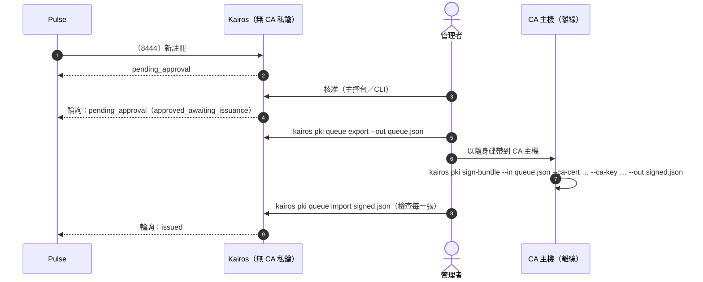

# Kairos PKI：自動簽發、撤銷與資料模型（衝刺 4 規格）

本文件是 Kairos 端「註冊與憑證」的工程規格：CA 架構、簽發金鑰的保管、憑證格式、撤銷與 CRL、離線簽發模式，以及資料庫 schema v4。8444 註冊通道的線上協定見 [`crates/kairos-proto/ENROLL.md`](../crates/kairos-proto/ENROLL.md)，主控台與 CLI 見 [`API.md`](API.md) 第 11 節。

- 狀態：**0.5.0〔草稿〕規格**。第 1 節原本標「待使用者確認」的項目已由使用者決定（2026-10-14），標為「已決定（2026-10-14）」。
- 設計依據（設計包，唯讀）：`kairos/screens.md` S02 步驟 3、S12～S15、§24 #6、#7、#13、#20；`pulse/enrollment-ux.md` §1、§8；`design-system/cli-style.md` §11.3；`decisions/INTEGRATION.md` §17。
- 現況：0.4 沒有內建的 PKI。`packaging/INSTALL.md` 第 6 節以 openssl 在管理主機建立兩個離線 CA（伺服器 CA、代理 CA），手動簽發與撤銷，`kairos-crl.timer` 定期重新產生 CRL；Kairos 只讀取 `auth.client_ca` 與 `auth.crl`。

## 1. 決定摘要

| # | 決定 | 預設 | 狀態 |
|---|---|---|---|
| 1 | **根 CA 離線、Kairos 線上持有「代理簽發 CA」（中繼 CA）的私鑰**（0600），核准後立即簽發 | `pki.mode = "online"` | **已決定（2026-10-14）**：預設線上簽發。線上持有簽發金鑰是自動簽發的前提，也是新的攻擊面（第 3 節） |
| 2 | Kairos 的 mTLS 信任錨是**簽發 CA 本身**（不是根 CA） | — | 技術決定（理由見第 2 節） |
| 3 | 簽發 CA 憑證帶 `pathLenConstraint = 0` 與 EKU `clientAuth`，有效 5 年；新簽發的用戶端憑證不得晚於簽發 CA 到期 | — | 技術決定 |
| 4 | 演算法：簽發 CA 與用戶端金鑰 **ECDSA P-256**；根 CA 新安裝用 **ECDSA P-384**，既有的 RSA 根 CA（RSA 3072／4096）照用，簽發 CA 可由 RSA 根 CA 簽發 | — | **已決定（2026-10-14）** |
| 5 | 用戶端憑證 365 天（D2）、序號 16 bytes 隨機值、`notBefore` 往前 10 分鐘 | — | 已定（D2） |
| 6 | **離線簽發模式**（`pki.mode = "offline"`）：不在線上持有任何 CA 私鑰，核准後匯出 CSR 佇列、在 CA 主機簽發、再匯入 | 不是預設 | **已決定（2026-10-14）**：可切換的選項，**不是**高安全場域的預設；需要時由管理者明確設定 |
| 7 | Kairos 自己產生並載入簽發 CA 的 CRL（每次撤銷與每 24 小時），不再需要 `kairos-crl.timer`（離線模式仍需要） | — | 技術決定 |
| 8 | 衝刺 4 **不實作** `kairos pki init`（一次建立根 CA 與簽發 CA 並把根 CA 私鑰加密匯出）：先以「Kairos 產生簽發 CA 的金鑰與 CSR → 管理主機以根 CA 簽發 → 匯入」完成，根 CA 從頭到尾不在 Kairos 主機上 | — | **已決定（2026-10-14）**：`pki init` 延後到首次啟動精靈（S02） |
| 9 | 續簽重放快取持久化、除役 10 分鐘視窗以「延後生效的撤銷」實作 | — | 技術決定（ENROLL.md 第 18 節，安全審查的處置） |
| 10 | 主控台變更的註冊端點模式與憑證政策存在資料庫的 `settings` 表，**優先於 `kairos.toml`**；以 `kairos config show --effective` 查詢實際生效值與每一項的來源 | — | **已決定（2026-10-14）**：設計包 #14 要求寫回 `kairos.toml`，精靈實作時再評估是否統一 |
| 11 | 註冊 token 的列表與詳情只顯示**前 4 碼**（`KRT1-GE8Q…`），不顯示後 4 碼 | — | **已決定（2026-10-14）**：ENROLL.md 第 18 節第 5 項 |

## 2. CA 架構

```
根 CA（離線；P-384，10 年）
├── 代理簽發 CA（中繼；P-256，5 年；私鑰在 Kairos 的 data/pki/，線上模式）  ← Kairos 的 mTLS 信任錨
│     └── 用戶端憑證（P-256，365 天；SAN DNS:<agent_id>；EKU clientAuth）
└── 伺服器憑證（8443／8444／9443；EKU serverAuth；由根 CA 離線簽發，或匯入組織 CA 簽發的憑證）
```

- **Pulse 信任的是根 CA**：安裝字串的 CA 指紋＝根 CA 的 SPKI 雜湊（`pki.server_ca_path` 指向它，ENROLL.md 第 3 節），`identity/ca.pem` 存根 CA。根 CA 私鑰不在 Kairos 上，所以 Kairos 被入侵也簽不出 Pulse 會信任的新伺服器憑證；簽發 CA 憑證帶 EKU `clientAuth`，webpki 沿鏈檢查 EKU，即使簽發 CA 私鑰外洩也無法產生可用於 `serverAuth` 的鏈。
- **Kairos 信任的是簽發 CA**（`auth.client_ca` 的檔案內容，加上資料庫中狀態為 `active`／`trusted` 的簽發 CA）：
  - 撤換簽發 CA 時從信任錨移除即可，**不需要根 CA 的 CRL**（以根 CA 為信任錨時，Kairos 的 fail-closed CRL 檢查會要求每一層都有 CRL，根 CA 的 CRL 就必須定期以離線金鑰重新產生，運作成本高）。
  - 根 CA 簽發的伺服器憑證不能被拿來當用戶端憑證（不是信任錨簽的，也沒有 `clientAuth`）。
- **既有部署**（INSTALL 第 6 節的兩個 CA）：伺服器 CA 就是 Pulse 信任的 CA（`pki.server_ca_path` 指向它的 `ca.pem`）；代理 CA 可以 (a) 繼續當 `auth.client_ca` 的信任錨並採**離線模式**，或 (b) 當「根」，以它簽發一個線上簽發 CA（第 9 節）。

## 3. 線上簽發 CA（預設）

| 項目 | 規則 |
|---|---|
| 位置 | `<storage.data_dir>/pki/`，目錄 **0700**（擁有者 `kairos`）。簽發 CA 私鑰 `issuing-<ca_id>.key`：PKCS#8 PEM、**0600**；憑證 `issuing-<ca_id>.pem`：0644 |
| 權限檢查 | 啟動時與每次重新載入時檢查（沿用 `fsperm.rs`）：私鑰的群組或其他使用者有任何權限、或擁有者不是執行 Kairos 的帳號時，**不使用**這把金鑰（不拒絕啟動：既有主機照常連線），線上簽發停用，核准的申請停在 `approved_awaiting_issuance`，記 `ERROR` 與 `KRS-E1302`（原因：「私鑰權限過寬」；是否另配代碼見 ENROLL.md 第 19.4 節）。目錄的權限過寬時同樣處理 |
| 與資料庫的關係 | `kairos.db` 維持 0640（`kairos` 群組可讀，供備份）；**資料庫中沒有任何私鑰**（只有 token 雜湊、`poll_secret` 雜湊、CSR 與憑證）。`kairos db backup` 不含 `data/pki/`；簽發 CA 私鑰另外備份（加密），遺失時見第 4 節 |
| 誰讀私鑰 | 只有 Kairos 常駐行程（簽發器）。CLI（`kairos enroll approve`）不簽發，只把申請標為已核准，常駐行程在 2 秒內簽發（第 10 節）。`kairos pki` 的離線指令（第 6 節）在 CA 主機上執行，讀的是離線金鑰 |
| 記錄 | 啟動時記一次 `KRS-W1301`（CA 私鑰存放在伺服器上）的 `INFO`／`WARN`：說明線上簽發的取捨與離線模式；S15 的憑證鏈顯示「私鑰：在伺服器 · 簽發 N 張」 |
| 選用的加密（之後） | systemd `LoadCredentialEncrypted=` 提供私鑰（TPM 或主機金鑰加密），Kairos 從 `$CREDENTIALS_DIRECTORY` 讀取；本衝刺不實作，設定鍵 `pki.issuing_key_path` 先保留可指向任意路徑 |

## 4. 簽發 CA 的輪替與遺失

設計包 S15「CA 輪替」四步，對應到資料庫的 `pki_cas.state`：

1. **建立新的簽發 CA**：`kairos pki issuing-ca new` 在 `data/pki/` 產生新的 P-256 私鑰與 CSR（新 `ca_id`，狀態 `pending`）；管理者在離線主機以根 CA 簽發（INSTALL 新增 `issuing_ca_ext` 範本：`basicConstraints=critical,CA:TRUE,pathlen:0`、`keyUsage=critical,keyCertSign,cRLSign`、`extendedKeyUsage=clientAuth`）；`kairos pki issuing-ca install <cert.pem>` 檢查憑證與私鑰成對、上述擴充欄位、有效期間（至少剩 2 年），狀態改為 `trusted`。
2. **新舊並存**：新 CA 加入信任錨；`kairos pki issuing-ca activate <ca_id>` 後新簽發改用新 CA（狀態 `active`，舊的改 `trusted`）。
3. **依進度重新簽發**：8443 的 `hello_ack.renew_now`（ENROLL.md 第 13.1 節）要求仍使用舊 CA 憑證的主機提早輪替（分散在 6 小時內）；S15 顯示「還有 N 台使用舊 CA 簽發的憑證」。
4. **移除舊 CA**：N＝0（或剩下的都已撤銷、過期超過寬限期）後才能 `retire`；狀態 `retired`，從信任錨移除，私鑰檔刪除。

- **何時輪替**：簽發 CA 剩餘有效期少於「用戶端憑證最長有效天數（825 天）＋ 90 天」時，系統健康為警告；新簽發的 `notAfter` 一律截在簽發 CA 的 `notAfter` 之前（第 5 節），所以不會簽出比 CA 長命的憑證。
- **私鑰遺失**（沒有備份）：舊 CA 簽發的憑證仍有效，但**無法再為它產生 CRL**，也就無法撤銷。處置：立即建立新的簽發 CA（上述 1～3 步），舊 CA 的 CRL 停在最後一版；最後一版到期（`nextUpdate`）前完成輪替，否則以舊 CA 憑證連線的主機會因 CRL 過期被拒（fail closed）。S15 以嚴重提示這個期限。
- **私鑰外洩**：從信任錨移除舊 CA（`kairos pki issuing-ca retire --compromised`，L3）：以舊 CA 憑證連線的主機立即被拒，需以過期續簽以外的方式（新 token）重新註冊；過期續簽以舊 CA 的憑證證明身分，也一併失效。

## 5. 憑證格式

### 5.1 用戶端憑證（由簽發 CA 簽發）

| 欄位 | 值 |
|---|---|
| 版本 | v3 |
| 序號 | 16 bytes CSPRNG 隨機值，最高位元清為 0（正整數）、不得為 0；以大寫十六進位顯示與保存（例 `5E0B2C77A1D94F3E8B6A0C21D4F7E913`）。全資料庫唯一（`pki_certificates` 的唯一索引），重複時重抽 |
| 簽章演算法 | `ecdsa-with-SHA256`（簽發 CA 為 P-256） |
| issuer | 簽發 CA 的 subject |
| subject | `CN=<agent_id>`（小寫），沒有其他屬性（不含主機名稱等可識別資訊；主機名稱在清冊中） |
| 公鑰 | CSR 的公鑰，必須是 P-256（ENROLL.md 第 15.1 節） |
| `notBefore` | 簽發時間 − 10 分鐘（容許 ENROLL.md 第 9 節的 ±5 分鐘時鐘偏差，避免 `PLS-E8304`） |
| `notAfter` | 簽發時間 ＋ 有效天數（政策預設 365 天，token 可覆寫 90～825 天，設計包 D2、S12），且不晚於簽發 CA 的 `notAfter` |
| `subjectAltName` | **恰好一個** `dNSName = <agent_id>`（與 8443 的 `auth::cert_matches_agent_id`、PROTOCOL.md「身分驗證」一致） |
| `basicConstraints` | critical，`CA:FALSE` |
| `keyUsage` | critical，`digitalSignature` |
| `extendedKeyUsage` | `clientAuth` |
| `subjectKeyIdentifier`、`authorityKeyIdentifier` | 有（keyid） |
| CRL DP、AIA | 不帶（唯一的驗證者是 Kairos，CRL 由 Kairos 自己載入） |
| CSR 的擴充欄位 | 一律不複製 |

### 5.2 代理簽發 CA

subject `CN=<組織名稱> Kairos Agent Issuing CA <ca_id>`；P-256；`basicConstraints` critical `CA:TRUE, pathlen:0`；`keyUsage` critical `keyCertSign, cRLSign`；`extendedKeyUsage` `clientAuth`；SKI／AKI；有效 5 年（設計包 S02「中繼 CA 5 年」）。

### 5.3 根 CA 與伺服器憑證

- 根 CA：P-384（或既有的 RSA），`CA:TRUE`、`keyCertSign, cRLSign`，10 年（S02），私鑰離線、加密保存。
- 伺服器憑證：沿用 INSTALL 第 6.1 節（EKU `serverAuth`、SAN 為 Pulse 連線使用的名稱、`CA:FALSE`）。由根 CA 簽發，或由組織 CA 簽發後匯入；8443、8444 預設共用（`enroll.cert_path` 可另設）。8444 的鏈尾會附上 `pki.server_ca_path` 的根 CA（ENROLL.md 第 2 節）。

## 6. 離線簽發模式（`pki.mode = "offline"`）

給「CA 私鑰不得放在任何連網主機上」的場域。Kairos 沒有任何 CA 私鑰；註冊、核准、輪詢、撤回、過期續簽的協定與線上模式完全相同，差別只在「核准」到「簽發」之間多了人工的匯出與匯入。



| 步驟 | 規格 |
|---|---|
| 匯出 | `kairos pki queue export [--out <檔案>] [--json]`：狀態為已核准、尚未簽發的所有申請（新註冊、過期續簽、8443 輪替）。檔案 `kairos-csr-queue/v1`（JSON）：`exported_at`、`kairos_instance`（資料庫的實例 ID）、`items[]`（`request_id`、`kind`、`agent_id`、`csr`〔base64url DER〕、`lifetime_days`、`approved_by`、`approved_at`）。檔案不含秘密。匯出不改變狀態，可以重複匯出 |
| 離線簽發 | 在 CA 主機以同一個 `kairos` 執行檔：`kairos pki sign-bundle --in <檔案> --ca-cert <簽發 CA 憑證> --ca-key <簽發 CA 私鑰> --out <檔案>`，依第 5.1 節的格式逐一簽發，輸出 `kairos-signed-certs/v1`：`items[]`（`request_id`、`certificate`〔base64url DER〕）。不連網、不需要 Kairos 的資料庫。也可以用 openssl 以 INSTALL 的 `client_ext` 範本手動簽發，再以 `--pem-dir` 匯入 |
| 匯入 | `kairos pki queue import <檔案>`（或 `--pem-dir <目錄>`）逐張檢查：鏈到目前的信任錨（`auth.client_ca`）、SAN 與 CN 等於申請的 `agent_id`、公鑰等於申請 CSR 的公鑰、序號未使用、`notAfter` 在未來、EKU `clientAuth`。通過的申請改為 `issued`（Pulse 下一次輪詢取得）；不通過的列出原因，申請維持原狀 |
| 撤銷 | 主控台與 CLI 照常撤銷（立即寫入資料庫，S14 顯示「撤銷待生效」）。`kairos pki revocations export` 匯出 `kairos-revocations/v1`（簽發 CA 的 SPKI 雜湊、下一個 CRL 版本號、`revoked[]`：序號、撤銷時間、原因）；CA 主機 `kairos pki gencrl --revocations <檔案> --ca-cert … --ca-key … --out agents.crl`（或沿用 `openssl ca -gencrl`）；以主控台「上傳 CRL」或 `kairos pki crl upload`（設計包 S15 的四項檢查，`KRS-E1206`）套用後生效 |
| 定期 CRL | 沒有新的撤銷也要在 `nextUpdate` 前更新：沿用 `kairos-crl.timer`（INSTALL 第 10.3 節）或在 CA 主機以 `kairos pki gencrl` 排程 |
| 主控台 | S12 頁首 `KRS-E1302`「目前設定為私鑰離線保存……核准後需在 CA 主機上簽發」；S14「待簽發」篩選；S13 核准後列為「已核准，待簽發」 |

**取捨**

| | 線上簽發（預設） | 離線簽發 |
|---|---|---|
| 核准到取得憑證 | 幾秒 | 視管理者多久匯出、簽發、匯入一次（小時到天） |
| 自動核准 token、過期續簽、8443 輪替 | 全自動 | 都要等人工簽發；季節性產線回來時要有人在場 |
| 撤銷生效 | 幾秒（Kairos 自己產生 CRL） | 上傳新的 CRL 之後 |
| Kairos 被入侵 | 攻擊者可簽發任意 `agent_id` 的用戶端憑證（可冒充主機回報假資料），但無法冒充 Kairos（簽不出伺服器憑證）；處置見第 4 節「私鑰外洩」 | 攻擊者無法簽發 |
| 運作負擔 | 備份 `data/pki/`（加密） | 每批核准都要往返 CA 主機；CRL 定期更新 |

## 7. 資料模型（schema v4）

在 `kairos.db` 新增一個遷移（`store/sqlite.rs` 的 `MIGRATIONS`，0.5.0）。沿用 STORAGE.md 第 3 節的慣例：時間為 Unix 毫秒、不使用 `STRICT` 與外鍵、雜湊為 BLOB、`agent_id` 小寫、序號為大寫十六進位文字。

```sql
-- v4：註冊通道與 PKI（ENROLL.md、PKI.md）
CREATE TABLE pki_cas (                       -- Kairos 管理的代理簽發 CA（auth.client_ca 檔案中的 CA 不在這裡）
    ca_id        INTEGER PRIMARY KEY,
    subject      TEXT NOT NULL,
    spki_sha256  BLOB NOT NULL UNIQUE,
    cert_der     BLOB,                       -- pending（等根 CA 簽發）時為 NULL
    not_before   INTEGER,
    not_after    INTEGER,
    key_file     TEXT,                       -- 相對於 data_dir；離線模式為 NULL
    state        TEXT NOT NULL,              -- pending | active | trusted | retired
    next_crl_number INTEGER NOT NULL DEFAULT 1,
    created_at   INTEGER NOT NULL,
    retired_at   INTEGER
);

CREATE TABLE enroll_tokens (                 -- 註冊 token（S12）；與 api_tokens 無關
    token_id       TEXT PRIMARY KEY,         -- 16 個十六進位字元，公開的識別碼
    secret_hash    BLOB NOT NULL UNIQUE,     -- EnrollToken::lookup_hash（ENROLL.md 14.2）
    hint           TEXT NOT NULL,            -- KRT1-XXXX…XXXX
    name           TEXT NOT NULL,
    group_name     TEXT NOT NULL,
    tags           TEXT,                     -- 預設標籤（JSON 陣列）
    approval       TEXT NOT NULL,            -- manual | auto
    max_uses       INTEGER NOT NULL,
    used           INTEGER NOT NULL DEFAULT 0,
    expires_at     INTEGER NOT NULL,
    allowed_cidrs  TEXT,                     -- 限定來源網段（JSON 陣列）
    batch_mode     INTEGER NOT NULL DEFAULT 0,
    allowed_agent_ids TEXT,                  -- 限定主機（JSON 陣列）
    cert_lifetime_days INTEGER,              -- NULL：沿用憑證政策
    created_at     INTEGER NOT NULL,
    created_by     TEXT NOT NULL,            -- 主控台帳號、API token 的 token_id 或作業系統帳號
    disabled_at    INTEGER,
    disabled_by    TEXT,
    disable_reason TEXT,
    last_used_at   INTEGER
) WITHOUT ROWID;

CREATE TABLE enroll_requests (               -- 註冊與續簽申請（S13）
    request_id     TEXT PRIMARY KEY,
    kind           TEXT NOT NULL,            -- enroll | grace_renewal | renewal（8443 輪替需核准時）
    agent_id       TEXT NOT NULL,
    request_code   TEXT NOT NULL,            -- 8 個字元（不含連字號）
    state          TEXT NOT NULL,            -- pending_approval | approved | issued | rejected | request_expired | withdrawn | replaced
    csr_der        BLOB NOT NULL,
    csr_sha256     BLOB NOT NULL,
    spki_sha256    BLOB NOT NULL,
    poll_secret_hash BLOB,                   -- 8443 輪替為 NULL
    token_id       TEXT,                     -- 新註冊
    expired_serial TEXT,                     -- 過期續簽：出示的舊憑證
    previous_serial TEXT,                    -- 新註冊：Pulse 帶來的前一張序號
    source_ip      TEXT NOT NULL,
    hostname       TEXT NOT NULL,
    display_name   TEXT,
    tags           TEXT,
    os             TEXT,
    host_fingerprint TEXT,
    pulse_version  TEXT,
    server_verification TEXT,                -- ca_pin | ca_file | tofu
    flags          TEXT,                     -- 異常旗標（JSON 陣列，S13）
    created_at     INTEGER NOT NULL,
    expires_at     INTEGER NOT NULL,
    decided_at     INTEGER,
    decided_by     TEXT,
    reject_reason_code TEXT,                 -- unknown_host | source_mismatch | duplicate | other
    reject_reason  TEXT,
    issued_serial  TEXT,
    delivered_at   INTEGER,                  -- 第一次在輪詢回應中交出憑證
    withdrawn_at   INTEGER,
    withdraw_reason TEXT,
    withdraw_initiated_by TEXT,
    withdraw_ip    TEXT,
    closed_at      INTEGER                   -- 進入結束狀態的時間（最近結束保存 30 天）
) WITHOUT ROWID;
CREATE UNIQUE INDEX enroll_requests_csr ON enroll_requests (agent_id, csr_sha256);  -- 冪等的鍵
CREATE INDEX enroll_requests_state ON enroll_requests (state, created_at);
CREATE INDEX enroll_requests_agent ON enroll_requests (agent_id);
CREATE INDEX enroll_requests_code ON enroll_requests (request_code);
CREATE INDEX enroll_requests_token ON enroll_requests (token_id);

CREATE TABLE pki_certificates (              -- 簽發紀錄（S14）；含匯入與手動簽發的
    serial         TEXT NOT NULL UNIQUE,
    ca_id          INTEGER,                  -- NULL：由 auth.client_ca 中的外部 CA 簽發（匯入）
    agent_id       TEXT NOT NULL,
    spki_sha256    BLOB NOT NULL,
    not_before     INTEGER NOT NULL,
    not_after      INTEGER NOT NULL,
    cert_der       BLOB NOT NULL,
    issued_at      INTEGER NOT NULL,
    issued_via     TEXT NOT NULL,            -- token | grace_renewal | renewal | manual | import
    request_id     TEXT,
    approved_by    TEXT,
    first_used_at  INTEGER,                  -- 第一次以這張憑證成功 hello（輪替時撤銷舊憑證的時機）
    revoked_at     INTEGER,
    revoke_effective_at INTEGER,             -- 進入 CRL 的時間（除役為 +10 分鐘，ENROLL.md 第 18 節）
    revocation_reason TEXT,                  -- keyCompromise | cessationOfOperation | superseded | unspecified
    revoked_by     TEXT,
    revoke_comment TEXT,
    crl_number     INTEGER                   -- 第一次收錄的 CRL 版本
);
CREATE INDEX pki_certificates_agent ON pki_certificates (agent_id, issued_at);
CREATE INDEX pki_certificates_not_after ON pki_certificates (not_after);

CREATE TABLE pki_crls (                      -- CRL 版本歷史（S15）
    ca_id          INTEGER NOT NULL,         -- 0：上傳的外部 CRL
    crl_number     INTEGER NOT NULL,
    this_update    INTEGER NOT NULL,
    next_update    INTEGER NOT NULL,
    revoked_count  INTEGER NOT NULL,
    der            BLOB NOT NULL,
    source         TEXT NOT NULL,            -- scheduled | revocation | upload | startup
    created_by     TEXT,
    PRIMARY KEY (ca_id, crl_number)
) WITHOUT ROWID;

CREATE TABLE enroll_replay (                 -- 過期續簽的重放快取（持久化，ENROLL.md 第 16.4、18 節）
    key            BLOB PRIMARY KEY,         -- 簽章內容的 SHA-256
    expires_at     INTEGER NOT NULL,         -- 寫入時間 + 10 分鐘
    agent_id       TEXT NOT NULL,
    first_seen_at  INTEGER NOT NULL
) WITHOUT ROWID;
CREATE INDEX enroll_replay_expires ON enroll_replay (expires_at);

CREATE TABLE enroll_blocks (                 -- L7 封鎖（重新啟動後仍有效）
    source         TEXT NOT NULL,            -- 來源（IPv6 為 /64）
    class          TEXT NOT NULL,            -- enroll | renew
    blocked_until  INTEGER NOT NULL,
    offenses       INTEGER NOT NULL,         -- 再犯次數（封鎖時間加倍）
    last_offense_at INTEGER NOT NULL,
    PRIMARY KEY (source, class)
) WITHOUT ROWID;

CREATE TABLE enroll_relaxations (            -- 暫時放寬（enroll-rate-limit.md §4.3，附到期時間）
    id             INTEGER PRIMARY KEY,
    cidr           TEXT NOT NULL,
    expires_at     INTEGER NOT NULL,
    created_at     INTEGER NOT NULL,
    created_by     TEXT NOT NULL,
    reason         TEXT NOT NULL
);

CREATE TABLE settings (                      -- 主控台修改的設定（第 8 節）
    key            TEXT PRIMARY KEY,         -- 例 enroll.mode、pki.policy.cert_lifetime_days
    value          TEXT NOT NULL,            -- JSON
    updated_at     INTEGER NOT NULL,
    updated_by     TEXT NOT NULL
) WITHOUT ROWID;

CREATE TABLE audit_events (                  -- 稽核（之後的雜湊鏈 #11 在此表加欄位）
    id             INTEGER PRIMARY KEY,
    at             INTEGER NOT NULL,
    actor          TEXT NOT NULL,            -- 使用者、token:<token_id>、system、host:<agent_id 前 8 碼>
    actor_ip       TEXT,
    category       TEXT NOT NULL,            -- enroll | pki | host | settings
    action         TEXT NOT NULL,            -- 例 request.approve、cert.revoke、token.create、mode.change
    object         TEXT,                     -- request_id、serial、token_id、agent_id
    result         TEXT NOT NULL,            -- ok | rejected | failed
    code           TEXT,                     -- 產品代碼或協定錯誤碼
    details        TEXT                      -- JSON
);
CREATE INDEX audit_events_at ON audit_events (at);
CREATE INDEX audit_events_object ON audit_events (object);

ALTER TABLE hosts ADD COLUMN lifecycle TEXT NOT NULL DEFAULT 'active';  -- active | decommissioned
ALTER TABLE hosts ADD COLUMN decommissioned_at INTEGER;
ALTER TABLE hosts ADD COLUMN current_serial TEXT;        -- 最新簽發的憑證（過期續簽的「最新」判定）
ALTER TABLE hosts ADD COLUMN grace_override_until INTEGER; -- 「允許再次自動續簽」（S14，D12）
ALTER TABLE hosts ADD COLUMN expired_seen_at INTEGER;    -- 8443 以過期憑證報到（S14「最後嘗試」）
ALTER TABLE hosts ADD COLUMN last_grace_attempt TEXT;    -- JSON：時間、結果代碼（含 clock_skew 的偏差）
```

**與既有資料表的關係**

- `hosts`（清冊）：簽發時以 `agent_id` 建立或更新（`source = 'enroll'`、`current_serial`；新主機 `first_seen`／`last_seen` ＝ 簽發時間、`online = 0`，主控台 API 判為 `unknown` 的 `never_connected`）。`lifecycle`、`decommissioned_at` 由除役（#20）寫入；授權節點數＝`lifecycle = 'active'` 且（有未過期且未撤銷的憑證，或過期仍在寬限期內），設計包 D24。
- `api_tokens`（主控台 API token）：不變；`scope` 欄位新增 `operate`、`admin` 兩個值（API.md 第 11.1 節）。註冊 token 是**另一張表**：兩者的格式、授權對象、生命週期都不同。
- `meta`：不放新資料。`agents.json` 快照：不變（申請與 token 不進狀態表）。

**保存與清除**（掛在既有的保留清除工作上，每小時一次）

| 資料 | 保存 |
|---|---|
| `enroll_requests` | 待核准逾期（`expires_at`）時改為 `request_expired`；結束後 30 天刪除（`closed_at`） |
| `enroll_tokens` | 過期或停用後 400 天刪除（S12「全部」可查） |
| `pki_certificates` | 不自動刪除（每台每年約一筆）；「刪除主機資料」時一併刪除 |
| `pki_crls` | 每個 CA 保留最近 100 版 |
| `enroll_replay` | 每分鐘刪除 `expires_at` 已過的 |
| `enroll_blocks`、`enroll_relaxations` | 到期後刪除 |
| `audit_events` | 400 天（之後由 #11 的設定取代） |

**schema 版本**：v4（0.5.0）。升級到 v4 之後 0.4 無法開啟資料庫（STORAGE.md 第 3.2 節的規則）；`kairos db backup` 涵蓋所有新資料表。STORAGE.md 在實作時更新第 3 節。

## 8. 設定

```toml
[pki]
mode = "online"                    # online | offline；沒有 [pki] 時為 offline（升級不會自動開始簽發，與 enroll.mode 的雙層預設同一原則）
server_ca_path = "/opt/kairos/ca.pem"  # Pulse 信任的 CA（CA 指紋、8444 鏈尾、enroll 回應的 ca_pem）；必填才能啟用 8444
crl_validity_days = 30             # Kairos 產生的 CRL 的 nextUpdate
crl_refresh_hours = 24             # 沒有新撤銷時重新產生的間隔
```

- 憑證政策（S14：有效天數、輪替觸發天數、輪替需人工核准、過期寬限期、主機自行除役時撤銷）與註冊端點模式（`enroll.mode`、`enroll.auto_pause_enabled`、`enroll.auto_pause_after_hours`）可由主控台修改，存在 `settings` 表。**優先順序**：環境變數 ＞ `settings`（主控台）＞ `kairos.toml` ＞ 程式內建預設。被環境變數覆寫的項目，主控台顯示為鎖定並說明來源（設計包 #14）；`kairos config show --effective` 列出每個值的實際生效值與來源（`environment`／`console`／`file`／`default`）。**已決定（2026-10-14）**（第 1 節第 10 項）。
- `[pki]` 不存在、或 `pki.server_ca_path` 未設定時，8444 不監聽（即使 `enroll.mode` 不是 `closed`），啟動時記錄原因：沒有被釘選的 CA，Pulse 無法驗證 Kairos。
- `auth.client_ca` 仍必填（mTLS）；線上簽發 CA 自動加入信任錨，不必寫進檔案。

## 9. 從手動 PKI（0.4）升級

1. 備份資料庫；升級到 0.5.0（schema v4）。此時 `[pki]` 不存在 → 離線模式，`[enroll]` 不存在 → 關閉，行為與 0.4 相同。
2. 設定 `pki.server_ca_path` 為現有的伺服器 CA（`ca.pem`）。
3. 選擇：
   - **維持離線**：`pki.mode = "offline"`，註冊與核准在線上完成，簽發用第 6 節的匯出／匯入（代理 CA 私鑰不離開管理主機）。
   - **改為線上**：`kairos pki issuing-ca new` → 在管理主機以**代理 CA** 簽發（代理 CA 在此扮演根 CA）→ `install`、`activate`；`pki.mode = "online"`。舊的手動憑證繼續有效（代理 CA 仍在 `auth.client_ca`），到期前由 8443 的 `renew` 換成線上簽發的憑證。
4. 設定 `[enroll]`（`mode = "open"` 或 `renew_only`），開放 8444 的防火牆。
5. 手動簽發的既有憑證可以 `kairos pki certificates import <目錄>` 匯入簽發紀錄（S14 的清冊與撤銷才看得到它們）；不匯入也能連線。

## 10. 簽發流程（Kairos 內部）

- **簽發器**：常駐行程內的單一工作，持有線上簽發 CA 的私鑰。來源：(a) 8444 的自動核准與過期續簽（同步呼叫，受請求的 5 秒處理時限約束）；(b) 主控台 API 的核准（同步，批次核准逐筆在背景進行，設計包 S13 的進度）；(c) CLI 寫入的 `approved` 申請（每 2 秒掃描一次）；(d) 8443 的 `renew_request`。
- **一筆簽發**＝ 產生序號 → 依第 5.1 節組出並簽章 → 單一交易寫入 `pki_certificates`、`enroll_requests`（`issued`）、`hosts`（`current_serial`）、`audit_events` → commit 後喚醒該申請的長輪詢。交易失敗時憑證視同未簽發（序號不會重用：寫入時才佔用）。
- **冪等**：寫入前以 `enroll_requests (agent_id, csr_sha256)` 確認沒有已簽發的紀錄（ENROLL.md 第 7.4 節）；同一個 CSR 永遠只有一張憑證。
- **撤銷**：寫入 `revoked_at`、`revoke_effective_at`（一般為現在；除役為 +10 分鐘）→ 在生效時刻重新產生該 CA 的 CRL（`crl_number` 遞增，寫入 `pki_crls` 與 `data/pki/crl/agents-<ca_id>.crl`）→ 以新的 CRL 原子替換 TLS 驗證器（沿用 `tls.rs` 的 `TlsMaterial` 替換與既有連線重新驗證，被撤銷的連線收到 `certificate_rejected` 並斷線）。多筆撤銷在 2 秒內合併成一次 CRL。CRL 收錄已生效、且 `not_after` 尚未超過 1 天以上的撤銷。
- **定期 CRL**：每 `crl_refresh_hours` 與啟動時（`next_update` 在 7 天內）重新產生；失敗時記 `KRS-E1205`，`next_update` 剩 7 天起 `KRS-W1201`（沿用既有代碼與 `auth.crl_expiry_warning_days`）。
- **輪替後撤銷舊憑證**：新序號第一次成功 `hello` 時寫 `first_used_at`，並依政策以 `superseded` 撤銷同一 `agent_id` 的前一張（ENROLL.md 第 13.1 節）。

## 11. 與設計包的對照

| 設計包 | 本文件 |
|---|---|
| §24 #6：讀取 CRL `nextUpdate`、版本、撤銷筆數；CRL 自動更新與上傳檢查 | 第 6、10 節；`pki_crls`；上傳檢查沿用 S15 的四項（`KRS-E1206`） |
| §24 #7：註冊 token、CSR 佇列、異常旗標、批次簽發、撤銷並產生 CRL、輪替 | 第 6、7、10 節；ENROLL.md；API.md 第 11 節 |
| S02 步驟 3：根 CA＋agent 專用中繼 CA；根 CA 私鑰加密下載後刪除 | 第 2、3 節；`pki init` 延後（第 1 節第 8 項） |
| S14 憑證政策、撤銷原因、「撤銷待生效」 | 第 5、6、10 節 |
| S15 憑證鏈、CA 輪替四步、CRL 版本歷史 | 第 4、7 節 |
| `copywriting.md` `KRS-W1301`、`KRS-E1302`、`KRS-W1201`、`KRS-E1205`、`KRS-E1206` | 第 3、6、10 節（沿用，不新增代碼） |
