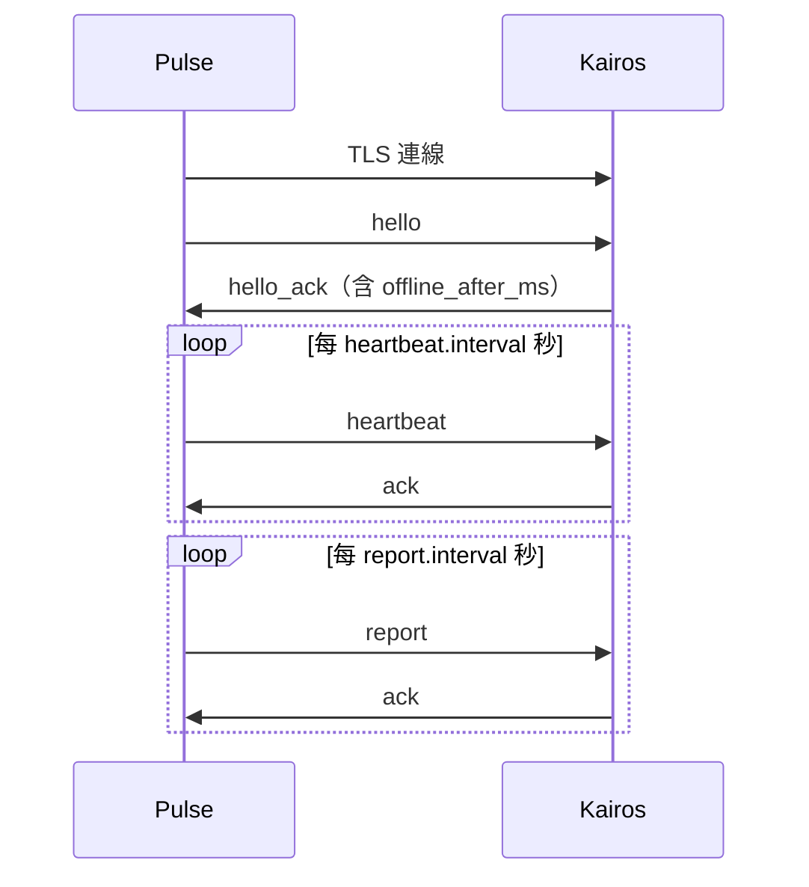

# Pulse ↔ Kairos 通訊協定 v1

本文件同時存在於 pulse 與 Kairos 兩個 repo，內容必須保持一致。修改協定時請兩邊一起更新，並同步更新兩邊單元測試中的測試向量。

- **Pulse**：地端監控代理（client）
- **Kairos**：中央伺服器（server）

## 傳輸

- 一條長時間維持的 TLS 連線，由 Pulse 主動連線。
- 訊息格式為 **NDJSON**：UTF-8，一行一則 JSON 物件，以 `\n` 結尾（接收端也接受 `\r\n`）。
- 單行上限 **65536 bytes**（不含結尾的 `\n`，但含 `\r`），超過時伺服器回 `too_long` 並關閉連線。
- Pulse 收到超長或非 UTF-8 的伺服器訊息時，直接斷線並重連。
- 雙方都忽略不認得的欄位，以便日後擴充。

## 流程



1. 連線後必須先送 `hello`。在 `hello` 之前送 `heartbeat` 或 `report`，伺服器回 `hello_required` 並關閉連線；在 `hello` 之前送壞掉的 JSON 或未知 type，伺服器回非 fatal 的 `bad_request` / `unknown_type`，繼續等待 `hello`。
   Pulse 在收到 `hello_ack` 之前收到任何 `error`（不論是否 fatal），都會結束該連線並重連。
2. 伺服器對每一則合法訊息都會回應：`hello` 回 `hello_ack`，`heartbeat` 與 `report` 回 `ack`。
   `report` 的 `ack` 代表該筆資料**已寫入伺服器的資料檔**（已交給作業系統，但不保證已同步到磁碟）；寫檔失敗時不回 `ack`，而是回 `error`（`storage_unavailable`）。
3. 斷線後 Pulse 以指數退避重連，重連後重新送 `hello`。

## 共通欄位

| 欄位 | 型別 | 說明 |
|---|---|---|
| `type` | string | 訊息種類（snake_case） |
| `seq` | u64 | 每條連線從 1 開始遞增，重連後重新計算 |
| `ts` | string | client 端時間，RFC 3339 UTC，精確到毫秒，最長 64 bytes（超過回 `bad_request`）。伺服器只記錄，不用來判斷存活 |

## 訊息

### Pulse → Kairos

| type | 其他欄位 |
|---|---|
| `hello` | `proto`（目前為 `1`）、`agent_id`、`hostname`（僅供顯示）、`agent_version`、`heartbeat_interval_ms` |
| `heartbeat` | 無 |
| `report` | `cpu_usage`（%）、`total_memory`（MB）、`used_memory`（MB） |

### Kairos → Pulse

| type | 欄位 |
|---|---|
| `hello_ack` | `seq`、`proto`、`offline_after_ms` |
| `ack` | `seq` |
| `error` | `seq`（可為 `null`）、`code`、`message`、`fatal` |

`fatal` 為 `true` 時，伺服器送出該錯誤後會關閉連線。

### `hello` 欄位限制

| 欄位 | 限制 | 違反時 |
|---|---|---|
| `agent_id` | UUID 文字格式：`8-4-4-4-12` 個十六進位字元（共 36 字元，大小寫皆可）。Pulse 首次啟動時產生並保存 | `bad_request` |
| `hostname` | 1～255 bytes，不得含控制字元 | `bad_request` |
| `agent_version` | 1～64 bytes，不得含控制字元 | `bad_request` |
| `heartbeat_interval_ms` | 伺服器將其夾在 1000～60000 之間後再計算 `offline_after_ms` | 不視為錯誤 |

Pulse 端的 `heartbeat.interval` 設定上限為 60 秒，與上表一致。

## 錯誤碼

| code | 情境 | fatal |
|---|---|---|
| `unsupported_version` | `hello` 的 `proto` 不受支援 | 是 |
| `hello_required` | 第一則訊息不是 `hello` | 是 |
| `too_long` | 單行超過 65536 bytes | 是 |
| `superseded` | 同一個 `agent_id` 建立了新連線，舊連線被關閉 | 是 |
| `auth_failed` | 伺服器啟用 mTLS 時，`hello` 的 `agent_id` 與客戶端憑證不符（見「身分驗證」） | 是 |
| `certificate_rejected` | 連線期間伺服器重新驗證時，客戶端憑證已被撤銷、過期或不再受信任（見「身分驗證」） | 是 |
| `storage_unavailable` | 伺服器無法寫入這筆 `report`（例如磁碟已滿）；這筆資料未保存 | 否 |
| `bad_request` | 不是合法 JSON 或欄位缺漏（同一連線連續 5 次會改為 fatal） | 否 |
| `unknown_type` | 不認得的 `type` | 否 |
| `already_registered` | 同一連線送了第二次 `hello` | 否 |
| `invalid_report` | `cpu_usage` 不是有限值或不在 0～100 之間，或 `used_memory` 大於 `total_memory`；這筆資料不會保存（Pulse 送出前會先把 `cpu_usage` 夾在 0～100） | 否 |

## 身分驗證（mTLS）

Kairos 設定了 `auth.client_ca` 時啟用雙向 TLS：

- Pulse 必須出示由該 CA 簽發的客戶端憑證，否則 TLS 握手失敗（不會有應用層錯誤訊息）。
- 伺服器憑證必須是終端實體憑證（`basicConstraints = CA:FALSE`）；`openssl req -x509` 預設產生的 `CA:TRUE` 憑證會被拒絕。
- 客戶端憑證必須包含 `subjectAltName = DNS:<agent_id>`，且擴充金鑰用途（EKU）包含 `clientAuth`。CN 建議也設為 `agent_id`，方便人工辨識。
- 伺服器以憑證的 SAN 比對 `hello` 的 `agent_id`（不分大小寫）。不符時回 `auth_failed` 並關閉連線。
- 因此只持有某個 `agent_id` 而沒有對應憑證與私鑰的人，無法冒用該代理，也無法把它的連線踢掉（`superseded`）。
- 客戶端憑證可以帶中繼 CA 鏈；私鑰可為 RSA 或 EC（P-256 / P-384）。
- **撤銷**：伺服器可設定 CRL（`auth.crl`）。伺服器會定期重新載入憑證、CA 與 CRL 檔案，不需重啟；重新載入後，已連線但憑證已被撤銷、過期或不再受信任的代理會收到 `certificate_rejected` 並被斷線。

未設定 `auth.client_ca` 時不要求客戶端憑證，任何能連上伺服器的人都能以任意 `agent_id` 註冊；Kairos 啟動時會記錄警告。僅建議用於本機開發。

## 逾時與離線判定

Kairos 的 TLS 握手、等待 `hello`、寫出逾時可在設定檔 `[timeouts]` 調整，下表為預設值。

| 角色 | 項目 | 數值 |
|---|---|---|
| Kairos | TLS 握手 | 10 秒 |
| Kairos | 握手後等待 `hello` | 5 秒 |
| Kairos | 讀取閒置（沒收到任何**合法**訊息；壞行與未知 type 不算） | `offline_after_ms` |
| Pulse | TCP 連線 | 5 秒 |
| Pulse | TLS 握手 | 10 秒 |
| Pulse | 等待 `hello_ack` | 5 秒 |
| Pulse | 讀取閒置（沒收到任何伺服器訊息） | `max(10 秒, 2 × min(heartbeat.interval, report.interval))`，視為連線中斷並重連 |
| 雙方 | 每則訊息寫出 | 5 秒 |

- `offline_after_ms = max(5 × clamp(heartbeat_interval_ms, 1000, 60000), 5000)`，因此介於 5000～300000，由伺服器在 `hello_ack` 中告知。
- 伺服器超過 `offline_after_ms` 沒收到某代理的合法訊息（`hello`、`heartbeat`、`report`，含 `invalid_report` 的那筆），就將它標為離線並關閉該連線。
- 離線超過 24 小時的代理會從伺服器的狀態表（`agents.json`）中移除。

### 重連

- Pulse 斷線後以指數退避重連：從 `retry.initial_delay` 開始加倍，上限 `retry.max_delay`，加上 ±20% 抖動；達到上限後在 `[0.8 × max_delay, max_delay]` 間均勻分佈。
- 退避只在**連線穩定維持 30 秒以上**後才重置，避免「註冊成功後立刻被踢」時以固定短間隔反覆重連（例如兩台主機誤用同一份 `agent.id`）。
- `report` 採 at-most-once：送不出去就丟棄，不會重送舊資料。

## 範例

```
P {"type":"hello","seq":1,"proto":1,"agent_id":"6f1c0e4a-1b2c-4d3e-9f00-112233445566","hostname":"web-01","agent_version":"0.1.0","heartbeat_interval_ms":1000,"ts":"2026-10-08T03:15:40.001Z"}
K {"type":"hello_ack","seq":1,"proto":1,"offline_after_ms":5000}
P {"type":"heartbeat","seq":2,"ts":"2026-10-08T03:15:41.002Z"}
K {"type":"ack","seq":2}
P {"type":"report","seq":6,"ts":"2026-10-08T03:15:45.210Z","cpu_usage":17.84,"total_memory":49152,"used_memory":37034}
K {"type":"ack","seq":6}
```

錯誤範例：

```
K {"type":"error","seq":1,"code":"unsupported_version","message":"supported proto: 1","fatal":true}
K {"type":"error","seq":null,"code":"unknown_type","message":"unknown message type","fatal":false}
```

## 手動測試

可以直接用 OpenSSL 連上 Kairos，手動貼上 JSON：

```bash
openssl s_client -connect 127.0.0.1:8080 -servername localhost -quiet
```
