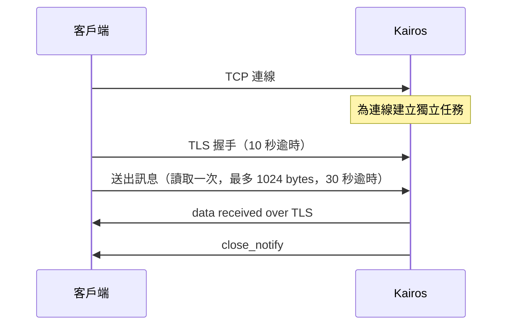

# Kairos

以 Rust 撰寫的非同步 TLS 伺服器，建構於 [tokio](https://tokio.rs/) 與 [rustls](https://github.com/rustls/rustls)。

目前處於概念驗證階段：接受 TLS 連線、讀取客戶端送來的一則訊息，並回傳確認訊息。

## 功能

- 以 tokio 處理非同步 I/O，每條連線在獨立任務中執行
- 使用 rustls（`ring` 加密後端），支援 TLS 1.2 與 TLS 1.3
- 私鑰支援 PKCS#8、PKCS#1（RSA）與 SEC1（EC）格式
- 握手逾時 10 秒、讀寫逾時 30 秒，避免閒置連線佔用資源
- 回應後正常關閉 TLS 連線（送出 `close_notify`）
- 單一連線出錯或接受連線失敗時，伺服器會記錄錯誤並繼續運作

## 需求

- Rust 工具鏈（開發時使用 Rust 1.89）
- OpenSSL 命令列工具（僅用於產生測試憑證與手動測試）

## 快速開始

### 1. 產生自簽憑證

在專案根目錄執行：

```bash
openssl req -x509 -newkey rsa:2048 -nodes \
  -keyout key.pem -out cert.pem -days 365 -subj "/CN=localhost"
```

> [!NOTE]
> 在 Windows 的 Git Bash 中，`/CN=localhost` 會被自動轉換成檔案路徑，請在指令前加上 `MSYS_NO_PATHCONV=1`。

> [!WARNING]
> `key.pem` 是私鑰，請勿提交到版本控制。

### 2. 啟動伺服器

```bash
cargo run
```

伺服器會從**目前工作目錄**讀取 `cert.pem` 與 `key.pem`，並監聽 `127.0.0.1:8080`。啟動成功時會顯示：

```
TLS 伺服器已啟動，等待連線...
```

### 3. 測試連線

另開一個終端機：

```bash
echo "hello" | openssl s_client -connect 127.0.0.1:8080 -quiet
```

客戶端會收到：

```
data received over TLS
```

伺服器端則會顯示：

```
接收到來自 127.0.0.1:xxxxx 的連線
收到資料: hello
回應已發送
```

使用自簽憑證時，`openssl s_client` 會出現 `verify error:num=18:self-signed certificate`，這是正常現象。

## 運作方式



1. 啟動時載入證書與私鑰，建立 rustls 的 `ServerConfig`（不要求客戶端憑證）。
2. 在 `127.0.0.1:8080` 監聽 TCP 連線，每條連線交給 `tokio::spawn` 處理。
3. 完成 TLS 握手後讀取一次資料並印出。
4. 回傳固定訊息 `data received over TLS`，隨後關閉 TLS 連線。

任何連線層級的錯誤（握手失敗、逾時、客戶端中斷）都會以 `處理來自 <位址> 的連線時發生錯誤: <原因>` 的格式輸出到 stderr，不影響其他連線。

## 設定

目前所有設定都寫在 `src/main.rs` 中，修改後需重新編譯。

| 項目 | 預設值 | 位置 |
|---|---|---|
| 監聽位址 | `127.0.0.1:8080` | `main` |
| 證書檔 | `cert.pem` | `main` |
| 私鑰檔 | `key.pem` | `main` |
| 握手逾時 | 10 秒 | `HANDSHAKE_TIMEOUT` |
| 讀寫逾時 | 30 秒 | `IO_TIMEOUT` |
| 讀取緩衝區 | 1024 bytes | `handle_connection` |

## 疑難排解

| 錯誤訊息 | 原因與解法 |
|---|---|
| `無法開啟 cert.pem: 系統找不到指定的檔案` | 目前工作目錄沒有憑證檔。請在放置 `cert.pem`、`key.pem` 的目錄執行程式。 |
| `cert.pem 中找不到證書` | 檔案內沒有 `BEGIN CERTIFICATE` 區塊。 |
| `key.pem 中找不到私鑰` | 檔案內沒有支援格式的私鑰（`BEGIN PRIVATE KEY`、`BEGIN RSA PRIVATE KEY` 或 `BEGIN EC PRIVATE KEY`）。 |
| `AddrInUse`（一次只能用一個通訊端位址） | 8080 埠已被佔用，可能有另一個 Kairos 仍在執行。 |

## 專案結構

```
Kairos/
├── Cargo.toml     套件設定與依賴
├── Cargo.lock     鎖定的依賴版本
└── src/
    └── main.rs    伺服器程式（TLS 設定載入、連線處理）
```

## 依賴

| 套件 | 用途 |
|---|---|
| `tokio` | 非同步執行環境、TCP 監聽、逾時 |
| `tokio-rustls` | 在 tokio 上提供 TLS；透過其重新匯出的 `rustls` 與 `rustls::pki_types` 解析 PEM 並建立設定 |

加密後端選用 `ring` 而非 rustls 預設的 `aws-lc-rs`，以避免在 Windows 上需要額外的 C 建置工具。

## 目前限制

- 每條連線只讀取一次、最多 1024 bytes，沒有定義訊息邊界，較長或被分段的訊息會被截斷
- 每條連線只處理一次請求與回應
- 設定寫死在原始碼中，無法透過參數或設定檔調整
- 回應不是 HTTP，無法直接用瀏覽器測試
- 沒有同時連線數上限
- 尚無自動化測試
