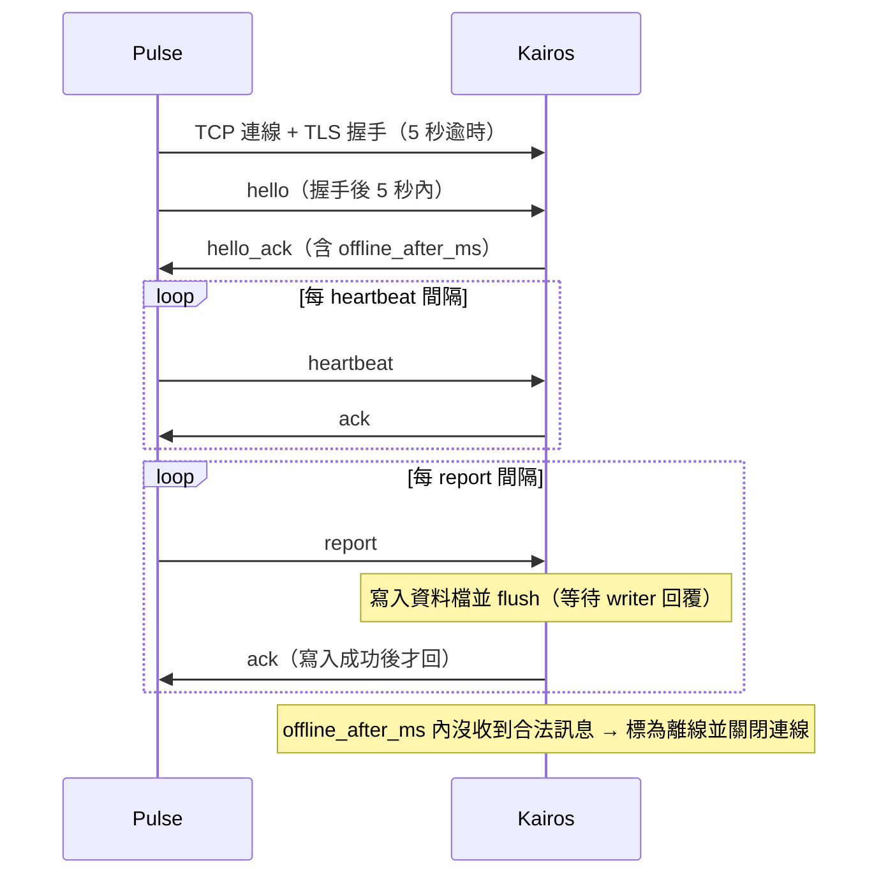

# Kairos

以 Rust 撰寫的非同步 TLS 監控伺服器，建構於 [tokio](https://tokio.rs/) 與 [rustls](https://github.com/rustls/rustls)，負責接收 Pulse agent 送來的心跳與系統資源回報。

每個 agent 與 Kairos 維持一條長 TLS 連線，以 NDJSON（一行一則 JSON）交換訊息。Kairos 追蹤每個 agent 的上線／離線狀態，並把回報寫入 JSONL 檔。

## 功能

- 長連線 + NDJSON 協定（v1、v2），單行上限 65536 bytes，詳見 [PROTOCOL.md](PROTOCOL.md)；hello 以 `proto_min`／`proto_max`／`features` 協商版本，與舊版 Pulse 自動以 v1 通訊（見「升級注意事項（與 Pulse 混用版本）」）
- 協定 v2：保存 Pulse 宣告的主機資訊（主機指紋、顯示名稱、標籤、report 間隔、作業系統）到 `agents.json`，同一個 `agent_id` 的主機指紋改變時記 `WARN`；report 為通用指標 `metrics`（CPU、記憶體、磁碟、網路、溫度等），原樣保存到 JSONL；`hello_ack` 帶 `server_time`
- 以 `agent_id` 識別 agent（不分大小寫，一律以小寫識別、記錄與寫檔）；同一 agent 重新連線時自動踢掉舊連線（`superseded`）
- 依 agent 宣告的心跳間隔計算離線門檻：`max(5 × clamp(heartbeat_interval_ms, 1000, 60000), 5000)` ms（5～300 秒），只有合法訊息才算存活
- 每秒檢查存活狀態，上線／離線／恢復都會記錄日誌（「標記為離線」與「從狀態表移除」每 10 秒最多各逐一記錄 20／5 個，其餘在時間窗結束後合併成一行摘要）；離線超過 24 小時的 agent 自動從狀態表移除（狀態表只在記憶體中，重新啟動後離線的 agent 會立即從 `agents.json` 消失）；每 60 秒輸出一行摘要
- 驗證 hello 欄位（`agent_id` 必須是 UUID 文字格式，`hostname`、`agent_version` 有長度與字元限制），並以 `limits.max_agents` 限制狀態表筆數（預設 `max(10000, server.max_connections)`；滿時先淘汰離線最久的 agent，沒有可淘汰者才拒絕新的 `agent_id`），避免狀態表與 `agents.json` 被任意資料灌爆
- 預設拒絕未認證的對外監聽：監聽非 loopback 位址（例如 `0.0.0.0`）又沒有設定 `auth.client_ca` 時拒絕啟動，除非明確設定 `auth.allow_unauthenticated = true`（見「啟用 mTLS」）
- 雙向 TLS（mTLS）：設定 `auth.client_ca` 後要求客戶端憑證，且 `agent_id` 必須與憑證的 SAN 相符（預設憑證只能有一個 DNS SAN），無法冒用其他代理或把它踢掉；支援 CRL 撤銷；啟用時停用 TLS session resumption，收到 hello 時再驗證一次憑證鏈
- 熱重載：定期檢查伺服器憑證、私鑰、客戶端 CA 與 CRL 檔，有變更就重建 TLS 設定（失敗時保留舊設定）；同時重新驗證所有現役連線的客戶端憑證，已撤銷、過期或不再受信任的連線收到 `certificate_rejected` 並被關閉
- 到期預警：啟動時、熱重載時與之後定期檢查伺服器憑證的到期日與 CRL 的下次更新時間（nextUpdate），到期前 30／7 天（`server.cert_expiry_warning_days`／`auth.crl_expiry_warning_days`）記 `WARN`、已過期記 `ERROR`；附 CRL 定期更新的 systemd timer 範例（`packaging/kairos-crl.timer`）
- report 的 `ack` 代表**已寫入資料檔**；確定未寫入時回 `storage_unavailable`（這筆未保存），寫入結果無法確定時不回應、直接關閉連線。Pulse 採 at-most-once，兩種情況都不重送
- 回報依 UTC 日期寫入 `data/reports-YYYY-MM-DD.jsonl`，依 `storage.retention_days` 自動清除過期檔案（啟動時、換日時與每小時；系統日期前進得比實際經過的時間多時暫停清除，保護狀態存於 `data/.retention-guard.json`）；可設定每個日期檔的大小上限 `storage.max_daily_bytes`（預設 `0` = 不限制），達到後當天的 report 回 `storage_unavailable`；agent 狀態每 5 秒快照到 `data/agents.json`（寫暫存檔並 fsync 後再更名）；資料目錄在執行中被刪除時會自動重建
- 正常關機：收到 Ctrl+C／Ctrl+Break／關閉主控台／系統關機（非 Windows 為 SIGINT／SIGTERM）時，送出 `close_notify` 關閉所有連線、寫完佇列中的 report、寫出最後的 `agents.json` 後以結束代碼 0 結束，最壞約 3 秒內完成
- 設定可由 `kairos.toml`、`--config <path>` 與 `KAIROS__` 環境變數調整
- 同時連線數上限（預設 1024），達上限時暫停接受新連線；其中握手中（已 accept、尚未通過 hello）的連線最多佔一半（`max(1, server.max_connections / 2)`），其餘保留給已通過 hello 的連線。另有每個來源 IP 位址的連線數上限（預設 `min(32, server.max_connections)`，以單一位址計算；未啟用 mTLS 時計算全部連線，啟用 mTLS 時只計算尚未通過 hello 的連線，通過後改依憑證身分計數，同一個 NAT 後的 agent 數不受此限）與每個來源的新連線速率上限（每秒 10 條，可連續 `max(32, 2 × 每 IP 上限)` 條；IPv6 以 /64 合併計算）。超過任一上限的連線不握手直接關閉，避免單一來源以慢速握手或大量連線佔滿名額。網段允許清單 `server.per_ip_allowlist` 內的位址改用較高的上限（見「每 IP 上限、NAT 與網段允許清單」）；被拒的連線依原因（每 IP 上限依來源、全域上限的暫停時間與握手中上限）計數
- report 速率限制：跨連線依來源計算（啟用 mTLS 時依 `agent_id`，否則依來源 IP／IPv6 /64），可連續送 10 則、之後每秒 2 則，新來源與新連線一開始只有 2 則；需延後 0.5 秒以內時延後處理，更久時回 `storage_unavailable`（`report rate limit exceeded`）。另有每條連線的訊息速率上限（可連續 50 則、之後每秒 20 則，超過時延後處理）
- 使用 rustls（`ring` 加密後端），支援 TLS 1.2 與 TLS 1.3；私鑰支援 PKCS#8、PKCS#1（RSA）與 SEC1（EC）格式
- 握手、等待 hello、寫出、讀取閒置皆有逾時；關閉連線時送出 `close_notify`
- 單一連線出錯或接受連線失敗時，伺服器會記錄錯誤並繼續運作；report 寫入、監控、TLS 重載等背景工作異常結束時，記錄 `ERROR` 並走正常關機流程，以結束代碼 1 結束（交由服務管理員重新啟動）
- 啟動失敗依原因以不同的結束代碼結束（依設計包 `cli-style.md` §8 的結束代碼表，完整對照見 monorepo 根目錄 README「結束代碼」）：命令列參數錯誤 **2**；設定錯誤（設定檔無法載入或驗證不通過、未啟用 mTLS 卻監聽非 loopback 位址）**3**；憑證錯誤（伺服器憑證、私鑰、`auth.client_ca`、`auth.crl` 無法讀取、格式錯誤或不成對）**4**；連接埠已被佔用 **11**；其他啟動失敗 1。`kairos.service` 以 `RestartPreventExitStatus=2 3 4` 讓 systemd 不再對重試也不會成功的錯誤反覆重試
- 日誌同時輸出到終端與 `logs/kairos-YYYY-MM-DD.log`（UTC 日期），依 `log.retention_days` 自動清除
- 可能被掃描大量觸發的日誌依類別（部分類別再依來源 IP；啟用 mTLS 時 agent 的上線、離線等事件改依 `agent_id`）節流，每 10 秒最多一行並附上略過的則數，未啟用 mTLS 時另列出被略過的 agent_id（見「日誌」的節流說明）

## 需求

- Rust 1.99（edition 2024）；monorepo 根目錄的 `rust-toolchain.toml` 會讓 rustup 自動使用 1.99.0 與 rustfmt、clippy
- OpenSSL 命令列工具（產生憑證與手動測試；私有 CA 流程需 OpenSSL 3.0+）
- Linux 上可開啟的檔案數（`ulimit -n`／systemd 的 `LimitNOFILE`）需大於 `server.max_connections` + 64；啟動時讀取 `/proc/self/limits`，soft limit 不足時記 `WARN` 並附上建議值（否則連線數接近上限時可能 accept 失敗，`EMFILE`）。其他平台不檢查，請自行確認
- 以 systemd 執行時請在 unit 的 `[Service]` 設定 `LimitNOFILE`，例如 `LimitNOFILE=8192`（發佈包的 `kairos.service` 已設定）：Ubuntu 預設的 soft limit 1024 在預設的 `server.max_connections = 1024` 下就不夠，每次啟動都會記 `WARN`。調高 `server.max_connections` 時一併調高

## 升級注意事項（破壞性變更）

完整的變更與升級步驟見 monorepo 根目錄的 [CHANGELOG.md](../CHANGELOG.md)（發佈包中與本文件放在同一目錄）；以下是 Kairos 需要先處理的項目。

- **未啟用 mTLS 的對外監聽改為拒絕啟動**：舊版在 `server.listen` 為非 loopback 位址（例如 `0.0.0.0:8080`）而沒有設定 `auth.client_ca` 時只記一則 `WARN` 就照常啟動；新版會記 `ERROR`「未啟用客戶端憑證驗證（mTLS）卻監聽非 loopback 位址，拒絕啟動」並以結束代碼 3（設定錯誤）結束；新版 `kairos.service` 的 `RestartPreventExitStatus=2 3 4` 讓 systemd 不再反覆重試（沿用舊版 unit 時仍會依 `Restart=on-failure` 每 5 秒重試並失敗，請一併換上新版 unit）。升級前請先啟用 mTLS（見「啟用 mTLS」）；確定只在隔離的測試環境使用時，才在 `kairos.toml` 加上 `[auth]` 的 `allow_unauthenticated = true`（或環境變數 `KAIROS__AUTH__ALLOW_UNAUTHENTICATED=true`）。只監聽 `127.0.0.1`／`::1` 等 loopback 位址的設定不受影響。
- **啟動失敗的結束代碼依原因區分**（舊版一律為 1）：命令列參數錯誤 2、設定錯誤 3（設定檔無法載入或驗證不通過、上述拒絕啟動）、憑證錯誤 4（伺服器憑證、私鑰、client CA、CRL）、連接埠已被佔用 11。`kairos.service` 新增 `RestartPreventExitStatus=2 3 4`，systemd 不再對這些錯誤無限重試；修正後執行 `systemctl restart kairos`。以結束代碼判斷啟動失敗的腳本請改為「非 0」。背景工作異常（1）、看門狗強制結束（1）、其他啟動失敗（1）、第二次訊號強制結束（130）不變。
- **啟用 mTLS 時 `server.max_connections_per_ip` 只計算尚未通過 hello 的連線**（行為改變，不需修改設定）：舊版不論是否啟用 mTLS，都計算同一位址的全部連線，同一個 NAT 後第 33 台 agent 起在握手前被斷線（審計 A7）；新版啟用 mTLS 時，連線通過 hello（憑證與 `agent_id` 綁定）後改依憑證身分計數，同一個 NAT 後的 agent 數只受 `server.max_connections` 限制。握手前與握手中的連線仍依位址限制（慢速握手防護）。為了 NAT 而調高 `server.max_connections_per_ip` 的 mTLS 部署可以改回預設；未啟用 mTLS 時行為不變。見「每 IP 上限、NAT 與網段允許清單」。

## 升級注意事項（與 Pulse 混用版本）

**協定 v2 起不必同時升級**：新版 Kairos 支援協定 1～2，依 Pulse 的 hello 自動協商（PROTOCOL.md「版本協商」）：

| 組合 | 協商結果 |
|---|---|
| 舊版 Pulse（只送 `proto: 1`）連新版 Kairos | v1：`hello_ack` 與舊版相同，report 為三個欄位，JSONL 為 `schema` 1、`agents.json` 的 `proto` 為 1 |
| 新版 Pulse 連舊版 Kairos | v1：舊版 Kairos 只檢查 `proto == 1` 並忽略 v2 欄位，Pulse 依 `hello_ack` 改送三個欄位 |
| 新版 Pulse 連新版 Kairos | v2：report 為通用指標，JSONL 為 `schema` 2 |

讀取 JSONL 的工具請依每行的 `schema` 判斷格式（見「資料輸出」）；同一個檔案中可能同時有兩種格式的行。

更早的版本之間混用時可能出現下列問題：

| 組合 | 風險 |
|---|---|
| 舊版 Pulse（`44dcee5` 之前，即 `081f859` 及更早）連新版 Kairos | Pulse 不會替換主機名稱中的格式字元（Cf），`hostname` 含這類字元時被以 `bad_request` 拒絕，**無法註冊**；Pulse 的讀取閒置固定為 `max(10 秒, 2 × min(heartbeat, report))`，心跳間隔較大時（例如 5 秒）小於「心跳間隔 + 伺服器最壞回應延遲 8 秒」，伺服器寫檔緩慢時**可能誤斷線** |
| 第一輪修正版 Pulse（`44dcee5`）連新版 Kairos | 新版 Kairos 另外禁止 U+034F、Hangul filler、變體選擇字元與私用區（見「協定概述」的 hello 欄位限制），`44dcee5` 不會替換這些字元；主機名稱含這些字元時**無法註冊** |
| 新版 Pulse 連舊版 Kairos（`572b955` 之前，`timeouts.write_secs` 沒有 6 秒上限） | Kairos 的 `timeouts.write_secs` 大於約 8 秒時，伺服器寫檔緩慢期間的回應延遲可能超過 Pulse 讀取閒置中的 10 秒餘裕，Pulse **誤判斷線**並重連 |

**部署順序**：先升級全部 Pulse，再升級 Kairos；或兩邊同時升級。新版 Pulse 送出前會替換所有新版 Kairos 禁止的字元，讀取閒置也只依心跳間隔計算，連舊版 Kairos（`timeouts.write_secs` 維持預設 5 秒時）不受影響。

## 從發佈包安裝

地端正式部署請使用預編譯的發佈包 `kairos-<版本>-<commit>-linux-x86_64.tar.gz`（x86_64、musl 靜態連結，不依賴系統函式庫），不需要安裝 Rust。發佈包內含執行檔、`kairos.example.toml`、`kairos.service`（系統層級 systemd unit 範本）、`kairos-crl.service`／`kairos-crl.timer`（CRL 定期更新範例）、`INSTALL.md`、本文件、`PROTOCOL.md`、`CHANGELOG.md`（變更紀錄與升級步驟）、`THIRD-PARTY-LICENSES`（第三方授權聲明）與 SBOM（CycloneDX）。

完整步驟見 [`packaging/INSTALL.md`](packaging/INSTALL.md)（發佈包根目錄的 `INSTALL.md`），概要如下：

1. 以 `ssh-keygen -Y verify` 驗證 `SHA256SUMS.sig`（發佈公鑰 `allowed_signers` 須從另一個管道取得）、`sha256sum -c --ignore-missing SHA256SUMS` 驗證雜湊後解壓（`tar xzf … --strip-components=1`），`./kairos --version` 確認版本與 commit（輸出 `kairos <版本> (<commit>)`，見「設定」最後的命令列參數）。
2. 建立系統使用者 `kairos` 與 `/opt/kairos`、`/opt/kairos/data`、`/opt/kairos/logs`。
3. 在管理主機建立伺服器 CA 與以 `openssl ca` 管理的代理 CA（可撤銷、產生 CRL），簽發伺服器憑證與各 Pulse 送來的 CSR。
4. 放置 `cert.pem`、`key.pem`、`client-ca.pem`、`agents.crl`，以 `kairos.example.toml` 建立 `kairos.toml`（至少改 `server.listen` 並啟用 `auth.client_ca`、`auth.crl`）。
5. 安裝 `kairos.service`（`User=kairos`、`WorkingDirectory=/opt/kairos`、`ExecStart=/opt/kairos/kairos --config /opt/kairos/kairos.toml`、`LimitNOFILE=8192`、`Restart=on-failure`、`KillSignal=SIGINT`、`ProtectSystem=strict` 且只開放 `data/`、`logs/` 可寫），`systemctl enable --now kairos`。
6. 確認 `--version`、`journalctl -u kairos` 與 `data/agents.json`。

不要以 `systemd-run --user` 執行正式服務：沒有開啟 linger 時，最後一個登入 session 結束就會一起被停掉。升級時先升級全部 Pulse，再升級 Kairos（見上一節）。

發佈包由 [`packaging/build-release.sh`](packaging/build-release.sh) 產生：以 docker 的 `rust:1.99-alpine`（以 `@sha256:` digest 固定）建置 musl 靜態執行檔，輸出到 monorepo 根目錄的 `dist/kairos-<版本>-<commit>-linux-x86_64.tar.gz`，並更新與 Pulse 共用的 `dist/SHA256SUMS`（工作目錄有未提交的變更時檔名加上 `-dirty`）；需要 Docker，Windows 請在 Git Bash 執行 `sh packaging/build-release.sh`。正式發佈的流程見 monorepo 根目錄的 `RELEASING.md`。

## 快速開始

### 1. 產生自簽憑證（含 SAN）

在專案根目錄（monorepo 的 `kairos/`）執行：

```bash
MSYS_NO_PATHCONV=1 openssl req -x509 -newkey rsa:2048 -nodes \
  -keyout key.pem -out cert.pem -days 365 -subj "/CN=localhost" \
  -addext "subjectAltName=DNS:localhost,IP:127.0.0.1" \
  -addext "basicConstraints=critical,CA:FALSE"
```

> [!IMPORTANT]
> `basicConstraints=critical,CA:FALSE` 不能省：`openssl req -x509` 預設會把憑證標記為 CA（`CA:TRUE`），Pulse 使用的 rustls 不接受 CA 憑證直接當伺服器憑證，握手會以 `CaUsedAsEndEntity` 失敗。

> [!NOTE]
> `MSYS_NO_PATHCONV=1` 是給 Windows 的 Git Bash 用的，避免 `/CN=localhost` 被自動轉換成檔案路徑；其他環境可省略。

> [!IMPORTANT]
> 現代 TLS 客戶端只看 `subjectAltName`（SAN），不看 CN。若伺服器以其他主機名稱或 IP 提供服務，請把它們加進 `subjectAltName`，例如 `DNS:monitor.example.com,IP:10.0.0.5`。

> [!WARNING]
> `key.pem` 是私鑰，請勿提交到版本控制（`.gitignore` 已忽略 `*.pem`）。

Pulse 端把設定中的 `server.ca_cert` 指向這份 `cert.pem`，即可在不關閉憑證驗證的情況下連線。

### 2. 啟動伺服器

```bash
cargo run
```

伺服器會從**目前工作目錄**讀取 `cert.pem`、`key.pem` 與（若存在）`kairos.toml`，並監聽 `127.0.0.1:8080`。啟動成功時會顯示：

```
2026-10-08 11:15:40 [INFO] kairos 0.2.0 (7247f20)
2026-10-08 11:15:40 [INFO] 未找到 kairos.toml，使用程式內預設值
2026-10-08 11:15:40 [WARN] 未啟用客戶端憑證驗證（auth.client_ca），只監聽 loopback 位址；同一台主機上的任何程式都能以任意 agent_id 註冊，僅建議用於本機開發
2026-10-08 11:15:40 [INFO] 每 30 秒檢查憑證、私鑰、客戶端 CA 與 CRL 是否變更
2026-10-08 11:15:40 [INFO] 每 IP 上限：未啟用 mTLS，計算全部連線（含握手中），每個位址 32 條（server.max_connections_per_ip）；網段允許清單（server.per_ip_allowlist）是空的
2026-10-08 11:15:40 [INFO] Kairos 已啟動，監聽 127.0.0.1:8080（連線上限 1024，其中握手中 512，每個來源 IP 32，狀態表上限 10000，資料目錄 data）
```

本機開發不啟用 mTLS 時，`WARN` 是預期的；監聽 `0.0.0.0` 等非 loopback 位址時必須啟用 mTLS，否則拒絕啟動（見「啟用 mTLS」）。Linux 上以 `umask 022` 手動執行、`key.pem` 為 `0644` 時，另有一行私鑰權限過寬的 `WARN`（`chmod 600 key.pem` 即可）。

### 3. 測試連線

另開一個終端機，用 `openssl s_client` 扮演 agent，送出 hello 與一則 heartbeat：

```bash
(printf '%s\n' \
  '{"type":"hello","seq":1,"proto":1,"agent_id":"6f1c0e4a-1b2c-4d3e-9f00-112233445566","hostname":"web-01","agent_version":"0.1.0","heartbeat_interval_ms":1000,"ts":"2026-10-08T03:15:40.001Z"}' \
  '{"type":"heartbeat","seq":2,"ts":"2026-10-08T03:15:41.002Z"}'; sleep 1) \
| openssl s_client -connect 127.0.0.1:8080 -servername localhost -CAfile cert.pem -quiet
```

客戶端會收到：

```
{"type":"hello_ack","seq":1,"proto":1,"offline_after_ms":5000}
{"type":"ack","seq":2}
```

伺服器端會先顯示上線：

```
2026-10-08 11:15:42 [INFO] [#1] agent 6f1c0e4a-1b2c-4d3e-9f00-112233445566（web-01，v0.1.0，127.0.0.1:50123）上線，離線門檻 5000 ms
```

之後 agent 不再送訊息，約 5 秒後會被判定離線並關閉連線。離線由兩個機制處理，門檻相同：

- **連線的閒置逾時**：記 `INFO`「超過 5000 ms 沒有合法訊息，關閉連線」，送出 `close_notify` 後最多再等對方 1 秒才釋放連線；釋放時若這個 agent 仍是線上，才記 `INFO`「連線關閉，標記為離線」。
- **每秒一次的存活檢查**：`last_seen` 超過門檻時記 `WARN`「已 N 秒沒有合法訊息，標記為離線」。

哪一個先觸發、對方多快回應 `close_notify` 都不固定，因此會看到下列**其中一種**組合：

```
# 情況一：閒置逾時先觸發，對方立即回應 close_notify，釋放連線時標記離線
2026-10-08 11:15:47 [INFO] [#1] agent 6f1c0e4a-1b2c-4d3e-9f00-112233445566 超過 5000 ms 沒有合法訊息，關閉連線
2026-10-08 11:15:47 [INFO] [#1] agent 6f1c0e4a-1b2c-4d3e-9f00-112233445566（web-01）連線關閉，標記為離線

# 情況二：閒置逾時先觸發，但對方沒有回應 close_notify（例如 agent 程序被凍結、網路中斷），
# 等待的這段時間內存活檢查先標記離線；連線釋放時已是離線狀態，不再記「連線關閉，標記為離線」
2026-10-08 11:15:47 [INFO] [#1] agent 6f1c0e4a-1b2c-4d3e-9f00-112233445566 超過 5000 ms 沒有合法訊息，關閉連線
2026-10-08 11:15:48 [WARN] agent 6f1c0e4a-1b2c-4d3e-9f00-112233445566（web-01）已 5.8 秒沒有合法訊息，標記為離線

# 情況三：存活檢查先觸發（連線隨後關閉時已是離線狀態，不再記「連線關閉，標記為離線」）
2026-10-08 11:15:47 [WARN] agent 6f1c0e4a-1b2c-4d3e-9f00-112233445566（web-01）已 5.1 秒沒有合法訊息，標記為離線
2026-10-08 11:15:47 [INFO] [#1] agent 6f1c0e4a-1b2c-4d3e-9f00-112233445566 超過 5000 ms 沒有合法訊息，關閉連線
```

地端測試以 `kill -STOP` 凍結 Pulse 時，觀察到的是情況二。

兩行 `INFO` 屬於同一個節流類別（agent 離線，見「日誌」的節流說明）：未啟用 mTLS 時（例如本例）以來源 IP 節流，10 秒內同一來源只記第一行，因此情況一的第二行可能不會出現，而是在同一來源下一次記錄離線事件時附註「（上次記錄後另有 1 則略過，涉及 agent：6f1c0e4a-1b2c-4d3e-9f00-112233445566）」；啟用 mTLS 時以 `agent_id` 節流，兩行都會記錄。存活檢查的 `WARN` 不受這個節流影響。

> [!NOTE]
> `agent_id` 必須是 UUID 文字格式（`8-4-4-4-12` 個十六進位字元），自行測試時請照範例填寫，否則伺服器會回 `bad_request`。大寫的 `agent_id` 也接受，但伺服器一律轉成小寫後識別與記錄。

> [!NOTE]
> Windows 版 `openssl s_client` 無法從 stdin 送出超過約 16 KB 的單行，測試 `too_long` 請改用其他 TLS 客戶端。

## 私有 CA（正式環境）

正式環境建議自建私有 CA 簽發伺服器憑證，agent 只信任 CA 憑證；之後更換伺服器憑證時不必更新每台 agent。

```bash
# 1. 建立 CA（ca.key 請離線保存，不要放在伺服器上）
MSYS_NO_PATHCONV=1 openssl req -x509 -newkey rsa:4096 -nodes \
  -keyout ca.key -out ca.pem -days 3650 -subj "/CN=Kairos Private CA" \
  -addext "basicConstraints=critical,CA:TRUE" \
  -addext "keyUsage=critical,keyCertSign,cRLSign"

# 2. 建立伺服器私鑰與憑證簽署請求（SAN 填實際的主機名稱／IP）
MSYS_NO_PATHCONV=1 openssl req -newkey rsa:2048 -nodes \
  -keyout key.pem -out server.csr -subj "/CN=monitor.example.com" \
  -addext "subjectAltName=DNS:monitor.example.com,IP:10.0.0.5"

# 3. 以 CA 簽發伺服器憑證（-copy_extensions copyall 需 OpenSSL 3.0+）
openssl x509 -req -in server.csr -CA ca.pem -CAkey ca.key -CAcreateserial \
  -out cert.pem -days 825 -copy_extensions copyall
```

- Kairos 使用 `cert.pem` 與 `key.pem`。
- 各 Pulse agent 的 `server.ca_cert` 指向 `ca.pem`，`server.domain` 填 SAN 中的名稱。新版 Pulse 設定了 `server.ca_cert` 而未設定 `server.use_system_roots` 時，預設只信任 `ca_cert`（不信任作業系統信任庫），不需另外設定；舊版 Pulse（`server.use_system_roots` 預設為 `true`）仍需明確設定 `server.use_system_roots = false`，才會只信任私有 CA。
- `ca.key` 是整個信任鏈的根本，請離線保存；外洩時必須重建 CA 並更新所有 agent。

## 啟用 mTLS（客戶端憑證驗證）

未設定 `auth.client_ca` 時，任何能連上伺服器的人都能以任意 `agent_id` 註冊，也能藉此把同 `agent_id` 的代理踢掉（`superseded`）。因此 Kairos 預設拒絕未認證的對外監聽：

| `server.listen` 解析出的位址 | 未設定 `auth.client_ca` 時 |
|---|---|
| 全部是 loopback（`127.0.0.0/8`、`::1`，例如預設的 `127.0.0.1:8080` 或 `localhost:8080`） | 照常啟動，記 `WARN`「未啟用客戶端憑證驗證（auth.client_ca），只監聽 loopback 位址…僅建議用於本機開發」 |
| 任何一個不是 loopback（含 `0.0.0.0`、`::` 等所有介面） | **拒絕啟動**，記 `ERROR`「未啟用客戶端憑證驗證（mTLS）卻監聽非 loopback 位址，拒絕啟動」並附上修正方式，以結束代碼 3（設定錯誤）結束，systemd 不重試 |
| 任何一個不是 loopback，且設定 `auth.allow_unauthenticated = true` | 照常啟動，記 `WARN`「未啟用客戶端憑證驗證（auth.client_ca）卻監聽非 loopback 位址 …（auth.allow_unauthenticated = true）…」。**只用於隔離的測試環境** |

啟用 mTLS 時 `auth.allow_unauthenticated` 不生效。

正式環境請啟用 mTLS：每台代理持有一張由「代理 CA」簽發、SAN 為 `DNS:<agent_id>` 的客戶端憑證。Kairos 在 TLS 握手時驗證憑證鏈（由該 CA 簽發、未過期、EKU 含 `clientAuth`），收到 hello 時以目前的 CA 與 CRL 再驗證一次憑證鏈（不通過回 `certificate_rejected`），並檢查 `agent_id` 與憑證的 SAN 相符（不分大小寫），不符就回 `auth_failed` 並關閉連線。這些檢查都在註冊之前，所以沒有對應憑證與私鑰的人無法冒用代理，也無法踢掉它的連線。

- 客戶端憑證預設必須**恰好有一個** DNS SAN；含多個 DNS SAN 的憑證會被以 `auth_failed`（`client certificate must contain exactly one DNS SAN`）拒絕，避免一張憑證同時冒用（並踢掉）多個代理。確有需要時可設定 `auth.allow_multiple_dns_sans = true` 放寬。
- 啟用 mTLS 時 Kairos 停用 TLS session resumption（不保存 session、不發 TLS 1.3 ticket），每條連線都完整驗證客戶端憑證，過期或已撤銷的憑證無法藉由恢復 session 繼續連線。

### 1. 建立代理 CA（只需一次）

代理 CA 與上一節簽發伺服器憑證的 CA 用途不同，建議分開建立，且**只用來簽發代理的客戶端憑證**：Kairos 信任這個 CA 簽發的任何客戶端憑證，用它簽發其他用途的憑證等於讓持有者能登記成代理。`client-ca.key` 請離線保存。

```bash
MSYS_NO_PATHCONV=1 openssl req -x509 -newkey rsa:3072 -nodes \
  -keyout client-ca.key -out client-ca.pem -days 3650 -subj "/CN=Kairos Agent CA" \
  -addext "basicConstraints=critical,CA:TRUE" \
  -addext "keyUsage=critical,keyCertSign,cRLSign"
```

### 2. 為每台代理簽發客戶端憑證

先在代理主機上取得它的 `agent_id`：讀取 Pulse 的 `agent.id` 檔案，或執行 `pulse --print-agent-id`。以下以 `6f1c0e4a-1b2c-4d3e-9f00-112233445566` 為例：

```bash
AGENT_ID=6f1c0e4a-1b2c-4d3e-9f00-112233445566

# 產生私鑰與憑證簽署請求（CN 與 SAN 都填 agent_id，EKU 為 clientAuth）
MSYS_NO_PATHCONV=1 openssl req -new -newkey rsa:2048 -nodes \
  -keyout "$AGENT_ID.key" -out "$AGENT_ID.csr" -subj "/CN=$AGENT_ID" \
  -addext "subjectAltName=DNS:$AGENT_ID" \
  -addext "extendedKeyUsage=clientAuth"

# 以代理 CA 簽發（-copy_extensions copyall 需 OpenSSL 3.0+，才會把 SAN 與 EKU 帶進憑證）
openssl x509 -req -in "$AGENT_ID.csr" -CA client-ca.pem -CAkey client-ca.key \
  -CAcreateserial -out "$AGENT_ID.crt" -days 825 -copy_extensions copyall

# 確認 SAN 與 EKU
openssl x509 -in "$AGENT_ID.crt" -noout -ext subjectAltName,extendedKeyUsage
```

- Kairos 只驗證客戶端憑證，不會讀取客戶端私鑰；私鑰支援的格式與演算法（RSA、ECDSA P-256 / P-384、Ed25519，不可加密）以 Pulse 的說明為準。
- 把 `$AGENT_ID.crt` 與 `$AGENT_ID.key` 交給該台代理，依 Pulse 的說明設定客戶端憑證；私鑰只放在該台主機上，不要複製到其他地方。
- 代理重新產生 `agent.id` 後，必須用新的 `agent_id` 重新簽發憑證。

### 3. 設定 Kairos

```toml
[auth]
client_ca = "client-ca.pem"   # 可放多張 CA（例如更換 CA 期間新舊並存）
crl = ["agents.crl"]          # 選用：CRL 檔（PEM 或 DER），見下一節
```

或使用環境變數 `KAIROS__AUTH__CLIENT_CA=client-ca.pem`、`KAIROS__AUTH__CRL=agents.crl`（多個檔案以逗號分隔）。啟動時會記錄：

```
[INFO] 已啟用客戶端憑證驗證（mTLS），信任 client-ca.pem，CRL 1 份；agent_id 必須與憑證的 SAN 相符
```

檔案讀不到、沒有憑證、CRL 格式錯誤或無法建立驗證器時，Kairos 會在啟動時報錯並結束（訊息附檔案路徑）。

### 4. 撤銷客戶端憑證（CRL）

要撤銷代理憑證，需要用 `openssl ca` 管理簽發紀錄。建立代理 CA 時改用下列方式，之後簽發、撤銷、產生 CRL 都透過同一個資料庫：

```bash
mkdir -p agent-ca/db && touch agent-ca/db/index.txt
echo 1000 > agent-ca/db/serial && echo 1000 > agent-ca/db/crlnumber
cat > agent-ca/ca.cnf <<'EOF'
[ ca ]
default_ca = agent_ca
[ agent_ca ]
database         = agent-ca/db/index.txt
serial           = agent-ca/db/serial
crlnumber        = agent-ca/db/crlnumber
new_certs_dir    = agent-ca/db
certificate      = client-ca.pem
private_key      = client-ca.key
default_md       = sha256
default_days     = 825
default_crl_days = 30
policy           = policy_any
copy_extensions  = copy
[ policy_any ]
commonName       = supplied
[ client_ext ]
basicConstraints = critical,CA:FALSE
keyUsage         = critical,digitalSignature
extendedKeyUsage = clientAuth
[ crl_ext ]
authorityKeyIdentifier = keyid:always
EOF

# 簽發（取代上一節的 openssl x509 -req；CSR 的產生方式相同）
MSYS_NO_PATHCONV=1 openssl ca -batch -config agent-ca/ca.cnf -extensions client_ext \
  -in "$AGENT_ID.csr" -out "$AGENT_ID.crt" -notext

# 產生 CRL（第一次即使沒有撤銷任何憑證也要產生）
MSYS_NO_PATHCONV=1 openssl ca -batch -config agent-ca/ca.cnf -gencrl -crlexts crl_ext -out agents.crl

# 撤銷某台代理後重新產生 CRL；先寫到暫存檔再改名，避免 Kairos 讀到寫一半的檔案
MSYS_NO_PATHCONV=1 openssl ca -batch -config agent-ca/ca.cnf -revoke "$AGENT_ID.crt" -crl_reason keyCompromise
MSYS_NO_PATHCONV=1 openssl ca -batch -config agent-ca/ca.cnf -gencrl -crlexts crl_ext -out agents.crl.new
mv agents.crl.new agents.crl
```

覆寫 `agents.crl` 後不需重新啟動：Kairos 在下一個重載週期（`server.reload_interval_secs`，預設 30 秒）重新載入，被撤銷的代理若在線上會收到 `certificate_rejected`（`client certificate has been revoked or is no longer trusted`）並被斷線，之後重連會在 TLS 握手階段被拒（`certificate revoked`）。其他代理不受影響。

Kairos 採用最嚴格的 CRL 檢查（fail closed），以安全性優先：

| 行為 | 設定 | 說明 |
|---|---|---|
| 檢查整條憑證鏈 | 預設（未使用 `only_check_end_entity_revocation`） | 有中繼 CA 時，每一層都要有其上層 CA 發行的 CRL |
| 撤銷狀態無法判定時拒絕 | 預設（未使用 `allow_unknown_revocation_status`） | 例如設定了 CRL 卻漏了某一層 CA 的 CRL，該鏈上的憑證全部被拒，避免設定疏漏造成撤銷失效 |
| CRL 超過 `nextUpdate` 時拒絕 | `enforce_revocation_expiration` | 過期的 CRL 可能漏掉之後的撤銷，因此視為無法判定 |

> [!IMPORTANT]
> 因為過期的 CRL 會讓**所有**代理被拒，請在 `nextUpdate` 之前重新產生 CRL（上面的設定為 30 天，`openssl crl -in agents.crl -noout -nextupdate` 可查看），例如每週以排程執行一次 `-gencrl` 並改名覆寫（發佈包附有 systemd 的 `kairos-crl.service`／`kairos-crl.timer` 範例，見 INSTALL 第 10.3 節）。Kairos 會預警：啟動時、熱重載套用新設定時，以及之後每個重載週期（停用熱重載時每小時）讀取每份 CRL 的 `nextUpdate`，剩下 `auth.crl_expiry_warning_days`（預設 7）天以內時記 `WARN`「CRL agents.crl 將在 … 後過期…」，已過期時記 `ERROR`「CRL agents.crl 已過期…所有 agent 都會被拒絕連線」（見「到期預警」）。預警不改變驗證行為，過期的 CRL 仍然讓所有代理被拒。過期後的徵兆是握手失敗日誌出現 `ExpiredRevocationList`（以 `ERROR` 記錄「無法判定客戶端憑證的撤銷狀態」，與一般握手失敗分開節流），以及現役連線在下一個重載週期被斷線。這種情況下（以及缺少某一層 CA 的 CRL 時），送出 hello 或連線中被重新驗證的代理收到的 `certificate_rejected` 的 message 為 `revocation status unavailable`（一般撤銷或過期為 `client certificate has been revoked or is no longer trusted`），Pulse 據此提示這是伺服器端問題、不需重新簽發。

未設定 `auth.crl` 時不做撤銷檢查。`auth.crl` 只在設定 `auth.client_ca` 時有效，否則啟動時報錯。

## 到期預警

伺服器憑證過期時 Pulse 會拒絕連線；CRL 超過 `nextUpdate` 時 Kairos 會拒絕所有代理（見上一節）。兩者都會讓所有代理同時斷線，因此 Kairos 會事先預警：

| 項目 | 讀取的日期 | 預警門檻（預設） | 預警期間內 | 已過期 |
|---|---|---|---|---|
| 伺服器憑證（`server.cert_path` 的第一張） | notAfter | `server.cert_expiry_warning_days`（30 天） | `WARN`「伺服器憑證 cert.pem 將在 … 後到期…」 | `ERROR`「伺服器憑證 cert.pem 已於 … 過期，Pulse 會拒絕連線…」 |
| 每份 CRL（`auth.crl`，一個 PEM 檔可含多份） | nextUpdate | `auth.crl_expiry_warning_days`（7 天） | `WARN`「CRL agents.crl 將在 … 後過期…」 | `ERROR`「CRL agents.crl 已過期…所有 agent 都會被拒絕連線（fail closed）…」 |

- **何時檢查**：啟動時、熱重載套用新設定時，以及之後每個重載週期（`server.reload_interval_secs`；設為 `0` 停用熱重載時改為每小時）。
- **節流**：每個檔案（每份 CRL）各自計時，與「日誌」的節流類別完全分開、不共用額度，大量的握手失敗等日誌無法掩蓋它。進入預警、過期、到期時間改變時立即記錄，啟動與熱重載時也一律記錄；其餘情況同一個項目每 24 小時最多提醒一次。換上新的檔案、不再需要預警時記 `INFO`「… 的到期時間已更新為 …，解除預警」。
- 門檻設為 `0` 時不預警，但已過期仍記 `ERROR`。時間一律以 UTC 顯示。
- 預警不改變任何驗證行為：CRL 過期時仍是 fail closed（所有代理被拒）。代理的客戶端憑證到期不在此預警範圍內（由 Pulse 端處理）。

## 設定

設定依下列順序疊加，後者覆寫前者：

1. 程式內預設值
2. 設定檔：預設讀取目前工作目錄的 `kairos.toml`（不存在則略過）；可用 `--config <path>` 指定其他檔案（指定了卻不存在會報錯並結束）
3. 環境變數 `KAIROS__<SECTION>__<KEY>`，例如 `KAIROS__SERVER__LISTEN=0.0.0.0:8080`

完整範本見 [`kairos.example.toml`](kairos.example.toml)，複製成 `kairos.toml` 後修改即可（`kairos.toml` 已加入 `.gitignore`）。

| 設定 | 環境變數 | 預設值 | 說明 |
|---|---|---|---|
| `server.listen` | `KAIROS__SERVER__LISTEN` | `127.0.0.1:8080` | 監聽位址（`IP:port` 或 `主機名稱:port`）；部署成中央伺服器時改成 `0.0.0.0:8080`，並同時設定 `auth.client_ca` 啟用 mTLS：解析出的位址有任何一個不是 loopback 又沒有 mTLS 時拒絕啟動（見 `auth.allow_unauthenticated`） |
| `server.cert_path` | `KAIROS__SERVER__CERT_PATH` | `cert.pem` | 憑證檔（PEM，可含中繼憑證） |
| `server.key_path` | `KAIROS__SERVER__KEY_PATH` | `key.pem` | 私鑰檔（PEM） |
| `server.max_connections` | `KAIROS__SERVER__MAX_CONNECTIONS` | `1024` | 同時連線數上限，1～65535。其中握手中（已 accept、尚未通過 hello）的連線最多 `max(1, server.max_connections / 2)` 條（固定比例，不可設定），超過時新連線不握手直接關閉 |
| `server.max_connections_per_ip` | `KAIROS__SERVER__MAX_CONNECTIONS_PER_IP` | 未設定時為 `min(32, server.max_connections)` | 同一來源 IP 位址的連線數上限，明確設定時必須介於 1～`server.max_connections`；超過時不握手直接關閉。**未啟用 mTLS** 時計算全部連線（含握手中、尚未送 hello 的連線）；**啟用 mTLS** 時只計算尚未通過 hello 的連線，通過後改依憑證身分計數（見「每 IP 上限、NAT 與網段允許清單」）。`server.per_ip_allowlist` 內的位址改用 `server.max_connections_per_allowlisted_ip`。IPv4-mapped IPv6 位址（`::ffff:a.b.c.d`）視為同一個 IPv4；IPv6 位址以單一位址計數（同一個 /64 中的多台主機不會互相佔用名額；以大量 IPv6 位址慢速握手的攻擊由「握手中」上限防護）。同一來源另有新連線速率上限：每秒 10 條，可連續 `max(32, 2 × 此值)` 條（固定值；此項 IPv6 以 /64 合併計算），超過時同樣不握手直接關閉。此值也決定未啟用 mTLS 時以來源 IP 計算的 report 額度倍數（見下方說明）。未啟用 mTLS 而多台代理經同一個 NAT 連入時，請把 NAT 出口加入 `server.per_ip_allowlist` 或調高此值：超過上限的代理會在握手前被斷線並不斷退避重連 |
| `server.per_ip_allowlist` | `KAIROS__SERVER__PER_IP_ALLOWLIST`（逗號分隔） | `[]` | 每 IP 上限的網段允許清單（CIDR，IPv4／IPv6；只寫位址表示單一位址，例如 `["203.0.113.10", "10.20.0.0/16", "2001:db8:100::/48"]`）。清單內的位址改用 `server.max_connections_per_allowlisted_ip`，新連線可連續的條數隨之為 `max(32, 2 × 該上限)`。主機位元不為 0（例如 `10.0.0.1/8`）、前綴長度超出範圍、不是 IP 位址（主機名稱、zone ID）時拒絕啟動。`::ffff:a.b.c.d/96..128` 視為對應的 IPv4 網段 |
| `server.max_connections_per_allowlisted_ip` | `KAIROS__SERVER__MAX_CONNECTIONS_PER_ALLOWLISTED_IP` | 未設定時為 `4096` | 允許清單內每個位址的上限，1～65535。**實際上限 ＝ min(此值, `server.max_connections`)**（同一個位址的連線也算在全部連線之內）。允許清單非空且此值（含預設 4096）大於 `server.max_connections` 時，啟動記一次 `WARN`（不拒絕啟動）；清單為空時這個值不生效，不檢查也不警告 |
| `server.reload_interval_secs` | `KAIROS__SERVER__RELOAD_INTERVAL_SECS` | `30` | 每隔幾秒檢查憑證、私鑰、客戶端 CA 與 CRL 檔是否變更，並重新驗證現役連線的客戶端憑證；`0` = 停用，上限 3600 |
| `server.cert_expiry_warning_days` | `KAIROS__SERVER__CERT_EXPIRY_WARNING_DAYS` | `30` | 伺服器憑證到期前幾天開始記 `WARN`，0～365；`0` = 不預警（已過期仍記 `ERROR`）。見「到期預警」 |
| `timeouts.handshake_secs` | `KAIROS__TIMEOUTS__HANDSHAKE_SECS` | `5` | TLS 握手逾時（秒），1～3600 |
| `timeouts.hello_secs` | `KAIROS__TIMEOUTS__HELLO_SECS` | `5` | 握手後等待 hello 的時間（秒），逾時直接關閉，1～3600 |
| `timeouts.write_secs` | `KAIROS__TIMEOUTS__WRITE_SECS` | `5` | 每則訊息寫出、以及等待 report 寫入資料檔的逾時（秒），**1～6**：伺服器的回應延遲必須不超過 8 秒，Pulse 的讀取閒置只在心跳間隔上預留 10 秒餘裕（見「協定概述」） |
| `storage.data_dir` | `KAIROS__STORAGE__DATA_DIR` | `data` | 資料輸出目錄 |
| `storage.retention_days` | `KAIROS__STORAGE__RETENTION_DAYS` | `30` | `reports-YYYY-MM-DD.jsonl` 保留天數（今天與前 N 天保留），`0` = 永久保留，上限 3650 |
| `storage.max_daily_bytes` | `KAIROS__STORAGE__MAX_DAILY_BYTES` | `0` | 每個 `reports-YYYY-MM-DD.jsonl` 的大小上限（bytes），`0` = 不限制。合適的上限取決於部署規模，請自行設定。只寫入放得下的完整紀錄；放不下的 report 不寫入，回 `storage_unavailable`（`report could not be stored`，確定未保存），並記 `ERROR`（節流）。換日後寫入新檔即恢復。設定值小於「`server.max_connections` 條連線 × 每秒 1 則 × 約 250 bytes × 86400 秒」的估算量時，啟動時記 `WARN` |
| `auth.client_ca` | `KAIROS__AUTH__CLIENT_CA` | `""` | 非空時啟用 mTLS：要求客戶端憑證，以此 PEM（可含多張 CA）驗證，並強制 `agent_id` 與憑證綁定（見「啟用 mTLS」） |
| `auth.crl` | `KAIROS__AUTH__CRL`（逗號分隔） | `[]` | CRL 檔路徑清單（PEM 或 DER）；只在設定 `auth.client_ca` 時有效（見「撤銷客戶端憑證」） |
| `auth.allow_multiple_dns_sans` | `KAIROS__AUTH__ALLOW_MULTIPLE_DNS_SANS` | `false` | 是否接受含多個 DNS SAN 的客戶端憑證；`false` 時憑證必須恰好有一個 DNS SAN |
| `auth.crl_expiry_warning_days` | `KAIROS__AUTH__CRL_EXPIRY_WARNING_DAYS` | `7` | CRL 的 `nextUpdate` 前幾天開始記 `WARN`，0～365；`0` = 不預警（已過期仍記 `ERROR`）。見「到期預警」 |
| `auth.allow_unauthenticated` | `KAIROS__AUTH__ALLOW_UNAUTHENTICATED` | `false` | 未設定 `auth.client_ca` 時是否仍允許監聽非 loopback 位址。`false` 時拒絕啟動（loopback 位址不受影響）；`true` 只用於隔離的測試環境，任何能連線的人都能以任意 `agent_id` 註冊。啟用 mTLS 時不生效 |
| `limits.max_agents` | `KAIROS__LIMITS__MAX_AGENTS` | 未設定時為 `max(10000, server.max_connections)` | 狀態表（記憶體與 `agents.json`）最多保留的 agent 數，明確設定時必須介於 `server.max_connections`～100000。滿時先淘汰連線已結束、離線最久的 agent（記 `INFO`）；沒有可淘汰者時，新的 `agent_id` 以 fatal 的 `bad_request`（`server agent registry is full`）拒絕並記 `WARN`（防禦性處理：因為此值不小於 `server.max_connections`，依設定範圍實際上不會發生）。已在狀態表中的 `agent_id` 重新連線不受影響 |
| `log.level` | `KAIROS__LOG__LEVEL` | `info` | `off`、`error`、`warn`、`info`、`debug`、`trace` |
| `log.retention_days` | `KAIROS__LOG__RETENTION_DAYS` | `14` | `logs/kairos-YYYY-MM-DD.log` 保留天數（今天與前 N 天保留），`0` = 永久保留，上限 3650 |

- 所有相對路徑都以**目前工作目錄**解析。
- 讀取閒置逾時不在設定檔中，而是依 agent 宣告的心跳間隔計算（見下節）。
- `server.max_connections_per_ip`、`server.max_connections_per_allowlisted_ip` 與 `limits.max_agents` 未設定時依 `server.max_connections` 推導，因此只調整 `server.max_connections` 的設定檔仍能啟動；明確設定時才做範圍檢查。
- report 速率限制不在設定檔中（固定值），以「來源」計算、跨連線保留，斷線重連無法取得新的額度：
  - 啟用 mTLS 時來源為 `agent_id`（與憑證綁定，無法偽造）：可連續送 10 則，之後每秒補充 2 則。
  - 未啟用 mTLS 時 `agent_id` 可任意宣告，改以來源 IP（IPv6 以 /64 合併）為來源，容量與速率乘上 `server.max_connections_per_ip`（來源與 `server.per_ip_allowlist` 有交集時改乘允許清單的實際上限；讓同一個 NAT 後的多個 agent 不互相拖累）；另外每條連線各有一份「可連續 10 則、每秒 2 則」的額度，單一連線無法獨佔來源 IP 的額度。
  - 新出現的來源與新連線一開始只有 2 則（不是滿額）。
  - 需要延後 0.5 秒以內時，伺服器暫停讀取該連線、延後處理（TCP 背壓會讓送出端慢下來），不回錯誤；需要延後更久時（例如同一來源有多條連線同時送出）不處理這筆，回非 fatal 的 `storage_unavailable`（`report rate limit exceeded`，確定未保存）。兩者都記 `WARN`（依來源 IP 節流）。Pulse 的 `report.interval` 最短 1 秒，且同一時間只有一筆 report 在途，正常不會觸及。
- 每條連線的訊息速率上限也是固定值：所有訊息（含無效的行）可連續 50 則，之後每秒 20 則；超過時延後處理（每則最多 0.05 秒，期間不讀取該連線），不回錯誤，並記 `WARN`（依來源 IP 節流）。
- 環境變數的值一律以字串讀入，數值與布林欄位在載入時才轉型；路徑、位址等字串欄位保持原樣（例如 `KAIROS__STORAGE__DATA_DIR=0001` 就是 `0001`，不會變成 `1`）。`KAIROS__AUTH__CRL` 仍以逗號分隔多個檔案（設定檔中的 `auth.crl` 可為陣列或逗號分隔的字串）。
- 不合理的設定會在啟動時報錯：`timeouts.handshake_secs`、`timeouts.hello_secs` 必須介於 1～3600 秒，`timeouts.write_secs` 必須介於 1～6 秒，`server.max_connections` 必須介於 1～65535，`server.max_connections_per_ip`（有設定時）必須介於 1～`server.max_connections`，`server.max_connections_per_allowlisted_ip`（有設定時）必須介於 1～65535，`server.per_ip_allowlist` 的每一項必須是合法的 CIDR，`limits.max_agents`（有設定時）必須介於 `server.max_connections`～100000，`server.reload_interval_secs` 必須介於 0～3600、`storage.retention_days` 與 `log.retention_days` 必須介於 0～3650、`server.cert_expiry_warning_days` 與 `auth.crl_expiry_warning_days` 必須介於 0～365、`log.level` 必須是可用值。
- 熱重載只涵蓋憑證、私鑰、客戶端 CA 與 CRL **檔案的內容**（以內容雜湊比對，不依賴修改時間），套用時的日誌會列出變更的檔案種類，例如「已重新載入 TLS 設定（變更：cert、key；mTLS：啟用，CRL 1 份）」；`kairos.toml` 本身的設定變更（例如改監聽位址、改 `auth.client_ca` 的路徑）仍需重新啟動。
- 熱重載讀檔卡住時（例如網路磁碟、FIFO），每個週期最多等 `min(10 秒, server.reload_interval_secs)`：逾時記 `ERROR`（「檢查 TLS 設定檔超過 … 秒仍未完成」），不再啟動新的檢查，但現役連線的客戶端憑證仍以目前的設定照常重新驗證；檢查完成後記「檢查 TLS 設定檔已恢復」。

### 每 IP 上限、NAT 與網段允許清單

同一個 NAT（或防火牆）後的主機在 Kairos 看來是同一個來源位址。連線上限分兩個階段計算（審計 A7、K-S2）：

| 階段 | 未啟用 mTLS | 啟用 mTLS（`auth.client_ca`） |
|---|---|---|
| 握手前、握手中、等待 hello（accept 到 hello 通過） | 依來源位址計數，上限 `server.max_connections_per_ip`（允許清單內：實際上限 ＝ min(`server.max_connections_per_allowlisted_ip`, `server.max_connections`)）；另受全域「握手中」上限（`server.max_connections` 的一半）限制 | 同左 |
| hello 通過後 | 繼續依來源位址計數（`agent_id` 可任意宣告，無法以身分區分） | **改依憑證身分（`agent_id`，與憑證 SAN 綁定）計數**，歸還來源位址的名額。同一身分的新連線依既有的 `superseded` 行為取代舊連線，每個身分穩定時只有一條連線；同一位址後的 agent 數只受 `server.max_connections` 限制 |

- 啟用 mTLS 時，預設的 `server.max_connections_per_ip = 32` 只限制同一位址「同時在握手中」的連線數（慢速握手防護），NAT 後的 agent 數量不受限。Kairos 重新啟動後大量 agent 同時重連時，超過的連線在握手前被關閉、Pulse 退避後重試；加上新連線速率（可連續 `max(32, 2 × 每 IP 上限)` 條、之後每秒 10 條），數百台約在數十秒內全部連上。需要更快時把 NAT 出口加入允許清單。
- 未啟用 mTLS 時（只建議用於 loopback 或隔離的測試環境），每 IP 上限涵蓋整個連線；NAT 後超過上限的主機會連不上，請把 NAT 出口加入 `server.per_ip_allowlist`，或調高 `server.max_connections_per_ip`。
- `server.per_ip_allowlist` 在兩種模式下都只放寬「依來源位址計數」的部分（握手前與握手中、未啟用 mTLS 時的全部連線、新連線速率、未啟用 mTLS 時的 report 額度），不影響全域上限。例如：

```toml
[server]
max_connections = 2400
per_ip_allowlist = ["203.0.113.10", "10.20.0.0/16"]   # B 廠 NAT 出口、內網
max_connections_per_allowlisted_ip = 2400              # 未設定時為 4096；實際上限 = min(此值, max_connections)
```

- 允許清單非空且 `server.max_connections_per_allowlisted_ip`（含預設 4096）大於 `server.max_connections` 時，啟動記一次 `WARN`「允許清單內每位址上限（4096）大於同時連線上限（1024），實際只會生效 1024：…」（設計包 `KRS-W0203`），內容附調整建議；不拒絕啟動。清單為空時不檢查也不警告。
- 被拒的連線在記憶體中分兩類累計（重新啟動後歸零；供日後的狀態頁與 `/metrics` 使用）：**因每 IP 上限**（依來源位址，附當時的上限與是否在允許清單內；新連線速率另依來源計數，設計包 `KRS-W2201`）與**因全域上限**（`server.max_connections` 用盡而暫停接受新連線的次數與累計時間、握手中上限拒絕的次數，設計包 `KRS-W2204`）。關機時記一行 `INFO` 摘要「啟動以來被拒的連線：…」。

命令列參數：

```
kairos [--config <path>]
kairos --version      # 或 -V
kairos --help         # 或 -h
```

`--version` 印出 `kairos <版本> (<commit>)`（例如 `kairos 0.2.0 (7247f20)`）後結束。commit 在建置時決定：環境變數 `BUILD_COMMIT`（`packaging/build-release.sh` 會傳入）→ `git rev-parse --short HEAD` → 都取不到時為 `unknown`。啟動日誌的第一行也會印出同樣的字串，可從日誌確認正在執行的版本。

`--config` 的路徑可以含有非 UTF-8 的字元（Linux 的檔名不限編碼）；Windows 上非 Unicode 的路徑請用 `--config <path>`（以空白分隔）而不是 `--config=<path>`。其他參數含有無法辨識的字元時，印出錯誤與用法後以結束代碼 2（用法錯誤）結束；無法辨識的參數、`--config` 缺少路徑或重複指定也一樣。

## 協定概述

完整規格見 [PROTOCOL.md](PROTOCOL.md)，以下只列重點。



| 方向 | `type` | 說明 |
|---|---|---|
| Pulse → Kairos | `hello` | 連線後第一則訊息，帶 `proto`、`agent_id`、`hostname`、`agent_version`、`heartbeat_interval_ms`；v2 另帶 `proto_min`、`proto_max`、`features` 與主機資訊（`host_fingerprint`、`display_name`、`tags`、`report_interval_ms`、`os`） |
| Pulse → Kairos | `heartbeat` | 存活訊號 |
| Pulse → Kairos | `report` | v1：`cpu_usage`（%）、`total_memory`、`used_memory`（MB）；v2 且雙方都宣告 `metrics`：`metrics`（`[{name, value, unit, labels}]`） |
| Kairos → Pulse | `hello_ack` | 回應 hello，帶協商出的 `proto` 與 `offline_after_ms`；v2 另帶 `features`（`["metrics"]`）與 `server_time`（RFC 3339 UTC 毫秒） |
| Kairos → Pulse | `ack` | 回應 heartbeat / report（report 的 ack 代表該筆已寫入資料檔並 flush，交給作業系統，但不保證已同步到磁碟） |
| Kairos → Pulse | `error` | 帶 `code`、`message`、`fatal`；`fatal: true` 時伺服器隨即關閉連線 |

| 錯誤碼 | 情境 | fatal |
|---|---|---|
| `unsupported_version` | hello 宣告的版本範圍與本伺服器（1～2）沒有交集，或 `proto` 不是合法 u32（例如字串、負數、小數）；`message` 為 `supported proto: 1-2`，另帶 `proto_min`、`proto_max` | 是 |
| `hello_required` | 第一則訊息不是 hello | 是 |
| `too_long` | 單行超過 65536 bytes | 是 |
| `superseded` | 同 `agent_id` 有新連線，舊連線被踢 | 是 |
| `bad_request` | 非 UTF-8、JSON 錯誤（含超出 f64 範圍的數字，例如 `1e400`）、欄位缺漏或型別錯誤（含 report 的格式與協商結果不符，例如 v1 連線送 `metrics`）、hello 欄位不符限制（含 v2 的版本範圍、features 與主機資訊）、`ts` 超過 64 bytes 或含禁止的字元；狀態表已滿時拒絕新 agent（`server agent registry is full`） | 否（`bad_request` 與 `unknown_type` 合計連續 5 次時第 5 次改為 fatal；狀態表已滿時是） |
| `unknown_type` | 不認得的 `type` | 否（連續達上限時是，計數同上） |
| `already_registered` | 同一連線第二次 hello | 否 |
| `invalid_report` | v1：`cpu_usage` 不在 0..=100 或 `used_memory > total_memory`；v2：`metrics` 不符名稱、單位、label、數量（1～256）、重複或標準指標範圍的限制（見 PROTOCOL.md「report（通用指標）」）。不寫檔，但仍視為存活 | 否 |
| `auth_failed` | 啟用 mTLS 時，hello 的 `agent_id` 與客戶端憑證的 SAN 不符（`agent_id does not match client certificate`），或憑證含多個 DNS SAN（`client certificate must contain exactly one DNS SAN`，`auth.allow_multiple_dns_sans = false` 時） | 是 |
| `certificate_rejected` | 啟用 mTLS 時，收到 hello 時重新驗證、或連線期間重新驗證時，客戶端憑證已被撤銷、過期或不再受信任（`client certificate has been revoked or is no longer trusted`）；無法判定撤銷狀態（CRL 已過期或缺少某一層 CA 的 CRL）時 message 為 `revocation status unavailable`，屬伺服器端問題 | 是 |
| `storage_unavailable` | 伺服器確定沒有寫入這筆 report，這筆資料未保存：寫入失敗（磁碟已滿、資料目錄無法寫入、等待寫入逾時且已取消、當天的檔案已達 `storage.max_daily_bytes`）時 message 為 `report could not be stored`；report 送得太快、需延後超過 0.5 秒時為 `report rate limit exceeded` | 否 |

**hello 欄位限制**（違反時回 `bad_request` 並計入連續無效訊息，連線繼續等待 hello；回應的 `seq` 帶回該則 hello 的 `seq`，其他無效訊息的 `seq` 為 `null`，見 PROTOCOL.md）：

| 欄位 | 限制 |
|---|---|
| `agent_id` | UUID 文字格式：`8-4-4-4-12` 個十六進位字元（共 36 字元，大小寫皆可）；通過後一律轉成小寫，之後的憑證比對、註冊、日誌、`agents.json` 與 JSONL 都使用小寫 |
| `hostname` | 1～255 bytes，不得含控制字元（換行、ESC 等）、格式字元（Cf，例如 U+200B 零寬空格、U+202E 由右至左覆寫、U+FEFF）、行分隔 U+2028、段落分隔 U+2029，以及顯示為空白或不可見的碼位：U+034F、Hangul filler（U+115F、U+1160、U+3164、U+FFA0）、變體選擇字元（U+FE00–U+FE0F、U+E0100–U+E01EF）、私用區（U+E000–U+F8FF、U+F0000–U+FFFFD、U+100000–U+10FFFD） |
| `agent_version` | 1～64 bytes，字元限制同 `hostname` |
| `heartbeat_interval_ms` | 不視為錯誤：任何 JSON 數字都接受（負數視為 0、小數捨去），伺服器先夾在 1000～60000 之間再計算離線門檻，被夾值時記錄 `WARN`；不是數字或缺漏時才回 `bad_request`。例外：超出 f64 範圍的數字（例如 `1e400`）無法解析，整行視為不合法 JSON，回 `bad_request` |
| `proto_min`、`proto_max`、`features`（v2） | 版本範圍須同時出現且 `proto_min ≤ proto ≤ proto_max`；`features` 最多 32 項 |
| `host_fingerprint`、`display_name`、`tags`、`report_interval_ms`、`os`（v2） | 只在協商結果為 v2 時檢查（v1 時與舊版 Kairos 一樣忽略）：指紋為 `<演算法>:<小寫十六進位>`；`display_name` 1～255 bytes、`tags` 最多 32 個各 1～64 bytes 且不重複、`os` 各欄位 1～128 bytes，字元限制同 `hostname`；`report_interval_ms` 為 1000～86400000 |

另外，所有訊息的 `ts` 最長 64 bytes，且字元限制同 `hostname`（`ts` 會原樣寫入 JSONL 與 `agents.json`），違反時回 `bad_request`；伺服器不檢查 `ts` 是否為 RFC 3339。對方提供的字串（`hostname`、`agent_version`）寫入日誌時會再做一次跳脫，作為防止日誌注入的第二道防線。

伺服器送出 fatal 錯誤後會先送 `close_notify`，再讀取並丟棄對方剩餘的資料最多 1 秒（關機期間最多 200 ms）才釋放連線，避免對方仍在傳送時 RST 讓它收不到最後的錯誤訊息（例如 `too_long`）。

**回應延遲**：Pulse 的讀取閒置逾時為 `max(2 × h, h + 10 秒)`（`h` 為 Pulse 的心跳間隔，與回報間隔無關；Pulse 預設心跳 15 秒時為 30 秒，心跳 1 秒時為 11 秒），逾時內沒收到合法的伺服器訊息就會斷線重連；而 Kairos 處理一筆 report 時，同一連線後續的訊息（包括 heartbeat）都要等它寫完。從收到 report 到回應的最壞延遲為：訊息速率延後最多 0.05 秒 + report 速率限制延後最多 0.5 秒 + `timeouts.write_secs`（上限 6 秒）+ 寫入已開始時的寬限 1 秒 = 7.55 秒 ≤ 8 秒。Pulse 每 `h` 秒內一定會送出 heartbeat，因此最久 `h + 8` 秒內一定會收到伺服器訊息，對任何心跳間隔都小於 Pulse 的逾時。這也是 `timeouts.write_secs` 上限只有 6 秒的原因。

**存活判定**：

- `offline_after_ms = max(5 × clamp(heartbeat_interval_ms, 1000, 60000), 5000)`，介於 5000～300000，在 `hello_ack` 中告知 agent。Pulse 的 `heartbeat.interval` 預設為 15 秒，因此預設下為 75000 ms（主機斷線約 75 秒後才標記為離線）；舊版 Pulse 預設 1 秒，為 5000 ms。
- 只有**合法訊息**（`hello`、`heartbeat`、`report`，含回 `invalid_report` 的那筆）會更新 `last_seen` 並重置連線的閒置計時；壞行（`bad_request`）與未知 type（`unknown_type`）不算。等待 report 寫入資料檔期間同一連線的 heartbeat 無法處理，因此伺服器在等待期間每秒更新一次該 agent 的 `last_seen`，寫入完成後再更新一次；磁碟變慢不會讓 agent 被誤判為離線。
- 連線上超過 `offline_after_ms` 沒收到合法訊息就關閉連線；監控工作每秒檢查一次，`last_seen` 超過門檻的 agent 標記為離線並記錄 `WARN`。兩者門檻相同，觸發順序不固定（見「快速開始」的日誌範例）。
- 離線超過 **24 小時**、且已沒有連線的 agent 會在存活檢查時從狀態表（`agents.json`）移除，並記錄 `INFO`。之後同一 `agent_id` 再連線時視為新 agent。狀態表達到 `limits.max_agents` 時，離線最久的 agent 可能提早被移除。
- 狀態表只存在記憶體中，`agents.json` 只寫不讀：Kairos **重新啟動後**狀態表從空開始，離線中的 agent 會在第一次快照（約 5 秒內）就從 `agents.json` 消失，不會保留 24 小時；線上的 agent 重新連線、送出 hello 後才會再出現。
- 被新連線取代的舊連線，其後送達的 report 不會寫入檔案，伺服器直接回 `superseded` 並關閉該連線。

## 資料輸出

### `data/reports-YYYY-MM-DD.jsonl`

每筆合法 report 一行（JSON Lines），只會附加寫入。檔名的日期是該筆 `recv_at` 的 **UTC** 日期（台灣時間早上 8 點前收到的資料會在前一天的檔案裡）；writer 遇到日期變化時切換檔案，同一批跨過午夜的資料也會正確拆到兩個檔案。

每一行的第一個欄位 `schema` 標示格式（審計 O6）：`1` 為三個欄位的 report（協定 v1，或 v2 但未協商 `metrics`），`2` 為協定 v2 的通用指標。同一個檔案中可能同時有兩種格式（例如部分 Pulse 尚未升級），讀取端請依 `schema` 判斷，遇到不認得的 `schema` 應略過該行。加入 `schema` 之前的版本寫出的行沒有這個欄位，視同 `schema` 1。

```json
{"schema":1,"recv_at":"2026-10-08T03:15:45.300Z","peer":"127.0.0.1:50123","agent_id":"6f1c0e4a-1b2c-4d3e-9f00-112233445566","hostname":"web-01","seq":6,"ts":"2026-10-08T03:15:45.210Z","cpu_usage":17.84,"total_memory":49152,"used_memory":37034}
{"schema":2,"recv_at":"2026-10-08T03:15:45.300Z","peer":"127.0.0.1:50124","agent_id":"aaaaaaaa-bbbb-4ccc-8ddd-eeeeeeeeeeee","hostname":"web-02","seq":3,"ts":"2026-10-08T03:15:45.210Z","metrics":[{"name":"system.cpu.usage","value":17.84,"unit":"%"},{"name":"system.memory.total","value":51539607552,"unit":"By"},{"name":"system.filesystem.available","value":211312345088,"unit":"By","labels":{"fstype":"ext4","mountpoint":"/"}}]}
```

| 欄位 | 說明 |
|---|---|
| `schema` | 這一行的格式：`1` 或 `2` |
| `recv_at` | 伺服器收到的時間（RFC 3339 UTC，毫秒） |
| `peer` | agent 的來源 `ip:port` |
| `agent_id`、`hostname` | 來自該連線的 hello（`agent_id` 一律為小寫） |
| `seq`、`ts` | agent 端的序號與時間（`ts` 只記錄，不用於存活判定） |
| `cpu_usage` | （`schema` 1）CPU 使用率（%） |
| `total_memory`、`used_memory` | （`schema` 1）記憶體總量與使用量（MB） |
| `metrics` | （`schema` 2）Pulse 送來的指標，依原順序保存：`name`、`value`（保留原本的數字表示，bytes 等整數不會變成小數）、`unit`，有 label 時另有 `labels`（依名稱排序）；指標物件中規格未定義的欄位不保存。標準指標的名稱與單位見 PROTOCOL.md「report（通用指標）」 |

寫入由單一背景工作負責：連線讀到該行時就記錄 `recv_at`（之後的限速等待不影響），把紀錄放入容量 1024 的佇列，背景工作取出一批、依日期分段，每段一次寫入並 flush 後，才逐筆回覆給各連線；連線收到成功才回 `ack`。寫檔失敗時（非 fatal，連線繼續），背景工作記錄 `ERROR`、下一批重新開檔：開檔失敗等一個 byte 都還沒寫入的情況，這一段的每一筆都回 `storage_unavailable`；寫出中途失敗時，依檔案長度的變化判斷，確定沒寫入的紀錄回 `storage_unavailable`，可能已完整或部分寫入的紀錄（無法得知寫入多少時則是整段）視為結果未知，處理方式同下述「不回應、直接關閉連線」。多條連線同時送 report 時仍是一批一次寫入；單一連線的 report 則是一筆寫完才處理下一筆。當天的檔案達到 `storage.max_daily_bytes` 時，只寫入放得下的完整紀錄，其餘回 `storage_unavailable`（確定未寫入）。開檔失敗、寫入失敗與達到大小上限的 `ERROR` 依類別節流（磁碟已滿時不會每批都記一行）。

連線等待結果的時間受 `timeouts.write_secs` 限制。逾時時分兩種情況，確保 `storage_unavailable` 一定代表「未保存」：

- writer 還沒開始處理這筆：連線取消這筆要求（writer 之後會略過它，保證不會寫入），回 `storage_unavailable`。
- writer 已開始寫入這筆（無法取消）：再等最多 1 秒；仍沒有結果時，伺服器既不能回 `ack` 也不能回 `storage_unavailable`，因此**不回應、直接關閉連線**，並記錄 `WARN`（「寫入結果未知，不回應並關閉連線」）。這筆資料可能已寫入，也可能沒有。

**保留與清除**：啟動時、每次切換到新的一天時，以及之後每小時一次（不論有沒有 report 進來），刪除資料目錄中檔名**完全符合** `reports-YYYY-MM-DD.jsonl` 且日期早於「今天（UTC）− `retention_days`」的檔案（今天與前 `retention_days` 天保留）。每刪一個記錄 `INFO`，刪除失敗記錄 `WARN` 後繼續。其他檔案一律不碰。`retention_days = 0` 時永久保留。「今天」一律取自 writer 的系統時鐘，不會因單筆紀錄的日期觸發刪除。

**系統日期異常時暫停清除**：若系統時鐘被誤校到未來，以「今天」計算的保留期限會把所有檔案判定為過期。因此清除前會檢查日期是否合理，「已接受的日期」只能隨實際經過的時間推進（`retention_days = 0` 時不做此檢查）：

- **基準點**：記錄一個可信的日期與當時的時間。只在三種情況設定：啟動時沒有狀態、接受跳躍後的日期、日期回撥後降回已接受的日期。正常推進時不更新。
- **經過時間**：同一次執行內以單調時鐘計算；跨重新啟動時為「存檔時已經過的時間 + min(max(0, 現在 − 存檔時間), 24 小時)」（每次檢查都存檔，正常為每小時一次）。
- **日期與已接受的日期相同**：照常清除。
- **日期往前推進**：允許的最晚日期 = 基準日期 + ceil(經過時間 / 1 天) + 1 天。在範圍內就接受並清除；超過時記錄 `WARN` 並暫停清除，新的日期持續 24 小時後才接受為正確日期（並以此重設基準點）、恢復清除；日期回到範圍內時立即恢復。暫停期間日期比「偵測到跳躍時的日期」再往前超過 2 天時，重新起算 24 小時。因此即使每次只把時鐘往前推 2 天以內、逐步推進，已接受的日期也不會超過實際經過的天數 + 1 天。
- **日期回撥**（早於已接受的日期）：照常以較早的日期清除（只會刪得更少），並開始計時；回撥持續 24 小時後把已接受的日期降回目前日期（並重設基準點），之後時鐘再往前跳仍會被偵測。

狀態（已接受的日期、基準點、跳躍暫停與回撥的起點）保存在狀態檔 `data/.retention-guard.json`（先寫入隨機檔名的暫存檔並同步到磁碟，再更名；啟動時清除先前異常結束時殘留的暫存檔），重新啟動時讀回，時鐘錯誤期間重新啟動也不會讓保護失效。跳躍暫停與回撥的計時**跨重啟延續**：跳躍暫停以「存檔時已累積的暫停時間」延續，重新啟動時只再加上停機時間 min(max(0, 現在 − 存檔時間), 1 小時)，因此停機時把時鐘調快再啟動不會因停機的牆鐘差而立即被接受，24 小時的暫停主要在執行中累積；回撥計時延續 min(max(0, 現在 − 起點), 24 小時)，起點在未來（牆鐘差為負）時改寫為現在並存檔，排程重啟不會讓計時無限延長。首次啟動或沒有狀態檔（或內容無效）時，以資料目錄中**不晚於今天的最新 report 檔日期**為基準（沒有檔案時為今天；時鐘誤校期間建立的未來日期檔案不列入）。

副作用：伺服器停機超過約 2 天後重新啟動時，停機期間最多只算 24 小時的經過時間，日期會超過允許範圍，因此會記錄 `WARN` 並暫停清除 24 小時（之後自動恢復）。

> [!IMPORTANT]
> 請勿刪除 `data/.retention-guard.json` 與 `logs/.retention-guard-logs.json`：刪掉時若系統時鐘仍停在未來，重新建立的基準可能採用時鐘錯誤期間產生的檔案日期，以未來日期清除而誤刪檔案。搬移或備份資料目錄、日誌目錄時請一併保留這兩個檔案。它們的檔名不符合 `reports-YYYY-MM-DD.jsonl`／`kairos-YYYY-MM-DD.log`，不會被保留清除刪掉。

**舊版 `data/reports.jsonl`**：按日分檔之前的版本寫入單一的 `reports.jsonl`。啟動時若發現它存在，會記錄一次 `INFO` 說明已改為按日分檔；舊檔不會再寫入，也不會被自動刪除，請自行搬移或刪除。

### `data/agents.json`

每 5 秒覆寫一次的狀態快照（先以隨機檔名建立暫存檔 `agents.json.<16 位十六進位>.tmp`（不跟隨預先放置的符號連結、不覆寫既有檔案）並 fsync 到磁碟，再更名為 `agents.json`，讀取端不會讀到寫一半的檔案，當機後也不會留下空檔；啟動時刪除先前異常結束時殘留的暫存檔）。寫入或更名失敗時第一次立即記錄 `ERROR`，持續失敗時每 60 秒再記一次（附連續失敗次數）：

```json
{
  "generated_at": "2026-10-08T03:16:00.000Z",
  "online": 1,
  "total": 1,
  "agents": [
    {
      "agent_id": "6f1c0e4a-1b2c-4d3e-9f00-112233445566",
      "hostname": "web-01",
      "agent_version": "0.1.0",
      "proto": 1,
      "peer": "127.0.0.1:50123",
      "online": true,
      "conn_id": 12,
      "connected_at": "2026-10-08T03:15:40.010Z",
      "last_seen": "2026-10-08T03:15:59.002Z",
      "offline_after_ms": 5000,
      "last_report": {
        "recv_at": "2026-10-08T03:15:45.300Z",
        "seq": 6,
        "ts": "2026-10-08T03:15:45.210Z",
        "cpu_usage": 17.84,
        "total_memory": 49152,
        "used_memory": 37034
      }
    }
  ]
}
```

`agents` 依 `agent_id`（小寫）排序；離線的 agent 會保留 24 小時（`online: false`）後移除（狀態表達到 `limits.max_agents` 時可能提早移除），`last_report` 尚未收到時為 `null`。

`proto` 是該連線協商出的協定版本。協商為 v2 的 agent 另有它在 hello 中宣告的主機資訊（只輸出有值的欄位）：`host_fingerprint`、`display_name`、`tags`、`report_interval_ms`、`os`（`name`、`version`、`kernel`、`arch`）。v2 指標 report 的 `last_report` 取自沒有 label 的 `system.cpu.usage`、`system.memory.total`／`used`（bytes 換算成 MB，與 v1 相同單位；沒有時省略該欄位），並另有 `metrics`（該筆的指標數），例如：

```json
      "proto": 2,
      "host_fingerprint": "sha256:355cf5ed40956a057645145cccf74f594102726167e94e3511aae182acc4ec43",
      "display_name": "Web 01（正式環境）",
      "tags": ["env:prod"],
      "report_interval_ms": 5000,
      "os": {"name": "Ubuntu", "version": "24.04", "kernel": "6.8.0-45-generic", "arch": "x86_64"},
      ...
      "last_report": {"recv_at": "…", "seq": 3, "ts": "…", "cpu_usage": 17.84, "total_memory": 49152, "used_memory": 37034, "metrics": 8}
```

同一個 `agent_id` 這次 hello 的 `host_fingerprint` 與狀態表中記錄的不同時（例如由映像檔複製的 VM 沿用了 `agent.id`，或主機已重灌），記 `WARN`「主機指紋與上次不同」（每個 agent 節流）。狀態表在重新啟動後從空開始，因此只能偵測同一次執行期間的改變。

`agents.json` 只寫不讀：Kairos 重新啟動時不會讀回，狀態表從空開始，因此離線中的 agent 在重新啟動後就從 `agents.json` 消失（「離線 24 小時才移除」只適用於同一次執行期間），線上的 agent 重新連線後才會再出現。關機時最後的 `agents.json` 由主流程寫出，監控工作異常結束時也會寫出。

### `logs/kairos-YYYY-MM-DD.log`

與終端輸出相同，格式為 `YYYY-MM-DD HH:MM:SS [LEVEL] 訊息`，以附加方式寫入，每筆寫入後即 flush。

- **檔名用 UTC 日期，行內時間用本地時間**：檔名與 reports 一致採 UTC（換日時自動切換到新檔，同一行日誌不會被拆到兩個檔案），行內時間維持與 Pulse 相同的本地時間格式。因此在台灣（UTC+8），每天早上 8 點前的日誌會在前一天的檔案裡。
- **保留**：啟動時與每小時刪除 `logs/` 中檔名**完全符合** `kairos-YYYY-MM-DD.log` 且早於「今天（UTC）− `log.retention_days`」的檔案，每刪一個記錄 `INFO`；`0` = 永久保留。清除前的日期檢查規則與 reports 相同（見「系統日期異常時暫停清除」）；狀態保存在 `logs/.retention-guard-logs.json`（與 report 的狀態檔不同名，`storage.data_dir` 設成 `logs` 時兩者也不會共用；新檔不存在時會讀取一次舊版的 `logs/.retention-guard.json` 沿用其狀態），沒有狀態檔時以啟動前 `logs/` 中不晚於今天的最新日誌檔日期為基準，伺服器停機超過約 2 天後重新啟動也會暫停清除 24 小時。日誌清除工作與其他背景工作一樣受監看，異常結束時走關機流程。
- **舊版 `logs/kairos.log`**：啟動時若存在，記錄一次 `INFO`；不再寫入，也不會被自動刪除。
- **節流**：可能被掃描或攻擊大量觸發的日誌，每個節流 key 每 10 秒最多記錄一行，下一次記錄時附上「上次記錄後另有 N 則略過」。略過的則數要等到該 key 下一次記錄時才會出現。
  - **只以類別為 key**（全域共用）：TLS 握手失敗、hello 前後的協定違規（`hello_required`、`unsupported_version`、`too_long`、連續無效訊息）、hello 逾時、其他連線錯誤、accept 失敗、握手中連線數已達上限、狀態表已滿、狀態表淘汰離線 agent（與「狀態表已滿」分開節流）、寫入結果未知、report 檔開檔／寫入失敗與達到每日大小上限。
  - **agent 事件**：上線（含取代舊連線、恢復上線）、離線（連線關閉、被取代、閒置逾時）。
    - 啟用 mTLS 時以 `agent_id` 為 key：能走到這一步的連線都已通過客戶端憑證驗證，`agent_id` 與憑證綁定、無法偽造，因此同一來源 IP（例如同一個 NAT 後）的多個 agent 各自記錄。每個 agent、每個類別每 10 秒最多 10 行（互踢、短暫重連仍逐筆記錄），不套用下述每類別 20 行的總量上限；每個類別最多追蹤 65536 個 agent，超過時退回以類別為 key。
    - 未啟用 mTLS 時 `agent_id` 可任意宣告，仍以來源 IP 為 key（規則同下一項）。被略過的事件會在該來源下一次記錄時列出涉及的 agent_id，最多列 5 個，例如「（上次記錄後另有 2 則略過，涉及 agent：68891ed6-…、7d25e84f-…）」，更多時附註「等其餘 N 個」。多個 agent 經同一個 NAT 連入時，請以 `agents.json` 作為上線狀態的依據。
  - **以類別 + 來源為 key**（來源為 IP，IPv6 以 /64 合併）：握手時客戶端憑證已撤銷、`auth_failed` 與 hello 時憑證已失效、超過每來源連線上限、超過每來源新連線速率、心跳間隔被夾值、`invalid_report`、report 速率限制、訊息速率限制。攻擊來源只會壓掉自己的訊息；同一類別所有來源合計每 10 秒最多 20 行，因此總量上限而未記錄的則數會在該類別下一次記錄時附註（「先前此類訊息另有 N 則因每 10 秒 20 則的總量上限未記錄」）。每個類別各自最多追蹤 1024 個來源，超過時只有該類別退回以類別為 key，不影響其他類別。
  - 握手時無法判定撤銷狀態（例如 CRL 過期）屬伺服器端設定問題，獨立成一個類別並以 `ERROR` 記錄，不會被一般握手失敗掩蓋。

heartbeat 只在 `trace` 等級記錄；agent 未送 `close_notify` 就斷線、連線被重設或中止等常見斷線只在 `debug` 等級記錄（「連線關閉，標記為離線」仍以 `INFO` 記錄，依上述 agent 事件的規則節流）。

### 檔案權限

report 檔含有 agent 的來源 IP 與主機名稱（可能含人名），日誌也是，因此不應讓服務帳號以外的使用者讀取。

- **Unix**：Kairos 建立的 `reports-YYYY-MM-DD.jsonl`、`agents.json` 與 `kairos-YYYY-MM-DD.log` 一律最多 `0640`（擁有者讀寫、group 唯讀、其他人無權限），自行建立的資料目錄與日誌目錄（含執行中被刪除後重建）為 `0750`，不依賴 umask。既有的檔案在開啟時收緊到最多 `0640`（只移除權限，`0600` 維持 `0600`）；既有的目錄不會被改變，但其他使用者可存取時（例如 `0755`）啟動會記 `WARN`「資料目錄 … 的權限為 0755，其他使用者可以存取…；建議執行 chmod 750 …」。`agents.json` 與日期保護狀態檔（`.retention-guard.json`、`.retention-guard-logs.json`，只含日期）以「寫暫存檔再更名」產生，暫存檔建立時就是 `0640`，更名後不需再收緊。
- **Windows**：檔案沒有 Unix 的權限位元，新檔案繼承所在目錄的 ACL；預設的 ACL 通常讓本機的 `Users` 群組可以讀取。請在第一次啟動前建立資料目錄與日誌目錄，並移除繼承、只授權給執行 Kairos 的帳號與系統管理員，例如（在 Kairos 的工作目錄、以系統管理員身分執行；`KAIROS_SVC` 換成實際的服務帳號）：

  ```bat
  mkdir data logs
  icacls data /inheritance:r /grant:r "SYSTEM:(OI)(CI)F" "Administrators:(OI)(CI)F" "KAIROS_SVC:(OI)(CI)M"
  icacls logs /inheritance:r /grant:r "SYSTEM:(OI)(CI)F" "Administrators:(OI)(CI)F" "KAIROS_SVC:(OI)(CI)M"
  icacls key.pem /inheritance:r /grant:r "SYSTEM:F" "Administrators:F" "KAIROS_SVC:R"
  ```

  `icacls data` 可確認結果。以自己的帳號手動執行時，把 `KAIROS_SVC` 換成該帳號。

### 資料目錄被刪除時

writer 每批寫入前都會檢查目前的 `reports-YYYY-MM-DD.jsonl` 路徑是否仍指向開著的檔案。下列情況會記錄 `WARN`、重建目錄並重新開檔，之後的 report 寫入新檔案：

- 以路徑查詢失敗，不論原因：例如「不存在」、Windows 上檔案處於刪除中狀態而回「拒絕存取」、Linux 上資料目錄被換成同名檔案而回「不是目錄」
- 路徑指向的不是一般檔案
- Unix 上路徑指向的是另一個檔案（裝置或 inode 不同）

重新開檔失敗時（例如資料目錄被換成同名檔案而無法重建），這一批回 `storage_unavailable`（確定未保存），不會寫進已刪除的檔案後回 `ack`。`agents.json` 寫入前也會先建立資料目錄。

## 關機

在主控台按 Ctrl+C（或 Ctrl+Break、關閉主控台視窗、系統關機；非 Windows 為 SIGINT／SIGTERM）時，Kairos 依序：

1. 停止接受新連線並關閉監聽 socket
2. 對每條連線送出 `close_notify` 後結束（送出後最多再讀取丟棄對方資料 200 ms），連線上的 agent 照常標記為離線；最晚到**訊號後 2.0 秒**，逾時的連線直接中止並標記為離線（收尾期限已過時不再送 `close_notify`，直接釋放連線）
3. 把寫檔佇列中剩餘的 report 寫完並 flush、逐筆回覆結果（連線已關閉的回覆直接忽略；被中止的連線已送出的 report 仍會寫入，只是 agent 收不到 `ack`），最晚到訊號後 2.5 秒
4. 寫出最後一次 `agents.json`（此時所有 agent 都是 `online: false`），最晚到訊號後 3.0 秒
5. 以結束代碼 0 結束，最後一行日誌附上關機總耗時

各階段共用以收到訊號的時間起算的單一期限（使用剩餘時間，不是各自固定的秒數），因此最壞約 **3 秒**內結束；一般情況（連線都正常回應）約 0.2 秒。Windows 關閉主控台視窗或系統關機時約 5 秒後會強制終止行程，所以流程刻意遠低於 5 秒。

另有看門狗：收到第一次訊號時啟動一條獨立執行緒，若訊號後 **4 秒**行程仍未結束（例如磁碟 I/O 卡住這類無法取消的阻塞），以結束代碼 1 強制結束。過程中再送一次中止訊號會立即以結束代碼 130 結束。這兩種情況下，最後一行 `ERROR` 日誌改由另一條執行緒嘗試寫出，最多只等 100 ms 就結束行程，因此日誌所在的磁碟或 stdout 卡住時也能結束（這時最後一行日誌可能沒有寫出）；佇列中的資料可能遺失。主流程結束後，tokio runtime 最多再等 500 ms 讓仍在 blocking 執行緒上的工作（例如卡住的 fsync）結束，不會無限期等待。

report 寫入、監控或 TLS 重載等背景工作在關機前異常結束（panic 或意外返回）時，Kairos 記錄 `ERROR`（「…異常結束」或「…意外結束」，開始關機），以同樣的流程與期限關機（同樣有看門狗），最後記錄「Kairos 因內部錯誤而結束」並以結束代碼 **1** 結束，交由服務管理員重新啟動。TLS 重載中「檢查檔案」的工作 panic 時不關機，而是重建後在下個週期強制重新載入設定。

```
2026-10-09 10:00:00 [INFO] 收到 Ctrl+C 訊號，開始關機（再送一次訊號可強制結束）
2026-10-09 10:00:00 [INFO] 已停止接受新連線
2026-10-09 10:00:00 [INFO] 關閉 3 條連線（最晚至訊號後 2.0 秒）
2026-10-09 10:00:00 [INFO] [#12] agent 6f1c0e4a-1b2c-4d3e-9f00-112233445566（web-01）連線關閉，標記為離線
2026-10-09 10:00:00 [INFO] 寫入剩餘 0 筆 report
2026-10-09 10:00:00 [INFO] 已寫入最後的 agent 快照 data\agents.json（線上 0 / 共 3）
2026-10-09 10:00:00 [INFO] Kairos 已結束（關機耗時 0.21 秒）
```

## 疑難排解

| 錯誤訊息 | 原因與解法 |
|---|---|
| `無法開啟 cert.pem: 系統找不到指定的檔案` | 目前工作目錄沒有憑證檔。請在放置 `cert.pem`、`key.pem` 的目錄執行程式，或在設定中指定 `server.cert_path`、`server.key_path`。 |
| `cert.pem 中找不到證書` | 檔案內沒有 `BEGIN CERTIFICATE` 區塊。 |
| `key.pem 中找不到私鑰` | 檔案內沒有支援格式的私鑰（`BEGIN PRIVATE KEY`、`BEGIN RSA PRIVATE KEY` 或 `BEGIN EC PRIVATE KEY`）。 |
| `[WARN] 伺服器私鑰 key.pem 的權限過寬（0644：…）…` | 僅 Unix：私鑰讓其他使用者（other）有權限、group 可寫入或執行，或 group 可讀但檔案的群組不是 Kairos 執行時的群組（只在 Linux 判斷群組）。建議由 root 擁有、只讓服務的群組讀取：`chown root:kairos key.pem && chmod 640 key.pem`；手動執行時 `chmod 600 key.pem`。啟動時與熱重載換了私鑰時檢查，只記錄、不拒絕啟動。Windows 請以 ACL 限制（見「檔案權限」）。 |
| `無法監聽 127.0.0.1:8080: ...一次只能用一個通訊端位址...`（`AddrInUse`） | 埠已被佔用，可能有另一個 Kairos 仍在執行；結束它或修改 `server.listen`。 |
| `找不到設定檔 <path>` | `--config` 指定的檔案不存在。 |
| `未啟用客戶端憑證驗證（mTLS）卻監聽非 loopback 位址，拒絕啟動` | `server.listen` 不是 loopback 位址（例如 `0.0.0.0:8080`），但沒有設定 `auth.client_ca`。依訊息的處理方式擇一：啟用 mTLS（建議，見「啟用 mTLS」）；本機測試時改聽 `127.0.0.1`；只在隔離的測試環境設定 `auth.allow_unauthenticated = true`。 |
| `無法解析 server.listen ...` | `server.listen` 的主機名稱無法解析；改用 IP 位址或修正名稱。 |
| `載入設定失敗（kairos.toml / KAIROS__ 環境變數）: ...` | 設定檔 TOML 語法錯誤或欄位型別不符（例如數字欄位填了文字）。 |
| `log.level 的值 "..." 無效` | 只接受 `off`、`error`、`warn`、`info`、`debug`、`trace`。 |
| Pulse 端出現憑證驗證失敗（例如 hostname mismatch） | 憑證缺少 SAN 或 SAN 與 Pulse 的 `server.domain` 不符；依「快速開始」或「私有 CA」重新產生含正確 SAN 的憑證。 |
| `[WARN] ... 未先送出 hello，關閉連線` | 客戶端在 hello 之前送了其他訊息；確認客戶端實作了本協定。 |
| `[WARN] ... 的協定版本 N 不受支援（…，本伺服器支援 1～2）` | 客戶端宣告的版本範圍與本伺服器沒有交集（例如只支援更新版本的 Pulse），請更新 Kairos。 |
| `[WARN] ... 的主機指紋與上次不同（… → …）` | 同一個 `agent_id` 從不同的主機連入：多半是由映像檔複製的 VM 沿用了 `agent.id`（會與「取代舊連線」交替出現），在多出來的主機上刪除 `agent.id` 後重新啟動；主機重灌後的第一次連線也會出現，可忽略。 |
| `[INFO] ... 在 5 秒內未送出 hello，關閉連線` | 客戶端完成 TLS 握手後沒有送 hello，常見於用瀏覽器或 port 掃描連入。 |
| agent 反覆出現「取代舊連線」 | 兩台機器使用了相同的 `agent_id`（例如複製了 Pulse 的 `agent.id` 檔案）；刪除其中一台的 `agent.id` 讓它重新產生。 |
| `[WARN] 已達同時連線上限 N（server.max_connections），暫停接受新連線；…` | 同時連線數達到 `server.max_connections`；調高上限（並一併調高檔案描述元上限）或檢查是否有異常連線。只在進入飽和時記錄一次；等待新連線期間每秒檢查一次，可用名額回到上限的 10%（至少 1）時記錄「恢復接受新連線（啟動以來因全域上限暫停 N 次、累計 N 秒）」，不必等到下一條連線。 |
| `[WARN] 來自 <IP> 的同時連線數已達上限 N（server.max_connections_per_ip），在 TLS 握手前拒絕新連線；若這是多台主機共用的 NAT 出口，…` | 未啟用 mTLS：同一來源 IP 位址的連線過多，超過的連線未握手即被關閉（客戶端看到 TLS 握手失敗）。可能是掃描或攻擊；若多台代理經同一個 NAT 連入，請把該位址加入 `server.per_ip_allowlist`（或調高 `server.max_connections_per_ip`）。 |
| `[WARN] 來自 <IP> 的握手中（尚未通過 hello）的連線數已達上限 N（server.max_connections_per_ip；啟用 mTLS 時通過 hello 的連線改依憑證身分計數），…` | 啟用 mTLS：同一位址同時在握手中（含等待 hello）的連線過多。已連上的 agent 不受影響；大量 agent 經同一個 NAT 同時重連時會短暫出現，Pulse 退避後重試即可連上。持續出現且不是 NAT 時，可能是慢速握手攻擊。 |
| `[WARN] 來自 <IP> 的…連線數已達上限 N（此位址在 server.per_ip_allowlist 中，上限為 …較小者），…` | 允許清單內的位址也達到上限（實際上限 ＝ min(`server.max_connections_per_allowlisted_ip`, `server.max_connections`)）；需要更多連線時兩者一併調高。 |
| `[WARN] 允許清單內每位址上限（N）大於同時連線上限（M），實際只會生效 M：…` | 啟動時：`server.per_ip_allowlist` 非空，且 `server.max_connections_per_allowlisted_ip`（含預設 4096）大於 `server.max_connections`。單一 NAT 後的主機不超過 M 台時不需處理（或把前者改為 M 以下讓設定一致）；需要更多時調高 `server.max_connections` 與檔案描述元上限。 |
| `server.per_ip_allowlist 第 N 項 "..." 無效：…` | 允許清單的網段格式錯誤，拒絕啟動（結束代碼 3）。訊息寫出原因，例如主機位元不為 0 時建議正確的網段（`10.0.0.1/8` → `10.0.0.0/8`）。 |
| `[WARN] 來自 <IP> 的新連線超過每秒 10 條（IPv6 以 /64 合併計算），拒絕新連線` | 同一來源建立新連線太快（可連續 `max(32, 2 × 每 IP 上限)` 條，之後每秒 10 條；允許清單內的來源以允許清單的實際上限計算），超過的連線未握手即被關閉。正常的 Pulse 以退避重連，不會觸發；大量代理經同一個 NAT 在伺服器重新啟動後同時重連時，可把 NAT 出口加入 `server.per_ip_allowlist`（或調高 `server.max_connections_per_ip`）以提高可連續的條數。 |
| `[WARN] 握手中（尚未通過 hello）的連線數已達上限 N（server.max_connections 的一半），在 TLS 握手前拒絕來自 <IP> 的新連線` | 已 accept、尚未通過 hello 的連線達到 `server.max_connections` 的一半，新連線未握手即被關閉；其餘名額保留給已通過 hello 的連線。通常代表有大量慢速握手或只連不送 hello 的連線（掃描或攻擊）。 |
| `[WARN] [#N] <IP:port> 送出訊息超過每秒 20 則（可連續 50 則），延後處理` | 該連線送訊息的速度超過每條連線的訊息速率上限；伺服器已延後處理（期間不讀取該連線）。正常的 Pulse 不會觸發。 |
| `[WARN] 可開啟的檔案數上限（RLIMIT_NOFILE soft limit）為 N，低於 server.max_connections（N）加上預留的 64（共 N）…建議：以 systemd 執行時在 unit 的 [Service] 加上 LimitNOFILE=N…` | 僅 Linux：`ulimit -n`（或 systemd 的 `LimitNOFILE`）太小，連線數接近上限時可能 accept 失敗（`EMFILE`）。依訊息中的建議值在 systemd unit 設定 `LimitNOFILE`（發佈包的 `kairos.service` 預設 8192）、手動執行前先 `ulimit -n`，或調低 `server.max_connections`。 |
| `[WARN] [#N] 狀態表已達上限 N（limits.max_agents）且沒有可淘汰的離線 agent，拒絕 ... 的新 agent ...` | 狀態表已滿且都是線上 agent，新的 `agent_id` 收到 fatal 的 `bad_request`（`server agent registry is full`）。未啟用 mTLS 時可能是有人以大量隨機 `agent_id` 灌入；正式環境請啟用 mTLS，或調高 `limits.max_agents`。 |
| `[INFO] 狀態表已達上限（limits.max_agents），移除離線最久的 agent ...` | 為了登記新的 agent，提前移除了離線最久的 agent；該 agent 之後重新連線會被視為新 agent。 |
| `[WARN] [#N] agent ... 的 report 超過每秒 2 則（可連續 10 則），延後處理` | 該 agent（或來源 IP）送 report 的速度超過速率限制；伺服器已延後處理，不影響資料。正常的 Pulse 不會觸發。 |
| `[WARN] [#N] agent ... 的 report 超過每秒 2 則（可連續 10 則），不保存並回 storage_unavailable` | 需要延後超過 0.5 秒（例如同一 `agent_id` 或同一來源 IP 有多條連線同時送 report）；這筆未保存，代理收到 `storage_unavailable`（`report rate limit exceeded`）。正常的 Pulse 不會觸發。 |
| 代理收到 `storage_unavailable`（`report could not be stored`） | 伺服器無法寫入資料檔（磁碟已滿、資料目錄被換成檔案或沒有寫入權限、寫入超過 `timeouts.write_secs`），或當天的檔案已達 `storage.max_daily_bytes`。伺服器日誌會有對應的 `[ERROR]`（節流）；排除後下一筆會自動重新開檔寫入，達到大小上限時換日後恢復。 |
| `[ERROR] data\reports-YYYY-MM-DD.jsonl 已達每日大小上限 N bytes（storage.max_daily_bytes），本批 N 筆中有 N 筆未寫入` | 當天的 report 檔已達 `storage.max_daily_bytes`；之後到換日前的 report 都回 `storage_unavailable`。請調高上限（`0` = 不限制）或檢查是否有異常大量的 report。 |
| `[WARN] storage.max_daily_bytes（N bytes）小於以 N 條連線、每條每秒 1 則 report 估算的每日量…` | 啟動時的提醒：設定的每日大小上限可能在連線數接近上限時不夠用。確認上限符合實際規模即可。 |
| `[WARN] [#N] agent ... 的 report seq=N 寫入結果未知（...），不回應並關閉連線` | 等待寫入逾時，且 writer 已開始寫入這筆而無法取消；這筆可能已寫入也可能沒有。通常代表磁碟 I/O 嚴重延遲，請檢查儲存裝置。 |
| `[WARN] 系統日期 ... 晚於依經過時間推算的最晚日期 ...（先前為 ...），可能是時鐘被誤校；暫停清除過期的...` | 系統日期前進得比實際經過的時間多：時鐘往前跳，或伺服器停機超過約 2 天後重新啟動（跨重啟最多只算 24 小時的經過時間；沒有狀態檔時以不晚於今天的最新 report 檔或日誌檔日期為基準）。若日期正確，24 小時後會自動恢復清除（記「系統日期 ... 已持續 24 小時，接受為正確日期並恢復清除…」）；若時鐘錯誤，請校正時鐘。 |
| `[INFO] 系統日期 ... 早於先前的 ...（時鐘回撥）；以較早的日期清除過期的...` | 系統時鐘往回撥；照常以較早的日期清除（只會刪得更少），持續 24 小時後改以此日期為基準。 |
| `[ERROR] 檢查 TLS 設定檔超過 N 秒仍未完成（檔案系統可能卡住），先以目前的設定重新驗證現役連線` | 熱重載讀取憑證、私鑰、CA 或 CRL 檔時卡住（例如網路磁碟、FIFO）；在檢查完成前不會套用新檔案，但現役連線仍照常重新驗證。完成後記「檢查 TLS 設定檔已恢復」。 |
| `[ERROR] ... 異常結束: ...，開始關機`／`Kairos 因內部錯誤而結束` | 背景工作 panic 或意外結束；Kairos 已關機並以結束代碼 1 結束。請保留日誌回報問題，並由服務管理員重新啟動。 |
| `[ERROR] 重新載入 TLS 設定失敗，繼續使用目前的設定: ...` | 熱重載時新的憑證、私鑰、CA 或 CRL 有問題（訊息附路徑）；伺服器繼續使用舊設定。同一份有問題的檔案只記錄一次，修正後下一個週期會自動重載。 |
| `[INFO] 已重新載入 TLS 設定（變更：crl；mTLS：啟用，CRL 1 份）` | 偵測到檔案變更並已套用；「變更」列出內容有變動的檔案種類（`cert`、`key`、`client_ca`、`crl`，多個時以「、」分隔），方便稽核。之後的新連線使用新設定，既有連線不中斷（客戶端憑證仍有效者）。 |
| `[WARN] agent ... 的客戶端憑證已不再有效（invalid peer certificate: Revoked），關閉連線` | 該代理的憑證已列入 CRL；也可能是 `Expired`（憑證過期）、`UnknownIssuer`（CA 已更換）或 `ExpiredRevocationList`（CRL 已過期，見「撤銷客戶端憑證」）。 |
| `[WARN] 已停用 TLS 熱重載` | `server.reload_interval_secs = 0`；更換憑證、CA、CRL 需重新啟動，現役連線的客戶端憑證也不會定期重新檢查（新連線送出 hello 時仍會驗證一次）。 |
| 日誌行尾的「（上次記錄後另有 N 則略過）」 | 該節流 key 在 10 秒內發生多次，只記錄第一次；N 為期間略過的則數。未啟用 mTLS 時 agent 的上線、離線事件會附上「涉及 agent：…」（最多列 5 個 agent_id）。大量出現通常代表有掃描或設定錯誤的客戶端。 |
| 日誌行尾的「（先前此類訊息另有 N 則因每 10 秒 20 則的總量上限未記錄）」 | 以來源區分的類別在 10 秒內所有來源合計超過 20 行，超過的則數在該類別下一次記錄時附註。通常代表大量來源同時觸發（例如網路中斷後大量代理重連，或分散式掃描）。 |
| `[WARN] data\reports-YYYY-MM-DD.jsonl 已不存在、正被刪除或已被替換...，重新開檔` | 執行中資料目錄或當天的 report 檔被刪除或換掉；伺服器已重建並重新開檔，之後的 report 寫入新檔案，刪除前已寫入的資料不會還原。 |
| `[INFO] 發現舊版的 data\reports.jsonl ...` | 舊版的單一檔案；已改為按日分檔，舊檔不再寫入也不會被自動刪除，可自行搬移或刪除。 |
| `[WARN] 無法刪除過期的 ...` | 過期的 report 或日誌檔被其他程式開啟或沒有權限；下一次定期清除（每小時）會再嘗試。 |
| `無法開啟 client-ca.pem: ...`、`client-ca.pem 中找不到CA 憑證` | `auth.client_ca` 指向的檔案不存在或沒有 `BEGIN CERTIFICATE` 區塊；修正路徑或內容，或清空 `auth.client_ca` 停用 mTLS。 |
| 啟用 mTLS 後代理連不上，伺服器記錄 `[WARN] ... TLS 握手失敗: peer sent no certificates` | 代理沒有出示客戶端憑證，TLS 握手失敗（沒有應用層錯誤訊息）。確認 Pulse 已設定客戶端憑證與私鑰。 |
| `[WARN] CRL agents.crl 將在 … 後過期…` | CRL 的 `nextUpdate` 剩下 `auth.crl_expiry_warning_days` 天以內。在管理主機重新產生 CRL 並部署（INSTALL 第 6.4、10.1 節）；有使用 `kairos-crl.timer` 時以 `systemctl status kairos-crl.service`、`journalctl -u kairos-crl` 確認排程是否失敗。部署後下一個重載週期會記「…解除預警」。 |
| `[ERROR] CRL agents.crl 已過期…` | CRL 已超過 `nextUpdate`，所有代理都被拒絕（`ExpiredRevocationList`）。立即重新產生並部署，不需重新啟動。 |
| `[WARN] 伺服器憑證 cert.pem 將在 … 後到期…`、`[ERROR] 伺服器憑證 cert.pem 已於 … 過期…` | 依「私有 CA」重新簽發伺服器憑證，以 `mv` 覆寫 `cert.pem`（換金鑰時一併換 `key.pem`），下一個重載週期自動套用。 |
| 伺服器記錄 `invalid peer certificate: UnknownIssuer` | 客戶端憑證不是由 `auth.client_ca` 中的 CA 簽發。 |
| 伺服器記錄 `invalid peer certificate: Expired` 或 `... InvalidPurpose` | 客戶端憑證已過期，或缺少 `extendedKeyUsage=clientAuth`；重新簽發。 |
| 代理收到 `auth_failed`，伺服器記錄 `... 的 hello agent_id "..." 未通過客戶端憑證綁定，關閉連線: ...` | 憑證的 SAN 不是 `DNS:<該代理的 agent_id>`（代理收到的 message 為 `agent_id does not match client certificate`），或憑證含多個 DNS SAN（message 為 `client certificate must contain exactly one DNS SAN`，伺服器日誌為「客戶端憑證含 N 個 DNS SAN，必須恰好一個」）。常見原因：代理重新產生了 `agent.id`、憑證拿錯台，或簽發時漏了 `-copy_extensions copyall` 導致憑證沒有 SAN。用 `openssl x509 -in <cert> -noout -ext subjectAltName` 檢查。 |
| 代理收到 `certificate_rejected`，伺服器記錄 `... 的客戶端憑證在 hello 時已不再有效` | 握手後、送出 hello 前憑證已過期，或 CA／CRL 已重新載入而不再信任此憑證；重新簽發或檢查 CRL。若代理收到的 message 為 `revocation status unavailable`，是伺服器的 CRL 已過期或缺少某一層 CA 的 CRL，請更新 `auth.crl`，代理端不需處理。 |
| agent 一直收到 `bad_request`，`... must not contain control, format or line/paragraph separator characters` | `hostname` 或 `agent_version` 含換行、ESC 等控制字元，或零寬空格、方向控制等格式字元、U+2028／U+2029，或 Hangul filler、變體選擇字元、私用區等不可見碼位。舊版 Pulse 不會替換後者，請升級 Pulse（見「升級注意事項」）。`ts` 含這些字元時 message 為 `ts must not contain control, format, invisible or line/paragraph separator characters`。 |
| `timeouts.write_secs 必須介於 1..=6` 等 | `timeouts.handshake_secs`、`timeouts.hello_secs` 必須介於 1～3600 秒，`timeouts.write_secs` 必須介於 1～6 秒，`server.max_connections` 必須介於 1～65535，`server.max_connections_per_ip`（有設定時）必須介於 1～`server.max_connections`，`limits.max_agents`（有設定時）必須介於 `server.max_connections`～100000。 |
| agent 一直收到 `bad_request`，`agent_id must be a UUID ...` | `agent_id` 不是 UUID 文字格式；Pulse 會自動產生，若手動編輯過 `agent.id` 請刪除讓它重新產生。 |
| `[WARN] ... 宣告的 heartbeat_interval_ms=N 超出 1000..=60000` | agent 的心跳間隔設定超出範圍，伺服器已自動夾值；請調整 Pulse 的 `heartbeat.interval`。 |
| `[WARN] ... 結尾有不完整的行，補上換行後繼續寫入` | 先前寫入該日的 report 檔時中斷，最後一行不完整；伺服器已補上換行，殘缺的那一行需由讀取端略過。 |

## 專案結構

本專案是 monorepo 中的 `kairos/`；`Cargo.lock`（鎖定的依賴版本）與 `rust-toolchain.toml` 位於 monorepo 根目錄，建置輸出在根目錄的 `target/`。

```
kairos/
├── Cargo.toml             套件設定與依賴
├── kairos.example.toml    設定檔範本
├── PROTOCOL.md            Pulse ↔ Kairos 協定規格
├── build.rs               建置時決定 --version 顯示的 commit（BUILD_COMMIT 或 git）
├── packaging/             發佈包：build-release.sh（打包腳本）、kairos.service（systemd unit）、kairos-crl.service／kairos-crl.timer（CRL 定期更新範例）、INSTALL.md（安裝指南）
├── testdata/              單元測試用的憑證樣本；pki/ 為測試用 CA、代理憑證與 CRL（見其中的 README）；含測試用私鑰，不可部署
└── src/
    ├── main.rs            元件組裝、accept 迴圈與連線上限、背景工作監看、關機流程
    ├── config.rs          設定載入（預設值、kairos.toml、環境變數、--config）
    ├── logger.rs          日誌初始化（按 UTC 日期分檔，Unix 上日誌檔 0640）與舊日誌清除
    ├── fsperm.rs          檔案與目錄權限（Unix：資料檔與日誌檔最多 0640、目錄 0750）
    ├── tls.rs             憑證、私鑰、客戶端 CA 與 CRL 載入；可替換的目前 TLS 設定；憑證鏈重新驗證
    ├── reload.rs          TLS 熱重載與現役連線的客戶端憑證重新驗證
    ├── expiry.rs          伺服器憑證與 CRL 的到期預警（含讀取 notAfter／nextUpdate 的最小 DER 解析）
    ├── auth.rs            mTLS：客戶端憑證 SAN 與 agent_id 的綁定檢查
    ├── per_ip.rs          每個來源 IP 位址的連線數上限（mTLS 時 hello 後改依憑證身分計數）、每個來源（IPv6 /64）的新連線速率上限
    ├── per_ip/cidr.rs     CIDR 解析與 server.per_ip_allowlist
    ├── per_ip/stats.rs    被拒連線的計數（每 IP 上限依來源、全域上限的暫停時間與握手中上限）
    ├── rate.rs            token bucket 與跨連線的 report 速率限制
    ├── throttle.rs        日誌節流（類別或類別 + 來源）
    ├── retention.rs       依日期命名的檔案：檔名規則、保留清除與日期合理性檢查
    ├── protocol.rs        訊息型別、NDJSON codec、驗證（純函式）
    ├── connection.rs      單一連線：握手、hello 狀態機、訊息處理與訊息速率限制、report 限速、踢除
    ├── registry.rs        agent 註冊表、存活狀態與筆數上限
    ├── storage.rs         按日分檔的 report 寫入工作（寫入後回覆結果）、agents.json 快照
    ├── monitor.rs         每秒存活檢查、每 5 秒快照、每 60 秒摘要、關機時最後快照
    ├── shutdown.rs        關機訊號、關機期限與看門狗
    ├── integration_tests.rs  透過真實 TLS 連線的整合測試（僅測試建置）
    └── test_pki.rs        整合測試用的 PKI 常數，含測試用私鑰（僅測試建置，不可部署）
```

## 依賴

| 套件 | 用途 |
|---|---|
| `tokio` | 非同步執行環境、TCP 監聽、逾時、channel、Semaphore |
| `tokio-rustls` | 在 tokio 上提供 TLS；透過其重新匯出的 `rustls` 與 `rustls::pki_types` 解析 PEM、建立設定與客戶端憑證驗證器 |
| `rustls-webpki` | 檢查客戶端憑證的 SAN 是否包含 `DNS:<agent_id>`（rustls 本身已依賴同一版本，只啟用 `alloc`，不引入其他加密後端） |
| `tokio-util` | `LinesCodec` 與 `Framed`，處理 NDJSON 分行與單行上限 |
| `futures-util` | `SinkExt` / `StreamExt`，對 `Framed` 收送訊息 |
| `serde`、`serde_json` | 訊息與輸出檔的序列化 |
| `chrono` | RFC 3339 時間戳記與日誌時間 |
| `config` | 設定檔與環境變數疊加（0.15，只啟用 `toml`） |
| `log`、`fern` | 日誌輸出到終端與按日分檔的檔案（分檔由 `logger.rs` 自行處理，以便指定檔案權限） |

加密後端選用 `ring` 而非 rustls 預設的 `aws-lc-rs`，以避免在 Windows 上需要額外的 C 建置工具。

## 測試

```bash
cargo test
cargo clippy --all-targets -- -D warnings
cargo fmt --check
```

以上在 `kairos/` 目錄執行，只處理本產品；在 monorepo 根目錄執行 `cargo test --workspace` 等指令則包含 Pulse（見根目錄 README）。CI 在 Linux 與 Windows 上都會執行，Unix 專屬的測試（`#[cfg(unix)]`，例如檔案權限與 inode 比對）只在 Linux 上跑；Windows 開發機可以用 Docker 在 Linux 上測試，例如在 monorepo 根目錄（Git Bash）：

```bash
MSYS_NO_PATHCONV=1 docker run --rm -v "$(pwd -W):/src" -w /src -e CARGO_TARGET_DIR=/tmp/target rust:1.99 cargo test -p kairos --locked
```

協定本身的測試在與 Pulse 共用的 `crates/kairos-proto`（在 monorepo 根目錄執行 `cargo test -p kairos-proto`，`cargo test --workspace` 也會包含）：協定測試向量（直接從 `crates/kairos-proto/PROTOCOL.md` 的「範例」節解析，v1 與 v2 各一組）、版本協商與相容矩陣（以凍結的 v1 型別定義驗證舊版兩端忽略 v2 欄位）、v2 hello 欄位與通用指標的限制、規格中的上限與標準指標表與常數一致、錯誤碼表的 fatal 欄、訊息與 hello 欄位驗證邊界（UUID、大小寫正規化、長度、控制與格式字元、`ts` 長度、`proto` 與心跳的寬鬆解析與夾值）、`cpu_usage` 轉成 f32 後與直接反序列化的結果一致；日期保護的核心規則則在共用的 `crates/date-guard`。本產品的單元測試涵蓋 NDJSON codec（CRLF、非 UTF-8、單行上限含 `\r` 的邊界）、註冊表的取代、離線判定、24 小時清除與筆數上限淘汰、report 的保存與回覆（寫入後才成功、寫檔失敗與逾時回 `storage_unavailable`、寫出中途失敗時只對確定未寫入者回 `storage_unavailable`、逾時取消後不寫入、被取代不寫檔、失敗時不更新 `last_report`）、report 速率限制、按日分檔（日期→檔名、嚴格的檔名解析、保留天數邊界、跨日批次拆分、清除只碰符合的檔案、時鐘跳躍時不刪檔、跳躍保護狀態檔的保存與跨重啟讀回）、補換行與資料目錄重建、關機時佇列寫完、關機期限與讀取丟棄上限、背景工作異常時關機、mTLS 的 SAN 綁定（含多個 DNS SAN）、CRL 載入（PEM／DER／壞檔）與撤銷判定、憑證過期判定、mTLS 時停用 session resumption、熱重載的變更偵測與失敗時保留舊設定、現役連線重新驗證（以 `testdata/` 的憑證樣本）、每 IP 連線上限與每來源新連線速率（IPv6 /64）、握手中上限、CIDR 與網段允許清單的解析（含錯誤輸入與 IPv4-mapped IPv6）、允許清單的實際上限與啟動警告條件、兩階段計數（mTLS 時 hello 後改依憑證身分）、被拒連線的計數、跨連線的 report 限速與訊息速率、每日檔案大小上限、日期保護的逐步推進、回撥與跨重啟情境、狀態檔的隨機暫存檔名、日誌清除工作、看門狗不等待卡住的日誌、日誌檔名與保留、日誌節流（含依來源與總量上限），設定載入、環境變數（字串不轉型）與上限檢查，以及未啟用 mTLS 時的監聽位址檢查（loopback 判斷、拒絕啟動）、非 UTF-8 的命令列參數、report 檔被刪除或替換時重新開檔（含 Linux 的 `NotADirectory` 與 Unix 的 inode 比對）、資料檔與日誌檔的權限（Unix）、私鑰權限檢查、憑證 notAfter 與 CRL nextUpdate 的 DER 解析（含截斷與異常輸入）、到期預警的門檻與提醒間隔。`src/integration_tests.rs` 另以真實 TLS 連線測試 `handle_connection` 與 accept 迴圈（v1 client 的 v1 連線與 v2 欄位被忽略、v2 協商與指標 report 寫成 `schema` 2、未協商 `metrics` 時沿用三欄位、版本範圍沒有交集時的 `unsupported_version`、v2 hello 欄位的 `bad_request`、主機指紋改變的日誌、hello 狀態機、fatal 後關閉、`superseded`、連續無效訊息上限、單行上限、寬鬆的 hello 解析、hello 與閒置逾時、`close_notify`、狀態表已滿、report 速率限制、mTLS 的 SAN 綁定與停用 session resumption、hello 時與握手時的撤銷檢查、寫入結果未知時不回應、每 IP 連線上限、允許清單、mTLS 下同一 NAT 後 40 台依憑證身分連線與握手前的每 IP 保護、全域上限的暫停計時），mTLS 用的測試 CA、客戶端憑證與 CRL 放在 `src/test_pki.rs`，NAT 情境的 40 個身分在 `testdata/pki/nat-clients.bundle`。測試數量以 `cargo test` 的輸出為準。

> [!WARNING]
> `src/test_pki.rs` 與 `testdata/`（例如 `testdata/pki/server.key`）中的私鑰**只供測試使用**，已公開在 repo 中，絕對不可用於任何部署環境。正式環境的憑證與私鑰請依「私有 CA」與「啟用 mTLS」重新產生。

依賴套件的安全公告（RustSec）、授權與來源由 CI 的 `cargo deny check` 檢查（設定見 monorepo 根目錄的 `deny.toml`）；本機可先 `cargo install cargo-deny --locked` 後在根目錄執行。

## 目前限制

- 狀態只存在記憶體（`agents.json` 只寫不讀）：重新啟動後 `agents.json` 會從空清單開始，離線中的 agent 立即消失（不會保留 24 小時），線上的 agent 要等重新連線才會出現
- 狀態表達到 `limits.max_agents` 時，離線最久的 agent 會在 24 小時到期前被提早移除；全部都在線上時，新的 `agent_id` 無法登記
- report 檔寫入中途失敗時，殘缺的那一行會留在檔案中（之後補上換行隔開），讀取端需能略過無法解析的行
- `ack` 代表資料已交給作業系統（write + flush），不保證已同步到磁碟；作業系統當機或斷電時，最近寫入的資料可能遺失（為了寫入效能，沒有每批呼叫 fsync）
- writer 在寫入前檢查 report 檔是否還存在，但「檢查」與「寫入」之間仍有時間差：若檔案剛好在這段期間被刪除，該批資料會寫進已刪除的檔案而遺失，連線卻已收到 `ack`。下一批寫入前會偵測到並重建檔案
- 等待寫入逾時且 writer 已開始寫入、或寫出中途失敗而無法確定這筆是否已寫入時，伺服器不回應並關閉連線，該筆資料是否已保存無法得知（Pulse 不重送，不會重複；但可能已寫入或遺失）
- 系統日期前進得比實際經過的時間多時，保留清除會暫停 24 小時（跨重啟延續）；伺服器停機超過約 2 天後重新啟動也會觸發，期間過期的 report 檔與日誌檔不會被刪除。保護狀態存於 `data/.retention-guard.json` 與 `logs/.retention-guard-logs.json`，刪除後若系統時鐘仍在未來，可能以未來日期清除
- 未設定 `auth.client_ca` 時沒有客戶端身分驗證：任何能完成 TLS 握手的客戶端都能以任意 `agent_id` 登記，也能藉此踢掉同 `agent_id` 的既有連線；狀態表筆數雖有上限，仍可能被大量隨機 `agent_id` 佔滿而擠掉離線 agent。因此預設只允許在 loopback 位址上不啟用 mTLS（見「啟用 mTLS」），`auth.allow_unauthenticated = true` 時對外位址也一樣
- 現役連線的客戶端憑證在每個重載週期重新檢查，因此撤銷或過期最多延遲 `server.reload_interval_secs` 才生效；握手後、送出 hello 前的連線（最多 `timeouts.hello_secs`）不在週期檢查範圍內，但送出 hello 時會再驗證一次憑證鏈，註冊後也會在下一個週期被檢查
- 關機時連線最晚到訊號後 2 秒就會被中止；網路極慢的連線可能收不到 `close_notify`（agent 端會視為斷線並重連）。被中止的連線若正在等待 report 寫入，該筆仍會寫入資料檔，但 `agents.json` 中該 agent 的 `last_report` 可能不會更新
- `kairos.toml` 本身的設定只在啟動時讀取；熱重載只涵蓋憑證、私鑰、客戶端 CA 與 CRL 檔的內容
- 只提供檔案輸出，沒有查詢 API 或網頁介面
