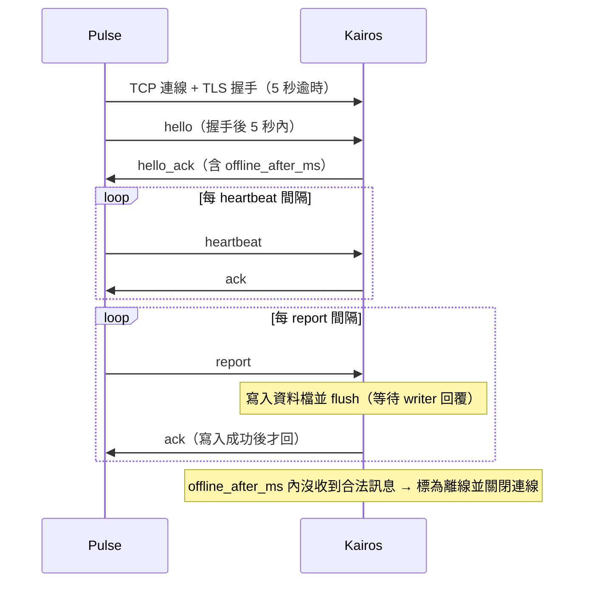

# Kairos

以 Rust 撰寫的非同步 TLS 監控伺服器，建構於 [tokio](https://tokio.rs/) 與 [rustls](https://github.com/rustls/rustls)，負責接收 Pulse agent 送來的心跳與系統資源回報。

每個 agent 與 Kairos 維持一條長 TLS 連線，以 NDJSON（一行一則 JSON）交換訊息。Kairos 追蹤每個 agent 的上線／離線狀態，並把回報寫入 JSONL 檔。

## 功能

- 長連線 + NDJSON 協定（v1），單行上限 65536 bytes，詳見 [PROTOCOL.md](PROTOCOL.md)
- 以 `agent_id` 識別 agent（不分大小寫，一律以小寫識別、記錄與寫檔）；同一 agent 重新連線時自動踢掉舊連線（`superseded`）
- 依 agent 宣告的心跳間隔計算離線門檻：`max(5 × clamp(heartbeat_interval_ms, 1000, 60000), 5000)` ms（5～300 秒），只有合法訊息才算存活
- 每秒檢查存活狀態，上線／離線／恢復都會記錄日誌（同一次檢查判定離線超過 20 個、或移除超過 5 個時，只逐一記錄前 20／5 個，其餘合併成一行摘要）；離線超過 24 小時的 agent 自動從狀態表移除；每 60 秒輸出一行摘要
- 驗證 hello 欄位（`agent_id` 必須是 UUID 文字格式，`hostname`、`agent_version` 有長度與字元限制），並以 `limits.max_agents` 限制狀態表筆數（預設 `max(10000, server.max_connections)`；滿時先淘汰離線最久的 agent，沒有可淘汰者才拒絕新的 `agent_id`），避免狀態表與 `agents.json` 被任意資料灌爆
- 可選的雙向 TLS（mTLS）：設定 `auth.client_ca` 後要求客戶端憑證，且 `agent_id` 必須與憑證的 SAN 相符（預設憑證只能有一個 DNS SAN），無法冒用其他代理或把它踢掉；支援 CRL 撤銷；啟用時停用 TLS session resumption，收到 hello 時再驗證一次憑證鏈
- 熱重載：定期檢查伺服器憑證、私鑰、客戶端 CA 與 CRL 檔，有變更就重建 TLS 設定（失敗時保留舊設定）；同時重新驗證所有現役連線的客戶端憑證，已撤銷、過期或不再受信任的連線收到 `certificate_rejected` 並被關閉
- report 的 `ack` 代表**已寫入資料檔**；確定未寫入時回 `storage_unavailable`（這筆未保存），寫入結果無法確定時不回應、直接關閉連線。Pulse 採 at-most-once，兩種情況都不重送
- 回報依 UTC 日期寫入 `data/reports-YYYY-MM-DD.jsonl`，依 `storage.retention_days` 自動清除過期檔案（啟動時、換日時與每小時；系統日期異常往前跳時暫停清除，保護狀態存於 `data/.retention-guard.json`）；agent 狀態每 5 秒快照到 `data/agents.json`（寫暫存檔並 fsync 後再更名）；資料目錄在執行中被刪除時會自動重建
- 正常關機：收到 Ctrl+C／Ctrl+Break／關閉主控台／系統關機（非 Windows 為 SIGINT／SIGTERM）時，送出 `close_notify` 關閉所有連線、寫完佇列中的 report、寫出最後的 `agents.json` 後以結束代碼 0 結束，最壞約 3 秒內完成
- 設定可由 `kairos.toml`、`--config <path>` 與 `KAIROS__` 環境變數調整
- 同時連線數上限（預設 1024），達上限時暫停接受新連線；另有每個來源 IP 的同時連線數上限（預設 `min(32, server.max_connections)`），超過時不握手直接關閉，避免單一來源以慢速握手佔滿名額
- report 速率限制：每條連線可連續送 10 則，之後每秒 2 則，超過時延後處理（不回錯誤）
- 使用 rustls（`ring` 加密後端），支援 TLS 1.2 與 TLS 1.3；私鑰支援 PKCS#8、PKCS#1（RSA）與 SEC1（EC）格式
- 握手、等待 hello、寫出、讀取閒置皆有逾時；關閉連線時送出 `close_notify`
- 單一連線出錯或接受連線失敗時，伺服器會記錄錯誤並繼續運作；report 寫入、監控、TLS 重載等背景工作異常結束時，記錄 `ERROR` 並走正常關機流程，以結束代碼 1 結束（交由服務管理員重新啟動）
- 日誌同時輸出到終端與 `logs/kairos-YYYY-MM-DD.log`（UTC 日期），依 `log.retention_days` 自動清除
- 可能被掃描大量觸發的日誌依類別（部分類別再依來源 IP）節流，每 10 秒最多一行並附上略過的則數（見「日誌」的節流說明）

## 需求

- Rust 1.99（edition 2024）；專案根目錄的 `rust-toolchain.toml` 會讓 rustup 自動使用 1.99.0 與 rustfmt、clippy
- OpenSSL 命令列工具（產生憑證與手動測試；私有 CA 流程需 OpenSSL 3.0+）

## 快速開始

### 1. 產生自簽憑證（含 SAN）

在專案根目錄執行：

```bash
MSYS_NO_PATHCONV=1 openssl req -x509 -newkey rsa:2048 -nodes \
  -keyout key.pem -out cert.pem -days 365 -subj "/CN=localhost" \
  -addext "subjectAltName=DNS:localhost,IP:127.0.0.1" \
  -addext "basicConstraints=critical,CA:FALSE"
```

> [!IMPORTANT]
> `basicConstraints=critical,CA:FALSE` 不能省：`openssl req -x509` 預設會把憑證標記為 CA（`CA:TRUE`），Pulse 使用的 rustls 不接受 CA 憑證直接當伺服器憑證，握手會以 `CaUsedAsEndEntity` 失敗。

> [!NOTE]
> `MSYS_NO_PATHCONV=1` 是給 Windows 的 Git Bash 用的，避免 `/CN=localhost` 被自動轉換成檔案路徑；其他環境可省略。

> [!IMPORTANT]
> 現代 TLS 客戶端只看 `subjectAltName`（SAN），不看 CN。若伺服器以其他主機名稱或 IP 提供服務，請把它們加進 `subjectAltName`，例如 `DNS:monitor.example.com,IP:10.0.0.5`。

> [!WARNING]
> `key.pem` 是私鑰，請勿提交到版本控制（`.gitignore` 已忽略 `*.pem`）。

Pulse 端把設定中的 `server.ca_cert` 指向這份 `cert.pem`，即可在不關閉憑證驗證的情況下連線。

### 2. 啟動伺服器

```bash
cargo run
```

伺服器會從**目前工作目錄**讀取 `cert.pem`、`key.pem` 與（若存在）`kairos.toml`，並監聽 `127.0.0.1:8080`。啟動成功時會顯示：

```
2026-10-08 11:15:40 [INFO] 未找到 kairos.toml，使用程式內預設值
2026-10-08 11:15:40 [INFO] Kairos 已啟動，監聽 127.0.0.1:8080（連線上限 1024，每個來源 IP 32，狀態表上限 10000，資料目錄 data）
```

### 3. 測試連線

另開一個終端機，用 `openssl s_client` 扮演 agent，送出 hello 與一則 heartbeat：

```bash
(printf '%s\n' \
  '{"type":"hello","seq":1,"proto":1,"agent_id":"6f1c0e4a-1b2c-4d3e-9f00-112233445566","hostname":"web-01","agent_version":"0.1.0","heartbeat_interval_ms":1000,"ts":"2026-10-08T03:15:40.001Z"}' \
  '{"type":"heartbeat","seq":2,"ts":"2026-10-08T03:15:41.002Z"}'; sleep 1) \
| openssl s_client -connect 127.0.0.1:8080 -servername localhost -CAfile cert.pem -quiet
```

客戶端會收到：

```
{"type":"hello_ack","seq":1,"proto":1,"offline_after_ms":5000}
{"type":"ack","seq":2}
```

伺服器端會先顯示上線：

```
2026-10-08 11:15:42 [INFO] [#1] agent 6f1c0e4a-1b2c-4d3e-9f00-112233445566（web-01，v0.1.0，127.0.0.1:50123）上線，離線門檻 5000 ms
```

之後 agent 不再送訊息，約 5 秒後會被判定離線並關閉連線。每秒一次的存活檢查與連線本身的閒置逾時使用同一個門檻，哪一個先觸發不一定，因此會看到下列**其中一種**日誌：

```
# 情況一：連線的閒置逾時先觸發
2026-10-08 11:15:47 [INFO] [#1] agent 6f1c0e4a-1b2c-4d3e-9f00-112233445566 超過 5000 ms 沒有合法訊息，關閉連線
2026-10-08 11:15:47 [INFO] [#1] agent 6f1c0e4a-1b2c-4d3e-9f00-112233445566（web-01）連線關閉，標記為離線

# 情況二：存活檢查先觸發（連線隨後關閉時已是離線狀態，不再重複記錄「標記為離線」）
2026-10-08 11:15:47 [WARN] agent 6f1c0e4a-1b2c-4d3e-9f00-112233445566（web-01）已 5.1 秒沒有合法訊息，標記為離線
2026-10-08 11:15:47 [INFO] [#1] agent 6f1c0e4a-1b2c-4d3e-9f00-112233445566 超過 5000 ms 沒有合法訊息，關閉連線
```

> [!NOTE]
> `agent_id` 必須是 UUID 文字格式（`8-4-4-4-12` 個十六進位字元），自行測試時請照範例填寫，否則伺服器會回 `bad_request`。大寫的 `agent_id` 也接受，但伺服器一律轉成小寫後識別與記錄。

> [!NOTE]
> Windows 版 `openssl s_client` 無法從 stdin 送出超過約 16 KB 的單行，測試 `too_long` 請改用其他 TLS 客戶端。

## 私有 CA（正式環境）

正式環境建議自建私有 CA 簽發伺服器憑證，agent 只信任 CA 憑證；之後更換伺服器憑證時不必更新每台 agent。

```bash
# 1. 建立 CA（ca.key 請離線保存，不要放在伺服器上）
MSYS_NO_PATHCONV=1 openssl req -x509 -newkey rsa:4096 -nodes \
  -keyout ca.key -out ca.pem -days 3650 -subj "/CN=Kairos Private CA" \
  -addext "basicConstraints=critical,CA:TRUE" \
  -addext "keyUsage=critical,keyCertSign,cRLSign"

# 2. 建立伺服器私鑰與憑證簽署請求（SAN 填實際的主機名稱／IP）
MSYS_NO_PATHCONV=1 openssl req -newkey rsa:2048 -nodes \
  -keyout key.pem -out server.csr -subj "/CN=monitor.example.com" \
  -addext "subjectAltName=DNS:monitor.example.com,IP:10.0.0.5"

# 3. 以 CA 簽發伺服器憑證（-copy_extensions copyall 需 OpenSSL 3.0+）
openssl x509 -req -in server.csr -CA ca.pem -CAkey ca.key -CAcreateserial \
  -out cert.pem -days 825 -copy_extensions copyall
```

- Kairos 使用 `cert.pem` 與 `key.pem`。
- 各 Pulse agent 的 `server.ca_cert` 指向 `ca.pem`，`server.domain` 填 SAN 中的名稱；建議同時設定 `server.use_system_roots = false`，讓 Pulse 只信任私有 CA。
- `ca.key` 是整個信任鏈的根本，請離線保存；外洩時必須重建 CA 並更新所有 agent。

## 啟用 mTLS（客戶端憑證驗證）

未設定 `auth.client_ca` 時，任何能連上伺服器的人都能以任意 `agent_id` 註冊，也能藉此把同 `agent_id` 的代理踢掉（`superseded`）。Kairos 啟動時會記錄：

```
[WARN] 未啟用客戶端憑證驗證（auth.client_ca），任何人都能以任意 agent_id 註冊，僅建議用於本機開發
```

正式環境請啟用 mTLS：每台代理持有一張由「代理 CA」簽發、SAN 為 `DNS:<agent_id>` 的客戶端憑證。Kairos 在 TLS 握手時驗證憑證鏈（由該 CA 簽發、未過期、EKU 含 `clientAuth`），收到 hello 時以目前的 CA 與 CRL 再驗證一次憑證鏈（不通過回 `certificate_rejected`），並檢查 `agent_id` 與憑證的 SAN 相符（不分大小寫），不符就回 `auth_failed` 並關閉連線。這些檢查都在註冊之前，所以沒有對應憑證與私鑰的人無法冒用代理，也無法踢掉它的連線。

- 客戶端憑證預設必須**恰好有一個** DNS SAN；含多個 DNS SAN 的憑證會被以 `auth_failed`（`client certificate must contain exactly one DNS SAN`）拒絕，避免一張憑證同時冒用（並踢掉）多個代理。確有需要時可設定 `auth.allow_multiple_dns_sans = true` 放寬。
- 啟用 mTLS 時 Kairos 停用 TLS session resumption（不保存 session、不發 TLS 1.3 ticket），每條連線都完整驗證客戶端憑證，過期或已撤銷的憑證無法藉由恢復 session 繼續連線。

### 1. 建立代理 CA（只需一次）

代理 CA 與上一節簽發伺服器憑證的 CA 用途不同，建議分開建立，且**只用來簽發代理的客戶端憑證**：Kairos 信任這個 CA 簽發的任何客戶端憑證，用它簽發其他用途的憑證等於讓持有者能登記成代理。`client-ca.key` 請離線保存。

```bash
MSYS_NO_PATHCONV=1 openssl req -x509 -newkey rsa:3072 -nodes \
  -keyout client-ca.key -out client-ca.pem -days 3650 -subj "/CN=Kairos Agent CA" \
  -addext "basicConstraints=critical,CA:TRUE" \
  -addext "keyUsage=critical,keyCertSign,cRLSign"
```

### 2. 為每台代理簽發客戶端憑證

先在代理主機上取得它的 `agent_id`：讀取 Pulse 的 `agent.id` 檔案，或執行 `pulse --print-agent-id`。以下以 `6f1c0e4a-1b2c-4d3e-9f00-112233445566` 為例：

```bash
AGENT_ID=6f1c0e4a-1b2c-4d3e-9f00-112233445566

# 產生私鑰與憑證簽署請求（CN 與 SAN 都填 agent_id，EKU 為 clientAuth）
MSYS_NO_PATHCONV=1 openssl req -new -newkey rsa:2048 -nodes \
  -keyout "$AGENT_ID.key" -out "$AGENT_ID.csr" -subj "/CN=$AGENT_ID" \
  -addext "subjectAltName=DNS:$AGENT_ID" \
  -addext "extendedKeyUsage=clientAuth"

# 以代理 CA 簽發（-copy_extensions copyall 需 OpenSSL 3.0+，才會把 SAN 與 EKU 帶進憑證）
openssl x509 -req -in "$AGENT_ID.csr" -CA client-ca.pem -CAkey client-ca.key \
  -CAcreateserial -out "$AGENT_ID.crt" -days 825 -copy_extensions copyall

# 確認 SAN 與 EKU
openssl x509 -in "$AGENT_ID.crt" -noout -ext subjectAltName,extendedKeyUsage
```

- Kairos 只驗證客戶端憑證，不會讀取客戶端私鑰；私鑰支援的格式與演算法（RSA、ECDSA P-256 / P-384、Ed25519，不可加密）以 Pulse 的說明為準。
- 把 `$AGENT_ID.crt` 與 `$AGENT_ID.key` 交給該台代理，依 Pulse 的說明設定客戶端憑證；私鑰只放在該台主機上，不要複製到其他地方。
- 代理重新產生 `agent.id` 後，必須用新的 `agent_id` 重新簽發憑證。

### 3. 設定 Kairos

```toml
[auth]
client_ca = "client-ca.pem"   # 可放多張 CA（例如更換 CA 期間新舊並存）
crl = ["agents.crl"]          # 選用：CRL 檔（PEM 或 DER），見下一節
```

或使用環境變數 `KAIROS__AUTH__CLIENT_CA=client-ca.pem`、`KAIROS__AUTH__CRL=agents.crl`（多個檔案以逗號分隔）。啟動時會記錄：

```
[INFO] 已啟用客戶端憑證驗證（mTLS），信任 client-ca.pem，CRL 1 份；agent_id 必須與憑證的 SAN 相符
```

檔案讀不到、沒有憑證、CRL 格式錯誤或無法建立驗證器時，Kairos 會在啟動時報錯並結束（訊息附檔案路徑）。

### 4. 撤銷客戶端憑證（CRL）

要撤銷代理憑證，需要用 `openssl ca` 管理簽發紀錄。建立代理 CA 時改用下列方式，之後簽發、撤銷、產生 CRL 都透過同一個資料庫：

```bash
mkdir -p agent-ca/db && touch agent-ca/db/index.txt
echo 1000 > agent-ca/db/serial && echo 1000 > agent-ca/db/crlnumber
cat > agent-ca/ca.cnf <<'EOF'
[ ca ]
default_ca = agent_ca
[ agent_ca ]
database         = agent-ca/db/index.txt
serial           = agent-ca/db/serial
crlnumber        = agent-ca/db/crlnumber
new_certs_dir    = agent-ca/db
certificate      = client-ca.pem
private_key      = client-ca.key
default_md       = sha256
default_days     = 825
default_crl_days = 30
policy           = policy_any
copy_extensions  = copy
[ policy_any ]
commonName       = supplied
[ client_ext ]
basicConstraints = critical,CA:FALSE
keyUsage         = critical,digitalSignature
extendedKeyUsage = clientAuth
[ crl_ext ]
authorityKeyIdentifier = keyid:always
EOF

# 簽發（取代上一節的 openssl x509 -req；CSR 的產生方式相同）
MSYS_NO_PATHCONV=1 openssl ca -batch -config agent-ca/ca.cnf -extensions client_ext \
  -in "$AGENT_ID.csr" -out "$AGENT_ID.crt" -notext

# 產生 CRL（第一次即使沒有撤銷任何憑證也要產生）
MSYS_NO_PATHCONV=1 openssl ca -batch -config agent-ca/ca.cnf -gencrl -crlexts crl_ext -out agents.crl

# 撤銷某台代理後重新產生 CRL；先寫到暫存檔再改名，避免 Kairos 讀到寫一半的檔案
MSYS_NO_PATHCONV=1 openssl ca -batch -config agent-ca/ca.cnf -revoke "$AGENT_ID.crt" -crl_reason keyCompromise
MSYS_NO_PATHCONV=1 openssl ca -batch -config agent-ca/ca.cnf -gencrl -crlexts crl_ext -out agents.crl.new
mv agents.crl.new agents.crl
```

覆寫 `agents.crl` 後不需重新啟動：Kairos 在下一個重載週期（`server.reload_interval_secs`，預設 30 秒）重新載入，被撤銷的代理若在線上會收到 `certificate_rejected`（`client certificate has been revoked or is no longer trusted`）並被斷線，之後重連會在 TLS 握手階段被拒（`certificate revoked`）。其他代理不受影響。

Kairos 採用最嚴格的 CRL 檢查（fail closed），以安全性優先：

| 行為 | 設定 | 說明 |
|---|---|---|
| 檢查整條憑證鏈 | 預設（未使用 `only_check_end_entity_revocation`） | 有中繼 CA 時，每一層都要有其上層 CA 發行的 CRL |
| 撤銷狀態無法判定時拒絕 | 預設（未使用 `allow_unknown_revocation_status`） | 例如設定了 CRL 卻漏了某一層 CA 的 CRL，該鏈上的憑證全部被拒，避免設定疏漏造成撤銷失效 |
| CRL 超過 `nextUpdate` 時拒絕 | `enforce_revocation_expiration` | 過期的 CRL 可能漏掉之後的撤銷，因此視為無法判定 |

> [!IMPORTANT]
> 因為過期的 CRL 會讓**所有**代理被拒，請在 `nextUpdate` 之前重新產生 CRL（上面的設定為 30 天，`openssl crl -in agents.crl -noout -nextupdate` 可查看），例如每週以排程執行一次 `-gencrl` 並改名覆寫。Kairos 無法事先讀取 CRL 的 `nextUpdate` 發出預警；過期後的徵兆是握手失敗日誌出現 `ExpiredRevocationList`（以 `ERROR` 記錄「無法判定客戶端憑證的撤銷狀態」，與一般握手失敗分開節流），以及現役連線在下一個重載週期被斷線。

未設定 `auth.crl` 時不做撤銷檢查。`auth.crl` 只在設定 `auth.client_ca` 時有效，否則啟動時報錯。

## 設定

設定依下列順序疊加，後者覆寫前者：

1. 程式內預設值
2. 設定檔：預設讀取目前工作目錄的 `kairos.toml`（不存在則略過）；可用 `--config <path>` 指定其他檔案（指定了卻不存在會報錯並結束）
3. 環境變數 `KAIROS__<SECTION>__<KEY>`，例如 `KAIROS__SERVER__LISTEN=0.0.0.0:8080`

完整範本見 [`kairos.example.toml`](kairos.example.toml)，複製成 `kairos.toml` 後修改即可（`kairos.toml` 已加入 `.gitignore`）。

| 設定 | 環境變數 | 預設值 | 說明 |
|---|---|---|---|
| `server.listen` | `KAIROS__SERVER__LISTEN` | `127.0.0.1:8080` | 監聽位址；部署成中央伺服器時改成 `0.0.0.0:8080` |
| `server.cert_path` | `KAIROS__SERVER__CERT_PATH` | `cert.pem` | 憑證檔（PEM，可含中繼憑證） |
| `server.key_path` | `KAIROS__SERVER__KEY_PATH` | `key.pem` | 私鑰檔（PEM） |
| `server.max_connections` | `KAIROS__SERVER__MAX_CONNECTIONS` | `1024` | 同時連線數上限，1～65535 |
| `server.max_connections_per_ip` | `KAIROS__SERVER__MAX_CONNECTIONS_PER_IP` | 未設定時為 `min(32, server.max_connections)` | 同一來源 IP 的同時連線數上限（含握手中、尚未送 hello 的連線），明確設定時必須介於 1～`server.max_connections`；超過時不握手直接關閉。IPv4-mapped IPv6 位址（`::ffff:a.b.c.d`）視為同一個 IPv4；其他 IPv6 位址以單一位址計數（不合併同一個 /64 網段）。多台代理經同一個 NAT 連入時請調高：超過上限的代理會在握手前被斷線並不斷退避重連 |
| `server.reload_interval_secs` | `KAIROS__SERVER__RELOAD_INTERVAL_SECS` | `30` | 每隔幾秒檢查憑證、私鑰、客戶端 CA 與 CRL 檔是否變更，並重新驗證現役連線的客戶端憑證；`0` = 停用，上限 3600 |
| `timeouts.handshake_secs` | `KAIROS__TIMEOUTS__HANDSHAKE_SECS` | `5` | TLS 握手逾時（秒），1～3600 |
| `timeouts.hello_secs` | `KAIROS__TIMEOUTS__HELLO_SECS` | `5` | 握手後等待 hello 的時間（秒），逾時直接關閉，1～3600 |
| `timeouts.write_secs` | `KAIROS__TIMEOUTS__WRITE_SECS` | `5` | 每則訊息寫出、以及等待 report 寫入資料檔的逾時（秒），**1～6**：伺服器的回應延遲必須不超過 8 秒，Pulse 的讀取閒置只在最短間隔上預留 10 秒餘裕（見「協定概述」） |
| `storage.data_dir` | `KAIROS__STORAGE__DATA_DIR` | `data` | 資料輸出目錄 |
| `storage.retention_days` | `KAIROS__STORAGE__RETENTION_DAYS` | `30` | `reports-YYYY-MM-DD.jsonl` 保留天數（今天與前 N 天保留），`0` = 永久保留，上限 3650 |
| `auth.client_ca` | `KAIROS__AUTH__CLIENT_CA` | `""` | 非空時啟用 mTLS：要求客戶端憑證，以此 PEM（可含多張 CA）驗證，並強制 `agent_id` 與憑證綁定（見「啟用 mTLS」） |
| `auth.crl` | `KAIROS__AUTH__CRL`（逗號分隔） | `[]` | CRL 檔路徑清單（PEM 或 DER）；只在設定 `auth.client_ca` 時有效（見「撤銷客戶端憑證」） |
| `auth.allow_multiple_dns_sans` | `KAIROS__AUTH__ALLOW_MULTIPLE_DNS_SANS` | `false` | 是否接受含多個 DNS SAN 的客戶端憑證；`false` 時憑證必須恰好有一個 DNS SAN |
| `limits.max_agents` | `KAIROS__LIMITS__MAX_AGENTS` | 未設定時為 `max(10000, server.max_connections)` | 狀態表（記憶體與 `agents.json`）最多保留的 agent 數，明確設定時必須介於 `server.max_connections`～100000。滿時先淘汰連線已結束、離線最久的 agent（記 `INFO`）；沒有可淘汰者時，新的 `agent_id` 以 fatal 的 `bad_request`（`server agent registry is full`）拒絕並記 `WARN`。已在狀態表中的 `agent_id` 重新連線不受影響 |
| `log.level` | `KAIROS__LOG__LEVEL` | `info` | `off`、`error`、`warn`、`info`、`debug`、`trace` |
| `log.retention_days` | `KAIROS__LOG__RETENTION_DAYS` | `14` | `logs/kairos-YYYY-MM-DD.log` 保留天數（今天與前 N 天保留），`0` = 永久保留，上限 3650 |

- 所有相對路徑都以**目前工作目錄**解析。
- 讀取閒置逾時不在設定檔中，而是依 agent 宣告的心跳間隔計算（見下節）。
- `server.max_connections_per_ip` 與 `limits.max_agents` 未設定時依 `server.max_connections` 推導，因此只調整 `server.max_connections` 的設定檔仍能啟動；明確設定時才做範圍檢查。
- report 速率限制不在設定檔中（固定值）：每條連線可連續送 10 則，之後每秒補充 2 則。超過時伺服器暫停讀取該連線、延後處理（每則最多延後 0.5 秒，TCP 背壓會讓送出端慢下來），不回錯誤，並記 `WARN`（依來源 IP 節流）。Pulse 的 `report.interval` 最短 1 秒，正常不會觸及。
- 不合理的設定會在啟動時報錯：`timeouts.handshake_secs`、`timeouts.hello_secs` 必須介於 1～3600 秒，`timeouts.write_secs` 必須介於 1～6 秒，`server.max_connections` 必須介於 1～65535，`server.max_connections_per_ip`（有設定時）必須介於 1～`server.max_connections`，`limits.max_agents`（有設定時）必須介於 `server.max_connections`～100000，`server.reload_interval_secs` 必須介於 0～3600、`storage.retention_days` 與 `log.retention_days` 必須介於 0～3650、`log.level` 必須是可用值。
- 熱重載只涵蓋憑證、私鑰、客戶端 CA 與 CRL **檔案的內容**（以內容雜湊比對，不依賴修改時間）；`kairos.toml` 本身的設定變更（例如改監聽位址、改 `auth.client_ca` 的路徑）仍需重新啟動。

命令列參數：

```
kairos [--config <path>]
kairos --help
```

## 協定概述

完整規格見 [PROTOCOL.md](PROTOCOL.md)，以下只列重點。



| 方向 | `type` | 說明 |
|---|---|---|
| Pulse → Kairos | `hello` | 連線後第一則訊息，帶 `proto`、`agent_id`、`hostname`、`agent_version`、`heartbeat_interval_ms` |
| Pulse → Kairos | `heartbeat` | 存活訊號 |
| Pulse → Kairos | `report` | `cpu_usage`（%）、`total_memory`、`used_memory`（MB） |
| Kairos → Pulse | `hello_ack` | 回應 hello，帶 `offline_after_ms` |
| Kairos → Pulse | `ack` | 回應 heartbeat / report（report 的 ack 代表該筆已寫入資料檔並 flush，交給作業系統，但不保證已同步到磁碟） |
| Kairos → Pulse | `error` | 帶 `code`、`message`、`fatal`；`fatal: true` 時伺服器隨即關閉連線 |

| 錯誤碼 | 情境 | fatal |
|---|---|---|
| `unsupported_version` | hello 的 `proto` 不是 1（含不是合法 u32 的值，例如字串、負數、小數） | 是 |
| `hello_required` | 第一則訊息不是 hello | 是 |
| `too_long` | 單行超過 65536 bytes | 是 |
| `superseded` | 同 `agent_id` 有新連線，舊連線被踢 | 是 |
| `bad_request` | 非 UTF-8、JSON 錯誤、欄位缺漏或型別錯誤、hello 欄位不符限制、`ts` 超過 64 bytes；狀態表已滿時拒絕新 agent（`server agent registry is full`） | 否（`bad_request` 與 `unknown_type` 合計連續 5 次時第 5 次改為 fatal；狀態表已滿時是） |
| `unknown_type` | 不認得的 `type` | 否（連續達上限時是，計數同上） |
| `already_registered` | 同一連線第二次 hello | 否 |
| `invalid_report` | `cpu_usage` 不在 0..=100 或 `used_memory > total_memory`（不寫檔，但仍視為存活） | 否 |
| `auth_failed` | 啟用 mTLS 時，hello 的 `agent_id` 與客戶端憑證的 SAN 不符（`agent_id does not match client certificate`），或憑證含多個 DNS SAN（`client certificate must contain exactly one DNS SAN`，`auth.allow_multiple_dns_sans = false` 時） | 是 |
| `certificate_rejected` | 啟用 mTLS 時，收到 hello 時重新驗證、或連線期間重新驗證時，客戶端憑證已被撤銷、過期或不再受信任 | 是 |
| `storage_unavailable` | 伺服器確定沒有寫入這筆 report（例如磁碟已滿、資料目錄無法寫入、等待寫入逾時且已取消）；這筆資料未保存 | 否 |

**hello 欄位限制**（違反時回 `bad_request` 並計入連續無效訊息，連線繼續等待 hello）：

| 欄位 | 限制 |
|---|---|
| `agent_id` | UUID 文字格式：`8-4-4-4-12` 個十六進位字元（共 36 字元，大小寫皆可）；通過後一律轉成小寫，之後的憑證比對、註冊、日誌、`agents.json` 與 JSONL 都使用小寫 |
| `hostname` | 1～255 bytes，不得含控制字元（換行、ESC 等）、格式字元（Cf，例如 U+200B 零寬空格、U+202E 由右至左覆寫、U+FEFF）、行分隔 U+2028 與段落分隔 U+2029 |
| `agent_version` | 1～64 bytes，字元限制同 `hostname` |
| `heartbeat_interval_ms` | 不視為錯誤：任何 JSON 數字都接受（負數視為 0、小數捨去），伺服器先夾在 1000～60000 之間再計算離線門檻，被夾值時記錄 `WARN`；不是數字或缺漏時才回 `bad_request` |

另外，所有訊息的 `ts` 最長 64 bytes，超過時回 `bad_request`。對方提供的字串（`hostname`、`agent_version`）寫入日誌時會再做一次跳脫，作為防止日誌注入的第二道防線。

伺服器送出 fatal 錯誤後會先送 `close_notify`，再讀取並丟棄對方剩餘的資料最多 1 秒（關機期間最多 200 ms）才釋放連線，避免對方仍在傳送時 RST 讓它收不到最後的錯誤訊息（例如 `too_long`）。

**回應延遲**：Pulse 的讀取閒置逾時為 `max(2 × m, m + 10 秒)`（`m` 為 Pulse 心跳與回報間隔中較短者，預設 11 秒），逾時內沒收到合法的伺服器訊息就會斷線重連；而 Kairos 處理一筆 report 時，同一連線後續的訊息（包括 heartbeat）都要等它寫完。從收到 report 到回應的最壞延遲為：速率限制延後最多 0.5 秒 + `timeouts.write_secs`（上限 6 秒）+ 寫入已開始時的寬限 1 秒 = 7.5 秒 ≤ 8 秒。Pulse 每 `m` 秒內一定會送出訊息，因此最久 `m + 8` 秒內一定會收到伺服器訊息，對任何心跳間隔都小於 Pulse 的逾時。這也是 `timeouts.write_secs` 上限只有 6 秒的原因。

**存活判定**：

- `offline_after_ms = max(5 × clamp(heartbeat_interval_ms, 1000, 60000), 5000)`，介於 5000～300000，在 `hello_ack` 中告知 agent。
- 只有**合法訊息**（`hello`、`heartbeat`、`report`，含回 `invalid_report` 的那筆）會更新 `last_seen` 並重置連線的閒置計時；壞行（`bad_request`）與未知 type（`unknown_type`）不算。等待 report 寫入資料檔期間同一連線的 heartbeat 無法處理，因此伺服器在等待期間每秒更新一次該 agent 的 `last_seen`，寫入完成後再更新一次；磁碟變慢不會讓 agent 被誤判為離線。
- 連線上超過 `offline_after_ms` 沒收到合法訊息就關閉連線；監控工作每秒檢查一次，`last_seen` 超過門檻的 agent 標記為離線並記錄 `WARN`。兩者門檻相同，觸發順序不固定（見「快速開始」的日誌範例）。
- 離線超過 **24 小時**、且已沒有連線的 agent 會在存活檢查時從狀態表（`agents.json`）移除，並記錄 `INFO`。之後同一 `agent_id` 再連線時視為新 agent。狀態表達到 `limits.max_agents` 時，離線最久的 agent 可能提早被移除。
- 被新連線取代的舊連線，其後送達的 report 不會寫入檔案，伺服器直接回 `superseded` 並關閉該連線。

## 資料輸出

### `data/reports-YYYY-MM-DD.jsonl`

每筆合法 report 一行（JSON Lines），只會附加寫入。檔名的日期是該筆 `recv_at` 的 **UTC** 日期（台灣時間早上 8 點前收到的資料會在前一天的檔案裡）；writer 遇到日期變化時切換檔案，同一批跨過午夜的資料也會正確拆到兩個檔案。

```json
{"recv_at":"2026-10-08T03:15:45.300Z","peer":"127.0.0.1:50123","agent_id":"6f1c0e4a-1b2c-4d3e-9f00-112233445566","hostname":"web-01","seq":6,"ts":"2026-10-08T03:15:45.210Z","cpu_usage":17.84,"total_memory":49152,"used_memory":37034}
```

| 欄位 | 說明 |
|---|---|
| `recv_at` | 伺服器收到的時間（RFC 3339 UTC，毫秒） |
| `peer` | agent 的來源 `ip:port` |
| `agent_id`、`hostname` | 來自該連線的 hello（`agent_id` 一律為小寫） |
| `seq`、`ts` | agent 端的序號與時間（`ts` 只記錄，不用於存活判定） |
| `cpu_usage` | CPU 使用率（%） |
| `total_memory`、`used_memory` | 記憶體總量與使用量（MB） |

寫入由單一背景工作負責：連線把紀錄放入容量 1024 的佇列，背景工作取出一批、依日期分段，每段一次寫入並 flush 後，才逐筆回覆給各連線；連線收到成功才回 `ack`。寫檔失敗時（非 fatal，連線繼續），背景工作記錄 `ERROR`、下一批重新開檔：開檔失敗等一個 byte 都還沒寫入的情況，這一段的每一筆都回 `storage_unavailable`；寫出中途失敗時，依檔案長度的變化判斷，確定沒寫入的紀錄回 `storage_unavailable`，可能已完整或部分寫入的紀錄（無法得知寫入多少時則是整段）視為結果未知，處理方式同下述「不回應、直接關閉連線」。多條連線同時送 report 時仍是一批一次寫入；單一連線的 report 則是一筆寫完才處理下一筆。

連線等待結果的時間受 `timeouts.write_secs` 限制。逾時時分兩種情況，確保 `storage_unavailable` 一定代表「未保存」：

- writer 還沒開始處理這筆：連線取消這筆要求（writer 之後會略過它，保證不會寫入），回 `storage_unavailable`。
- writer 已開始寫入這筆（無法取消）：再等最多 1 秒；仍沒有結果時，伺服器既不能回 `ack` 也不能回 `storage_unavailable`，因此**不回應、直接關閉連線**，並記錄 `WARN`（「寫入結果未知，不回應並關閉連線」）。這筆資料可能已寫入，也可能沒有。

**保留與清除**：啟動時、每次切換到新的一天時，以及之後每小時一次（不論有沒有 report 進來），刪除資料目錄中檔名**完全符合** `reports-YYYY-MM-DD.jsonl` 且日期早於「今天（UTC）− `retention_days`」的檔案（今天與前 `retention_days` 天保留）。每刪一個記錄 `INFO`，刪除失敗記錄 `WARN` 後繼續。其他檔案一律不碰。`retention_days = 0` 時永久保留。「今天」一律取自 writer 的系統時鐘，不會因單筆紀錄的日期觸發刪除。

**系統日期異常時暫停清除**：若系統時鐘被誤校到未來，以「今天」計算的保留期限會把所有檔案判定為過期。因此清除前會比對上次接受的日期：新的日期晚超過 2 天時記錄 `WARN` 並暫停清除；新的日期持續 24 小時後才接受為正確日期並恢復清除，日期回到正常範圍時也立即恢復。時鐘往回撥不受限制（只會刪得更少）。`retention_days = 0` 時不做此檢查。

上次接受的日期與偵測到跳躍的時間保存在狀態檔 `data/.retention-guard.json`（先寫暫存檔並同步到磁碟，再更名），重新啟動時讀回，因此 24 小時的計時**跨重啟累計**（同一次執行內以單調時鐘計算，跨重啟時以牆鐘差延續），時鐘錯誤期間重新啟動也不會讓保護失效。首次啟動或沒有狀態檔（或內容無效）時，以資料目錄中**不晚於今天的最新 report 檔日期**為基準（沒有檔案時為今天；時鐘誤校期間建立的未來日期檔案不列入）。不論有沒有狀態檔，伺服器停機超過 2 天後重新啟動都會暫停清除 24 小時。

> [!IMPORTANT]
> 請勿刪除 `data/.retention-guard.json` 與 `logs/.retention-guard.json`：刪掉時若系統時鐘仍停在未來，重新建立的基準可能採用時鐘錯誤期間產生的檔案日期，以未來日期清除而誤刪檔案。搬移或備份資料目錄、日誌目錄時請一併保留這兩個檔案。它們的檔名不符合 `reports-YYYY-MM-DD.jsonl`／`kairos-YYYY-MM-DD.log`，不會被保留清除刪掉。

**舊版 `data/reports.jsonl`**：按日分檔之前的版本寫入單一的 `reports.jsonl`。啟動時若發現它存在，會記錄一次 `INFO` 說明已改為按日分檔；舊檔不會再寫入，也不會被自動刪除，請自行搬移或刪除。

### `data/agents.json`

每 5 秒覆寫一次的狀態快照（先寫 `agents.json.tmp` 並 fsync 到磁碟，再更名，讀取端不會讀到寫一半的檔案，當機後也不會留下空檔）。寫入或更名失敗時第一次立即記錄 `ERROR`，持續失敗時每 60 秒再記一次（附連續失敗次數）：

```json
{
  "generated_at": "2026-10-08T03:16:00.000Z",
  "online": 1,
  "total": 1,
  "agents": [
    {
      "agent_id": "6f1c0e4a-1b2c-4d3e-9f00-112233445566",
      "hostname": "web-01",
      "agent_version": "0.1.0",
      "peer": "127.0.0.1:50123",
      "online": true,
      "conn_id": 12,
      "connected_at": "2026-10-08T03:15:40.010Z",
      "last_seen": "2026-10-08T03:15:59.002Z",
      "offline_after_ms": 5000,
      "last_report": {
        "recv_at": "2026-10-08T03:15:45.300Z",
        "seq": 6,
        "ts": "2026-10-08T03:15:45.210Z",
        "cpu_usage": 17.84,
        "total_memory": 49152,
        "used_memory": 37034
      }
    }
  ]
}
```

`agents` 依 `agent_id`（小寫）排序；離線的 agent 會保留 24 小時（`online: false`）後移除（狀態表達到 `limits.max_agents` 時可能提早移除），`last_report` 尚未收到時為 `null`。

### `logs/kairos-YYYY-MM-DD.log`

與終端輸出相同，格式為 `YYYY-MM-DD HH:MM:SS [LEVEL] 訊息`，以附加方式寫入，每筆寫入後即 flush。

- **檔名用 UTC 日期，行內時間用本地時間**：檔名與 reports 一致採 UTC（換日時由 fern 自動切換到新檔），行內時間維持與 Pulse 相同的本地時間格式。因此在台灣（UTC+8），每天早上 8 點前的日誌會在前一天的檔案裡。
- **保留**：啟動時與每小時刪除 `logs/` 中檔名**完全符合** `kairos-YYYY-MM-DD.log` 且早於「今天（UTC）− `log.retention_days`」的檔案，每刪一個記錄 `INFO`；`0` = 永久保留。與 reports 相同，系統日期比上次接受的日期晚超過 2 天時暫停清除 24 小時；狀態保存在 `logs/.retention-guard.json`（同樣跨重啟累計），沒有狀態檔時以啟動前 `logs/` 中不晚於今天的最新日誌檔日期為基準，伺服器停機超過 2 天後重新啟動也會暫停清除 24 小時。
- **舊版 `logs/kairos.log`**：啟動時若存在，記錄一次 `INFO`；不再寫入，也不會被自動刪除。
- **節流**：可能被掃描或攻擊大量觸發的日誌，每個節流 key 每 10 秒最多記錄一行，下一次記錄時附上「上次記錄後另有 N 則略過」。略過的則數要等到該 key 下一次記錄時才會出現。
  - **只以類別為 key**（全域共用）：TLS 握手失敗、hello 前後的協定違規（`hello_required`、`unsupported_version`、`too_long`、連續無效訊息）、hello 逾時、其他連線錯誤、accept 失敗、狀態表已滿、寫入結果未知。
  - **以類別 + 來源 IP 為 key**：agent 上線（含取代舊連線、恢復上線）、離線（連線關閉、被取代、閒置逾時）、握手時客戶端憑證已撤銷、`auth_failed` 與 hello 時憑證已失效、超過每 IP 連線上限、心跳間隔被夾值、`invalid_report`、report 速率限制。攻擊來源只會壓掉自己的訊息；同一類別所有來源合計每 10 秒最多 20 行，節流表最多追蹤 4096 個 key（超過時退回以類別為 key）。
  - 握手時無法判定撤銷狀態（例如 CRL 過期）屬伺服器端設定問題，獨立成一個類別並以 `ERROR` 記錄，不會被一般握手失敗掩蓋。

heartbeat 只在 `trace` 等級記錄；agent 未送 `close_notify` 就斷線、連線被重設或中止等常見斷線只在 `debug` 等級記錄（「連線關閉，標記為離線」仍以 `INFO` 記錄，但依來源 IP 節流）。

### 資料目錄被刪除時

writer 每批寫入前都會檢查目前的 `reports-YYYY-MM-DD.jsonl` 是否還存在；若檔案或整個資料目錄被刪除（檢查結果為「不存在」，或 Windows 上檔案處於刪除中狀態而回「拒絕存取」），會記錄 `WARN`、重建目錄並重新開檔，之後的 report 寫入新檔案。`agents.json` 寫入前也會先建立資料目錄。

## 關機

在主控台按 Ctrl+C（或 Ctrl+Break、關閉主控台視窗、系統關機；非 Windows 為 SIGINT／SIGTERM）時，Kairos 依序：

1. 停止接受新連線並關閉監聽 socket
2. 對每條連線送出 `close_notify` 後結束（送出後最多再讀取丟棄對方資料 200 ms），連線上的 agent 照常標記為離線；最晚到**訊號後 2.0 秒**，逾時的連線直接中止並標記為離線（收尾期限已過時不再送 `close_notify`，直接釋放連線）
3. 把寫檔佇列中剩餘的 report 寫完並 flush、逐筆回覆結果（連線已關閉的回覆直接忽略；被中止的連線已送出的 report 仍會寫入，只是 agent 收不到 `ack`），最晚到訊號後 2.5 秒
4. 寫出最後一次 `agents.json`（此時所有 agent 都是 `online: false`），最晚到訊號後 3.0 秒
5. 以結束代碼 0 結束，最後一行日誌附上關機總耗時

各階段共用以收到訊號的時間起算的單一期限（使用剩餘時間，不是各自固定的秒數），因此最壞約 **3 秒**內結束；一般情況（連線都正常回應）約 0.2 秒。Windows 關閉主控台視窗或系統關機時約 5 秒後會強制終止行程，所以流程刻意遠低於 5 秒。

另有看門狗：收到第一次訊號時啟動一條獨立執行緒，若訊號後 **4 秒**行程仍未結束（例如磁碟 I/O 卡住這類無法取消的阻塞），記錄 `ERROR` 並以結束代碼 1 強制結束。過程中再送一次中止訊號會立即以結束代碼 130 結束。這兩種情況下佇列中的資料可能遺失。

report 寫入、監控或 TLS 重載等背景工作在關機前異常結束（panic 或意外返回）時，Kairos 記錄 `ERROR`（「…異常結束」或「…意外結束」，開始關機），以同樣的流程與期限關機（同樣有看門狗），最後記錄「Kairos 因內部錯誤而結束」並以結束代碼 **1** 結束，交由服務管理員重新啟動。TLS 重載中「檢查檔案」的工作 panic 時不關機，而是重建後在下個週期強制重新載入設定。

```
2026-10-09 10:00:00 [INFO] 收到 Ctrl+C 訊號，開始關機（再送一次訊號可強制結束）
2026-10-09 10:00:00 [INFO] 已停止接受新連線
2026-10-09 10:00:00 [INFO] 關閉 3 條連線（最晚至訊號後 2.0 秒）
2026-10-09 10:00:00 [INFO] [#12] agent 6f1c0e4a-1b2c-4d3e-9f00-112233445566（web-01）連線關閉，標記為離線
2026-10-09 10:00:00 [INFO] 寫入剩餘 0 筆 report
2026-10-09 10:00:00 [INFO] 已寫入最後的 agent 快照 data\agents.json（線上 0 / 共 3）
2026-10-09 10:00:00 [INFO] Kairos 已結束（關機耗時 0.21 秒）
```

## 疑難排解

| 錯誤訊息 | 原因與解法 |
|---|---|
| `無法開啟 cert.pem: 系統找不到指定的檔案` | 目前工作目錄沒有憑證檔。請在放置 `cert.pem`、`key.pem` 的目錄執行程式，或在設定中指定 `server.cert_path`、`server.key_path`。 |
| `cert.pem 中找不到證書` | 檔案內沒有 `BEGIN CERTIFICATE` 區塊。 |
| `key.pem 中找不到私鑰` | 檔案內沒有支援格式的私鑰（`BEGIN PRIVATE KEY`、`BEGIN RSA PRIVATE KEY` 或 `BEGIN EC PRIVATE KEY`）。 |
| `無法監聽 127.0.0.1:8080: ...一次只能用一個通訊端位址...`（`AddrInUse`） | 埠已被佔用，可能有另一個 Kairos 仍在執行；結束它或修改 `server.listen`。 |
| `找不到設定檔 <path>` | `--config` 指定的檔案不存在。 |
| `載入設定失敗（kairos.toml / KAIROS__ 環境變數）: ...` | 設定檔 TOML 語法錯誤或欄位型別不符（例如數字欄位填了文字）。 |
| `log.level 的值 "..." 無效` | 只接受 `off`、`error`、`warn`、`info`、`debug`、`trace`。 |
| Pulse 端出現憑證驗證失敗（例如 hostname mismatch） | 憑證缺少 SAN 或 SAN 與 Pulse 的 `server.domain` 不符；依「快速開始」或「私有 CA」重新產生含正確 SAN 的憑證。 |
| `[WARN] ... 未先送出 hello，關閉連線` | 客戶端在 hello 之前送了其他訊息；確認客戶端實作了協定 v1。 |
| `[WARN] ... 的協定版本 N 不受支援` | Pulse 與 Kairos 版本不相容，請更新其中一方。 |
| `[INFO] ... 在 5 秒內未送出 hello，關閉連線` | 客戶端完成 TLS 握手後沒有送 hello，常見於用瀏覽器或 port 掃描連入。 |
| agent 反覆出現「取代舊連線」 | 兩台機器使用了相同的 `agent_id`（例如複製了 Pulse 的 `agent.id` 檔案）；刪除其中一台的 `agent.id` 讓它重新產生。 |
| `[WARN] 已達連線上限 N，暫停接受新連線` | 同時連線數達到 `server.max_connections`；調高上限或檢查是否有異常連線。只在進入飽和時記錄一次；等待新連線期間每秒檢查一次，可用名額回到上限的 10%（至少 1）時記錄「恢復接受新連線」，不必等到下一條連線。 |
| `[WARN] 來自 <IP> 的同時連線數已達上限 N（server.max_connections_per_ip），拒絕新連線` | 同一來源 IP 的連線過多，超過的連線未握手即被關閉（客戶端看到 TLS 握手失敗）。可能是掃描或攻擊；若多台代理經同一個 NAT 連入，請調高 `server.max_connections_per_ip`。 |
| `[WARN] [#N] 狀態表已達上限 N（limits.max_agents）且沒有可淘汰的離線 agent，拒絕 ... 的新 agent ...` | 狀態表已滿且都是線上 agent，新的 `agent_id` 收到 fatal 的 `bad_request`（`server agent registry is full`）。未啟用 mTLS 時可能是有人以大量隨機 `agent_id` 灌入；正式環境請啟用 mTLS，或調高 `limits.max_agents`。 |
| `[INFO] 狀態表已達上限（limits.max_agents），移除離線最久的 agent ...` | 為了登記新的 agent，提前移除了離線最久的 agent；該 agent 之後重新連線會被視為新 agent。 |
| `[WARN] [#N] agent ... 的 report 超過每秒 2 則（可連續 10 則），延後處理` | 該連線送 report 的速度超過速率限制；伺服器已延後處理，不影響資料。正常的 Pulse 不會觸發。 |
| 代理收到 `storage_unavailable` | 伺服器無法寫入資料檔（磁碟已滿、資料目錄被換成檔案或沒有寫入權限、寫入超過 `timeouts.write_secs`）。伺服器日誌會有對應的 `[ERROR]`；排除後下一筆會自動重新開檔寫入。 |
| `[WARN] [#N] agent ... 的 report seq=N 寫入結果未知（...），不回應並關閉連線` | 等待寫入逾時，且 writer 已開始寫入這筆而無法取消；這筆可能已寫入也可能沒有。通常代表磁碟 I/O 嚴重延遲，請檢查儲存裝置。 |
| `[WARN] 系統日期 ... 比先前的 ... 晚超過 2 天，可能是時鐘被誤校；暫停清除過期的...` | 系統時鐘往前跳，或伺服器停機超過 2 天後重新啟動（與 `.retention-guard.json` 記錄的日期相比；沒有狀態檔時以不晚於今天的最新 report 檔或日誌檔日期為基準）。若日期正確，24 小時後會自動恢復清除；若時鐘錯誤，請校正時鐘。 |
| `[ERROR] ... 異常結束: ...，開始關機`／`Kairos 因內部錯誤而結束` | 背景工作 panic 或意外結束；Kairos 已關機並以結束代碼 1 結束。請保留日誌回報問題，並由服務管理員重新啟動。 |
| `[ERROR] 重新載入 TLS 設定失敗，繼續使用目前的設定: ...` | 熱重載時新的憑證、私鑰、CA 或 CRL 有問題（訊息附路徑）；伺服器繼續使用舊設定。同一份有問題的檔案只記錄一次，修正後下一個週期會自動重載。 |
| `[INFO] 已重新載入 TLS 設定（...）` | 偵測到檔案變更並已套用；之後的新連線使用新設定，既有連線不中斷（客戶端憑證仍有效者）。 |
| `[WARN] agent ... 的客戶端憑證已不再有效（invalid peer certificate: Revoked），關閉連線` | 該代理的憑證已列入 CRL；也可能是 `Expired`（憑證過期）、`UnknownIssuer`（CA 已更換）或 `ExpiredRevocationList`（CRL 已過期，見「撤銷客戶端憑證」）。 |
| `[WARN] 已停用 TLS 熱重載` | `server.reload_interval_secs = 0`；更換憑證、CA、CRL 需重新啟動，現役連線的客戶端憑證也不會定期重新檢查（新連線送出 hello 時仍會驗證一次）。 |
| 日誌行尾的「（上次記錄後另有 N 則略過）」 | 該節流 key 在 10 秒內發生多次，只記錄第一次；N 為期間略過的則數。大量出現通常代表有掃描或設定錯誤的客戶端。 |
| `[WARN] data\reports-YYYY-MM-DD.jsonl 已不存在或正被刪除...，重新建立` | 執行中資料目錄或當天的 report 檔被刪除；伺服器已重建，之後的 report 寫入新檔案，刪除前已寫入的資料不會還原。 |
| `[INFO] 發現舊版的 data\reports.jsonl ...` | 舊版的單一檔案；已改為按日分檔，舊檔不再寫入也不會被自動刪除，可自行搬移或刪除。 |
| `[WARN] 無法刪除過期的 ...` | 過期的 report 或日誌檔被其他程式開啟或沒有權限；下一次定期清除（每小時）會再嘗試。 |
| `無法開啟 client-ca.pem: ...`、`client-ca.pem 中找不到CA 憑證` | `auth.client_ca` 指向的檔案不存在或沒有 `BEGIN CERTIFICATE` 區塊；修正路徑或內容，或清空 `auth.client_ca` 停用 mTLS。 |
| 啟用 mTLS 後代理連不上，伺服器記錄 `[WARN] ... TLS 握手失敗: peer sent no certificates` | 代理沒有出示客戶端憑證，TLS 握手失敗（沒有應用層錯誤訊息）。確認 Pulse 已設定客戶端憑證與私鑰。 |
| 伺服器記錄 `invalid peer certificate: UnknownIssuer` | 客戶端憑證不是由 `auth.client_ca` 中的 CA 簽發。 |
| 伺服器記錄 `invalid peer certificate: Expired` 或 `... InvalidPurpose` | 客戶端憑證已過期，或缺少 `extendedKeyUsage=clientAuth`；重新簽發。 |
| 代理收到 `auth_failed`，伺服器記錄 `... 的 hello agent_id "..." 與客戶端憑證不符` | 憑證的 SAN 不是 `DNS:<該代理的 agent_id>`（代理收到的 message 為 `agent_id does not match client certificate`），或憑證含多個 DNS SAN（message 為 `client certificate must contain exactly one DNS SAN`，伺服器日誌註明「必須恰好一個」）。常見原因：代理重新產生了 `agent.id`、憑證拿錯台，或簽發時漏了 `-copy_extensions copyall` 導致憑證沒有 SAN。用 `openssl x509 -in <cert> -noout -ext subjectAltName` 檢查。 |
| 代理收到 `certificate_rejected`，伺服器記錄 `... 的客戶端憑證在 hello 時已不再有效` | 握手後、送出 hello 前憑證已過期，或 CA／CRL 已重新載入而不再信任此憑證；重新簽發或檢查 CRL。 |
| agent 一直收到 `bad_request`，`... must not contain control, format or line/paragraph separator characters` | `hostname` 或 `agent_version` 含換行、ESC 等控制字元，或零寬空格、方向控制等格式字元、U+2028／U+2029。 |
| `timeouts.write_secs 必須介於 1..=6` 等 | `timeouts.handshake_secs`、`timeouts.hello_secs` 必須介於 1～3600 秒，`timeouts.write_secs` 必須介於 1～6 秒，`server.max_connections` 必須介於 1～65535，`server.max_connections_per_ip`（有設定時）必須介於 1～`server.max_connections`，`limits.max_agents`（有設定時）必須介於 `server.max_connections`～100000。 |
| agent 一直收到 `bad_request`，`agent_id must be a UUID ...` | `agent_id` 不是 UUID 文字格式；Pulse 會自動產生，若手動編輯過 `agent.id` 請刪除讓它重新產生。 |
| `[WARN] ... 宣告的 heartbeat_interval_ms=N 超出 1000..=60000` | agent 的心跳間隔設定超出範圍，伺服器已自動夾值；請調整 Pulse 的 `heartbeat.interval`。 |
| `[WARN] ... 結尾有不完整的行，補上換行後繼續寫入` | 先前寫入該日的 report 檔時中斷，最後一行不完整；伺服器已補上換行，殘缺的那一行需由讀取端略過。 |

## 專案結構

```
Kairos/
├── Cargo.toml             套件設定與依賴
├── Cargo.lock             鎖定的依賴版本
├── kairos.example.toml    設定檔範本
├── PROTOCOL.md            Pulse ↔ Kairos 協定規格
├── rust-toolchain.toml    固定 Rust 1.99.0（含 rustfmt、clippy）
├── testdata/              單元測試用的憑證樣本；pki/ 為測試用 CA、代理憑證與 CRL（見其中的 README）
└── src/
    ├── main.rs            元件組裝、accept 迴圈與連線上限、背景工作監看、關機流程
    ├── config.rs          設定載入（預設值、kairos.toml、環境變數、--config）
    ├── logger.rs          日誌初始化（按 UTC 日期分檔）與舊日誌清除
    ├── tls.rs             憑證、私鑰、客戶端 CA 與 CRL 載入；可替換的目前 TLS 設定；憑證鏈重新驗證
    ├── reload.rs          TLS 熱重載與現役連線的客戶端憑證重新驗證
    ├── auth.rs            mTLS：客戶端憑證 SAN 與 agent_id 的綁定檢查
    ├── per_ip.rs          每個來源 IP 的同時連線數上限
    ├── throttle.rs        日誌節流（類別或類別 + 來源 IP）
    ├── retention.rs       依日期命名的檔案：檔名規則、保留清除與日期合理性檢查
    ├── protocol.rs        訊息型別、NDJSON codec、驗證（純函式）
    ├── connection.rs      單一連線：握手、hello 狀態機、訊息處理、report 速率限制、踢除
    ├── registry.rs        agent 註冊表、存活狀態與筆數上限
    ├── storage.rs         按日分檔的 report 寫入工作（寫入後回覆結果）、agents.json 快照
    ├── monitor.rs         每秒存活檢查、每 5 秒快照、每 60 秒摘要、關機時最後快照
    ├── shutdown.rs        關機訊號、關機期限與看門狗
    ├── integration_tests.rs  透過真實 TLS 連線的整合測試（僅測試建置）
    └── test_pki.rs        整合測試用的 PKI 常數（僅測試建置）
```

## 依賴

| 套件 | 用途 |
|---|---|
| `tokio` | 非同步執行環境、TCP 監聽、逾時、channel、Semaphore |
| `tokio-rustls` | 在 tokio 上提供 TLS；透過其重新匯出的 `rustls` 與 `rustls::pki_types` 解析 PEM、建立設定與客戶端憑證驗證器 |
| `rustls-webpki` | 檢查客戶端憑證的 SAN 是否包含 `DNS:<agent_id>`（rustls 本身已依賴同一版本，只啟用 `alloc`，不引入其他加密後端） |
| `tokio-util` | `LinesCodec` 與 `Framed`，處理 NDJSON 分行與單行上限 |
| `futures-util` | `SinkExt` / `StreamExt`，對 `Framed` 收送訊息 |
| `serde`、`serde_json` | 訊息與輸出檔的序列化 |
| `chrono` | RFC 3339 時間戳記與日誌時間 |
| `config` | 設定檔與環境變數疊加（0.15，只啟用 `toml`） |
| `log`、`fern` | 日誌輸出到終端與按日分檔的檔案（啟用 fern 的 `date-based`） |

加密後端選用 `ring` 而非 rustls 預設的 `aws-lc-rs`，以避免在 Windows 上需要額外的 C 建置工具。

## 測試

```bash
cargo test
cargo clippy --all-targets -- -D warnings
cargo fmt --check
```

單元測試涵蓋協定測試向量（PROTOCOL.md「範例」節，與 Pulse 共用）、訊息與 hello 欄位驗證邊界（UUID、大小寫正規化、長度、控制與格式字元、`ts` 長度、`proto` 與心跳的寬鬆解析與夾值）、NDJSON codec（CRLF、非 UTF-8、單行上限含 `\r` 的邊界）、註冊表的取代、離線判定、24 小時清除與筆數上限淘汰、report 的保存與回覆（寫入後才成功、寫檔失敗與逾時回 `storage_unavailable`、寫出中途失敗時只對確定未寫入者回 `storage_unavailable`、逾時取消後不寫入、被取代不寫檔、失敗時不更新 `last_report`）、report 速率限制、按日分檔（日期→檔名、嚴格的檔名解析、保留天數邊界、跨日批次拆分、清除只碰符合的檔案、時鐘跳躍時不刪檔、跳躍保護狀態檔的保存與跨重啟讀回）、補換行與資料目錄重建、關機時佇列寫完、關機期限與讀取丟棄上限、背景工作異常時關機、mTLS 的 SAN 綁定（含多個 DNS SAN）、CRL 載入（PEM／DER／壞檔）與撤銷判定、憑證過期判定、mTLS 時停用 session resumption、熱重載的變更偵測與失敗時保留舊設定、現役連線重新驗證（以 `testdata/` 的憑證樣本）、每 IP 連線上限、日誌檔名與保留、日誌節流（含依來源 IP 與總量上限），以及設定載入、環境變數與上限檢查。`src/integration_tests.rs` 另以真實 TLS 連線測試 `handle_connection` 與 accept 迴圈（hello 狀態機、fatal 後關閉、`superseded`、連續無效訊息上限、單行上限、寬鬆的 hello 解析、hello 與閒置逾時、`close_notify`、狀態表已滿、report 速率限制、mTLS 的 SAN 綁定與停用 session resumption、hello 時與握手時的撤銷檢查、寫入結果未知時不回應、每 IP 連線上限），mTLS 用的測試 CA、客戶端憑證與 CRL 放在 `src/test_pki.rs`。目前共 166 個測試。

## 目前限制

- 狀態只存在記憶體：重新啟動後 `agents.json` 會從空清單開始，先前的 agent 要等重新連線才會出現
- 狀態表達到 `limits.max_agents` 時，離線最久的 agent 會在 24 小時到期前被提早移除；全部都在線上時，新的 `agent_id` 無法登記
- report 檔寫入中途失敗時，殘缺的那一行會留在檔案中（之後補上換行隔開），讀取端需能略過無法解析的行
- `ack` 代表資料已交給作業系統（write + flush），不保證已同步到磁碟；作業系統當機或斷電時，最近寫入的資料可能遺失（為了寫入效能，沒有每批呼叫 fsync）
- writer 在寫入前檢查 report 檔是否還存在，但「檢查」與「寫入」之間仍有時間差：若檔案剛好在這段期間被刪除，該批資料會寫進已刪除的檔案而遺失，連線卻已收到 `ack`。下一批寫入前會偵測到並重建檔案
- 等待寫入逾時且 writer 已開始寫入、或寫出中途失敗而無法確定這筆是否已寫入時，伺服器不回應並關閉連線，該筆資料是否已保存無法得知（Pulse 不重送，不會重複；但可能已寫入或遺失）
- 系統日期比上次接受的日期晚超過 2 天時，保留清除會暫停 24 小時（跨重啟累計）；伺服器停機超過 2 天後重新啟動也會觸發，期間過期的 report 檔與日誌檔不會被刪除。保護狀態存於 `data/.retention-guard.json` 與 `logs/.retention-guard.json`，刪除後若系統時鐘仍在未來，可能以未來日期清除
- 未設定 `auth.client_ca` 時沒有客戶端身分驗證：任何能完成 TLS 握手的客戶端都能以任意 `agent_id` 登記，也能藉此踢掉同 `agent_id` 的既有連線；狀態表筆數雖有上限，仍可能被大量隨機 `agent_id` 佔滿而擠掉離線 agent
- 現役連線的客戶端憑證在每個重載週期重新檢查，因此撤銷或過期最多延遲 `server.reload_interval_secs` 才生效；握手後、送出 hello 前的連線（最多 `timeouts.hello_secs`）不在週期檢查範圍內，但送出 hello 時會再驗證一次憑證鏈，註冊後也會在下一個週期被檢查
- 關機時連線最晚到訊號後 2 秒就會被中止；網路極慢的連線可能收不到 `close_notify`（agent 端會視為斷線並重連）。被中止的連線若正在等待 report 寫入，該筆仍會寫入資料檔，但 `agents.json` 中該 agent 的 `last_report` 可能不會更新
- `kairos.toml` 本身的設定只在啟動時讀取；熱重載只涵蓋憑證、私鑰、客戶端 CA 與 CRL 檔的內容
- 只提供檔案輸出，沒有查詢 API 或網頁介面
